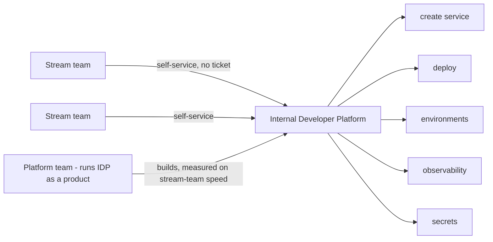

## 55.4 Platform engineering and the internal developer platform

#### Concept

Platform engineering is the discipline of building an internal platform that makes the stream-aligned teams faster and more self-sufficient — treating that platform as a *product*, with the stream-aligned teams as its customers. The **internal developer platform (IDP)** is the concrete thing: the self-service layer (templates, pipelines, environments, observability, the paved road from Part 53) that lets a product team create, deploy, and operate a service without filing tickets or waiting on anyone. The key disciplines are **platform-as-a-product** (the platform has customers, a roadmap, and is measured on their success, not its own output), **self-service** (teams help themselves, no tickets), and the **thinnest viable platform** (build the minimum that unblocks teams, not a gold-plated everything-platform).

#### Why does it exist?

Imagine every stream-aligned team having to file a ticket to the operations team to get a new service deployed, wait two days, file another ticket to get a database, wait another day, and another to get monitoring. Every team is blocked on a central team's queue for everything, so the central team is a permanent bottleneck and the product teams spend more time waiting and ticketing than building. The org's velocity is capped by the ticket queue, no matter how fast the product teams themselves are.

Platform engineering exists to remove that bottleneck by making the central capabilities *self-service*: instead of a team that does operations for you (a ticket queue), a platform that lets you do operations yourself (a self-service product). It exists because central teams that do work on request do not scale — their queue grows with the org — while platforms that enable self-service scale infinitely, because they require no human in the loop for the common case. The IDP is how a growing org keeps its product teams unblocked.

#### Mental model

Imagine the difference between a restaurant kitchen and a grocery store. A kitchen (the ticket-queue ops team) takes your order and cooks it for you — great until there are a hundred customers and one kitchen, at which point everyone waits. A grocery store (the platform) stocks the ingredients and tools so you can cook for yourself, serving a thousand customers at once because it does not cook each meal — it enables each customer to. Platform engineering is building the grocery store: well-stocked, self-service, so every team feeds itself without waiting in the kitchen's queue. And like a good store, it is curated (the thinnest viable platform — it stocks what people actually need, not every possible product) and run as a business that serves its customers, not as a warehouse that dumps inventory.

#### How it works

**Platform-as-a-product.** The platform team treats its platform as a product and the stream-aligned teams as its customers:

- It has a **roadmap** driven by customer (stream-team) needs, not by what the platform team finds interesting.
- It is **measured on customer success** — the speed, reliability, and satisfaction of the stream-aligned teams — not on its own ticket throughput or lines of platform code.
- It does **user research**: it talks to the stream teams, finds their biggest friction, and prioritises removing it.
- Adoption is **earned, not mandated**: teams use the platform because it is genuinely the easiest path (the paved road principle, Part 53), not because they are forced.

**Self-service.** The defining property. A stream team should be able to, without filing a ticket or waiting on the platform team: create a new service (the template), deploy it (the pipeline), get an environment, get observability, get secrets. Anything that requires a ticket to the platform team is a bottleneck that self-service is meant to remove.

**Thinnest viable platform (TVP).** Build the minimum that unblocks teams, and no more:

```text
Thinnest viable platform:
  Start with the single biggest friction teams face (e.g. deploys).
  Pave JUST that, well. Ship it. Learn.
  Then the next biggest friction. Pave that.
  Resist building a gold-plated, speculative, everything-platform.
A platform is justified by the friction it removes, not by its completeness.
```

The TVP guards against the biggest platform-team failure: building an elaborate platform nobody asked for while the real friction goes unaddressed. The platform should always be the minimum that removes the current biggest pain.



#### Practical example

A platform team at a 60-engineer company builds an IDP incrementally, thinnest-viable-first. They do user research and find the biggest friction is deployment — teams wait two days for ops to deploy a service. So they build just the self-service deploy pipeline first, nothing else, and ship it: now any team deploys itself in minutes. Teams adopt it immediately because it is obviously better. The next research round finds service creation is the next biggest pain, so they add the self-service `create-service` template (Part 53.2). Then observability. Each increment is driven by the measured biggest friction, shipped, and adopted because it is genuinely the easiest path. Two years later the IDP is comprehensive, but it got there by removing one real friction at a time, with teams pulling it in voluntarily — not by building a speculative everything-platform up front. The platform is measured on the stream teams' lead time, which has dropped from weeks to days, which is the only number that justifies the platform team's existence.

#### Artifact example

A platform-as-product charter and a thinnest-viable-platform roadmap — the artifacts that keep a platform team serving its customers rather than building speculatively.

```markdown
# Platform team charter (platform-as-a-product)

## Who our customers are
The 14 stream-aligned teams. They are not users we support; they are
customers whose success we are measured on.

## How we are measured (NOT on our own output)
- Stream-team lead time for change (platform should drive it DOWN).
- Self-service adoption (% of deploys/service-creations done without a ticket).
- Developer satisfaction (quarterly survey) with the platform.
- Platform reliability (our SLOs — if the platform is down, every team is).
We are NOT measured on tickets closed or platform features shipped.

## How we decide what to build
User research every quarter: we interview stream teams, find their biggest
friction, and build the thinnest thing that removes it. Teams pull our
platform in because it's the easiest path; we do not mandate it.

---

# Thinnest-viable-platform roadmap (friction-driven)
| Quarter | Built | Biggest friction it removed |
|---|---|---|
| Q1 | Self-service deploy pipeline | 2-day wait for ops to deploy |
| Q2 | create-service template | 1-week service setup |
| Q3 | Self-service observability + dashboards | teams flew blind |
| Q4 | Self-service ephemeral environments | PR testing blocked on shared env |
## Explicitly NOT building (yet)
- A custom internal UI portal (the CLI is enough; no measured demand).
- Multi-cloud abstraction (we're on one cloud; speculative).
- A service mesh (no mesh-shaped friction reported).
Each would be gold-plating ahead of real demand.
```

The charter's defining feature is that the platform team is measured on its *customers'* success (stream-team lead time, self-service adoption, satisfaction), not on its own output — which is what keeps it building what teams actually need. The TVP roadmap is explicitly friction-driven, building the thinnest thing that removes the current biggest pain, and it names what it is *not* building to resist gold-plating. Together they turn a platform team from an inward-facing builder of speculative infrastructure into a customer-serving product team.

#### Real-world scenario

Two platform teams at different companies take opposite approaches. The first treats the platform as a product: it does user research, builds the thinnest thing that removes each measured friction, and is judged on the stream teams' lead time. Its platform is adopted enthusiastically because every piece of it obviously helps, and the org's velocity climbs. The second treats the platform as an engineering showcase: it builds an elaborate, technically impressive platform based on what the platform engineers find interesting — a sophisticated multi-cloud abstraction, a custom orchestration layer — without talking to the stream teams about their actual friction. Two years and enormous effort later, adoption is low, because the platform solves problems the stream teams do not have while their real friction (slow deploys, no observability) remains unaddressed. The stream teams route around the impressive platform and build their own simple tools. The first platform succeeded because it served its customers; the second failed despite greater technical sophistication because it served itself. The difference was entirely the product mindset — knowing who the customer is and being measured on their success.

#### Failure scenario

A platform team builds a gold-plated internal developer platform up front: a beautiful web portal, a plugin system, a multi-cloud abstraction, a custom DSL for defining services — a two-year project before anything ships to the stream teams. When it finally lands, it is impressive but it does not fit how the teams actually work, because it was designed in isolation from them. The teams find it over-complex for their needs (they wanted a simple way to deploy, not a DSL), and critically, the two years spent building the gold-plated platform were two years during which the stream teams' actual friction — slow deploys, manual observability setup — went unaddressed, because the platform team was heads-down on the big build instead of removing current pain. The org paid for two years of platform engineering and got a platform teams do not want, while the real bottlenecks persisted the whole time. Had the team built the thinnest viable platform — ship the self-service deploy pipeline in month one, then iterate on real feedback — the stream teams would have been unblocked from the start and the platform would have grown to fit their actual needs. Building a speculative everything-platform before shipping anything is the signature platform-engineering failure, and the thinnest-viable-platform discipline exists specifically to prevent it.

#### Edge cases & failure modes

- **Platform built on what the platform team finds interesting,** not on measured customer friction, so adoption is low.
- **Gold-plated everything-platform built up front,** delaying any value by years while real friction persists.
- **Platform team measured on its own output** (tickets, features) instead of stream-team success, so it builds the wrong things.
- **"Self-service" that still requires tickets.** A platform that is really a ticket queue with a nicer interface is still a bottleneck.
- **Mandated adoption of a platform teams dislike,** producing resentment and routing-around instead of the paved-road dynamic.
- **Platform with no reliability discipline.** If the platform is down, every team is down; a platform needs SLOs like any tier-1 service.

#### How a Principal Engineer thinks about this

They insist the platform be run as a product with the stream-aligned teams as customers, and they fight to have the platform team measured on its customers' success — their lead time, their self-service adoption, their satisfaction — rather than on the platform team's own output, because they know a platform team measured on tickets or features will build what is easy to ticket or impressive to build, not what actually unblocks teams. They hold self-service as the defining goal, treating any remaining ticket-to-the-platform-team as a bottleneck to be removed, because a central team that does work on request does not scale while a platform that enables self-service does.

They are disciplined about the thinnest viable platform, because they have watched too many platform teams disappear for two years building a speculative everything-platform while the real friction festered. They would rather ship the one thing that removes the current biggest pain this quarter and iterate on real feedback than design a comprehensive platform in isolation. And they treat the platform's own reliability as tier-1, because a platform outage is an everyone outage. The principal's measure of a platform team is simple and external: are the stream teams faster and happier because of it, and are they choosing it freely.

#### Common mistakes

- **Building the platform on the platform team's interests** instead of customers' measured friction.
- **Building a gold-plated everything-platform up front** instead of the thinnest viable thing, iterated.
- **Measuring the platform team on its own output** rather than on stream-team success.
- **"Self-service" that still routes through a ticket queue,** which is still a bottleneck.
- **Mandating a platform teams dislike** instead of making it the genuinely easiest path.

#### Interview questions

1. **What does it mean to run a platform as a product, and why does it matter?**
   *Expected answer:* treat the stream-aligned teams as customers, drive the roadmap from their measured friction (user research), make adoption earned through being the easiest path, and measure the platform team on the customers' success (their lead time, self-service adoption, satisfaction) not on the platform team's own output. It matters because a platform measured on its own output builds the wrong things. *Follow-up:* what would you measure a platform team on.

2. **What is the thinnest viable platform and what failure does it prevent?**
   *Expected answer:* build the minimum that removes the current biggest friction, ship it, learn, then address the next biggest friction — rather than building a comprehensive, speculative platform up front. It prevents the signature platform failure: disappearing for two years building a gold-plated platform teams do not want while their real friction goes unaddressed. *Why it matters:* tests the iterate-on-real-friction discipline.

3. **Why is self-service the defining property of a good internal developer platform?**
   *Expected answer:* because a central team that does work on request (a ticket queue) is a bottleneck that does not scale — its queue grows with the org — whereas self-service lets teams help themselves with no human in the loop for the common case, so it scales infinitely. Any remaining ticket-to-the-platform-team is a bottleneck to remove. *Why it matters:* tests understanding of why platforms scale where ops queues do not.

#### Practical exercise

Assess your org's platform (or the absence of one). Identify the biggest friction stream teams currently face (what do they wait on, what do they file tickets for). Then design the thinnest viable platform increment that would remove that single biggest friction, and specify how the platform team should be measured (a stream-team success metric, not a platform-output metric). Flag any current "self-service" that actually still requires a ticket.

**Acceptance criteria:** you identify the stream teams' single biggest current friction from their perspective (not the platform team's); your proposed increment is the thinnest thing that removes that friction (not a comprehensive platform); you specify at least one measurement of the platform team based on stream-team success; and you identify whether the common operations (deploy, create service, get observability) are genuinely self-service or still ticket-gated.
