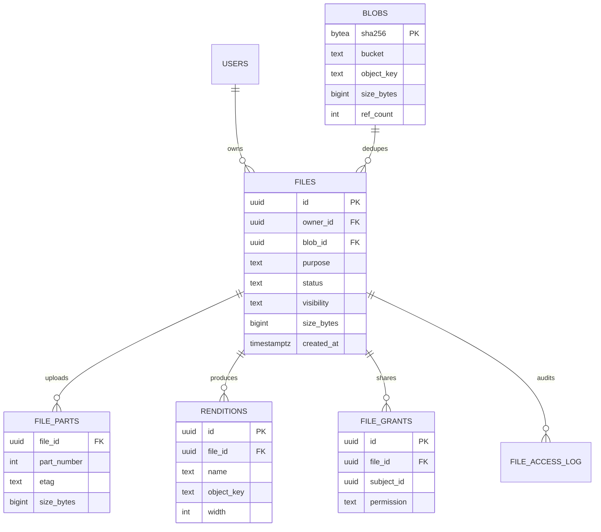
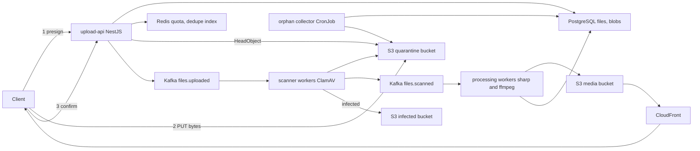
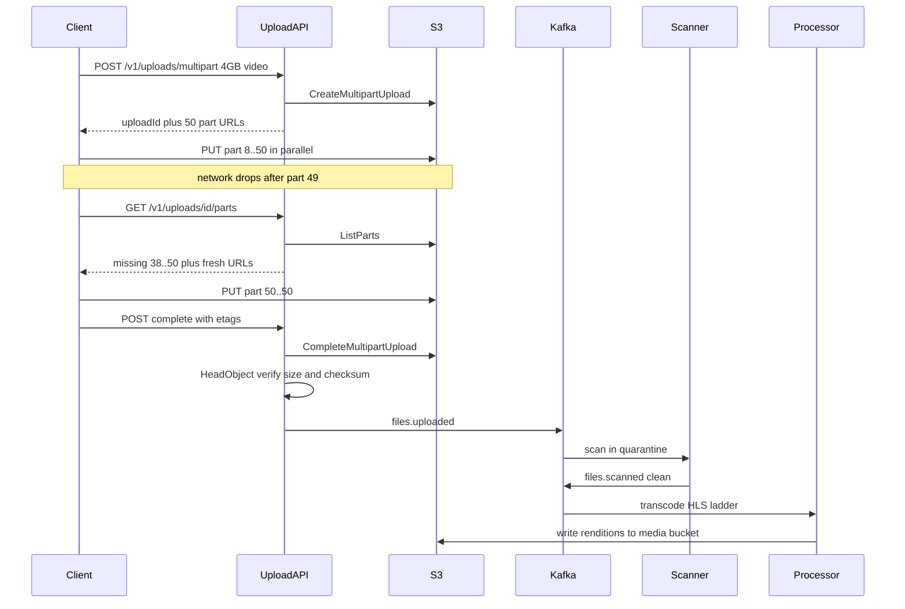
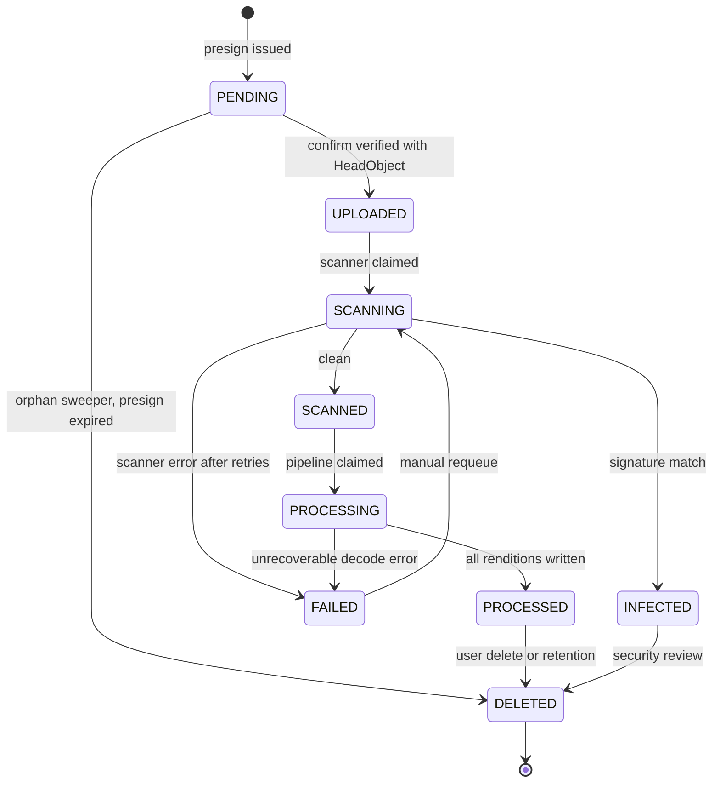
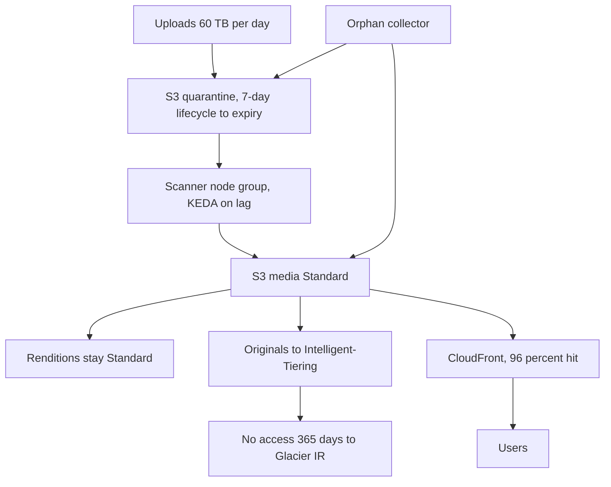

## 55.5 File Upload System

> **Try it first** · Level: Beginner · About 30 minutes
>
> **Build:** a file service where users upload images, documents and videos, which are scanned, processed and served through a CDN.
>
> **Requirements:**
> - Upload bytes directly to S3 using presigned URLs, with multipart and resumable uploads for files over 100 MB.
> - Confirm each upload server-side (exists, size, checksum) and scan it for malware before anyone can read it.
> - Resize images and transcode videos into renditions; track each file's lifecycle (`PENDING`, `UPLOADED`, `SCANNED`, `PROCESSED`).
> - Serve public files from the CDN and private files through short-lived signed URLs; enforce quotas and size and type limits.
> - Deduplicate by content hash and clean up orphaned uploads.
>
> **Scale and constraints:** 800,000 uploads per day (about 56 per second at peak), average file 7.7 MB, about 6.2 TB ingested per day; 360 million file reads per day (about 16,700 per second at peak), a 450 to 1 read/write ratio. Presign p99 under 50 ms; first image rendition p95 under 20 s; 100 percent of files scanned before any read; 99.99 percent read availability; S3 limits (5 GB single PUT, 5 MB minimum part, 10,000 parts).
>
> **Your task:** sketch the API, the data model and the main components; estimate storage, bandwidth and throughput; name the two hardest problems and how you would solve them.
>
> Spend the time on paper before you read on. The model design follows.

### 55.5.1 Requirements

A file upload system stores bytes that users give you and hands them back later, quickly, to exactly the people allowed to see them. In an e-commerce and marketplace platform that means product photos from sellers, KYC documents from merchants, profile avatars, return-request videos from buyers, CSV catalog imports, and invoice PDFs generated by the billing service. Sizes range from a 40 KB avatar to a 4 GB product video shot on a phone.

The naive version is a NestJS controller with `@UseInterceptors(FileInterceptor('file'))` that receives the bytes and pushes them to S3. It works in development and it is wrong in production, for a reason worth stating precisely: your API pods are sized for CPU and concurrency, not for holding megabytes of buffered request body. A 4 GB upload on a 2 GB pod is an OOMKill. A hundred concurrent 50 MB uploads on 20 pods is 5 GB of memory and 20 event loops blocked on socket reads that could have served 40,000 requests instead. Your pods also sit behind an ALB with a 60-second idle timeout and behind an ingress with a body-size limit, and a slow mobile uploader on a train will hit both. And you pay for the bytes twice: once inbound to the pod, once outbound to S3.

Imagine a warehouse with a receiving dock and a reception desk. The naive design routes every delivery truck through reception: the receptionist carries each box to the shelves personally, and the queue of visitors waiting to ask a question stretches out the door. The correct design is the one every real warehouse uses: reception issues a numbered, time-limited dock pass, the truck drives to the dock and unloads directly, and then reception records that pallet 4471 arrived, weighs it and inspects it. Reception never touches the goods. The dock pass is an S3 presigned URL, reception is your NestJS API, and the inspection is the virus scan and processing pipeline.

### 55.5.2 Functional requirements

1. Issue a presigned upload target so the client uploads bytes directly to S3, never through the API.
2. Support multipart upload for files over 100 MB, with per-part presigned URLs, parallel part upload and a completion step.
3. Support resumable uploads: a client that loses connectivity resumes from the parts already stored, without re-sending them.
4. Confirm an upload server-side by verifying the object actually exists, its size and its checksum, before marking it usable.
5. Scan every uploaded file for malware in a quarantine bucket before it is readable by anyone.
6. Process images (resize into a fixed set of renditions, strip EXIF, convert to WebP and AVIF) and videos (transcode to HLS ladders, extract a thumbnail and duration).
7. Track metadata in PostgreSQL with the lifecycle `PENDING -> UPLOADED -> SCANNED -> PROCESSED`, plus `INFECTED`, `FAILED` and `DELETED`.
8. Serve files through CloudFront: public files cached at the edge, private files behind short-lived signed URLs.
9. Enforce per-user and per-tenant storage quotas and per-file size and MIME-type limits.
10. Deduplicate by content hash so the same file uploaded a thousand times is stored once.
11. Apply lifecycle rules (Standard to Infrequent Access to Glacier) and retention policies per file class.
12. Garbage-collect orphans: presigned uploads that were never confirmed, and S3 objects with no metadata row.
13. Enforce access control for `private`, `shared` (an explicit grant list) and `public` files, and audit every read of a sensitive file.

### 55.5.3 Non-functional requirements

| Property | Target | Why |
|---|---|---|
| Presign latency | p99 under 50 ms | It is a request the user waits on before anything happens |
| Upload throughput | Limited only by the client's link and S3 | The API must not be in the byte path |
| Time to first usable rendition | p95 under 20 s for images, under 5 min for a 10-minute video | Sellers publish listings immediately after upload |
| Durability | 11 nines (S3 Standard) | Losing a merchant's KYC document is a regulatory event |
| Availability of reads | 99.99 percent | Product images are on every page |
| Scan coverage | 100 percent of user-supplied files before any read | One served malware sample is a security incident |
| Consistency | A file is never readable in a state earlier than `SCANNED` | Race conditions here are how malware gets served |
| Cost | Under 0.03 USD per GB-month all-in | Storage grows forever and nobody deletes anything |

### 55.5.4 Constraints

- S3 limits that shape the design: a single PUT is capped at 5 GB, each multipart part must be at least 5 MB except the last, there is a maximum of 10,000 parts per upload, and an object can be up to 5 TB. Presigned URLs expire at most 7 days out with SigV4, and at most 12 hours when signed with temporary credentials from an IAM role, which is what a pod uses.
- S3 gives read-after-write consistency for new objects, so a confirm step that reads immediately after a client's PUT is safe.
- CloudFront signed URLs and signed cookies require a key pair and a key group; signed cookies suit a whole gallery, signed URLs suit a single asset.
- ClamAV needs about 2 GB of RAM for its signature database and takes 30 to 60 seconds to load it, so scanner pods must be long-lived, not per-file Lambdas.
- Mobile clients upload over networks that drop; assume a 15 percent failure rate on uploads over 100 MB without resumability.
- Existing platform: NestJS on EKS, Aurora PostgreSQL, Redis, MSK, S3, CloudFront.

### 55.5.5 Capacity estimation

| Quantity | Assumption | Calculation | Result |
|---|---|---|---|
| Registered users | | given | 40,000,000 |
| Daily active uploaders | 0.5 percent of users upload something | 40M x 0.005 | 200,000 |
| Uploads per uploader per day | | 4 | 800,000 uploads per day |
| Average upload RPS | | 800,000 / 86,400 | 9.3 |
| Peak upload RPS | 6x during evening listing hours | 9.3 x 6 | 56 |
| Presign calls per upload | One per simple upload, 1 + parts/1 for multipart, average 1.4 | 56 x 1.4 | 78 presign RPS peak |
| Average file size | 80 percent images at 2 MB, 15 percent documents at 500 KB, 5 percent video at 120 MB | 0.8x2 + 0.15x0.5 + 0.05x120 | 7.7 MB |
| Bytes ingested per day | 800,000 x 7.7 MB | | 6.2 TB per day |
| Bytes ingested per year | 6.2 TB x 365 | | 2.25 PB per year |
| Renditions per image | 5 sizes in 2 formats, average 1.4x the original in total | | +40 percent |
| Video renditions | 4 HLS ladders, about 1.8x the original | | +80 percent on video bytes |
| Stored bytes per year after processing | 2.25 PB x 1.45 | | 3.3 PB |
| After content-hash deduplication | Measured 12 percent duplicate rate | 3.3 PB x 0.88 | 2.9 PB per year |

Reads and metadata:

| Quantity | Calculation | Result |
|---|---|---|
| File reads per day | 6M DAU x 60 images per session | 360,000,000 |
| Average read RPS | 360M / 86,400 | 4,170 |
| Peak read RPS | x4 | 16,700 |
| Read/write ratio | 360M reads / 800K writes | 450 to 1 |
| CDN hit ratio | Measured on product images | 96 percent |
| Origin RPS at peak | 16,700 x 0.04 | 670 to S3 |
| CDN egress per day | 360M x 150 KB average served rendition | 54 TB per day |
| `files` table | 350 B x 800,000 x 365 | 102 GB per year |
| `file_parts` | 120 B x 5 percent of uploads x 25 parts x 365 | 44 GB per year, prunable |
| `file_access_log` | 200 B x reads of sensitive files only, 0.1 percent | 26 GB per year |
| PostgreSQL connections | 20 API pods x 10 + 30 workers x 5 | 350, via PgBouncer |
| Redis for quotas and dedupe index | 40M users x 60 B + hot hash index | 4 GB |

The 450-to-1 read/write ratio is the single most important number here: this is a read system that occasionally writes. It says the CDN is not an optimization, it is the architecture, and it says the metadata database will be dominated by point lookups by file id, which a primary key handles forever.

### 55.5.6 API design

| Method | Path | Request | Response | Status codes | Idempotency | Auth |
|---|---|---|---|---|---|---|
| POST | `/v1/uploads/presign` | `{ filename, contentType, sizeBytes, purpose, sha256? }` | `{ fileId, uploadUrl, headers, expiresAt }` or `{ fileId, status: "PROCESSED", deduped: true }` | 200, 400, 402 quota, 413, 415 | Yes, by `Idempotency-Key`; a repeat returns the same `fileId` and a fresh URL | User access token |
| POST | `/v1/uploads/multipart` | `{ filename, contentType, sizeBytes, purpose, partSizeBytes }` | `{ fileId, uploadId, parts: [{ partNumber, url }], expiresAt }` | 200, 400, 402, 413 | Yes | User access token |
| GET | `/v1/uploads/{fileId}/parts` | | `{ uploadId, uploaded: [{ partNumber, etag, size }], missing: [n] }` | 200, 404, 410 | Yes | Owner |
| POST | `/v1/uploads/{fileId}/parts/presign` | `{ partNumbers: [n] }` | `{ parts: [{ partNumber, url }] }` | 200, 404, 410 | Yes | Owner |
| POST | `/v1/uploads/{fileId}/complete` | `{ uploadId, parts: [{ partNumber, etag }] }` | `{ fileId, status: "UPLOADED" }` | 200, 400, 404, 409, 422 | Yes, repeat returns current status | Owner |
| POST | `/v1/uploads/{fileId}/confirm` | `{ sha256? }` | `{ fileId, status, sizeBytes, contentType }` | 200, 404, 409, 422 | Yes, repeat is a no-op | Owner |
| DELETE | `/v1/uploads/{fileId}` | | | 204, 404, 409 | Yes | Owner |
| GET | `/v1/files/{fileId}` | | metadata plus rendition list | 200, 403, 404 | Yes | Owner, grantee, or public |
| GET | `/v1/files/{fileId}/url` | `?rendition=thumb&ttl=300` | `{ url, expiresAt }` | 200, 403, 404, 409 not ready | Yes | Owner, grantee, or public |
| POST | `/v1/files/{fileId}/grants` | `{ subjectType, subjectId, permission }` | grant | 201, 403, 409 | Yes | Owner |
| DELETE | `/v1/files/{fileId}/grants/{grantId}` | | | 204 | Yes | Owner |
| GET | `/v1/quota` | | `{ usedBytes, limitBytes, fileCount }` | 200 | Yes | User access token |

Status codes carry real meaning here. `402` is returned when the quota is exhausted, so the client shows an upgrade prompt rather than a generic error. `413` rejects an oversized file before a single byte moves. `415` rejects a MIME type the purpose does not allow (a `kyc_document` may be PDF or JPEG, never a ZIP). And `409` on `/url` means the file exists but is not yet `SCANNED`, which the client renders as a spinner rather than a broken image.

### 55.5.7 Data model



```sql
CREATE TYPE file_status     AS ENUM ('PENDING','UPLOADED','SCANNING','SCANNED','PROCESSING','PROCESSED','INFECTED','FAILED','DELETED');
CREATE TYPE file_visibility AS ENUM ('private','shared','public');

-- One row per distinct byte sequence. Many files may point at one blob.
CREATE TABLE blobs (
  sha256      bytea PRIMARY KEY,                  -- 32 bytes, the content hash
  bucket      text  NOT NULL,
  object_key  text  NOT NULL,                     -- 'blobs/ab/cd/<hex>'
  size_bytes  bigint NOT NULL CHECK (size_bytes > 0),
  content_type text NOT NULL,
  ref_count   integer NOT NULL DEFAULT 0 CHECK (ref_count >= 0),
  created_at  timestamptz NOT NULL DEFAULT now()
);
-- Serves the orphan collector: blobs nothing points at any more.
CREATE INDEX blobs_unreferenced_idx ON blobs (created_at) WHERE ref_count = 0;

CREATE TABLE files (
  id            uuid PRIMARY KEY DEFAULT gen_random_uuid(),
  owner_id      uuid NOT NULL,
  tenant_id     uuid,
  blob_id       bytea REFERENCES blobs(sha256),   -- NULL until confirmed
  purpose       text NOT NULL,                    -- 'product_image','kyc_document','return_video','catalog_csv'
  filename      text NOT NULL,
  content_type  text NOT NULL,
  size_bytes    bigint NOT NULL CHECK (size_bytes >= 0),
  status        file_status NOT NULL DEFAULT 'PENDING',
  visibility    file_visibility NOT NULL DEFAULT 'private',
  staging_key   text,                             -- quarantine object key before promotion
  upload_id     text,                             -- S3 multipart upload id
  scan_result   jsonb,
  retention_until timestamptz,
  legal_hold    boolean NOT NULL DEFAULT false,
  created_at    timestamptz NOT NULL DEFAULT now(),
  updated_at    timestamptz NOT NULL DEFAULT now(),
  deleted_at    timestamptz
);
-- Serves the owner's file list, newest first, with keyset pagination.
CREATE INDEX files_owner_recent_idx ON files (owner_id, created_at DESC) WHERE deleted_at IS NULL;
-- Serves the orphan sweeper: PENDING uploads older than the presign expiry.
CREATE INDEX files_pending_idx ON files (created_at) WHERE status = 'PENDING';
-- Serves the pipeline dispatcher and the stuck-file alert.
CREATE INDEX files_status_updated_idx ON files (status, updated_at) WHERE status IN ('UPLOADED','SCANNING','SCANNED','PROCESSING');
-- Serves quota recomputation and per-tenant reporting.
CREATE INDEX files_tenant_idx ON files (tenant_id) WHERE deleted_at IS NULL;
-- Serves lifecycle: files whose retention has expired and that are not on hold.
CREATE INDEX files_retention_idx ON files (retention_until) WHERE legal_hold = false AND deleted_at IS NULL;

CREATE TABLE file_parts (
  file_id     uuid NOT NULL REFERENCES files(id) ON DELETE CASCADE,
  part_number integer NOT NULL CHECK (part_number BETWEEN 1 AND 10000),
  etag        text NOT NULL,
  size_bytes  bigint NOT NULL,
  uploaded_at timestamptz NOT NULL DEFAULT now(),
  PRIMARY KEY (file_id, part_number)              -- serves the resume query and blocks duplicate parts
);

CREATE TABLE renditions (
  id         uuid PRIMARY KEY DEFAULT gen_random_uuid(),
  file_id    uuid NOT NULL REFERENCES files(id) ON DELETE CASCADE,
  name       text NOT NULL,                       -- 'thumb','medium','large','hls_720p'
  object_key text NOT NULL,
  content_type text NOT NULL,
  width      integer, height integer, duration_ms integer,
  size_bytes bigint NOT NULL,
  created_at timestamptz NOT NULL DEFAULT now(),
  UNIQUE (file_id, name)                          -- makes the processing step idempotent by construction
);

CREATE TABLE file_grants (
  id           uuid PRIMARY KEY DEFAULT gen_random_uuid(),
  file_id      uuid NOT NULL REFERENCES files(id) ON DELETE CASCADE,
  subject_type text NOT NULL CHECK (subject_type IN ('user','team','link')),
  subject_id   uuid,
  permission   text NOT NULL CHECK (permission IN ('read','write')),
  expires_at   timestamptz,
  created_at   timestamptz NOT NULL DEFAULT now()
);
-- Serves the authorization check on every private read.
CREATE UNIQUE INDEX file_grants_lookup_uidx ON file_grants (file_id, subject_type, subject_id, permission);

CREATE TABLE user_quotas (
  user_id     uuid PRIMARY KEY,
  limit_bytes bigint NOT NULL DEFAULT 5368709120, -- 5 GiB
  used_bytes  bigint NOT NULL DEFAULT 0 CHECK (used_bytes >= 0),
  file_count  integer NOT NULL DEFAULT 0,
  updated_at  timestamptz NOT NULL DEFAULT now()
);

CREATE TABLE file_access_log (
  id         bigserial,
  file_id    uuid NOT NULL,
  actor_id   uuid,
  action     text NOT NULL,                       -- 'presign_read','download','grant','delete'
  ip         inet,
  created_at timestamptz NOT NULL DEFAULT now(),
  PRIMARY KEY (id, created_at)
) PARTITION BY RANGE (created_at);
CREATE INDEX file_access_log_file_idx ON file_access_log (file_id, created_at DESC);
```

The `blobs` table is where deduplication lives. Two users uploading the same 4 MB product photo create two `files` rows and one `blobs` row with `ref_count = 2`. Ownership, permissions, filenames and retention are per file; bytes are shared. Deleting a file decrements `ref_count`, and only when it reaches zero does the orphan collector become eligible to remove the object - after a grace period, because a decrement racing with a new reference is exactly the bug that deletes someone's photo.

### 55.5.8 High-level architecture



Three buckets, not one, and the separation is a security control rather than tidiness. `quarantine` has no CloudFront distribution and no public policy at all; nothing outside the scanner can read it. `media` is the only origin CloudFront points at, and it only ever receives objects a scanner has cleared. `infected` has a bucket policy denying every principal except the security role, and a 90-day lifecycle rule. A bug that promotes an unscanned object is then a bug in one code path, and that code path is short enough to review carefully.

### 55.5.9 Component design

```text
src/
  uploads/
    uploads.controller.ts
    presign.service.ts
    confirm.service.ts
    multipart.service.ts
    quota.service.ts
    dto/presign.dto.ts
  files/
    files.controller.ts
    file-access.service.ts       -- authorization for read
    signed-url.service.ts        -- CloudFront signing
    grants.controller.ts
  pipeline/
    scanner.worker.ts
    image-processor.worker.ts
    video-processor.worker.ts
    promote.service.ts           -- quarantine to media, dedupe, ref counting
  maintenance/
    orphan-collector.job.ts
    retention.job.ts
    quota-reconciler.job.ts
  storage/
    s3.service.ts
  upload.module.ts
```

The presign endpoint does the work that must happen before any byte moves: validate, check quota, check for an existing blob with the same hash, create the `PENDING` row, and sign.

```ts
// uploads/presign.service.ts
import { BadRequestException, Injectable, PayloadTooLargeException, UnsupportedMediaTypeException } from '@nestjs/common';
import { S3Client, PutObjectCommand } from '@aws-sdk/client-s3';
import { getSignedUrl } from '@aws-sdk/s3-request-presigner';
import { randomUUID } from 'node:crypto';
import { DataSource } from 'typeorm';
import { QuotaService } from './quota.service';
import { PURPOSE_RULES } from './purpose-rules';

@Injectable()
export class PresignService {
  constructor(
    private readonly s3: S3Client,
    private readonly ds: DataSource,
    private readonly quota: QuotaService,
  ) {}

  async presign(userId: string, dto: PresignDto) {
    const rule = PURPOSE_RULES[dto.purpose];
    if (!rule) throw new BadRequestException('unknown purpose');
    if (!rule.mimeTypes.includes(dto.contentType)) throw new UnsupportedMediaTypeException(dto.contentType);
    if (dto.sizeBytes > rule.maxBytes) throw new PayloadTooLargeException(`max ${rule.maxBytes} bytes`);

    await this.quota.reserve(userId, dto.sizeBytes);   // throws PaymentRequiredException (402) when full

    // Client-side dedupe: if the client already knows the hash and we have those bytes,
    // no upload is needed at all. This is how "instant upload" works in Dropbox and Drive.
    if (dto.sha256) {
      const blob = await this.ds.query('SELECT sha256 FROM blobs WHERE sha256 = $1', [Buffer.from(dto.sha256, 'hex')]);
      if (blob.length) {
        const fileId = await this.linkExistingBlob(userId, dto);
        return { fileId, status: 'PROCESSED', deduped: true };
      }
    }

    const fileId = crypto.randomUUID();
    const stagingKey = `staging/${userId}/${fileId}`;   // never the user's filename: path traversal and collisions

    await this.ds.query(
      `INSERT INTO files (id, owner_id, purpose, filename, content_type, size_bytes, status, staging_key, visibility)
       VALUES ($1,$2,$3,$4,$5,$6,'PENDING',$7,$8)`,
      [fileId, userId, dto.purpose, sanitize(dto.filename), dto.contentType, dto.sizeBytes, stagingKey, rule.visibility],
    );

    const uploadUrl = await getSignedUrl(
      this.s3,
      new PutObjectCommand({
        Bucket: process.env.QUARANTINE_BUCKET,
        Key: stagingKey,
        ContentType: dto.contentType,        // signed, so the client cannot upload a different type
        ContentLength: dto.sizeBytes,        // signed, so the client cannot upload a 10 GB file
        ChecksumAlgorithm: 'SHA256',         // S3 verifies integrity on write
      }),
      { expiresIn: 900 },                    // 15 minutes: long enough for a slow link, short enough to bound orphans
    );

    return { fileId, uploadUrl, headers: { 'Content-Type': dto.contentType }, expiresAt: Date.now() + 900_000 };
  }
}
```

Signing `ContentType` and `ContentLength` into the URL is not decoration. Without them the presigned URL is a write capability for arbitrary bytes of arbitrary size at a key you chose, which turns your bucket into free hosting for whatever the holder of that URL wants. With them, S3 rejects any request whose headers do not match the signature.

The confirm endpoint is the trust boundary. Until it runs, the database's belief about the file is a guess. `HeadObject` turns it into a fact.

```ts
// uploads/confirm.service.ts
async confirm(userId: string, fileId: string, clientSha256?: string) {
  const file = await this.repo.findOwned(fileId, userId);
  if (!file) throw new NotFoundException();
  if (file.status !== 'PENDING') return { fileId, status: file.status };   // idempotent replay

  let head;
  try {
    head = await this.s3.send(new HeadObjectCommand({
      Bucket: process.env.QUARANTINE_BUCKET, Key: file.stagingKey, ChecksumMode: 'ENABLED',
    }));
  } catch (e) {
    if (e.name === 'NotFound') throw new UnprocessableEntityException('object not uploaded');
    throw e;
  }

  // The client claimed a size at presign time. Verify what actually landed.
  if (Number(head.ContentLength) !== Number(file.sizeBytes)) {
    await this.repo.fail(fileId, 'size_mismatch');
    await this.quota.release(userId, file.sizeBytes);
    throw new UnprocessableEntityException('size mismatch');
  }
  // S3 returns the base64 SHA-256 it computed itself, so this is not a claim we take on faith.
  const s3Sha = head.ChecksumSHA256 ? Buffer.from(head.ChecksumSHA256, 'base64').toString('hex') : null;
  if (clientSha256 && s3Sha && clientSha256.toLowerCase() !== s3Sha) {
    await this.repo.fail(fileId, 'checksum_mismatch');
    throw new UnprocessableEntityException('checksum mismatch');
  }

  await this.ds.transaction(async (m) => {
    await m.query(`UPDATE files SET status='UPLOADED', updated_at=now() WHERE id=$1 AND status='PENDING'`, [fileId]);
    await m.query(
      `INSERT INTO outbox (aggregate_type, aggregate_id, topic, key, payload)
       VALUES ('file',$1,'files.uploaded',$1,$2)`,
      [fileId, JSON.stringify({ fileId, purpose: file.purpose, sha256: s3Sha })],
    );
  });
  return { fileId, status: 'UPLOADED', sizeBytes: Number(head.ContentLength) };
}
```

Multipart and resume follow the same shape. `POST /v1/uploads/multipart` calls `CreateMultipartUpload`, stores the `upload_id`, and returns presigned `UploadPart` URLs for the first batch of parts. The client uploads parts in parallel (four at a time is a good default), collecting each part's ETag. If the client crashes, `GET /v1/uploads/{fileId}/parts` calls `ListParts` on S3, records what is there in `file_parts`, and returns the missing part numbers with fresh URLs. Nothing already uploaded is sent again. `complete` calls `CompleteMultipartUpload` with the full part list; S3 validates every ETag and assembles the object.



The status machine is the contract every other component reads:



The scanner claims work with a conditional update so two pods never scan the same file, streams the object from quarantine into ClamAV, and promotes clean files.

```ts
// pipeline/scanner.worker.ts (excerpt)
async handle({ fileId }: { fileId: string }) {
  // Atomic claim. Two consumers of the same rebalanced partition: exactly one proceeds.
  const claimed = await this.ds.query(
    `UPDATE files SET status='SCANNING', updated_at=now()
      WHERE id=$1 AND status IN ('UPLOADED','FAILED') RETURNING staging_key, size_bytes`, [fileId]);
  if (claimed.length === 0) return;                       // already scanned or in flight

  const body = await this.s3.getObjectStream(this.quarantine, claimed[0].staging_key);
  const verdict = await this.clamav.scanStream(body, { timeoutMs: 120_000 });

  if (verdict.infected) {
    await this.s3.copy(this.quarantine, claimed[0].staging_key, this.infectedBucket, `q/${fileId}`);
    await this.s3.delete(this.quarantine, claimed[0].staging_key);
    await this.repo.setStatus(fileId, 'INFECTED', { signature: verdict.signature });
    await this.security.alert('malware_upload', { fileId, signature: verdict.signature });
    return;
  }
  // Promote: compute the content hash, dedupe against blobs, move to the media bucket.
  await this.promote.run(fileId, claimed[0].staging_key);   // sets status SCANNED and emits files.scanned
}
```

Processing steps must be idempotent because Kafka will redeliver. The rule is simple: each step writes to a deterministic key derived from `(blob_sha256, rendition_name)`, and the `UNIQUE (file_id, name)` constraint on `renditions` makes a repeated insert a no-op.

```ts
// pipeline/image-processor.worker.ts (excerpt)
const RENDITIONS = [
  { name: 'thumb',  width: 160,  format: 'webp', quality: 78 },
  { name: 'small',  width: 400,  format: 'webp', quality: 80 },
  { name: 'medium', width: 800,  format: 'webp', quality: 82 },
  { name: 'large',  width: 1600, format: 'avif', quality: 55 },
];

async handle({ fileId, sha256 }: ImageJob) {
  const done = new Set(await this.repo.existingRenditionNames(fileId));
  const source = await this.s3.getObjectBuffer(this.media, blobKey(sha256));

  for (const r of RENDITIONS) {
    if (done.has(r.name)) continue;                       // idempotent: skip work already committed
    const key = `renditions/${sha256.slice(0, 2)}/${sha256}/${r.name}.${r.format}`;
    const out = await sharp(source, { limitInputPixels: 268_402_689 })   // decompression bomb guard
      .rotate()                                            // honor EXIF orientation, then drop EXIF
      .resize({ width: r.width, withoutEnlargement: true })
      .toFormat(r.format, { quality: r.quality })
      .toBuffer({ resolveWithObject: true });

    await this.s3.put(this.media, key, out.data, { contentType: `image/${r.format}`, cacheControl: 'public, max-age=31536000, immutable' });
    await this.repo.insertRendition(fileId, r.name, key, out.info);   // ON CONFLICT DO NOTHING
  }
  await this.repo.setStatus(fileId, 'PROCESSED');
}
```

Two details in that snippet are production scars. `limitInputPixels` stops a 200 KB PNG that decompresses to 60,000 x 60,000 pixels from consuming 10 GB of RAM and killing the pod - a decompression bomb. And `.rotate()` before resize applies the EXIF orientation tag and then strips the metadata, which both fixes sideways phone photos and removes the GPS coordinates that users do not know they are publishing.

### 55.5.10 Database design

The metadata database is small and simple by design, because the bytes live elsewhere. `files` at 102 GB per year is comfortable on a single Aurora cluster for several years; `file_access_log` is partitioned monthly and dropped after 13 months.

The hot query is a point lookup by primary key, served by the PK index in two buffer reads. The second hottest is the owner's gallery:

```sql
SELECT id, filename, content_type, size_bytes, status, created_at
  FROM files
 WHERE owner_id = $1 AND deleted_at IS NULL AND created_at < $2
 ORDER BY created_at DESC LIMIT 41;
```

```text
Limit  (cost=0.43..52.90 rows=41 width=98) (actual time=0.038..0.164 rows=41 loops=1)
  Buffers: shared hit=31
  ->  Index Scan Backward using files_owner_recent_idx on files
        Index Cond: ((owner_id = $1) AND (created_at < $2))
Planning Time: 0.184 ms
Execution Time: 0.198 ms
```

Quotas are the one place with contention. `UPDATE user_quotas SET used_bytes = used_bytes + $2 WHERE user_id = $1` takes a row lock, and a user uploading 50 files in parallel serializes on it. At this scale that is fine (a row update is 0.2 ms, so 50 serialized updates is 10 ms), but the reservation is done in Redis first with `INCRBY` and a check, and PostgreSQL is updated on confirm. A nightly reconciler recomputes `used_bytes` from `SUM(size_bytes)` per owner and corrects drift, because Redis reservations for uploads that never completed will otherwise leak quota forever.

Reference counting on blobs is the subtle part. Both the increment (a new file links an existing blob) and the decrement (a file is deleted) happen inside the same transaction as the `files` change, so `ref_count` can never disagree with reality due to a crash between two statements:

```sql
BEGIN;
UPDATE files SET status='DELETED', deleted_at=now() WHERE id=$1 AND deleted_at IS NULL;
UPDATE blobs SET ref_count = ref_count - 1
 WHERE sha256 = (SELECT blob_id FROM files WHERE id=$1) AND ref_count > 0;
COMMIT;
```

The orphan collector then only deletes S3 objects for blobs with `ref_count = 0` that have been at zero for more than 24 hours, verified again inside the deleting transaction with `SELECT ... FOR UPDATE`. The grace period exists so that a file created and deleted quickly, or a race between a dedupe link and a delete, never destroys bytes another row still needs.

### 55.5.11 Caching

| What | Where | TTL | Invalidation | Why |
|---|---|---|---|---|
| Rendition bytes | CloudFront edge | 1 year, `immutable` | Never - keys contain the content hash, so a new version is a new key | 96 percent hit ratio; this is the whole read architecture |
| Public file metadata | Redis `file:{id}` | 10 min | Write-through on status change and grant change | Product pages resolve dozens of files per render |
| Signed URL for a private rendition | Redis, keyed by `(fileId, rendition, ttlBucket)` | 4 min for a 5-min URL | Time | Signing is cheap but the authorization check behind it is a database read |
| Authorization decision | Redis `acl:{fileId}:{userId}` | 60 s | Deleted on grant revoke | A gallery of 40 private images would otherwise be 40 grant lookups |
| Quota reservation | Redis `quota:{userId}` | Until confirm or 15 min | Released on confirm or expiry | Avoids a hot row lock on the presign path |
| Blob existence by hash | Redis set, 24 h | Additive | Makes the instant-upload check a 0.3 ms lookup instead of a database round trip |

The immutable content-addressed key is the trick that makes caching easy. Because a rendition's key contains the SHA-256 of its source, the same URL always returns the same bytes, so `Cache-Control: public, max-age=31536000, immutable` is honest. There is no invalidation problem, because there is nothing to invalidate. Editing a photo produces different bytes, a different hash, and a different URL.

### 55.5.12 Messaging

| Topic | Partitions | Key | Producer | Consumer group | Notes |
|---|---|---|---|---|---|
| `files.uploaded` | 12 | `file_id` | Outbox relay after confirm | `scanner` | Backpressure here is fine; scanning is slow by nature |
| `files.scanned` | 12 | `file_id` | Scanner | `image-processor`, `video-processor` (separate groups, both read) | Routing by `content_type` inside each worker |
| `files.processed` | 12 | `file_id` | Processors | `catalog-service`, `search-indexer`, `analytics` | Other domains react without coupling to the upload API |
| `files.deleted` | 6 | `file_id` | API and retention job | `search-indexer`, `orphan-collector` | |
| `files.*.dlq` | 3 | `file_id` | Any worker after 3 attempts | manual | Video transcode failures land here with the ffmpeg stderr tail |

Video transcoding is different from every other job here because it takes minutes, not milliseconds, and Kafka consumers that take minutes per message get evicted from their group. Two options work: either the worker pauses the partition, processes, and resumes (calling `heartbeat` on a timer), or - the choice made here - the Kafka consumer only submits an AWS MediaConvert job and records the job id, and a separate small consumer of MediaConvert's EventBridge completion events writes the renditions. That keeps the Kafka consumer's per-message time under 100 ms and moves the long-running work to a service designed for it.

Every consumer is idempotent through the claim-then-work pattern shown in the scanner, and every producer publishes through the outbox, so a message is never published for a database change that rolled back.

### 55.5.13 Scaling

**At 1x (56 uploads per second, 16,700 reads per second, 6 TB per day).** Six API pods, four scanner pods, six image processors, MediaConvert for video, one Aurora cluster, one CloudFront distribution. S3 handles the bytes without any tuning; it sustains 3,500 PUT and 5,500 GET requests per second per prefix, and content-hash prefixes (`blobs/ab/cd/...`) spread load across prefixes automatically.

**At 10x (560 uploads per second, 60 TB per day).** The API tier barely notices, because it never touches bytes - presigning is a signature computation, roughly 0.1 ms of CPU. What breaks is scanning: ClamAV scans about 40 MB per second per core, so 60 TB per day is 700 MB per second sustained, needing about 18 dedicated cores plus headroom. Scanner pods get their own node group with 4 vCPU and 4 GB each, scaled by KEDA on `files.uploaded` lag, and the signature database is shared via a sidecar that refreshes it hourly so pods do not each download 300 MB from the internet. Image processing scales the same way but is far cheaper: `sharp` resizes a 12-megapixel JPEG into five renditions in about 400 ms.

Storage becomes the real cost at this scale: 22 PB per year. Lifecycle rules matter more than compute. Originals move to S3 Intelligent-Tiering immediately (S3 decides when to demote), renditions stay in Standard because they are what CloudFront fetches, and originals of files not accessed for a year move to Glacier Instant Retrieval, which is 68 percent cheaper and still millisecond-latency.



**At 100x (5,600 uploads per second, 600 TB per day, 220 PB per year).** The metadata database shards by `owner_id` across 16 clusters behind a directory service, or moves to DynamoDB, since every query is a point lookup or a per-owner range scan and there are no joins that matter. Scanning becomes the dominant compute cost and switches from full ClamAV on every byte to a tiered approach: hash-based lookup against known-good and known-bad sets first (which the dedupe index gives for free - a blob already scanned clean never needs scanning again, and at 12 percent duplication that is 12 percent of the work removed immediately), then a fast static analysis, then full scan only for executable and archive types. Multi-region becomes necessary for upload latency: S3 Transfer Acceleration or regional buckets with cross-region replication for the ones that must be global. And at 220 PB per year, storage engineering becomes its own team's job: aggressive rendition pruning (generate the long tail on demand at the edge with Lambda@Edge rather than storing 10 sizes for every image), and negotiated S3 pricing.

### 55.5.14 Security

- **Never trust the client's content type.** The presigned URL pins `Content-Type`, but a client can still upload a PHP web shell with `Content-Type: image/jpeg`. The scanner sniffs the real type from magic bytes and rejects any file whose sniffed type does not match its declared one. Serving is done with `Content-Type` from the sniffed value plus `X-Content-Type-Options: nosniff`.
- **Never serve user content from your application domain.** User uploads go out on `cdn-usercontent.example.com`, a separate origin with no cookies for the main domain. Otherwise a stored HTML or SVG file becomes stored XSS with full access to the user's session. SVGs are either rasterized during processing or served with `Content-Disposition: attachment`.
- **Path traversal and key injection.** Object keys are derived from server-generated UUIDs and content hashes, never from `filename`. The filename is stored for display only and is sanitized. `../../` in a filename cannot become a key because the filename is never in the key.
- **Presigned URL scope.** Upload URLs are for one exact key, one method, one content type, one length, and expire in 15 minutes. Read URLs are CloudFront signed URLs with a 5-minute expiry and, for the most sensitive classes, an IP restriction in the policy.
- **Authorization on every read.** A file id is a UUID, so it is not guessable, but "unguessable" is not "authorized". `GET /v1/files/{id}/url` checks ownership, then grants, then public visibility, in that order, and logs the access for `kyc_document` and other sensitive purposes.
- **Quarantine isolation.** Scanner pods run with a read-only root filesystem, no egress to the internet except the signature update endpoint, and an IAM role that can read quarantine and write media but cannot delete media. A compromised scanner cannot exfiltrate or destroy.
- **Zip bombs and decompression bombs.** Archive scanning has a maximum expansion ratio and a maximum nesting depth; image decoding has a pixel limit. Both are configured, both are tested with real bomb samples in CI.
- **Encryption.** SSE-KMS on all three buckets with a customer-managed key, and a separate key for `kyc_document` objects so that key access can be audited and revoked independently. TLS everywhere, enforced by a bucket policy denying `aws:SecureTransport = false`.
- **Server-side request forgery through remote fetch.** If you ever add "import from URL", it must run in an isolated egress-restricted worker with a deny list for link-local and private ranges; otherwise it is a metadata-service credential leak waiting to happen.
- **Audit.** Every grant, revoke, delete and sensitive read appends to `file_access_log`, and S3 access logs go to a separate account that the application role cannot write to.

### 55.5.15 Failure scenarios

| Failure | Detection | Impact | Mitigation | What the user sees |
|---|---|---|---|---|
| Client gets a presigned URL and never uploads | `files_pending_idx` count rises | Orphan `PENDING` rows and reserved quota | Sweeper deletes `PENDING` rows older than 1 hour and releases the Redis reservation; the quarantine bucket has a 7-day expiry lifecycle rule as a second net | Nothing |
| Client uploads but never calls confirm | S3 object with no `UPLOADED` row | Bytes paid for, never usable | S3 event notification on `ObjectCreated` in quarantine is a backup trigger that runs the same confirm logic server-side | File appears anyway, a minute later |
| Confirm is called twice | Duplicate-confirm counter | Would double-count quota | Conditional `UPDATE ... WHERE status='PENDING'`; the second call returns the current status with 200 | One file |
| Upload times out mid-multipart | Client error, incomplete parts in S3 | Partial object, storage charged | Resume flow via `ListParts`; a bucket lifecycle rule aborts incomplete multipart uploads after 7 days | Resume works; nothing lost |
| Client sends the wrong ETag list on complete | S3 `InvalidPart` | Assembly fails | 422 with the parts S3 actually has; client re-fetches `/parts` and retries | A retry, then success |
| Scanner pod OOMKilled on a 4 GB file | CrashLoopBackOff, file stuck in `SCANNING` | That file never progresses | Scanner streams instead of buffering; a stuck-file sweeper resets `SCANNING` rows older than 15 minutes back to `UPLOADED` with an attempt counter, DLQ after 3 | Processing takes longer, then works |
| ClamAV signature database corrupt or stale | Version-age metric, self-test with the EICAR sample every 10 min | Malware could pass, or everything is flagged infected | Fail closed: if the self-test fails, the pod goes unready and stops consuming; files stay `UPLOADED` and drain when a healthy pod appears | Processing delayed |
| Infected file uploaded | `files_infected_total` | An attacker tried to use you as a malware host | Object moved to the infected bucket, file `INFECTED`, owner's account flagged, security alert; the object was never in the media bucket so it was never servable | "This file could not be processed" |
| Image processor crashes halfway through renditions | Partial renditions, DLQ | Some sizes missing | Renditions are content-addressed and inserted with `ON CONFLICT DO NOTHING`; a retry skips completed sizes and finishes the rest | Slight delay |
| S3 returns 503 SlowDown | S3 error metric | Uploads and reads fail intermittently | SDK adaptive retry with jitter; content-hash key prefixes spread load; alert if sustained | Occasional retry, invisible to the client |
| CloudFront origin fetch fails for a promoted object | 5xx ratio at the edge | Broken images | Origin failover to a second region's replica bucket; `PROCESSED` is only set after every rendition PUT is acknowledged | Nothing, or a brief broken image |
| Orphan collector deletes a blob that a new file just linked | Would be silent data loss | Catastrophic: a user's file points at nothing | `ref_count` transitions happen in the same transaction as the `files` change; the collector re-checks under `SELECT ... FOR UPDATE` and only deletes blobs at zero for over 24 hours | Nothing |
| Quota drift after crashes leaves a user unable to upload | Reconciler diff metric | User blocked with space available | Nightly reconciler recomputes from `SUM(size_bytes)` and corrects; users can request an immediate recompute | Temporary "storage full" |
| Aurora writer failover during confirm | Write errors for 30 s | Confirms fail | Client retries confirm, which is idempotent; the S3 event fallback also covers it | A short spinner |
| A user shares a private file link publicly | Access log anomaly | Data exposure limited by URL TTL | Signed URLs expire in 5 minutes and are not re-shareable beyond that; sensitive purposes add an IP condition | Link stops working |

### 55.5.16 Observability

Metrics:

1. `upload_presign_total` and `upload_confirm_total` by purpose, with the ratio as the abandonment rate. A jump in abandonment usually means a client bug or a network regression, not a server problem.
2. `upload_pipeline_duration_seconds` histogram per stage (`confirm -> scanned`, `scanned -> processed`). Alert on p95 above 20 s for images.
3. `files_by_status` gauge. Any non-zero count of `UPLOADED` or `SCANNING` older than 15 minutes is a page - stuck files are the failure mode users notice first.
4. `scan_throughput_bytes_per_second` and `clamav_signature_age_seconds`. Alert if signatures are over 24 hours old.
5. `files_infected_total` by signature, sent to the security channel immediately.
6. `s3_request_errors_total` by operation and error code, and `s3_request_duration_seconds`.
7. `cdn_cache_hit_ratio` per distribution and `cdn_origin_requests_per_second`. A hit ratio falling from 96 to 80 percent quadruples origin cost and is usually a cache-busting query parameter someone added.
8. `storage_bytes_total` by bucket and storage class, and `storage_cost_usd_estimated` - the only metric that stops storage growth from being invisible until the invoice.
9. `orphan_collector_deleted_bytes_total` and `quota_reconcile_drift_bytes`.
10. `dlq_depth` per topic with the top error codes.

Traces: the presign request starts a trace, the trace id is stored on the `files` row, and every pipeline stage links to it. Support can then answer "what happened to this upload" with one lookup, including how long the scan took and why processing failed. Logs are structured per stage with `file_id`, `purpose`, `size_bytes`, `stage`, `duration_ms`, `outcome`, and never the filename for sensitive purposes.

### 55.5.17 Deployment

| Workload | Kind | Replicas | Notes |
|---|---|---|---|
| `upload-api` | Deployment + HPA | 6 to 20 | Small pods; the API never buffers bytes, so 512 MB is plenty |
| `scanner` | Deployment + KEDA | 4 to 40 | Dedicated node group, 4 vCPU / 4 GB, `readinessProbe` runs the EICAR self-test |
| `image-processor` | Deployment + KEDA | 4 to 30 | 2 vCPU / 2 GB, `sharp` with a memory limit and pixel guard |
| `video-dispatcher` | Deployment | 2 | Submits MediaConvert jobs only |
| `mediaconvert-events` | Deployment | 2 | Consumes EventBridge completion events |
| `orphan-collector` | CronJob hourly | 1 | Advisory lock so overlapping runs cannot both delete |
| `retention-job` | CronJob nightly | 1 | Applies `retention_until`, respects `legal_hold` |
| `quota-reconciler` | CronJob nightly | 1 | Recomputes from the source of truth |

Infrastructure is Terraform: three buckets with block-public-access on all of them, lifecycle rules, SSE-KMS keys, the CloudFront distribution with an Origin Access Control so the media bucket is not public even to CloudFront's old OAI, and a key group for signed URLs. Bucket policies are reviewed by a second engineer as a rule, because a wrong bucket policy is the single most common cloud data breach.

Rollout is canary on the API and a shadow mode for pipeline changes: a new image processor version writes renditions to a `-canary` key prefix and a comparison job checks dimensions and file size against the current version before promotion. Migrations are expand-then-contract; adding a rendition means adding to the list and running a backfill job over existing blobs, which is safe because rendition insertion is idempotent.

### 55.5.18 Cost considerations

| Item | Sizing | Monthly (USD, approximate) |
|---|---|---|
| S3 Standard, media bucket | 250 TB average in year 1 at 0.023 per GB | 5,900 |
| S3 Intelligent-Tiering, originals | 180 TB, mixed tiers | 2,800 |
| S3 requests | 24M PUT at 0.005 per 1,000, 20M GET | 140 |
| S3 quarantine | 45 TB rolling with 7-day expiry | 1,050 |
| CloudFront egress | 1.6 PB per month at about 0.06 per GB blended | 96,000 |
| MediaConvert | 1.2M minutes of SD/HD output | 9,000 |
| EKS compute for scanners and processors | 60 vCPU average | 2,400 |
| Aurora PostgreSQL | db.r6g.xlarge writer plus reader, 200 GB | 1,300 |
| KMS | 24M requests | 80 |
| Total | | about 118,700 |

CDN egress is 80 percent of the bill, which reframes every optimization. Serving AVIF instead of JPEG at the same visual quality cuts image bytes by 40 to 50 percent, which is a 40,000 USD per month saving - far more than any compute tuning. Correct `Cache-Control` and a high hit ratio matter for the same reason. Negotiating a committed-use CDN contract or using a cheaper CDN for the long tail is a finance conversation worth having before the next optimization sprint. Deduplication saves 12 percent of storage, roughly 1,000 USD per month, which pays for itself but is not where the money is.

### 55.5.19 Tradeoffs

- **Presigned direct-to-S3 instead of proxying bytes.** The API stays tiny and cheap and scales independently of file size; the price is a three-step client protocol (presign, upload, confirm) that clients get wrong, and losing the chance to inspect bytes inline. The confirm step and the S3 event fallback exist precisely to cover client mistakes.
- **Quarantine bucket instead of scanning in place.** Costs an extra copy of every byte and a promotion step; buys a hard guarantee that nothing unscanned can ever be reachable from the CDN, enforced by bucket policy rather than by code discipline.
- **Content-hash deduplication.** Saves 12 percent of storage and enables instant upload; costs reference counting, a grace period before deletion, and a subtle privacy consideration - a user could probe whether a specific file already exists by offering its hash, so the instant-upload path is limited to hashes the user could plausibly possess and is rate limited.
- **Renditions generated eagerly.** Every image gets five sizes whether or not anyone views them, wasting storage on the long tail; the alternative, on-demand generation at the edge, adds first-view latency and a cold-start cliff during traffic spikes. Eager for the top three sizes, on-demand for the rest, is the compromise most teams land on.
- **MediaConvert instead of self-hosted ffmpeg.** Costs about 3x the raw compute price; buys no queue management, no codec licensing questions, no GPU node group, and predictable throughput. Self-hosting wins above roughly 5M minutes per month.
- **Metadata in PostgreSQL rather than DynamoDB.** Joins, constraints, transactions across `files` and `blobs`, and a familiar operational model; the cost is a sharding project somewhere past 500 million rows.

### 55.5.20 Alternative architectures

**A managed upload and media platform: Uploadcare, Cloudinary, imgix, or Mux for video.** These take the file, scan it, store it, generate every rendition on demand from a URL with transformation parameters, and serve it from their own CDN. You write a presign call and a display URL and you are done. This wins decisively for small and mid-sized teams: the build above is a genuine year of engineering across upload, pipeline, security and operations, and these vendors employ specializts for exactly the parts that are easy to get subtly wrong (EXIF handling, color profiles, codec selection, malware). It loses when volume makes per-GB pricing untenable - Cloudinary at 1.6 PB of monthly delivery is an order of magnitude more expensive than CloudFront - when files are regulated and cannot leave your account (KYC documents, medical images), or when the processing you need is domain-specific rather than generic media transformation. A very common and sensible hybrid is: your own S3 and CDN for the bulk of the bytes, a vendor for the video pipeline only.

**tus resumable upload protocol on your own servers.** tus is an open protocol for resumable uploads over HTTP `PATCH`, with mature client libraries for web, iOS and Android. Running a tus server (or `tusd`) puts the bytes back through your infrastructure, which the whole section argued against - but it buys a genuinely better client experience for very large, very unreliable uploads, because it resumes at the byte rather than the 5 MB part, and it works with a single well-supported client library instead of a bespoke three-call protocol. The right way to run it is as a dedicated deployment on its own node group, isolated from the API, writing directly to S3 with tusd's S3 store so the bytes stream through rather than land on disk. Choose this when your users routinely upload multi-gigabyte files over bad networks (field data collection, video production, scientific instruments) and the multipart resume flow has proven too fiddly for your clients.

**Serverless pipeline: S3 event notifications plus Lambda, no Kafka.** The object lands, S3 fires an event, Lambda scans or processes it, Step Functions orchestrates the stages, DynamoDB holds state. This removes Kafka, KEDA and the worker deployments entirely, and it costs nothing when idle - which is exactly right for a system with bursty, low average volume. It struggles here for two concrete reasons: ClamAV's 300 MB signature database and 30-second load time make it a poor fit for Lambda's execution model (you can bake it into a container image, but you pay the load on every cold start), and Lambda's 15-minute limit plus 10 GB memory ceiling rules out large-file processing. If your files are small documents and images and your volume is under a few hundred thousand per day, the serverless version is less code, less operations and less money, and you should probably build that one.
