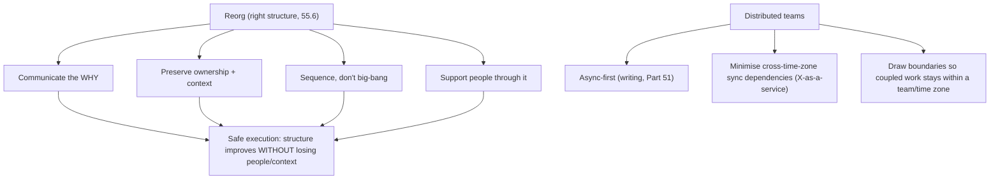

## 55.7 Worked example: redesigning team and service boundaries for a food-delivery company at 60 engineers

This section brings the whole Part together: redesigning the team and service boundaries for a food-delivery company that has grown to 60 engineers. It uses Conway's Law and the inverse maneuver, Team Topologies, cognitive load, platform engineering, and DevEx measurement. It also contains the failure story the outline asks for: a microservices split that followed the org chart and created a distributed monolith, and how to fix it.

#### The situation

QuickBite is a food-delivery company at 60 engineers. It grew fast and its org grew haphazardly: a handful of large, broadly-scoped teams (a "backend team" of 25, a "mobile team", a "web team", an "infra team") and a monolith that someone started splitting into microservices a year ago — a split that has gone wrong. A principal engineer is asked to redesign the org and architecture together.

#### The failure she finds: a distributed monolith from the org chart

```markdown
# Diagnosis: the microservices split created a distributed monolith

## What was done
A year ago, the monolith was split into 12 microservices. But the ORG was
not changed — the 25-person "backend team" still owns and works across all
12 services. The split followed the old code structure / org chart, not
bounded contexts.

## The result (Conway's Law in action)
- Because one broad team owns all 12 services, the services are coupled
  across (team-less) boundaries: they share database tables, call each other
  synchronously in deep chains, and must be deployed together.
- A single feature touches 5-6 services (all owned by the one team).
- Deploys are MORE coordinated than before (12 deploy targets, must be
  ordered), with distributed debugging and 12 on-call surfaces.
- This is strictly WORSE than the monolith: all the cost of distribution,
  none of the independence.

## Why it happened
The split was done WITHOUT splitting the team (fighting Conway's Law, 55.1)
and WITHOUT data ownership (shared tables, 54.4). The services mirror the
broad-team org, so they're coupled. This is the canonical distributed-
monolith failure.
```

This is the failure story: microservices split along the existing org/code structure, with one broad team spanning all the services and shared databases underneath, producing a distributed monolith. The diagnosis traces it directly to the two root causes from this Part and Part 54: fighting Conway's Law (splitting services without splitting teams) and skipping data ownership (shared tables).

#### The redesign: inverse Conway + Team Topologies

She redesigns the org and architecture together. First, she defines the target architecture as bounded contexts: ordering, restaurant, delivery, payments, and search. Then — the inverse Conway maneuver (55.1) — she designs the teams to produce that architecture:

```markdown
# QuickBite org + architecture redesign (60 engineers)

## Stream-aligned teams (per bounded context — Team Topologies 55.2)
| Team | Owns (code + DATA + deploys) | Size |
|---|---|---|
| Ordering | ordering service + order tables | 8 |
| Restaurant | restaurant service + restaurant tables | 7 |
| Delivery | delivery service + delivery tables | 8 |
| Payments | payments service + payment tables | 6 |
| Search | search service + its index | 6 |
(Mobile and web folded INTO the stream teams — each stream team is full-stack,
 ending the technology-layer handoff queues, 55.2.)

## Platform team (1 — 55.4)
| Developer Platform | paved road, CI/CD, observability, self-service deploy | 7 |
(Was the "infra team"; re-chartered as platform-as-a-product, measured on
 stream-team lead time.)

## Enabling team (1, small — 55.2)
| Reliability enablement | pairs with stream teams to improve SLOs, then leaves | 3 |

## The fixes this encodes
- Split the 25-person backend team into stream-aligned teams by bounded
  context -> service boundaries now mirror TEAM boundaries (Conway, 55.1).
- Each team owns its DATA (no shared tables) -> ends the distributed monolith
  (54.4). Shared tables are separated during the migration.
- Technology-layer teams (mobile/web/infra) dissolved into stream teams or
  re-chartered as platform -> ends handoff queues (55.2).
- Cognitive load: each team owns ONE coherent context, sized ~6-8 (55.3).
```

#### Fixing the distributed monolith under the new org

With the teams now aligned to bounded contexts, fixing the distributed monolith becomes tractable (it was intractable under the broad-team org, because Conway's Law kept re-coupling the services). Each stream team now owns a coherent subset of the 12 services and, crucially, its own data. They separate the shared database tables along ownership lines (Part 54.4 data-ownership work), replace the synchronous cross-service chains with APIs and events along the team boundaries, and consolidate the over-split services within a team where the split bought nothing (merging services that were always changed together, 55.6). The 12 ill-defined services become 5 well-bounded ones that mirror the 5 teams, each independently deployable because each team owns its code and data. Conway's Law, which was producing coupling under the broad-team org, now produces clean boundaries under the bounded-context org.

#### Platform and DevEx

The old "infra team" is re-chartered as a platform team running the developer platform as a product (55.4), measured on the stream teams' lead time, building the thinnest viable platform friction-first. A DevEx dashboard (55.5) is stood up: DORA plus lead-time breakdown plus a survey. The initial measurement shows the distributed-monolith deploy coordination as the top friction; as the redesign lands and services become independently deployable, deployment frequency rises and lead time falls, confirming the redesign worked (and catching it if it had not).

#### Why this redesign succeeds

Trace it against the Part. It designs org and architecture *together*, using the inverse Conway maneuver (55.1) to make the teams the mould that produces the target architecture. It uses Team Topologies (55.2) to make most teams stream-aligned (ending technology-layer handoff queues) with a platform team run as a product and a small enabling team. It respects cognitive load (55.3) by giving each team one coherent, appropriately-sized context. It fixes the distributed monolith by splitting teams *and* data ownership (the two things the failed split omitted). It re-charters the platform as a product (55.4) measured on stream-team success. And it measures DevEx (55.5) to confirm the redesign actually helped. The failed microservices split went wrong by fighting Conway's Law and skipping data ownership; the redesign succeeds by aligning the org to the architecture and owning the data — which is the entire thesis of this Part. Org design is architecture, and the two must be designed as one.

#### Practical exercise

Take your own org (or QuickBite as a template) and redesign its team and service boundaries together. Define the target architecture as bounded contexts. Design stream-aligned teams, one per context, each owning code and data, using the inverse Conway maneuver. Add the minimal platform, enabling, and complicated-subsystem teams, justified. Check each team's cognitive load (one coherent context, appropriate size). Identify any existing distributed-monolith symptoms (services split without teams, shared databases) and show how the redesign fixes them.

**Acceptance criteria:** the org design and architecture are designed as one (teams mirror the target bounded contexts); each stream team owns its data, not just its code; most teams are stream-aligned with handoff-queue technology-layer teams dissolved; each team's cognitive load is a coherent, appropriately-sized context; and if a distributed monolith exists, your redesign addresses both root causes (split teams AND split data ownership), with a DevEx measurement to confirm it worked.

## 55.8 Executing an org change safely, and distributed-team considerations

#### Concept

Two aspects of org design beyond the structure itself. **Executing an org change safely** is the how of a reorg — because a reorg is an architectural change (55.6) but also a deeply human one, and a poorly-executed reorg, even with the right target structure, causes damage (lost people, lost context, dropped momentum). The techniques: communicate the why, preserve ownership and context, sequence the change, and support people through it. **Distributed-team considerations** is how org design changes when teams are remote or spread across time zones — Conway's Law still operates, but the communication structure (and therefore the architecture it produces) is shaped by distance and asynchrony, which changes how you draw team and service boundaries.

#### Why does it exist?

Imagine a reorg with the right target structure (correct team boundaries matching the target architecture) but executed badly: announced abruptly with no explanation, ownership reshuffled so people lose the systems they knew, no transition period, key people blindsided. Even though the structure is correct, the execution causes the best people to leave (they feel disrespected and disrupted), institutional context to be lost (people no longer own what they built), and momentum to drop for longer than necessary. The right structure, wrongly executed, still damages the organisation. Safe execution exists because a reorg is a human event as much as an architectural one, and the human damage of poor execution can outweigh the benefit of the better structure.

Distributed-team considerations exist because Conway's Law operates through the communication structure, and distance and asynchrony fundamentally change that structure. A co-located team communicates constantly and cheaply; a team split across time zones communicates slowly and asynchronously. This changes which boundaries work: a service boundary that assumes constant communication fails across a twelve-hour time-zone gap. Org design for distributed teams must account for how distance shapes communication and therefore architecture.

#### Mental model

For executing a reorg, imagine moving house. The destination (new house) might be better, but how you move matters enormously: pack carefully (preserve context), tell everyone the plan in advance (communicate the why), move in a sequence that keeps life functioning (sequence the change), and support the family through the disruption (support people). A move to a better house, done chaotically — no warning, belongings lost, no transition — is traumatic despite the better destination. A reorg is a move; the destination structure matters, but the execution determines whether people arrive intact.

For distributed teams, imagine building with teams in different cities who can only exchange letters (asynchronous, slow) rather than talking across a table (synchronous, fast). The letter-exchanging teams naturally build with cleaner, more explicit interfaces between their parts (because coordinating across letters is expensive, they minimise it and define clear contracts), while the table-sharing team builds with tighter, more implicit coupling (because coordinating is cheap). Distance changes the communication structure, which (Conway) changes the architecture. Designing for distributed teams means designing boundaries that work with letter-speed communication, not table-speed.

#### How it works

**Executing an org change safely:**

```text
- Communicate the WHY: explain the reasoning (the architectural/strategic driver,
  55.6) so people understand it's deliberate, not arbitrary. Unexplained reorgs
  feel like chaos or politics and destroy trust.
- Preserve ownership and context: where possible, keep people with the systems
  they know, or ensure a real handover. Reshuffling people off their systems
  loses institutional context (and risks orphaned services, 55.3).
- Sequence the change: don't reorg everything at once; phase it so the org keeps
  functioning and people adapt gradually.
- Support people through it: 1-1s, address concerns, help people find their place
  in the new structure. A reorg is stressful; support reduces attrition.
- Pair with the architecture change: the team change and the service-boundary
  change go together (Conway, 55.1/55.6), sequenced deliberately.
- Minimise frequency: reorgs are costly (55.6), so execute them well and rarely.
```

**Distributed-team considerations:**

```text
- Conway's Law + distance: remote/time-zone-split teams communicate async and
  slowly, so the architecture they produce has cleaner, more explicit interfaces
  (expensive coordination -> minimise it). Design boundaries that suit this.
- Team boundaries along time zones: a team split across a 12-hour gap struggles;
  prefer teams that are co-located OR fully async-capable, and draw service
  boundaries so that tightly-coupled work stays within one time zone/team.
- Async-first communication: distributed orgs rely even more on writing (Part 51)
  — decisions, designs, and context must be written, because the hallway
  conversation isn't available across time zones.
- Minimise cross-time-zone dependencies: a dependency that requires synchronous
  coordination across a 12-hour gap is painfully slow; design so teams can work
  independently (X-as-a-service, 55.2) across distance.
- Cognitive load + distance: distributed teams have higher coordination cost, so
  keeping ownership coherent and self-contained (55.3) matters even more.
```



#### Artifact example

A reorg execution plan and distributed-team design notes — the artifacts that make an org change safe and account for distance.

```markdown
# Reorg execution plan: split ordering team (the WHAT is in 55.6)

## Communicating the why (so it's not felt as arbitrary/political)
- All-hands: explain the driver (ordering + promotions are two domains; coupling
  slows both; splitting enables independent delivery — the architecture reason).
- 1-1s with every affected person BEFORE the announcement (no one blindsided).

## Preserving ownership + context
- Ordering engineers stay with the ordering service (keep their context).
- Promotions: 3 engineers who've worked on promotions move to the new team
  (they carry the context) + 2 hires. No orphaned systems (55.3).

## Sequencing
- Week 1: announce, 1-1s. Weeks 2-4: new team forms, service boundary work
  begins (paired with the team split, Conway). Not a big-bang.

## Supporting people
- Weekly 1-1s through the transition; address concerns; help the new promotions
  tech lead settle. Watch for attrition risk on the 2 most-affected people.

---
# Distributed-team design notes (teams in SF, London, Bangalore)
- Conway + distance: draw service boundaries so tightly-coupled work stays within
  ONE time zone. The payments service (lots of internal coordination) is owned by
  ONE co-located team (London), not split across time zones.
- Cross-team interactions are X-as-a-service (55.2) with clear async contracts,
  so a London team doesn't block waiting for Bangalore synchronously.
- Writing culture (Part 51) is mandatory: decisions and designs written, because
  the hallway conversation isn't available across the 12-hour SF-Bangalore gap.
- Avoid: a service co-owned by SF + Bangalore requiring daily sync coordination —
  that's a 12-hour-latency coupling that will be painfully slow.
```

The reorg execution plan's power is that it treats the reorg as a human event — communicating the why (so it is not felt as arbitrary), preserving context (keeping people with their systems or ensuring handover), sequencing (not big-bang), and supporting people (reducing attrition) — so the right structure is achieved without the human damage of poor execution. The distributed-team notes apply Conway's Law to distance, drawing boundaries so coupled work stays within a time zone and cross-team interactions are async contracts, because the communication structure (and thus the architecture) is shaped by distance. Both go beyond the org structure to how it is achieved and how it works across distance.

#### Real-world scenario

A principal engineer executes a necessary reorg (splitting an overgrown team) carefully. She communicates the why in an all-hands and in one-on-ones with every affected person before the announcement, so no one is blindsided and everyone understands it is a deliberate architectural decision, not politics. She preserves context by keeping people with the systems they know where possible and ensuring real handovers where not, avoiding orphaned services. She sequences the change over weeks rather than flipping everything at once, and she supports people through the transition with regular one-on-ones. The reorg achieves the better structure *and* retains the people and the context — nobody leaves, momentum recovers quickly. A peer executes a structurally-identical reorg badly: announced abruptly, people reshuffled off their systems, no transition, no explanation. The structure is the same, but two key engineers leave (feeling disrespected and disrupted), institutional context is lost, and momentum drops for two quarters. The target structures were identical; the execution determined whether the reorg strengthened or damaged the organisation. Separately, when the principal designs a distributed org across three time zones, she draws service boundaries so coupled work stays within a co-located team and cross-team interactions are async contracts, avoiding the 12-hour-latency couplings that would make work painfully slow — because she knows Conway's Law operates through the communication structure, which distance reshapes.

#### How a Senior Backend Engineer thinks about this

They treat a reorg as a human event as much as an architectural one, because they know the right target structure, executed badly, still damages the organisation — losing the best people, the institutional context, and the momentum. So they execute reorgs carefully: communicating the why (so it is not felt as arbitrary or political), preserving ownership and context (keeping people with their systems or ensuring real handovers, avoiding orphaned services), sequencing the change (not big-bang), and supporting people through the stressful transition. They pair the team change with the architecture change (Conway, 55.6) and execute reorgs well and rarely, because they are costly.

For distributed teams, they understand that Conway's Law operates through the communication structure and that distance and asynchrony fundamentally reshape it — so they draw service boundaries so that tightly-coupled work (which needs frequent coordination) stays within one co-located team or time zone, make cross-team interactions async X-as-a-service contracts (so no team blocks on synchronous coordination across a 12-hour gap), and lean even harder on a writing culture (Part 51), because the hallway conversation that co-located teams rely on is not available across time zones. The senior engineer knows that org design is both structure and execution, and that it must account for how distance shapes the communication that Conway's Law turns into architecture — designing boundaries that work at letter-speed, not just table-speed.

#### Common mistakes

- **Executing a reorg abruptly** with no explanation, so it feels arbitrary/political and destroys trust.
- **Reshuffling people off their systems** without handover, losing institutional context and risking orphans.
- **Big-bang reorgs** that disrupt everything at once rather than sequencing the change.
- **Not supporting people through the transition,** causing avoidable attrition.
- **Drawing service boundaries that split tightly-coupled work across time zones,** creating painfully slow cross-time-zone synchronous couplings.
- **Relying on synchronous coordination in a distributed org** instead of async contracts and a writing culture.

#### Interview questions

1. **A reorg has the right target structure but risks going badly. What makes execution safe?**
   *Expected answer:* communicate the why (so it's deliberate, not arbitrary/political), preserve ownership and context (keep people with their systems or ensure handover, avoiding orphans), sequence the change (not big-bang), support people through the stressful transition (1-1s, address concerns, reduce attrition), and pair the team change with the architecture change. The right structure executed badly still loses people, context, and momentum. *Why it matters:* a reorg is a human event as much as an architectural one.

2. **How does org and service-boundary design change for distributed, cross-time-zone teams?**
   *Expected answer:* Conway's Law operates through the communication structure, which distance and asynchrony reshape — so draw service boundaries so tightly-coupled work (needing frequent coordination) stays within one co-located team/time zone, make cross-team interactions async X-as-a-service contracts (so no team blocks on synchronous coordination across a 12-hour gap), and lean harder on a writing culture because the hallway conversation isn't available across time zones. *Why it matters:* distance fundamentally changes what boundaries work.

3. **Two identical reorgs, one strengthens the org and one damages it. What's the difference?**
   *Expected answer:* execution — the one that communicated the why, preserved people's context, sequenced the change, and supported people through it achieved the better structure while retaining people and context; the one executed abruptly (no explanation, reshuffled people off their systems, no transition) achieved the same structure but lost key people, institutional context, and momentum. The target structure was identical; execution determined the outcome. *Why it matters:* tests whether they understand reorg execution is as important as reorg structure.

#### Practical exercise

Take the reorg you designed earlier in this Part (or a real one) and write its execution plan: how you will communicate the why, preserve ownership and context, sequence the change, and support people through it. Then, if your org is (or could be) distributed across time zones, write the distributed-team design notes: how you would draw service boundaries so coupled work stays within a team/time zone, make cross-team interactions async, and strengthen the writing culture.

**Acceptance criteria:** your execution plan communicates the why, preserves context (keeping people with their systems or ensuring handover, avoiding orphans), sequences the change rather than big-bang, and supports people to reduce attrition — so the right structure is achieved without human damage; and your distributed-team notes draw boundaries so tightly-coupled work stays within a co-located team/time zone, use async X-as-a-service contracts across distance, and rely on a writing culture — demonstrating that you treat org design as both structure and safe execution, accounting for how distance shapes the communication Conway's Law turns into architecture.

## 55.9 A quick-reference for org design

A compact reference distilling the Part into the checks that matter most when you design or assess an organisation.

#### The org-design checklist

```text
[ ] Is the org designed TOGETHER with the architecture? (Conway: the org chart
    becomes the architecture diagram.)
[ ] Does each team's boundary match a bounded context you want as a service
    boundary? (Inverse Conway: shape teams to produce the architecture.)
[ ] Does each team own its DATA, not just its code? (Else coupling via shared DB.)
[ ] Are most teams STREAM-ALIGNED (own a flow end to end)? (Not technology-layer
    teams with handoff queues.)
[ ] Is each non-stream team (platform, enabling, complicated-subsystem) justified?
[ ] Are interactions mostly X-AS-A-SERVICE? (Collaboration time-boxed; permanent
    collaboration = a wrong boundary.)
[ ] Is each team's COGNITIVE LOAD a coherent domain it can hold? (Not a sprawl.)
[ ] Is ownership EXPLICIT (a catalog)? Any ORPHANED services? (Time bombs.)
[ ] Is the platform run as a PRODUCT, measured on stream-team success? (Thinnest
    viable platform; self-service.)
[ ] Is DevEx measured to help teams (DORA/SPACE/surveys), not to judge individuals?
```

#### The warning signs

Signals that the org design is wrong:

```text
- Services split but teams not (distributed monolith — all cost, no independence).
- A team spanning many unrelated domains (cognitive overload — will collapse).
- Permanent cross-team collaboration (a boundary is drawn wrong).
- Features crossing many teams with handoff queues (technology-layer teams).
- Orphaned services with no owner (silent time bombs).
- A platform team measured on its own output, building what nobody adopts.
- Frequent reorgs (thrash — full cost, no coherent-architecture benefit).
- Architects who've stopped shipping (ivory tower; designs teams ignore).
```

#### The enduring principle

The whole Part reduces to one idea: **org design IS architecture, because Conway's Law guarantees the org chart becomes the architecture diagram.** So you design the two together — shaping teams (and their data ownership) to produce the architecture you want, keeping each team's cognitive load coherent, making ownership explicit, running the platform as a product, and measuring developer experience to improve the system. When you face an architecture problem, ask whether it is really an org problem in disguise (it often is), and when you change the org, remember you are changing the software. Design the org as deliberately as you design the system, because they are the same thing viewed from two angles.

Return to this reference when designing or assessing an org; the reasoning behind each line is in the sections above.

#### The first question to ask about any architecture problem

When you hit a persistent architecture problem — a boundary that won't stay clean, a coupling you can't eliminate, a service that keeps growing tangled — ask first: *is this really an org problem in disguise?* More often than engineers expect, the answer is yes, and the root cause is a team structure that Conway's Law is turning into the architecture you don't want. The clean boundary won't hold because one undifferentiated team spans it; the coupling persists because the teams that own the two sides communicate constantly, so the cost of coupling is invisible to them; the service grows tangled because no single team owns it. In each case, no amount of architectural willpower fixes it, because the org keeps reshaping the architecture back. The fix is the org change (the inverse Conway maneuver, 55.1) — align the teams to the architecture you want, and the architecture follows. Treating an org-rooted architecture problem as a purely technical one is a common, expensive mistake; a principal's instinct is to check the org chart first.

## Senior Checklist — Part 55

- [ ] I understand the concept
- [ ] I can explain it simply
- [ ] I can implement it
- [ ] I understand its failure modes
- [ ] I understand its scaling limitations
- [ ] I understand its security implications
- [ ] I understand its operational implications
- [ ] I can choose between alternatives
- [ ] I can explain the tradeoffs
- [ ] I can answer senior-level interview questions
- [ ] I understand Conway's Law and use the inverse maneuver to design the org that produces the architecture I want
- [ ] I never split services without splitting teams, and I always include data ownership
- [ ] I design teams using the four Team Topologies types, defaulting to stream-aligned and X-as-a-service
- [ ] I treat cognitive load as a finite design constraint and size each team's ownership to a coherent domain
- [ ] I make service ownership explicit with a catalog and hunt down orphaned services
- [ ] I run the platform as a product, measured on stream-team success, and build the thinnest viable platform
- [ ] I measure developer experience (DORA, SPACE, lead-time stages, surveys) to locate and remove friction, never to judge individuals
- [ ] I treat a reorg as a deliberate, sparingly-used architectural change, not a political lever
- [ ] I work as a player-coach, staying hands-on so my judgement and credibility stay grounded
- [ ] I can recognise and fix a distributed monolith caused by splitting services without splitting teams and data

## Part 55 — Key Takeaways

- Conway's Law: organisations produce systems that mirror their communication structure; team boundaries become service boundaries whether you plan it or not, so architecture and org are the same problem.
- Use the inverse Conway maneuver: decide the target architecture, then design the teams as the mould that produces it, because fighting the org to impose an architecture is a losing battle.
- Splitting services without splitting teams (and without data ownership) produces a distributed monolith — all the cost of distribution, none of the independence, worse than the monolith you started with.
- Team Topologies gives four team types (stream-aligned, platform, enabling, complicated-subsystem) and three interactions (collaboration, X-as-a-service, facilitating); default to stream-aligned teams and X-as-a-service, and time-box collaboration.
- Cognitive load is a finite design constraint; a team overloaded past its limit collapses rather than slowing gracefully, so size each team's ownership to a coherent domain and remove extraneous load via the platform.
- Make service ownership explicit with a catalog and the "you build it, you run it" model; orphaned services are the silent time bombs of every grown organisation, and the catalog's job is to make them visible.
- Run the platform as a product with the stream-aligned teams as customers, measured on their success, built as the thinnest viable platform that removes real friction, with self-service as the defining property.
- Measure developer experience with DORA, SPACE dimensions, lead-time stages and surveys — to locate and remove friction at the system level, never to judge individuals, which triggers gaming and fear.
- Treat a reorg as a deliberate architectural change used sparingly; pair every team split with the matching service boundary, and never reorg what works, because frequent reorgs are thrash that pay the full cost for no coherent-architecture benefit.
- Position architects as embedded player-coaches who still ship and take on-call, not as a central advisory board, because credibility at this level is renewed by delivery and an architect disconnected from the code produces designs teams ignore.
- Design the org and the architecture together, always, because Conway's Law guarantees the org chart will become the architecture diagram.
