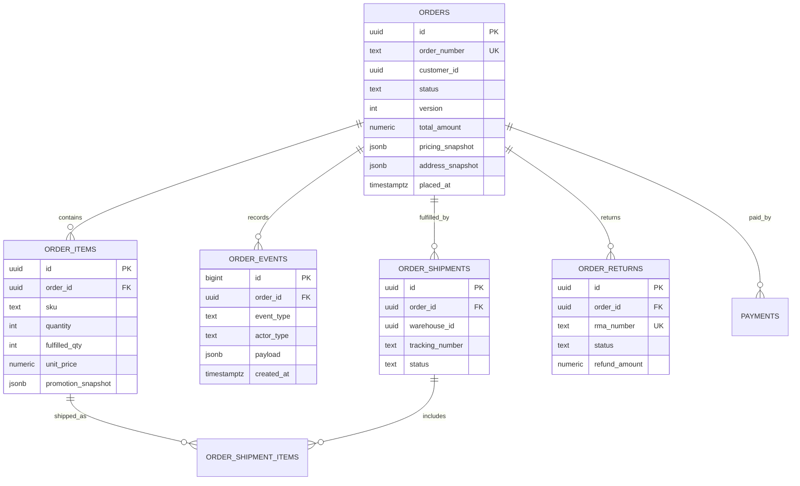
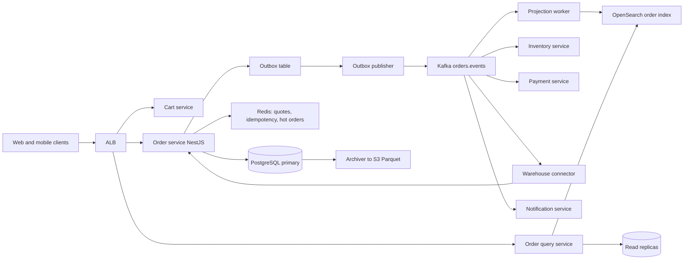
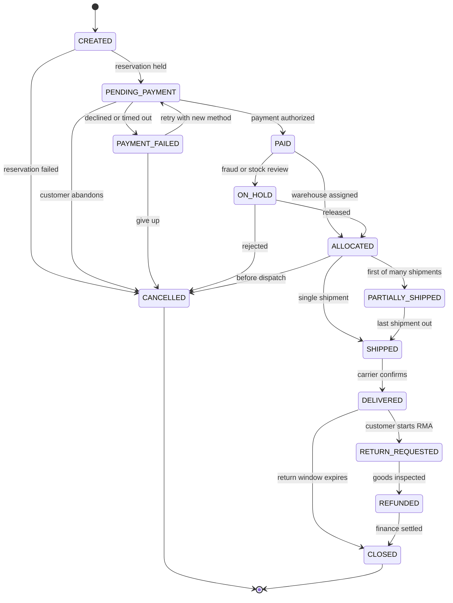
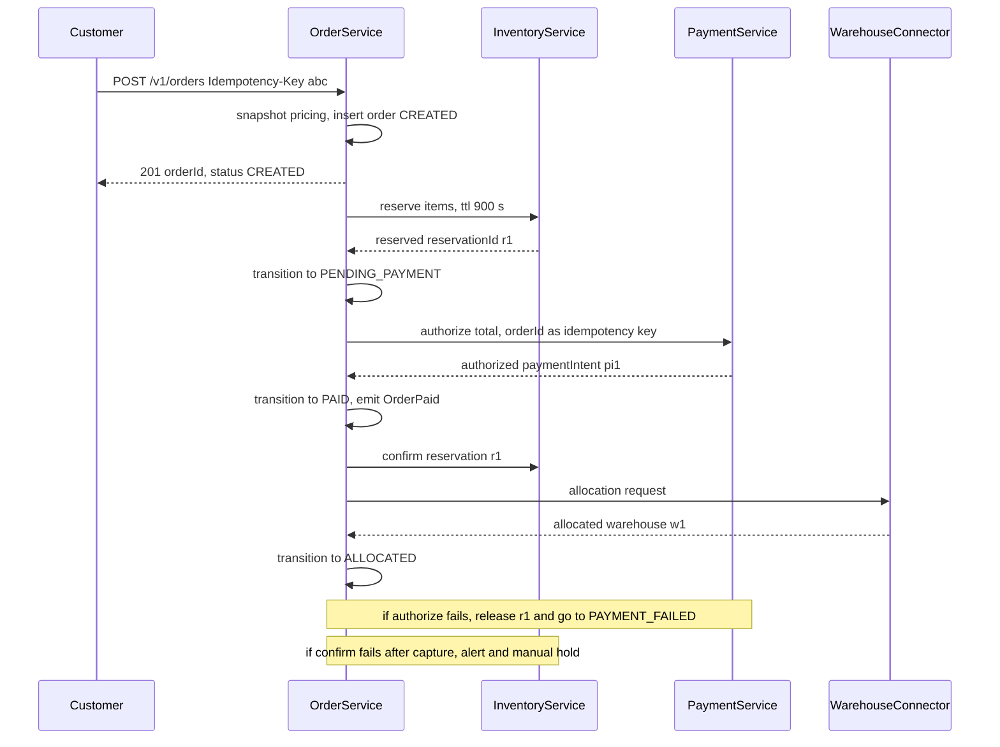
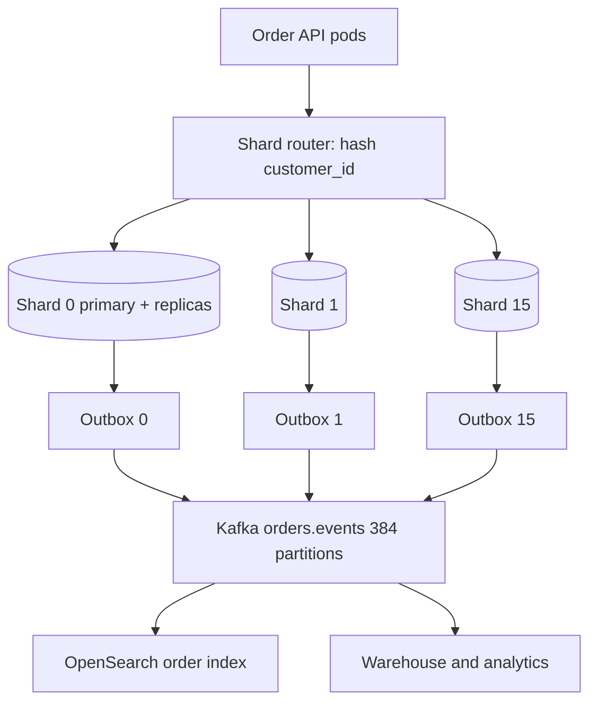

## 55.8 Order Management System

> **Try it first** · Level: Intermediate · About 45 minutes
>
> **Build:** the order service of an online shop: it turns a cart into an order and drives it through payment, fulfilment, cancellation and returns.
>
> **Requirements:**
> - An idempotent checkout (`POST /orders`) that snapshots prices, promotions, tax and address onto the order.
> - Reserve inventory and authorize payment as one saga, with compensations when a step fails.
> - An explicit order lifecycle with a legal-transition table; partial fulfilment across warehouses; cancellations, returns and refunds.
> - Order history and search for customers and support agents; admin actions such as hold and force-cancel.
> - Publish domain events (`OrderPlaced`, `OrderPaid`, `OrderShipped` and so on) exactly once from the consumers' point of view; keep an append-only event history; retain orders seven years.
>
> **Scale and constraints:** 40 million users, 4 million daily active; 125,000 orders per day normally, 1 million on a festive peak, with a flash sale reaching about 222 orders per second and 355 checkout attempts per second; about 7,900 order reads per second at peak (35 to 1 read/write); about 407 GB per year. Checkout p99 under 400 ms excluding the payment provider; order read p99 under 120 ms; zero lost orders; read-your-writes after checkout; one PostgreSQL primary.
>
> **Your task:** sketch the API, the data model and the order state machine, and the main components; estimate storage and throughput; name the two hardest problems and how you would solve them.
>
> Spend the time on paper before you read on. The model design follows.

### 55.8.1 Requirements

An order management system is the part of an e-commerce platform that remembers what a customer bought, what they paid, what was promised to them, and what actually happened afterwards. Everything else on the site is a view of a catalog. The order is the moment the site stops being a browsing experience and becomes a contract, and from that moment on the record must survive price changes, promotion expiry, warehouse moves, refunds, disputes and a tax audit five years later.

The users are three groups with very different needs. Customers place orders and then obsessively check status. Operations staff cancel, split, hold, refund and edit orders all day. Downstream systems (warehouse, finance, analytics, customer support tooling) consume a stream of order events and expect it to be complete and in order.

Imagine a restaurant kitchen with a ticket rail. When a waiter takes an order they write a ticket: the dishes, the price agreed at the table, any discount the manager approved, the table number. The ticket then moves along the rail through stations, and every station marks it. Nobody rewrites the ticket when the menu price changes at 6 p.m. Nobody guesses which stage the ticket is at; the rail position *is* the state. If a dish is cancelled the ticket gets a visible annotation, not an eraser. An order management system is that ticket rail, made durable, made concurrent, and made auditable.

Two rules follow from that image and drive the whole design. First, an order is an **append-only history with a small mutable head**: the current status is a cached conclusion, and `order_events` is the truth. Second, **everything the order depends on is snapshotted at order time**: prices, tax rates, promotion values, the shipping address, the delivery promise. You never recompute the total of a two-year-old order, because the catalog, the tax table and the promotion engine have all moved on and the number you would compute is not the number the customer agreed to pay.

### 55.8.2 Functional requirements

1. Build a cart, price it, and turn it into an order through a checkout that is safe to retry (`POST /orders` is idempotent).
2. Snapshot pricing, promotions, tax, the shipping address and the delivery promise onto the order at creation time.
3. Reserve inventory and authorize payment as one orchestrated saga, with compensations when any step fails.
4. Move the order through an explicit lifecycle with a legal-transition table; reject illegal transitions.
5. Support partial fulfilment: one order can ship as several shipments from several warehouses, and each item line has its own fulfilled quantity.
6. Support customer cancellation before dispatch and operator cancellation at any time before delivery, with correct refunds and inventory release.
7. Support returns and refunds (full and partial), with a returns workflow that puts stock back only after the item is inspected.
8. Serve order history and search (by number, email, phone, item, date range, status) quickly for both customers and support agents.
9. Give operations a set of admin actions: hold, release, edit address, adjust price, add a note, force-cancel, re-send confirmation.
10. Publish domain events (`OrderPlaced`, `OrderPaid`, `OrderAllocated`, `OrderShipped`, `OrderDelivered`, `OrderCancelled`, `OrderRefunded`) exactly once from the point of view of consumers.
11. Keep an append-only `order_events` history that can reconstruct the order state at any past instant.
12. Retain orders for seven years for finance and tax, with older data archived off the hot database.

### 55.8.3 Non-functional requirements

| Property | Target | Why |
|---|---|---|
| Checkout write latency | p99 under 400 ms for `POST /orders` excluding the payment provider call | Every extra second at checkout costs conversion |
| Order read latency | p99 under 120 ms for `GET /orders/{id}` | The status page is polled by every anxious customer |
| Durability | Zero accepted orders lost; committed means committed | An order lost after the customer sees a confirmation is a support and trust disaster |
| Correctness | Money fields never recomputed after creation; totals always reconcile with payments and refunds | Finance reconciles daily and will find any drift |
| Event delivery | At-least-once with idempotent consumers, ordered per order id | The warehouse must not ship before it sees the payment |
| Availability | 99.95 percent for order placement, 99.9 percent for admin | Placement is revenue; admin can wait a few minutes |
| Consistency | Read-your-writes for the customer's own order immediately after checkout | "Where is my order?" right after paying must not return 404 |
| Auditability | Every state change attributable to an actor with a reason, immutable | Chargebacks, disputes, regulators |

### 55.8.4 Constraints

- One PostgreSQL primary with two read replicas exists already; the OMS may add replicas but not a second write primary in year one.
- Payment is an external provider (Stripe-style) reachable over HTTPS with 1 to 3 second latency and occasional 30 second stalls.
- Inventory is a separate service (see 55.9) reachable synchronously and also over Kafka.
- The warehouse management system is a third-party SaaS that consumes our events and posts back shipment webhooks; it can replay webhooks and sometimes sends duplicates.
- Kafka is available (MSK, 3 brokers) and is the only approved event bus.
- Compliance: card data never touches our servers (we store a provider token only), and order records must be immutable enough to satisfy a seven-year tax retention rule.

### 55.8.5 Capacity estimation

| Quantity | Assumption | Calculation | Result |
|---|---|---|---|
| Registered users | given | | 40,000,000 |
| Daily active users | 10 percent of registered | 40M x 0.10 | 4,000,000 |
| Orders per day, normal | 2.5 percent of DAU convert, 1.25 orders each | 4M x 0.025 x 1.25 | 125,000 |
| Orders per day, festive peak | 8x normal | 125,000 x 8 | 1,000,000 |
| Order writes per second, average | Spread over 14 active hours, not 24 | 125,000 / 50,400 | 2.5 per second |
| Order writes per second, peak | Flash sale: 40 percent of the day's orders in 30 minutes | 1,000,000 x 0.40 / 1,800 | 222 per second |
| Checkout attempts per second, peak | 1.6 attempts per successful order (failed cards, retries) | 222 x 1.6 | 355 per second |
| Order reads per second, peak | Status polling every 30 s for 200,000 open orders, plus history and admin | 200,000 / 30 + 1,200 | about 7,900 per second |
| Read/write ratio | | 7,900 / 222 | about 35 to 1 |
| Rows per order | 1 order + 3.2 items + 9 events + 1.2 shipments | | 14.4 rows |
| Database rows per year, normal load | | 125,000 x 365 x 14.4 | 657 million rows |
| Bytes per `orders` row | ids, money columns, 3 JSONB snapshots (pricing, address, promotions) | | about 1.4 KB |
| Bytes per `order_items` row | | | about 420 B |
| Bytes per `order_events` row | type, actor, JSONB payload | | about 380 B |
| Order storage per year | 45.6M orders x 1.4 KB | | 64 GB |
| Item storage per year | 146M items x 420 B | | 61 GB |
| Event storage per year | 410M events x 380 B | | 156 GB |
| Indexes | about 45 percent of heap | (64 + 61 + 156) x 0.45 | 126 GB |
| Total per year | | | about 407 GB |
| Hot window (18 months online) | | 407 x 1.5 | about 610 GB |
| Seven-year archive in S3 (Parquet, compressed 6x) | | 407 x 7 / 6 | about 475 GB |
| Kafka events per second, peak | 9 events per order plus shipment webhooks | 222 x 9 x 1.3 | about 2,600 per second |
| Kafka volume per day, peak | 2,600 x 1.5 KB x 86,400 s (peak sustained is shorter, so use 6 hours) | 2,600 x 1.5 KB x 21,600 | 84 GB per peak day |
| Cache memory | 200,000 open orders x 6 KB serialized + 400,000 carts x 3 KB | 1.2 GB + 1.2 GB | about 2.5 GB, use 8 GB with headroom |
| Bandwidth out for order reads | 7,900 rps x 8 KB | | 63 MB per second |
| Connection count | 40 API pods x 12 pool + 12 workers x 8 | 480 + 96 | 576, so PgBouncer in transaction mode is mandatory |

Three conclusions fall out of these numbers. The write rate is small (222 per second is nothing for PostgreSQL), so the difficulty is not throughput but correctness under concurrency. The read rate is 35x the write rate and almost all of it is "show me my order", so reads belong on replicas and in a cache, never on the write primary. And the row count grows by 657 million a year, which no single unpartitioned table should carry, so `orders`, `order_items` and `order_events` are partitioned by month from day one.

### 55.8.6 API design

| Method | Path | Request | Response | Status codes | Idempotency | Auth |
|---|---|---|---|---|---|---|
| POST | `/v1/carts/{cartId}/items` | `{ sku, qty }` | cart with recomputed totals | 200, 404, 409 | Natural (set quantity, not add) | User |
| POST | `/v1/checkout/quote` | `{ cartId, addressId, promoCodes[] }` | `{ quoteId, lines[], subtotal, discount, tax, shipping, total, expiresAt }` | 200, 409, 422 | Yes, pure read | User |
| POST | `/v1/orders` | `{ quoteId, cartId, addressId, paymentMethodId, promoCodes[] }` plus `Idempotency-Key` header | `{ orderId, orderNumber, status, total, nextAction }` | 201, 200 on replay, 402, 409, 422 | **Required** via `Idempotency-Key` | User |
| GET | `/v1/orders/{orderId}` | | order with items, shipments, timeline | 200, 403, 404 | Yes | User or admin |
| GET | `/v1/orders` | `?status=&from=&to=&cursor=&limit=` | page of order summaries | 200 | Yes | User |
| POST | `/v1/orders/{orderId}/cancel` | `{ reason, items? }` | order | 200, 409 if already shipped | Yes, second call is a no-op returning 200 | User or admin |
| POST | `/v1/orders/{orderId}/returns` | `{ items: [{ itemId, qty, reason }] }` | return with RMA number | 201, 409, 422 | Via `Idempotency-Key` | User |
| GET | `/v1/orders/{orderId}/events` | `?after=` | append-only timeline | 200 | Yes | User (filtered) or admin |
| POST | `/v1/admin/orders/{orderId}/hold` | `{ reason }` | order | 200, 409 | Yes | Admin, scope `orders:write` |
| PATCH | `/v1/admin/orders/{orderId}` | `{ shippingAddress?, note? }` plus `If-Match: "<version>"` | order | 200, 409, 412 on stale version | Optimistic via `If-Match` | Admin |
| POST | `/v1/admin/orders/{orderId}/refunds` | `{ amount, reason, items? }` | refund | 201, 409, 422 | Via `Idempotency-Key` | Admin, scope `refunds:write` |
| POST | `/internal/orders/{orderId}/shipments` | `{ warehouseId, trackingNumber, items[] }` | shipment | 201, 409 | Via `shipmentId` natural key | Service token (WMS) |
| GET | `/v1/admin/orders/search` | `?q=&status=&warehouse=&from=&to=` | page | 200 | Yes | Admin |

Notes on the contract that matter more than the table:

- `POST /orders` returns `201` the first time and `200` with the identical body on every replay of the same `Idempotency-Key`. A different body under the same key returns `409 idempotency_key_reuse`.
- `nextAction` carries 3-D Secure or UPI redirect data when the payment provider needs the customer back. The order already exists at that point in `PENDING_PAYMENT`; it is not created after payment.
- `409` on cancel carries the current status so the client can render the truth ("already shipped") instead of retrying.
- Quotes expire in 15 minutes. Placing an order with an expired quote returns `422 quote_expired` and the client re-quotes, because pricing must be fresh at the moment of the contract.

### 55.8.7 Data model



```sql
CREATE TYPE order_status AS ENUM (
  'CREATED','PENDING_PAYMENT','PAID','ALLOCATED','PARTIALLY_SHIPPED','SHIPPED',
  'DELIVERED','CANCELLED','PAYMENT_FAILED','ON_HOLD','RETURN_REQUESTED','REFUNDED','CLOSED'
);

CREATE TABLE orders (
  id                 uuid        NOT NULL DEFAULT gen_random_uuid(),
  order_number       text        NOT NULL,                       -- human facing: 'ORD-2026-0009123456'
  customer_id        uuid        NOT NULL,
  status             order_status NOT NULL DEFAULT 'CREATED',
  version            integer     NOT NULL DEFAULT 1,             -- optimistic locking for admin edits
  currency           char(3)     NOT NULL,
  subtotal_amount    numeric(14,4) NOT NULL CHECK (subtotal_amount >= 0),
  discount_amount    numeric(14,4) NOT NULL DEFAULT 0 CHECK (discount_amount >= 0),
  tax_amount         numeric(14,4) NOT NULL DEFAULT 0 CHECK (tax_amount >= 0),
  shipping_amount    numeric(14,4) NOT NULL DEFAULT 0 CHECK (shipping_amount >= 0),
  total_amount       numeric(14,4) NOT NULL CHECK (total_amount >= 0),
  paid_amount        numeric(14,4) NOT NULL DEFAULT 0,
  refunded_amount    numeric(14,4) NOT NULL DEFAULT 0,
  pricing_snapshot   jsonb       NOT NULL,                       -- catalog price, list price, tax rule ids, fx rate
  promotion_snapshot jsonb       NOT NULL DEFAULT '[]'::jsonb,   -- promo id, version, rule text, computed value
  address_snapshot   jsonb       NOT NULL,                       -- full address as typed, geocode, phone
  shipping_snapshot  jsonb       NOT NULL,                       -- carrier, service level, promised window, cost basis
  idempotency_key    text,
  placed_at          timestamptz NOT NULL DEFAULT now(),
  updated_at         timestamptz NOT NULL DEFAULT now(),
  cancelled_at       timestamptz,
  CONSTRAINT orders_total_ck CHECK (total_amount = subtotal_amount - discount_amount + tax_amount + shipping_amount),
  CONSTRAINT orders_refund_ck CHECK (refunded_amount <= paid_amount),
  PRIMARY KEY (id, placed_at)
) PARTITION BY RANGE (placed_at);

CREATE TABLE orders_2026_09 PARTITION OF orders
  FOR VALUES FROM ('2026-09-01') TO ('2026-10-01');

-- serves GET /v1/orders (customer history), the most frequent authenticated read
CREATE INDEX orders_customer_placed_idx ON orders (customer_id, placed_at DESC);
-- serves support lookup by the number printed on the invoice; unique within a partition
CREATE UNIQUE INDEX orders_number_uidx ON orders (order_number, placed_at);
-- serves idempotent POST /orders replay detection
CREATE UNIQUE INDEX orders_idem_uidx ON orders (idempotency_key, placed_at) WHERE idempotency_key IS NOT NULL;
-- serves the ops queue "everything stuck in PENDING_PAYMENT / ON_HOLD", a tiny slice of a huge table
CREATE INDEX orders_open_status_idx ON orders (status, placed_at)
  WHERE status IN ('PENDING_PAYMENT','PAID','ALLOCATED','PARTIALLY_SHIPPED','ON_HOLD');

CREATE TABLE order_items (
  id                 uuid NOT NULL DEFAULT gen_random_uuid(),
  order_id           uuid NOT NULL,
  placed_at          timestamptz NOT NULL,                       -- carried down so the child partitions align
  line_no            smallint NOT NULL,
  sku                text NOT NULL,
  product_id         uuid NOT NULL,
  title_snapshot     text NOT NULL,                              -- name at purchase time; catalog renames later
  quantity           integer NOT NULL CHECK (quantity > 0),
  fulfilled_qty      integer NOT NULL DEFAULT 0 CHECK (fulfilled_qty >= 0),
  cancelled_qty      integer NOT NULL DEFAULT 0 CHECK (cancelled_qty >= 0),
  returned_qty       integer NOT NULL DEFAULT 0 CHECK (returned_qty >= 0),
  unit_price         numeric(14,4) NOT NULL CHECK (unit_price >= 0),
  line_discount      numeric(14,4) NOT NULL DEFAULT 0,
  line_tax           numeric(14,4) NOT NULL DEFAULT 0,
  tax_rate_snapshot  numeric(6,4) NOT NULL,
  promotion_snapshot jsonb NOT NULL DEFAULT '[]'::jsonb,
  warehouse_id       uuid,                                       -- set at allocation
  PRIMARY KEY (id, placed_at),
  CONSTRAINT order_items_qty_ck CHECK (fulfilled_qty + cancelled_qty <= quantity),
  CONSTRAINT order_items_ret_ck CHECK (returned_qty <= fulfilled_qty)
) PARTITION BY RANGE (placed_at);

-- serves the order detail page: fetch all lines of one order
CREATE INDEX order_items_order_idx ON order_items (order_id, line_no);
-- serves "which orders contain this SKU" for recalls and support
CREATE INDEX order_items_sku_idx ON order_items (sku, placed_at DESC);

CREATE TABLE order_events (
  id            bigint GENERATED ALWAYS AS IDENTITY,
  order_id      uuid        NOT NULL,
  occurred_at   timestamptz NOT NULL DEFAULT now(),
  seq           integer     NOT NULL,                            -- 1,2,3... per order; gap = lost write
  event_type    text        NOT NULL,                            -- 'ORDER_PLACED','PAYMENT_AUTHORIZED',...
  from_status   order_status,
  to_status     order_status,
  actor_type    text        NOT NULL CHECK (actor_type IN ('customer','admin','system','webhook')),
  actor_id      text,
  reason        text,
  payload       jsonb       NOT NULL DEFAULT '{}'::jsonb,
  PRIMARY KEY (id, occurred_at)
) PARTITION BY RANGE (occurred_at);

-- serves the order timeline, always ordered
CREATE UNIQUE INDEX order_events_order_seq_uidx ON order_events (order_id, seq, occurred_at);
-- serves ops queries: "all payment failures in the last hour"
CREATE INDEX order_events_type_time_idx ON order_events (event_type, occurred_at DESC);

CREATE TABLE order_shipments (
  id              uuid PRIMARY KEY DEFAULT gen_random_uuid(),
  order_id        uuid NOT NULL,
  warehouse_id    uuid NOT NULL,
  external_id     text NOT NULL,                                 -- WMS shipment id, natural idempotency key
  carrier         text NOT NULL,
  tracking_number text,
  status          text NOT NULL CHECK (status IN ('CREATED','PICKED','DISPATCHED','IN_TRANSIT','DELIVERED','FAILED','RETURNED')),
  shipped_at      timestamptz,
  delivered_at    timestamptz
);
-- serves duplicate-webhook suppression from the WMS
CREATE UNIQUE INDEX order_shipments_external_uidx ON order_shipments (external_id);
CREATE INDEX order_shipments_order_idx ON order_shipments (order_id);

CREATE TABLE order_outbox (
  id            bigint GENERATED ALWAYS AS IDENTITY PRIMARY KEY,
  aggregate_id  uuid NOT NULL,
  topic         text NOT NULL,
  event_key     text NOT NULL,
  payload       jsonb NOT NULL,
  created_at    timestamptz NOT NULL DEFAULT now(),
  published_at  timestamptz
);
-- serves the publisher's "give me the next unpublished batch" query
CREATE INDEX order_outbox_unpublished_idx ON order_outbox (id) WHERE published_at IS NULL;
```

Why the snapshots are columns and not joins: a promotion row can be deleted, a price can change three times a day, a tax rate changes by legislation, and a customer edits their saved address. If the order detail page joined to those tables, a customer opening a six-month-old order would see a total that does not match what their card was charged. The snapshot columns are the contract; the live tables are the catalog. This is the single most common design mistake in order systems, and it is discovered late, usually by finance.

### 55.8.8 High-level architecture



The service boundary is deliberate: **one service owns writes to the order aggregate**. Inventory, payment and the warehouse never write to `orders`; they emit events or call the order service's internal API, and the order service alone decides whether the state change is legal. That single writer is what makes the state machine enforceable. A team that lets the payment service flip `orders.status` directly will spend the next year debugging orders that are `PAID` but were never `CREATED` properly.

### 55.8.9 Component design

```text
src/
  orders/
    orders.module.ts
    api/
      orders.controller.ts
      admin-orders.controller.ts
      internal-shipments.controller.ts
      dto/place-order.dto.ts
      dto/cancel-order.dto.ts
    domain/
      order.entity.ts
      order-item.entity.ts
      order-event.entity.ts
      order-state-machine.ts
      order-number.generator.ts
    application/
      place-order.service.ts
      order-transition.service.ts
      order-query.service.ts
      cancellation.service.ts
      returns.service.ts
      snapshot.builder.ts
    saga/
      checkout.saga.ts
      checkout-saga.state.ts
      compensations.ts
    infra/
      idempotency.service.ts
      outbox.publisher.ts
      order.repository.ts
    workers/
      outbox-publisher.worker.ts
      payment-timeout.worker.ts
      order-projection.worker.ts
      archiver.worker.ts
```

#### The lifecycle as an explicit state machine



The legal-transition table is the code, not documentation. Every entry names who may trigger it and what must be true.

| From | To | Trigger | Allowed actor | Guard |
|---|---|---|---|---|
| CREATED | PENDING_PAYMENT | `ReservationConfirmed` | system | All lines reserved |
| CREATED | CANCELLED | `ReservationFailed` | system | Within 60 s of creation |
| PENDING_PAYMENT | PAID | `PaymentAuthorized` | system | `paid_amount >= total_amount` |
| PENDING_PAYMENT | PAYMENT_FAILED | `PaymentDeclined` or timeout | system | 15 min timer expired or provider decline |
| PENDING_PAYMENT | CANCELLED | customer cancel | customer, admin | Nothing dispatched |
| PAYMENT_FAILED | PENDING_PAYMENT | retry | customer | Reservation still alive or re-reserved |
| PAID | ALLOCATED | `AllocationComplete` | system | Every line has a warehouse |
| PAID | ON_HOLD | fraud rule or manual | system, admin | Reason recorded |
| ON_HOLD | ALLOCATED | release | admin | Reason recorded |
| ALLOCATED | PARTIALLY_SHIPPED | `ShipmentDispatched` | webhook | `sum(fulfilled_qty) < sum(quantity)` |
| ALLOCATED | SHIPPED | `ShipmentDispatched` | webhook | All lines fulfilled |
| PARTIALLY_SHIPPED | SHIPPED | `ShipmentDispatched` | webhook | All lines fulfilled |
| ALLOCATED, PARTIALLY_SHIPPED | CANCELLED | admin cancel | admin | Only unshipped lines cancelled; refund issued |
| SHIPPED | DELIVERED | carrier webhook | webhook | |
| DELIVERED | RETURN_REQUESTED | RMA created | customer, admin | Within return window |
| RETURN_REQUESTED | REFUNDED | goods inspected | admin, system | Refund captured at provider |
| any non-terminal | CANCELLED | force-cancel | admin with `orders:force` | Dual approval above a value threshold |

```ts
// orders/domain/order-state-machine.ts
import { ConflictException } from '@nestjs/common';

export type OrderStatus =
  | 'CREATED' | 'PENDING_PAYMENT' | 'PAID' | 'ALLOCATED' | 'PARTIALLY_SHIPPED'
  | 'SHIPPED' | 'DELIVERED' | 'CANCELLED' | 'PAYMENT_FAILED' | 'ON_HOLD'
  | 'RETURN_REQUESTED' | 'REFUNDED' | 'CLOSED';

const TRANSITIONS: Readonly<Record<OrderStatus, readonly OrderStatus[]>> = Object.freeze({
  CREATED:           ['PENDING_PAYMENT', 'CANCELLED'],
  PENDING_PAYMENT:   ['PAID', 'PAYMENT_FAILED', 'CANCELLED'],
  PAYMENT_FAILED:    ['PENDING_PAYMENT', 'CANCELLED'],
  PAID:              ['ALLOCATED', 'ON_HOLD', 'CANCELLED'],
  ON_HOLD:           ['ALLOCATED', 'CANCELLED'],
  ALLOCATED:         ['PARTIALLY_SHIPPED', 'SHIPPED', 'CANCELLED'],
  PARTIALLY_SHIPPED: ['SHIPPED', 'CANCELLED'],
  SHIPPED:           ['DELIVERED', 'CANCELLED'],
  DELIVERED:         ['RETURN_REQUESTED', 'CLOSED'],
  RETURN_REQUESTED:  ['REFUNDED', 'DELIVERED'],
  REFUNDED:          ['CLOSED'],
  CANCELLED:         [],
  CLOSED:            [],
});

export function assertTransition(from: OrderStatus, to: OrderStatus): void {
  if (from === to) return;                                   // idempotent replay of the same event
  if (!TRANSITIONS[from].includes(to)) {
    throw new ConflictException({ error: 'illegal_transition', from, to });
  }
}

export const isTerminal = (s: OrderStatus) => TRANSITIONS[s].length === 0;
```

#### Transitions use a row lock; admin edits use a version

State transitions are triggered concurrently by the payment webhook, the WMS webhook and a background timer. Two of them arriving in the same millisecond must not both read `PENDING_PAYMENT` and both write. The transition service therefore takes a pessimistic row lock, and because the lock is held for a few milliseconds inside one small transaction, contention is invisible.

```ts
// orders/application/order-transition.service.ts
import { Injectable, NotFoundException } from '@nestjs/common';
import { DataSource } from 'typeorm';
import { assertTransition, OrderStatus } from '../domain/order-state-machine';

export interface TransitionInput {
  orderId: string;
  to: OrderStatus;
  eventType: string;
  actorType: 'customer' | 'admin' | 'system' | 'webhook';
  actorId?: string;
  reason?: string;
  payload?: Record<string, unknown>;
  dedupeKey?: string;              // e.g. payment intent id; makes webhook replays a no-op
}

@Injectable()
export class OrderTransitionService {
  constructor(private readonly ds: DataSource) {}

  async transition(input: TransitionInput): Promise<OrderStatus> {
    return this.ds.transaction('READ COMMITTED', async (m) => {
      // Lock the head row. Any concurrent transition for this order waits here.
      const rows = await m.query(
        `SELECT id, status, placed_at FROM orders WHERE id = $1 FOR UPDATE`,
        [input.orderId],
      );
      if (rows.length === 0) throw new NotFoundException('order_not_found');
      const current = rows[0].status as OrderStatus;

      if (input.dedupeKey) {
        const dup = await m.query(
          `SELECT 1 FROM order_events WHERE order_id = $1 AND payload->>'dedupeKey' = $2 LIMIT 1`,
          [input.orderId, input.dedupeKey],
        );
        if (dup.length > 0) return current;                 // duplicate webhook: nothing to do
      }

      assertTransition(current, input.to);
      if (current === input.to) return current;

      await m.query(
        `UPDATE orders SET status = $2, version = version + 1, updated_at = now()
           WHERE id = $1 AND placed_at = $3`,
        [input.orderId, input.to, rows[0].placed_at],
      );
      await m.query(
        `INSERT INTO order_events (order_id, occurred_at, seq, event_type, from_status, to_status,
                                   actor_type, actor_id, reason, payload)
         VALUES ($1, now(),
                 (SELECT coalesce(max(seq),0)+1 FROM order_events WHERE order_id = $1),
                 $2, $3, $4, $5, $6, $7, $8)`,
        [input.orderId, input.eventType, current, input.to, input.actorType,
         input.actorId ?? null, input.reason ?? null,
         JSON.stringify({ ...(input.payload ?? {}), dedupeKey: input.dedupeKey })],
      );
      await m.query(
        `INSERT INTO order_outbox (aggregate_id, topic, event_key, payload)
         VALUES ($1, 'orders.events', $1::text, $2)`,
        [input.orderId, JSON.stringify({ type: input.eventType, orderId: input.orderId, to: input.to })],
      );
      return input.to;
    });
  }
}
```

Admin edits are different. An operator opens an order in a back-office tab, goes to lunch, comes back and saves. Pessimistic locking would hold a database lock for 40 minutes; that is unacceptable. So admin edits use **optimistic locking**: the read returns `version` as an `ETag`, the write sends `If-Match`, and the `UPDATE ... WHERE version = $expected` either affects one row or zero. Zero means somebody else changed the order and the operator is told exactly what changed.

```ts
// orders/api/admin-orders.controller.ts (excerpt)
@Patch(':id')
async edit(
  @Param('id', ParseUUIDPipe) id: string,
  @Headers('if-match') ifMatch: string,
  @Body() dto: AdminEditOrderDto,
  @CurrentUser() admin: AdminPrincipal,
) {
  if (!ifMatch) throw new PreconditionRequiredException('if_match_required');
  const expected = Number(ifMatch.replace(/"/g, ''));
  const updated = await this.adminOrders.edit(id, expected, dto, admin);
  if (!updated) throw new PreconditionFailedException({ error: 'stale_version' });
  return updated;                                    // response carries the new ETag
}
```

#### Idempotent order placement

`POST /orders` is the highest-stakes idempotent endpoint in the platform. A customer on a train taps "Pay" and the response is lost; the app retries; two orders and two charges would be a refund, a support ticket and a bad review. The rule: **the idempotency record and the order are written in the same transaction**, so there is no window where one exists without the other.

```ts
// orders/application/place-order.service.ts
import { BadRequestException, ConflictException, Injectable } from '@nestjs/common';
import { DataSource } from 'typeorm';
import { createHash } from 'node:crypto';
import { SnapshotBuilder } from './snapshot.builder';
import { OrderNumberGenerator } from '../domain/order-number.generator';

@Injectable()
export class PlaceOrderService {
  constructor(
    private readonly ds: DataSource,
    private readonly snapshots: SnapshotBuilder,
    private readonly numbers: OrderNumberGenerator,
  ) {}

  async place(customerId: string, dto: PlaceOrderDto, idempotencyKey: string) {
    const fingerprint = createHash('sha256')
      .update(`${customerId}:${dto.cartId}:${dto.quoteId}:${dto.paymentMethodId}`)
      .digest('hex');

    const existing = await this.ds.query(
      `SELECT response, fingerprint, state FROM idempotency_keys WHERE key = $1`, [idempotencyKey]);
    if (existing.length) {
      if (existing[0].fingerprint !== fingerprint) throw new ConflictException('idempotency_key_reuse');
      if (existing[0].state === 'IN_FLIGHT') throw new ConflictException('request_in_flight');
      return existing[0].response;                              // exact replay
    }

    const quote = await this.snapshots.loadValidQuote(dto.quoteId, customerId);
    if (!quote) throw new BadRequestException('quote_expired');

    return this.ds.transaction(async (m) => {
      // Claim the key first; a concurrent duplicate now fails on the unique index and retries into the replay path.
      await m.query(
        `INSERT INTO idempotency_keys (key, fingerprint, state) VALUES ($1, $2, 'IN_FLIGHT')`,
        [idempotencyKey, fingerprint]);

      const orderNumber = await this.numbers.next(m);
      const snap = this.snapshots.build(quote);                 // pricing, promo, address, shipping frozen here
      const order = await m.query(
        `INSERT INTO orders (order_number, customer_id, status, currency, subtotal_amount, discount_amount,
                             tax_amount, shipping_amount, total_amount, pricing_snapshot, promotion_snapshot,
                             address_snapshot, shipping_snapshot, idempotency_key)
         VALUES ($1,$2,'CREATED',$3,$4,$5,$6,$7,$8,$9,$10,$11,$12,$13)
         RETURNING id, order_number, status, total_amount, placed_at`,
        [orderNumber, customerId, quote.currency, snap.subtotal, snap.discount, snap.tax, snap.shipping,
         snap.total, snap.pricing, snap.promotions, snap.address, snap.shipping_meta, idempotencyKey]);

      await this.insertItems(m, order[0], quote.lines);
      await this.insertEvent(m, order[0].id, 'ORDER_PLACED', 'customer', customerId);
      await m.query(
        `INSERT INTO order_outbox (aggregate_id, topic, event_key, payload)
         VALUES ($1,'orders.events',$1::text,$2)`,
        [order[0].id, JSON.stringify({ type: 'OrderPlaced', orderId: order[0].id, lines: quote.lines })]);

      const response = { orderId: order[0].id, orderNumber, status: 'CREATED', total: snap.total };
      await m.query(`UPDATE idempotency_keys SET state='DONE', response=$2 WHERE key=$1`,
        [idempotencyKey, JSON.stringify(response)]);
      return response;
    });
  }
}
```

#### The checkout saga

Reserving stock and taking money are two systems that can each fail independently. A distributed transaction across them does not exist in practice, so the design uses an orchestrated saga: the order service is the orchestrator, holds the saga state in its own database, and issues compensations when a step fails.



Each saga step is a Kafka consumer with a retry policy and a compensation. The saga state lives in a `checkout_sagas` table (`order_id`, `step`, `attempts`, `last_error`, `deadline_at`), which means a pod crash does not lose the saga: a timer worker scans for sagas past their deadline and resumes or compensates them. The compensations are: release reservation, void authorization (or refund if already captured), cancel order with reason.

The honest part of the design is that the last step, "confirm reservation after money is captured", has no clean compensation. If confirmation fails permanently the money is taken and the stock may be gone. The system does not pretend otherwise: it puts the order `ON_HOLD`, raises a P2 page, and gives ops one button to refund or to source from another warehouse. Designs that hide this case are the ones that oversell during a sale.

#### Partial shipments and cancellations

The quantity columns on `order_items` (`quantity`, `fulfilled_qty`, `cancelled_qty`, `returned_qty`) are what make partial fulfilment representable. A shipment webhook increments `fulfilled_qty` for the shipped lines; the order status becomes `SHIPPED` only when `sum(fulfilled_qty + cancelled_qty) = sum(quantity)`. A cancellation of a still-unshipped line increments `cancelled_qty`, releases the reservation for that line, and issues a partial refund computed from the *snapshot* line values, never from the current catalog.

### 55.8.10 Database design

Partitioning by month on `placed_at` is the backbone. It gives four concrete wins: `DROP`ping a partition after archival is instant instead of a multi-hour `DELETE`; `VACUUM` and `REINDEX` work on 30 GB pieces instead of a 600 GB table; the planner prunes to one or two partitions for any date-bounded query; and the hot month stays in the buffer cache. The cost is that every unique index must include the partition key, which is why the primary keys are `(id, placed_at)` and why application code always carries `placed_at` alongside `order_id` when it can.

Partitions are created two months ahead by a `@Cron` job (a missing partition at midnight on the first is a classic outage), and monthly maintenance detaches partitions older than 18 months, exports them to S3 as Parquet with Glue catalog entries for Athena, verifies the row counts, then drops them.

The customer history query is the one to tune:

```sql
EXPLAIN (ANALYZE, BUFFERS)
SELECT id, order_number, status, total_amount, placed_at
FROM orders
WHERE customer_id = '7f3c...'::uuid
  AND placed_at >= now() - interval '18 months'
ORDER BY placed_at DESC
LIMIT 20;
```

```text
Limit  (cost=0.98..142.31 rows=20 width=72) (actual time=0.061..0.310 rows=20 loops=1)
  ->  Merge Append  (cost=0.98..1284.44 rows=182 width=72) (actual time=0.060..0.302 rows=20 loops=1)
        Sort Key: orders.placed_at DESC
        ->  Index Scan Backward using orders_2026_09_customer_placed_idx on orders_2026_09
              (actual time=0.031..0.121 rows=14 loops=1)
              Index Cond: (customer_id = '7f3c...'::uuid)
              Buffers: shared hit=9
        ->  Index Scan Backward using orders_2026_08_customer_placed_idx on orders_2026_08
              (actual time=0.021..0.058 rows=7 loops=1)
              Buffers: shared hit=8
Planning Time: 1.940 ms
Execution Time: 0.402 ms
```

Two lessons live in that plan. The scan is a `Merge Append` across partitions, which is cheap only because the index leads with `customer_id` and the sort key matches the index order; drop the `placed_at` bound and the planner must touch all 18 partitions, and planning time alone climbs past 15 ms. And planning time (1.9 ms) is larger than execution time, which is normal for partitioned tables and is why the query service uses prepared statements through a connection pool that keeps plans warm.

Order search for support (by email, phone, partial name, SKU) is not served by PostgreSQL at all. Those are low-selectivity, multi-field, fuzzy queries over hundreds of millions of rows, and every attempt to serve them with `ILIKE` and `pg_trgm` on the primary ends with a support tool that takes 30 seconds and a primary at 100 percent CPU. A projection worker consumes `orders.events` and maintains an OpenSearch index with one document per order, and the admin search endpoint reads that index and then hydrates the details from a read replica.

Read/write split: `GET /orders/{id}` for a customer who just checked out reads the primary for 5 seconds after their last write (a short-lived "read your writes" marker in Redis keyed by user id), then falls back to a replica. Everything else reads replicas.

### 55.8.11 Caching

| What | Where | TTL | Invalidation | Notes |
|---|---|---|---|---|
| Checkout quote | Redis string, `quote:{id}` | 15 min | Consumed at order placement | The quote *is* the frozen price; storing it removes a recompute at the riskiest moment |
| Idempotency response | PostgreSQL table plus Redis mirror | 24 h in Redis, 30 days in PostgreSQL | On key expiry | Redis absorbs the retry storm; PostgreSQL is the truth |
| Order detail read model | Redis JSON, `order:{id}` | 10 min | Deleted on every transition, before the outbox publish | Cuts p99 on the status page from 90 ms to 6 ms |
| Customer's first page of history | Redis list, `orders:cust:{id}:p1` | 2 min | Deleted on any transition of any of their orders | Only page 1; deeper pages go to the replica |
| Product title and image for order lines | In-process LRU | 5 min | Time | Display only; the authoritative title is the snapshot |
| Read-your-writes marker | Redis, `rw:{userId}` | 5 s | Time | Routes the user to the primary just after a write |

Cache invalidation happens **before** the transaction commits its outbox row is published, and again after: delete-before-write plus delete-after-write. The double delete removes the classic race where a slow reader repopulates the cache with the pre-write value between the delete and the commit.

### 55.8.12 Messaging

| Topic | Key | Partitions | Events | Consumers |
|---|---|---|---|---|
| `orders.events` | `order_id` | 24 | `OrderPlaced`, `OrderPaid`, `OrderAllocated`, `OrderShipped`, `OrderPartiallyShipped`, `OrderDelivered`, `OrderCancelled`, `OrderRefunded` | Inventory, WMS connector, notifications, analytics, projection worker |
| `orders.commands` | `order_id` | 12 | `ReserveStock`, `ReleaseStock`, `AuthorizePayment`, `RefundPayment` | Inventory, payment |
| `payments.events` | `order_id` | 12 | `PaymentAuthorized`, `PaymentCaptured`, `PaymentDeclined`, `RefundSucceeded` | Order saga |
| `wms.events` | `order_id` | 12 | `ShipmentDispatched`, `ShipmentDelivered`, `AllocationFailed` | Order service |
| `orders.events.dlq` | `order_id` | 6 | Poison messages after 5 retries | On-call dashboard, replay tool |

Keying every topic by `order_id` guarantees per-order ordering, which is the only ordering that matters. Cross-order ordering is meaningless, and demanding it would force one partition and cap throughput at a few thousand messages per second.

Publication uses the **transactional outbox**: the state change and the outbox row commit together, and a publisher worker reads unpublished rows in id order, produces to Kafka, and marks them published. This makes "the database says PAID but Kafka never heard about it" impossible. Duplicates are still possible (publish succeeds, the mark fails, the worker restarts and republishes), so every consumer is idempotent, usually via a unique constraint on `(consumer, event_id)` or by making the operation naturally idempotent.

```ts
// orders/workers/outbox-publisher.worker.ts (core loop)
@Injectable()
export class OutboxPublisher {
  constructor(private readonly ds: DataSource, private readonly kafka: KafkaProducer) {}

  @Interval(200)
  async tick(): Promise<void> {
    await this.ds.transaction(async (m) => {
      const batch = await m.query(
        `SELECT id, topic, event_key, payload FROM order_outbox
          WHERE published_at IS NULL ORDER BY id LIMIT 500
          FOR UPDATE SKIP LOCKED`);            // SKIP LOCKED lets several publisher pods run safely
      if (batch.length === 0) return;
      await this.kafka.sendBatch(batch.map((r) => ({
        topic: r.topic, messages: [{ key: r.event_key, value: JSON.stringify(r.payload) }],
      })));
      await m.query(`UPDATE order_outbox SET published_at = now() WHERE id = ANY($1)`,
        [batch.map((r) => r.id)]);
    });
  }
}
```

`FOR UPDATE SKIP LOCKED` is the detail that lets three publisher pods run without stepping on each other and without a leader election. Published rows are deleted after 7 days by a nightly job.

### 55.8.13 Scaling

**At 1x (222 orders per second peak, 7,900 reads per second).** One PostgreSQL primary (db.r6g.4xlarge, 16 vCPU, 128 GB), two replicas, PgBouncer in transaction mode, 40 API pods, 6 worker pods, Redis with 8 GB, Kafka with 24 partitions on `orders.events`. The primary is at maybe 25 percent CPU. Nothing exotic is needed; the engineering effort goes into correctness.

**At 10x (2,200 orders per second, 79,000 reads per second).** Reads are the first thing to break, then connections, then the outbox.

- Reads move fully off the primary: four to six replicas behind a reader endpoint, with the read-your-writes marker deciding the rare primary read. The order detail cache hit rate goes from 60 percent to 90 percent by caching the rendered read model rather than raw rows.
- Connection count would be 400 pods times 12 equals 4,800; PgBouncer collapses that to about 120 server connections.
- The outbox becomes a hot table: 20,000 inserts per second and a publisher scanning it. It moves to its own tablespace on separate storage, gets partitioned by hour, and publishers scale to six pods with `SKIP LOCKED`.
- Kafka partitions grow to 96 on `orders.events` so consumers can scale horizontally.
- Order search is entirely on OpenSearch with 6 data nodes.
- Hot-partition risk appears: every insert goes to the current month's partition, so index tails become the contention point. UUID v7 (time-ordered) primary keys keep index inserts on the right-hand side without random page churn.

**At 100x (22,000 orders per second, roughly a very large marketplace).** A single write primary is over. The order table is sharded by `customer_id` hash into, say, 16 PostgreSQL clusters, with a routing layer (Citus, Vitess-style middleware, or an application-level shard map in Redis backed by PostgreSQL).



At this size the order number must encode the shard (`ORD-2026-07-0009123456` where `07` is the shard) so a support agent with only the number can be routed. Cross-shard queries ("all orders for a promotion") stop being possible on PostgreSQL and are answered from the search index or the warehouse. Global uniqueness of order numbers is handled per shard with a shard-prefixed sequence rather than a global counter. And the checkout saga becomes a per-shard concern, which is fine because a saga never spans two customers.

### 55.8.14 Security

- **Authorization on every read.** `GET /orders/{id}` must check `order.customer_id = principal.sub`, not just that the id is a valid UUID. Object-level authorization failures are the most common serious bug in order APIs; a plain sequential order id in a URL is an invitation.
- **Order numbers are not secrets.** They appear on invoices and in emails, so they are never used for authentication. Support lookups by number require an admin token plus a second factor of customer identity (email or last four digits of the phone).
- **Money fields are server-side only.** The client sends `quoteId`, never prices. A request body containing `total` is rejected by the DTO's `forbidNonWhitelisted` validation, because a client-supplied total is a free-shopping bug waiting to happen.
- **Promotion abuse.** Promo codes are validated and consumed inside the placement transaction with a per-customer usage counter (`UNIQUE (promo_id, customer_id)` when single-use), so a customer firing 50 concurrent checkouts cannot use a one-time code 50 times.
- **Admin actions are privileged and audited.** Refunds, force-cancels and price adjustments require specific scopes, are written to `order_events` with the actor id, and above a value threshold require a second approver. Every admin session is logged with IP and device.
- **PII minimisation.** The address snapshot contains what shipping needs. Full card numbers never exist; only a provider token and last four digits. Exported analytics events carry a hashed customer id.
- **Webhook authenticity.** Payment and WMS webhooks are verified by HMAC signature with a timestamp window of 5 minutes to stop replays, and the handler is idempotent by the provider's event id.
- **Rate limiting.** `POST /orders` is limited per customer and per payment method to stop card-testing attacks, which show up as thousands of tiny orders with different cards.
- **Data retention.** Seven-year retention conflicts with deletion requests; the resolution is pseudonymisation (replace name, email and address in the snapshot with a token, keep the financial record), which satisfies both the tax rule and the privacy rule.

### 55.8.15 Failure scenarios

Run the mantra over every path: can it time out, fail, slow down, duplicate, return something wrong, or partially succeed?

| Failure | Detection | Impact | Mitigation | What the user sees |
|---|---|---|---|---|
| Client retries `POST /orders` after a timeout | Duplicate `Idempotency-Key`, duplicate rate metric | Would create two orders and two charges | Idempotency record written in the same transaction as the order; replay returns the original 200 body | One order, one charge |
| Payment provider times out after 30 s, outcome unknown | Provider call p99 alarm; order stuck in `PENDING_PAYMENT` | Money may or may not be taken | Order stays `PENDING_PAYMENT`; a reconciliation worker queries the provider by our idempotency key every minute for 15 min, then voids | "Payment is being confirmed", then success or a retry prompt |
| Payment succeeds but our commit fails | Provider reports a charge with no matching `PAID` order | Customer charged, no order progress | Nightly and 5-minute reconciliation jobs compare provider charges to orders; orphan charges auto-refund after 30 minutes and page on-call | Charge appears then is refunded, with an email |
| Inventory reserved but payment declined | Saga step failure | Stock held for nothing | Compensation releases the reservation; reservations also expire after 15 minutes independently | Sees "payment declined, try another card"; stock returns |
| Duplicate shipment webhook from the WMS | Unique index on `external_id` and the `dedupeKey` check | Would double-increment `fulfilled_qty` and mark the order shipped twice | Natural-key uniqueness plus a same-state transition returning early | Nothing |
| Out-of-order events (delivered arrives before shipped) | `assertTransition` throws `illegal_transition` | Order stuck or wrongly advanced | Events carry `occurred_at` and a per-order sequence; the handler parks the early event in a small buffer table and replays it after the expected one, with a 10-minute alarm | Slightly delayed status |
| Kafka down or lagging | Consumer lag alarm, publish error rate | No warehouse dispatch, no notifications | Outbox holds events durably; the publisher backs off and drains when Kafka recovers; the WMS also polls a fallback API | Order confirmed but "preparing" for longer |
| PostgreSQL primary failover | Health checks, write error spike | Writes fail for 30 to 90 seconds | Multi-AZ RDS, PgBouncer reconnects, API returns 503 with `Retry-After`; the client retries with the same idempotency key so no duplicate is created | "Something went wrong, please retry" for under a minute |
| Read replica lag spikes to 20 s | `pg_stat_replication` lag alarm | A customer sees a stale status right after paying | Read-your-writes marker sends recent writers to the primary; the query service skips replicas over a 5 s lag threshold | Nothing |
| Hot row: two admins edit the same order | Optimistic locking returns zero rows | Silent lost update if unguarded | `If-Match` version check returns 412 with a diff of what changed | "This order changed while you were editing" |
| Order stuck in `PENDING_PAYMENT` forever | A gauge of orders per status older than 30 minutes | Stock held, customer confused, revenue lost | Timeout worker cancels after 15 minutes, releases stock, emails a payment link | Email with "complete your payment" |
| Partial success in the saga: money captured, allocation impossible | Allocation failure event | Customer paid for something that cannot ship | Order goes `ON_HOLD`, P2 page, ops refunds or sources from another warehouse within the SLA | "There is a delay with your order", then a refund or a new date |
| Promotion recomputation drift | Finance reconciliation mismatch report | Refund amounts differ from charges | All refunds are computed from the snapshot; a test asserts that recomputing from the snapshot is byte-identical | Nothing |
| Missing monthly partition at midnight | Insert error `no partition of relation` | All order writes fail | Partitions created 60 days ahead by a cron job with an alert if fewer than 30 days exist; a default partition catches the rest | Brief checkout errors if all guards fail |
| Outbox table bloat | Table size and dead-tuple metrics | Publisher slows down, then vacuum storms | Published rows deleted after 7 days, table partitioned by hour at 10x, autovacuum tuned aggressively for it | Slower event propagation |

### 55.8.16 Observability

Metrics that matter, in the order an on-call engineer looks at them:

1. `orders_placed_total` and `orders_placed_amount_total` by channel and country, with a 7-day-baseline anomaly alert. A drop in orders is the single best detector of a broken checkout, better than any error rate.
2. `checkout_step_duration_seconds` histogram per saga step (`reserve`, `authorize`, `confirm`, `allocate`). p99 per step tells you which dependency is the problem in one glance.
3. `orders_by_status` gauge, and `orders_stuck_total` for orders older than a threshold in each non-terminal status. Alert on `PENDING_PAYMENT` older than 30 minutes and `PAID` not `ALLOCATED` after 2 hours.
4. `order_transition_illegal_total` by from/to pair. Non-zero means a bug or an event-ordering problem.
5. `idempotency_replay_total` and `idempotency_conflict_total`. A spike in conflicts means a client is reusing keys wrongly.
6. `outbox_lag_seconds` (now minus the oldest unpublished row) and `outbox_unpublished_rows`. Alert above 30 seconds.
7. `saga_compensation_total` by reason, and `saga_stuck_total`.
8. `payment_reconciliation_mismatch_total`. This one pages immediately at any non-zero value.
9. Database: replica lag, transaction rate, lock waits on `orders`, partition sizes, autovacuum activity on `order_outbox`.

Tracing: a `traceparent` header from the client flows through the API, the saga, Kafka headers and back through webhooks, so a single trace shows checkout from tap to allocation. The order id is a span attribute on everything, which makes "show me everything that happened to order X" a one-field query in the tracing tool.

Logs: one structured line per transition with `orderId`, `from`, `to`, `actor`, `reason`, `traceId`. Money mutations log the before and after amounts. Nothing logs a full address or a card token.

Dashboards: a business board (orders, revenue, conversion by step), a pipeline board (status funnel, stuck counts, saga steps), an integration board (payment provider latency and decline codes, WMS webhook lag, Kafka lag) and a data board (partition growth, replica lag, cache hit rate).

### 55.8.17 Deployment

| Workload | Kind | Replicas | Notes |
|---|---|---|---|
| `order-api` | Deployment | 12 to 40 (HPA on RPS and p95) | Readiness gate on PostgreSQL and Redis; `PodDisruptionBudget` minAvailable 75 percent |
| `order-query` | Deployment | 8 to 24 | Reads replicas and OpenSearch only; separate pool so a slow report cannot starve checkout |
| `outbox-publisher` | Deployment | 3 | `SKIP LOCKED`, no leader election needed |
| `saga-worker` | Deployment | 4 | Kafka consumer group; concurrency 8 per pod |
| `timeout-worker` | Deployment | 2 | Payment timeouts, reservation expiry, stuck-order sweeps |
| `projection-worker` | Deployment | 3 | Maintains OpenSearch |
| `archiver` | CronJob | monthly | Detach, export to S3, verify, drop |
| `partition-maker` | CronJob | daily | Creates partitions 60 days ahead |

Migrations run as a Kubernetes `Job` before the rollout, and every migration is backwards-compatible for one release: add a nullable column, deploy code that writes it, backfill, then add the constraint. A column is never dropped in the same release that stops using it.

Rollout is a canary on 5 percent of pods for 20 minutes with automatic rollback on order rate, 5xx rate and p99 latency. Because the order service is the revenue path, deploys are blocked during the daily peak window and during sale events by a policy check in the pipeline.

Graceful shutdown matters more than usual: `SIGTERM` stops accepting new requests, waits for in-flight transactions (up to 25 seconds), and only then closes the pool. A pod killed mid-saga is fine because the saga state is in PostgreSQL and the timeout worker resumes it, but a pod killed mid-HTTP-request produces exactly the ambiguous outcome idempotency keys exist to handle.

### 55.8.18 Cost considerations

| Item | Sizing | Monthly (USD, approximate) |
|---|---|---|
| PostgreSQL primary + 2 replicas | db.r6g.4xlarge Multi-AZ + 2 readers | 3,900 |
| Storage and backups | 1.2 TB gp3 plus 35 days of PITR | 450 |
| Redis (ElastiCache) | 2 x cache.r6g.large with replica | 340 |
| Kafka (MSK) | 3 x kafka.m5.large, 2 TB storage | 900 |
| OpenSearch | 3 data nodes r6g.large plus 500 GB | 750 |
| EKS compute for OMS workloads | about 60 vCPU average | 1,500 |
| S3 archive plus Athena | 475 GB growing, occasional scans | 40 |
| Payment provider fees | Not infrastructure, but 2.2 percent of GMV | dominates everything above |
| Total infrastructure | | about 7,900 |

The engineering lesson in that table: infrastructure for an order system handling 45 million orders a year costs less than one senior engineer, while payment fees on the same volume cost millions. That is why routing logic (choose the cheapest processor per card type), retry policy on soft declines and failed-payment recovery flows have far more financial leverage than shaving 20 percent off the database bill. The second lesson is that the archive tier costs 40 dollars a month while keeping seven years online in PostgreSQL would add roughly 2,000 dollars a month and slow every query; archival is a performance decision that happens to save money.

### 55.8.19 Tradeoffs

- **Snapshots over joins.** Order rows are fat (1.4 KB) and denormalised, and a promotion rule change cannot be retroactively applied. That is the point. The alternative, recomputing from live tables, is smaller and always wrong eventually.
- **Single writer for the order aggregate.** All order state changes funnel through one service, which is a coordination bottleneck and an extra network hop for payment and inventory. It buys an enforceable state machine and one place to look when an order is wrong.
- **Pessimistic locks for transitions, optimistic for admin edits.** Two locking strategies in one system is more to learn, but a 40-minute back-office tab and a 5-millisecond webhook need opposite answers.
- **Outbox instead of publishing directly to Kafka.** Extra table, extra worker, extra latency of up to 200 ms on event propagation, in exchange for never losing an event and never publishing an event for a transaction that rolled back.
- **Saga instead of a distributed transaction.** Eventual consistency is visible to users (an order is `CREATED` before it is `PAID`) and compensation code is real work. Two-phase commit across a payment provider does not exist, so the choice is between a saga and pretending.
- **Search in OpenSearch.** A second store to keep in sync and to secure, in exchange for admin searches that return in 50 ms instead of 30 seconds and a primary that stays healthy.
- **Monthly partitioning from day one.** More DDL machinery and a cron job that can fail, versus a table you cannot maintain at 650 million rows a year. Partitioning added later, under load, is a multi-week migration.

### 55.8.20 Alternative architectures

**Full event sourcing with CQRS.** Instead of a mutable `orders` row plus an event log, store *only* events and derive every read model by projection. This is a genuinely better fit when the business needs perfect temporal queries ("what did this order look like on 3 March, and who changed it"), when regulators demand an immutable audit trail as the primary record, or when many differently-shaped read models are needed. It wins on auditability and on the ability to add a new read model by replaying history. It loses on operational simplicity: every query needs a projection, projections drift and need rebuilding, schema evolution of old events is painful forever, and "give me the current status" becomes a cache-maintenance problem rather than a `SELECT`. The design above is a pragmatic middle: the event log exists and is authoritative for history, but the current status is materialised on the row so the common query stays trivial. Choose full event sourcing when the audit requirement is a legal one and the team has done it before.

**Monolithic transactional order + inventory + payment in one database.** Put orders, stock and payment records in one PostgreSQL database and do the whole checkout in a single ACID transaction: decrement stock, insert the order, record the charge intent. This is dramatically simpler; no saga, no compensations, no eventual consistency, no outbox. It is the right architecture for a business doing under a few hundred thousand orders a year with one warehouse, and many teams should start here and stay longer than they think. It breaks when the payment provider is external (you cannot hold a transaction open for a 3-second HTTP call without destroying concurrency), when inventory must be shared with other channels, and when one team's schema change starts blocking another team's deploy.

**Buy a commercial OMS (Fluent, NetSuite, Shopify's order engine) and integrate.** The order lifecycle, returns, multi-warehouse allocation and finance integration are solved products. This wins when order management is not your differentiator, when you need international tax and compliance handled, and when the team is small. It loses when your fulfilment rules are unusual (subscription bundles, made-to-order, marketplace splits), when latency or customisation at checkout is a competitive advantage, or when per-order licensing costs scale worse than your margins. The realistic hybrid many companies land on: own the checkout and order creation path because it is on the revenue-critical latency path, and delegate post-dispatch fulfilment, returns logistics and finance posting to the packaged system through the same event stream described above.
