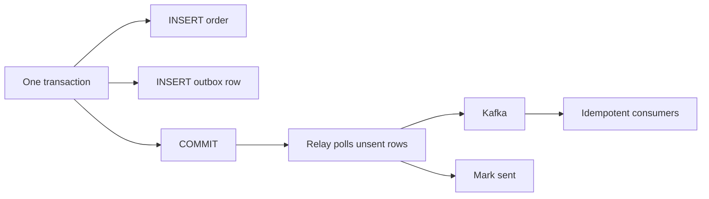

## 55.16 Cross-cutting lessons from the fifteen designs

Fifteen systems, fifteen different problem statements, fifteen different bills. And yet if you read the deep-dive sections back to back, the same nine or ten mechanisms keep appearing, wearing different clothes. That repetition is the real content of this part. The designs are worked examples; the patterns are the transferable skill.

Here is what actually repeated, why it repeated, and how to recognise the moment you need each one.

### 55.16.1 Idempotency is not a feature, it is the default posture

Every single design in this part has an idempotency mechanism, and in most of them it is the mechanism that makes correctness possible at all.

The URL shortener deduplicates by content hash. The authentication system rotates refresh tokens with a replay-detection window. The rate limiter accepts that a client retry consumes tokens and says so explicitly. The notification system deduplicates by `(user, template, dedupe_key)`. The upload system makes `complete` idempotent by checksum. The payment system carries an idempotency key into the provider so a retry returns the original intent instead of charging twice. The order and inventory designs make reservation a conditional update. The e-commerce checkout enforces `UNIQUE (idempotency_key)` on orders. The feed's fan-out is `ZADD` with a deterministic member, which is idempotent by the nature of the data structure. The transcoder's task rows are unique on `(job_id, step, rendition)` and write to deterministic S3 keys. The scheduler's `UNIQUE (job_name, scheduled_for)` turns split-brain into a metric.

The reason is the same in all fifteen cases and it is worth stating as a law: **in a distributed system, "did it happen?" is not always answerable, so every operation must be safe to attempt again.** A timeout is not a failure; it is an unknown. The client cannot tell the difference between a request that never arrived, one that succeeded but whose response was lost, and one that is still running. So the client retries, and it is right to retry.

There are only three ways to be idempotent, and every design in this part uses one of them:

1. **A natural key with a uniqueness constraint.** `UNIQUE (job_name, scheduled_for)`, `PRIMARY KEY (post_id, user_id)` on likes, `PRIMARY KEY (promotion_id, customer_id)` on redemptions. The database refuses the duplicate. This is the strongest form because it does not depend on anyone remembering to check.
2. **A client-supplied key stored with the result.** `Idempotency-Key` on checkout and on post creation, `dedupe_key` on scheduled runs. The second request returns the first request's stored response. This is the right form for anything a client initiates over an unreliable network.
3. **An operation that is naturally repeatable.** `SET` instead of `INCR`, `ZADD` with a fixed member, `PUT` for a like, writing to a deterministic object key. Cheapest of all, when the domain permits it.

What does *not* work, and appears in every incident review, is "check whether it exists, then insert". Under concurrency that is a race, and the window is exactly as wide as your network latency.

### 55.16.2 The outbox: the only honest way to write to two places

Six designs write to a database and publish an event, and all six use the transactional outbox: notifications, chat, payments, orders, the feed, e-commerce.

The problem is always identical. You need `COMMIT` and `producer.send()` to happen together, and they cannot, because they are different systems with no shared transaction. If you publish first and the commit fails, consumers act on something that never happened. If you commit first and the publish fails, the world never learns about something that did.

The outbox resolves it by making the *intent to publish* part of the same transaction as the data change: insert the row, insert the outbox row, commit. A relay reads unsent outbox rows and publishes them, marking each sent afterwards. Delivery becomes at-least-once, never zero-times, and consumers handle duplicates because of 55.16.1.



The cost is one extra table, a relay process with leader election, and a small publish delay (typically under a second with `LISTEN/NOTIFY` or a 200 ms poll). The alternative, sometimes called "just publish after commit and hope", works fine until the pod is `OOMKilled` in the gap, and then it produces the class of bug that takes three days to find because the database and the message log disagree about reality.

### 55.16.3 Keyset pagination, never offsets

The feed, chat history, order history, notification inbox, comment threads, run history and search results all paginate, and none of them uses `OFFSET`.

Two reasons, and the second is the one people forget. First, cost: `LIMIT 20 OFFSET 100000` makes PostgreSQL find and discard 100,000 rows, so page 5,000 is 5,000 times more expensive than page one. Second, correctness: on a list where rows are inserted at the head, offsets shift under the reader. A user scrolling a feed while new posts arrive sees duplicates and misses items, and no amount of database tuning fixes it because the bug is in the addressing scheme.

The keyset form is always the same shape: order by a stable, unique, monotonic key and ask for rows strictly beyond the last one you saw.

```sql
SELECT * FROM orders
 WHERE customer_id = $1 AND (created_at, id) < ($2, $3)
 ORDER BY created_at DESC, id DESC
 LIMIT 20;
```

The tuple comparison matters: `created_at` alone is not unique, so ties would be skipped or repeated. The index must match the order exactly (`(customer_id, created_at DESC, id DESC)`), and then every page costs the same as the first. Encode the cursor as an opaque base64 string so clients cannot construct one and you can change the internals later. This is why the feed uses Snowflake ids: a single 8-byte, time-ordered, unique value that serves as primary key, sort key and cursor at once.

### 55.16.4 Redis plus PostgreSQL, and knowing which one is the truth

Every design uses both, and the discipline that keeps them sane is a single question asked of every piece of state: **if this store is wiped right now, what have we lost?**

If the answer is "nothing but speed", Redis can hold it. Feeds, product read models, hydration caches, session lookups, watch progress, availability badges, policy caches: all rebuildable from PostgreSQL, all in Redis, all with a rebuild path that is written and tested before it is needed.

If the answer is "money, an audit trail, or something a customer will call about", PostgreSQL holds it. Orders, payments, inventory ledgers, job definitions and execution keys, posts, follows, users.

The interesting middle is state that lives in Redis for performance but must not be lost: the rate limiter's token buckets (losing them means a brief over-allowance, accepted), the cart (losing it costs a sale, so it is backed up asynchronously to PostgreSQL), the flash-sale stock counter (losing it is contained because the real constraint is a `CHECK` in the database). In each case the design names the consequence of loss and then chooses deliberately. That naming is the whole discipline. "We put it in Redis because it is fast" is not a design decision; "we put it in Redis, and if Redis dies we lose at most five seconds of cart edits, which we accept" is.

Two rules fall out of this that appear in almost every design. **Redis is never the only place a limit is enforced** when the limit protects money or stock; the database has the authoritative constraint. And **every cache has a documented rebuild path**, because the day the cache is empty for everyone at once is the day you find out whether one exists.

### 55.16.5 Per-key ordering is the only ordering you get

Kafka, SQS FIFO and every partitioned log give ordering *within a partition*, never globally. Six designs depend on this, and all six choose their partition key to make the ordering they need line up with the key they have.

`post.created` is keyed by author id, so a create and a delete for the same author cannot be processed out of order. `order.lifecycle` is keyed by order id, so `paid` cannot overtake `confirmed` and the notification worker cannot send "shipped" before "confirmed". `social.engagement` is keyed by post id, which lets the aggregator batch all likes for one post in one consumer. `transcode.task` is keyed by job id, so the orchestrator sees ordered completions per video. Chat messages are keyed by conversation id, because ordering within a conversation is the product and ordering across conversations is meaningless.

The tradeoff is always the same and it is worth naming: the key that gives you the ordering you need is also the key that creates your hot partition. A viral post, a celebrity author, a huge tenant, a single hot video: all of them concentrate on one partition. The standard escape is a composite key (`postId:bucket`) applied only to keys detected as hot, with the consumer summing the buckets. You give up strict ordering for that key in exchange for throughput, which is acceptable for counters and unacceptable for state transitions.

If you need global ordering, you do not need a distributed system; you need one writer. Say so early.

### 55.16.6 Read models: pre-compute what is read a thousand times more often than it is written

The product page, the order history page, the feed entry, the chat conversation list, the video watch page and the notification inbox are all read models: denormalised documents assembled by a worker consuming events, stored as a single blob, fetched with one key lookup.

The arithmetic that justifies them is always a ratio. The e-commerce product page is read 83,500 times a second at peak and changes a few times a day. Rendering it from normalised tables costs a join across products, variants, inventory, reviews and promotions; rendering it from a Redis `GET` costs 0.3 ms. When the read-to-write ratio is above roughly a hundred to one, pre-computing wins, and above a thousand to one it is not really a choice.

The three things that make read models work in production, all of which appear in these designs:

- **The projector is idempotent and replayable.** You will need to rebuild a projection because of a bug, and you must be able to do it without stopping writes.
- **Projection lag is a monitored metric with an alert.** A read model is a promise about staleness; unmonitored, it becomes a promise about nothing.
- **Anything that must be correct is re-verified at the decision point.** The e-commerce checkout re-reads the price from the source of truth even though the page came from a read model, because a stale page must never produce a wrong charge. Search indexes match and rank; they never decide.

### 55.16.7 Partitioning by time or by tenant

Large tables in these designs are partitioned exactly two ways, and the choice follows the access pattern mechanically.

**By time** when data has a natural lifetime and queries are recent-biased: posts, orders, order events, job runs, notification logs, chat messages, video stats. The benefits are retention as `DETACH PARTITION` instead of a multi-hour `DELETE`, indexes small enough to stay in memory for the hot partition, and vacuum that only ever touches the current partition. The cost is partition management, which must run ahead of time — the scheduler creates partitions three weeks in advance precisely because a missing partition turns every insert into an error at a calendar boundary, at midnight, when nobody is awake.

**By hash of a key** when there is no time dimension, only point lookups, and the goal is spreading write load: likes by post id, feed entries by user id, watch progress by user id, order events by order id. This avoids the tail-of-the-index hotspot that a monotonic key creates.

**By tenant** when isolation matters more than balance: a large tenant gets its own partition or its own schema so its volume, its vacuum behaviour and its slow queries do not affect anyone else. The scheduler, the rate limiter and the e-commerce platform all carry a tenant dimension for exactly this reason, even before it is strictly needed, because retrofitting a tenant column into a hundred queries is a year of work.

### 55.16.8 State machines with append-only event tables

Orders, payments, transcode jobs, scheduled runs, chat message delivery, upload sessions and checkout sagas are all state machines, and all of them keep two things: a `state` column for querying, and an append-only event table for truth.

The `state` column answers "show me all pending orders over 500 EUR" with a `WHERE` clause. The event table answers "what actually happened, in order, and when" — which is the first question in every payment dispute, every "my job did not run" ticket and every post-incident review. Keeping both is a deliberate middle path between a bare status field (fast, unauditable) and full event sourcing (auditable, and a much larger commitment).

Three properties make this pattern pay off:

- **Transitions are validated, not assigned.** `order.transitionTo('paid')` checks that the current state permits it and throws otherwise. A state machine implemented as scattered `UPDATE ... SET state = ...` statements is not a state machine; it is a set of race conditions with a naming convention.
- **The event row is written in the same transaction as the state change**, usually alongside the outbox row. Otherwise the history lies.
- **Illegal transitions are a metric.** Their count should be zero, and when it is not, it points at the bug faster than any log search.

### 55.16.9 The hybrid fan-out

The last pattern is the most specific and the most instructive, because it is the one where arithmetic, not taste, produces the answer.

Whenever one write must reach many readers, there are exactly three strategies: push at write time into every reader's materialised list, pull at read time and merge, or split the population and do both. The feed uses it for celebrities. The notification system uses it for broadcast campaigns versus personal alerts. The chat system uses it for large group conversations versus one-to-one. The inventory and pricing designs use it for cache invalidation of very popular SKUs.

The decision is a single comparison. Push costs `followers x posts` writes. Pull costs `followees x reads` reads. With 50 million daily actives, ordinary accounts make push cheap (200 followers, 10 million posts a day, 2 billion writes spread over 24 hours) and celebrity accounts make it impossible (one account with 50 million followers occupies the entire Redis cluster for 12.5 seconds per post). So you set a threshold, push below it, pull above it, and merge at read time. The threshold is a runtime-tunable number, not a constant in code, because during an incident lowering it is the fastest available mitigation.

Recognise this pattern by its shape rather than its domain: **a heavy-tailed distribution where the mean is harmless and the tail is fatal.** The general answer is never "pick one strategy"; it is "pick a threshold, handle each side with the strategy that suits it, and make the threshold adjustable at runtime".

### 55.16.10 Each design, its hardest problem, and the pattern that solved it

| # | Design | The single hardest problem | The pattern that solved it |
|---|---|---|---|
| 55.1 | URL Shortener | 10,000 redirects per second that must never hit disk, with unique short codes generated concurrently | Redis-first read path with PostgreSQL as truth, plus pre-allocated id ranges and a content hash for idempotent creation |
| 55.2 | Authentication System | A stolen refresh token is indistinguishable from a legitimate one | Refresh-token rotation with reuse detection: an append-only token family where replaying a rotated token revokes the whole family |
| 55.3 | Rate Limiter | One shared counter across sixty pods, decided in under 2 ms | An atomic Lua token bucket on the Redis server clock, plus local hybrid buckets for hot subjects |
| 55.4 | Notification System | The same event must not notify a user twice across three channels and many retries | Deduplication keys plus the outbox, with per-user ordering from the partition key |
| 55.5 | File Upload System | The client, S3 and the database must agree that an upload finished | Presigned multipart upload with an idempotent, checksum-verified `complete` step and a state machine over the session |
| 55.6 | Chat System | Ordering and delivery guarantees across devices that are offline half the time | Per-conversation sequence numbers with per-key ordering in the log, and an append-only message table read by keyset |
| 55.7 | Payment System | Money that has moved in a system you do not control | Idempotency keys passed to the provider, authorise-then-capture, signed deduplicated webhooks, and a reconciliation job as the safety net |
| 55.8 | Order Management System | Many partial failures across many downstream systems | An orchestrated saga over an explicit state machine with an append-only `order_events` table and compensations |
| 55.9 | Inventory System | Two customers buying the last unit at the same millisecond | A conditional `UPDATE ... WHERE on_hand - reserved >= qty` plus a `CHECK` constraint, so the database refuses to oversell |
| 55.10 | Food Delivery System | Assigning couriers on live, constantly changing geospatial state | Redis geospatial indexes as the hot read model with PostgreSQL as truth, and per-order state machines for the handoffs |
| 55.11 | Ride Booking System | Matching supply and demand in real time without double-assigning a driver | A short-lived distributed lock or conditional claim per driver, with per-driver ordering and an expiring offer state machine |
| 55.12 | Social Media Feed | One post from an account with fifty million followers | Hybrid fan-out: push below a follower threshold, pull above it, merged at read time over capped Redis sorted sets |
| 55.13 | Video Streaming Platform | Egress cost, and a multi-step pipeline that must survive crashes at any step | Unique `(job, step, rendition)` task rows with deterministic output keys and leases, plus immutable versioned CDN paths |
| 55.14 | E-commerce Platform | Payment captured but the order not created | Ordered saga with the irreversible step last, a `UNIQUE (idempotency_key)` on orders, and a provider reconciler that sweeps the gap |
| 55.15 | Distributed Job Scheduler | Two schedulers, one clock, and a job that must run exactly once | `UNIQUE (job_name, scheduled_for)` as an idempotent execution key, with `FOR UPDATE SKIP LOCKED` claims and heartbeat leases |

Read that table twice. Nine of the fifteen hardest problems are some form of "this might happen twice", and every one of them is solved by a uniqueness constraint or a stable key rather than by coordination. That is the single most useful thing to carry out of Part 55.

### 55.16.11 What senior engineers refused to do

The absences are as consistent as the patterns.

No design used a distributed transaction or two-phase commit. Where atomicity across systems was needed, a saga with explicit compensation and a state machine did the job, because 2PC turns two systems' availability into their product and blocks on a coordinator failure.

No design put a synchronous third-party call inside a database transaction. Payment providers, carriers, tax services and transcoders are all called outside the transaction, with the state machine recording the intent before and the result after.

No design used floating point for money. Integer cents, everywhere, with the currency stored next to the amount.

No design trusted a client-supplied price, total, limit or identity. Everything that decides an outcome is recomputed server-side.

No design started with microservices. The e-commerce platform is explicit about it: a modular monolith with named seams and an extraction order, because a thirty-person team's bottleneck is coordination cost, not machine capacity, and a distributed system you did not need is a permanent tax.

And no design left a cache without a documented rebuild path, a queue without a dead-letter queue, a retry without a maximum attempt count, or a failure table with fewer than eight rows. Those four omissions are what turn a working system into a 3 a.m. page.

## Senior Checklist — Part 55

- [ ] I understand the concept
- [ ] I can explain it simply
- [ ] I can implement it
- [ ] I understand its failure modes
- [ ] I understand its scaling limitations
- [ ] I understand its security implications
- [ ] I understand its operational implications
- [ ] I can choose between alternatives
- [ ] I can explain the tradeoffs
- [ ] I can answer senior-level interview questions
- [ ] I can take a one-sentence problem statement and produce requirements, non-functional targets and constraints before drawing anything
- [ ] I can do capacity arithmetic out loud: users, DAU, RPS average and peak, read/write ratio, bytes per record, storage per year, bandwidth, cache size, connection count
- [ ] I can write an API table with method, path, request, response, status codes, idempotency and auth for any system in this part
- [ ] I can write PostgreSQL DDL with real types and constraints, and justify every index by the query it serves
- [ ] I can choose between fan-out on write, fan-out on read and a hybrid, and show the arithmetic that decides it
- [ ] I can make any write endpoint idempotent by one of the three mechanisms, and say which one I chose and why
- [ ] I can explain the transactional outbox and why publishing after commit is not equivalent
- [ ] I can write keyset pagination with a tuple comparison and the matching index, and explain why `OFFSET` breaks on a moving list
- [ ] I can decide what belongs in Redis and what belongs in PostgreSQL by naming the consequence of losing each store
- [ ] I can design a saga with explicit compensations and place the irreversible step last
- [ ] I can prevent oversell with a conditional update and a `CHECK` constraint rather than a read-then-write
- [ ] I can claim work from a table with `FOR UPDATE SKIP LOCKED`, hold it with a heartbeat lease, and recover it when the worker dies
- [ ] I can choose a Kafka partition key that gives the ordering the domain needs, and handle the hot partition it creates
- [ ] I can partition a large table by time or by hash and explain which retention and vacuum problems that solves
- [ ] I can produce a failure table with at least eight modes, each with detection, impact, mitigation and what the user sees
- [ ] I can give a 1x, 10x and 100x scaling ladder that says what concretely changes at each step
- [ ] I can estimate a monthly bill and name the dominant cost driver, and I know that in a media system it is egress
- [ ] I can name at least two alternative architectures for any design and the conditions under which each wins
- [ ] I know when *not* to build: BullMQ instead of a scheduler, a commerce platform instead of a checkout, a managed pipeline instead of a transcoder

## Part 55 — Key Takeaways

- Design is a method, not a memory: clarify, estimate, define APIs, model data, draw, deep-dive the hot path, cover the cross-cutting concerns, state tradeoffs, offer alternatives. The fifteen case studies are that method applied fifteen times.
- Numbers decide architectures. The hybrid fan-out, the queue-based flash-sale checkout, the lazy bitrate ladder and the midnight jitter were all forced by arithmetic, not by preference. Do the arithmetic before you draw the boxes.
- Assume every request will be retried. Idempotency by a uniqueness constraint, a stored client key, or a naturally repeatable operation is what separates a system that survives retries from one that double-charges.
- Never write to two systems and hope. The transactional outbox is the standard answer, and at-least-once delivery plus idempotent consumers is the standard contract.
- Redis holds what you can afford to rebuild; PostgreSQL holds what a customer will call about. Write the rebuild path before you need it, and name the loss you are accepting.
- The database's constraints are your best concurrency control. `CHECK (reserved <= on_hand)`, `UNIQUE (job_name, scheduled_for)` and `UNIQUE (promotion_id, customer_id)` prevent bugs that no amount of application-level checking can.
- Pre-compute what is read far more often than it is written, monitor its lag, and re-verify anything that decides money or permissions at the decision point.
- Ordering is per key or it does not exist. Choose the partition key for the ordering the domain needs, then plan for the hot partition that choice creates.
- Every long-running thing needs a lease, a heartbeat and a reaper: transcode tasks, scheduled runs, reservations, upload sessions and saga steps all die mid-flight eventually.
- The cost model is part of the design. In a streaming platform egress dominates; in e-commerce payment fees dwarf infrastructure; in a feed the CDN and Redis memory are the levers. Optimising the wrong layer is the most expensive kind of busy work.
- Failure tables and 1x/10x/100x ladders are where seniority shows. Anyone can draw the happy path; the job is knowing what breaks, how you find out, and what the user sees while you fix it.
- The best architecture is the simplest one that meets the requirement. Start with a modular monolith and named seams, extract a service when a specific pain justifies it, and know which battles to skip entirely by buying BullMQ, Temporal, a commerce platform or a managed pipeline instead of building one.
