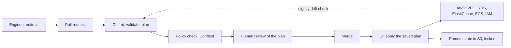

# Part 56 — Infrastructure as Code

The servers, databases, load balancers, networks and permissions your application runs on are infrastructure, and how you create and change that infrastructure matters as much as how you write code. **Infrastructure as Code (IaC)** means defining infrastructure in text files, version-controlled and applied by tooling, instead of clicking through a cloud console by hand. This Part teaches IaC from the ground up for a backend engineer: why it exists, Terraform fundamentals, state management, structuring it for many environments, the alternatives (Pulumi, CDK, CloudFormation), IaC in CI/CD, policy as code, GitOps for Kubernetes, secrets handling, and the real incident that explains why the guardrails matter.

The running example is the infrastructure for a NestJS service on AWS — a network, a PostgreSQL database, a Redis cache, a container runtime and the permissions tying them together — defined as code. This Part builds on cloud services (see Part 50 — Cloud Architecture, especially 50.13 and 50.16), Kubernetes (see Part 49 — Kubernetes, 49.19) and CI/CD (see Part 51 — CI/CD and Deployment Strategies), turning the "how do you create this infrastructure" question those raise into a disciplined, codified answer. Sections 56.1 to 56.6 introduce each idea. Sections 56.7 to 56.13 go to production depth: the Terraform language features that cause and prevent incidents (`for_each`, `moved`, `import` and `removed` blocks, lifecycle rules), layout and module versioning, Pulumi and CDK side by side, a real plan-and-apply pipeline, Rego policies, Argo CD and Kustomize, and secrets that never touch state. Section 56.14 is the full worked example in Terraform, and 56.15 retells the `terraform apply` that deleted a production database, minute by minute, with every guardrail that would have stopped it.



## 56.1 Why infrastructure as code

### 56.1.1 Clickops, reproducibility and the case for IaC

#### Concept

The alternative to IaC is **clickops**: creating and changing infrastructure by hand in the cloud provider's web console. IaC replaces that with text files that describe the desired infrastructure, which a tool reads and makes real. The infrastructure's definition becomes code: versioned in Git, reviewed in pull requests, repeatable across environments, and auditable — the same engineering discipline you apply to application code, applied to the servers it runs on.

#### Why does it exist?

Clickops does not scale and is not safe. Infrastructure built by clicking is undocumented (the only record is what exists, and you cannot easily see why or who changed it), unrepeatable (recreating it in another region or after a disaster means remembering every click), inconsistent (staging and production drift apart because they were clicked separately), and unreviewable (a wrong click in production has no pull request and no second pair of eyes). IaC exists to fix all of this: the infrastructure is described once, applied identically everywhere, changed through reviewed pull requests, and recoverable from the code. It brings version control, review, repeatability and auditability to infrastructure.

#### Mental model

Clickops is assembling furniture from memory with no instructions — it might work once, but you cannot reliably build the same thing again, nobody can check your work, and if it breaks you are guessing at what you did. IaC is having the assembly instructions written down: anyone can build the identical thing, the instructions are reviewed before use, you can see exactly what changed between versions, and if something breaks you consult the written plan. Infrastructure as code turns "I think I set it up like this" into a precise, shared, versioned document that also builds the thing.

#### How it works

```text
Clickops:                                   Infrastructure as Code:
  open the console                            write a .tf file describing the infra
  click to create a database                  commit it, open a pull request
  click to set its size, network, backups     a teammate reviews the change
  ...no record of why or who                  CI shows a plan of what will change
  recreate elsewhere = remember every click   apply -> the tool makes it real, identically
```

With IaC you write files declaring the desired state ("a PostgreSQL database of this size, in this network, with these backups"), and the tool figures out what to create, change or leave alone to match that declaration. The files live in Git, so changes go through pull requests and review (see Part 5 — Git Basics, 5.3, and Part 52 — Git from Intermediate to Senior, 52.13), and the history shows every infrastructure change with its reason. The same files applied to staging and production produce consistent environments. If the infrastructure is lost, you reapply the code. (Reapplying rebuilds the infrastructure, not the data in it: a recreated database is empty until you restore a backup, see Part 54 — Backup, Restore and Disaster Recovery.)

#### Practical example

A team runs a NestJS orders API on AWS that was built by hand two years ago: one VPC, an RDS PostgreSQL instance, an ElastiCache Redis cluster, an ECS service behind an ALB, about 15 security groups and 30 IAM policies. Nobody can say which security group rules are still needed. Staging was cloned by hand and differs in 40-odd settings. A new region launch is planned. The IaC path is incremental: write Terraform for the existing resources, adopt them into state with `import` blocks (56.7) without recreating anything, run `terraform plan` until it shows "No changes", then make every future change through a pull request. After that, the new region is the same code with a different variable file.

#### Production scenario

A company with 25 services and three environments manages about 4,000 AWS resources in roughly 60 Terraform root configurations (56.8). A typical week has 40–60 infrastructure pull requests; each shows its plan in the PR, policy checks run in about 30 seconds, and applies run from CI. The nightly drift job runs `terraform plan -detailed-exitcode` against every root and reports 2–5 drifted resources a week, almost all from emergency console fixes or AWS-side changes, each turned into code or reverted within a day. Rebuilding a full staging environment from scratch takes about 50 minutes of apply time, most of it RDS and ElastiCache creation.

#### Failure scenario (clickops disaster)

A critical production database's automated backups had been disabled months earlier — someone had clicked the setting off during a one-time maintenance task and never re-enabled it, with no record of the change. When the database later suffered corruption, there was no recent backup to restore from, and data was lost. In an IaC world, the backup setting would be declared in code (`backup_retention_period = 30`), any change to it would be a reviewed pull request with a visible reason, and drift detection (56.2) would have flagged that the live setting no longer matched the code. The invisible, unreviewed, forgotten click is exactly the failure mode IaC prevents. The lesson: infrastructure changed by hand has no record, no review and no safety net, and the gap stays hidden until it causes an incident.

#### Edge cases & failure modes

- **IaC that reverts an emergency fix.** Someone raises a connection limit by hand during an incident; the next unrelated apply quietly puts it back, and the incident recurs. Codify emergency changes the same day.
- **Partial IaC.** Half the resources in code, half by hand; the code looks authoritative but is not. Track coverage (resources in state versus resources in the account).
- **Resources created by other tools.** Auto Scaling creates instances, ECS creates tasks, Kubernetes creates load balancers; do not try to manage those in Terraform, manage the thing that creates them.
- **Console read access is still fine.** IaC does not mean nobody may look at the console; it means changes go through code.
- **IaC itself can destroy at scale.** One wrong apply can delete more in a minute than clickops could in a day; that is why 56.5 and 56.15 exist.

#### How a Senior Backend Engineer thinks about this

A senior treats all infrastructure as code and clickops as a liability to be eliminated, because unmanaged manual changes are undocumented, unrepeatable, inconsistent and unreviewable — the conditions under which quiet, dangerous drift accumulates until it causes an incident. They want every piece of infrastructure declared in version-controlled files, changed only through reviewed pull requests with a visible plan of the effect, and applied identically across environments so staging genuinely resembles production. They value the audit trail (who changed what and why) and the disaster-recovery property (the infrastructure can be rebuilt from code). They allow manual console changes only in genuine emergencies and then immediately bring the change back into code, because a live environment that no longer matches its code is drift waiting to surprise someone.

#### Common mistakes

- Managing production infrastructure by clickops, leaving it undocumented and unrepeatable.
- Making a quiet manual change (disabling a backup, opening a port) with no record or review.
- Letting staging and production drift apart because they were built by hand separately.
- Making an emergency manual change and never codifying it, creating drift.

#### Interview questions

1. **What is infrastructure as code and why use it over clickops?** Defining infrastructure in version-controlled files applied by tooling instead of manual console clicks; it brings version control, review, repeatability, consistency across environments, and auditability to infrastructure.
2. **What are the dangers of clickops?** Undocumented changes, unrepeatable setups, environment drift, no review of production changes, and no audit trail — conditions that hide dangerous misconfigurations until an incident.
3. **How does IaC help disaster recovery?** The infrastructure is described in code, so it can be reapplied to rebuild the environment identically, rather than recreated from memory.
4. **What should you do after an emergency manual change?** Bring it back into the code immediately, because a live environment that diverges from its code is drift that will surprise someone later.

#### Practical exercise

List the infrastructure for a simple web service (network, database, cache, compute, permissions) and, for each, note the problems of managing it by clickops (documentation, repeatability, review, drift) and how IaC addresses each. Then describe how the disabled-backup incident above would have been prevented by IaC. Acceptance criteria: you can articulate the four clickops problems and map each to an IaC benefit.

## 56.2 Terraform fundamentals

### 56.2.1 Providers, resources, plan and apply

#### Concept

**Terraform** is the most widely used IaC tool. You write declarations in its language (HCL) describing the resources you want — a network, a database, a server — and Terraform's workflow has two key steps: **plan** (show what changes it would make to reach the desired state) and **apply** (make those changes). A **provider** is a plugin that knows how to manage a particular platform's resources (AWS, GCP, Kubernetes). You declare the desired state; Terraform computes and applies the difference.

#### Why does it exist?

You need a tool that reads your infrastructure declarations and reconciles reality to match them — creating what is missing, changing what differs, leaving what matches, and removing what you deleted from the code. Doing this by hand (figuring out the API calls to create each resource in order, with dependencies) would be enormous and error-prone. Terraform exists to do that reconciliation declaratively and across many platforms via providers: you say what you want, it figures out how to get there, and it shows you the plan before it acts so there are no surprises.

#### Mental model

Terraform is like a meticulous contractor working from a blueprint. You hand over the blueprint (your declarations) describing the finished building. The contractor compares it to what is currently built (the current state), produces a punch list of exactly what will be added, changed or demolished (the plan), shows you that list for approval, and then does precisely that work (apply). You describe the end result; the contractor handles the ordering and the mechanics and never acts without showing you the plan first.

#### How it works

```hcl
# A provider: which platform, and its configuration.
provider "aws" {
  region = "us-east-1"
}

# A resource: a declaration of something you want to exist.
resource "aws_db_instance" "orders" {
  identifier              = "orders-db"
  engine                  = "postgres"
  engine_version          = "17"
  instance_class          = "db.r6g.large"
  allocated_storage       = 100
  backup_retention_period = 30          # declared, reviewed, cannot be quietly disabled
  multi_az                = true
  db_subnet_group_name    = aws_db_subnet_group.orders.name   # private subnets (56.14)
  vpc_security_group_ids  = [aws_security_group.orders_db.id]
  username                = "orders_admin"
  manage_master_user_password = true    # RDS generates the password in Secrets Manager (56.13)
  storage_encrypted       = true
  deletion_protection     = true        # AWS refuses to delete it, whatever Terraform says (56.15)
}

# Variables parameterize the config across environments.
variable "environment" { type = string }

# Outputs expose values (e.g. the database endpoint) for other code to use.
output "db_endpoint" { value = aws_db_instance.orders.endpoint }
```

```bash
terraform init      # download providers and set up the working directory
terraform plan      # show what Terraform WOULD change (no changes made) -- review this
terraform apply     # make the changes (after you confirm the plan)
```

The workflow's heart is **plan before apply**: `terraform plan` shows exactly what will be created, changed or destroyed, so you review the effect before anything happens. This is the safety mechanism — you never apply blind. Terraform is **declarative**: you describe the desired end state, not the steps, and it computes the difference from the current state (the **state**, 56.3) and makes only the needed changes. **Modules** (56.4) package reusable groups of resources; **variables** parameterize them; **outputs** expose values.

#### The destroy in the plan

A plan can show resources to be **destroyed** — this is where the danger lives. If you remove a resource from the code, or change a property that forces replacement, the plan shows a destroy. Reading the plan carefully for destroys, especially of stateful resources like databases, is critical: a plan that says it will destroy the production database must never be applied casually. This is the heart of the IaC incident in 56.6 and 56.15, and why the plan step and guardrails exist.

Here is what that looks like in a real plan. Changing `identifier` (or `engine`, or the subnet group, among others) cannot be done in place, so the AWS provider replaces the database:

```text
Terraform will perform the following actions:

  # aws_db_instance.orders must be replaced
-/+ resource "aws_db_instance" "orders" {
      ~ address                 = "orders-db.c9xk2l1abcd.ap-south-1.rds.amazonaws.com" -> (known after apply)
      ~ arn                     = "arn:aws:rds:ap-south-1:111122223333:db:orders-db" -> (known after apply)
      ~ identifier              = "orders-db" -> "orders-primary" # forces replacement
        instance_class          = "db.r6g.large"
        # (41 unchanged attributes hidden)
    }

Plan: 1 to add, 0 to change, 1 to destroy.
```

Three symbols to know: `+` create, `~` update in place, `-/+` destroy then create (or `+/-` create then destroy, with `create_before_destroy`). The comment `# forces replacement` names the argument responsible. For a database, `-/+` means a new, empty database and the old one deleted. Changing `instance_class` instead shows `~` (an in-place modify, applied by AWS during the next maintenance window unless `apply_immediately = true`).

#### Production scenario

For a team applying 10–20 changes a day, plans for a root configuration with 300 resources take 20–60 seconds, most of it refreshing state against AWS APIs. Applies of routine changes (a task count, a security group rule) take under a minute; creating an RDS instance takes 8–15 minutes, a Multi-AZ ElastiCache replication group 10–20 minutes. The plan is posted to the pull request, the reviewer scrolls straight to the summary line (`Plan: N to add, N to change, N to destroy`) and then to every `-/+` and `-`.

#### Failure scenario

An engineer bumped `engine_version` on a staging database from `"16.4"` to `"17"` to test an upgrade, and the plan said `~ update in-place`, which looked harmless. On apply, RDS rejected it because a major version upgrade needs `allow_major_version_upgrade = true`. After adding that, the apply succeeded, and the staging database was unavailable for about 20 minutes during the upgrade, in the middle of a QA session. Nothing was wrong with Terraform; the plan was accurate about what would change, but it does not show how long a change takes or whether it causes downtime. The lesson: a plan tells you *what* changes, not *what it costs*; for stateful resources you also need to know the provider's behaviour for that argument (in-place but with downtime, deferred to a maintenance window, or forcing replacement).

#### Edge cases & failure modes

- **`(known after apply)` hides the real value.** A plan cannot show what AWS will generate; changes that depend on those values only surface at apply.
- **Plan is a snapshot.** If someone changes the infrastructure between plan and apply, the saved plan fails to apply as "stale"; that is a feature.
- **Provider upgrades change plans.** A new provider version can add a default or change how an argument is read, showing diffs nobody wrote. Pin versions (56.7).
- **Long applies get interrupted.** A CI job killed mid-apply leaves resources created but not recorded, or a stale lock; rerun plan and reconcile before doing anything else.
- **Destroy of a resource you did not touch.** A resource that depends on a replaced one (a parameter group, a security group) can be replaced too; read the whole plan, not only the lines you expected.

#### How a Senior Backend Engineer thinks about this

A senior treats `terraform plan` as a mandatory review step and reads it carefully every time, with particular attention to anything marked for destruction or replacement, because the plan is the last chance to catch a change that would delete a database or recreate something stateful. They keep the configuration declarative and let Terraform compute the diff, rather than reasoning about imperative steps. They parameterize with variables so one configuration serves multiple environments consistently (56.4), and expose values via outputs rather than hardcoding. They know that a Terraform apply is a powerful, potentially destructive action, so they wrap it in the guardrails of the rest of this Part — plan on pull request, review, approvals, and protection on stateful resources (56.5) — and never run a casual `apply` against production without reading the plan.

#### Common mistakes

- Running `apply` without reading the `plan`, missing a destructive change.
- Not noticing a resource marked for destroy or replace, especially a stateful one (database).
- Hardcoding environment-specific values instead of using variables.
- Not using modules, so configuration is copy-pasted and drifts.

#### Interview questions

1. **What do `terraform plan` and `terraform apply` do, and why is plan important?** `plan` shows exactly what would be created, changed or destroyed without acting; `apply` makes the changes; plan is the mandatory review step that catches destructive changes before they happen.
2. **What is a provider and a resource in Terraform?** A provider is a plugin that manages a platform's resources (AWS, GCP, Kubernetes); a resource is a declaration of a piece of infrastructure you want to exist.
3. **Why is Terraform declarative, and what does it compute?** You declare the desired end state; Terraform computes the difference from the current state and makes only the needed changes.
4. **What is the most dangerous thing a plan can show, and how do you handle it?** A destroy or forced replacement of a stateful resource (like a database); read plans carefully for these and guard stateful resources against accidental destruction (56.5).

#### Practical exercise

Write a Terraform configuration declaring a PostgreSQL database with backups enabled and multi-AZ, parameterized by an `environment` variable, with the endpoint as an output. Run `terraform plan` (against a sandbox or with a dry setup) and read the plan to identify what it would create. Then change the instance class and observe whether the plan shows a modify or a replace. Acceptance criteria: you can read the plan, identify creates versus replaces, and explain why a replace of a database would be dangerous.
