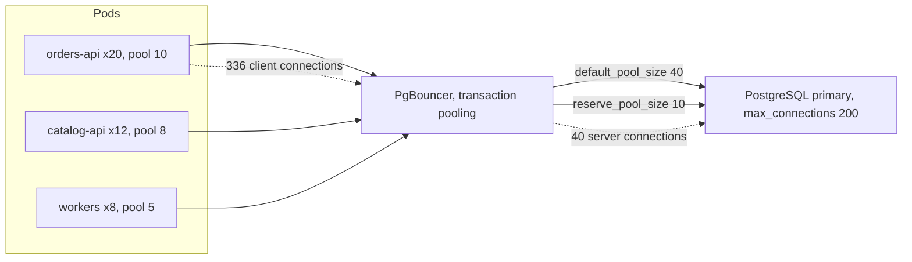
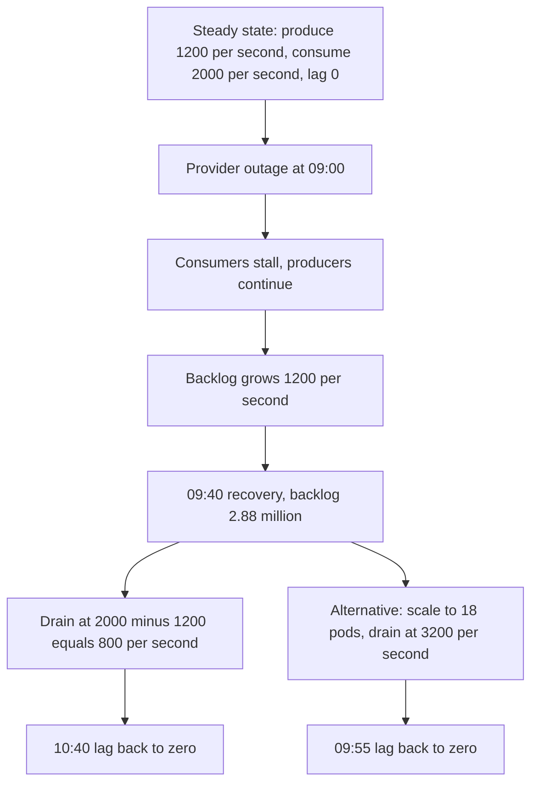

## 56.7 Connections and queues

### 56.7.1 The connection arithmetic

Every PostgreSQL connection is a process on the database server. `max_connections` is a hard wall: when you hit it, new connections get `FATAL: sorry, too many clients already` and your entire fleet starts failing at once, including the connection your on-call engineer needs to diagnose it. (PostgreSQL reserves a few slots via `superuser_reserved_connections`, which is the only reason you can still get in.)

```text
peak_connections = SUM over deployments of (replicas * pool_max) * surge_factor
                   + workers + cron + migrations + monitoring + human sessions
```

| Consumer | Replicas | Pool max | Connections |
|---|---|---|---|
| `orders-api` | 20 | 10 | 200 |
| `catalog-api` | 12 | 8 | 96 |
| `notification-worker` | 8 | 5 | 40 |
| `settlement-cron` | 2 | 5 | 10 |
| Migration job (during deploy) | 1 | 2 | 2 |
| Metrics exporter, backups, admin humans | | | 12 |
| **Subtotal** | | | **360** |
| **Rolling deploy surge** (old pods still draining while new pods start) | x1.5 typical, x2 worst case | | **540–720** |
| `max_connections` on the instance | | | **500** |

That table is an incident with a date on it. Everything is fine until the third deploy of the day, when a slow-terminating pod holds its connections a little longer than usual and the surge peak crosses 500. **The surge factor is the term everyone forgets**, and it is why connection exhaustion incidents almost always coincide with a deploy.

Two fixes, and you generally want both:

**Size the pool from Little's law, not from a feeling.** `concurrency = throughput * latency`. If a pod serves 150 RPS and the average time a connection is held is 4 ms, it needs `150 * 0.004 = 0.6` concurrent connections. A pool of 10 is 16x oversized. Pool max should be roughly `p99_hold_time * peak_rps_per_pod`, with a small floor (say 4) so a slow query does not serialize everything. Most NestJS services run pools that are 3–10x larger than they need, purely from copying a default.

**Put PgBouncer in transaction mode between them.** PgBouncer holds thousands of client connections and multiplexes them onto a small server pool, assigning a server connection only for the duration of a transaction.



Sizing the PgBouncer server pool is Little's law again: `server_connections = query_rate * average_transaction_duration`. At 3,000 transactions per second and 3 ms average duration, that is 9 concurrent server connections; set `default_pool_size = 25` for burst and `reserve_pool_size = 10`. You have turned 360 client connections into 35 server connections, and `max_connections` can now be 200 instead of 700, which also frees several gigabytes of database RAM.

The cost of transaction pooling: session-level features break. No session-scoped `SET`, no `LISTEN/NOTIFY`, no advisory locks that outlive a transaction, and prepared statements need care (`max_prepared_statements` in PgBouncer 1.21+, or disable statement caching in your driver). Know these before you deploy it, not during the incident.

### 56.7.2 Queue sizing and drain time

A queue's capacity question is not "how many messages fit". Brokers hold enormous backlogs. The real questions are **how big does the backlog get during an incident** and **how long does it take to drain afterwards**.

```text
backlog = producer_rate * outage_duration
drain_time = backlog / (consumer_rate - producer_rate)
```

The second formula only has a solution when `consumer_rate > producer_rate`. If your consumers can only just keep up in steady state, **you never recover from an outage**; the lag grows forever until you add capacity. That is why consumer capacity should be provisioned at 2–3x the producer rate, not at 1.2x.

Worked example. A notification pipeline:

| Quantity | Value | Source |
|---|---|---|
| Producer rate (peak) | 1,200 messages/s | From the RPS estimate |
| Per-consumer throughput | 250 messages/s | Measured: 4 ms per message, dominated by the provider HTTP call |
| Consumer pods | 8 | |
| Total consumer rate | 8 * 250 = **2,000/s** | |
| Headroom ratio | 2,000 / 1,200 = 1.67x | Adequate but not generous |

Now the incident: the push provider is down for 40 minutes and the consumers cannot make progress.

| Step | Formula | Value |
|---|---|---|
| Outage duration | given | 2,400 s |
| Backlog at recovery | 1,200 * 2,400 | **2,880,000 messages** |
| Drain rate | 2,000 - 1,200 | 800/s |
| **Drain time** | 2,880,000 / 800 | **3,600 s = 60 minutes** |
| Total user-visible delay for the last message | 40 + 60 | **100 minutes** |

Is 100 minutes acceptable? For a marketing push, yes. For a one-time password, catastrophically no. If the SLO is "drained within 15 minutes", solve for the consumer rate you need:

| Step | Formula | Value |
|---|---|---|
| Required drain rate | 2,880,000 / 900 s | 3,200/s |
| Required consumer rate | 3,200 + 1,200 | **4,400/s** |
| Pods needed | 4,400 / 250 | **18 pods** |
| **Partitions needed** | at least 18, round up | **24 partitions** |

And there is the decision the whole exercise existed to produce: **the partition count of the topic is a capacity decision made before the topic is created**, because a Kafka consumer group cannot have more active consumers than partitions. Increasing partitions later is possible but it rehashes key-to-partition assignment and breaks per-key ordering for in-flight keys. Estimate the *recovery* consumer count, not the steady-state one, and set partitions from that.



Also size the storage the backlog needs, because a broker with a full disk is a much worse incident than a lagging consumer:

| Quantity | Formula | Value |
|---|---|---|
| Message size | measured, including headers | 1.5 KB |
| Backlog bytes | 2.88M * 1.5 KB | 4.3 GB |
| Replication factor | 3 | 13 GB |
| Retention (7 days at peak rate, the real sizing driver) | 1,200/s * 86,400 * 7 * 1.5 KB * 3 | **3.3 TB across the cluster** |
| Per broker, 6 brokers | 3.3 TB / 6 * 1.3 headroom | **~700 GB each** |

For a BullMQ or RabbitMQ queue the arithmetic is identical, but the storage lives in Redis memory or in the RabbitMQ node's disk and RAM, and both are far less comfortable holding 3 million messages than Kafka is. **A backlog that Kafka shrugs at will OOM a Redis-backed queue**, so if your mitigation plan is "let it queue", check what "it" is made of. For BullMQ specifically: 2.88 million jobs at roughly 1.5 KB of Redis memory each (job data, options, and the several sorted sets and hashes that back a job) is around 5–7 GB of Redis, which is more than most teams provision for their queue.

## 56.8 Five worked estimations

Each of these follows the same method: assumptions, formulas, tables, sanity check, then a conclusion that names instance sizes and replica counts. Read them as templates.

### 56.8.1 An e-commerce API at 2 million daily actives

**Assumptions**

| Assumption | Value | Confidence |
|---|---|---|
| Daily active users | 2,000,000 | High (analytics) |
| API calls per user per day | 25 | Medium (counted from session traces) |
| Read:write ratio | 95:5 | High |
| Peak / average | 5x (single country, evening peak) | Medium |
| Conversion rate | 3% | High |
| Average response size | 15 KB compressed | Medium |
| Cacheable share of reads | 60%, at 95% hit ratio | Low, must be measured |

**Traffic**

| Quantity | Formula | Value |
|---|---|---|
| Requests/day | 2M * 25 | 50,000,000 |
| Average RPS | 50M / 86,400 | 580 |
| **Peak RPS** | 580 * 5 | **3,000** |
| Peak reads | 3,000 * 0.95 | 2,850 |
| Peak writes | 3,000 * 0.05 | 150 |
| Orders/day | 2M * 0.03 | 60,000 |
| Peak orders/s | 60,000 / 86,400 * 5 | 3.5 |
| Flash-sale peak on 2 endpoints | 580 * 50 | 30,000 |

**Database load**

| Path | Peak RPS | Destination |
|---|---|---|
| Cacheable reads, hits | 1,710 * 0.95 = 1,625 | Redis |
| Cacheable reads, misses | 85 | Primary |
| Staleness-tolerant reads | 800 | Read replicas |
| Strict reads (cart, stock, payment) | 340 | Primary |
| Writes, x1.6 database ops each | 240 | Primary |
| **Primary total** | **665 ops/s** | vs ~20,000 capacity: 3% utilized |
| **Replica total** | 800 | 2 replicas at 400 each |
| **Cold-cache primary total** | 665 + 1,625 | **2,290 ops/s: still survivable** |

That last row is the one that matters: the design survives a Redis restart, which means Redis is a latency optimization and not a single point of failure.

**Application tier**

| Quantity | Formula | Value |
|---|---|---|
| Measured RPS per pod (1 vCPU, mixed endpoints) | load test | 250 |
| Pods at 100% | 3,000 / 250 | 12 |
| At 65% utilization | 12 / 0.65 | 19 |
| N+1 across 3 AZs | 19 * 1.5 | 29 |
| **Deployment** | | **HPA min 12, max 40, target CPU 60%, steady 20** |

**Storage** (from section 56.5): ~370 GB hot with partitioning and retention, 800 GB provisioned per copy, 2.4 TB across primary and two replicas.

**Cache**: 3.4 GB logical, 8.3 GB provisioned (section 56.6.2).

**Connections**: 20 pods x pool 8 = 160, plus workers and cron = 210, surge x1.5 = 315. Through PgBouncer: `default_pool_size 30`, `max_connections 200`.

**Bandwidth**: 580 RPS average x 15 KB = 8.7 MB/s = 750 GB/day = 22 TB/month of JSON egress; images on the CDN.

**Conclusion**

| Component | Sizing |
|---|---|
| API | 20 pods (1 vCPU, 1 GiB), HPA 12–40 |
| PostgreSQL primary | `db.r6g.2xlarge` (8 vCPU, 64 GB), 800 GB gp3 with 6,000 provisioned IOPS |
| Read replicas | 2 x `db.r6g.xlarge` |
| PgBouncer | 2 pods, transaction pooling |
| Redis | `cache.r6g.large` primary + replica, Multi-AZ |
| Kafka | Shared cluster; `order.events` 12 partitions |
| CDN | Images and anonymous catalog pages, ~92% offload |

The whole system is one medium database. Say that out loud in the design review, because the instinct to shard at 2 million daily actives is strong and the arithmetic says it would be a self-inflicted wound.

### 56.8.2 A notification system sending 50 million pushes a day

**Assumptions**: 50M notification events/day; average 1.4 devices per user, so 70M device sends/day; a marketing campaign can target 5 million users and is expected to be delivered within 10 minutes; provider call takes 80 ms at p50, 400 ms at p99; message payload 600 bytes.

| Quantity | Formula | Value |
|---|---|---|
| Device sends/day | 50M * 1.4 | 70,000,000 |
| Average sends/s | 70M / 86,400 | 810 |
| Transactional peak (diurnal 4x) | 810 * 4 | 3,240 |
| **Campaign burst** | 5M * 1.4 / 600 s | **11,700/s** |
| **Design target** | max of the two, +20% | **14,000/s** |

**Worker sizing**

| Quantity | Formula | Value |
|---|---|---|
| Provider call latency (p50) | measured | 80 ms |
| Concurrency per pod (async HTTP, bounded) | chosen | 60 |
| Throughput per pod | 60 / 0.080 | 750/s |
| Reality factor (p99 tail, retries, JSON work) | x0.7 | 525/s |
| Pods at 100% | 14,000 / 525 | 27 |
| At 65% | 27 / 0.65 | **42 pods** |
| **Kafka partitions** | >= 42, rounded | **64** |

**Kafka**

| Quantity | Formula | Value |
|---|---|---|
| Throughput | 14,000/s * 600 B | 8.4 MB/s |
| With replication factor 3 | 8.4 * 3 | 25 MB/s of broker write |
| Retention 3 days at average rate | 810 * 86,400 * 3 * 600 B * 3 | 378 GB |
| **Brokers** | 3 (throughput is trivial; 3 is the availability floor) | **3 x `kafka.m5.large`, 500 GB each** |

**Storage**

| Table | Rows/day | Bytes/row | Per day | Retention | Steady state |
|---|---|---|---|---|---|
| `notification_log` | 70,000,000 | 220 | 15.4 GB | 30 days, daily partitions | **460 GB** |
| Indexes on it | | 0.6x | | | 276 GB |
| `device_tokens` | 60M rows total | 260 | | forever, with a pruning job | 16 GB |
| **Total** | | | | | **~750 GB provisioned** |

70 million rows a day is 810 inserts/s average and 14,000/s during a campaign. A single primary cannot absorb 14,000 individual `INSERT` statements per second, but it absorbs them easily when the worker batches: 14,000/s in batches of 500 is 28 multi-row inserts per second. **Batching is what makes this fit on one database**, and it is the design decision the estimate produces.

**Deduplication**: 70M idempotency keys per day with a 24-hour TTL. At 110 bytes each (key + value + overhead) that is 7.7 GB, fragmentation x1.3 = 10 GB, at 70% `maxmemory` = 14 GB. Two shards of `cache.r6g.xlarge` (26 GB each) gives room and halves the ops rate.

**Conclusion**

| Component | Sizing |
|---|---|
| API (accepts notification requests) | 6 pods; it only writes to Kafka |
| Sender workers | 42 pods (1 vCPU, 1 GiB), KEDA-scaled on consumer lag, min 8 max 80 |
| Kafka | 3 brokers, topic `notifications.send` with **64 partitions**, RF 3, 3-day retention |
| PostgreSQL | `db.r6g.xlarge` primary + 1 replica, 1 TB, daily partitions on `notification_log` |
| Redis (dedupe) | 2 shards x `cache.r6g.xlarge` |
| Rate limiting per provider | Token bucket at the provider's documented quota, shared across all 42 pods |

The scaling constraint is not your capacity, it is **the provider's**. FCM, APNs and every SMS gateway have per-project quotas. Estimate against their limit, not against your workers, or you will build 42 pods that spend their lives receiving 429s.

### 56.8.3 A chat system with 5 million concurrent connections

**Assumptions**: 5,000,000 concurrent WebSocket connections at peak; each connection sends 4 messages per hour; average group size 8 recipients; heartbeat every 30 seconds; message payload 250 bytes.

| Quantity | Formula | Value |
|---|---|---|
| Messages sent/s | 5M * 4 / 3,600 | 5,600/s |
| **Deliveries/s** (fan-out) | 5,600 * 8 | **44,800/s** |
| **Heartbeats/s** | 5M / 30 | **167,000/s** |
| Total socket events/s | 44,800 + 167,000 + 5,600 | **~217,000/s** |

Stop and look at that. **The heartbeat is 77 percent of the workload.** This is the single most valuable output of the estimate, and it is invisible without doing the arithmetic. It immediately produces two decisions: heartbeats must be the cheapest possible code path (no logging, no database, no Redis write, just a counter and a timestamp in the connection object), and the heartbeat interval is a capacity knob (moving from 30 s to 60 s halves 77 percent of your load, at the cost of detecting dead connections twice as slowly).

**Gateway pods**

| Quantity | Formula | Value |
|---|---|---|
| Memory per connection (JS objects + socket buffers, measured) | | 45 KB |
| Connections per pod, memory-limited | 3.5 GB usable / 45 KB | 78,000 |
| Connections per pod, event-loop-limited (measured under load) | | **50,000** |
| Pods at 100% | 5M / 50,000 | 100 |
| At 65% (a pod dying must not tip the rest) | 100 / 0.65 | **154, round to 160** |
| Reconnect storm check | if 1 pod dies, 50,000 clients reconnect within the backoff window | must be spread by jittered backoff, or 160 pods receive 312 new connections/s each: fine |

The reconnect-storm line is the one that separates a working chat system from an outage loop. If all 5 million clients reconnect at once (a load balancer restart), that is 5 million TLS handshakes; at 2,000 handshakes/s per pod that is 15 seconds of pure CPU on every pod, during which nothing else happens. Jittered exponential backoff on the client is a capacity requirement, not a nicety.

**Fan-out**: 44,800 deliveries/s must be routed to whichever pod holds each recipient's socket. Options: Redis Pub/Sub (every message goes to every pod, so 5,600 publishes/s become 5,600 * 160 = 896,000 deliveries across the fabric: wasteful but workable), or a routing table (`user_id -> pod_id` in Redis, 5M keys at 80 B = 400 MB) with direct pod-to-pod delivery. At this size, use Redis Cluster sharded Pub/Sub keyed by conversation, or a routing table.

**Presence**: 5M keys with a TTL refreshed by the heartbeat is 167,000 Redis writes/s, which exceeds a single node. Shard 4 ways (42,000/s each) or, better, keep presence in the gateway pod's memory and publish a compact delta every 5 seconds: 160 pods * 1 message/5 s is nothing.

**Storage**

| Quantity | Formula | Value |
|---|---|---|
| Messages/day | 5,600 * 86,400 | 484,000,000 |
| Bytes/row (250 B body + ids + timestamps + overhead) | | 420 |
| Per day | 484M * 420 | **203 GB/day** |
| 90-day hot retention | 203 * 90 | 18 TB |
| Indexes | 0.5x | 9 TB |

18 TB of hot data at half a billion rows a day is past the comfortable range of a single PostgreSQL primary. This is where the estimate legitimately produces "you need a different database": either PostgreSQL partitioned by month **and** sharded by conversation id across 8 primaries, or a wide-column store (Cassandra/ScyllaDB/DynamoDB) whose data model is exactly "rows sorted by time within a partition key". Archive to Parquet on S3 after 90 days.

**Conclusion**: 160 gateway pods (2 vCPU, 6 GiB) behind an NLB; 24 fan-out worker pods; Redis Cluster of 6 shards (`cache.r6g.xlarge`) for routing and presence; 8 sharded PostgreSQL primaries (`db.r6g.4xlarge`, 4 TB each) with monthly partitions, or ScyllaDB with 12 nodes; Kafka with 48 partitions for the delivery-receipt stream.

### 56.8.4 Event ingestion at 100,000 events per second

**Assumptions**: 100,000 events/s sustained, 250,000/s peak; average event 800 bytes JSON; clients batch 500 events per HTTP request with gzip; retention 3 days in Kafka, 90 days in the analytics store.

| Quantity | Formula | Value |
|---|---|---|
| Bytes/s in (raw) | 100,000 * 800 B | 80 MB/s |
| Compressed on the wire (gzip ~6x on JSON) | 80 / 6 | 13 MB/s |
| **HTTP requests/s** | 100,000 / 500 | **200 RPS** |
| Events/day | 100,000 * 86,400 | 8.64 billion |
| Raw bytes/day | 8.64B * 800 B | **6.9 TB/day** |

**200 RPS.** That is the payoff of batching, and it is why an ingestion endpoint is a small service and not a heroic one. Without batching this would be 100,000 RPS and a completely different (and far more expensive) architecture.

**Ingest tier**

| Quantity | Formula | Value |
|---|---|---|
| CPU per batch (gunzip 130 KB + parse + validate 500 events + produce) | measured | 22 ms |
| Batches/s per vCPU | 1,000 / 22 | 45 |
| vCPU at peak (250,000/s = 500 batches/s) | 500 / 45 | 11 |
| At 60% utilization | 11 / 0.6 | 19 |
| **Pods** (1 vCPU each) | | **20, HPA 8–40** |

**Kafka**

| Quantity | Formula | Value |
|---|---|---|
| Producer throughput (snappy-compressed, ~4x) | 80 MB/s / 4 | 20 MB/s |
| With RF 3 | 60 MB/s of broker write | |
| Storage, 3-day retention | 20 MB/s * 86,400 * 3 * 3 | **15.5 TB** |
| Brokers at 70% of 4 TB each | 23.5 / (4 * 0.7) | 6 brokers |
| Partitions: throughput floor | 20 MB/s / 10 MB/s per partition | 2 |
| Partitions: consumer parallelism | consumer does 6,000 events/s; 250,000 / 6,000 = 42 consumers | 48 |
| **Partitions** | max of the two, with headroom | **96** |

Note how the partition count is driven entirely by consumer parallelism, never by throughput. That is almost always true, and it is why "how many partitions?" is answered by "how fast is one consumer, and what recovery time do you need?"

**Analytics store**

| Quantity | Formula | Value |
|---|---|---|
| Raw/day | | 6.9 TB |
| Columnar compression (ClickHouse / Parquet, 8–12x on event data) | 6.9 / 10 | 690 GB/day |
| 90-day retention | 690 GB * 90 | **62 TB** |
| ClickHouse nodes at 70% of 20 TB | 62 / 14 | **5 nodes, use 6 for replication** |

**Conclusion**: 20 ingest pods (1 vCPU, 512 MiB) behind an ALB; Kafka 6 brokers (`kafka.m5.2xlarge`, 4 TB gp3), topic `events.raw` with 96 partitions and RF 3; 45 consumer pods writing batched inserts to ClickHouse; ClickHouse 6 nodes (16 vCPU, 64 GB, 20 TB); S3 for archive beyond 90 days at roughly USD 0.023/GB. **PostgreSQL appears nowhere in this design**, which is the correct answer for append-only analytical data at this rate and the thing the arithmetic proves in thirty seconds.

### 56.8.5 Ride-hailing location updates from 500,000 drivers every three seconds

**Assumptions**: 500,000 drivers online at peak; one location update every 3 seconds; payload 120 bytes; 200,000 ride requests/day; matching searches a 3 km radius.

| Quantity | Formula | Value |
|---|---|---|
| **Updates/s** | 500,000 / 3 | **166,700/s** |
| Bytes/s | 166,700 * 120 B | 20 MB/s |
| Updates/day | 166,700 * 86,400 | 14.4 billion |
| Ride requests peak/s | 200,000 / 86,400 * 6 | 14/s |

**The single most important line of this estimate**: 166,700 writes per second is 20–50x what one PostgreSQL primary can do. **Location updates never touch the relational database.** If someone proposes `UPDATE drivers SET lat = $1, lng = $2 WHERE id = $3`, the arithmetic ends the conversation in one line.

**Ingest tier**: persistent connections (WebSocket or MQTT), 500,000 of them.

| Quantity | Formula | Value |
|---|---|---|
| Connections per pod | measured | 50,000 |
| Pods for connections | 500,000 / 50,000 / 0.65 | 16 |
| CPU per update (parse, validate, geohash, pipeline to Redis) | measured | 55 us |
| vCPU for 166,700/s | 166,700 * 0.000055 | 9.2 |
| At 60% | 9.2 / 0.6 | 15 |
| **Pods** | max of the two | **16 pods (1 vCPU, 4 GiB)** |

**Redis geospatial index**

| Quantity | Formula | Value |
|---|---|---|
| Ops/s (`GEOADD`) | 166,700 | Exceeds one node (~120,000/s comfortable) |
| Shards, by city or geohash prefix | 166,700 / 25,000 target per shard | **8 shards** |
| Memory: 500,000 drivers in a sorted set | 500,000 * ~90 B + per-city set overhead | ~50 MB total |
| `GEOSEARCH` rate | 14/s, returning ~40 drivers each | Trivial |

The memory is nothing; the **operation rate** is what forces sharding. That is a common shape: geospatial state is small and hot. Batch with pipelining (each pod pipelines 200 updates per round trip, turning 166,700 commands/s into 830 round trips/s) and the shard count could drop, but keep the shards for failure isolation by city.

**The trail question.** Storing every point is 14.4 billion rows/day; at 40 bytes packed that is 576 GB/day and 52 TB over 90 days. Ask the product question: who reads a driver's location from last Tuesday? The answers are trip replay for disputes, and analytics.

| Policy | Rows/day | Bytes/day | 90 days |
|---|---|---|---|
| Every point, every driver, always | 14.4B | 576 GB | 52 TB |
| Only during an active trip (100k concurrent trips, avg 18 min) | 2.9B | 116 GB | 10.4 TB |
| Active trips, downsampled to 1 point per 15 s | 576M | 23 GB | **2.1 TB** |
| Plus full resolution kept 7 days for dispute windows | +116 GB * 7 | | +0.8 TB |

A 25x reduction from two product questions. Write the trail as Parquet on S3 partitioned by date and city, not into PostgreSQL. PostgreSQL holds the small, transactional part: drivers, trips, fares, payments, at roughly 200,000 trips/day and a few hundred writes per second, which is comfortable on one `db.r6g.2xlarge`.

**Conclusion**: 16 ingest pods; Redis Cluster of 8 shards (`cache.r6g.large`) for live positions and presence; Kafka with 32 partitions for the raw location stream feeding the archiver; 6 archiver pods writing Parquet to S3; PostgreSQL `db.r6g.2xlarge` primary + 1 replica for the transactional core; matching service 8 pods.

