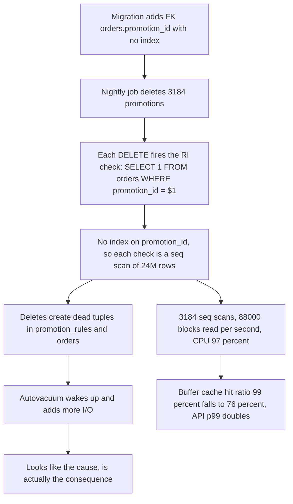
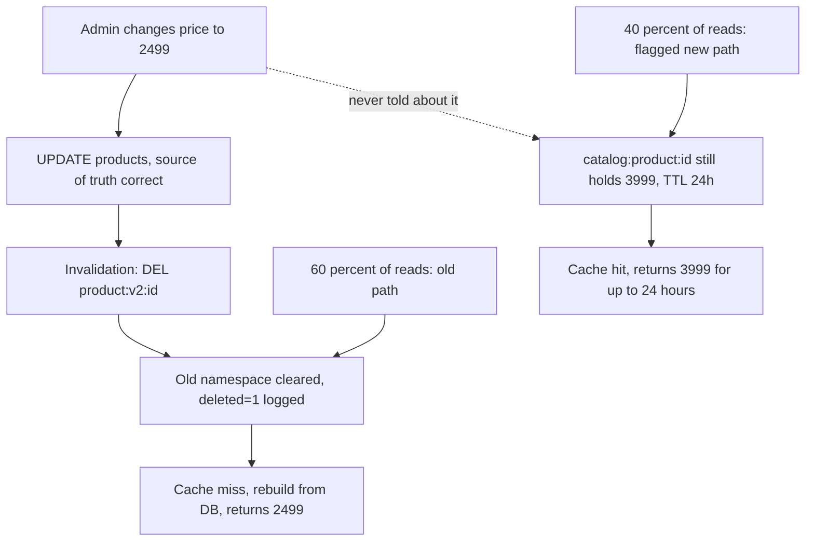

## 57.2 PostgreSQL CPU is at 100 percent

### Symptom

**02:41** — `RDS CPUUtilization > 90% for 15m` on `orders-primary`. API p99 has doubled from 220 ms to 480 ms but nothing is failing. The alert has fired at roughly the same time on each of the last three nights, and each time the previous on-call acknowledged it and it cleared by 05:00. Tonight the on-call is annoyed enough to actually look.

### First five minutes (mitigation)

Nothing is broken for users yet, so the mitigation bar is low and the diagnostic value of watching it live is high. The on-call does one cheap protective thing:

```sql
SET statement_timeout = '60s';  -- for their own session only
```

and starts observing rather than acting. That is a defensible senior choice: mitigating a recurring, non-user-impacting event before understanding it guarantees a fourth night.

### Metrics

| Signal | Value | Note |
|---|---|---|
| RDS CPU | 97% | Pinned since 02:05 |
| RDS `blks_read` | 88,000/s | Massive sequential I/O |
| Buffer cache hit ratio | 76% | Normally 99.3% |
| `DatabaseConnections` | 71 | Normal |
| Write IOPS | 4,100 | Elevated but not extreme |
| API RPS | 40 | It is 02:41; almost no user traffic |

Forty requests per second and 97 percent CPU. Whatever is burning the database is not user traffic.

### Logs

```text
02:00:04 [batch] INFO  promotions.expiry job started, correlationId=b41c2f19
02:00:04 [batch] INFO  found 3184 promotions to expire
02:41:52 [batch] INFO  processed 940 / 3184
```

Forty-two minutes to process 940 rows: 2.7 seconds per row. The job deletes expired promotions and their eligibility rows.

### Traces

The batch job is instrumented. One iteration:

```text
promotions.expiry.iteration                    2,684 ms
├── db.query promotions.findOne                     2 ms
├── db.query promotion_rules.delete                 4 ms
└── db.query promotions.delete                  2,671 ms   <-- a single-row DELETE by primary key
```

A `DELETE` of one row by primary key taking 2.7 seconds is the kind of observation that should stop you cold. A primary key delete is microseconds. Something is happening *because* of the delete, not in it.

### Application

```ts
// src/promotions/promotion-expiry.job.ts
@Cron('0 0 2 * * *')
async expirePromotions(): Promise<void> {
  const expired = await this.promotions.find({ where: { endsAt: LessThan(new Date()) } });
  this.logger.log(`found ${expired.length} promotions to expire`);
  for (const p of expired) {
    await this.rules.delete({ promotionId: p.id });
    await this.promotions.delete(p.id);   // 2.7 s each
  }
}
```

Loop-per-row is not efficient, but it is not the problem either; 3,184 fast deletes would take seconds.

### Database

```sql
SELECT pid, now() - query_start AS age, state, wait_event_type, wait_event, left(query, 90)
FROM pg_stat_activity
WHERE state <> 'idle' AND backend_type = 'client backend'
ORDER BY age DESC LIMIT 10;
```

```text
  pid  |      age       | state  | wait_event_type | wait_event |                      left
-------+----------------+--------+-----------------+------------+-------------------------------------------
 30412 | 00:00:02.41    | active | IO              | DataFileRead | DELETE FROM promotions WHERE id = $1
 30418 | 00:00:00.19    | active |                 |            | SELECT o.id, o.status FROM orders o WHERE
 29901 | 00:04:11.02    | active | IO              | DataFileRead | autovacuum: VACUUM public.orders
 29903 | 00:02:55.71    | active | IO              | DataFileRead | autovacuum: VACUUM public.promotion_rules
```

**The red herring appears here.** Two autovacuum workers are visible, both doing heavy I/O, and it is tempting to conclude that autovacuum is eating the database. Several teams "fix" this by disabling autovacuum, which converts a nightly slowdown into a permanent catastrophe three weeks later.

The senior test: is autovacuum a cause or a consequence? Check the order of events. Autovacuum on `orders` started at **02:29**, twenty-four minutes *after* the CPU went to 97 percent at 02:05. It is also vacuuming `promotion_rules`, the very table the batch job has been deleting from. Autovacuum is downstream of the batch job, not upstream. It is the cleanup crew, not the vandal. Theory discarded at 02:52.

Now the real question: why is a primary key `DELETE` slow? `pg_stat_statements`:

```sql
SELECT calls, round(total_exec_time::numeric) AS total_ms, round(mean_exec_time::numeric,1) AS mean_ms,
       left(query, 120) AS query
FROM pg_stat_statements ORDER BY total_exec_time DESC LIMIT 5;
```

```text
 calls | total_ms  | mean_ms |                                      query
-------+-----------+---------+-------------------------------------------------------------------------
   940 | 2510440   |  2670.7 | SELECT 1 FROM ONLY "public"."orders" x WHERE $1 OPERATOR(pg_catalog.=)
       |           |         | "promotion_id" FOR KEY SHARE OF x
   940 |    3760   |     4.0 | DELETE FROM promotion_rules WHERE promotion_id = $1
  8821 |    1102   |     0.1 | SELECT o.id, o.status, o.total_amount FROM orders o WHERE o.user_id = $1
```

That first query is not written by anyone. It is the **referential integrity trigger** PostgreSQL runs internally to enforce a foreign key: before deleting a `promotions` row, it must verify that no `orders` row references it. And it is doing so with a sequential scan of 24 million rows, 940 times.

```sql
EXPLAIN (ANALYZE, BUFFERS)
SELECT 1 FROM ONLY public.orders x WHERE '9f2a...'::uuid = promotion_id FOR KEY SHARE OF x;
```

```text
LockRows  (cost=0.00..1301882.00 rows=1 width=38) (actual time=2664.9..2664.9 rows=0 loops=1)
  ->  Seq Scan on orders x  (cost=0.00..1301872.00 rows=1 width=38) (actual time=2664.9..2664.9 rows=0 loops=1)
        Filter: ('9f2a...'::uuid = promotion_id)
        Rows Removed by Filter: 24118780
        Buffers: shared hit=2104 read=1041013
Execution Time: 2664.98 ms
```

Confirmed. Find every foreign key in the database with no supporting index:

```sql
SELECT c.conrelid::regclass AS child_table,
       a.attname            AS fk_column,
       c.confrelid::regclass AS parent_table
FROM pg_constraint c
JOIN unnest(c.conkey) WITH ORDINALITY AS k(attnum, ord) ON true
JOIN pg_attribute a ON a.attrelid = c.conrelid AND a.attnum = k.attnum
WHERE c.contype = 'f'
  AND NOT EXISTS (
    SELECT 1 FROM pg_index i
    WHERE i.indrelid = c.conrelid
      AND (i.indkey::smallint[])[0] = k.attnum   -- FK column is the leading index column
  )
ORDER BY 1;
```

```text
 child_table |    fk_column    | parent_table
-------------+-----------------+--------------
 orders      | promotion_id    | promotions
 order_items | gift_wrap_id    | gift_wraps
```

Two of them. The `promotion_id` column was added by a migration eleven days earlier with `ADD CONSTRAINT ... FOREIGN KEY` and no index.

### Infrastructure

Nothing. Instance class unchanged, storage 63 percent, no throttling, no failover. Confirmed in two minutes and dismissed.

### Root cause

A foreign key `orders.promotion_id -> promotions.id` was created without an index on the child column. PostgreSQL creates an index automatically for a primary key and for a unique constraint, but **never for a foreign key's referencing column**. Every `DELETE` or key `UPDATE` on the parent therefore triggers a full sequential scan of the 24-million-row child table. The nightly expiry job performs 3,184 such deletes, so the job costs 3,184 sequential scans of `orders`, which is roughly 3.3 billion row examinations and a saturated CPU for three hours. Autovacuum on the churned tables was a consequence.



### Fix

```sql
CREATE INDEX CONCURRENTLY idx_orders_promotion_id ON orders (promotion_id)
  WHERE promotion_id IS NOT NULL;   -- partial: only 4% of orders have a promotion
CREATE INDEX CONCURRENTLY idx_order_items_gift_wrap_id ON order_items (gift_wrap_id)
  WHERE gift_wrap_id IS NOT NULL;
```

Built in 90 seconds; the partial index is 38 MB instead of 800 MB. The next night's job finished in 41 seconds with database CPU peaking at 34 percent.

Also fix the job so it does set-based work rather than a loop:

```ts
await this.dataSource.transaction(async (m) => {
  const ids = await m.query(
    `SELECT id FROM promotions WHERE ends_at < now() ORDER BY id LIMIT 500 FOR UPDATE SKIP LOCKED`);
  if (ids.length === 0) return;
  const list = ids.map((r: { id: string }) => r.id);
  await m.query(`DELETE FROM promotion_rules WHERE promotion_id = ANY($1)`, [list]);
  await m.query(`DELETE FROM promotions WHERE id = ANY($1)`, [list]);
});
// called in a loop until it returns nothing: batches of 500, each its own transaction
```

Batching in chunks of 500 with a transaction per chunk keeps lock durations short and lets autovacuum keep up, which is exactly what a long single transaction prevents.

### Prevention

- **A CI check that fails any migration adding a foreign key without an index on the referencing column.** Run the `pg_constraint` query above against the migrated schema in the pipeline and fail the build on any row. This is the single highest-value prevention item in this scenario, because the mistake is invisible in review and expensive in production.
- **Alert on database CPU above 80 percent for 10 minutes, regardless of time of day.** The alert existed; what was missing was the expectation that somebody investigate rather than acknowledge. Add a runbook link to the alert.
- **Batch jobs get their own `application_name` and their own `statement_timeout`.** A job that would take 2.7 s per statement should fail loudly, not run for three hours.
- **Schedule batch jobs against the traffic curve**, and give them a lower-priority connection budget so they cannot starve interactive traffic.
- **Track the "unindexed foreign keys" query as a weekly report**, because constraints get added by many hands.

### Junior versus senior

| | Junior | Senior |
|---|---|---|
| Sees autovacuum in `pg_stat_activity` | "Autovacuum is killing us" and considers disabling it | Checks the *start time* of autovacuum against the start of the CPU spike; concludes consequence, not cause |
| Reads `pg_stat_statements` | Skips the query they did not write | Recognises the RI trigger text as PostgreSQL's own foreign key check |
| Fix | Bigger instance class | An index, a partial one, plus the CI check that stops the class of bug |
| Recurring alert | Acknowledges it three nights running | Treats the third occurrence as a design problem, not an ops problem |

## 57.3 Redis is returning stale data

### Symptom

**10:18** — the merchandising manager messages the team channel: "I dropped the price on the winter jacket to 2,499 forty minutes ago. The app still shows 3,999. The admin panel shows 2,499." Support has four tickets from customers whose cart total does not match the listing price.

Reproducing it is maddening: refreshing the product page shows 3,999, then 2,499, then 3,999 again. Roughly 40 percent of requests return the old price.

Intermittent wrong data with a stable error rate is the signature of a **cache coherence** problem, and the "sometimes correct" pattern specifically points at *some* copies being updated and others not.

### First five minutes (mitigation)

Wrong prices are a commercial and legal problem, so mitigate immediately and diagnose after. The safe blunt instrument:

```bash
# Flush only the product namespace, never FLUSHALL on a shared Redis
redis-cli --scan --pattern 'product:*' | xargs -L 500 redis-cli DEL
```

**10:26** — prices are correct everywhere. Database load spikes from 90 to 1,400 reads/s for about four minutes as the cache refills, which the primary absorbs (this is precisely the cold-cache headroom that Part 56 told you to provision for).

The incident is mitigated but not resolved: the next price change will do the same thing. And the on-call now writes the crucial line in the doc: *"Deleting the keys fixed it, so the cache held a value that invalidation failed to remove. Question: which key was not deleted?"*

### Metrics

| Signal | Value | Note |
|---|---|---|
| Redis `keyspace_hits` / `misses` | 96.2% hit ratio | Healthy, so the cache is being used |
| `evicted_keys` | 0 | Not eviction. Nothing was pushed out |
| `expired_keys` | 3,200/min | Normal TTL churn |
| `used_memory` | 4.1 GB of 9 GB `maxmemory` | Room to spare |
| `master_repl_offset` vs replica offset | Equal | **No replication lag** |
| `cache.invalidation.deletes` (app metric) | 41/min | Invalidations *are* happening |
| Total keys | 1,240,110 | Up 38% week over week |

That last row is quietly interesting: the key count grew 38 percent in a week without a corresponding catalog change.

### Logs

The invalidation path logs every delete:

```text
10:02:11 [catalog-admin] INFO price updated productId=8f31a2c4 old=3999 new=2499 correlationId=c8a1
10:02:11 [catalog-admin] INFO cache invalidated key=product:v2:8f31a2c4 deleted=1 correlationId=c8a1
10:02:11 [catalog-admin] INFO cache invalidated key=product:v2:8f31a2c4:price deleted=1 correlationId=c8a1
```

`deleted=1` on both. The invalidation ran, found the keys, and removed them. So how is the old price still being served?

### Traces

Two traces of `GET /products/8f31a2c4`, taken a second apart, differ:

```text
Trace A (returns 2499)                       Trace B (returns 3999)
GET /products/:id              14 ms          GET /products/:id              11 ms
├── redis.get product:v2:8f31a2c4  0.4 ms     ├── redis.get catalog:product:8f31a2c4  0.3 ms
│     result: MISS                            │     result: HIT
├── db.query products.findOne     6 ms        └── serialize                    2 ms
└── redis.setex product:v2:...    0.5 ms
```

**Two different key names.** That is the whole incident, visible in one screen. Some requests read `product:v2:<id>`, others read `catalog:product:<id>`.

The **red herring** dies here as well. The initial theory in the channel had been replication lag: reads are served by two Redis replicas, so "the replicas must be behind". It was plausible, it was worth checking, and it was checked three ways: `INFO replication` showed `master_repl_offset` identical to both `slave_repl_offset` values; `master_last_io_seconds_ago` was 0; and pinning reads to the primary with a temporary config flag still produced stale responses at the same rate. Replication lag ruled out at 10:34. **A theory that survives only because you have not tested it is not a theory, it is a preference.**

### Application

Find both key formats in the codebase:

```bash
grep -rn "product:" src/ --include=*.ts | grep -v spec
```

```text
src/common/cache/cache-keys.ts:14:  static product(id: string) { return `product:v2:${id}`; }
src/common/cache/cache-keys.ts:15:  static productPrice(id: string) { return `product:v2:${id}:price`; }
src/catalog/catalog-read.service.ts:38:    const key = `catalog:product:${id}`;
src/catalog/catalog-read.service.ts:52:    await this.redis.setex(key, 86400, JSON.stringify(dto));
```

The offending code, shipped nine days earlier as part of a "catalog read path v3" refactor behind a 40 percent traffic flag:

```ts
// src/catalog/catalog-read.service.ts  (the bug)
async getProduct(id: string): Promise<ProductDto> {
  const key = `catalog:product:${id}`;              // hand-rolled key, not CacheKeys.product(id)
  const cached = await this.redis.get(key);
  if (cached) return JSON.parse(cached) as ProductDto;
  const dto = await this.buildProductDto(id);
  await this.redis.setex(key, 86400, JSON.stringify(dto));   // 24-hour TTL
  return dto;
}
```

And the invalidation, which was never told about the new format:

```ts
// src/catalog/catalog-admin.service.ts  (unchanged for two years)
async onPriceChanged(productId: string): Promise<void> {
  await this.redis.del(CacheKeys.product(productId));        // product:v2:<id>
  await this.redis.del(CacheKeys.productPrice(productId));   // product:v2:<id>:price
}
```

Both halves are individually correct. Together they are a silent data-corruption engine. And the failure is invisible: the invalidation logs `deleted=1` and looks successful, because it *did* delete the key it knew about.

The 40 percent flag explains the 40 percent stale rate, and the 38 percent key growth was the new namespace accumulating alongside the old one, doubling memory for products behind the flag.

### Database

Checked and clean: `SELECT price FROM products WHERE id = '8f31a2c4'` returns 2499, `updated_at` is 10:02:11. The source of truth was always right. Worth doing explicitly and early: if the database had been wrong, everything above would have been the wrong investigation.

### Infrastructure

Redis cluster healthy, no failover events, no `CLUSTER` slot migration, no OOM, no restart in 34 days. The instance is not the problem; the protocol between two pieces of application code is.

### Root cause

A new read path introduced a second cache key format (`catalog:product:<id>`) for data that an existing invalidation path removes under the old format (`product:v2:<id>`). Invalidation silently missed the new keys, and with a 24-hour TTL the stale value persisted for up to a day. The traffic flag at 40 percent meant 40 percent of reads hit the stale namespace, producing intermittent wrongness that looked like a replication or eventual-consistency problem.



### Fix

**Immediate (done at 10:26):** delete the `product:*` namespace, then also `catalog:product:*`.

**Structural:** cache keys become a single typed module that both the read path and the invalidation path must use, and building a key by string interpolation anywhere else is a review failure.

```ts
// src/common/cache/cache-keys.ts
export const CACHE_VERSION = 'v3';   // bump to invalidate an entire namespace on deploy

export class CacheKeys {
  static product(id: string): string { return `product:${CACHE_VERSION}:${id}`; }
  static productPrice(id: string): string { return `product:${CACHE_VERSION}:${id}:price`; }

  /** Every key that must die when a product changes. Read paths and invalidation share this list. */
  static productInvalidationSet(id: string): string[] {
    return [CacheKeys.product(id), CacheKeys.productPrice(id), CacheKeys.productCard(id)];
  }
  static productCard(id: string): string { return `product:${CACHE_VERSION}:${id}:card`; }
}
```

```ts
// src/catalog/catalog-admin.service.ts
async onProductChanged(productId: string): Promise<void> {
  const keys = CacheKeys.productInvalidationSet(productId);
  const deleted = await this.redis.del(...keys);
  this.metrics.increment('cache.invalidation.keys_deleted', deleted);
  this.metrics.increment('cache.invalidation.keys_requested', keys.length);
  if (deleted === 0) {
    // Either nothing was cached, or we are deleting the wrong key names. Make it visible.
    this.logger.warn({ productId, keys }, 'invalidation deleted nothing');
  }
}
```

Three defences in that snippet. The invalidation set is **derived from the same module the readers use**, so a new cached view cannot be added without appearing here. The version constant lets a deploy retire an entire namespace at once. And the `deleted === 0` warning turns a silent miss into a log line, which is the difference between finding this in staging and finding it in a customer's cart.

**TTL as a backstop:** price-bearing values move from 24 hours to 300 seconds.

```ts
await this.redis.setex(CacheKeys.product(id), 300, JSON.stringify(dto));
```

A short TTL does not fix incorrect invalidation, it bounds the blast radius. The design question is "how long may this be wrong if invalidation fails?" For prices the honest answer is minutes. For a product description it is hours. **Never cache without a TTL**; a key with no expiry that invalidation misses is wrong forever.

### Prevention

- **A test that asserts the read key and the invalidation key are the same.** Cheap, and it would have caught this in the pull request:

```ts
it('invalidates every key the read paths write', async () => {
  const id = 'p-1';
  await catalogRead.getProduct(id);              // populates whatever key it uses
  await catalogAdmin.onProductChanged(id);
  const leftovers = await redis.keys(`*${id}*`); // real Redis via Testcontainers
  expect(leftovers).toEqual([]);                 // nothing survives invalidation
});
```

- **A metric on `keys_deleted / keys_requested`** with an alert when the ratio collapses, plus hit ratio broken down by key prefix so a new namespace appearing is visible on a dashboard.
- **A lint rule (or a review checklist item) banning template-literal cache keys** outside `cache-keys.ts`.
- **Include cache-key changes in the deploy risk checklist.** A key format change is a cache flush in disguise: it drops the hit ratio to zero for that namespace and moves the full read load to the database. Warm the new keys, or ship it during a low-traffic window with the database watched.
- **When a value must never be stale, do not cache it.** Stock at checkout and payment status are read from the primary. Deciding this per field, at design time, is cheaper than deciding it during an incident.

### Junior versus senior

| | Junior | Senior |
|---|---|---|
| First theory | "Redis is eventually consistent" | Redis is strongly consistent for a single key on the primary; the question is which key |
| Replication lag | Assumes it, mentions it in the post-mortem as the cause | Tests it three ways in five minutes and writes down that it was ruled out |
| Evidence | Reads code and reasons about it | Compares two traces of the same endpoint and sees two different key names |
| Fix | Adds a `redis.del` for the new key | Makes it structurally impossible to have two key formats, adds the test, shortens the TTL, adds the metric |
| Cache flush | `FLUSHALL` | Namespace-scoped delete, with the database's cold-cache capacity checked first |
