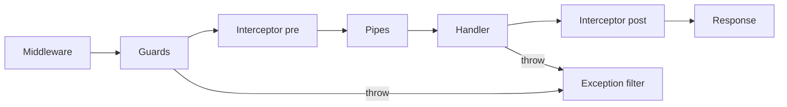

## 57.3 NestJS

NestJS questions are usually a proxy for "do you understand the framework or do you cargo-cult decorators?" The best answers explain what happens at bootstrap versus per request.

### Q29. How does the NestJS DI container work? What kinds of providers are there?

- **Expected answer** — At bootstrap Nest scans modules, builds a dependency graph from each provider's metadata, topologically sorts it and instantiates singletons once. Constructor injection works because `emitDecoratorMetadata` writes `design:paramtypes` (the runtime constructor types) and Nest looks each token up in the module's injector. Provider forms: `useClass` (the shorthand `providers: [OrderService]`), `useValue` (constants, mocks, an already-built SDK client), `useFactory` (async or computed construction, with `inject: [ConfigService]` for its own dependencies), and `useExisting` (an alias to another token). Because interfaces do not exist at runtime, an abstract dependency needs a token — a string, a `Symbol`, or better an abstract class used as both type and token:

  ```ts
  export abstract class PaymentGateway { abstract charge(o: Order): Promise<Receipt>; }
  { provide: PaymentGateway, useClass: StripeGateway } // inject by the abstract class
  ```

  Resolution is per module: a provider is only injectable where its module is imported and the provider is `exports`ed.

- **Why it matters** — DI errors ("Nest can't resolve dependencies of X") are the number one framework bug, and the fix requires this model.

- **Follow-ups** — Read me the error message and tell me the three usual causes. When is `useFactory` async and what does that do to bootstrap time? How do you inject the same instance under two tokens?

- **Senior signal** — Uses abstract classes as tokens for testability and swappability, and can debug a resolution error from first principles.

### Q30. Explain injection scopes and what they cost.

- **Expected answer** — `Scope.DEFAULT` is a singleton: one instance for the app's lifetime, shared by all requests. `Scope.REQUEST` creates a new instance per incoming request, and the whole dependency chain *above* it is also made request-scoped ("scope bubbling"), because a singleton cannot hold a request-scoped dependency. `Scope.TRANSIENT` gives every injector a fresh instance. The cost of request scope is real: Nest must instantiate that subtree on every request, which adds allocation and GC pressure, and it disables some optimisations — on a hot path this can be a measurable few percent, and if you accidentally make a controller request-scoped, the entire graph under it is rebuilt per request. It also breaks things that assume singletons, such as a provider that starts a `setInterval` in `onModuleInit`. Preferred alternative for "I need the current user or a correlation id": `AsyncLocalStorage` in a middleware or interceptor, which gives per-request context without per-request instantiation. Use `REQUEST` scope deliberately, for example a multi-tenant database connection resolved from the request host.

- **Why it matters** — Scope bubbling is an easy way to accidentally halve throughput.

- **Follow-ups** — What is `ContextIdFactory` for? How does request scope interact with a `@Cron` job that has no request? Show the `AsyncLocalStorage` alternative.

- **Senior signal** — Knows about bubbling and offers `AsyncLocalStorage`, which is the answer of someone who has profiled it.

### Q31. How do you design module boundaries in a large Nest application?

- **Expected answer** — Modules should follow business capabilities, not technical layers: `OrdersModule`, `PaymentsModule`, `InventoryModule` — not `ControllersModule`, `ServicesModule`. Each module exposes a deliberately small public surface via `exports` (usually one facade service, plus its DTOs), and everything else stays private. Cross-module calls go through those exported facades or, better for anything that is not needed synchronously, through domain events so the caller does not depend on the callee at all. `SharedModule`/`CoreModule` should hold only truly cross-cutting things (config, logging, database connection); a god `SharedModule` that exports everything defeats the point and reintroduces the cycle problem. In practice I keep a rule: if module A imports B and B imports A, one of them is wrong — extract the shared piece or invert with an event. This structure is what makes a modular monolith splittable later: the module boundary becomes the service boundary, and the exported facade becomes the API client.

- **Why it matters** — Module design is architecture; it decides whether the codebase is refactorable in year three.

- **Follow-ups** — Where do shared DTOs live? How do you enforce boundaries in CI? What changes when you extract a module into its own service?

- **Senior signal** — Ties module boundaries to future service extraction and mentions automated enforcement (dependency-cruiser, ESLint import rules), not just intentions.

### Q32. What is the exact order of the NestJS request lifecycle?



- **Expected answer** — Incoming request, then: **middleware** (global first, then module-bound, in registration order) -> **guards** (global, controller, route) -> **interceptors, pre-handler part** (the code before `next.handle()`) -> **pipes** (parameter transformation and validation) -> **the route handler** -> **interceptors, post-handler part** (the RxJS operators applied to the returned stream, in reverse order) -> **exception filters** if anything threw at any point -> response. Two consequences people get wrong. First, pipes run *after* guards, so an authorization guard cannot rely on a validated/transformed body — it only has the raw one. Second, interceptors wrap the handler, so the post part runs in reverse nesting order (global outermost), which matters for timing/logging interceptors.

- **Why it matters** — Ordering bugs (auth after validation, filters that never fire) are common and this is the map.

- **Follow-ups** — Where would you put request-id generation and why? Can a filter catch an error thrown in middleware? Why can a guard not see the DTO instance?

- **Senior signal** — Volunteers the guard-before-pipes consequence and the reverse ordering of interceptor post-processing.

### Q33. How do you write a custom decorator, and when is one justified?

- **Expected answer** — Two kinds. A **param decorator** built with `createParamDecorator` extracts something from the execution context, which removes repetitive plumbing from controllers:

  ```ts
  export const CurrentUser = createParamDecorator(
    (data: keyof AuthUser | undefined, ctx: ExecutionContext) => {
      const req = ctx.switchToHttp().getRequest<Request & { user: AuthUser }>();
      return data ? req.user?.[data] : req.user;
    },
  );
  ```

  A **metadata decorator** built with `SetMetadata` (or the typed `Reflector.createDecorator()`) attaches data a guard or interceptor later reads with `reflector.getAllAndOverride(...)` across handler and class. Composition helpers like `applyDecorators` let you bundle `@UseGuards(JwtGuard, RolesGuard)`, `@Roles('admin')` and Swagger annotations into one `@AdminOnly()`. Justified when it removes duplicated cross-cutting plumbing from many handlers; not justified when it hides business logic, because a decorator is invisible in a stack trace and hard to unit test.

- **Why it matters** — Shows understanding of the metadata system and of when abstraction helps versus obscures.

- **Follow-ups** — How does `getAllAndOverride` differ from `get`? How do you unit test a param decorator? What breaks if the guard runs before the middleware that sets `req.user`?

- **Senior signal** — The "do not hide business logic in decorators" boundary, and knowing the handler/class metadata merge strategies.

### Q34. What is a dynamic module and when do you build one?

- **Expected answer** — A dynamic module is a module whose providers are configured at import time. The class exposes static factory methods returning a `DynamicModule` object: `forRoot(options)` for app-wide singleton configuration (a database connection, an HTTP client), `forRootAsync({ useFactory, inject })` when options depend on `ConfigService` or an async secret fetch, and `forFeature(...)` for per-module registrations such as which entities or queues this module uses. Internally you provide the options under a token and inject them into the service. Mark it `@Global()` only sparingly — global modules make dependencies invisible. You build one when you are packaging reusable infrastructure for multiple apps or teams: an internal `KafkaModule`, a tenant-resolution module, an audit-logging module. For a single application's own feature module, a plain module plus `ConfigService` is simpler and you should not over-engineer.

- **Why it matters** — Distinguishes library authors from consumers, and tests the configurable-provider pattern.

- **Follow-ups** — Implement `forRootAsync` with `useFactory`. Why does `forFeature` exist separately? What does `ConfigurableModuleBuilder` give you for free?

- **Senior signal** — "Do not build a dynamic module for a single app" plus caution about `@Global()`.

### Q35. How do exception filters work and how do you design error responses?

- **Expected answer** — Nest's built-in filter turns `HttpException` subclasses into responses and everything else into a 500. A custom filter (`@Catch()` for everything, `@Catch(QueryFailedError)` for a specific class) implements `catch(exception, host)`, gets the underlying request/response from the `ArgumentsHost`, and writes a consistent envelope. I use one global filter that maps domain and infrastructure errors to HTTP once, in one place: `EntityNotFoundError` to 404, a unique-violation `QueryFailedError` with code `23505` to 409, a `class-validator` failure to 422 or 400 with field details, a timeout to 504, everything unknown to 500 with a generated `traceId` in the body and the full stack only in the logs. That last part matters: never leak stack traces, SQL text or internal hostnames to clients. Order note: filters are matched most-specific-first per level, and a route-level filter overrides the global one for that route.

  ```ts
  @Catch(QueryFailedError)
  export class PgExceptionFilter implements ExceptionFilter { /* map 23505 -> 409 */ }
  ```

- **Why it matters** — Error consistency is an API contract question, and leaking internals is a security issue.

- **Follow-ups** — What does your error body look like and why? How do you keep the mapping testable? What status do you return for a business rule violation such as "insufficient inventory"?

- **Senior signal** — One central mapping, a trace id linking client-visible errors to logs, and an explicit no-leak rule.

### Q36. Which `ValidationPipe` options do you always set, and why?

- **Expected answer** — `whitelist: true` strips properties with no decorator on the DTO, so a client cannot smuggle extra fields into an object you later pass to an ORM `save`. `forbidNonWhitelisted: true` turns that into a 400 instead of silent stripping, which I prefer for internal APIs and avoid for public ones where extra fields should be tolerated. `transform: true` turns the plain body into a real DTO instance so `class-transformer` conversions and defaults apply; with `transformOptions: { enableImplicitConversion: true }` query params become numbers and booleans, though I usually prefer explicit `@Type(() => Number)` because implicit conversion has surprising edge cases with `'0'` and empty strings. `stopAtFirstError` for cheap responses, `disableErrorMessages: true` in production only if you have a separate detailed log. And crucially, register it globally (`app.useGlobalPipes`) or via `APP_PIPE` so no route is accidentally unvalidated. The mass-assignment risk without `whitelist` is real: `{ "role": "admin" }` posted to a profile update.

- **Why it matters** — This is a security question disguised as a configuration question.

- **Follow-ups** — Show the mass-assignment attack. Why does `APP_PIPE` matter over `useGlobalPipes` for DI? How do you validate nested arrays of objects?

- **Senior signal** — Names mass assignment, and knows `APP_PIPE` allows the pipe to inject dependencies while `useGlobalPipes` does not.

### Q37. What are interceptors good for, and what are they bad at?

- **Expected answer** — An interceptor wraps the handler and returns an RxJS stream, so it can act before and after: response shaping (`ClassSerializerInterceptor` applying `@Exclude`/`@Expose` so password hashes never serialise), timing and logging, caching (`CacheInterceptor`), timeouts (`timeout(3000)` plus `catchError` mapping to a 504), retries on idempotent handlers, and transaction management if you are careful. They are bad at anything needing to *stop* the request before it runs with a domain decision — that is a guard's job — and at per-field validation, which belongs in pipes. The trap: an interceptor that wraps everything in a `{ data: ... }` envelope also wraps file streams and health checks unless excluded, and a global caching interceptor that ignores the authenticated user will serve one user's data to another. Test that specifically.

  ```ts
  return next.handle().pipe(timeout(3000), catchError(e =>
    throwError(() => e instanceof TimeoutError ? new GatewayTimeoutException() : e)));
  ```

- **Why it matters** — Cross-cutting concerns done in the wrong layer create both bugs and security holes.

- **Follow-ups** — How would you add a per-request timeout without breaking streaming responses? Why is a global cache interceptor dangerous with auth? Where do you start the DB transaction?

- **Senior signal** — The user-scoped cache poisoning risk, and the guard-versus-interceptor boundary.

### Q38. You get a circular dependency error. What do you do?

- **Expected answer** — First, treat it as a design smell rather than something to patch. Nest offers `forwardRef(() => OtherModule)` on both sides of the import and `@Inject(forwardRef(() => OtherService))` on the constructor, and that works, but it also disables some resolution guarantees and makes the graph harder to reason about. The better fixes in order: (1) extract the shared piece into a third module both depend on; (2) invert the direction with an event — if `OrdersService` needs to tell `NotificationsService` something, emit `order.paid` via `EventEmitterModule` or a real broker and let notifications subscribe, so orders no longer imports notifications; (3) pass a callback or use the `ModuleRef` to resolve lazily at call time (`this.moduleRef.get(X, { strict: false })`) when there is genuinely a runtime-only relationship. I use `forwardRef` only as a temporary bridge with a ticket, because a codebase with twenty `forwardRef`s has no module boundaries left.

- **Why it matters** — How someone resolves cycles predicts whether the architecture degrades over time.

- **Follow-ups** — Why does `forwardRef` need to be on both sides? What does the error message tell you about which side to fix? How does the event approach change failure semantics?

- **Senior signal** — Treats the cycle as an architecture bug and reaches for event inversion; notes that the event approach changes the call from synchronous-and-transactional to asynchronous-and-eventually-consistent, which is a real trade-off, not a free win.

### Q39. Which NestJS microservice transports have you used and how do you choose?

- **Expected answer** — `@nestjs/microservices` supports TCP, Redis (pub/sub), NATS, MQTT, RabbitMQ, Kafka and gRPC, with two messaging styles: request-response (`@MessagePattern`, `client.send()`, returns an Observable) and event-based (`@EventPattern`, `client.emit()`, fire and forget). Choosing: gRPC for synchronous internal RPC where you want a schema, streaming and low latency; Kafka for high-throughput event streams with replay and ordered partitions; RabbitMQ for work queues with per-message ack, retries and dead-letter exchanges; NATS for lightweight fast messaging; Redis pub/sub only for non-durable fan-out because messages are lost if no one is listening; plain TCP transport basically never in production. The important caveats: `client.send()` over Kafka creates a reply topic and is usually the wrong shape — Kafka is for events; and consumer offset/ack semantics differ per transport, so "at least once" means you still need idempotent handlers regardless of which one you pick.

- **Why it matters** — Transport choice is an architecture decision people often make by familiarity.

- **Follow-ups** — How do you handle a poison message in the Rabbit transport? What does Nest do with Kafka offsets by default? When would you keep it a plain HTTP call instead?

- **Senior signal** — Warns against request-response over Kafka and says "at least once, so make handlers idempotent" without being asked.

### Q40. How do you test a NestJS service and a controller?

- **Expected answer** — For a unit test, build a minimal module with `Test.createTestingModule({ providers: [OrderService, { provide: PaymentGateway, useValue: mockGateway }, { provide: getRepositoryToken(Order), useValue: mockRepo }] }).compile()` and pull the service with `module.get`. Mock at *boundaries* — gateways, repositories, clocks — not at internal method level, or the test locks in the implementation. For a controller test, use `overrideGuard(JwtGuard).useValue({ canActivate: () => true })` so the HTTP contract is tested without auth plumbing. For integration and e2e, `createNestApplication()` plus `supertest` against a real Postgres in Testcontainers, applying the same global pipes and filters as `main.ts` (a very common bug is a test suite that passes because the global `ValidationPipe` was never registered in the test app). Use `overrideProvider` for external HTTP and `useRealTimers`/fake timers deliberately. And keep the container per test file, resetting data with a truncate or a transaction rollback rather than rebuilding the schema each time.

- **Why it matters** — Testing strategy exposes how the person keeps a large codebase changeable.

- **Follow-ups** — Why does the e2e app need the same globals as `main.ts`? How do you make tests fast with a real database? When is mocking the repository a mistake?

- **Senior signal** — Mentions the "globals not registered in tests" trap and prefers a real database over mocked repositories for anything query-shaped.

### Q41. How do you handle configuration and validate it?

- **Expected answer** — `ConfigModule.forRoot({ isGlobal: true, validationSchema, cache: true, expandVariables: true })` with a Joi (or `class-validator`/zod via `validate`) schema that fails fast at boot if anything is missing or malformed. Fail-fast is the whole point: a service that starts with `DB_PASSWORD` undefined and then throws on the first request is far worse than one that refuses to start, because Kubernetes will keep the old ReplicaSet during a rolling update if the new pods never become ready. I group config into typed namespaces with `registerAs('db', () => ({...}))` and inject `ConfigType<typeof dbConfig>` so consumers get real types instead of `configService.get<string>('DB_HOST')` stringly-typed lookups. Secrets do not live in `.env` in production; they come from the platform (Kubernetes secrets from AWS Secrets Manager via External Secrets, or SSM), and the app only reads environment variables. Never log the resolved config object.

- **Why it matters** — Config mistakes are a top cause of failed deploys and of leaked credentials.

- **Follow-ups** — What breaks if validation happens lazily? How do you rotate a database password without downtime? Why is `cache: true` recommended?

- **Senior signal** — The fail-fast-plus-rolling-update argument, typed namespaces, and secret handling outside `.env`.

### Q42. What lifecycle hooks does Nest give you and what belongs in each?

- **Expected answer** — In order: `onModuleInit` (after the host module's dependencies are resolved — connect clients, warm caches, register consumers), `onApplicationBootstrap` (after *all* modules are initialised — safe place for things needing the whole graph, such as starting schedulers), then on shutdown `onModuleDestroy`, `beforeApplicationShutdown` (receives the signal; stop accepting work, drain), and `onApplicationShutdown` (final resource release: close pools, flush the logger). Shutdown hooks only fire if you call `app.enableShutdownHooks()`, which is the most commonly missed line and the reason "my cleanup never runs". Practical rules: do not do slow work in `onModuleInit` because it delays readiness for every pod on every deploy; do not start consuming from a queue before the app is fully bootstrapped or you will process a message with a half-built graph; and put "flip readiness to false" in `beforeApplicationShutdown`, before you close anything.

- **Why it matters** — Startup and shutdown correctness is where deploy-time errors live.

- **Follow-ups** — Why is `enableShutdownHooks` opt-in? Where do you register a Kafka consumer? What is the interaction with `terminationGracePeriodSeconds`?

- **Senior signal** — Orders the shutdown steps around readiness and drain, and knows hooks are inert without the opt-in call.

### Q43. Express adapter or Fastify adapter?

- **Expected answer** — Express is the default and has the largest middleware ecosystem; Fastify is roughly two to three times faster on synthetic JSON benchmarks thanks to schema-based serialisation and a faster router. In practice the adapter is almost never the bottleneck for a real service: if a request does a 4 ms database query and a 1 ms Redis call, the framework overhead of 0.1 ms versus 0.05 ms is noise. I would choose Fastify when the service is a thin, extremely high-RPS proxy or aggregator where serialisation dominates, and when I do not need Express-only middleware. Costs to name: some third-party Nest packages and middleware assume Express, cookie/session/multipart handling uses different plugins, and `@Res()` semantics differ. Measure before switching an existing app; I have seen a migration produce a 4% end-to-end gain and two weeks of work.

- **Why it matters** — Tests whether the candidate reasons about where time actually goes.

- **Follow-ups** — What is Fastify's serialisation trick? What breaks if you use `@Res()` directly? How would you measure whether it is worth it?

- **Senior signal** — Refuses to treat a benchmark number as an end-to-end number, and gives a concrete threshold for when the switch pays.

### Q44. When would you use `@nestjs/cqrs`?

- **Expected answer** — CQRS separates commands (state changes, no return payload beyond an id or acknowledgement) from queries (reads, no side effects), each with its own handler, plus events published after a command succeeds. `@nestjs/cqrs` gives you `CommandBus`, `QueryBus`, `EventBus`, `AggregateRoot` with `apply()`/`commit()`, and sagas that turn one event stream into further commands. It pays off when a domain has genuinely complex write rules and many read shapes — an orders domain where the write model enforces inventory, pricing and fraud rules, while reads are served from denormalised projections. It is over-engineering for CRUD: you get three files and a bus for what was a five-line service method, and stack traces become harder to follow. Also be clear that the Nest `EventBus` is in-process and not durable — if a handler must survive a crash, the event has to go through an outbox and a real broker, not the in-memory bus. That confusion causes silently lost side effects.

- **Why it matters** — CQRS is the most commonly over-applied pattern in Nest codebases.

- **Follow-ups** — Where does event sourcing come in, and do you need it? How do you keep the read model in sync and what is the staleness budget? What is the failure mode if an in-process event handler throws?

- **Senior signal** — States the in-process-bus durability gap and gives a clear "not for CRUD" boundary with an example on each side.
