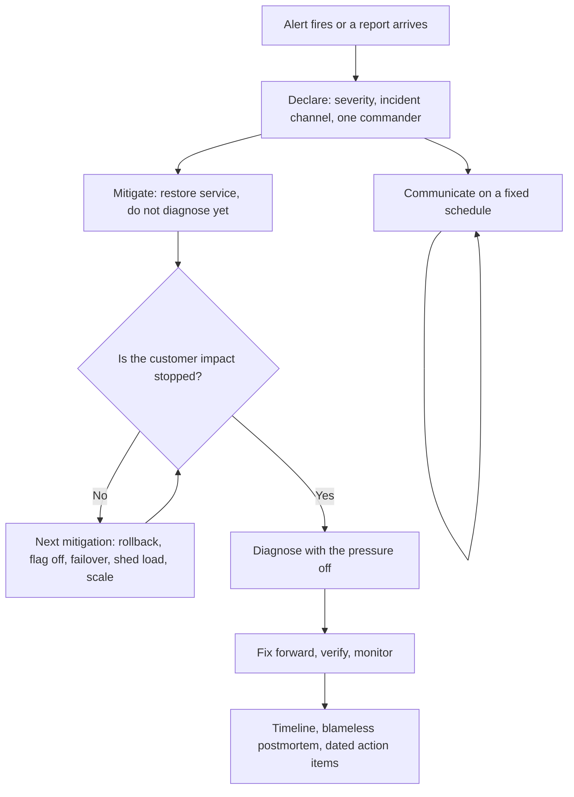

## 57.10 How seniors handle incidents and pressure

An incident is the only time engineering is watched by everyone at once, and it is where seniority is most visible. Not because seniors debug faster — sometimes they do not — but because they impose structure on a situation that is trying to become chaos.



### 57.10.1 Mitigate first

The instinct under pressure is to find the root cause. Resist it. **Stopping the bleeding and understanding the wound are different jobs, and the first one comes first.**

The mitigation menu, roughly in order of speed:

1. **Roll back the last deploy.** If the timing correlates, do it before you finish arguing about whether it is the cause. A rollback that turns out to be unnecessary costs ten minutes; a diagnosis that takes forty costs forty minutes of customers.
2. **Turn off the feature flag.** Seconds, and surgically scoped.
3. **Fail over.** Secondary payment provider, replica promotion, secondary region.
4. **Shed load.** Disable exports, reports, non-critical consumers; tighten rate limits. Protect the core transaction.
5. **Scale the obvious constraint.** More pods, bigger instance, more consumers, if the constraint is genuinely capacity.
6. **Restart.** Legitimate for a leaked resource or a wedged process. Note what you lose: the process state that would have explained it. Take a heap snapshot first if you can afford 30 seconds.

The senior discipline is to say out loud: "we are mitigating, not diagnosing. Diagnosis is after." It gives everyone permission to stop theorising.

One caution: mitigations have their own blast radius. Failing over to a cold replica, or restarting a consumer group without checking the offset commit strategy, can turn an availability incident into a data incident. Ask "what could this mitigation break?" for two seconds before doing it. Two seconds, not two minutes.

### 57.10.2 Communicate on a schedule

The vacuum of silence during an incident gets filled with speculation, and speculation reaches customers. Fix it with a rhythm, not with heroic ad-hoc updates.

Pick an interval by severity: every 15 minutes for a customer-visible outage, every 30 for a degradation. Then post on the interval **even when there is nothing new**, because "no update, still investigating the payment provider timeout, next update at 14:45" is enormously calming and stops six people from asking.

A good update has four lines and no jargon:

```text
14:30 UTC - Checkout failures, ~35% of attempts since 14:06.
Impact: customers see an error at payment; carts are preserved.
Now: we have rolled back release 2026.3.11 and are watching error rates.
Next update: 14:45.
```

Separate the roles. The person typing commands should not also be writing updates to the executive channel. Split them: an incident commander who coordinates and communicates, and responders who investigate. On a small team, the commander can be a non-expert; their job is to run the process, keep the log and protect the responders from interruptions, and that is genuinely valuable work.

Say what you know, what you do not know, and what you are doing next. Never guess at a cause publicly during an incident. "It looks like a database issue" travels to a customer email in eleven minutes and is wrong 40 percent of the time.

### 57.10.3 Keep a log

Write timestamps as you go, in the incident channel. Every action, every observation, every hypothesis and whether it was ruled out.

```text
14:06 first 5xx spike on /checkout, 12% error rate
14:09 paged; confirmed p99 4.2s on payment-service
14:11 checked deploys: release 2026.3.11 went out 14:02  <- correlation
14:13 pg_stat_activity shows 180 idle in transaction sessions   <- observation
14:15 rolled back 2026.3.11
14:19 error rate back to baseline; idle-in-transaction draining
14:26 hypothesis: new code opens a transaction before an HTTP call to the PSP
```

Three reasons this matters. During the incident, it stops two people from repeating the same check. After it, it is the postmortem timeline, written for free, while memory is accurate. And it is the only defence against the reconstruction bias that makes everyone believe afterwards that the cause was obvious.

### 57.10.4 Stay blameless, and mean it

"Blameless" does not mean pretending nobody made a mistake. It means the analysis targets the **system that allowed the mistake to reach production**, because that is the only part you can change.

An engineer ran a `DELETE` without a `WHERE` clause on production. Blame version: the engineer is careless, everyone is reminded to be careful, and it happens again in fourteen months with a different engineer. Blameless version: why did a human have write access to production data from a laptop, why was there no `--dry-run` step in the tool, why did the query run in a session without a transaction so it could not be rolled back, and why did we not notice for 40 minutes? Four fixable things. The careful-engineer fix is zero fixable things.

The practical test of whether your culture is blameless: does the person closest to the mistake write the postmortem and feel safe doing it? If they are quietly excluded, you have a blame culture with a polite vocabulary, and your next incident will be reported late or hidden.

### 57.10.5 Follow through

Most organisations are fine at responding and poor at following up. The incident ends, everyone is relieved, the action items go into a document, and 60 percent of them are never done. Then the same incident recurs and the postmortem says "we identified this last time".

Rules that make follow-through real: every action item has one named owner and a date, no owner is "the team", items go into the normal backlog with a link to the incident, and someone reviews open incident actions in a recurring meeting. Cap it: three real action items that get done beat fourteen that decorate a document.

And prioritise by *class*, not by instance. Do not just add a timeout to the one call that broke. Ask where else you have calls without timeouts, and fix the class with a shared HTTP client that has a default timeout, so the mistake becomes impossible rather than fixed once.

### 57.10.6 Pressure

Two practical things about your own head, because they change your effectiveness more than any tool.

**Slow down externally when things speed up internally.** Speak slower, type carefully, read the command before you press enter. The most damaging incident actions I have seen were made by very good engineers moving very fast in the first ten minutes. Say the destructive command out loud to another person before running it. That one habit has saved me twice.

**You cannot debug for six hours.** After about ninety minutes of an incident, hand over or bring in a second person, deliberately. Fresh eyes see the log line you have scrolled past four times. Tired engineers make the decisions that turn incidents into disasters.

## 57.11 How seniors communicate

### 57.11.1 Writing clearly

Most senior impact travels through writing. The rules are boring and effective:

- **Put the conclusion first.** People read the first paragraph. Bottom-line-up-front: "I recommend we cap the export endpoint at 5,000 rows and move large exports to a background job. Details below."
- **Numbers, not adjectives.** "Slow" is unactionable. "p99 is 4.2 s against our 500 ms target, on 60 RPS" is a decision input.
- **Short sentences.** If a sentence has three clauses, it has three sentences hiding in it.
- **Write for the least-informed necessary reader.** Define the acronym once. Nobody has ever been annoyed by clarity.
- **Say what you want.** Every document ends with the decision you are asking for or the action you want. Documents without an ask get comments, not outcomes.

### 57.11.2 Explaining a trade-off to a product manager

The failure mode is explaining the mechanism. Product managers do not need to know about B-tree page splits. They need the choice expressed in time, risk and money, and they need you to have an opinion.

Here is a dialogue close to one I have had several times.

> **PM:** Can we add the "download all my data" button this sprint? It looks small.
>
> **Engineer:** The button is small. The download is not. Our biggest customers have around 400,000 orders. Building that file takes about 90 seconds and roughly 600 MB of memory, and the gateway cuts requests off at 30 seconds. If we do the simple version, it works for most customers and fails for our largest ones, which are the ones most likely to ask for it.
>
> **PM:** So how long for the version that works?
>
> **Engineer:** Two options. Option A, four days: the button starts a background job, and the customer gets an email with a link when it is ready, usually within two minutes. That is how every large product does it, so it will not feel odd. Option B, one day: we ship it now with a limit of the last 90 days, which covers about 85 percent of the requests support currently gets, and we add a note about contacting support for more.
>
> **PM:** What happens if we do the naive version anyway?
>
> **Engineer:** It works in the demo and fails in production for the accounts that matter, probably during a busy period, and it can take other requests down with it because of the memory. I would not ship that one. If the sprint is fixed, I would take option B this sprint and option A next.
>
> **PM:** Let's do B now, and put A in next sprint's plan.

Notice: no jargon, real numbers, a named risk, two options with costs, a clear recommendation, and no attempt to win. That conversation takes three minutes and produces a better product decision than a week of tickets.

### 57.11.3 Saying no with options attached

A flat "no" makes you an obstacle and gets routed around. A "yes" to everything makes you unreliable. The senior pattern is: **no to this shape, yes to a shape that works, with the cost of each.**

The template: acknowledge the goal, state the specific problem with the request as posed, offer two alternatives with costs, recommend one, and make the trade-off owner's choice explicit.

> "I understand we need per-customer pricing live for the campaign on the 14th. Building the full rules engine by then is not realistic; the honest estimate is five weeks and I would be guessing. What we can do by the 14th is hardcode the three tiers marketing has actually asked for, which is four days and covers the campaign, and then decide in March whether the rules engine is worth five weeks based on how often the tiers change. I recommend that. If the full engine is genuinely required for the 14th, then something else in the sprint has to move, and I would need to know what."

That last sentence matters. Scope, time and quality: name which one is moving, and let the person with the authority choose. What you must never do is silently absorb the pressure by cutting quality, because that debt is invisible until it becomes an incident.

### 57.11.4 Estimating honestly

Estimates are probability distributions that everyone insists on hearing as a single number. Give ranges, with the reason for the width.

- "Three to five days. The width is because I do not know yet whether the provider's sandbox supports partial refunds. I can find out in two hours, and then I can narrow it."
- "Two weeks if the data is as clean as the sample suggests; four if it is not. I will know by Wednesday."

Three habits keep you credible. Name the assumption that would blow the estimate up. Say when you will have a better number, and then actually give it. And when you are going to miss, say so as early as you know, not on the due date. Nobody minds a revised estimate on Tuesday. Everyone minds a surprise on Friday afternoon.

Never estimate under social pressure in a meeting. "I'll come back to you this afternoon with a number" is always available and always better than a number you invented to end the silence.

### 57.11.5 Documenting for the reader in two years

Write for the engineer who joins after you have left. That person has the code, so do not narrate the code. They need what the code cannot tell them:

- **Why** it is this way, especially the parts that look wrong.
- What was tried and rejected.
- The invariants: "an order in `paid` must have exactly one `payments` row with `captured` status; the reconciliation job in `jobs/reconcile.ts` enforces this nightly."
- The operational facts: which alerts exist, what the runbook says, which third parties are involved and what their failure modes are.
- The traps: "do not add an index on `events.payload`, we tried, it doubled the write latency; the query it was for now uses the summary table."

Put it in the repository next to the code, not in a wiki that dies. `README.md` per module, `docs/adr/` for decisions, `docs/runbooks/` for operations. Documentation that lives with the code gets updated in the same pull request as the change; documentation somewhere else does not.

## 57.12 How seniors grow others and themselves

### 57.12.1 Mentoring

Mentoring is not answering questions. It is calibrating how much struggle is productive.

The rule I use: give the **question**, not the answer, when there is time; give the answer with the reasoning when there is not. "Where would you look first?" beats "check `pg_stat_activity`" during a calm afternoon. During an incident, say "check `pg_stat_activity` for idle in transaction, here is why", and teach afterwards.

Two more things that work. Delegate the *whole* problem, not tasks: "you own the payment retry work, I'm your reviewer" produces growth; "implement this function I designed" produces typing. And be public about your own uncertainty and mistakes. A senior who says "I got this wrong last year and here is what I learned" makes it safe for everyone else to be honest, and honesty is what makes a team fast.

### 57.12.2 Pairing and design reviews

Pair on the hard part, not the whole day. Ninety minutes on the concurrency design or the tricky migration transfers more than a week of side-by-side typing, and it does not exhaust anybody.

Run design reviews before code exists, not after. A 30-minute conversation over a diagram catches the boundary mistake that would have cost three weeks. The cheapest possible design review is one sentence in a Slack channel: "planning to solve X by doing Y, any objections?" It has saved me more rework than any formal process.

### 57.12.3 Leaving the codebase better

Not "rewrite everything you touch", which is how you become the person nobody wants to review. The habit is small and constant: while you are in a file, fix the misleading name, add the missing index, delete the dead branch, add the test that was obviously missing, replace the magic number with a named constant.

Also: delete things. Unused endpoints, dead feature flags, unused indexes, obsolete jobs, commented-out code. Every dead thing is something a future engineer must read and be uncertain about. Deletion is the most under-rated senior activity, and Git remembers everything anyway.

### 57.12.4 Reading source code and postmortems

Two habits that compound faster than any course.

**Read the source of the tools you use.** When you wonder how TypeORM builds a transaction, or how BullMQ guarantees a job is not processed twice, open the file. It is ordinary TypeScript written by ordinary people. Doing this a few times permanently removes the sense that libraries are magic, and it makes you dramatically better at debugging them.

**Read public postmortems.** The write-ups published by large infrastructure providers, and the ones your own company writes, are years of expensive experience for an hour of reading. You will notice the same shapes recurring: retry storms, a config change with a wider blast radius than anyone realised, a failover that had never been tested, a queue that filled because a consumer got slower, a certificate nobody owned. Recognising those shapes is most of what "instinct" turns out to be.

### 57.12.5 Shipping side projects to real production

There is a category of knowledge you cannot get from work if your work hands you a platform: what it costs, what breaks, and what it takes to keep something alive when nobody else is responsible.

Build something small, put it on the internet with a real domain and TLS, add a database, put it behind a CDN, set up an alert, and keep it running for a year. You will learn certificate renewal, backup restores, cost surprises, dependency upgrades, and the specific misery of a disk filling at 04:00. It is the cheapest available simulation of ownership, and the lessons transfer completely.

## 57.13 Anti-mindsets

The failure modes I see most often, and the correction for each.

| Anti-mindset | What it looks like | Why it hurts | The correction |
|---|---|---|---|
| Resume-driven development | Choosing Kafka, Kubernetes or GraphQL because it is good for your career | The team carries the operational cost for years; you leave in 18 months | Choose the boring tool; get your learning from side projects and reading |
| Cargo cult | "Netflix does it this way" | Their constraints are not yours: their scale, staffing and failure budget are different by orders of magnitude | Ask what problem it solved *for them*, and whether you have that problem |
| Premature optimisation | Micro-tuning a function that runs 5 times a day; a cache before a measurement | Complexity for no gain, and it hides the real bottleneck | Measure first. The bottleneck is almost never where you think |
| Gold plating | Building the configurable, pluggable version of a thing with one use case | Every reader pays the abstraction tax forever | Build for the second use case when it arrives, not the imagined third |
| Hero culture | The same person fixes every incident at 03:00 and is celebrated for it | Burnout, a single point of failure, and no incentive to fix root causes | Rotate on-call, write runbooks, reward prevention over rescue |
| "Not my problem" | The bug is in another team's service, so it stops with you | Customers do not care about your org chart; the problem sits in the gap | Drive it to an owner, hand over with context, follow up |
| Fear of deleting code | Commented-out blocks, dead flags, unused endpoints kept "just in case" | Every dead line is read, feared and worked around by future engineers | Delete it. Git has it. If you are unsure, check the metrics, then delete it |
| Arguing about formatting | Twenty comments on naming, none on the missing timeout | Burns review capital on the cheapest issues and misses the expensive ones | Automate it: Prettier, ESLint, a linter in CI. Then never discuss it again |

Two more worth naming because they wear a disguise. **Perfectionism** presents as high standards but is often fear of being judged; the tell is a branch that is four weeks old and 90 percent done. And **cynicism** presents as experience — "we tried that, it won't work" — but it is a way of avoiding the risk of trying. Both are common in strong engineers who have been burned. The antidote to both is shipping something small and reversible this week.

## 57.14 The senior's daily checklist

Compact versions, for actual use.

**Before I finish a design:**

- [ ] The requirement is written with a number in it.
- [ ] This is the simplest thing that meets it; I can name what each added component buys.
- [ ] I know what breaks first at 10x and roughly where the wall is.
- [ ] Every dependency has a named behaviour when it is down.
- [ ] Every remote call has a timeout, and every side effect has a duplication defence.
- [ ] I named the source of truth for each important fact.
- [ ] I know the blast radius, and it is acceptable to the business.
- [ ] I classified this as a one-way or two-way door and applied the right amount of process.
- [ ] Alerts, dashboards, runbook and on-call owner exist or are in the plan.
- [ ] I wrote down why, including the option I rejected and the trigger to revisit.

**Before I open a pull request:**

- [ ] I reviewed it myself, as a stranger, against the concurrency and failure questions.
- [ ] New queries have indexes; new migrations are additive and rollback-safe.
- [ ] Input validated at the boundary; queries scoped to the actor; DTOs not entities.
- [ ] There is at least one test that fails if the core behaviour breaks.
- [ ] The failure branches log identifiers, and the outcome is measurable.
- [ ] The description says what problem this solves, what I considered, and what to watch after deploy.

**Before I deploy:**

- [ ] Old and new versions can run at the same time.
- [ ] It is rollback-safe, or the PR says explicitly that it is not and why.
- [ ] Migrations are separate from the deploy and bounded in lock time.
- [ ] I know which dashboard I am watching and which number tells me to roll back.
- [ ] Risky behaviour is behind a flag that defaults to off.
- [ ] Someone other than me knows this is going out.

**During an incident:**

- [ ] Severity declared, channel open, one commander named.
- [ ] Mitigating first; diagnosis is after.
- [ ] Considered rollback and feature flag before anything clever.
- [ ] Timestamped log running in the channel.
- [ ] Updates on a fixed interval, even when there is nothing new.
- [ ] Checked what my mitigation could break before running it.
- [ ] Handing over if I have been on it more than ninety minutes.
- [ ] Postmortem scheduled, timeline captured, three owned action items with dates.

## Senior Checklist — Part 57

- [ ] I understand the concept
- [ ] I can explain it simply
- [ ] I can implement it
- [ ] I understand its failure modes
- [ ] I understand its scaling limitations
- [ ] I understand its security implications
- [ ] I understand its operational implications
- [ ] I can choose between alternatives
- [ ] I can explain the tradeoffs
- [ ] I can answer senior-level interview questions
- [ ] I run the architecture, database, distributed, production, security and business question sets automatically on every design
- [ ] I classify decisions as one-way or two-way doors and vary my process accordingly
- [ ] I can write an ADR in twenty minutes that a stranger could act on in two years
- [ ] I build honest trade-off tables, including the criteria that make my preferred option look bad
- [ ] My code reviews label blocking versus preference, and find concurrency and failure bugs rather than style
- [ ] I mitigate before I diagnose, and I communicate on a fixed schedule during incidents
- [ ] I keep a timestamped incident log and run blameless postmortems with owned, dated actions
- [ ] I can explain a technical trade-off to a product manager in three minutes using time, risk and money
- [ ] I give estimates as ranges with the assumption that would break them
- [ ] I say no with options attached, and I name which of scope, time or quality is moving
- [ ] I leave the codebase better, delete dead things, and grow the people around me
- [ ] I can name the anti-mindsets I personally fall into, and the correction for each

## Part 57 — Key Takeaways

- Seniority is measured in removed uncertainty, not in years, syntax or the number of tools you can name.
- The transferable skill is a question set that fires automatically: can it time out, duplicate, arrive late, arrive out of order, partially succeed; who owns the truth; what happens when the dependency is down.
- The simplest thing that meets a stated numeric requirement wins; every added component is a permanent tax paid in operations, onboarding and 03:00 debugging.
- Classify every decision as a one-way or two-way door, and spend process accordingly; both freezing on reversible choices and sprinting through irreversible ones are failures.
- A timeout is not a failure, it is unknown; that single sentence forces idempotency keys, reconciliation and a defined source of truth.
- Blast radius matters more than uptime: correctness failures cost far more than availability failures, and juniors systematically underrate them.
- Data decisions are the ones you cannot take back: partitioning, ownership, index cost, keeping the facts rather than only the derived state.
- "Done" means running safely in production: alerted on a business signal, deployable, rollback-safe, migratable, debuggable at 03:00, and owned by a named rotation.
- Write decisions down at the time you make them, with the alternatives and the numeric trigger that would make you revisit; the ADR is for the stranger who arrives in two years.
- In incidents, mitigate before you diagnose, communicate on a fixed schedule, keep a timestamped log, stay blameless, and fix the class of problem rather than the instance.
- Express engineering trade-offs in time, risk and money, and always arrive with an opinion and two options.
- Your throughput caps your value; the people you make better do not, which is why review, pairing, writing and deleting are the job, not overhead.
