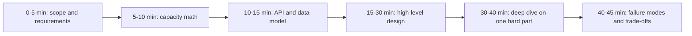

### Q107. How do you design and consume webhooks reliably?

- **Expected answer** — As a producer: sign every payload (HMAC-SHA256 over the raw body plus a timestamp, sent in a header) so receivers can verify authenticity and reject replays outside a tolerance window; include a stable `event_id` and `event_type`; deliver at least once with exponential backoff and jitter over hours, with a dead-letter and a manual replay tool; make delivery asynchronous from the originating transaction using an outbox so you never emit an event for a rolled-back write; and cap the payload, offering an ID that the consumer can fetch instead of embedding large data. As a consumer: verify the signature *on the raw body* before parsing (this is why frameworks need a raw-body option), respond 2xx within a couple of seconds by enqueueing the work rather than processing inline, deduplicate on `event_id` with a unique constraint because retries are guaranteed, and never assume ordering — events can arrive out of order, so either carry a version/sequence number or re-fetch the current state. Expose delivery attempts and failures to your customers, because "we sent it" is not enough when they cannot see it.

- **Why it matters** — Webhooks concentrate idempotency, ordering, security and retry design into one small surface.

- **Follow-ups** — Why verify against the raw body? How do you handle a consumer that is down for six hours? How do you prevent your webhook sender from being an SSRF vector?

- **Senior signal** — Outbox on the send side, dedupe plus no-ordering-assumption on the receive side, and SSRF awareness for customer-supplied URLs.

### Q108. How do you expose a long-running operation over HTTP?

- **Expected answer** — Do not hold the connection. Accept the request, validate it, persist a job with a client-visible id, return `202 Accepted` with a `Location` header pointing at a status resource, and process asynchronously. The status resource returns state (`pending`, `running`, `succeeded`, `failed`), progress if meaningful, a result link on success and a structured error on failure. Clients poll with a `Retry-After` hint, or you push completion via a webhook or a WebSocket/SSE channel. Make the submission idempotent with an idempotency key so a client retry after a network timeout does not start a second export. Keep job records long enough for clients to observe the outcome (typically days) and expose cancellation if the operation is expensive. The anti-pattern is a synchronous endpoint with a 300-second gateway timeout: the load balancer, the client library and the browser all have their own timeouts, so the client gives up while the work continues, then retries, and now you are running the same 20-minute report three times.

- **Why it matters** — Timeout-driven duplicate work is a very common and expensive production failure.

- **Follow-ups** — How do you avoid three concurrent runs of the same export? What do you do if the worker dies mid-job? Poll or push, and why?

- **Senior signal** — Explains the layered-timeout retry storm, and combines 202 with idempotency rather than treating them as separate features.

### Q109. What counts as a breaking change, and how do you evolve an API without one?

- **Expected answer** — Breaking: removing or renaming a field, changing a field's type or format, making an optional request field required, tightening validation, adding a new required header, changing a status code for an existing condition, changing default sort order or default page size, changing error codes, and changing the semantics of an existing field even if the shape is identical. Non-breaking, if clients are tolerant readers: adding optional request fields, adding response fields, adding new endpoints, adding new enum values *only if* the contract said clients must tolerate unknown values. That last caveat matters: strict client-side schema validation turns additive changes into breaking ones, so publish a tolerant-reader expectation up front. Techniques for evolving: expand-and-contract (add the new field, dual-write, migrate consumers, then remove), feature flags per consumer, a compatibility shim in the gateway that translates old requests to the new internal shape, and measuring actual field usage from logs so you know who would break. Never rely on "nobody uses that field" without data.

- **Why it matters** — Backward compatibility discipline is what makes an API a platform rather than a liability.

- **Follow-ups** — Is adding an enum value breaking? How do you find out who uses a field? How do you deprecate with a deadline that people actually meet?

- **Senior signal** — The tolerant-reader contract and measuring field usage before removal.

### Q110. What is contract testing and when is it worth it?

- **Expected answer** — Contract testing verifies that a provider and its consumers agree on the interface, without running a full integrated environment. In the consumer-driven form (Pact), each consumer writes tests against a mock provider; those interactions become a contract published to a broker; the provider's CI replays them against the real service and fails if it broke someone. The alternative, schema-first (OpenAPI or protobuf plus a linter that checks for breaking changes between commits), is lighter and catches shape regressions but not semantic expectations. It is worth it when you have several teams and independently deployed services, because the alternative is finding the break in staging, or in production. It is not worth it for one team with a monolith and a single front end — an OpenAPI schema generated from the code plus a few end-to-end tests gives most of the value. The practical requirement people underestimate is process: contract tests only work if the provider's pipeline actually blocks on the broker's verification result, and if there is a `can-i-deploy` gate. Without that, they are decorative.

- **Why it matters** — It shows whether the candidate has worked in a multi-team environment and understands CI gating.

- **Follow-ups** — Who owns a failing contract, the consumer or provider? How does this interact with versioning? What does `can-i-deploy` do?

- **Senior signal** — Names the gating requirement and gives a clear "not worth it here" boundary.
## 57.9 System design

### Q111. You get "design a notification service" and 45 minutes. What is your method?

- **Expected answer** — A fixed method, run out loud, so the interviewer can follow and steer. Step 1: clarify functional scope (which channels, who triggers, do users have preferences, is delivery guaranteed) and non-functional targets (RPS, latency, durability, ordering, retention). Write the assumptions on the board and get them confirmed — an unconfirmed assumption is how designs go wrong for 40 minutes. Step 2: numbers — daily volume, peak-to-average ratio, storage per year. Step 3: the external API and the core tables, because the data model is where most designs quietly fail. Step 4: boxes and arrows with the queue boundaries and the datastore choices justified. Step 5: pick the hardest part (here: deduplication and per-user rate limiting) and go deep. Step 6: what breaks, how you detect it, what you would do differently at 10x. Throughout, state trade-offs explicitly and say what you are *not* building.

- **Why it matters** — Without a method, candidates ramble, run out of time, and never reach the interesting part.

- **Follow-ups** — What would you cut for a two-week v1? Which assumption would change the design most if wrong? Where would you have pushed back on the requirements?

- **Senior signal** — Manages the clock deliberately, confirms assumptions, and drives to a deep dive rather than drawing more boxes.

### Q112. Do the capacity math for a service with 20 million daily active users sending 3 notifications each.

- **Expected answer** — 60 million notifications per day. Average is 60e6 / 86,400 ≈ 700 per second. Peak matters more: a 5x peak-to-average ratio for a consumer app gives about 3,500 per second, and a broadcast campaign is not a ratio at all, it is a spike of, say, 5 million in 10 minutes ≈ 8,300 per second, which is the real design point. Storage: a notification record with ids, type, payload reference and timestamps is roughly 400 bytes; 60 million per day is 24 GB per day, 8.7 TB per year — so retention policy is a design decision, not an afterthought; keep 30 days hot (720 GB, fine for one Postgres instance with monthly partitions) and archive the rest to S3. Throughput per worker: if a push send takes 50 ms of mostly I/O and one worker handles 100 concurrent sends, that is ~2,000 per second per worker, so five workers cover the spike with headroom. Bandwidth and third-party limits usually bind first: FCM and your SMS provider have per-second quotas, so the design needs a rate-limited egress stage regardless of what your service can do.

- **Why it matters** — Numbers turn a hand-wavy design into an engineering one, and the peak/average distinction is where people are sloppy.

- **Follow-ups** — Where did the 5x come from and how would you verify it? What is the cost per month of that storage? What happens when the SMS provider rate-limits you?

- **Senior signal** — Designs for the campaign spike rather than the average, and identifies the third-party quota as the true constraint.

### Q113. Design the key generation for a URL shortener.

- **Expected answer** — Requirements shape it: short (6–8 characters), unguessable enough that people cannot enumerate private links, unique, and generated fast without a central bottleneck. Options. (1) Hash the URL (MD5/SHA) and take the first 7 base62 characters — deterministic and dedupes identical URLs, but collisions must be handled by rehashing with a salt, and identical URLs from different users share a link, which may be wrong for analytics. (2) A central counter encoded in base62 — guaranteed unique and dense, but sequential ids are enumerable and the counter is a single point of contention; mitigate by having each app instance take a *block* of ids (Redis `INCRBY 1000`) so it only talks to the counter once per thousand links. (3) Random 7-character base62 (62^7 ≈ 3.5e12) with a unique constraint and retry on conflict — simple, unguessable, and at 1 billion links the collision probability per insert is still tiny (~0.03%), so retries are rare. I would pick (3) for a public product because it is unguessable and needs no coordination, with the database unique index as the correctness backstop and a small retry loop. Add a reserved-word blocklist and profanity filter on generated codes, which is a detail real products always need.

- **Why it matters** — It is a compact test of uniqueness-under-concurrency thinking and of security awareness.

- **Follow-ups** — Compute the collision probability at 10 billion links. How do you support custom aliases without breaking uniqueness? How do you handle deletion and reuse of codes?

- **Senior signal** — Picks based on enumerability and coordination cost, uses the database constraint as the guarantee rather than trusting randomness, and mentions the blocklist.

### Q114. Compare rate-limiting algorithms and say how you would run one across 40 pods.

- **Expected answer** — **Fixed window**: count per key per minute; O(1) and trivial, but allows 2x the limit across a boundary (100 at 11:59:59 and 100 at 12:00:00). **Sliding window log**: store timestamps in a sorted set and count those within the window; exact, but memory grows with the limit and it is the most expensive. **Sliding window counter**: weight the previous window's count by the fraction of it still in view; approximate within a few percent, cheap, and my usual choice for simple limits. **Token bucket**: refill at a rate, allow a burst up to capacity; naturally expresses "10 per second with a burst of 50", and it is what most public APIs actually want. **Leaky bucket**: smooths output to a fixed rate, better for protecting a downstream that cannot burst. Distributed: keep the state in Redis and do the read-modify-write in a single Lua script so it is atomic, keyed by the limit dimension, with a TTL so keys expire. At high volume, cut Redis calls by letting each pod take a local lease of N tokens and reconcile periodically — you trade a little accuracy for a big reduction in round trips. State the failure mode: on Redis failure, fail open with a conservative local limiter for general traffic and fail closed for expensive endpoints.

- **Why it matters** — It is the most common "concurrency plus state plus failure" mini-design.

- **Follow-ups** — Write the Lua sketch for token bucket. How much error does the local-lease optimisation introduce? What headers do you return?

- **Senior signal** — Chooses per requirement, knows the Lua atomicity requirement, and has an answer for the limiter's own failure.

### Q115. How do you deduplicate notifications so a user is not messaged twice?

- **Expected answer** — Separate three different duplicates. (1) *Delivery duplicates* from at-least-once messaging: give every notification a deterministic id derived from the triggering event (`hash(event_id, user_id, channel)`), and make the send path insert that id with a unique constraint before dispatching — a conflict means someone already sent it. (2) *Semantic duplicates*: five "someone liked your post" events in a minute should be one notification, so add a coalescing window — buffer per `(user_id, notification_type, entity_id)` for 2 to 5 minutes, then send a rolled-up message ("5 people liked your post"). Implement with a Redis key holding the pending aggregate plus a delayed job, or a small table with a `send_after` timestamp. (3) *Cross-channel duplicates*: do not send push and email for the same thing within a window unless the user opted in; keep a per-user, per-type "last sent" record. Combine with per-user rate limits (at most N pushes per hour) and quiet hours in the user's timezone. Crucially, the dedupe key must be stored durably before the external send, and the external provider call must be idempotent or at-least-once-tolerant, because a crash between "provider accepted" and "we recorded it" will otherwise resend.

- **Why it matters** — Duplicate notifications are the fastest way to lose user trust, and the answer requires both messaging and product thinking.

- **Follow-ups** — What if the provider call succeeds but your write fails? How do you pick the coalescing window? How do quiet hours interact with urgent alerts?

- **Senior signal** — Distinguishes delivery from semantic duplication and handles the crash-between-send-and-record window explicitly.

### Q116. How do you order messages in a chat system?

- **Expected answer** — Do not rely on wall-clock time from clients; phones have skewed clocks and a message can arrive with a timestamp in the past. Order per conversation, not globally, because that is the only ordering users actually perceive. The standard approach is a monotonic per-conversation sequence number assigned by the server: the write path takes a lock or uses a single partition per conversation and assigns `seq = last_seq + 1`, so all clients agree. In Postgres, that is an `UPDATE conversations SET last_seq = last_seq + 1 RETURNING last_seq` inside the message insert transaction, which serialises writes per conversation — fine, since a conversation rarely exceeds a few messages per second. If you shard by conversation id in Kafka, the partition gives you ordering for free as long as producer retries are configured for idempotence, otherwise a retry can reorder. Clients need three more things: a client-generated message id for optimistic UI and dedupe, an "unconfirmed" state until the server returns a sequence number, and a gap-detection rule — if a client receives `seq` 41 and 43, it fetches 42 rather than displaying out of order. For read state, store per-user `last_read_seq` rather than timestamps.

- **Why it matters** — Ordering is the classic distributed-systems problem in a form everyone has an intuition for.

- **Follow-ups** — What breaks if you use client timestamps? How do you handle a message edited or deleted after the fact? What does the sequence counter do to write throughput on a busy group chat?

- **Senior signal** — Server-assigned per-conversation sequence, gap detection on the client, and awareness that producer idempotence is required for Kafka ordering under retries.

### Q117. Fan-out on write or fan-out on read for a social feed?

- **Expected answer** — Fan-out on write (push): when a user posts, insert the post id into every follower's feed list (Redis list or a `feeds` table). Reads are then O(1) and fast, which is what users feel. Cost: a celebrity with 10 million followers generates 10 million writes per post, which is a write storm and expensive storage. Fan-out on read (pull): store posts once and, at read time, query the posts of everyone the user follows, merge and sort. Cheap writes, expensive reads, and the read gets worse as following counts grow. Real systems use a hybrid: push for normal accounts, and for accounts above a threshold (say 100,000 followers) do not fan out — instead, at read time, merge the precomputed feed with a small pull query over the handful of celebrities the user follows. That keeps both sides bounded. Other essentials: feeds are capped (keep the newest ~1,000 entries), fan-out is asynchronous through a queue so posting stays fast, deletions and privacy changes must be reflected at read time by filtering rather than trying to unwind millions of writes, and ranking is applied at read time over a candidate set. Say the staleness budget out loud: a few seconds for a feed is fine, which is what makes async fan-out acceptable.

- **Why it matters** — It is the canonical read/write amplification trade-off, and the hybrid answer proves real understanding.

- **Follow-ups** — Where do you set the celebrity threshold and how would you measure it? What happens when a user with 5 million followers deletes a post? How do you backfill the feed for a new follow?

- **Senior signal** — Proposes the hybrid unprompted and handles deletion by read-time filtering rather than write-time unwinding.

### Q118. Design payment idempotency and the ledger.

- **Expected answer** — Two separate concerns. Idempotency at the API boundary (see Q98): the client's `Idempotency-Key` maps to at most one payment attempt, stored in the same transaction as the attempt record. Then the ledger: money is recorded as immutable **double-entry** journal entries, never as a mutable balance column. Each transaction produces balanced debit and credit lines against accounts (customer wallet, merchant payable, fee revenue, gateway clearing), and the sum of every entry group is zero — a `CHECK` and a periodic reconciliation job assert that. Balances are derived by summing entries, and materialised into a snapshot table for speed with the snapshot always reconstructible from entries. Nothing is ever updated or deleted; a mistake is corrected with a compensating entry, which preserves the audit trail regulators and finance teams require. Amounts are stored as integer minor units (`bigint` paise/cents) with an explicit currency column, never floats. State transitions on the payment (`pending -> authorized -> captured -> settled`, plus `failed`, `refunded`) are guarded updates (`WHERE status = 'authorized'`) so duplicate provider callbacks cannot double-capture. Finally, reconcile daily against the provider's settlement file, because your view and theirs *will* diverge, and the ledger is what makes the difference findable.

- **Why it matters** — Money systems are where correctness is non-negotiable, and this is a strong seniority filter.

- **Follow-ups** — Why never update a balance in place? How do you handle a refund of a partially captured payment? What does the reconciliation job do when it finds a mismatch?

- **Senior signal** — Double-entry, immutability with compensating entries, integer minor units, and daily reconciliation — the four things finance engineering actually requires.

### Q119. How do you prevent overselling inventory in a flash sale?

- **Expected answer** — Decide the business rule first: is overselling by 1% acceptable with a cancellation, or is it forbidden? For a strict rule, the invariant must live where the writes are serialised. In Postgres, the simplest correct form is a single guarded statement — `UPDATE inventory SET available = available - $qty WHERE sku = $1 AND available >= $qty RETURNING available` — and zero affected rows means sold out, returned as a 409. This is atomic, needs no explicit lock management, and cannot go negative. The cost is that one row becomes a hot row: at 5,000 requests per second for one SKU, every transaction queues on that row lock, and each waits for the previous commit's fsync, so you cap out at maybe a few thousand per second. Techniques to raise the ceiling: shard the counter into N sub-rows and pick one at random (reducing contention N-fold, at the cost of a slightly harder "is it sold out" check), or move the counter to Redis with `DECRBY` guarded by a Lua script and treat Redis as the reservation system with Postgres as the durable record, reconciling asynchronously. Add reservations with expiry (stock held for 10 minutes during checkout, released by a job) rather than decrementing only at payment, and a queue/waiting room in front so the spike is shaped rather than absorbed.

- **Why it matters** — Hot-row contention under a spike is a very real e-commerce problem with an unavoidable trade-off.

- **Follow-ups** — What is the actual throughput limit of a single row and why? How does the Redis approach fail, and what do you lose? How do you expire reservations reliably?

- **Senior signal** — Starts from the business tolerance, gives the guarded-update baseline with its concrete throughput ceiling, and only then reaches for sharding or Redis.

### Q120. How do you get exactly-once execution of a scheduled job across 10 replicas?

- **Expected answer** — You get exactly-once *effects*, not exactly-once execution, and you say so. The mechanism is a lease: each replica tries to claim the job for a time window, and only the winner runs it. In Postgres that is `INSERT INTO job_runs (job_name, run_key) VALUES ($1, $2) ON CONFLICT DO NOTHING RETURNING id` where `run_key` is the scheduled slot (for example `daily-invoices:2026-09-09`) — one row wins, everyone else gets nothing and skips. Or `pg_try_advisory_lock` for a coarse "only one instance runs the scheduler" approach. In Redis, `SET lock:job val NX PX 60000` with a random token and a Lua compare-and-delete on release. Then handle the hard part: the winner can die mid-run, so the lease must expire and the job must be safe to re-run (idempotent writes, checkpointing progress) — and a lease that expires while the original worker is merely paused by GC means two workers run at once, which is why the work itself must tolerate it, usually via fencing tokens or guarded updates. Also record start and end so you can alert on a job that never completed, which is the failure everyone forgets: a job that silently stops running produces no errors at all.

- **Why it matters** — Cron in a replicated deployment is a trap almost every team falls into once.

- **Follow-ups** — What happens if the leader is GC-paused for 90 seconds? How do you detect a job that stopped firing? Why is `ON CONFLICT DO NOTHING` better than checking first?

- **Senior signal** — Refuses "exactly once", designs for lease expiry plus idempotent work, and monitors for silent non-execution.

### Q121. What is a hot key and how do you deal with one?

- **Expected answer** — A hot key is a single key, row or partition receiving a disproportionate share of traffic: one celebrity's profile, one popular product during a sale, one tenant that is 60% of your volume, one Kafka partition because the partition key is `country = 'IN'`. Symptoms are one Redis node or one shard at 100% while the rest idle, or one partition with growing consumer lag. Remedies depend on read versus write. For hot *reads*: add a small in-process cache in front of Redis (a two-tier cache with a 1-second TTL absorbs almost all of it), or replicate the key with a suffix (`product:123:r{0..9}`) and read a random replica. For hot *writes*: shard the counter as in Q119, batch updates (accumulate in memory and flush every 200 ms), or change the partition key to include a random salt and aggregate downstream. Detect them before they hurt: Redis `--hotkeys` or `MEMORY USAGE` sampling, per-partition lag metrics, and top-N key logging at the application layer. And say the design rule: any key derived from user-controlled or naturally skewed data will eventually be hot, so a partitioning scheme needs a documented answer for skew before launch.

- **Why it matters** — Skew breaks otherwise-correct scaling designs, and it is invisible in average metrics.

- **Follow-ups** — How would you find the hot key at 2 a.m.? What are the consistency costs of a local cache tier? How do you rebalance a hot Kafka partition without losing ordering?

- **Senior signal** — Different remedies for read versus write hot keys, and proactive detection rather than reactive firefighting.

