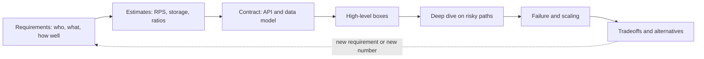
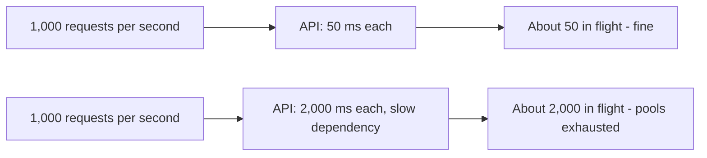
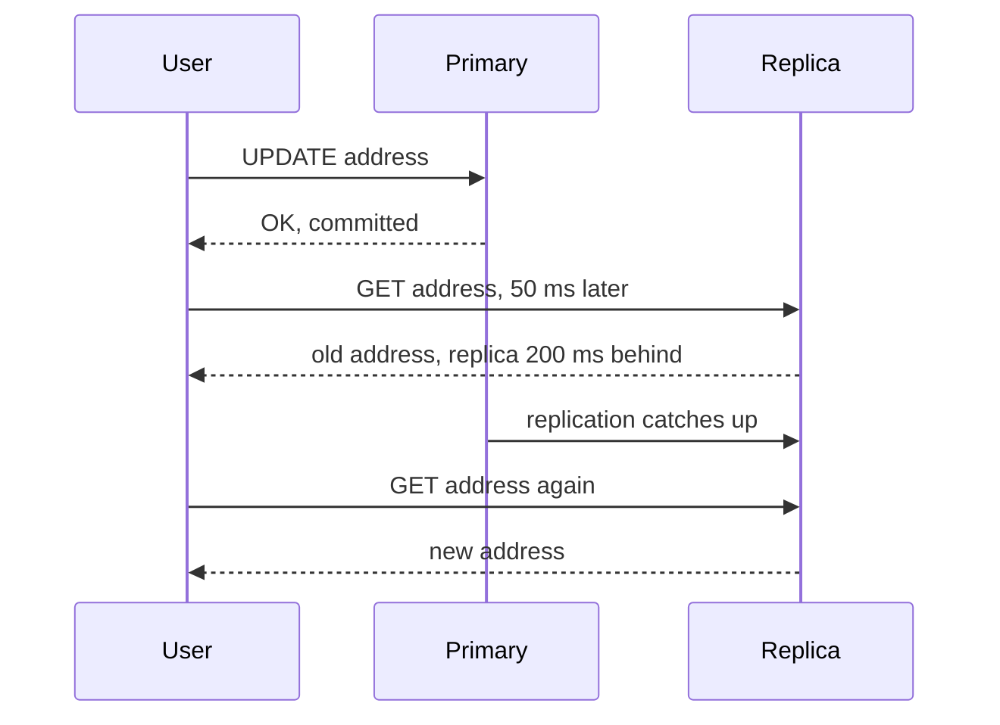
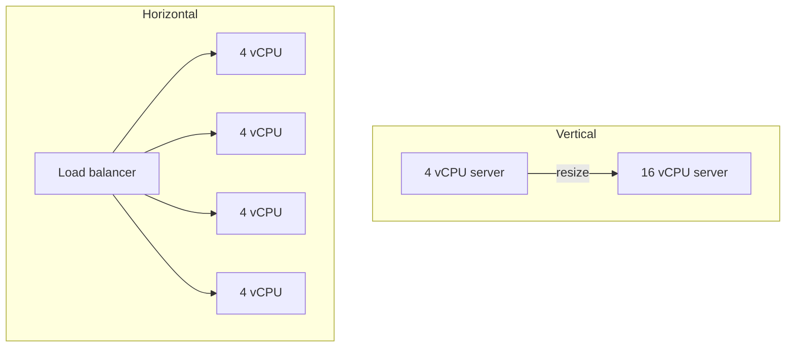

# Part 58 — System Design from Zero

This Part opens Volume 6 and is the on-ramp to the whole system design track. If you have finished Volume 0 you can build an API, store rows in PostgreSQL and deploy it somewhere. That is enough. By the end of this Part you will know what system design actually is, you will know the fifteen building blocks every design is made of, you will have watched one food-ordering app grow from one user to ten million users one forced change at a time, you will have done your first guided design with checkpoints, and you will have seen the same interview answered at junior, senior and staff level with the scores that separate them. Then Part 59 — System Design Case Studies takes over with its nine-move method and fifteen full designs.

Read this Part in order. Each section uses only what the sections before it taught.

## 58.1 What system design is (and is not)

#### Concept

**System design** is deciding which pieces a software system is made of, how those pieces talk to each other, where the data lives, and what happens when any piece is slow, overloaded or broken. The output is not code. It is a set of decisions with reasons: "orders live in PostgreSQL because we need transactions; menus are cached in Redis because they are read 2,000 times for every change; emails go through a queue because the email provider is sometimes down for twenty minutes".

Coding answers *"how do I make this function correct?"* System design answers *"how do I make this whole thing keep working for a million people, at a cost we can afford, when parts of it fail every day?"* A correct function can still be a broken system: it can hold a database connection for two seconds, call a third party with no timeout, or store files on a disk that disappears when the pod restarts.

System design is **not** drawing the most boxes, not naming the most fashionable tools, and not "microservices plus Kafka plus Kubernetes". The best design is the *simplest one that meets the requirements with the numbers you actually have*, plus a clear idea of what you will change when the numbers grow.

#### Why does it exist?

Because one computer runs out. One server has a fixed amount of CPU, memory, disk and network. One database has a ceiling on writes per second. One data centre can lose power. The moment your traffic, your data or your availability promise exceeds what one machine can give, you must split the work across several machines, and the moment you have several machines you have new problems: they disagree, they fail independently, the network between them is slow and unreliable.

It also exists because changes are expensive later. Choosing the wrong primary key, putting files in the database, or calling a payment provider inside a database transaction are cheap mistakes to avoid on day one and very expensive mistakes to undo on day 400, with ten million rows and a live business on top.

#### Mental model

Imagine you open a small restaurant. On day one you are cook, waiter and cashier in one room. That is a single server, and it is the right design for day one. As customers grow, you hire a second cook (horizontal scaling), put popular dishes under a heat lamp so nobody cooks them twice (a cache), give takeaway orders a ticket number so the counter does not block while food is cooked (a queue), and open a second branch across town when one kitchen physically cannot keep up (sharding). Nobody opens five branches on day one. Nobody refuses to hire a second cook when the queue is out the door. System design is knowing which change to make, when, and what each change costs.

#### How it works

Every design, from a pastebin to a stock exchange, is built the same way. You do not need to memorise this yet; Part 59 turns it into a strict method.

1. **Understand the problem.** Who uses it, what they do, and what "working" means in numbers: how fast, how available, how consistent, how much data.
2. **Estimate.** Requests per second, data per year, read/write ratio. Numbers tell you whether one database is enough.
3. **Define the contract.** The API endpoints and the data model.
4. **Draw the boxes.** Choose building blocks (Section 58.3) that the numbers force, and no others.
5. **Go deep on the risky paths.** The two or three places where it will break first.
6. **Ask how each arrow fails.** The senior mantra, applied to every arrow: *Can it timeout? Can it fail? Can it become slow? Can it duplicate? Can it return a wrong response? Can it partially succeed?*
7. **Name the tradeoffs.** What you gave up and why.

The dotted arrow matters. Design is a loop: when the numbers change, you go round again. Part 59, section 59.0.1 "The method in nine moves" expands these seven steps into nine and section 59.0.2 gives the 20-section template that every case study follows. This Part builds up to that method; it does not replace it.

How system design differs from coding, side by side:

| Question | Coding | System design |
|---|---|---|
| Unit of work | A function, a class, a module | A service, a datastore, a queue, a region |
| What "correct" means | Returns the right output | Returns the right output, fast enough, for enough users, while parts fail |
| Main enemy | Bugs in logic | Latency, load, partial failure, data growth, cost |
| How you test it | Unit and integration tests | Load tests, failure drills, capacity models, production metrics |
| Typical mistake | Off-by-one, null handling | Single point of failure, no timeout, unbounded queue, wrong shard key |
| Cost of a wrong choice | A refactor | A migration of live data, sometimes months |

#### Practical example

A product manager says: "Customers should get an SMS when their food order is out for delivery." A coder adds `await smsClient.send(...)` inside the order status update. A system designer asks four questions first: how many orders per minute at dinner peak (about 2,000), how slow is the SMS provider (200 ms usually, 30 seconds when degraded), what happens if it is down (the rider still delivers, so the order update must not fail), and what happens if the message is sent twice (an annoyed customer, not a financial loss). The answers force a design: write the status change and an outbox row in one transaction, let a background worker send the SMS with a timeout and retries, and deduplicate by `(order_id, status)`. Same feature, very different system.

#### Failure scenario

At 20:40 on a Saturday, the SMS provider's API starts taking 25 seconds per call. The coder's version holds a database connection inside the status-update transaction for those 25 seconds. The pool of 20 connections per pod is exhausted in under a second at dinner load. Riders cannot mark orders as picked up; restaurants cannot accept new orders; the whole app is down because a *notification* was slow. The designer's version keeps working: the outbox fills up, the SMS worker's lag grows to ten minutes, and the only visible effect is late SMS messages. That difference, a slow side feature taking down the core business versus degrading gracefully, is what system design is for.

#### How a Senior Backend Engineer thinks about this

- They start from requirements and numbers, never from tools. "Kafka" is not an answer until there is a throughput figure that needs it.
- They design for today's numbers plus one step, and write down the trigger for the next step ("when the primary passes 60 percent CPU at peak, add a replica").
- They spend most of their attention on the write path and the failure paths, because reads are easy to scale and happy paths are easy to draw.
- They explain choices to a product manager in business terms: "this adds two weeks and protects checkout from email outages, which cost us an evening of orders last quarter".

#### Common mistakes

- **Starting with boxes.** A diagram before requirements is decoration.
- **Copying a big company's architecture.** Their numbers are a thousand times yours, and so is their team.
- **Ignoring failure.** Drawing only the path where everything answers in 5 ms.
- **No numbers.** "It needs to scale" is not a requirement; "3,000 requests per second at dinner peak with p99 under 300 ms" is.
- **Treating the design as finished.** Designs evolve with traffic; a good design says what changes next.

## 58.2 The vocabulary, with real numbers

You cannot discuss a design without a shared vocabulary. Each term below gets a plain definition, a real number, and a pointer to the Part that teaches it in depth.

### 58.2.1 Latency and throughput

**Latency** is how long one request takes, measured from the moment it is sent to the moment the answer arrives. **Throughput** is how many requests the system completes per second. They are different things. Imagine a motorway: latency is how long your drive takes; throughput is how many cars pass a point per minute. Adding lanes raises throughput without making any one drive faster. A traffic jam raises latency for everyone even though throughput may stay the same.

Real numbers to remember (approximate, same region):

| Operation | Typical latency |
|---|---|
| Redis `GET`, small value | 0.2 to 1 ms |
| Indexed PostgreSQL lookup, data in memory | 1 to 5 ms seen from the app |
| Same lookup, data read from disk | 5 to 20 ms |
| Round trip to another region | 70 to 150 ms |
| A third-party HTTPS API | 80 to 800 ms, sometimes seconds |
| bcrypt hash at cost 12 | about 250 to 350 ms |

The two are linked by **Little's law**: requests in flight = throughput x latency. If your API handles 1,000 requests per second and each takes 50 ms, there are on average 50 requests in flight. If latency climbs to 2 seconds because a dependency is slow, you suddenly need 2,000 requests in flight, which means 2,000 open connections, threads or promises. This is how a slow dependency exhausts a pool. Part 46 — Performance Engineering, section 46.1 "Latency, throughput and Little's law", goes deeper.

### 58.2.2 Percentiles: p50, p95, p99

An **average** latency hides the users who suffer. **Percentiles** do not. The p50 (median) is the latency that half of requests beat. The p95 is the latency that 95 percent beat; 1 in 20 requests is slower. The p99 is the latency that 99 percent beat; 1 in 100 is slower.

Example from a real-shaped checkout endpoint over one hour of 360,000 requests:

| Statistic | Value | What it tells you |
|---|---|---|
| Average | 120 ms | Looks fine and is useless |
| p50 | 80 ms | The typical user is happy |
| p95 | 300 ms | 18,000 requests that hour waited longer than 300 ms |
| p99 | 1,900 ms | 3,600 requests waited almost two seconds |
| max | 30,000 ms | Someone hit a timeout |

Why p99 matters more than it seems: a page that makes 20 backend calls has a high chance that at least one of them lands in the slowest 1 percent (about 1 - 0.99^20, roughly 18 percent of page loads). And the slowest requests often come from your biggest customers, the ones with the most data. Targets in this book are written as percentiles: "p99 under 300 ms". See Part 46, section 46.2 "Percentiles and tail latency".

### 58.2.3 Availability and the nines

**Availability** is the fraction of time (or of requests) the system works. It is expressed in "nines":

| Availability | Downtime per year | Downtime per 30 days | Realistic for |
|---|---|---|---|
| 99 % ("two nines") | 3.65 days | 7.2 hours | An internal tool |
| 99.9 % ("three nines") | 8.77 hours | 43.2 minutes | Most product APIs |
| 99.95 % | 4.38 hours | 21.6 minutes | A serious e-commerce checkout |
| 99.99 % ("four nines") | 52.6 minutes | 4.32 minutes | Payments, auth; expensive |
| 99.999 % ("five nines") | 5.26 minutes | 26 seconds | Telecom-grade; rarely justified |

Two facts make the nines hard. First, **serial dependencies multiply**: if a request passes through a load balancer (99.99), your API (99.95) and a database (99.95), the best you can promise is roughly 0.9999 x 0.9995 x 0.9995 = 99.89 percent. Second, every extra nine costs roughly ten times more in redundancy, testing and on-call discipline. Part 53 — Site Reliability Engineering, section 53.6.1 "The nines", has the full table and the maths.

### 58.2.4 Durability

**Durability** means that once the system says "saved", the data survives crashes, restarts and disk failures. It is different from availability: a system can be unavailable for an hour and lose nothing (durable but not available), or stay up while silently losing writes (available but not durable, the worse failure).

PostgreSQL gets durability from its write-ahead log: a commit returns only after the log record is flushed to disk (`fsync`), as Part 24, section 24.9 "Durability: WAL, fsync and what committed means", explains. Object storage such as Amazon S3 is designed for eleven nines (99.999999999 percent) of durability per object per year by keeping copies across several facilities. Redis, by default, is *not* durable in the same sense: with periodic snapshots you can lose the last few minutes of writes. That single fact decides what may live only in Redis (sessions, caches, rate-limit counters) and what may not (orders, payments).

### 58.2.5 Consistency: strong and eventual

**Consistency** here means: after a write, what do readers see?

- **Strong consistency:** every read sees the latest committed write. You update your delivery address, and every screen and every server immediately shows the new address. A single PostgreSQL primary gives you this for reads that go to it.
- **Eventual consistency:** readers may see old data for a while, but if writes stop, all copies converge. You update your profile photo, and a friend sees the old one for a few seconds because the CDN or a replica has not caught up.

Eventual consistency is not a bug; it is a price you pay for speed and availability. The design question is *which data can tolerate it*. A product's review count: yes. A payment's status: no. Part 32 — Distributed Systems Fundamentals, sections 32.6 "Consistency models in plain language" and 32.7 "Strong versus eventual consistency: which business cases need which", go further.

### 58.2.6 Scalability: vertical and horizontal

**Scalability** is the ability to handle more load by adding resources. There are two directions:

- **Vertical scaling (scale up):** a bigger machine. Going from 4 vCPU to 16 vCPU. Simple, no code changes, but it has a ceiling (the biggest instance you can buy), it gets expensive non-linearly, and it is still one machine that can fail.
- **Horizontal scaling (scale out):** more machines of the same size behind a load balancer. Near-linear growth for stateless servers, survives the loss of one machine, but requires that the work can be split and that machines do not keep private state.

App servers scale horizontally easily. Databases scale vertically first, then with replicas for reads, and only with sharding for writes. Part 26 — Database Scaling, sections 26.1 "The scaling ladder" and 26.2 "Vertical scaling", is the reference.

### 58.2.7 Statelessness

A server is **stateless** when it keeps nothing between requests that another server would need: no logged-in sessions in memory, no uploaded files on its local disk, no in-memory shopping cart. Every request carries what is needed (a token) or the server fetches it from a shared store (PostgreSQL, Redis, S3).

Statelessness is what makes horizontal scaling and safe deploys possible. If pod A holds your session in memory and the load balancer sends your next request to pod B, you are logged out. If pod A is killed during a deploy, everything in its memory is gone. The rule: **state lives in datastores; app servers are cattle, not pets**. Part 32, section 32.8 "Distributed state: where state lives and why services should not hold it", explains the reasoning.

### 58.2.8 SLI, SLO and SLA

- **SLI (service level indicator):** a measured number. "The fraction of `POST /orders` requests that returned a non-5xx response in under 500 ms."
- **SLO (service level objective):** the internal target for that number. "99.9 percent over a rolling 30 days." It gives you an **error budget**: 0.1 percent of requests, about 43 minutes of full outage per month, that you are allowed to spend on deploys, experiments and bad luck.
- **SLA (service level agreement):** the external, contractual promise, usually looser than the SLO, with a penalty such as service credits. "99.5 percent monthly, or 10 percent credit."

The order is always SLI, then SLO, then SLA, and the SLA must be looser than the SLO so that you notice problems before they cost money. Part 53, sections 53.2 "SLI: what to actually measure", 53.3 "SLO: the internal target" and 53.4 "SLA: the external promise", cover them in depth.

### 58.2.9 The vocabulary in one table

| Term | One-line meaning | Example number | Deep dive |
|---|---|---|---|
| Latency | Time for one request | p99 under 300 ms | Part 46 |
| Throughput | Requests completed per second | 3,000 RPS at peak | Part 46 |
| Percentile | Latency that X percent of requests beat | p99 = 1 in 100 is slower | Part 46 |
| Availability | Fraction of time it works | 99.9 % = 43 min down per month | Part 53 |
| Durability | Saved data survives failures | S3 designed for 11 nines | Parts 24 and 36 |
| Strong consistency | Reads see the latest write | Payment status | Part 32 |
| Eventual consistency | Reads converge after a delay | Like count, 2 s stale | Part 32 |
| Vertical scaling | Bigger machine | 4 to 16 vCPU | Part 26 |
| Horizontal scaling | More machines | 2 to 20 pods | Parts 26 and 49 |
| Stateless | No private state on the server | Session in Redis, not memory | Part 32 |
| SLO | Internal target on an SLI | 99.9 % of orders succeed in 500 ms | Part 53 |
| SLA | Contractual promise | 99.5 % or credits | Part 53 |

Notice that every term comes with a number. That is the habit to build: a design conversation that uses these words without numbers ("it should be fast and highly available") has not started yet.
