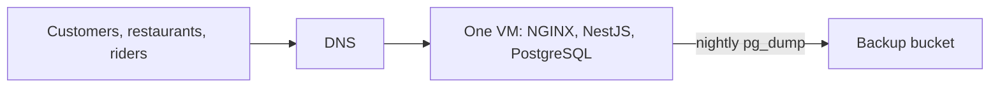
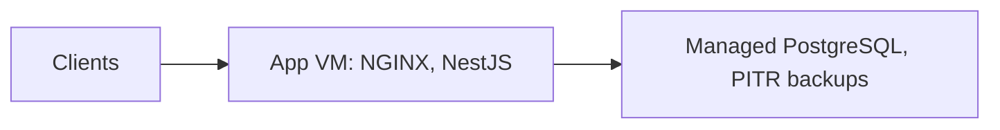
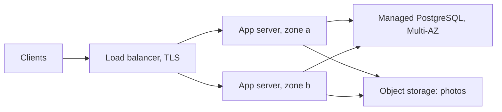
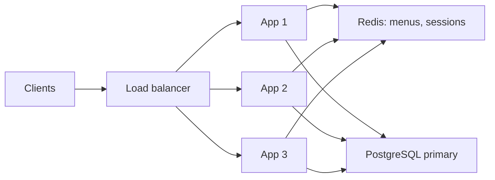
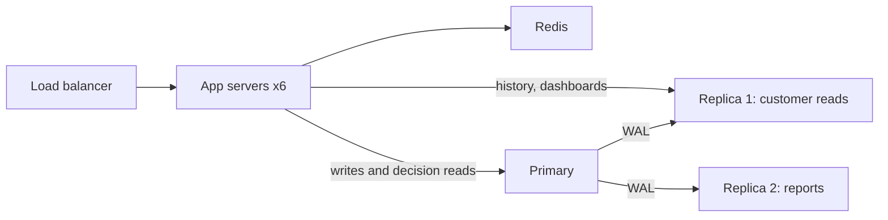
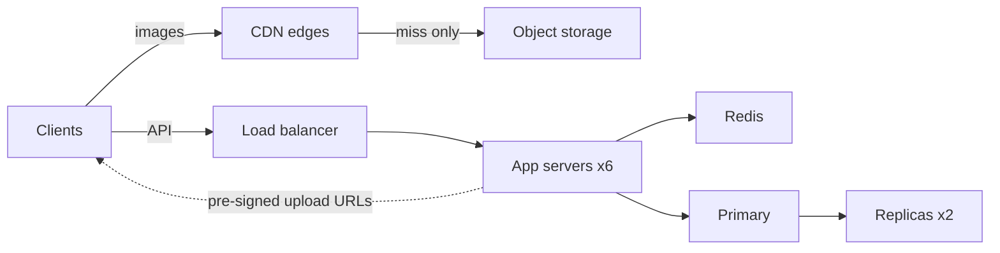
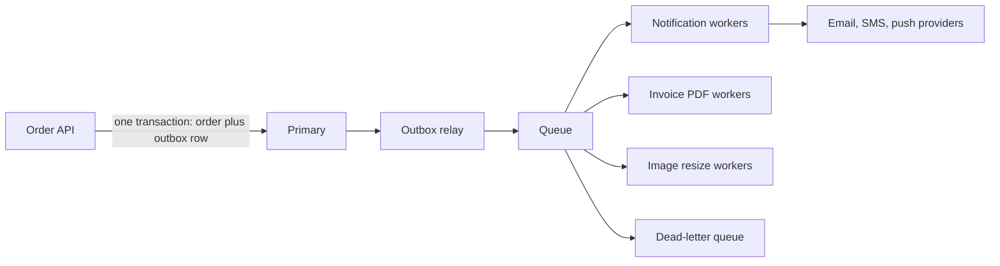
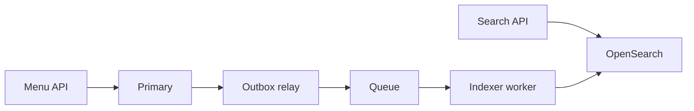
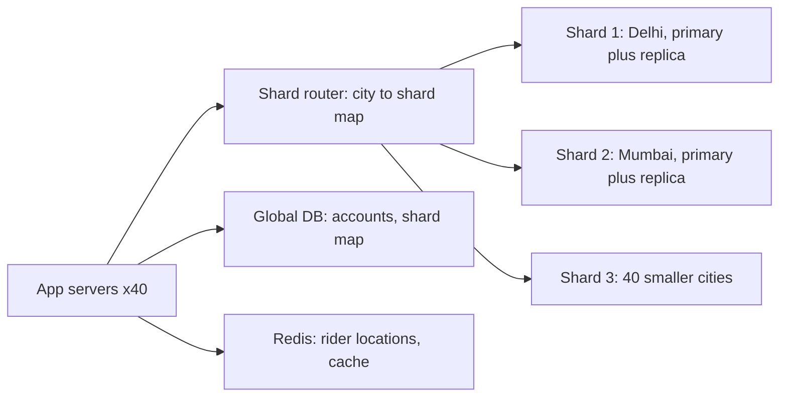
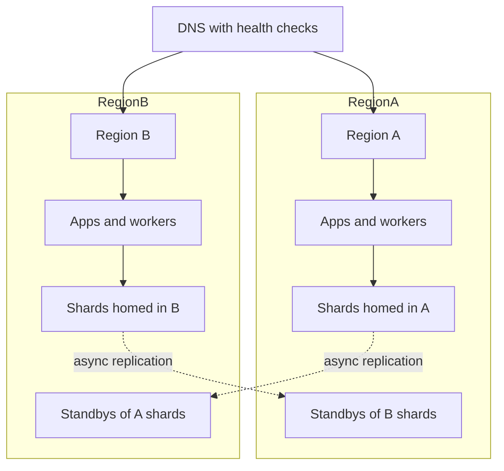

## 58.4 One app from 1 user to 10 million users

This section follows one fictional food-ordering app, which we will call **Tiffin**, from its first user to ten million registered users. Customers browse restaurant menus, place orders and pay; restaurants accept orders; riders deliver them. The stack is the book's default: NestJS, PostgreSQL, Redis when it is earned, and AWS-style managed services.

The rule of this section is strict: **no building block appears before its trigger.** A trigger is a concrete metric or incident that the team actually observed. Every stage has the same four parts: the trigger, the change, the new failure modes the change introduces, and rough numbers.

The numbers use one simple model so you can check them. Each daily active user (DAU) makes about 60 API calls a day, and food ordering is very peaky (lunch and dinner), so the peak is about five times the daily average:

```text
peak API RPS = DAU x 60 / 86,400 x 5   (roughly DAU x 0.0035)
orders per day = DAU x 0.5
```

| Stage | Registered users | DAU | Peak API RPS | Orders per day | Main DB size | Typical p99 |
|---|---|---|---|---|---|---|
| 0 | 100 | 20 | under 1 | 10 | 50 MB | 60 ms |
| 1 | 1,000 | 200 | about 1 | 100 | 500 MB | 70 ms |
| 2 | 10,000 | 2,000 | about 7 | 1,000 | 3 GB | 90 ms |
| 3 | 100,000 | 20,000 | about 70 | 10,000 | 30 GB | 1,200 ms, then 120 ms |
| 4 | 500,000 | 100,000 | about 350 | 50,000 | 150 GB | 150 ms |
| 5 | 1 million | 200,000 | about 700 | 100,000 | 300 GB | 150 ms |
| 6 | 2 million | 400,000 | about 1,400 | 200,000 | 600 GB | 2,800 ms on checkout, then 250 ms |
| 7 | 3 million | 600,000 | about 2,100 | 300,000 | 1 TB | 200 ms |
| 8 | 7 million | 1.4 million | about 4,900 | 700,000 | 3 TB | 250 ms |
| 9 | 10 million | 2 million | about 7,000 | 1 million | 4.5 TB | 250 ms |

All numbers are illustrative but realistic in shape. Your app will differ; the *order* of the stages and the habit of waiting for the trigger are what transfer.

### 58.4.1 Stage 0: one server (100 users)

**Situation.** Two founders and a handful of restaurants in one neighbourhood. One virtual machine (4 vCPU, 8 GB) runs the NestJS app and PostgreSQL side by side, with NGINX in front for TLS. Nightly `pg_dump` to object storage.

**Why this is right.** Under one request per second, anything works. The scarce resource is the founders' time, and every extra component would be time not spent on the product. The one non-negotiable even here is the backup, tested once by restoring it.



**New failure modes.** Everything is one failure domain: a disk failure, a bad kernel update or a runaway process takes down the app and the data together.

### 58.4.2 Stage 1: separate the database (1,000 users)

**Trigger.** A memory leak in the image-upload code grows the Node process until the Linux out-of-memory killer picks a victim. It picks PostgreSQL. The database restarts in recovery, the app is down for 14 minutes at lunch, and the team realises their only backup is 20 hours old.

**Change.** Move PostgreSQL to a managed database (for example Amazon RDS) with automated backups and point-in-time recovery. App and database no longer compete for memory, and the database can be resized or patched independently.



**New failure modes.** The app now talks to its database over the network: about 0.5 ms per round trip instead of a local socket, so an N+1 query loop of 200 queries now costs 100 ms instead of 20 ms. Connection limits become real. Credentials must be managed.

**Rough numbers.** About 1 RPS peak, 500 MB of data, p99 70 ms. Cost goes up by the price of a small managed instance; the founders consider it insurance.

### 58.4.3 Stage 2: a load balancer and a second app server (10,000 users)

**Trigger.** Not load. Peak is only about 7 RPS, and one server handles hundreds. The trigger is availability: every deploy restarts the only process and gives 20 to 40 seconds of errors, and a Friday deploy with a bad environment variable takes the site down for 11 minutes during dinner. The first reason to run two app servers is almost always availability, not capacity.

**Change.** A managed load balancer terminates TLS and spreads traffic over two app servers in two availability zones. Deploys become rolling: one server at a time. This forces the app to become stateless (Section 58.2.7), which surfaces two hidden bugs:

1. Restaurant photos were written to the server's local disk, so half the images 404 on the other server. They move to object storage, still served through the app for now.
2. A `@Cron` job that sends "your order is late" apologies runs on both servers, so customers get two apologies. The job takes a PostgreSQL advisory lock first (Part 35, section 35.13).



**New failure modes.** Health checks: too shallow and broken servers keep receiving traffic; too deep and a database blip removes both servers. Two copies of anything in memory can disagree. Login sessions now use signed tokens or Redis-backed sessions, so token expiry and revocation must be designed.

**Rough numbers.** About 7 RPS peak, 3 GB, p99 90 ms. The database is also switched to Multi-AZ so a zone failure costs a 60-second failover instead of a restore.

### 58.4.4 Stage 3: fix the queries, then add a cache (100,000 users)

**Trigger.** Lunchtime p99 on `GET /restaurants/:id/menu` reaches 1,200 ms and database CPU sits at 80 percent from 12:30 to 13:30. The menu page is 60 percent of all traffic.

**Change, in the right order.** First, measure: `pg_stat_statements` shows the menu endpoint issuing about 30 queries per call because the ORM loads each category's items and each item's add-ons one by one (N+1). Rewriting it as two queries and adding a composite index drops database CPU to 35 percent and p99 to 180 ms. No new component.

Six weeks later, with traffic still growing 15 percent a month, menus are still the top database consumer. Menus change a few times a day and are read about 2,000 times per change. That is the textbook case for a cache. The team adds Redis with **cache-aside**: read Redis; on a miss, read PostgreSQL and store the result with a 5-minute TTL; when a restaurant edits its menu, delete the key.



**New failure modes.** Stale data: a restaurant marks a dish sold out and customers can still order it for up to five minutes if invalidation fails, so the order API re-checks availability against PostgreSQL at checkout (the cache is for browsing, never for the decision). Stampede: when a popular restaurant's key expires at 13:00, 400 requests miss at once; a short lock or request coalescing fixes it (Part 30, section 30.5.2 "Cache stampede (dogpile)"). Redis down: the database must survive a burst of misses, so the app degrades by rate-limiting menu loads rather than collapsing.

**Rough numbers.** About 70 RPS peak; cache hit ratio 96 percent; database reads drop by about 20x for menus; p99 120 ms.

### 58.4.5 Stage 4: read replicas (500,000 users)

**Trigger.** Database CPU hits 70 percent at dinner even with the cache. The load is varied reads that do not cache well: customers' order history, restaurant dashboards ("orders this week by hour"), and the operations team's reports, one of which runs a 40-second query every 15 minutes and causes a visible latency spike each time. Writes are only about 10 percent of load.

**Change.** Add a read replica, later two. Route reads that tolerate a little lag to replicas: order history older than a few minutes, dashboards, reports. Keep everything that is part of a decision on the primary: checkout, payment status, stock checks. The operations reports move to their own replica so they cannot hurt customers.



**New failure modes.** Replication lag. A customer places an order, the app redirects to "My orders", the read goes to a replica 300 ms behind, and the order is missing. Customers re-order and get charged twice. The fix is **read-your-writes**: for a few seconds after a user writes, their reads go to the primary (a flag in the session or a timestamp comparison). See Part 26, section 26.5 "Replication lag". Replicas also do nothing for writes, which will matter at Stage 8.

**Rough numbers.** About 350 RPS peak, 150 GB, primary CPU back to 40 percent, p99 150 ms.

### 58.4.6 Stage 5: CDN and object storage for images (1 million users)

**Trigger.** A menu page shows about 30 dish photos, and the app loads roughly half of them as the customer scrolls. With menu pages still about 60 percent of the 700 API requests per second at dinner, that is around 6,000 image requests per second, far more than API requests, all streamed from object storage *through the app servers*. App pods spend 45 percent of their CPU copying image bytes, the bandwidth bill has tripled in three months, and customers in a newly launched city 1,500 km from the region see menus take 3.5 seconds to render on mobile networks.

**Change.** Put a CDN in front of object storage and serve images directly from it with long cache lifetimes and content-hashed file names (`dish-812-a91f3c.webp`), so a changed photo gets a new URL instead of needing invalidation. Uploads switch to **pre-signed URLs**: the restaurant app uploads straight to object storage, never through the API. A resized thumbnail is generated per upload.



**New failure modes.** A wrong `Cache-Control` header on an API path could cache one customer's order page at the edge for everyone, so API responses are explicitly marked `private, no-store`. Thumbnails are still generated synchronously inside the upload-confirm request (about 3 to 8 seconds for a large photo), which is about to become a problem.

**Rough numbers.** About 700 API RPS (images no longer counted; the CDN serves about 97 percent of image requests from the edge); app CPU drops by almost half; first image paint in the far city goes from 3.5 s to under 1 s.

### 58.4.7 Stage 6: a queue and background workers (2 million users)

**Trigger.** Checkout p99 is 2.8 seconds. Inside `POST /orders` the code charges the card, then sends a confirmation email (200 to 800 ms), an SMS, a push notification to the restaurant tablet, and renders an invoice PDF. On a Friday evening the email provider degrades to 20-second responses and 9 percent of checkouts fail with 504 Gateway Timeout, even though the orders and payments succeeded. Customers retry and some are charged twice.

**Change.** `POST /orders` now does only what must be synchronous: validate, reserve, charge with an idempotency key, and write the order. In the same database transaction it writes **outbox rows** (`order.placed`). A relay publishes them to a queue; separate worker deployments send email, SMS and push, render PDFs and resize photos, each with timeouts, retries with backoff, and a dead-letter queue. Each consumer deduplicates by event ID, because the queue delivers at least once.



**New failure modes.** Duplicates (a worker crashes after sending the email but before acknowledging, so the email goes twice; deduplicate by `(event_id, channel)`). Poison messages that fail forever (dead-letter queue plus an alert). Silent lag (alert on the age of the oldest message, not just queue length). Ordering: "order delivered" SMS arriving before "order confirmed" if messages for one order are processed in parallel.

**Rough numbers.** About 1,400 API RPS; around 200,000 orders a day produce roughly 2 million queue messages a day (about 23 per second on average, 120 per second at peak), which a managed queue handles trivially. Checkout p99 falls from 2.8 s to 250 ms. Kafka is *not* needed at this rate; a simple managed queue or BullMQ on Redis is the honest choice.

### 58.4.8 Stage 7: a search index (3 million users)

**Trigger.** Dish search uses `WHERE name ILIKE '%paneer%'` over 2 million dishes. It cannot use a B-tree index, takes 600 ms at p99, and consumes 25 percent of replica CPU. Product wants typo tolerance ("panner"), filters (veg, rating 4+, under 30 minutes) and ranking by distance and popularity.

**Change, in two steps.** Step one buys months for almost no cost: PostgreSQL full-text search with a `tsvector` column and a GIN index, plus the `pg_trgm` extension for fuzzy matching. p99 drops to 40 ms. Step two, a year later, when ranking needs to blend text relevance, distance, rating and live restaurant status at about 600 searches per second at peak: an OpenSearch cluster, fed by an indexer worker that consumes the same outbox events (`menu.updated`, `restaurant.status_changed`).



**New failure modes.** The index is a derived copy and is always slightly behind; a closed restaurant can appear in results for a few seconds, so the order API re-checks status. If the indexer falls behind, results drift; a nightly reconciliation job compares counts and re-indexes differences. Mapping changes need a reindex into a new index and an alias swap. See Part 37, section 37.10.

**Rough numbers.** About 2,100 API RPS; 1 TB in PostgreSQL; a three-node search cluster holding about 15 GB of index.

### 58.4.9 Stage 8: remove misplaced writes, partition, then shard (7 million users)

**Trigger.** The primary is at 85 percent CPU at dinner, replicas lag by up to 30 seconds, and the write-ahead log volume is high. The team's first instinct is "we need to shard". Measurement says otherwise: 60 percent of all writes are rider location pings (50,000 riders online at peak, one ping every 4 seconds, about 12,500 inserts per second) into a PostgreSQL table nobody queries after ten minutes.

**Change, step one: move writes that do not belong.** Live rider locations move to Redis geospatial keys (Part 30, section 30.8.11 "Geo"), with a sampled trail written to cheap storage for disputes. Primary CPU falls to 45 percent. The `order_events` table (1.2 billion rows) is partitioned by month so old months can be detached and archived instead of deleted row by row (Part 26, section 26.7).

**Change, step two: shard, a year later, when the trigger is real.** Writes from orders, carts, payments, restaurant and rider status updates and events reach about 3,000 transactions per second at peak and double every year, the primary is on the largest instance class the team will pay for, the database is 3 TB and grows 100 GB a month, and the last restore drill took 6 hours against a 1-hour recovery time objective. Now sharding is justified. The shard key is **city**: an order, its restaurant, its rider and its customer at that moment are all in one city, so almost every transaction stays on one shard. The two biggest cities each get their own shard; forty smaller cities share one. A small global database keeps accounts and the city-to-shard map.



**New failure modes.** Cross-city queries (a customer's history across two cities, a national revenue report) now fan out or move to an analytics store fed by change data capture. A hot shard if one city grows much faster than planned; the map makes moving a city possible but each move is a live data migration (Part 26, section 26.11 "Rebalancing and live data movement"). Every query must carry the city, and a bug that forgets it reads the wrong shard. This is the most expensive change in the story; many companies at this size run a single large primary for years, and that is a perfectly good outcome when the triggers above have not fired.

**Rough numbers.** About 4,900 API RPS; peak primary writes per shard down to about 1,000 transactions per second; restore time per shard under 1 hour.

### 58.4.10 Stage 9: multi-region (10 million users)

**Trigger.** On a Friday evening the cloud region suffers a three-hour partial outage of its managed database and load-balancer control plane. Tiffin is down in every city through the busiest dinner of the month. The board sets a new requirement: recover within 15 minutes from a region loss, losing at most a few seconds of orders (RTO 15 minutes, RPO seconds; Part 54, section 54.3 "RPO and RTO"). The company is also launching in a second country whose rules prefer local data storage.

**Change.** Because the data is already sharded by city, each city gets a **home region**. Each shard streams to a warm standby in the other region. The global account database is replicated to both. DNS health checks plus a documented, rehearsed runbook move a city's traffic to its standby. Stateless app servers, workers and caches run in both regions; caches simply start cold after a failover.



**New failure modes.** Asynchronous replication means a failover can lose the last few seconds of writes, so payments reconcile against the provider after failover. **Split brain**: if both regions believe they own a city, two primaries accept orders; ownership must be fenced in one place. Failover that was never rehearsed does not work, so game days run quarterly (Part 53, section 53.12 "Change management, game days and drills"). Cost rises by roughly 60 to 100 percent for standby capacity.

**Rough numbers.** About 7,000 API RPS peak across both regions; 4.5 TB across shards; cross-region replication lag normally under 1 second.

### 58.4.11 The whole journey in one table

| Stage | Trigger (observed) | Change | New failure mode to own |
|---|---|---|---|
| 0 | None; start here | One server, tested backups | Single failure domain |
| 1 | App OOM killed the database | Managed PostgreSQL | Network round trips, connection limits |
| 2 | Deploys and one crash caused outages | Load balancer, two stateless servers | Health checks, hidden state |
| 3 | Menu p99 1.2 s, DB CPU 80 % | Fix N+1 and indexes, then Redis cache | Stale data, stampede, Redis down |
| 4 | DB CPU 70 % from varied reads and reports | Read replicas | Replication lag, read-your-writes |
| 5 | Images 45 % of app CPU, far-city latency | CDN, direct uploads to object storage | Mis-cached private responses |
| 6 | Email outage failed 9 % of checkouts | Outbox, queue, workers | Duplicates, poison messages, lag |
| 7 | `ILIKE` search 600 ms, typo tolerance wanted | PostgreSQL full-text, later OpenSearch | Index drift, reindexing |
| 8 | Primary write-bound, 3 TB, slow restores | Move pings to Redis, partition, shard by city | Cross-shard queries, hot shards |
| 9 | Region outage; new country | City-homed regions, warm standbys | Split brain, data loss window, cost |

Three patterns run through the table. Each change was **forced by a measured symptom**. Each change **introduced a new failure mode** that had to be designed for at the same time. And the **cheapest fix was tried first** every time: queries before caches, PostgreSQL full-text before a search cluster, moving misplaced writes before sharding.

### 58.4.12 Incident stories: too early and too late

**Too early.** A different team, building a grocery-delivery app, started with 14 microservices, Kafka, a service mesh and a sharded database "so we never have to rewrite". At launch they had 3,000 users and about 2 requests per second. Nine months of a six-person team's time had gone into infrastructure. On launch week, at 19:10 on a Thursday, a Kafka consumer group rebalanced in a loop after a configuration change; order events stopped flowing, restaurants never saw new orders, and customers were charged for food that never arrived. The engineer on call needed 70 minutes to find the problem across five services' logs because tracing had not been set up yet. A single NestJS app with PostgreSQL and a job queue would have handled their traffic two hundred times over, and the bug would have been a stack trace in one log. The company ran out of money before the architecture's scale was ever needed. The lesson: complexity is paid for every day, and scale you do not have is a cost with no benefit.

**Too late.** A third team ran a successful food app on one PostgreSQL primary with no replicas and no cache. Database CPU had been above 75 percent at dinner for four months; a ticket to add a cache sat in the backlog behind features. On New Year's Eve, at 20:05, traffic reached 2.4 times a normal Saturday. Database CPU hit 100 percent, query latency went from 5 ms to 900 ms, and by Little's law the number of connections in use climbed until every pod's pool was exhausted. The app returned errors for 52 minutes on the most valuable evening of the year. The fix (a menu cache and a replica for history pages) took four days to build and test in January. The lesson: a sustained metric above its comfortable threshold *is* the trigger. Waiting for the incident means paying for the change at the worst possible moment.

The senior position sits between the two stories: **write down the trigger for the next stage before you need it, watch the metric, and act when it fires.**
