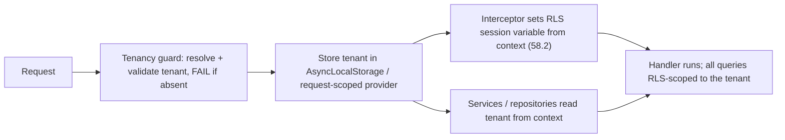

## 58.3 Tenant context in NestJS

#### Concept

The tenant context is how your NestJS application knows, for every request, which tenant it is serving — and makes that known reliably to every layer (guards, services, repositories, the RLS session variable) without passing it manually through every function call. The main techniques are **request-scoped providers** (NestJS creates a fresh provider instance per request, holding the tenant), **AsyncLocalStorage** (Node's mechanism for request-scoped context without request-scoping every provider), and a **tenancy guard** (which resolves and validates the tenant from the request and enforces that a tenant is present). Getting the tenant context right is what makes tenant isolation (58.2) actually work in the application, because RLS needs the correct tenant set on every request, reliably.

#### Why does it exist?

Imagine resolving the tenant in the controller and then having to pass the `tenantId` as a parameter to every service method, every repository call, and down into every helper, forever. It is tedious, error-prone (one function that forgets to pass it breaks isolation), and clutters every signature. Worse, if any code path fails to thread the tenant through, it either uses the wrong tenant or no tenant — an isolation failure. Manually threading tenant context through every call is both painful and dangerous.

The tenant context exists to resolve the tenant once, at the edge (in a guard), and make it available everywhere automatically for the rest of the request, so no code has to pass it manually and no code path can forget it. It also exists to *enforce* that a tenant is always present and valid — a request with no resolved tenant should be rejected (fail closed, 58.2), never processed tenant-less. The tenant context is the application-layer foundation that makes database-layer isolation (RLS) reliable.

#### Mental model

Imagine a hospital where every patient wears a wristband with their ID. Once the wristband is on (at admission), every nurse, doctor, and lab automatically knows which patient they are dealing with — nobody has to ask or pass a note; they just read the wristband. Without the wristband, staff would have to carry a slip of paper for each patient and hand it off at every step, and one dropped slip means treating the wrong patient. The tenant context is the wristband: resolved once at the edge (admission), it is automatically available to every part of the request (every nurse and lab) without manual passing, so no step can accidentally serve the wrong tenant. AsyncLocalStorage is the mechanism that makes the wristband readable from anywhere in the request without threading it through every call.

#### How it works

The flow: a guard at the edge resolves and validates the tenant, stores it in a context, and every downstream layer reads it from the context.



**Resolving the tenant.** The tenant is identified from the request — commonly from the authenticated user's token (the JWT claims include the tenant), from a subdomain (`acme.app.com`), or from a header. The guard extracts it and validates it (the tenant exists, is active, and the authenticated user belongs to it).

**AsyncLocalStorage** is Node's built-in mechanism for maintaining context across async operations within a request, without passing it as a parameter. You store the tenant at the start of the request, and any code during that request can read it from the store, even deep in async call chains.

**The tenancy guard** enforces the invariant: every request must have a valid tenant, or it is rejected. This is the fail-closed principle at the application layer — no tenant, no access.

#### NestJS example

An AsyncLocalStorage-based tenant context, a tenancy guard that resolves and enforces it, and a service reading it:

```ts
// tenant-context.ts — AsyncLocalStorage holding the current request's tenant.
import { AsyncLocalStorage } from 'async_hooks';

export interface TenantContext { tenantId: string; userId: string; }
export const tenantStorage = new AsyncLocalStorage<TenantContext>();

export function getTenantId(): string {
  const ctx = tenantStorage.getStore();
  if (!ctx) throw new Error('No tenant context');  // fail closed
  return ctx.tenantId;
}
```

```ts
// tenancy.guard.ts — resolve + validate the tenant, store it, FAIL if absent.
import { Injectable, CanActivate, ExecutionContext, ForbiddenException } from '@nestjs/common';
import { tenantStorage } from './tenant-context';
import { TenantService } from './tenant.service';

@Injectable()
export class TenancyGuard implements CanActivate {
  constructor(private readonly tenants: TenantService) {}

  async canActivate(ctx: ExecutionContext): Promise<boolean> {
    const req = ctx.switchToHttp().getRequest();
    const user = req.user;                 // set by the auth guard (JWT verified)
    const tenantId = user?.tenantId;       // tenant claim from the token
    if (!tenantId) throw new ForbiddenException('No tenant');  // fail closed

    // Validate: tenant exists, is active, and the user belongs to it.
    const tenant = await this.tenants.findActive(tenantId);
    if (!tenant) throw new ForbiddenException('Invalid or inactive tenant');

    // Store on the request AND in AsyncLocalStorage for the whole request.
    req.tenantId = tenantId;               // for the RLS interceptor (58.2)
    return tenantStorage.run({ tenantId, userId: user.id }, () => true) as boolean;
  }
}
```

```ts
// Any service reads the tenant from context — no manual passing needed.
import { Injectable } from '@nestjs/common';
import { getTenantId } from './tenant-context';
import { InjectRepository } from '@nestjs/typeorm';
import { Repository } from 'typeorm';
import { Order } from './order.entity';

@Injectable()
export class OrderService {
  constructor(@InjectRepository(Order) private orders: Repository<Order>) {}

  async listOrders() {
    const tenantId = getTenantId();        // from AsyncLocalStorage, automatic
    // With RLS (58.2) this filter is defence-in-depth; without RLS it's required.
    return this.orders.find({ where: { tenantId } });
  }
}
```

Note the defence in depth: the service still filters by `tenantId` from the context *and* RLS enforces it at the database (58.2). Belt and braces — the application filters correctly, and the database enforces it regardless.

#### PostgreSQL example

The tenant context feeds the RLS session variable (58.2). The interceptor reads the tenant from the context and sets it on the connection:

```sql
-- Driven by the tenant context: at request start, within the transaction,
SELECT set_config('app.current_tenant', 'acme-tenant-uuid', true);
-- Now every query in the request is RLS-scoped to acme. The tenant context
-- (application) and RLS (database) work together: context resolves the tenant
-- once, RLS enforces it on every query.
```

#### Production scenario

A SaaS resolves the tenant once per request in the tenancy guard (from the JWT's tenant claim, validated), stores it in AsyncLocalStorage, and an interceptor sets the RLS session variable from it. Every service and repository reads the tenant from the context automatically, and every database query is RLS-scoped. A developer adding a new feature does not have to think about tenancy at all — they just write their service logic, and the tenant context plus RLS handle isolation transparently. This is the goal: tenancy is handled by the infrastructure (guard, context, RLS), so individual feature code cannot get it wrong, because it never touches it. The tenant context, done well, makes correct multi-tenancy the default that developers get for free, which is exactly what you want for a security-critical invariant that must hold across thousands of code paths.

#### Failure scenario

A SaaS resolves the tenant in each controller and passes `tenantId` manually down through service and repository calls. It mostly works, but it is fragile. A developer adds a background job triggered by a request — and the job runs outside the request's call stack, so the manually-threaded `tenantId` does not reach it, and the developer, not realising, defaults it or fetches without a tenant filter. The background job processes data for the wrong tenant (or all tenants), causing a cross-tenant data corruption that is discovered weeks later. The root cause is manual tenant threading, which breaks exactly at the boundaries (background jobs, event handlers, async operations) where the call stack does not carry the parameter. Had the tenant been in AsyncLocalStorage with a fail-closed `getTenantId()` (that throws when no context exists), the background job would either have had the correct context propagated or failed loudly (no tenant context) rather than silently defaulting to the wrong tenant. Manual tenant threading is both tedious and dangerous precisely because it fails silently at async boundaries, and the fix is a request context that is either correctly propagated or absent-and-failing-closed, never silently wrong. (Background jobs need the tenant explicitly passed into the job payload and re-established in the job's context — a deliberate re-entry, not an assumed inheritance.)

#### Edge cases & failure modes

- **Manual tenant threading.** Passing `tenantId` through every call is tedious and fails silently at async boundaries (background jobs, event handlers).
- **No fail-closed on missing context.** If `getTenantId()` defaults or returns empty instead of throwing when there is no context, a tenant-less code path processes the wrong or all tenants' data.
- **Background jobs losing context.** AsyncLocalStorage context does not automatically cross into a queued job; the tenant must be put in the job payload and re-established in the job.
- **Resolving the tenant without validating it.** Trusting a tenant id from a header or token without checking the user belongs to that tenant allows tenant spoofing.
- **Request-scoped providers everywhere.** Making every provider request-scoped (to carry the tenant) hurts performance; AsyncLocalStorage avoids request-scoping the whole app.
- **Tenant context set but RLS variable not set.** The application knows the tenant but the database does not, so RLS has no tenant — must wire the context to the RLS session variable.

#### How a Senior Backend Engineer thinks about this

They resolve the tenant once at the edge, in a guard that validates it (the tenant exists, is active, and the user belongs to it — never trusting a raw tenant id), and they make it available everywhere automatically via AsyncLocalStorage rather than threading it manually, because they know manual threading is tedious and, more importantly, fails silently at async boundaries where the call stack does not carry the parameter. They design the context accessor to fail closed — throwing when there is no tenant context rather than defaulting — because a tenant-less code path that silently defaults is a cross-tenant corruption waiting to happen.

They wire the tenant context to the RLS session variable (58.2), so the application-resolved tenant enforces database-level isolation, and they treat the two as defence in depth: the application filters correctly and the database enforces it regardless. They are especially careful at the boundaries where context does not automatically propagate — background jobs, event handlers — explicitly passing the tenant into job payloads and re-establishing the context, because they know these boundaries are exactly where silent tenant-mixing bugs occur. The senior engineer's goal is to make correct tenancy the transparent default that feature code gets for free, so that isolation holds across thousands of code paths without each one having to get it right.

#### Common mistakes

- **Manually threading `tenantId`** through every call, which fails silently at async boundaries.
- **Not failing closed** when the tenant context is missing, so a tenant-less path processes wrong/all tenants' data.
- **Losing tenant context in background jobs** by assuming it propagates automatically.
- **Resolving the tenant without validating** that the user belongs to it, enabling tenant spoofing.
- **Not wiring the context to the RLS session variable,** so the database has no tenant to enforce.

#### Interview questions

1. **How do you make the current tenant available throughout a request without passing it manually everywhere?**
   *Expected answer:* resolve and validate it once at the edge in a tenancy guard (from the validated JWT claim or subdomain), store it in AsyncLocalStorage (Node's request-context mechanism), and have every layer read it from the context — plus wire it to the RLS session variable. This avoids manual threading, which is tedious and fails silently at async boundaries. *Follow-up:* why not just make every provider request-scoped.

2. **Why is manually threading the tenantId through every call dangerous, not just tedious?**
   *Expected answer:* it fails silently at boundaries where the call stack doesn't carry the parameter — background jobs, event handlers, async operations — where a developer may default it or omit it, causing the wrong tenant (or all tenants) to be processed, a cross-tenant corruption discovered late. A request context (AsyncLocalStorage) with a fail-closed accessor either propagates correctly or fails loudly. *Why it matters:* tests awareness of the silent async-boundary failure.

3. **How do you handle tenant context in a background job triggered by a request?**
   *Expected answer:* AsyncLocalStorage context does not automatically cross into a queued job, so you must put the tenant explicitly in the job payload and re-establish the tenant context (and the RLS session variable) at the start of the job — a deliberate re-entry, not an assumed inheritance. The job's accessor must fail closed if the tenant is missing. *Why it matters:* this is the exact boundary where tenant-context bugs occur.

#### Practical exercise

Implement a tenant context for a NestJS application: a tenancy guard that resolves the tenant from the validated JWT (checking the tenant is active and the user belongs to it, failing closed if absent), stores it in AsyncLocalStorage, and sets the RLS session variable; an accessor (`getTenantId`) that throws when there is no context; and a service that reads the tenant from the context without it being passed in. Then handle a background job: show how you pass the tenant into the job payload and re-establish the context in the job.

**Acceptance criteria:** the tenant is resolved and validated once at the edge (not trusted raw), stored in a request context (AsyncLocalStorage, not threaded manually), and wired to the RLS session variable; the accessor fails closed (throws) when no context exists; a service reads the tenant from the context automatically; and your background-job handling explicitly passes the tenant into the job and re-establishes the context, demonstrating awareness that context does not auto-propagate across async boundaries.
