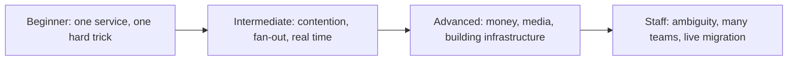
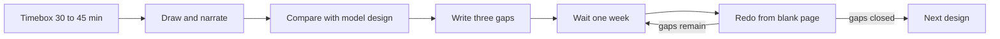
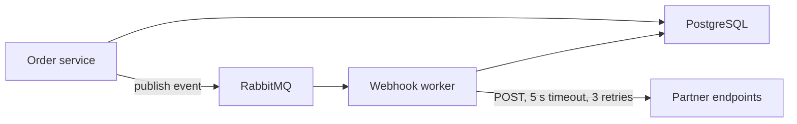

## 58.7 The system design ladder and a 12-week practice plan

The book contains more than thirty full designs. Reading them in book order is like learning to swim by starting in the deep end of five different pools. This section orders them from easy to hard, says what each one teaches, and gives you a plan to practise them.

### 58.7.1 What the levels mean

| Level | What the design asks of you | Typical new idea |
|---|---|---|
| Beginner | One service, one database, one or two well-known tricks | Key generation, Redis counters, object storage, a queue |
| Intermediate | Several components with a real consistency or contention problem | Fan-out, no-oversell, real-time delivery, geo indexes |
| Advanced | Money, media, global state or a piece of infrastructure built from scratch | Sagas, replication, quorum, streaming pipelines |
| Staff | Ambiguous scope, several teams, migration of a live system, or extreme constraints | Sequencing, organisational design, microsecond latency |

### 58.7.2 The ladder: every design in the book

High-level system design (the classic "design X" round):

| Level | Design | Where | What it teaches |
|---|---|---|---|
| Beginner | Pastebin | Part 58, section 58.6 | The whole method once, guided; content in object storage; key length set by guessing |
| Beginner | URL Shortener | Part 59, section 59.1 | Read-heavy design, key generation, caching the hot path, click analytics |
| Beginner | Authentication System | Part 59, section 59.2 | Sessions versus tokens, refresh rotation, password hashing cost |
| Beginner | Rate Limiter | Part 59, section 59.3 | Token bucket and sliding window, atomic Redis scripts, fail open or closed |
| Beginner | Notification System | Part 59, section 59.4 | Queues, fan-out per channel, preferences, deduplication, provider outages |
| Beginner | File Upload System | Part 59, section 59.5 | Pre-signed URLs, multipart upload, scanning pipeline, file state machine |
| Beginner | Unique ID Generator | Part 70, section 70.3 | Snowflake-style IDs, clock skew, coordination-free uniqueness |
| Beginner | Leaderboard and Top-K | Part 71, section 71.1 | Sorted sets, approximate counting, windowed rankings |
| Intermediate | Chat System | Part 59, section 59.6 | WebSockets, presence, message ordering, offline delivery |
| Intermediate | Order Management System | Part 59, section 59.8 | State machines, outbox, idempotent order creation |
| Intermediate | Inventory System | Part 59, section 59.9 | Reservations, no oversell under contention, hot rows |
| Intermediate | Social Media Feed | Part 59, section 59.12 | Fan-out on write versus read, celebrity problem |
| Intermediate | Distributed Job Scheduler | Part 59, section 59.15 | Leases, exactly-once illusions, missed and duplicate runs |
| Intermediate | Web Crawler | Part 70, section 70.1 | Frontier queues, politeness, deduplication at scale |
| Intermediate | Ticket and Seat Booking System | Part 70, section 70.4 | Holds with expiry, extreme contention at sale start |
| Intermediate | Proximity Search | Part 71, section 71.3 | Geohash and geo indexes, moving objects |
| Intermediate | Search Autocomplete | Part 72, section 72.1 | Prefix structures, precomputed suggestions, latency budgets |
| Intermediate | Distributed Cache | Part 72, section 72.4 | Consistent hashing, eviction, replication of a cache tier |
| Advanced | Payment System | Part 59, section 59.7 | Idempotency with money, ledgers, unknown outcomes, reconciliation |
| Advanced | Food Delivery System | Part 59, section 59.10 | Three-sided marketplace, dispatch, sagas across services |
| Advanced | Ride Booking System | Part 59, section 59.11 | High-rate location streams, matching, surge |
| Advanced | Video Streaming Platform | Part 59, section 59.13 | Transcoding pipelines, adaptive bitrate, CDN economics |
| Advanced | E-commerce Platform (end to end) | Part 59, section 59.14 | Integrating catalogue, cart, checkout, payments and fulfilment |
| Advanced | Distributed Key-Value Store | Part 70, section 70.2 | Consistent hashing, replication, quorum, repair |
| Advanced | Collaborative Document Editing | Part 71, section 71.2 | Operational transforms and CRDTs, real-time merge |
| Advanced | Ad-Click and Metrics Aggregation | Part 71, section 71.4 | Stream processing, windows, late data, exactly-once counting |
| Advanced | File Sync (Dropbox-style) | Part 72, section 72.2 | Chunking, deduplication, conflict resolution across devices |
| Advanced | Distributed Message Queue | Part 72, section 72.3 | Partitioned logs, replication, consumer offsets |
| Advanced | Object Storage (S3-style) | Part 72, section 72.5 | Metadata versus data planes, erasure coding, durability maths |
| Advanced | Monitoring and Alerting | Part 72, section 72.7 | Time-series storage, cardinality, alert evaluation at scale |
| Staff | Stock Exchange Matching Engine | Part 72, section 72.6 | Deterministic single-threaded matching, sequencing, microsecond latency |
| Staff | The platform that lets 40 teams ship services safely | Part 97, section 97.4.1 | Paved roads, governance, adoption across teams |
| Staff | Moving a monolith serving 10 million users without stopping feature work | Part 97, section 97.4.2 | Migration sequencing, strangler patterns, keeping every step shippable |

Low-level design (the "machine coding" round, classes and code rather than boxes), Part 73:

| Level | Problem | Where | What it teaches |
|---|---|---|---|
| Beginner | Parking Lot | Part 73, section 73.2 | Object modelling, strategies, concurrency on a shared resource |
| Beginner | Rate Limiter Library (pluggable strategies) | Part 73, section 73.6 | Strategy pattern, testable time |
| Beginner | Food-Order State Machine with Notifications | Part 73, section 73.8 | Explicit states and transitions, observers |
| Beginner | Logger / Pub-Sub Library | Part 73, section 73.10 | Observer pattern, back-pressure in a library |
| Intermediate | Splitwise | Part 73, section 73.3 | Domain modelling, debt simplification |
| Intermediate | Elevator System | Part 73, section 73.4 | Scheduling policies, state per elevator |
| Intermediate | Movie Ticket Booking (seat locking) | Part 73, section 73.5 | Locks with expiry in code |
| Intermediate | In-Memory Key-Value Store with TTL and Transactions | Part 73, section 73.9 | Data structures, nested transactions, expiry |

Frontend and full-stack design, Part 87:

| Level | Design | Where | What it teaches |
|---|---|---|---|
| Beginner | An e-commerce product page with a cart | Part 87, section 87.6.4 | Rendering strategy, client state, cache headers |
| Intermediate | A news feed | Part 87, section 87.6.2 | Pagination, virtualised lists, optimistic updates |
| Intermediate | A comment thread with live updates | Part 87, section 87.6.3 | Real-time updates on the client, ordering, reconnects |
| Intermediate | Checkout with stock reservation | Part 87, section 87.7.1 | The API contract as the design, idempotent submits |

Mock interviews: the notification-service loop in Part 64, section 64.22.2 "Loop B — 45-minute system design", and the three graded mocks in Section 58.8 below.

### 58.7.3 How to practise one design

Reading a model design feels like learning. It is mostly recognition, which fades in days. Practice is producing a design yourself and then finding out what you missed.

1. **Timebox.** Set 45 minutes (30 for Beginner designs). Read only the problem statement or the "Try it first" card.
2. **Draw on paper or a whiteboard.** Requirements, numbers, API table, data model, boxes, two deep dives, a failure table. Say it out loud as if someone were listening; silence is the habit interviews punish.
3. **Compare.** Read the model design. Mark each of its sections green (you had it), amber (you had it partly) or red (you missed it).
4. **Write down three gaps** in one line each. "Forgot replication lag after write." "No numbers for storage." "Did not size the key for guessing."
5. **Redo after a week,** from a blank page, without rereading. If the three gaps are now green, move on. If not, redo it again next week.
6. **From week 6, practise with a person.** Swap roles with a peer: one interviews using the rubric in Section 58.8.1, the other designs. Being the interviewer teaches you what the rubric rewards.

### 58.7.4 A 12-week plan

About five to six hours a week: two new designs, one redo, and from week 6 one mock. If you have less time, take the first design of each week and skip the rest.

| Week | New designs | Redo | Focus |
|---|---|---|---|
| 1 | Pastebin (58.6) again from a blank page; URL Shortener (59.1) | none | The method, estimates, key generation |
| 2 | Unique ID Generator (70.3); Rate Limiter (59.3) | Pastebin | Coordination, atomic Redis operations |
| 3 | Authentication System (59.2); File Upload System (59.5) | URL Shortener | Security basics, object storage |
| 4 | Notification System (59.4); Leaderboard and Top-K (71.1) | Rate Limiter | Queues, fan-out, approximate counting |
| 5 | Order Management (59.8); Inventory (59.9) | Notification System | Transactions, state machines, no oversell |
| 6 | Chat (59.6); Social Media Feed (59.12) | Inventory | Real time, fan-out tradeoffs; first peer mock (58.8 question) |
| 7 | Ticket and Seat Booking (70.4); Proximity Search (71.3); Search Autocomplete (72.1) | Chat | Contention, geo, prefix search |
| 8 | Distributed Job Scheduler (59.15); Web Crawler (70.1); Distributed Cache (72.4) | Seat Booking | Leases, politeness, consistent hashing; peer mock |
| 9 | Payment System (59.7); Food Delivery (59.10) | Job Scheduler | Money, sagas, idempotency |
| 10 | Ride Booking (59.11); Video Streaming (59.13); File Sync (72.2) | Payments | Streams, media pipelines, sync conflicts; peer mock |
| 11 | Distributed Key-Value Store (70.2); Distributed Message Queue (72.3); Object Storage (72.5); Collaborative Editing (71.2) | Food Delivery | Building infrastructure: replication, logs, durability |
| 12 | E-commerce end to end (59.14); Metrics Aggregation (71.4); Monitoring and Alerting (72.7); for staff targets, Stock Exchange (72.6) and Part 97, section 97.4 | Your weakest design | Integration, operations; two full mocks scored with the rubric |

Two warnings. Do not skip the redos; they are where the learning sticks. And do not jump to Advanced designs early because they look impressive: an Advanced design attempted without the Intermediate habits produces a diagram full of boxes you cannot defend.

## 58.8 Three graded mock interviews: one question, three levels

The question below is answered three times: by a typical junior candidate, a typical senior candidate and a typical staff candidate. The interviewer, the prompt and the 45 minutes are the same. The transcripts are condensed (timestamps show where time went), and each is followed by the interviewer's rubric scores and a debrief.

The question was chosen because it is small enough for a junior to attempt and deep enough for a staff engineer to show range. It is **not** one of Part 59's headings.

> **Interviewer's prompt:** "Our food-ordering platform needs to send order events to partners' systems over webhooks: restaurant point-of-sale systems, chains' own backends, logistics partners. Design the webhook delivery service."

The interviewer's private notes (given only when asked): 2 million orders a day; about 8 event types per order (`order.placed`, `order.accepted`, `order.ready`, `order.picked_up`, `order.delivered`, `order.cancelled`, and so on); 5,000 partner integrations; on average 1.5 subscribed endpoints per event; payload about 2 KB; partner endpoints answer in 300 ms at the median but some take 10 seconds; at any moment about 2 percent of endpoints are failing; partners want at-least-once delivery, events for one order in order, signatures, retries for up to 72 hours, a delivery log for 30 days and a replay button; first attempt within 5 seconds of the event for 95 percent of events. Today, the order service calls partner URLs inline, and that has caused two incidents.

### 58.8.1 The rubric

The interviewer scores each dimension Strong, Mixed or Weak, using the behaviour-based rubric style of Part 94, section 94.5 "Writing questions and rubrics, calibration, and avoiding bias", extended with the dimensions this question stresses. The expectations per level follow Part 63, section 63.2.20 "System design".

| Dimension | Strong | Mixed | Weak |
|---|---|---|---|
| Requirements | Finds guarantees, ordering, retention and scale before designing | Asks some, assumes others | Starts drawing immediately |
| Estimates | Computes rates, storage and concurrency; numbers change the design | Computes when asked | No numbers, or numbers that change nothing |
| API and data model | Partner-facing API, tables with keys, partitioning and retention | Tables named, few details | Vague "a logs table" |
| Tradeoffs | Names choices and what each gives up, unprompted | Some, when asked | Presents one path as the only path |
| Failure handling | Slow, down, duplicate, out-of-order, poison, unprompted | When prompted | Misses even when prompted |
| Operability and evolution | Metrics, alerts, rollout from today's system, what changes at 10x | Mentions monitoring | Not considered |
| Communication | Drives the session, narrates, checks in, manages time | Clear but needs steering | Silent or disorganised |

Overall recommendation uses Part 94's scale: strong hire, hire, lean hire, lean no-hire, no-hire, always stated *for a level*.

### 58.8.2 The junior answer

**00:00 Interviewer:** (gives the prompt)

**00:30 Candidate:** Okay. So a webhook is when we call the partner's URL when something happens. Which events do they need?

**00:50 Interviewer:** Order lifecycle events: placed, accepted, ready, picked up, delivered, cancelled.

**01:10 Candidate:** Got it. I'll start with the database. We need a table of partners and their URLs, and which events they want. (Draws.) Then in the order service, after we save the order status, we look up the subscriptions for that event and call each URL with axios, with the order as JSON. And we save each call in a `webhook_logs` table with the status code.

```mermaid
flowchart LR
    OS["Order service"] -->|"save status"| DB["PostgreSQL"]
    OS -->|"for each subscription: axios.post"| P1["Partner endpoint"]
    OS -->|"insert log"| DB
```

**05:00 Interviewer:** How many calls would this make?

**05:20 Candidate:** It's a big platform, so a lot. Maybe a thousand per second? I'm not sure.

**05:40 Interviewer:** What happens if a partner's endpoint takes ten seconds to answer?

**06:00 Candidate:** Then the order update would be slow. I'd add a timeout, maybe five seconds, and retry three times if it fails.

**06:40 Interviewer:** The order update is waiting for the partner?

**07:00 Candidate:** Oh, right, that's bad. The rider would be waiting to mark the order picked up. I could do the webhook calls asynchronously. I'll put a message on RabbitMQ when the status changes, and a worker consumes it and makes the HTTP calls. Then the order service is fast.

**10:00 Interviewer:** Good. What does the data model look like?

**10:20 Candidate:** `partners` with id and name. `subscriptions` with partner id, URL and event type. `webhook_logs` with subscription id, order id, status code and created time.

**13:00 Interviewer:** The partner's endpoint is down for two hours. What happens?

**13:20 Candidate:** The worker retries three times and then logs it as failed. Maybe we could have a cron job that retries failed ones every hour.

**15:00 Interviewer:** Suppose the worker crashes after it has sent the request but before it acknowledges the message.

**15:30 Candidate:** RabbitMQ would give the message to another worker, so it would send again. The partner gets it twice. I guess they would need to handle that. We could send an event ID so they can check.

**18:00 Interviewer:** How does a partner know the request really came from you?

**18:20 Candidate:** We use HTTPS. And we could add an API key in a header.

**20:00 Interviewer:** Anything about the order of events?

**20:30 Candidate:** They should arrive in order because the queue is in order.

**21:00 Interviewer:** With several workers and retries?

**21:30 Candidate:** Hmm. If "accepted" fails and gets retried later, "picked up" could arrive first. I'm not sure how to fix that. Maybe the partner can look at the timestamp.

**25:00 to 40:00** The interviewer asks about monitoring ("I'd log errors and look at the logs"), about one partner sending traffic to a URL inside the company's network ("I hadn't thought of that"), and about storage ("PostgreSQL should be fine"). The candidate draws a cleaner version of the second diagram and adds the event ID.

**40:00 Candidate:** To summarise: the order service publishes events to RabbitMQ, workers call the partners with a timeout and retries, failures are retried by a cron job, and everything is logged in PostgreSQL.

#### Interviewer's scores: junior answer

| Dimension | Score | Evidence |
|---|---|---|
| Requirements | Weak | One question (which events); did not ask about guarantees, ordering, retention or scale |
| Estimates | Weak | "Maybe a thousand per second", no arithmetic, no storage |
| API and data model | Mixed | Three sensible tables; no partner-facing API; no retention or size thinking |
| Tradeoffs | Weak | None stated |
| Failure handling | Mixed | Moved to async after one prompt; recognised duplicates and reordering when prompted; no answer for reordering |
| Operability and evolution | Weak | "Look at the logs"; no metrics or alerts; no plan to replace the inline calls |
| Communication | Mixed | Clear and honest ("I'm not sure"), responded well to hints, but waited to be led |

**Recommendation:** hire for a junior role; no-hire for mid or senior.

**Debrief.** The answer meets the junior bar because the candidate produced a workable design, understood each hint and improved the design in response, and was honest about what they did not know. The moment at 06:40 is the best evidence: one question was enough to move the HTTP calls out of the order path, and they named the business impact (the rider waiting). What keeps it at junior: almost every important idea arrived *after* a prompt; there were no numbers; and the failure answers stopped at the first layer ("retry three times", "the partner handles duplicates") without asking what a two-hour outage at 1,400 deliveries a second would do to those retries. Many companies do not run a full system design round for junior roles; when they do, this is roughly what a passing answer looks like.
