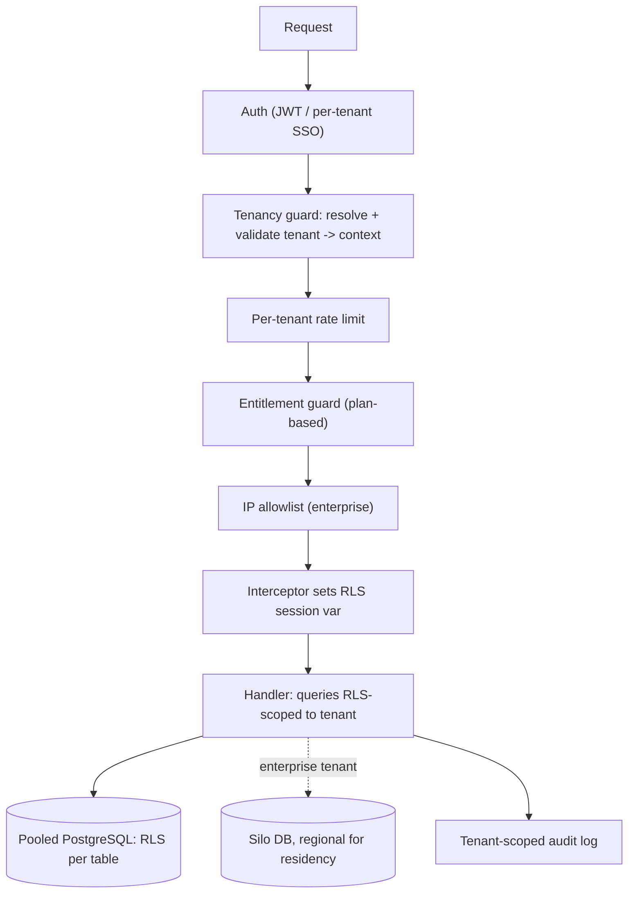

## 58.8 Worked example: turning a single-tenant inventory product into a multi-tenant SaaS

This section brings the whole Part together: converting a single-tenant inventory management product into a multi-tenant SaaS. It is the canonical "make it multi-tenant" problem, and it exercises every concept in this Part — the tenancy model, RLS isolation, tenant context, noisy-neighbour control, entitlements, enterprise features, compliance, and lifecycle.

#### The starting point

InventoryCo built a NestJS/PostgreSQL inventory product for a single company: products, stock levels, suppliers, orders. It works well for one organisation. Now they want to sell it as a SaaS to many companies. The naive approach — deploy a separate copy per customer — does not scale (it is the all-silo trap, 58.1). They need true multi-tenancy. Here is the conversion, step by step.

#### Step 1: Choose the tenancy model (58.1)

They expect many small-to-medium businesses plus some larger enterprises. So they choose a **mixed model**: pool (shared schema with `tenant_id`) for the many SMB tenants (dense, cheap), with the ability to silo (dedicated database) an enterprise tenant who needs isolation or residency. The bulk of the work is making the pool model safe.

#### Step 2: Add tenant_id and row-level security (58.2)

Every tenant-scoped table gets a `tenant_id` column, a tenant-first index, and row-level security:

```sql
ALTER TABLE products ADD COLUMN tenant_id UUID NOT NULL;
CREATE INDEX products_tenant_idx ON products (tenant_id, sku);
ALTER TABLE products ENABLE ROW LEVEL SECURITY;
ALTER TABLE products FORCE ROW LEVEL SECURITY;
CREATE POLICY tenant_isolation ON products
  USING (tenant_id = current_setting('app.current_tenant')::uuid)
  WITH CHECK (tenant_id = current_setting('app.current_tenant')::uuid);
-- Repeat for stock_levels, suppliers, orders, every tenant-scoped table.
-- A migration check (fitness function, Part 53.5) enforces RLS on every new table.
```

RLS makes isolation a database-enforced invariant — even a query that forgets the tenant filter returns only the right tenant's rows. This is the single most important safety mechanism of the conversion.

#### Step 3: Add the tenant context (58.3)

A tenancy guard resolves the tenant from the authenticated user (validated), stores it in AsyncLocalStorage, and an interceptor sets the RLS session variable per request:

```ts
// Per request: guard validates tenant -> AsyncLocalStorage -> RLS session var.
// Every service reads getTenantId() automatically; no manual threading.
// Background jobs carry tenantId in their payload and re-establish the context.
```

Now feature code does not have to think about tenancy — the context plus RLS handle it, so isolation holds across every code path without each one getting it right.

#### Step 4: Noisy-neighbour control (58.4)

Per-tenant rate limits (Redis, keyed by tenant), per-tenant fair queuing for the stock-reconciliation background jobs, and statement timeouts on the database — so one tenant's heavy batch import cannot degrade other tenants.

#### Step 5: Plans, entitlements, billing (58.5)

A plan-to-entitlements mapping (free: basic inventory; pro: + advanced reporting and API; enterprise: + SSO and audit export), checked through a centralised entitlement guard. Per-tenant config for branding and settings. Billing hooks via verified webhooks, graceful payment-status enforcement, and usage metering.

#### Step 6: Enterprise features for the enterprise tier (58.6)

Per-tenant SSO (SAML/OIDC), SCIM provisioning/deprovisioning, a tenant-scoped customer-readable audit log, IP allowlists, and — for enterprise tenants needing it — data residency via a regional silo. These unlock the enterprise deals.

#### Step 7: Compliance and lifecycle (58.7)

PCI scope reduction via payment-provider tokenisation (card data never touches InventoryCo's systems). A GDPR data map and deletion pipeline covering all stores. Tenant onboarding automated (provision tenant, apply plan). Tenant offboarding deletes all tenant data across every store after a grace period.

#### The architecture, assembled



#### Why this conversion works

Trace it against the Part. The tenancy model is a deliberate mix — pool for density, silo for demanding tenants (58.1). Isolation is enforced by the database via RLS, not by fragile application discipline (58.2). The tenant context makes correct tenancy the transparent default across all code paths (58.3). Noisy-neighbour control preserves fairness so one tenant cannot harm another (58.4). Plans and entitlements make the product monetizable and differentiated (58.5). Enterprise features unlock enterprise revenue (58.6). Compliance is designed in — PCI scope reduced via tokenisation, GDPR erasure via a data map and deletion pipeline (58.7). And the tenant lifecycle, including clean offboarding deletion, is a designed process (58.7). Each piece addresses a specific requirement of a real multi-tenant SaaS, and the whole hangs together around the first requirement: tenant isolation, enforced in depth (application context + database RLS), because a single isolation failure is a breach that can end the business. The naive "copy per customer" approach would have failed on economics; a pool-without-RLS approach would have risked a breach; this layered architecture delivers density, safety, monetisation, enterprise-readiness, and compliance together — which is what a real multi-tenant SaaS requires.

#### Practical exercise

Take a single-tenant application (yours, or InventoryCo) and design its conversion to a multi-tenant SaaS using every concept in this Part. Choose the tenancy model (likely a mix); add `tenant_id` and RLS to every tenant-scoped table; design the tenant context (guard, AsyncLocalStorage, RLS session variable, background-job handling); add noisy-neighbour controls; design plans/entitlements/billing; specify the enterprise features for the enterprise tier; and design compliance (PCI scope reduction, GDPR deletion pipeline) and tenant lifecycle (onboarding, offboarding deletion).

**Acceptance criteria:** the tenancy model is justified by the tenant mix (pool for density, silo for demanding tenants); every tenant-scoped table has RLS enforcing isolation at the database (fail-closed), not just application filtering; the tenant context makes tenancy transparent to feature code and handles async boundaries; noisy-neighbour controls are per-tenant; entitlements are centralised and plan-derived; enterprise features (per-tenant SSO, SCIM, tenant-scoped audit log, residency) are specified for the enterprise tier; and compliance (PCI tokenisation, GDPR deletion across all stores) and tenant offboarding (complete deletion) are designed in. The whole design centres on tenant isolation enforced in depth, because a single isolation failure is a breach.

## 58.9 A quick-reference for multi-tenant SaaS architecture

A compact reference distilling the Part into the decisions and checks that matter most when you design or review a multi-tenant SaaS — anchored on the first requirement, tenant isolation.

#### The tenancy-model decision

```text
Many small, cost-sensitive tenants     -> POOL (shared schema + tenant_id + RLS)
Few large tenants needing isolation    -> SILO (database-per-tenant, maybe regional)
Dozens-hundreds, moderate isolation    -> BRIDGE (schema-per-tenant)
A real mix (SMBs + enterprise)         -> MIXED (pool for the many, silo for the few)
```

#### The isolation checklist (the first requirement — get this right)

```text
[ ] Is isolation enforced at the DATABASE (RLS), not just application filtering?
[ ] Does RLS FAIL CLOSED (no tenant context -> no rows, never all rows)?
[ ] Is RLS FORCED (owner doesn't bypass) with WITH CHECK (no cross-tenant writes)?
[ ] Is the session variable set on the SAME connection the queries run on?
[ ] Is the tenant resolved + VALIDATED once (guard), in AsyncLocalStorage, not
    threaded manually (which fails at async boundaries)?
[ ] Do background jobs carry the tenant explicitly and re-establish the context?
[ ] Does every NEW tenant-scoped table get RLS (enforced by a migration check)?
```

#### The rest of the multi-tenant checklist

```text
[ ] Noisy neighbours: PER-TENANT (not global) rate limits, quotas, fair queuing?
[ ] Entitlements CENTRALISED and plan-derived (not scattered plan-name checks)?
[ ] Billing hooks safe (verified webhooks, graceful payment enforcement, reliable
    metering)?
[ ] Enterprise features built PROACTIVELY (per-tenant SSO, SCIM, tenant-scoped
    audit logs, IP allowlists) if selling to enterprise?
[ ] Data residency architected via regional deployments (not retrofitted)?
[ ] Compliance designed in: PCI scope reduced via tokenisation; GDPR erasure via
    a data map + deletion pipeline covering ALL stores?
[ ] Integration robust: signed/retried/idempotent webhooks; idempotent bulk APIs?
[ ] Tenant offboarding deletes ALL tenant data across every store?
```

#### The enduring principle

The whole Part reduces to one non-negotiable: **tenant isolation is the first requirement, and a single isolation failure is a breach, not a bug.** So isolation is enforced in depth — the application resolves and validates the tenant (context) and the database enforces it regardless (RLS, fail-closed) — because relying on application discipline alone is a bet that eventually loses. Everything else — the tenancy model, noisy-neighbour fairness, entitlements, enterprise features, compliance, lifecycle — is built on and around that isolation foundation. When you design or review a multi-tenant system, start with the question that matters most: can tenant A ever, under any failure, see tenant B's data — and is the architecture built so the answer is no even when the application code is wrong? Get that right, and the rest is engineering; get it wrong, and nothing else matters.

Return to this reference when designing or reviewing a multi-tenant SaaS; the reasoning behind each line is in the sections above.

## Senior Checklist — Part 58

- [ ] I understand the concept
- [ ] I can explain it simply
- [ ] I can implement it
- [ ] I understand its failure modes
- [ ] I understand its scaling limitations
- [ ] I understand its security implications
- [ ] I understand its operational implications
- [ ] I can choose between alternatives
- [ ] I can explain the tradeoffs
- [ ] I can answer senior-level interview questions
- [ ] I can choose a multi-tenancy model (silo/pool/bridge, or a mix) based on tenant mix and isolation needs
- [ ] I enforce tenant isolation at the database with row-level security, failing closed, not just in application code
- [ ] I implement a tenant context (guard + AsyncLocalStorage + RLS session variable) that handles async boundaries
- [ ] I prevent noisy neighbours with per-tenant rate limits, quotas, and fair queuing
- [ ] I centralise feature entitlements derived from plans, and handle billing hooks safely
- [ ] I can build the enterprise features (per-tenant SSO, SCIM, tenant-scoped audit logs, IP allowlists) that gate enterprise deals
- [ ] I architect data residency via regional deployments rather than retrofitting it into a global pool
- [ ] I design compliance in: PCI scope reduction via tokenisation, GDPR erasure via a data map and deletion pipeline
- [ ] I build enterprise integration (signed/retried/idempotent webhooks, idempotent bulk APIs)
- [ ] I design the full tenant lifecycle, including clean offboarding with complete data deletion

## Part 58 — Key Takeaways

- The first requirement of a multi-tenant SaaS is tenant isolation; a single isolation failure is not a normal bug but a breach that can end customer relationships and trigger legal consequences.
- Choose the tenancy model (silo, pool, bridge) by tenant mix and isolation needs; a mature SaaS usually runs a mix — pool for the dense many small tenants, silo for the few demanding enterprise ones — because all-silo is unviable at scale and all-pool cannot satisfy strict isolation.
- In a pooled model, enforce isolation at the database with PostgreSQL row-level security, so even a query that forgets the tenant filter returns only the right tenant's rows; relying on application discipline alone is a bet that eventually loses.
- Design isolation to fail closed: no tenant context means no access, never all access.
- Implement a tenant context (guard + AsyncLocalStorage + RLS session variable) so tenancy is transparent to feature code, and handle async boundaries (background jobs) explicitly, since context does not auto-propagate.
- Prevent noisy neighbours with per-tenant (not global) rate limits, quotas, and fair queuing, because in shared infrastructure one tenant's behaviour is a threat to all the others.
- Centralise feature entitlements derived from plans rather than scattering plan-name checks, so a plan change is a single data change; handle billing hooks safely (verified webhooks, graceful payment enforcement, reliable metering).
- Enterprise features — per-tenant SSO (SAML/OIDC), SCIM provisioning, tenant-scoped customer-readable audit logs, IP allowlists, data residency — gate enterprise revenue and must be built proactively, as they are substantial projects, not sales-cycle add-ons.
- Design compliance into the architecture: the principle for regulated data (card data, PHI, personal data) is isolate and minimise — PCI scope reduction via tokenisation, GDPR erasure via a data map and a deletion pipeline covering all stores.
- Build enterprise integration as real capabilities: signed, retried, idempotent webhooks and idempotent bulk APIs, because customers integrate at scale and retries are inevitable.
- Design the full tenant lifecycle, especially offboarding with complete data deletion across every store, because a departed tenant's lingering data is a liability and a compliance violation.
