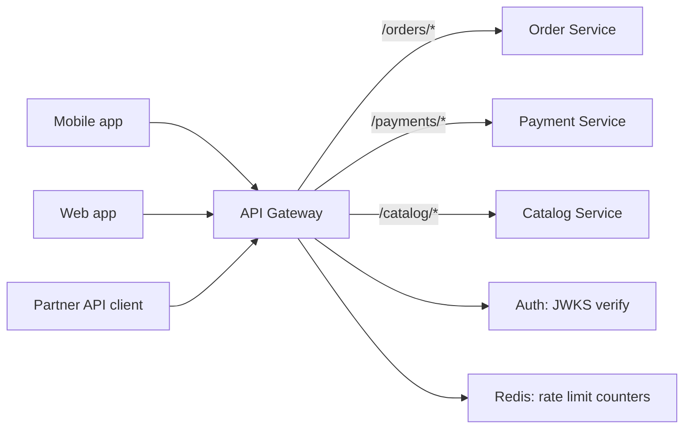
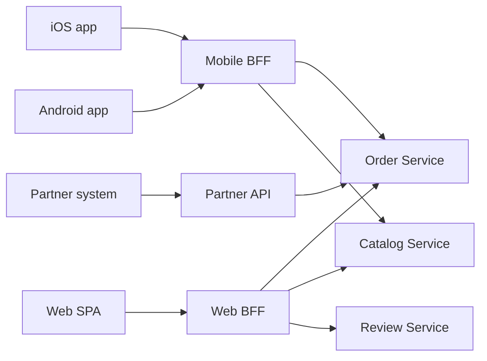
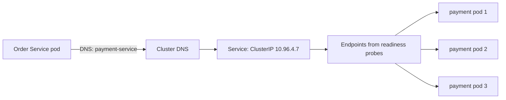
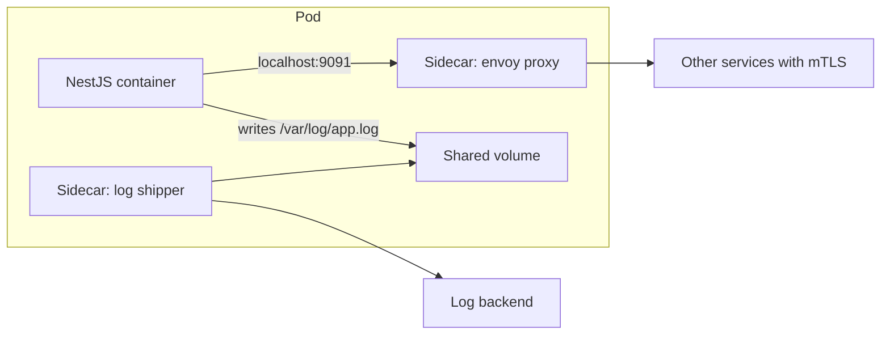
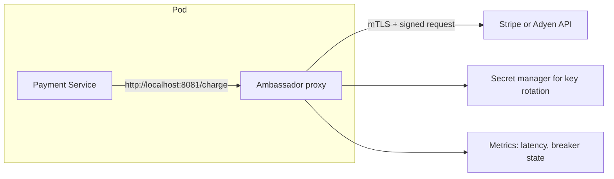
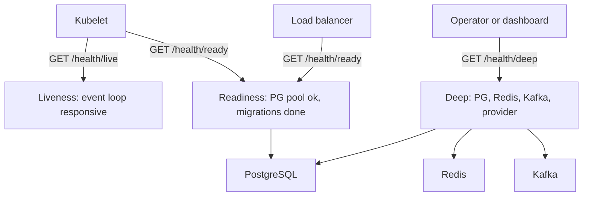

# Part 59 — Real-World Architecture Patterns

A pattern is not a library and not a framework. It is a named shape of a solution that has been rediscovered so many times that giving it a name saves everyone an hour of whiteboard time. When you say "we will put the outbox in front of Kafka", four people in the room stop arguing about dual writes and start arguing about the table schema, which is the argument worth having.

This part is a working catalogue. Thirty patterns, each with the same ten sub-sections, so you can skim to the one you need and read only the parts that matter to your decision. The two sub-sections most engineers skip are the two that save you: **When NOT to use** and **Edge cases and failure modes**. Patterns are dangerous exactly because they sound smart. A pattern applied to a problem you do not have is pure cost: more code, more moving parts, more pages at 03:00, and no benefit.

Several of these patterns are covered in depth elsewhere in the book. Circuit breakers, retries, timeouts and backpressure belong to Part 30 — Reliability Engineering. Outbox, inbox, saga and idempotency belong to Part 29 — Distributed Transactions. Cache-aside, rate limiting and token buckets belong to Part 26 — Caching and Redis. Here they get a short, catalogue-style entry with a *different* example, so this part works as a reference you can read end to end without duplicating three hundred pages.

One rule runs through everything below. Before you adopt a pattern, ask the senior questions: *Can it time out? Can it fail? Can it become slow? Can it duplicate? Can it return a wrong response? Can it partially succeed?* A pattern that does not improve at least one of those answers is decoration.

## 59.1 API Gateway

### Problem

You have twelve services behind one product. Every one of them needs TLS termination, authentication, rate limiting, request logging, CORS headers, request size limits and a stable public hostname. If each service implements all of that, you have twelve copies of your auth logic, twelve places where a security fix must land, and twelve different opinions about what a 429 body looks like. Clients also suffer: the mobile app must know that orders live at `orders.internal`, payments at `payments.internal`, and that one of them moved last week.

### Solution

Put one component at the edge that owns everything cross-cutting and routes to internal services by path or host. Clients see one origin (`api.shop.com`). The gateway authenticates the caller once, attaches a verified identity header, enforces global limits, and forwards the request. Internal services trust the gateway and stop re-implementing the edge.

### Architecture



### Example

A Kubernetes ingress that terminates TLS, applies a global rate limit, caps body size and strips any client-supplied identity header before it reaches the service.

```yaml
apiVersion: networking.k8s.io/v1
kind: Ingress
metadata:
  name: public-api
  annotations:
    nginx.ingress.kubernetes.io/limit-rps: "200"          # per client IP
    nginx.ingress.kubernetes.io/limit-burst-multiplier: "3"
    nginx.ingress.kubernetes.io/proxy-body-size: "2m"
    nginx.ingress.kubernetes.io/proxy-read-timeout: "15"  # seconds
    # never let a client forge the identity the gateway injects
    nginx.ingress.kubernetes.io/configuration-snippet: |
      proxy_set_header X-Auth-User-Id "";
      proxy_set_header X-Request-Id $request_id;
spec:
  ingressClassName: nginx
  tls:
    - hosts: ["api.shop.com"]
      secretName: api-shop-tls
  rules:
    - host: api.shop.com
      http:
        paths:
          - path: /orders
            pathType: Prefix
            backend: { service: { name: order-service, port: { number: 80 } } }
          - path: /payments
            pathType: Prefix
            backend: { service: { name: payment-service, port: { number: 80 } } }
```

Inside NestJS, the service trusts the gateway's headers only when the request arrived on the internal port, and never parses the raw `Authorization` header again:

```ts
@Injectable()
export class GatewayIdentityGuard implements CanActivate {
  canActivate(ctx: ExecutionContext): boolean {
    const req = ctx.switchToHttp().getRequest();
    const userId = req.headers['x-auth-user-id'];
    if (typeof userId !== 'string' || userId.length === 0) {
      throw new UnauthorizedException('missing gateway identity');
    }
    req.principal = { userId, scopes: String(req.headers['x-auth-scopes'] ?? '').split(',') };
    return true;
  }
}
```

### Advantages

- One place for TLS, auth, rate limiting, CORS, body limits and access logs.
- Clients get one stable hostname; internal topology can change freely.
- Security fixes land once. So do observability defaults such as a generated `X-Request-Id`.
- Cheap protocol translation at the edge: public HTTP/JSON, internal gRPC or HTTP/2.

### Disadvantages

- It is a single point of failure and a single point of *config* failure. A bad route rule takes down everything.
- It becomes a dumping ground. "Just add the coupon logic in the gateway" is how gateways turn into monoliths with a Lua plugin system.
- One more network hop: typically 1 to 3 ms in-region, more if it lives in another AZ.
- Deploy coupling: everyone waits for the gateway team.

### When to use

- More than about three public-facing services.
- You need consistent auth and rate limiting across services.
- You have external partners and want one documented origin and one set of error shapes.

### When NOT to use

- A single service. An ingress or load balancer already gives you TLS and routing; calling it a "gateway" adds a team, not a capability.
- As a place for business logic. If the gateway needs to know what a coupon is, the boundary is wrong.
- As a database proxy. Gateways that join data across services become the slowest, most fragile thing you own.

### Edge cases and failure modes

- **JWKS fetch failure**: the gateway cannot verify tokens and rejects everything. Cache keys for at least an hour and serve stale on fetch error.
- **Header spoofing**: a client sends `X-Auth-User-Id: 1`. If you forget to strip it, you have an authentication bypass. Strip on entry, always.
- **Config rollout**: an invalid route reload can drop live connections. Validate config in CI and roll out gradually.
- **Slow upstream**: without per-route timeouts, one slow service consumes all gateway worker connections and takes the others with it.
- **Body buffering**: gateways that buffer large uploads run out of memory or disk. Stream, and cap size.

### Senior perspective

The gateway is a policy enforcement point, not an application. The test I apply in review: if a change to the gateway requires knowing a domain concept, reject it. The second test: can we run without it? Internal service-to-service calls should not go through the public gateway; that turns a north-south component into an east-west bottleneck and doubles your blast radius. Also budget for the boring work — gateway config is production code and needs review, versioning and a rollback plan just like the services behind it.

## 59.2 Backend-for-Frontend

### Problem

One API cannot serve a mobile app, a web app and a partner integration well. Mobile wants a tiny payload over a flaky 4G link and hates round trips. Web wants rich objects and can afford them. Partners want a stable, versioned, slow-moving contract. Serving all three from one REST API produces endpoints with fifteen optional query flags, payloads that carry fields nobody uses, and a change freeze because "the partner might break".

### Solution

Give each client type its own thin backend. The BFF owns the shape of the response for exactly one consumer: it calls internal services, aggregates, trims fields and adapts protocols. It contains no business rules — only composition and presentation for its client.

### Architecture



### Example

A mobile BFF endpoint that builds the whole "order detail" screen in one call, with a hard budget on the fan-out.

```ts
@Controller('mobile/v1/orders')
export class MobileOrderController {
  constructor(
    private readonly orders: OrderClient,
    private readonly catalog: CatalogClient,
    private readonly shipping: ShippingClient,
  ) {}

  @Get(':id/screen')
  async orderScreen(@Param('id', ParseUUIDPipe) id: string, @Principal() p: Principal) {
    const order = await this.orders.getForUser(id, p.userId); // 404 if not theirs
    // Fan out in parallel; degrade instead of failing the screen.
    const [products, tracking] = await Promise.all([
      this.catalog.getManyBrief(order.items.map((i) => i.productId)).catch(() => []),
      this.shipping.getTracking(order.id).catch(() => null),
    ]);
    return {
      id: order.id,
      status: order.status,
      totalMinor: order.totalMinor,
      currency: order.currency,
      // mobile only needs thumbnail + name, not the 40-field product object
      items: order.items.map((i) => {
        const prod = products.find((x) => x.id === i.productId);
        return { name: prod?.name ?? 'Item', thumb: prod?.thumbUrl ?? null, qty: i.qty };
      }),
      tracking: tracking && { carrier: tracking.carrier, eta: tracking.eta },
    };
  }
}
```

### Advantages

- Each client evolves at its own pace; the mobile team ships without a partner-contract review.
- Payload sizes drop dramatically. A 180 KB generic response often becomes 8 KB.
- Round trips collapse: one screen, one request. On a 4G link at 120 ms RTT, replacing five calls with one saves roughly half a second.
- Client-specific concerns (pagination style, image sizes, date formatting) stop leaking into domain services.

### Disadvantages

- More deployables. Three BFFs means three pipelines, three dashboards, three on-call surfaces.
- Duplication between BFFs is real and mostly acceptable; policing it creates a shared library that recouples everything.
- Business logic creeps in. Every BFF eventually grows a "just this one rule".

### When to use

- Two or more client types with genuinely different needs (mobile plus web plus partner).
- Mobile clients where payload size and round trips matter.
- When one client's release cycle is blocking another's.

### When NOT to use

- One client. A BFF for a single SPA is just your API with an extra hop.
- When the "difference" is one field. Sparse fieldsets (`?fields=`) or GraphQL solve that more cheaply.
- When the BFF would need write-side business rules. Those belong in the owning service.

### Edge cases and failure modes

- **Partial dependency failure**: decide per field whether to degrade or fail. The example returns the order without tracking rather than a 500.
- **Fan-out amplification**: one BFF request becoming 30 internal calls turns a traffic spike into an internal DDoS. Cap concurrency and batch.
- **Timeout budget**: if the client timeout is 5 s, the BFF must time out downstream calls at roughly 1.5 s so it can still assemble a response.
- **Auth confusion**: the BFF must pass the *user's* identity downstream, not a service account, or you lose per-user authorization.

### Senior perspective

A BFF is a presentation layer that happens to run on a server. I keep them deliberately dumb and deliberately owned by the client team — if the mobile engineers cannot deploy their own BFF, you have built a second gateway with extra steps. The failure I have seen most often is the BFF quietly becoming the place where "we needed data from two services so we joined them here", and six months later it holds the real order-total calculation. Guard that boundary in code review: a BFF may reshape, filter, cache and merge. It may not decide.

## 59.3 Service discovery

### Problem

Service A needs to call service B. In a container platform, B's pods come and go every deploy, get new IPs, scale from 3 to 30 during a sale and back down at night. Hardcoding IPs is impossible; hardcoding a hostname works only if something keeps that name pointing at healthy instances.

### Solution

A registry maps a logical name to the current set of healthy network addresses. Instances register on start and deregister on stop (or are health-checked out), and callers resolve the name at call time. Two flavours: **client-side discovery** (the caller asks the registry and picks an instance itself) and **server-side discovery** (the caller talks to a stable virtual address and something else load balances). Kubernetes gives you server-side discovery for free via `Service` plus DNS.

### Architecture



### Example

Kubernetes discovery in practice: a headless-free `Service` plus a readiness probe that controls membership, and a Node client that respects DNS TTL rather than caching an IP forever.

```yaml
apiVersion: v1
kind: Service
metadata:
  name: payment-service
spec:
  selector: { app: payment }
  ports: [{ port: 80, targetPort: 3000 }]
---
apiVersion: apps/v1
kind: Deployment
metadata: { name: payment }
spec:
  replicas: 3
  selector: { matchLabels: { app: payment } }
  template:
    metadata: { labels: { app: payment } }
    spec:
      containers:
        - name: api
          image: registry.internal/payment:1.42.0
          readinessProbe:                 # failing this removes the pod from Endpoints
            httpGet: { path: /health/ready, port: 3000 }
            periodSeconds: 5
            failureThreshold: 2
          lifecycle:
            preStop:
              exec: { command: ["sleep", "10"] }   # drain before the process dies
```

```ts
// Node keeps HTTP connections alive, which pins you to old pods after a deploy.
// Cap socket lifetime so the agent re-resolves DNS and picks up new endpoints.
export const paymentAgent = new https.Agent({
  keepAlive: true,
  maxSockets: 50,
  maxFreeSockets: 10,
  timeout: 5_000,
});
setInterval(() => paymentAgent.destroy(), 60_000); // force fresh DNS every minute
```

### Advantages

- Deploys, scaling and node failures become invisible to callers.
- Health checks and discovery are the same mechanism: unready means unrouted.
- Works uniformly for every language and framework in the fleet.

### Disadvantages

- The registry is critical infrastructure. When DNS is wrong, everything is wrong.
- Client-side discovery pushes load-balancing logic (and bugs) into every service.
- DNS caching in Node, the JVM and connection pools defeats it silently.

### When to use

- Any dynamic environment: Kubernetes, ECS, autoscaling groups.
- Whenever instance counts change without a deploy.

### When NOT to use

- Two fixed servers behind a load balancer. A DNS record is enough.
- Do not run Consul or etcd yourself if your platform already provides discovery. You are adopting a quorum system, and quorum systems page you.

### Edge cases and failure modes

- **Stale DNS**: a pod is gone but the caller has its IP cached, so every call fails until the cache expires. This is the most common "half the requests fail after deploy" cause.
- **Keep-alive pinning**: long-lived connections keep hitting old pods. Bound socket lifetime, as above.
- **Registration without readiness**: an instance that registers before it can serve traffic causes a burst of 502s on every deploy.
- **Split brain**: a network partition makes the registry report instances that are unreachable from the caller's zone.
- **Thundering herd on registry restart**: all clients re-resolve at once.

### Senior perspective

Discovery is where deploys visibly hurt. Almost every "we get 502s for 30 seconds during rollout" incident traces to three missing details: a readiness probe that returns ready too early, no `preStop` drain delay, and a keep-alive agent holding sockets to dead pods. Fix those three and rolling deploys become boring. I also refuse to build custom registries; if the platform offers one, use it, and spend your budget on the health-check semantics instead.

## 59.4 Sidecar

### Problem

Every service needs the same operational capabilities: log shipping, metrics scraping, TLS between services, secret rotation, traffic capture. Implementing them as libraries means every service must be rebuilt and redeployed whenever the capability changes, and every language needs its own version.

### Solution

Run the capability as a separate container in the same pod, sharing the network namespace and (optionally) a volume with the application. The app stays ignorant; the sidecar handles the concern. This is how service meshes, log shippers and secret agents work.

### Architecture



### Example

A log-shipping sidecar sharing an `emptyDir` with the app, so the app writes plain JSON lines and never learns what a log backend is.

```yaml
apiVersion: apps/v1
kind: Deployment
metadata: { name: order }
spec:
  template:
    spec:
      volumes:
        - name: applogs
          emptyDir: { sizeLimit: 512Mi }   # bound it, or a log loop fills the node
      containers:
        - name: api
          image: registry.internal/order:2.9.1
          env: [{ name: LOG_DESTINATION, value: "/var/log/app/app.log" }]
          volumeMounts: [{ name: applogs, mountPath: /var/log/app }]
          resources:
            requests: { cpu: "500m", memory: "512Mi" }
            limits:   { memory: "1Gi" }
        - name: log-shipper
          image: registry.internal/vector:0.39.0
          args: ["--config", "/etc/vector/vector.toml"]
          volumeMounts:
            - { name: applogs, mountPath: /var/log/app, readOnly: true }
          resources:
            requests: { cpu: "50m", memory: "64Mi" }
            limits:   { memory: "128Mi" }
```

### Advantages

- Language agnostic. One sidecar serves Node, Go and Java services identically.
- Upgrade the capability by changing an image tag, not by rebuilding twenty apps.
- Strong isolation: a crashing log shipper does not take the app's heap with it.

### Disadvantages

- Every pod pays the sidecar's CPU and memory. At 500 pods, a 128 MB sidecar is 64 GB of cluster memory.
- Startup and shutdown ordering is genuinely hard: the app may start before the proxy is ready, or the proxy may die before the app finishes draining.
- Debugging gains a layer. "Which container dropped my request?" becomes a real question.

### When to use

- Cross-cutting infrastructure concerns in a polyglot fleet.
- mTLS, traffic shaping and retries you want uniform and out of application code.
- Log or metric collection where the app should stay unaware.

### When NOT to use

- Business logic. A sidecar that computes prices is a distributed monolith in a trench coat.
- Small clusters where a DaemonSet (one agent per node) does the job at a fraction of the memory.
- When the capability is one line of app config. Do not deploy a proxy to add a header.

### Edge cases and failure modes

- **Startup race**: the app calls out before the proxy has its config and gets connection refused. Use startup probes and retry the first calls.
- **Shutdown race**: Kubernetes stops the proxy first and in-flight requests fail. Use `preStop` sleeps on the sidecar too, or native sidecar containers.
- **Resource starvation**: the sidecar's limit is hit and it is OOMKilled, taking the pod's traffic with it.
- **Disk fill**: a shared `emptyDir` with no `sizeLimit` and a log loop evicts every pod on the node.

### Senior perspective

Sidecars are the right answer when the concern is *infrastructural and uniform*. They become the wrong answer the moment somebody asks "can we put the retry policy for this one endpoint in the mesh?" — now half your reliability behaviour lives in YAML that the service team cannot read or test. My rule: application-visible behaviour (timeouts, retries, idempotency) stays in the application, where it can be unit-tested; invisible plumbing (mTLS, log shipping, metrics) goes to the sidecar.

## 59.5 Ambassador

### Problem

Your service calls a third-party payment provider over the internet. That call needs TLS pinning, connection pooling, retries with jitter, a circuit breaker, credential rotation, request signing and per-tenant rate limiting. Implementing that inside every service that touches the provider spreads security-critical code everywhere, and each implementation is subtly different.

### Solution

The ambassador is a sidecar specialised for *outbound* calls: a local proxy that owns the relationship with a remote dependency. The app talks plain HTTP to `localhost`; the ambassador does TLS, auth, retries, breaking and metrics. It is the outbound twin of the gateway.

### Architecture



### Example

An Envoy ambassador that owns the outbound circuit breaker and timeout for the provider, so the app's HTTP client stays trivial.

```yaml
# envoy ambassador: one cluster per external dependency
static_resources:
  listeners:
    - address: { socket_address: { address: 127.0.0.1, port_value: 8081 } }
      filter_chains:
        - filters:
            - name: envoy.filters.network.http_connection_manager
              typed_config:
                "@type": type.googleapis.com/envoy.extensions.filters.network.http_connection_manager.v3.HttpConnectionManager
                stat_prefix: psp
                route_config:
                  virtual_hosts:
                    - name: psp
                      domains: ["*"]
                      routes:
                        - match: { prefix: "/" }
                          route:
                            cluster: psp_upstream
                            timeout: 8s                 # hard outbound budget
                            retry_policy:
                              retry_on: "5xx,reset,connect-failure"
                              num_retries: 2
                              per_try_timeout: 3s
                http_filters: [{ name: envoy.filters.http.router }]
  clusters:
    - name: psp_upstream
      connect_timeout: 2s
      type: LOGICAL_DNS
      lb_policy: ROUND_ROBIN
      circuit_breakers:
        thresholds:
          - max_connections: 100
            max_pending_requests: 50      # queue cap: fail fast instead of piling up
            max_retries: 10
      transport_socket:
        name: envoy.transport_sockets.tls
        typed_config:
          "@type": type.googleapis.com/envoy.extensions.transport_sockets.tls.v3.UpstreamTlsContext
          sni: api.stripe.com
```

### Advantages

- One audited implementation of TLS, signing and credential handling for a sensitive dependency.
- Uniform outbound metrics: you can see provider latency per pod without instrumenting each app.
- Credential rotation without redeploying applications.

### Disadvantages

- Reliability policy moves out of the code and into config the app team may not own.
- An extra process to size, monitor and upgrade per pod.
- Local-only trust: anything in the pod can now call the provider without credentials.

### When to use

- A small number of high-value external dependencies (payments, KYC, carrier APIs).
- Polyglot services calling the same provider.
- Strict requirements for pinning, signing or egress auditing.

### When NOT to use

- One service calling one API. A well-written HTTP client with a timeout and a breaker is simpler and testable in Jest.
- Internal service-to-service calls, where a mesh or plain client already covers it.

### Edge cases and failure modes

- **Retry duplication**: the app retries and the ambassador retries, so two retries become six requests to the provider. Decide once where retries live.
- **Silent breaker**: the ambassador opens its circuit and the app sees only 503s with no idea why. Export breaker state to the app's dashboards.
- **Credential expiry**: rotation fails and every call gets 401 at once.
- **Localhost trust**: a compromised container in the pod can charge cards. Keep the ambassador's listener bound to `127.0.0.1` and the pod's containers minimal.

### Senior perspective

I use ambassadors for exactly one thing: external dependencies where the security envelope matters more than the retry policy. When the main motivation is "we want retries", that is a library, not a proxy. The failure I have watched twice is nested retries during a provider brownout: the provider slows to 6 seconds, the app retries three times, the ambassador retries twice per attempt, and a 200 RPS service throws 1,200 RPS at a struggling partner and gets rate limited into a full outage. Write down where retries happen, and make everything else pass through.

## 59.6 Health check

### Problem

The orchestrator, the load balancer and the on-call engineer all need to answer two different questions: "is this process alive?" and "should this process receive traffic right now?" Conflating them is how you get pods restarted during a database blip, or traffic sent to a pod whose connection pool is still empty.

### Solution

Expose separate endpoints with separate semantics. **Liveness** answers "is the process wedged, should it be killed?" and must check almost nothing. **Readiness** answers "can I serve traffic right now?" and may check the dependencies the pod *cannot function without*. **Startup** gives a slow-booting app time before liveness applies. A fourth, deep check is for humans and dashboards, never for the orchestrator.

### Architecture



### Example

`@nestjs/terminus` with a deliberately shallow liveness check and a readiness check that includes only hard dependencies.

```ts
@Controller('health')
export class HealthController {
  constructor(
    private readonly health: HealthCheckService,
    private readonly db: TypeOrmHealthIndicator,
    private readonly mem: MemoryHealthIndicator,
    private readonly redis: RedisHealthIndicator, // custom indicator
  ) {}

  // Liveness: no I/O. If this responds, the event loop is not blocked.
  @Get('live')
  @HealthCheck()
  live() {
    return this.health.check([() => this.mem.checkHeap('heap', 1_200 * 1024 * 1024)]);
  }

  // Readiness: only what we cannot serve a single request without.
  @Get('ready')
  @HealthCheck()
  ready() {
    return this.health.check([
      () => this.db.pingCheck('postgres', { timeout: 800 }),
    ]);
  }

  // Deep: for humans. Redis being down degrades us; it must not un-ready every pod.
  @Get('deep')
  @HealthCheck()
  deep() {
    return this.health.check([
      () => this.db.pingCheck('postgres', { timeout: 1500 }),
      () => this.redis.isHealthy('redis'),
    ]);
  }
}
```

### Advantages

- Rolling deploys stop serving 502s: unready pods never receive traffic.
- Wedged processes get restarted automatically instead of paging someone.
- Clear operational semantics: "unready" is a routing decision, "dead" is a restart decision.

### Disadvantages

- Wrong checks cause outages that pure crashes never would (see below).
- Health endpoints leak information if they expose versions and dependency names publicly.
- They add load: a 5-second probe interval across 200 pods is 40 requests per second of pure overhead if each one queries the database.

### When to use

- Always, for anything behind an orchestrator or load balancer.

### When NOT to use

- Never skip them. But do *not* check optional dependencies in readiness, and do not check anything remote in liveness.

### Edge cases and failure modes

- **Correlated failure**: readiness checks PostgreSQL; PostgreSQL fails over for 20 seconds; every pod in the fleet goes unready simultaneously and the service is hard-down instead of degraded. This is the classic self-inflicted outage.
- **Liveness that calls the database**: a slow query makes the kubelet kill healthy pods, which increases load, which slows queries further. A restart loop under load.
- **Probe timeout longer than period**: probes queue up and the verdict lags reality.
- **Ready before warm**: pod reports ready with an empty connection pool and a cold JIT, so the first 200 requests are slow or fail.
- **Unbounded deep check**: a `/health` that calls six dependencies with no timeouts hangs, and the probe times out, un-readying a perfectly good pod.

### Senior perspective

Health checks are the highest-leverage 30 lines in your service, and the easiest to get catastrophically wrong. My defaults: liveness checks nothing external and returns in under a millisecond; readiness checks only the primary datastore, with a short timeout and a small failure tolerance; readiness flips to false during graceful shutdown *before* the server stops accepting, and stays false for at least one probe interval so the load balancer has time to notice. And I always ask the question that catches the classic mistake: *if this dependency is down, do I want every replica removed from the load balancer at the same time?* If the answer is no — and for caches, search and analytics it is always no — that dependency does not belong in readiness. Part 60 revisits this as an anti-pattern in its own right.
