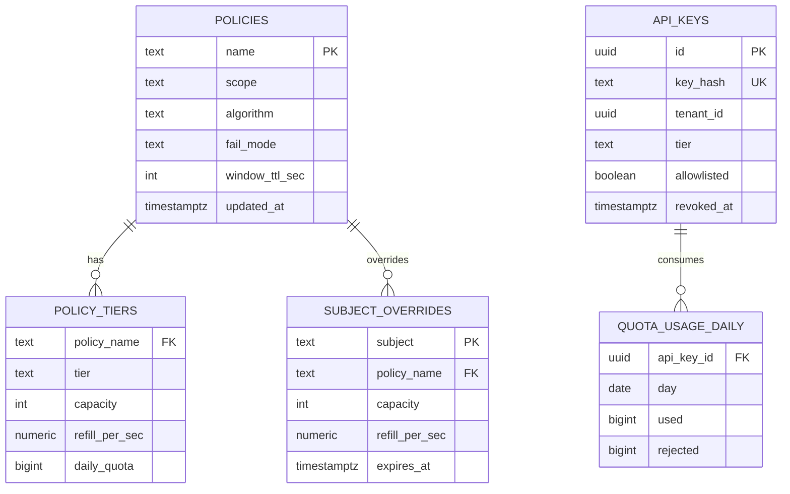
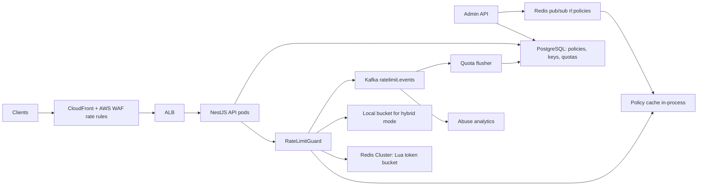
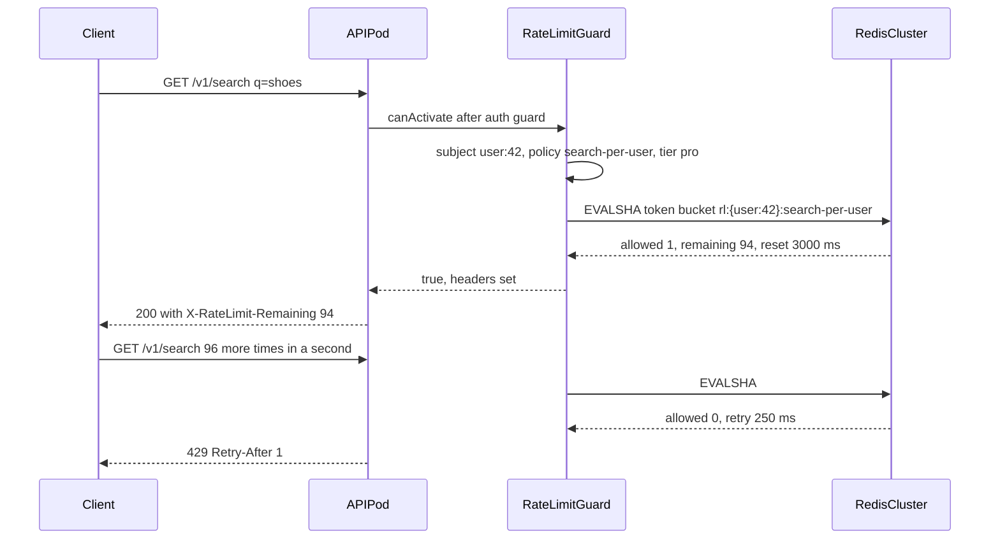
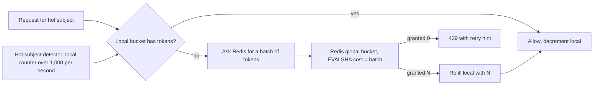

## 59.3 Rate Limiter

> **Try it first** · Level: Beginner · About 30 minutes
>
> **Build:** a shared rate limiter that every API service calls on every request to enforce per-user, per-API-key and per-IP limits and quotas.
>
> **Requirements:**
> - Enforce named policies per subject (user id, API key, IP), with different numbers per tier (`free`, `pro`, `enterprise`).
> - Support short-term limits with burst and long-term daily quotas, with a cost per request.
> - Return `X-RateLimit-Limit`, `X-RateLimit-Remaining`, `X-RateLimit-Reset` and `Retry-After` headers.
> - Let operators change limits at runtime, add overrides and allowlist internal callers; record rejections for abuse analysis.
>
> **Scale and constraints:** 5,000 requests per second on average, 20,000 at peak, about 26,000 limit decisions per second; about 2.5 million active subjects. Added latency p99 under 2 ms; accurate within 1 percent across all pods; the limiter must never take the API down; policy changes reach every pod within 10 seconds. Runs inside existing NestJS services with Redis Cluster available.
>
> **Your task:** pick an algorithm, sketch the API and the data model (policies and counters) and the main components; estimate Redis memory and throughput; name the two hardest problems and how you would solve them.
>
> Spend the time on paper before you read on. The model design follows.

### 59.3.1 Requirements

A rate limiter decides, for every incoming request, whether the caller has exceeded the number of requests they are allowed in a period of time. It protects the platform from abusive clients, from buggy clients stuck in retry loops, from credential stuffing on the login endpoint, and from one big customer starving everyone else. It is also a product feature: partners on the free tier get 100 requests per minute, paying partners get 5,000, and the numbers appear in the contract.

The users are three groups: public API partners identified by API key, logged-in users identified by their token, and anonymous traffic identified by IP address. The customers of the design are the platform engineers who need a way to declare a limit on any route in one line and trust that it is enforced the same way on every pod.

Imagine a nightclub with a bouncer and a bucket of wristbands. Every minute a staff member drops a fixed number of wristbands into the bucket. To get in you take one; when the bucket is empty you wait. A group arriving at once can take several wristbands (a burst), but on average nobody gets in faster than the refill rate. Now imagine ten doors with ten bouncers who must share one bucket. That is the distributed rate limiter: the shared bucket is Redis, the bouncers are NestJS pods, and the trick is to make "take a wristband" a single atomic step so two bouncers never hand out the same one.

### 59.3.2 Functional requirements

1. Enforce a limit per subject (user id, API key, IP address) per policy (a named limit attached to a route or group of routes).
2. Support tiers: the same policy has different numbers for `free`, `pro` and `enterprise` API keys.
3. Support both short-term rate limits (per second or minute, with burst) and long-term quotas (requests per day for billing).
4. Return standard headers on every response: `X-RateLimit-Limit`, `X-RateLimit-Remaining`, `X-RateLimit-Reset`, and `Retry-After` on rejection.
5. Allow a cost per request (a search request costs 5 units, a read costs 1).
6. Let operators change limits at runtime without a deploy, add per-subject overrides, and allowlist internal callers.
7. Expose current usage to the caller (`GET /v1/rate-limits/me`).
8. Record and report rejections for abuse analysis.

### 59.3.3 Non-functional requirements

| Property | Target | Why |
|---|---|---|
| Added latency | p99 under 2 ms per request | The limiter runs on every request of every service |
| Accuracy | Within 1 percent of the configured limit across all pods | Contracts promise numbers |
| Consistency | One shared count per subject across every pod and AZ | A client must not get 10x the limit by spreading requests over pods |
| Availability | The limiter must never take the API down; degrade by policy (fail-open or fail-closed per route) | The limiter is protection, not a feature users pay to see |
| Memory | Bounded by active subjects; idle subjects expire automatically | Millions of IPs |
| Change propagation | Policy edits take effect on all pods within 10 seconds | Incident response |

### 59.3.4 Constraints

- Runs inside the existing NestJS services and behind the existing ALB; there is no service-mesh gateway today.
- Redis Cluster (ElastiCache) is already available; a separate rate-limit store is acceptable if needed.
- Must work for both the public REST API and internal service-to-service calls.
- Clients behind corporate NATs share an IP; IP-based limits must be generous and used only for anonymous routes.

### 59.3.5 Capacity estimation

| Quantity | Assumption | Calculation | Result |
|---|---|---|---|
| Platform requests per second, average | | given | 5,000 |
| Platform requests per second, peak | 4x average during sales | 5,000 x 4 | 20,000 |
| Rate-limit decisions per second, peak | One per request, two on routes with both a per-user and a per-IP policy | 20,000 x 1.3 | 26,000 |
| Redis script executions per node | A Lua script with 4 commands costs about 25 microseconds; one node manages about 30,000 scripts per second | | 1 node is enough at 1x, no headroom |
| Active subjects | 2M daily users plus 5,000 API keys plus 500,000 IPs | | about 2.5 million |
| Policies per subject | 3 on average | | 7.5 million keys |
| Memory per key | Redis hash with 2 fields plus key name and expiry: about 120 B | 7.5M x 120 B | 900 MB |
| Rejections per second, peak | 2 percent of requests during an attack | 20,000 x 0.02 | 400 events per second to Kafka |

Storage in PostgreSQL is tiny: a few hundred policies, 5,000 API keys, and a `quota_usage_daily` table with 5,000 keys times 365 days, about 2M rows per year. Bandwidth to Redis: 26,000 scripts per second times about 200 B each is 5 MB per second, trivial. Connections: 60 API pods times 4 Redis connections is 240 connections, well within limits.

The numbers say two things. Redis is comfortably in range at 1x but a single shard is at its limit at peak, so the design uses a cluster from the start with keys spread by subject. And the added latency budget of 2 ms is dominated by one Redis round trip (0.3 to 0.8 ms in-AZ), so the design must never make two round trips for one decision.

### 59.3.6 API design

The limiter's main interface is not an endpoint; it is a decorator on a route and a set of response headers.

| Header | Meaning | Example |
|---|---|---|
| `X-RateLimit-Limit` | Bucket capacity for the applied policy | `100` |
| `X-RateLimit-Remaining` | Tokens left after this request | `37` |
| `X-RateLimit-Reset` | Unix seconds when the bucket is full again | `1757200000` |
| `X-RateLimit-Policy` | Name of the policy that applied | `search-per-user` |
| `Retry-After` | On 429 only: seconds to wait | `3` |

Management and introspection endpoints:

| Method | Path | Request | Response | Status codes | Idempotent | Auth |
|---|---|---|---|---|---|---|
| GET | `/v1/rate-limits/me` | | `[{ policy, limit, remaining, reset }]` | 200 | Yes | Access token or API key |
| GET | `/v1/admin/rate-limits/policies` | | list of policies with tiers | 200 | Yes | Admin |
| PUT | `/v1/admin/rate-limits/policies/{name}` | `{ tiers: { free: { capacity, refillPerSec }, pro: {...} }, failMode }` | policy | 200, 400 | Yes | Admin |
| PUT | `/v1/admin/rate-limits/overrides/{subject}` | `{ policy, capacity, refillPerSec, expiresAt }` | override | 200 | Yes | Admin |
| DELETE | `/v1/admin/rate-limits/overrides/{subject}` | | | 204 | Yes | Admin |
| POST | `/v1/admin/rate-limits/reset` | `{ subject, policy }` | | 204 | Yes | Admin |

A rejected request returns `429 Too Many Requests` with a JSON body `{ "error": "rate_limited", "policy": "search-per-user", "retryAfterMs": 2400 }`.

### 59.3.7 Data model

Counters live in Redis; configuration and long-term quotas live in PostgreSQL.



```sql
CREATE TABLE policies (
  name            text PRIMARY KEY,                       -- 'search-per-user', 'login-per-ip'
  scope           text NOT NULL CHECK (scope IN ('user', 'api_key', 'ip', 'route')),
  algorithm       text NOT NULL DEFAULT 'token_bucket' CHECK (algorithm IN ('token_bucket', 'sliding_window')),
  fail_mode       text NOT NULL DEFAULT 'open' CHECK (fail_mode IN ('open', 'closed')),
  window_ttl_sec  integer NOT NULL DEFAULT 3600,          -- how long an idle bucket stays in Redis
  updated_at      timestamptz NOT NULL DEFAULT now()
);

CREATE TABLE policy_tiers (
  policy_name     text NOT NULL REFERENCES policies(name) ON DELETE CASCADE,
  tier            text NOT NULL,                          -- 'free', 'pro', 'enterprise', 'anonymous'
  capacity        integer NOT NULL CHECK (capacity > 0),
  refill_per_sec  numeric(12,4) NOT NULL CHECK (refill_per_sec > 0),
  daily_quota     bigint,                                 -- NULL means unlimited
  PRIMARY KEY (policy_name, tier)                         -- serves "load all tiers for a policy" at startup
);

CREATE TABLE api_keys (
  id           uuid PRIMARY KEY DEFAULT gen_random_uuid(),
  key_hash     bytea NOT NULL,                            -- sha256 of the presented key
  tenant_id    uuid NOT NULL,
  tier         text NOT NULL DEFAULT 'free',
  allowlisted  boolean NOT NULL DEFAULT false,            -- internal callers bypass limits
  created_at   timestamptz NOT NULL DEFAULT now(),
  revoked_at   timestamptz
);
CREATE UNIQUE INDEX api_keys_hash_uidx ON api_keys (key_hash);   -- serves API key authentication on every request
CREATE INDEX api_keys_tenant_idx ON api_keys (tenant_id) WHERE revoked_at IS NULL;  -- serves the tenant's key list

CREATE TABLE subject_overrides (
  subject         text NOT NULL,                          -- 'api_key:...' or 'user:...' or 'ip:...'
  policy_name     text NOT NULL REFERENCES policies(name) ON DELETE CASCADE,
  capacity        integer NOT NULL,
  refill_per_sec  numeric(12,4) NOT NULL,
  expires_at      timestamptz,
  PRIMARY KEY (subject, policy_name)                      -- serves the override lookup, which is cached
);

CREATE TABLE quota_usage_daily (
  api_key_id  uuid NOT NULL REFERENCES api_keys(id),
  day         date NOT NULL,
  used        bigint NOT NULL DEFAULT 0,
  rejected    bigint NOT NULL DEFAULT 0,
  PRIMARY KEY (api_key_id, day)                           -- serves billing and the usage endpoint
);
```

Redis key layout, with hash tags so every key for one subject lands on the same cluster slot:

| Key | Type | Fields | TTL |
|---|---|---|---|
| `rl:{api_key:8f3a}:search` | hash | `tokens`, `ts` (ms) | `window_ttl_sec` refreshed on each hit |
| `rl:{ip:203.0.113.7}:login` | hash | same | 15 min |
| `rlq:{api_key:8f3a}:2026-09-07` | string | daily counter | 48 h |
| `rl:policies:version` | string | bumped on config change; pods subscribe to `rl:policies` channel | none |

### 59.3.8 High-level architecture



Enforcement happens in two places on purpose. AWS WAF at the edge applies coarse per-IP rules (for example 2,000 requests per 5 minutes per IP) and blocks obvious floods before they cost us compute. The NestJS guard applies the precise per-subject, per-policy limits that need authentication context (who is the user, what tier is the key). Neither layer alone is enough: the edge does not know who the user is, and the application cannot absorb a volumetric flood.

### 59.3.9 Component design

| Component | Responsibility |
|---|---|
| `RateLimit` decorator | Attaches a policy name and optional cost to a route or controller via `SetMetadata` |
| `RateLimitGuard` | Resolves the subject, looks up the effective policy, calls the limiter, sets headers, throws 429 |
| `RateLimiterService` | Runs the Lua script with `EVALSHA`, handles `NOSCRIPT`, timeouts and fail mode |
| `PolicyRegistry` | Loads policies and tiers from PostgreSQL at start, refreshes on pub/sub, resolves overrides |
| `QuotaFlusher` worker | Consumes `ratelimit.events` and upserts `quota_usage_daily` in batches |
| Admin controller | CRUD for policies and overrides; publishes invalidation |

```text
src/
  rate-limit/
    rate-limit.module.ts
    rate-limit.decorator.ts
    rate-limit.guard.ts
    rate-limiter.service.ts
    policy-registry.service.ts
    lua/token-bucket.ts          -- the script as a TypeScript constant
    admin/rate-limit-admin.controller.ts
    workers/quota-flusher.worker.ts
```

The algorithm choice comes first.

| Algorithm | How it works | Memory per key | Burst behavior | Accuracy | Redis cost | Use when |
|---|---|---|---|---|---|---|
| Fixed window | Counter per window (`INCR` on `rl:key:minute`) | 1 integer | Allows 2x the limit at a window boundary | Poor at edges | 2 commands | Cheap coarse limits, daily quotas |
| Sliding log | Sorted set of request timestamps; count entries in the last window | One entry per request | Exact | Exact | 3 to 4 commands, O(n) memory | Low-volume, high-precision limits (password reset per account) |
| Sliding window counter | Weighted sum of the current and previous fixed windows | 2 integers | Smooth, small approximation error | Within a few percent | 3 commands | General API limits when bursts are not wanted |
| Token bucket | Bucket refills at a rate up to a capacity; each request takes tokens | 2 numbers | Allows a burst up to capacity, then the steady rate | Exact for the rate; burst is by design | 1 script | The default: contracts are naturally "N per second with burst M" |
| Leaky bucket | Requests queue and drain at a fixed rate | A queue | Smooths output completely; excess is dropped or delayed | Exact | Needs a queue or the same math as token bucket for the drop variant | Traffic shaping toward a downstream with a hard rate (SMS provider) |

Token bucket is the default because it maps to how people talk about limits ("100 per second, bursts of 500"), it costs one script call, it stores two numbers, and its refill math does not need timers. Sliding log is used for a few security-critical per-account limits where the volume is tiny and precision matters.

The Lua script is the atomic heart. It reads the bucket, refills based on elapsed time using the Redis server clock (so every pod uses the same clock and clock skew between pods cannot create tokens), takes the requested tokens if available, writes the bucket back, and sets an expiry so idle buckets vanish.

```ts
// rate-limit/lua/token-bucket.ts
export const TOKEN_BUCKET_LUA = `
-- KEYS[1] bucket key
-- ARGV[1] capacity, ARGV[2] refill per second, ARGV[3] cost, ARGV[4] ttl ms
local capacity = tonumber(ARGV[1])
local rate     = tonumber(ARGV[2])
local cost     = tonumber(ARGV[3])
local ttl      = tonumber(ARGV[4])

local t = redis.call('TIME')                    -- server clock: seconds, microseconds
local now_ms = t[1] * 1000 + math.floor(t[2] / 1000)

local b = redis.call('HMGET', KEYS[1], 'tokens', 'ts')
local tokens = tonumber(b[1])
local ts     = tonumber(b[2])
if tokens == nil then
  tokens = capacity                             -- first sight of this subject: full bucket
  ts = now_ms
end

local elapsed = math.max(0, now_ms - ts) / 1000.0
tokens = math.min(capacity, tokens + elapsed * rate)

local allowed = 0
local retry_ms = 0
if tokens >= cost then
  tokens = tokens - cost
  allowed = 1
else
  retry_ms = math.ceil((cost - tokens) / rate * 1000)
end

redis.call('HSET', KEYS[1], 'tokens', tokens, 'ts', now_ms)
redis.call('PEXPIRE', KEYS[1], ttl)

local reset_ms = math.ceil((capacity - tokens) / rate * 1000)
return { allowed, math.floor(tokens), retry_ms, reset_ms }
`;
```

The service loads the script once, calls it with `EVALSHA`, and falls back to `EVAL` when Redis restarts and forgets the script. A 20 ms timeout and the policy's fail mode decide what happens when Redis is slow or gone.

```ts
// rate-limit/rate-limiter.service.ts
import { Inject, Injectable, Logger, ServiceUnavailableException } from '@nestjs/common';
import type { Cluster } from 'ioredis';
import { createHash } from 'node:crypto';
import { REDIS_CLIENT } from '../redis/redis.module';
import { TOKEN_BUCKET_LUA } from './lua/token-bucket';
import { MetricsService } from '../observability/metrics.service';

export interface EffectivePolicy { name: string; capacity: number; refillPerSec: number; ttlMs: number; failMode: 'open' | 'closed'; }
export interface Decision { allowed: boolean; remaining: number; retryAfterMs: number; resetMs: number; degraded: boolean; }

@Injectable()
export class RateLimiterService {
  private readonly logger = new Logger(RateLimiterService.name);
  private readonly sha = createHash('sha1').update(TOKEN_BUCKET_LUA).digest('hex');

  constructor(@Inject(REDIS_CLIENT) private readonly redis: Cluster, private readonly metrics: MetricsService) {}

  async consume(key: string, p: EffectivePolicy, cost = 1): Promise<Decision> {
    const args = [1, key, p.capacity, p.refillPerSec, cost, p.ttlMs] as const;
    try {
      const result = await this.withTimeout(this.run(args), 20);
      const [allowed, remaining, retryAfterMs, resetMs] = result as number[];
      return { allowed: allowed === 1, remaining, retryAfterMs, resetMs, degraded: false };
    } catch (err) {
      this.metrics.inc('ratelimit_backend_errors_total', { policy: p.name });
      this.logger.warn(`limiter degraded for ${p.name}: ${(err as Error).message}`);
      if (p.failMode === 'open') return { allowed: true, remaining: -1, retryAfterMs: 0, resetMs: 0, degraded: true };
      throw new ServiceUnavailableException('rate limiter unavailable');
    }
  }

  private async run(args: readonly [number, string, number, number, number, number]) {
    try {
      return await this.redis.evalsha(this.sha, ...args);
    } catch (err) {
      if (!(err as Error).message.includes('NOSCRIPT')) throw err;
      return this.redis.eval(TOKEN_BUCKET_LUA, ...args);   // Redis restarted; reload by running the source once
    }
  }

  private withTimeout<T>(p: Promise<T>, ms: number): Promise<T> {
    return new Promise((resolve, reject) => {
      const t = setTimeout(() => reject(new Error(`redis timeout after ${ms}ms`)), ms);
      p.then((v) => { clearTimeout(t); resolve(v); }, (e) => { clearTimeout(t); reject(e); });
    });
  }
}
```

The guard resolves who is being limited, which numbers apply, and turns the decision into headers or a 429.

```ts
// rate-limit/rate-limit.guard.ts
import { CanActivate, ExecutionContext, HttpException, HttpStatus, Injectable, SetMetadata } from '@nestjs/common';
import { Reflector } from '@nestjs/core';
import type { Request, Response } from 'express';
import { RateLimiterService } from './rate-limiter.service';
import { PolicyRegistry } from './policy-registry.service';

export const RATE_LIMIT_KEY = 'rate_limit';
export interface RateLimitOptions { policy: string; cost?: number; }
export const RateLimit = (opts: RateLimitOptions) => SetMetadata(RATE_LIMIT_KEY, opts);

type AuthedRequest = Request & { user?: { sub: string }; apiKey?: { id: string; tier: string; allowlisted: boolean } };

@Injectable()
export class RateLimitGuard implements CanActivate {
  constructor(private readonly reflector: Reflector, private readonly limiter: RateLimiterService, private readonly policies: PolicyRegistry) {}

  async canActivate(ctx: ExecutionContext): Promise<boolean> {
    const opts = this.reflector.getAllAndOverride<RateLimitOptions>(RATE_LIMIT_KEY, [ctx.getHandler(), ctx.getClass()]);
    if (!opts) return true;
    const req = ctx.switchToHttp().getRequest<AuthedRequest>();
    const res = ctx.switchToHttp().getResponse<Response>();
    if (req.apiKey?.allowlisted) return true;

    const policy = this.policies.get(opts.policy);
    const subject = this.subjectFor(policy.scope, req);         // 'api_key:<id>' | 'user:<sub>' | 'ip:<addr>'
    const effective = this.policies.resolve(policy, req.apiKey?.tier ?? (req.user ? 'user' : 'anonymous'), subject);
    const key = `rl:{${subject}}:${policy.name}`;               // hash tag keeps a subject on one slot

    const d = await this.limiter.consume(key, effective, opts.cost ?? 1);
    res.setHeader('X-RateLimit-Policy', policy.name);
    res.setHeader('X-RateLimit-Limit', String(effective.capacity));
    res.setHeader('X-RateLimit-Remaining', String(Math.max(0, d.remaining)));
    res.setHeader('X-RateLimit-Reset', String(Math.ceil((Date.now() + d.resetMs) / 1000)));
    if (d.allowed) return true;

    res.setHeader('Retry-After', String(Math.max(1, Math.ceil(d.retryAfterMs / 1000))));
    throw new HttpException({ error: 'rate_limited', policy: policy.name, retryAfterMs: d.retryAfterMs }, HttpStatus.TOO_MANY_REQUESTS);
  }

  private subjectFor(scope: string, req: AuthedRequest): string {
    if (scope === 'api_key' && req.apiKey) return `api_key:${req.apiKey.id}`;
    if (scope === 'user' && req.user) return `user:${req.user.sub}`;
    return `ip:${req.ip}`;                                       // trust proxy is configured; see security
  }
}
```

Usage on a route is one line: `@RateLimit({ policy: 'search-per-user', cost: 5 })` above `@Get('search')`. The guard is registered globally with `APP_GUARD` after the authentication guard so `req.user` and `req.apiKey` are already populated.

The request flow through the guard:



### 59.3.10 Database design

PostgreSQL holds configuration and billing quotas, nothing on the hot path. Policies and tiers are read once at startup and on invalidation. `quota_usage_daily` is written only by the flusher worker in batches of a few thousand upserts every 10 seconds using `INSERT ... ON CONFLICT (api_key_id, day) DO UPDATE SET used = quota_usage_daily.used + EXCLUDED.used`, so the table sees a few hundred writes per second at most. Daily rows older than 13 months are deleted monthly. Transactions are only needed in the admin API (policy and tiers updated together).

The daily quota itself is enforced from a Redis counter (`rlq:{api_key}:{day}`, `INCRBY` with a 48-hour TTL) that the guard checks in the same Lua script for policies that define one, so the quota decision costs no extra round trip. PostgreSQL is the durable record for invoices; if Redis loses a day's counter, the flusher's last checkpoint is used to rebuild it.

### 59.3.11 Caching

| What | Where | TTL | Invalidation | Notes |
|---|---|---|---|---|
| Policies and tiers | In-process `Map` in every pod | Until invalidated, safety refresh every 60 s | Admin API bumps `rl:policies:version` and publishes on `rl:policies`; pods reload from PostgreSQL | Change propagates in under 1 s in practice |
| Subject overrides | In-process, loaded per subject on first sight | 5 min | Same pub/sub channel | Bounded LRU of 100,000 entries |
| API key to tier mapping | In-process LRU | 60 s | Key revocation publishes an eviction | Saves a PostgreSQL read per request |
| Buckets | Redis | `window_ttl_sec` | Time | The bucket is the source of truth, not a cache |
| Local buckets (hybrid mode) | In-process | Continuous | Synced with Redis every 100 ms | Only for the top 1 percent hottest subjects; see scaling |

Stampede protection matters for the policy reload: when the version bumps, 60 pods would all query PostgreSQL at once. Each pod waits a random 0 to 500 ms before reloading, and the reload is a single small query, so the burst is harmless.

### 59.3.12 Messaging

| Topic | Key | Events | Consumers |
|---|---|---|---|
| `ratelimit.events` | subject | `consumed` (sampled 1 in 100 for allowed requests, every rejection), `quota.exceeded` | Quota flusher (aggregates into PostgreSQL), abuse analytics (ClickHouse), alerting |
| `rl:policies` (Redis pub/sub, not Kafka) | | `policies.changed`, `override.changed`, `api_key.revoked` | Every pod's policy registry |

Kafka carries the analytic stream because rejections during an attack can reach thousands per second and abuse analysis wants to replay them. Redis pub/sub carries config invalidation because it is fire-and-forget, sub-millisecond, and losing a message is harmless thanks to the 60-second safety refresh. The flusher is idempotent per batch (it records the last consumed offset per partition in the same transaction as the upsert), retries three times on database errors, and sends unparseable events to `ratelimit.events.dlq`. The producer in the guard is fire-and-forget through an in-memory buffer; if Kafka is down the buffer caps at 10,000 events and drops with a counter, because the limiter's own latency must not depend on Kafka.

### 59.3.13 Scaling

At 1x (26,000 decisions per second peak) a 3-shard Redis Cluster with replicas handles the load with each shard around 30 percent CPU. Keys are spread by subject hash tag, so no shard is hotter than another unless one subject is.

At 10x (260,000 decisions per second) the cluster grows to 12 shards, and hot subjects become the problem: a single large partner sending 20,000 requests per second hits one key on one shard, and every pod round-trips to Redis for every one of those requests. The fix is a hybrid: each pod keeps a local token bucket for hot subjects and synchronizes with the global bucket in batches.



A pod that sees a subject exceed 1,000 requests per second switches that subject to hybrid mode: it takes tokens from Redis in batches of, say, 50 (one script call with `cost = 50`), serves the next 50 requests locally, and comes back for more. Redis traffic for that subject drops 50x. The cost is accuracy: at any moment up to 50 tokens per pod may be reserved but unused, so across 60 pods a subject could momentarily get 3,000 tokens more than the limit, which is under 1 percent of a 20,000 per second limit and acceptable. Cold subjects keep the exact single-call path.

At 100x (2.6 million decisions per second) the limiter becomes its own service: an Envoy or Nginx layer in front of the pods calls a dedicated rate-limit service (Envoy's ratelimit gRPC protocol) backed by a Redis Cluster per region, with local hybrid buckets in each Envoy. Cross-region subjects are limited per region with the global limit divided by region weight, because a synchronous cross-region round trip of 80 ms would blow the latency budget. At this scale most subjects are limited by a coarse pre-filter at the CDN (Cloudflare or AWS WAF rate-based rules) and only authenticated traffic reaches the precise limiter.

### 59.3.14 Security

- **Bypass by header spoofing.** If the application trusts `X-Forwarded-For`, a client can set it and become a new "IP" per request. Configure Express `trust proxy` to the exact number of hops (ALB is one), so `req.ip` is the ALB-observed address, and strip client-supplied `X-Forwarded-For` at the CDN.
- **Bypass by identity rotation.** A free-tier abuser creates 100 API keys. Limits also apply per tenant (`tenant:<id>` scope on key creation) and per verified payment method.
- **IPv6 subnets.** One user often controls a whole /64; limit anonymous IPv6 traffic by /64 rather than by single address, or attackers get 2^64 identities.
- **Bypass through fail-open.** An attacker who can make Redis slow (for example with a flood on a different route) gets unlimited requests on fail-open routes. Login, password reset and payment routes are `fail_mode = closed`; a Redis outage makes them return 503 rather than opening the door. Everything else fails open to keep the product usable.
- **Limit on the limiter.** A flood of new subjects (random IPs) creates millions of Redis keys. TTLs bound memory; the CDN rate rule caps per-IP request rates before they reach us; and `maxmemory-policy volatile-lru` on the Redis Cluster means a memory squeeze evicts idle buckets rather than crashing.
- **Timing and information leaks.** Headers reveal the limit, which is fine; they must not reveal other subjects' state. The admin API requires an admin role and is audited.
- **Denial of service by cost.** Expensive endpoints declare a cost so that an attacker cannot exhaust the search cluster with 100 cheap-looking requests per minute.
- **Consistency of enforcement.** The guard runs globally through `APP_GUARD`; a route can only opt out with an explicit `@RateLimit({ policy: 'none' })` that is flagged in code review.

### 59.3.15 Failure scenarios

| Failure | Detection | Impact | Mitigation | What the user sees |
|---|---|---|---|---|
| Redis cluster down | Backend error counter, timeouts | No decisions possible | Fail-open routes allow with `degraded` metric; fail-closed routes return 503; CDN rules still cap floods | Most of the API works; login shows "try again" |
| Redis slow (p99 over 20 ms) | Timeout counter | Same as down for the affected calls | 20 ms timeout so the API's own latency is bounded; alert on shard CPU | Nothing or 503 on strict routes |
| One shard fails over | Cluster topology change, brief errors | Subjects on that shard lose their buckets (replica may lag by a few ms) | Buckets start full again for those subjects, a small over-allowance for one window | Nothing |
| Hot key | Shard CPU imbalance, per-subject counter | One shard saturates, other subjects on it get timeouts | Hybrid local buckets kick in above 1,000 requests per second per subject | Nothing |
| Policy reload fails (PG down) | Reload error metric | Pods keep last known policies | In-process cache is authoritative until the next successful reload; alert | Nothing |
| Bad policy pushed (capacity 1 by typo) | 429 rate spikes on a policy | Everyone on that route is rejected | Admin API validates ranges and requires a second approver for global policies; one-click revert to previous version | 429s until revert, minutes |
| Clock jump on a Redis node | Sudden burst of allowed requests or a frozen bucket | Refill math uses server time; a backwards jump clamps elapsed to 0 | ElastiCache nodes use NTP; `math.max(0, ...)` guard; monitored | Nothing |
| Duplicate decisions (client retries after timeout) | | The client consumed tokens for a request it never saw complete | Accepted; retries are requests | Slightly fewer tokens |
| Kafka down | Buffer drop counter | Usage analytics and daily quota flushing delayed | Redis daily counter still enforces quotas; flusher catches up | Nothing |
| Bad deploy of the guard (wrong subject resolution) | Canary shows 429 ratio change or a policy applied per pod | Everyone shares one bucket or nobody is limited | Canary compares 429 ratio and Redis key cardinality with baseline; rollback | Brief 429s or nothing |
| Region outage | Health checks | Regional API down | Each region has its own limiter; failover traffic starts with fresh buckets | Nothing beyond the outage itself |
| Wrong response: `Retry-After` computed from a stale rate | Client waits too long or too short | Client experience | Values come from the same script call as the decision | Nothing |

### 59.3.16 Observability

Metrics:

1. `ratelimit_decisions_total` by policy, tier and outcome (`allowed`, `rejected`, `degraded_open`). Alert when `degraded_open` is non-zero for more than 1 minute.
2. `ratelimit_decision_duration_seconds` histogram. Alert on p99 above 2 ms.
3. `ratelimit_backend_errors_total` by reason (`timeout`, `connection`, `noscript`).
4. `ratelimit_rejected_ratio` per policy, compared to a 7-day baseline; alert on 5x (attack or bad policy).
5. `ratelimit_hot_subjects` gauge (subjects in hybrid mode) and per-shard Redis CPU.
6. `ratelimit_policy_version` gauge per pod; alert when pods disagree for more than 60 s.
7. `ratelimit_event_buffer_dropped_total`.
8. Redis Cluster memory, evictions and key count.

Logs: rejections are logged at `info` with subject, policy, remaining and route, sampled to at most 100 per second per pod; degraded decisions are logged at `warn` with the error. Traces: the guard adds a span `ratelimit.consume` with policy and outcome attributes to every trace, so slow requests show whether the limiter contributed. Dashboards: a policy board (decisions and rejections per policy, top rejected subjects), a backend board (Redis latency, errors, hot shards), and an abuse board fed from ClickHouse (rejections by IP prefix, by tenant, over time).

### 59.3.17 Deployment

The limiter is a library module inside every API deployment; the extra workloads are small.

| Workload | Kind | Replicas | Notes |
|---|---|---|---|
| API deployments (each service) | Deployment | as before | `RateLimitModule` imported; guard registered via `APP_GUARD` |
| `ratelimit-quota-flusher` | Deployment | 2 | Consumer group over `ratelimit.events` |
| `ratelimit-admin` | Part of the admin API | 2 | Publishes invalidation |
| Redis Cluster | ElastiCache | 3 shards with replicas, Multi-AZ | Dedicated to rate limiting so cache evictions elsewhere cannot affect it |

Configuration: Redis endpoints, script timeout, default fail mode, hot-subject threshold, all via `@nestjs/config`. Policies are data, not config: they live in PostgreSQL and are migrated with seed migrations. Rollout: the guard ships in each service's normal canary; a new policy is created disabled (`capacity` very high), observed on the dashboard for a day, then tightened. Environments share the policy schema but staging has 10x looser numbers and a separate Redis.

Testing deserves its own note because a wrong limiter is invisible until an incident. Unit tests cover subject resolution and header formatting with a fake `RateLimiterService`. Integration tests run the real Lua script against a Redis container (Testcontainers) with a small policy (`capacity 3, refill 1 per second`): three requests pass, the fourth returns 429 with `Retry-After: 1`, and after a 1-second sleep one more passes. A concurrency test fires 200 parallel requests from 4 worker threads at a capacity of 100 and asserts exactly 100 succeed, which is the property the Lua atomicity exists for. A load test in staging at 2x expected peak confirms the p99 budget and that the hybrid mode engages for a synthetic hot subject.

### 59.3.18 Cost considerations

| Item | Sizing | Monthly (USD, approximate) |
|---|---|---|
| ElastiCache Redis Cluster | 3 x cache.r6g.large with replicas | 700 |
| Extra CPU in API pods | About 2 percent of request CPU | 100 |
| Flusher and admin | 2 small pods | 40 |
| Kafka share | 400 events per second peak | 100 |
| AWS WAF rate-based rules | 2 rules, 20,000 rps peak | 60 plus 0.60 per million requests, about 250 |
| ClickHouse share for abuse analytics | | 150 |
| Total | | about 1,300 |

The biggest driver is the dedicated Redis Cluster, and the biggest hidden cost is the alternative: without a limiter, one abusive partner can force you to scale the whole API tier. WAF request pricing grows linearly with traffic, which is why the coarse edge rules are kept to two.

### 59.3.19 Tradeoffs

- **Token bucket as the default.** Contracts read naturally and Redis cost is one call; the price is that a burst of `capacity` requests is always allowed, which a downstream with a hard rate limit may not like (use a lower capacity or leaky bucket there).
- **Redis server clock in Lua.** Immune to pod clock skew, but scripts become non-deterministic, which requires Redis 5 or later effects replication (the default) and makes unit testing need a real Redis.
- **Fail-open by default, fail-closed for security routes.** Availability over strictness for the product, strictness over availability for login and payments.
- **Application guard rather than a gateway.** Full identity context and a one-line developer experience, at the cost of the request already having consumed a connection and some CPU before rejection; the CDN rules cover the volumetric case.
- **Hybrid local buckets for hot subjects.** Accuracy within about 1 percent traded for a 50x reduction in Redis traffic for the subjects that would otherwise melt a shard.
- **Sampled allowed events.** Full fidelity on rejections, 1 percent on allows; billing quotas still come from the exact Redis counter.

### 59.3.20 Alternative architectures

**Gateway-native limiting (AWS API Gateway usage plans, Kong, Envoy with the ratelimit service).** Limits are configured outside application code and enforced before a request reaches a pod. This wins when many services in many languages must share one policy model, and when the team wants operators rather than developers to own limits. It loses when limits depend on application context (tier from a database, cost per request type) or when the gateway's counters are per-node approximations, as with API Gateway's per-second limits, which can be off by a large factor at low limits.

**`@nestjs/throttler` with a Redis storage adapter.** The official NestJS throttler gives `@Throttle()` decorators and per-IP or per-user limits with a pluggable storage. It is the right choice for a single service that needs simple protection ("100 per minute per IP on login") without tiers, costs, hybrid mode or contract headers. It loses when you need the runtime policy registry, the atomic multi-policy script, per-shard hot-key handling and precise headers described above.

**Edge-only limiting (Cloudflare rate limiting rules or AWS WAF with token-based keys).** The CDN limits by IP, header, cookie or a JWT claim it can parse, and the origin does nothing. It wins for public, mostly anonymous traffic and for volumetric protection, and it scales to millions of requests per second for a per-request fee. It loses on precision (edge counters are eventually consistent across points of presence), on tiers that live in your database, and on the internal service-to-service calls that never pass through the CDN.
