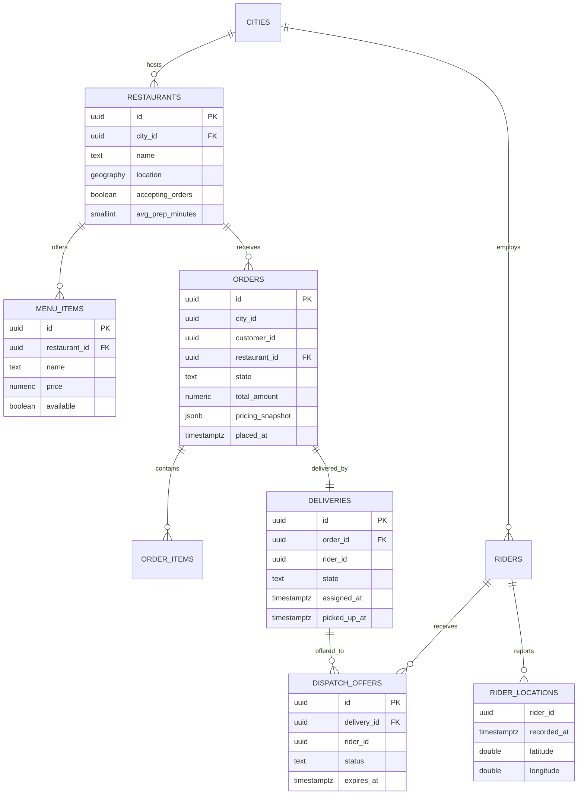
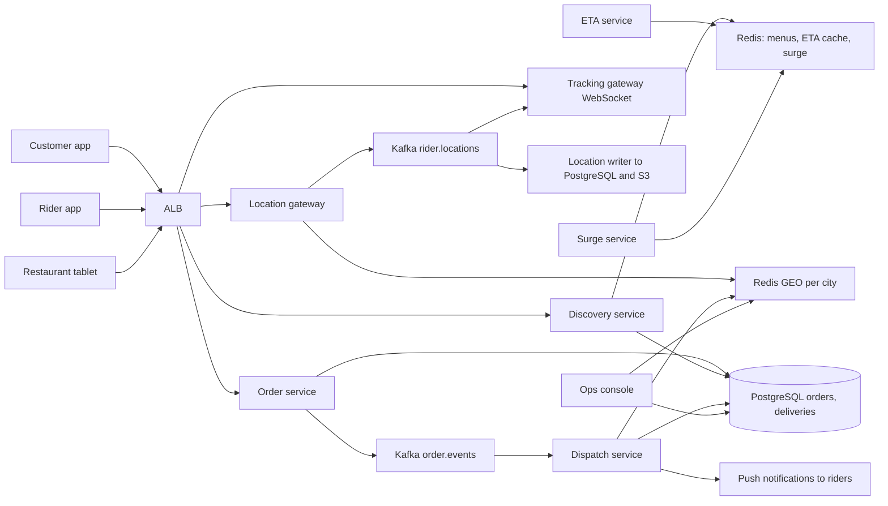
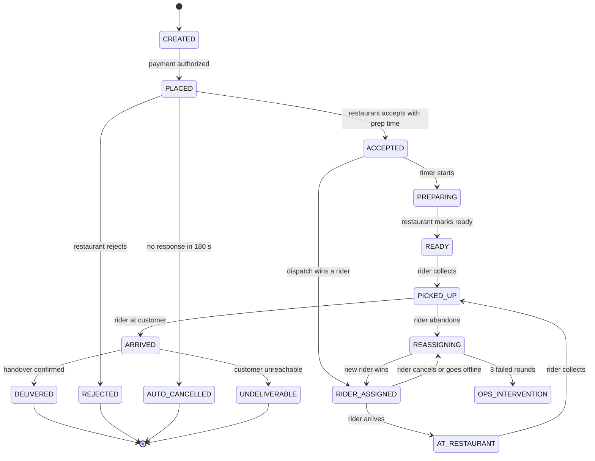
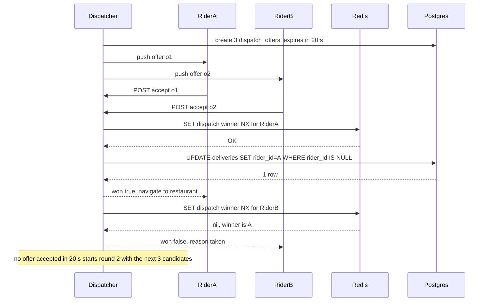
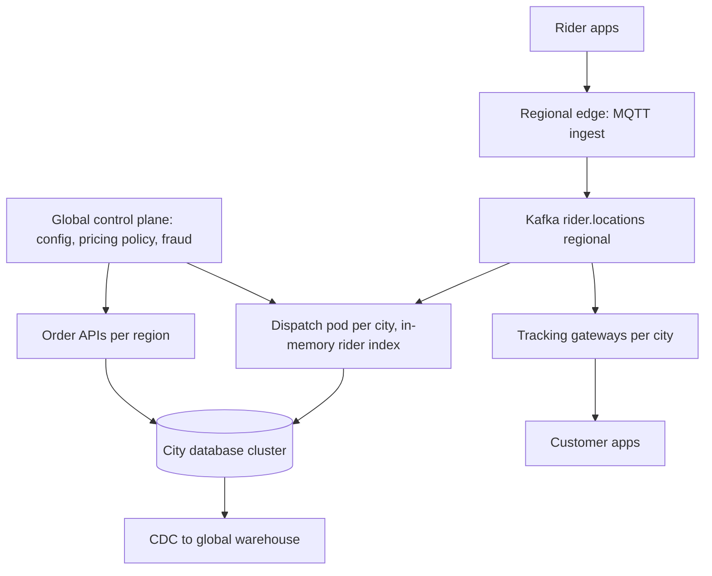

## 59.10 Food Delivery System

> **Try it first** · Level: Advanced · About 60 minutes
>
> **Build:** a food delivery platform that connects customers, restaurants and riders across 40 cities, from browsing to the food at the door.
>
> **Requirements:**
> - Browse nearby restaurants and menus whose item availability a restaurant can toggle instantly; place an order.
> - Restaurant acceptance with a preparation time, and auto-cancel if the restaurant does not respond.
> - Dispatch: find nearby riders, offer the job with a timeout, let exactly one rider accept, and reassign when a rider declines or drops out.
> - Live rider tracking and ETAs at every stage; surge pricing per zone.
> - Handle the three-party state machine with partial failures; rider earnings and an ops console per city.
>
> **Scale and constraints:** 25 million customers, 3 million daily active, 2 million orders per day (about 83 per second in the dinner peak hour, bursts of 125); 100,000 riders online at peak sending a location every 3 s (about 33,000 location writes per second); about 407,000 concurrent WebSocket connections. First dispatch offer p95 under 2 s, rider assigned p95 under 30 s, tracking under 5 s old, order placement p99 under 500 ms, zero double assignments; maps API is paid per call; 40 percent of orders land in two 90-minute windows.
>
> **Your task:** sketch the API, the data model and the main components; estimate storage, connections and throughput; name the two hardest problems and how you would solve them.
>
> Spend the time on paper before you read on. The model design follows.

### 59.10.1 Requirements

A food delivery platform is a three-sided real-time system. A customer orders, a restaurant cooks, a rider carries. None of the three controls the others, all three can drop out at any moment, and the whole thing is worthless if it takes more than about forty minutes. Unlike an e-commerce order, which can sit in a warehouse queue for six hours without anyone caring, a delivery order has a physical clock attached to it: the food is getting cold.

The users are customers (browse, order, track), restaurants (accept, set preparation time, mark ready, manage menu availability), riders (go online, receive offers, pick up, deliver), and the operations team in each city who watch a live map and intervene when something goes wrong.

Imagine a busy taxi dispatcher in a small town with a radio, a map on the wall with pins for every cab, and a stack of phone messages. When a call comes in they look at the pins near the caller, pick the closest free cab, and radio the driver: "job at 14 Oak Street, do you want it?" The driver has ten seconds to say yes. If they say nothing, the dispatcher radios the next cab. Two drivers must never be sent to the same job, so the dispatcher crosses it off the moment somebody accepts. Now imagine doing that 120 times a second across 40 cities with 100,000 cabs whose pins move every three seconds. That is a food delivery dispatch system: **a geospatial index, an offer with a timeout, and an acceptance race that exactly one participant can win**.

The second hard thing is time. Every screen in the product shows an estimate: the restaurant's preparation time, the rider's arrival, the delivery. Those estimates are the product. A system that is technically correct and consistently ten minutes wrong will lose to one that is slightly sloppier and honest about when the food arrives.

### 59.10.2 Functional requirements

1. Browse restaurants near an address, filtered by cuisine, rating, delivery time and open status.
2. Manage menus with item availability that a restaurant can toggle instantly ("we are out of paneer").
3. Place an order with items, options, instructions, tip and payment; support scheduled orders.
4. Restaurant acceptance: accept with a preparation time, reject with a reason, or auto-accept by configuration; auto-cancel if no response within a timeout.
5. Dispatch: find candidate riders near the restaurant, score them, offer the job with a timeout, and let exactly one rider accept.
6. Reassign automatically when a rider declines, times out, cancels or goes offline.
7. Live tracking: rider location on the customer's map, updated continuously from pickup to delivery.
8. ETA estimation at every stage (pre-order, post-order, after pickup) with recalculation as reality changes.
9. Surge pricing per city zone when demand exceeds available riders, applied transparently before the customer commits.
10. Handle the three-party state machine including partial failures: restaurant cancels after acceptance, rider abandons, customer not reachable at the door.
11. Rider earnings: per-delivery fee, distance, surge, tips, and a payout ledger.
12. Ops console per city: live map, stuck orders, manual reassignment, refunds.

### 59.10.3 Non-functional requirements

| Property | Target | Why |
|---|---|---|
| Dispatch time to first offer | p95 under 2 s after the restaurant accepts | Every second of dispatch delay is a second of cold food |
| Rider assigned | p95 under 30 s, p99 under 90 s | Longer than this and the customer sees an empty map and calls support |
| Location ingest | 35,000 writes per second sustained, p99 under 50 ms | 100,000 riders every 3 s |
| Tracking freshness | Customer sees a position under 5 s old | The map is the trust signal |
| Order placement | p99 under 500 ms | Checkout conversion |
| ETA accuracy | 80 percent of deliveries within 5 minutes of the promise | The promise is the product |
| Availability | 99.95 percent during meal peaks; degraded mode must still deliver food | An outage at 13:00 costs more than one at 03:00 |
| Exactly-one assignment | Zero double assignments | Two riders at one restaurant means one unpaid trip and one angry rider |

### 59.10.4 Constraints

- 40 cities; a city is the natural unit of everything (riders do not cross cities, restaurants serve a radius, ops teams are per city).
- Rider and customer phones are on mobile networks: intermittent, high latency, and prone to sending a burst of buffered updates after a tunnel.
- Restaurant hardware is a cheap Android tablet on the restaurant's Wi-Fi, which is the least reliable component in the system.
- Maps and routing come from an external provider with per-request pricing and a rate limit; we cannot call it for every ETA refresh of every order.
- Payments are external; the food is often cash-on-delivery in some markets.
- Peak load is extremely concentrated: roughly 40 percent of the day's orders occur in two 90-minute windows.

### 59.10.5 Capacity estimation

| Quantity | Assumption | Calculation | Result |
|---|---|---|---|
| Registered customers | given | | 25,000,000 |
| Daily active customers | 12 percent | 25M x 0.12 | 3,000,000 |
| Orders per day | 0.67 orders per active customer | 3M x 0.67 | 2,000,000 |
| Orders per second, average | Spread over 12 ordering hours | 2M / 43,200 | 46 per second |
| Orders per second, peak | 15 percent of the day in the dinner peak hour | 2M x 0.15 / 3,600 | 83 per second |
| Orders per second, instantaneous burst | 1.5x the peak hour average | 83 x 1.5 | 125 per second |
| Restaurants | | | 180,000 |
| Menu items | 55 per restaurant | 180,000 x 55 | 9,900,000 |
| Riders registered | | | 400,000 |
| Riders online at peak | 25 percent | 400,000 x 0.25 | 100,000 |
| **Location updates per second, peak** | Every online rider every 3 s | 100,000 / 3 | **33,333 per second** |
| Location payload on the wire | riderId, lat, lon, bearing, speed, accuracy, ts, battery, JSON | | about 180 B |
| Location ingest bandwidth | 33,333 x 180 B | | 6 MB per second |
| Location packed for storage | binary, 32 B per point | | |
| Location points per day | Average 45,000 riders online for 10 h | 45,000 x 12,000 points | 540,000,000 per day |
| Raw location storage per day | 540M x 32 B x 1.5 (index) | | about 26 GB per day |
| Hot retention (7 days raw) | 26 x 7 | | 182 GB |
| Downsampled retention (1 point per 30 s, 90 days) | 540M / 10 x 32 B x 90 x 1.5 | | about 233 GB in S3 |
| Active deliveries at peak | 125 per second x 2,100 s average lifetime | | 262,500 |
| Concurrent WebSocket connections | 262,500 customers + 100,000 riders + 45,000 restaurant tablets | | about 407,000 |
| Gateway pods needed | 20,000 connections per pod, 40 percent headroom | 407,000 / 20,000 x 1.4 | 29 pods |
| Tracking fan-out per second | Customer map refreshed at most every 5 s per active delivery | 262,500 / 5 | 52,500 messages per second |
| Dispatch offers per second, peak | 2.4 offers per order (declines and timeouts) | 125 x 2.4 | 300 per second |
| Geospatial searches per second | One per dispatch round, about 1.6 rounds per order | 125 x 1.6 | 200 per second, each returning 40 to 80 riders |
| Order rows per year | 2M x 365 | | 730 million |
| Bytes per order row | with snapshots | | about 1.6 KB |
| Order storage per year | 730M x 1.6 KB x 1.4 | | about 1.6 TB, partitioned by month and city |
| Redis memory for live state | 100,000 riders x 400 B (GEO entry + status hash) + 262,500 deliveries x 1.2 KB | 40 MB + 315 MB | about 400 MB, provision 8 GB with buffers |
| Kafka throughput, peak | 33,333 location + 300 dispatch + 1,200 order events | | about 35,000 messages per second, 8 MB per second |
| Connections | 60 API pods x 10 + 29 gateway pods x 4 + workers | | about 800, PgBouncer mandatory |

The single dominant number is 33,333 location writes per second, and the design decision it forces is stark: **rider locations never touch PostgreSQL on the write path**. They go to Redis for the current position (which is all dispatch needs) and to Kafka for everything else (tracking fan-out, history, analytics). Writing 33,000 rows per second into a relational table would need a dedicated cluster, would produce 540 million dead tuples a day, and would buy nothing, because no query ever needs a rider's position from four hours ago at row-level fidelity.

The second-largest number, 407,000 WebSocket connections, forces the tracking gateway to be a separate stateless deployment with its own scaling, because a Node process holding 20,000 sockets has a completely different memory and event-loop profile from one serving REST.

### 59.10.6 API design

| Method | Path | Request | Response | Status codes | Idempotency | Auth |
|---|---|---|---|---|---|---|
| GET | `/v1/discovery/restaurants` | `?lat=&lon=&cuisine=&sort=` | ranked list with `etaMinutes`, `feeAmount`, `surgeMultiplier` | 200, 400 | Yes | Optional |
| GET | `/v1/restaurants/{id}/menu` | | menu with per-item `available` | 200, 404 | Yes | Optional |
| POST | `/v1/orders/quote` | `{ restaurantId, items[], addressId }` | `{ quoteId, subtotal, deliveryFee, surge, tax, total, etaMinutes, expiresAt }` | 200, 409 | Yes | Customer |
| POST | `/v1/orders` | `{ quoteId, paymentMethodId, tip, instructions }` plus `Idempotency-Key` | order | 201, 200 on replay, 402, 409, 422 | **Required** | Customer |
| GET | `/v1/orders/{id}` | | order with state, ETA, rider summary | 200, 403, 404 | Yes | Customer |
| WS | `/v1/track/{orderId}` | subscribe | stream of `{ state, riderLocation, eta }` | 101, 401, 403 | n/a | Customer token |
| POST | `/v1/orders/{id}/cancel` | `{ reason }` | order with refund detail | 200, 409 | Yes | Customer |
| POST | `/v1/merchant/orders/{id}/accept` | `{ prepMinutes }` | order | 200, 409 | Yes | Restaurant |
| POST | `/v1/merchant/orders/{id}/reject` | `{ reason }` | order | 200, 409 | Yes | Restaurant |
| POST | `/v1/merchant/orders/{id}/ready` | | order | 200, 409 | Yes | Restaurant |
| PATCH | `/v1/merchant/menu-items/{id}` | `{ available }` | item | 200 | Yes | Restaurant |
| POST | `/v1/rider/status` | `{ online, lat, lon }` | `{ status }` | 200 | Yes | Rider |
| POST | `/v1/rider/locations` | batch `[{ lat, lon, bearing, speed, accuracy, ts }]` | `{ accepted }` | 202, 400 | Yes, `ts` dedupes | Rider |
| POST | `/v1/rider/offers/{offerId}/accept` | | `{ won: true, delivery }` or `{ won: false, reason }` | 200, 409, 410 | Yes, exactly one winner | Rider |
| POST | `/v1/rider/offers/{offerId}/decline` | `{ reason }` | | 204 | Yes | Rider |
| POST | `/v1/rider/deliveries/{id}/picked-up` | `{ lat, lon }` | delivery | 200, 409 | Yes | Rider |
| POST | `/v1/rider/deliveries/{id}/delivered` | `{ lat, lon, proof? }` | delivery | 200, 409 | Yes | Rider |
| POST | `/v1/ops/orders/{id}/reassign` | `{ reason, riderId? }` | delivery | 200, 409 | Yes | Ops |

Contract notes:

- `POST /v1/rider/locations` accepts a **batch** and returns `202`. A phone coming out of a tunnel sends the 40 points it buffered; the server takes them all, keeps only the newest for the live index, and forwards the rest to Kafka for history.
- `POST /v1/rider/offers/{id}/accept` is the race. It returns `200 { won: true }` to exactly one rider and `200 { won: false, reason: 'taken' }` to the others. It deliberately does not return `409`, because riders' apps retry on errors and a friendly "taken" is easier to render.
- Quotes carry the surge multiplier and expire in 5 minutes. Surge cannot change between the quote and the order; the customer sees the price they agreed.
- Every merchant action returns the full order so the tablet, which loses its connection constantly, can resynchronise from any response.

### 59.10.7 Data model



```sql
CREATE TABLE cities (
  id       uuid PRIMARY KEY DEFAULT gen_random_uuid(),
  code     text NOT NULL UNIQUE,                    -- 'BLR', 'DEL', 'MUM'
  timezone text NOT NULL,
  centroid geography(Point, 4326) NOT NULL
);

CREATE TABLE restaurants (
  id                uuid PRIMARY KEY DEFAULT gen_random_uuid(),
  city_id           uuid NOT NULL REFERENCES cities(id),
  name              text NOT NULL,
  location          geography(Point, 4326) NOT NULL,
  delivery_radius_m integer NOT NULL DEFAULT 5000,
  accepting_orders  boolean NOT NULL DEFAULT true,   -- the manual "we are slammed" switch
  auto_accept       boolean NOT NULL DEFAULT false,
  avg_prep_minutes  smallint NOT NULL DEFAULT 18,    -- learned from history, overridden per order
  rating            numeric(2,1) NOT NULL DEFAULT 4.0,
  opening_hours     jsonb NOT NULL
);
-- serves discovery: "open restaurants within 5 km of this point, in this city"
CREATE INDEX restaurants_geo_idx ON restaurants USING gist (location);
CREATE INDEX restaurants_city_open_idx ON restaurants (city_id) WHERE accepting_orders;

CREATE TABLE menu_items (
  id            uuid PRIMARY KEY DEFAULT gen_random_uuid(),
  restaurant_id uuid NOT NULL REFERENCES restaurants(id) ON DELETE CASCADE,
  category      text NOT NULL,
  name          text NOT NULL,
  price         numeric(10,2) NOT NULL CHECK (price >= 0),
  available     boolean NOT NULL DEFAULT true,
  options       jsonb NOT NULL DEFAULT '[]'::jsonb,  -- size, extras, each with a price delta
  updated_at    timestamptz NOT NULL DEFAULT now()
);
-- serves the menu page, the single most-read query in the product
CREATE INDEX menu_items_restaurant_idx ON menu_items (restaurant_id, category)
  WHERE available;

CREATE TABLE orders (
  id                uuid NOT NULL DEFAULT gen_random_uuid(),
  city_id           uuid NOT NULL,
  customer_id       uuid NOT NULL,
  restaurant_id     uuid NOT NULL,
  state             text NOT NULL DEFAULT 'CREATED',
  subtotal_amount   numeric(10,2) NOT NULL,
  delivery_fee      numeric(10,2) NOT NULL,
  surge_multiplier  numeric(4,2) NOT NULL DEFAULT 1.00,
  tip_amount        numeric(10,2) NOT NULL DEFAULT 0,
  tax_amount        numeric(10,2) NOT NULL DEFAULT 0,
  total_amount      numeric(10,2) NOT NULL,
  pricing_snapshot  jsonb NOT NULL,                  -- item prices and options frozen at order time
  address_snapshot  jsonb NOT NULL,                  -- text, geocode, floor, gate instructions
  prep_minutes      smallint,                        -- set by the restaurant at acceptance
  promised_at       timestamptz,                     -- the ETA the customer was shown
  placed_at         timestamptz NOT NULL DEFAULT now(),
  PRIMARY KEY (id, placed_at)
) PARTITION BY RANGE (placed_at);

-- serves the customer's order list and the ops console, both always city and time bounded
CREATE INDEX orders_city_state_idx ON orders (city_id, state, placed_at DESC);
CREATE INDEX orders_customer_idx ON orders (customer_id, placed_at DESC);
-- serves the merchant tablet: "my orders needing attention right now"
CREATE INDEX orders_restaurant_open_idx ON orders (restaurant_id, placed_at DESC)
  WHERE state IN ('PLACED','ACCEPTED','PREPARING','READY');

CREATE TABLE deliveries (
  id             uuid PRIMARY KEY DEFAULT gen_random_uuid(),
  order_id       uuid NOT NULL,
  city_id        uuid NOT NULL,
  rider_id       uuid,
  state          text NOT NULL DEFAULT 'PENDING_DISPATCH'
                 CHECK (state IN ('PENDING_DISPATCH','OFFERED','ASSIGNED','AT_RESTAURANT',
                                  'PICKED_UP','ARRIVED','DELIVERED','CANCELLED','FAILED')),
  dispatch_round smallint NOT NULL DEFAULT 0,
  assigned_at    timestamptz,
  picked_up_at   timestamptz,
  delivered_at   timestamptz,
  distance_m     integer,
  rider_fee      numeric(10,2),
  version        integer NOT NULL DEFAULT 1
);
-- one live delivery per order, enforced by the database
CREATE UNIQUE INDEX deliveries_order_uidx ON deliveries (order_id)
  WHERE state <> 'CANCELLED';
-- serves the dispatcher: "deliveries in this city waiting for a rider"
CREATE INDEX deliveries_city_pending_idx ON deliveries (city_id, state)
  WHERE state IN ('PENDING_DISPATCH','OFFERED');
-- serves the rider app: "my current job"
CREATE INDEX deliveries_rider_active_idx ON deliveries (rider_id)
  WHERE state IN ('ASSIGNED','AT_RESTAURANT','PICKED_UP','ARRIVED');

CREATE TABLE dispatch_offers (
  id           uuid PRIMARY KEY DEFAULT gen_random_uuid(),
  delivery_id  uuid NOT NULL REFERENCES deliveries(id),
  rider_id     uuid NOT NULL,
  round        smallint NOT NULL,
  score        numeric(8,3) NOT NULL,
  status       text NOT NULL DEFAULT 'OFFERED'
               CHECK (status IN ('OFFERED','ACCEPTED','DECLINED','EXPIRED','SUPERSEDED')),
  offered_at   timestamptz NOT NULL DEFAULT now(),
  expires_at   timestamptz NOT NULL,
  responded_at timestamptz
);
-- serves the offer expiry sweeper
CREATE INDEX dispatch_offers_expiry_idx ON dispatch_offers (expires_at) WHERE status = 'OFFERED';
-- serves "did this rider already see this delivery", to avoid re-offering a declined job
CREATE UNIQUE INDEX dispatch_offers_delivery_rider_uidx ON dispatch_offers (delivery_id, rider_id);
-- serves rider acceptance-rate metrics, which drive scoring
CREATE INDEX dispatch_offers_rider_time_idx ON dispatch_offers (rider_id, offered_at DESC);

CREATE TABLE rider_locations (
  rider_id    uuid NOT NULL,
  recorded_at timestamptz NOT NULL,
  city_id     uuid NOT NULL,
  latitude    double precision NOT NULL,
  longitude   double precision NOT NULL,
  bearing     smallint,
  speed_mps   real,
  accuracy_m  real,
  delivery_id uuid,
  PRIMARY KEY (rider_id, recorded_at)
) PARTITION BY RANGE (recorded_at);

CREATE TABLE rider_locations_2026_09_09 PARTITION OF rider_locations
  FOR VALUES FROM ('2026-09-09') TO ('2026-09-10');

-- serves the replay of one delivery's route for disputes and analytics
CREATE INDEX rider_locations_delivery_idx ON rider_locations (delivery_id, recorded_at)
  WHERE delivery_id IS NOT NULL;
```

`rider_locations` is partitioned **daily**, not monthly, because it takes 540 million rows a day. Daily partitions make the retention policy a `DROP TABLE` (instant) and keep each partition around 20 GB. It is written by a batching consumer at roughly 3,000 multi-row `COPY` operations per second, not by the API, and even then only for riders on an active delivery; idle-rider breadcrumbs go straight to S3 in Parquet.

### 59.10.8 High-level architecture



The important boundary is the **location gateway**. It is a small, stateless, deliberately boring service whose only job is to accept 33,000 writes per second, update one Redis GEO entry, and produce to Kafka. It has no database, no business logic and its own autoscaling. Everything that wants location data reads it from Redis (current position) or from Kafka (the stream). If the location gateway is the only thing under pressure at 13:00, you can scale it in seconds without touching anything else.

### 59.10.9 Component design

```text
src/
  discovery/            restaurant search, menus, availability
  orders/               placement, quotes, order state machine
  merchant/             acceptance, prep time, ready, menu toggles
  dispatch/
    dispatch.module.ts
    dispatch.service.ts            round orchestration
    candidate-finder.service.ts    Redis GEO search
    scoring.service.ts             rider ranking
    offer.service.ts               offer creation, expiry, acceptance race
    lua/accept-offer.ts
    workers/offer-expiry.worker.ts
    workers/dispatch-round.worker.ts
  location/
    location.controller.ts         batch ingest
    location.service.ts            Redis GEO + Kafka
    workers/location-writer.worker.ts
  tracking/
    tracking.gateway.ts            WebSocket, @nestjs/websockets
    tracking-consumer.service.ts   Kafka to socket fan-out
  eta/
    eta.service.ts
    prep-time.model.ts
    travel-time.model.ts
  surge/
    surge.service.ts
    workers/surge-calculator.worker.ts
```

#### The three-party state machine



Two state machines actually run in parallel: the **order** (what the customer and restaurant see) and the **delivery** (what the rider sees). They are separate tables and separate lifecycles because they genuinely diverge: a delivery can be reassigned three times while the order stays `PREPARING`, and an order can be `READY` for eight minutes with no rider at all. Modelling them as one status column is the mistake that makes reassignment impossible to express, and it is the most common design error in this domain.

The pairs that matter are enforced by guards. A delivery cannot go `PICKED_UP` unless the order is `READY` or the restaurant has confirmed handover. An order cannot be `DELIVERED` unless its delivery is. Ops overrides exist for both, and every override writes an event with the operator's id.

#### Dispatch: candidates, scoring, offer, race

Dispatch runs in **rounds**. Each round selects a small set of candidates, offers to them, and waits. Offering to one rider at a time is too slow (a 20-second timeout times four riders is 80 seconds of cold food); offering to everyone at once wastes rider attention and produces mass declines. The middle path used here: offer to the top 3 candidates simultaneously, 20-second timeout, and let them race.

```ts
// dispatch/candidate-finder.service.ts
import { Inject, Injectable } from '@nestjs/common';
import type { Redis } from 'ioredis';
import { REDIS_CLIENT } from '../redis/redis.module';

export interface Candidate { riderId: string; distanceM: number; }

@Injectable()
export class CandidateFinder {
  constructor(@Inject(REDIS_CLIENT) private readonly redis: Redis) {}

  // Redis GEO index per city: key 'geo:{city:BLR}:riders:free'
  async near(cityCode: string, lat: number, lon: number, radiusM: number, limit = 60): Promise<Candidate[]> {
    const key = `geo:{city:${cityCode}}:riders:free`;
    const raw = (await this.redis.geosearch(
      key, 'FROMLONLAT', lon, lat, 'BYRADIUS', radiusM, 'm',
      'ASC', 'COUNT', limit, 'WITHDIST',
    )) as [string, string][];
    return raw.map(([riderId, dist]) => ({ riderId, distanceM: Math.round(Number(dist)) }));
  }

  // Widening search: start tight so scoring has good options, widen only if nobody is near.
  async findWithWidening(cityCode: string, lat: number, lon: number): Promise<Candidate[]> {
    for (const radius of [1500, 3000, 6000]) {
      const found = await this.near(cityCode, lat, lon, radius);
      if (found.length >= 5 || radius === 6000) return found;
    }
    return [];
  }
}
```

Redis GEO is chosen over PostGIS for the live index for one reason: 33,000 writes per second. `GEOADD` is an O(log N) sorted-set write costing about 30 microseconds; a PostGIS `UPDATE` with a GiST index costs 1 to 3 ms plus WAL, plus vacuum pressure from 540 million dead tuples a day. PostGIS remains the right tool for the things it is good at: restaurant discovery (a static index, complex polygon queries for delivery zones, joins to ratings and cuisine), and offline route analysis. Use both, for different jobs.

Scoring turns distance into a business decision:

```ts
// dispatch/scoring.service.ts
export interface RiderSignals {
  distanceM: number;          // straight-line from Redis GEO
  etaToRestaurantS: number;   // distance / recent average speed in this zone
  acceptanceRate: number;     // last 50 offers
  activeDeliveries: number;   // batching: a rider may carry 2
  idleSeconds: number;        // fairness: reward the rider waiting longest
  ratingScore: number;        // 0 to 1
  batchCompatible: boolean;   // same restaurant or same direction as the current job
}

export function score(s: RiderSignals): number {
  const proximity = Math.max(0, 1 - s.etaToRestaurantS / 900);      // 15 min is worthless
  return proximity * 100                                            // dominant term
       + s.acceptanceRate * 25                                      // do not offer to serial decliners
       + Math.min(s.idleSeconds, 900) / 900 * 15                    // fairness to waiting riders
       + s.ratingScore * 10
       + (s.batchCompatible ? 20 : 0)                               // batching is the biggest cost lever
       - s.activeDeliveries * 30;                                   // do not overload
}
```

The weights encode policy, and they are configuration, not code, because city managers tune them. Note what fairness costs: giving idle riders a boost sometimes sends a slightly further rider, which adds perhaps 40 seconds to the delivery but keeps riders on the platform. That tradeoff is a business decision that engineers should surface, not silently choose.

#### The acceptance race

Three riders get the same offer. All three tap accept within 300 ms of each other. Exactly one must win, the other two must be told immediately and cleanly, and no database row may end up with two riders.

```ts
// dispatch/lua/accept-offer.ts
export const ACCEPT_OFFER_LUA = `
-- KEYS[1] = 'dispatch:{delivery:<id>}:winner'
-- ARGV[1] = riderId  ARGV[2] = offerId  ARGV[3] = ttl seconds
local ok = redis.call('SET', KEYS[1], ARGV[1] .. '|' .. ARGV[2], 'NX', 'EX', ARGV[3])
if ok then
  return {1, ARGV[1]}                       -- this rider won
end
local held = redis.call('GET', KEYS[1])
local winner = string.sub(held, 1, string.find(held, '|') - 1)
if winner == ARGV[1] then
  return {1, winner}                        -- same rider retried; idempotent win
end
return {0, winner}                          -- somebody else already won
`;
```

`SET key value NX EX` is the whole mechanism: one atomic Redis command decides the winner in about 0.3 ms. Redis is the arbiter for speed, but PostgreSQL is still the source of truth, so the winner immediately confirms with a conditional update that would reject a second writer even if Redis were bypassed entirely.

```ts
// dispatch/offer.service.ts (excerpt)
async accept(offerId: string, riderId: string) {
  const offer = await this.offers.findLive(offerId);
  if (!offer) return { won: false, reason: 'expired' };

  const [won, winner] = await this.redis.eval(
    ACCEPT_OFFER_LUA, 1, `dispatch:{delivery:${offer.deliveryId}}:winner`, riderId, offerId, 120,
  ) as [number, string];
  if (won !== 1) return { won: false, reason: 'taken', winnerId: winner };

  // Second gate: the database refuses a second assignment even if Redis lied.
  const res = await this.ds.query(
    `UPDATE deliveries
        SET rider_id = $2, state = 'ASSIGNED', assigned_at = now(), version = version + 1
      WHERE id = $1 AND rider_id IS NULL AND state IN ('PENDING_DISPATCH','OFFERED')
    RETURNING id, version`,
    [offer.deliveryId, riderId],
  );
  if (res.length === 0) {
    await this.redis.del(`dispatch:{delivery:${offer.deliveryId}}:winner`);  // let the round retry
    return { won: false, reason: 'taken' };
  }

  await this.ds.query(
    `UPDATE dispatch_offers SET status = CASE WHEN id = $1 THEN 'ACCEPTED' ELSE 'SUPERSEDED' END,
            responded_at = now()
      WHERE delivery_id = $2 AND status = 'OFFERED'`,
    [offerId, offer.deliveryId],
  );
  await this.events.emit('DeliveryAssigned', { deliveryId: offer.deliveryId, riderId });
  return { won: true, delivery: await this.deliveries.load(offer.deliveryId) };
}
```

The two-gate design is the point. Redis gives you a sub-millisecond decision under a burst of concurrent taps; the `WHERE rider_id IS NULL` clause in PostgreSQL guarantees correctness even during a Redis failover, a split brain or a bug. If the two ever disagree, the database wins and Redis is cleared, so the system converges rather than corrupting.



Reassignment reuses the same machinery. A rider who cancels, goes offline for more than 90 seconds while assigned, or fails to move toward the restaurant for 5 minutes triggers `REASSIGNING`: the delivery's `rider_id` is cleared, the Redis winner key is deleted, `dispatch_round` increments, and previously-offered riders are excluded by the unique index on `(delivery_id, rider_id)`. After three failed rounds the delivery goes to `OPS_INTERVENTION` and appears at the top of the city ops console with a loud sound.

#### Live tracking

```text
Rider phone  --HTTPS batch every 3 s-->  Location gateway
                                              |
                              GEOADD (current)  and  Kafka produce (stream)
                                              |
                                     Kafka rider.locations (partitioned by city)
                                        /                 \
                          Tracking gateway               Location writer
                        (consumer per pod)          (batch COPY to PostgreSQL, Parquet to S3)
                                |
                     WebSocket push to the customer watching that delivery
```

The tracking gateway is a NestJS WebSocket server. Each pod consumes all city partitions it needs, keeps an in-memory map of `deliveryId -> Set<socket>`, and pushes a throttled position (at most one per 5 seconds per delivery) to the subscribed customers.

```ts
// tracking/tracking.gateway.ts
import { OnGatewayConnection, OnGatewayDisconnect, WebSocketGateway, WebSocketServer } from '@nestjs/websockets';
import type { Server, WebSocket } from 'ws';

@WebSocketGateway({ path: '/v1/track' })
export class TrackingGateway implements OnGatewayConnection, OnGatewayDisconnect {
  @WebSocketServer() server!: Server;
  private readonly rooms = new Map<string, Set<WebSocket>>();   // deliveryId -> sockets
  private readonly lastSent = new Map<string, number>();

  async handleConnection(socket: WebSocket, req: { url: string; headers: Record<string, string> }) {
    const orderId = new URL(req.url, 'http://x').searchParams.get('orderId')!;
    const claims = await this.auth.verify(req.headers['sec-websocket-protocol']);
    const delivery = await this.deliveries.findForCustomer(orderId, claims.sub);   // authorize, always
    if (!delivery) { socket.close(4403, 'forbidden'); return; }
    this.join(delivery.id, socket);
    socket.send(JSON.stringify(await this.snapshot(delivery.id)));                  // state on connect
  }

  handleDisconnect(socket: WebSocket) { this.leaveAll(socket); }

  // Called by the Kafka consumer for every location message.
  onRiderLocation(deliveryId: string, payload: { lat: number; lon: number; bearing: number; ts: number }) {
    const room = this.rooms.get(deliveryId);
    if (!room || room.size === 0) return;                        // nobody is watching: drop it
    const last = this.lastSent.get(deliveryId) ?? 0;
    if (Date.now() - last < 5000) return;                        // throttle to 1 update per 5 s
    this.lastSent.set(deliveryId, Date.now());
    const frame = JSON.stringify({ type: 'location', ...payload });
    for (const s of room) if (s.readyState === 1) s.send(frame);
  }
}
```

Two economies make this affordable. If nobody is watching a delivery, the message is dropped at the gateway instead of being pushed. And the customer sees a smoothed, interpolated marker: the app receives a point every 5 seconds and animates between points, so the map looks continuous while the network carries a twelfth of the data. Customers who close the app fall back to push notifications at state changes only.

#### ETA estimation

The customer-facing ETA is a sum of four estimates, each with its own model and its own error bar:

| Component | How it is estimated | Typical error |
|---|---|---|
| Order to acceptance | Restaurant's median acceptance latency over the last 200 orders | 30 s |
| Preparation | The restaurant's declared `prepMinutes`, blended with the learned median for this restaurant at this hour and this basket size | 4 min |
| Rider to restaurant | Route provider ETA for the assigned rider; before assignment, the historical median assignment time for this zone and hour plus the median approach time | 3 min |
| Restaurant to customer | Route provider ETA with a city and hour multiplier learned from completed deliveries | 3 min |

The route provider is expensive and rate limited, so it is called at most three times per order: at quote time (cached per origin-destination cell pair for 10 minutes), at assignment, and at pickup. Between those calls the ETA is advanced by a local model: remaining distance divided by the rider's recent average speed on this delivery, floored at a walking pace so a stopped rider does not produce an absurd number.

The product decision that matters more than the model: **show a range, not a point, and pad it slightly**. A promise of "25 to 35 minutes" delivered at 31 minutes is a success. A promise of "27 minutes" delivered at 31 is a failure and a support contact. The `promised_at` column stores what the customer was actually shown, so the accuracy metric measures the promise, not an internal estimate that nobody saw.

#### Surge pricing

Surge is computed per city zone (a hexagonal grid, roughly 1 km across) every 60 seconds by a worker:

```text
supply  = free riders in the zone + riders finishing a delivery in the zone within 5 minutes
demand  = orders placed in the zone in the last 10 minutes, weighted toward the most recent
ratio   = demand / max(supply, 1)
multiplier = clamp(1.0 + (ratio - 1.0) * 0.6, 1.0, 2.5)   -- damped, capped
smoothed   = 0.7 * previous + 0.3 * multiplier            -- exponential smoothing
```

The damping and smoothing are not cosmetic. An undamped multiplier oscillates: surge rises, customers stop ordering, demand falls, surge drops, customers order again, surge spikes. That oscillation is visible to users, feels arbitrary and is a genuine product failure. Smoothing plus a maximum change of 0.2 per minute plus a floor on how long a level persists (5 minutes) makes it behave. Surge is written to Redis (`surge:{city}:{zone}`) with a 90-second TTL and read on every quote; if the key is missing the multiplier is 1.0, which is the safe default.

### 59.10.10 Database design

Partitioning strategy is two-dimensional in spirit and one-dimensional in implementation. `orders` is partitioned by `placed_at` monthly, with `city_id` as the leading index column, which gives most of the benefit of city partitioning (the planner uses the index; ops queries are always city-scoped) without the operational pain of composite partitioning. `rider_locations` is partitioned daily and dropped after 7 days.

City partitioning becomes real at 10x, and when it does, the honest approach is **one database cluster per city group** rather than list partitioning inside one cluster, because the point of city separation is to isolate failures and load, and a shared cluster gives you neither.

The lunch-peak hot region deserves its own paragraph. Between 12:00 and 13:30 in one metro area, three things concentrate: orders in a few business districts, riders in the same districts, and dispatch searches over the same Redis GEO key. The result is a single Redis slot doing 200 `GEOSEARCH` operations per second over a sorted set of 25,000 members, plus 8,000 `GEOADD` operations per second. That is survivable but it is a hot key, and it will be the first thing to melt. The fixes, in the order they get applied:

1. Split the GEO key by city **and** by rider state (`:free` versus `:busy`), so searches scan only the set that matters and busy-rider updates do not touch the searched key.
2. Split large cities into 4 to 8 zone keys and search the caller's zone plus its neighbours (a fixed list computed from the hex grid), which cuts the set size by roughly 8x.
3. Move the search to a read replica of that Redis shard, since `GEOSEARCH` is a read.
4. At the extreme, keep the whole city's rider set in the dispatch pod's memory, refreshed from Kafka, and do the geometry locally. This is what large platforms end up doing: dispatch becomes a stateful, in-memory, per-city service and Redis becomes the recovery mechanism rather than the query path.

For discovery, PostGIS earns its place:

```sql
EXPLAIN (ANALYZE, BUFFERS)
SELECT r.id, r.name, r.avg_prep_minutes,
       ST_Distance(r.location, ST_MakePoint($1, $2)::geography) AS dist_m
FROM restaurants r
WHERE r.city_id = $3
  AND r.accepting_orders
  AND ST_DWithin(r.location, ST_MakePoint($1, $2)::geography, 5000)
ORDER BY dist_m
LIMIT 40;
```

```text
Limit  (cost=118.42..118.52 rows=40 width=68) (actual time=6.812..6.831 rows=40 loops=1)
  ->  Sort  (cost=118.42..119.06 rows=257 width=68) (actual time=6.810..6.820 rows=40 loops=1)
        Sort Key: (st_distance(location, '0101...'::geography))
        Sort Method: top-N heapsort  Memory: 32kB
        ->  Index Scan using restaurants_geo_idx on restaurants r
              (cost=0.28..110.19 rows=257 width=68) (actual time=0.093..6.301 rows=284 loops=1)
              Index Cond: (location && _st_expand('0101...'::geography, 5000))
              Filter: (accepting_orders AND (city_id = '...') AND st_dwithin(...))
              Rows Removed by Filter: 61
              Buffers: shared hit=412
Planning Time: 0.402 ms
Execution Time: 6.902 ms
```

Seven milliseconds for a 5 km radius search over 180,000 restaurants, entirely from the buffer cache. The `&&` bounding-box condition from the GiST index does the cheap work and `ST_DWithin` refines it. The result is cached in Redis for 60 seconds keyed by a rounded geohash of the customer's location, which turns 12,000 discovery requests per second into a few hundred database queries.

### 59.10.11 Caching

| What | Where | TTL | Invalidation | Notes |
|---|---|---|---|---|
| Discovery results by geohash cell (precision 6, about 1.2 km) | Redis | 60 s | Time, plus immediate delete when a restaurant toggles `accepting_orders` | Collapses 12,000 rps to a few hundred queries |
| Restaurant menu | Redis JSON, `menu:{restaurantId}` | 10 min | Deleted on any menu write; the merchant tablet's toggle must appear in seconds | The most-read object in the system |
| Item availability overrides | Redis hash within the menu key | 10 min | Written through on toggle | Separate field so a single "out of paneer" does not invalidate the whole menu |
| Rider current position | Redis GEO plus a hash | 60 s sliding | Overwritten every 3 s | This is live state, not a cache |
| Surge multiplier per zone | Redis, `surge:{city}:{zone}` | 90 s | Recomputed every 60 s | Missing key means 1.0 |
| ETA for an origin-destination cell pair | Redis, keyed by two geohash cells and the 15-minute bucket | 10 min | Time | Cuts route-provider spend by roughly 85 percent |
| Active order snapshot | Redis JSON, `order:{id}:live` | Life of the order | Updated on every state change | Serves the tracking gateway's snapshot-on-connect without a database read |
| Rider acceptance rate and rating | Redis hash, refreshed every 5 min | 5 min | Time | Read on every scoring pass |

The menu cache has an unusual requirement: a restaurant toggling an item to unavailable must be visible to customers within a couple of seconds, because the alternative is an order for a dish that does not exist, which becomes a call, a partial refund and a bad rating. So menu writes delete the cache key and publish on a Redis channel that every discovery pod subscribes to, dropping its in-process copy too. This is the one place where the design pays for fast invalidation rather than accepting staleness.

### 59.10.12 Messaging

| Topic | Key | Partitions | Events | Consumers |
|---|---|---|---|---|
| `rider.locations` | `city_id` | 120 | Location points | Tracking gateway, location writer, analytics, fraud detection |
| `order.events` | `order_id` | 48 | `OrderPlaced`, `OrderAccepted`, `OrderReady`, `OrderCancelled` | Dispatch, notifications, merchant, analytics |
| `delivery.events` | `delivery_id` | 48 | `DeliveryAssigned`, `PickedUp`, `Delivered`, `Reassigning`, `OfferExpired` | Order service, notifications, earnings, analytics |
| `dispatch.commands` | `city_id` | 40 | `RunDispatchRound` | Dispatch workers |
| `rider.events` | `rider_id` | 24 | `WentOnline`, `WentOffline`, `Heartbeat` | Dispatch, supply analytics |
| `*.dlq` | | 6 each | Poison messages | On-call |

Partitioning `rider.locations` by `city_id` rather than `rider_id` is a deliberate choice with a real cost. It keeps a city's stream together so a dispatch or tracking consumer can subscribe to just its cities, and it makes per-city consumer scaling natural. The cost is skew: the largest city produces perhaps 15 percent of all messages, so its partitions are 6x hotter than average. The mitigation is to give large cities several partitions (`city_id + shard` as the key, with the shard count per city configured by volume), which is why the topic has 120 partitions for 40 cities.

Location messages are produced with `acks=1` and no idempotent producer, deliberately. Losing one location point out of 33,000 per second is invisible; another one arrives in three seconds. Paying for `acks=all` on this topic would double the produce latency of the busiest path in the system for no benefit. Order and delivery events, by contrast, use `acks=all`, the transactional outbox and idempotent consumers, because losing "the rider picked up the food" is not recoverable by waiting.

### 59.10.13 Scaling

**At 1x (125 orders per second peak, 33,000 location updates per second, 407,000 WebSocket connections).** 60 API pods, 29 tracking gateway pods, 12 location gateway pods, one PostgreSQL primary (db.r6g.4xlarge) with two replicas, a 6-shard Redis Cluster, Kafka with 120 location partitions. Dispatch runs as 8 pods consuming `dispatch.commands` by city.

**At 10x (1,250 orders per second, 330,000 location updates per second, 4 million connections).** The location path is the first casualty and the fixes are specific:

- Location ingest moves from HTTPS POST to a persistent WebSocket or MQTT connection from the rider app, because at 330,000 requests per second the TLS handshake and HTTP overhead dominate the 32 bytes of payload. This alone cuts CPU roughly in half.
- The update interval becomes adaptive: 3 seconds while on a delivery, 15 seconds while idle, 30 seconds while stationary. Since only about 25 percent of online riders are on a delivery at any moment, adaptive intervals cut the volume by roughly 60 percent, which is a bigger win than any amount of server tuning.
- The tracking gateway partitions by city so each pod consumes only the Kafka partitions for the deliveries its sockets care about. Without this, every pod consumes every location message and the fan-out cost is quadratic in pod count.
- Dispatch becomes stateful per city: each city is owned by one dispatch pod (with a standby), holding the rider set in memory, rebuilt from Kafka on start. Redis GEO becomes the recovery path rather than the query path.
- PostgreSQL splits by city group into 4 clusters. Cross-city queries (company-wide analytics) move to the warehouse.

**At 100x (12,500 orders per second, global scale).** The architecture becomes regional and per-city end to end.



At this scale the important properties are blast-radius containment (one city's outage must not touch another) and locality (a rider's data never leaves the region). The dispatch service becomes the most interesting component: an in-memory, single-writer-per-city process that can run a full scoring pass over 40,000 riders in under 20 milliseconds, checkpointing to Redis and rebuilding from Kafka on failover. Consistency across cities stops mattering entirely, which is exactly the property that makes this shape scale.

### 59.10.14 Security

- **Location privacy is the central concern.** A rider's live position is visible only to the customer of their current delivery and to city ops, and only between assignment and delivery. The tracking gateway authorizes on connect (the socket is bound to one `deliveryId` and one customer id) and re-checks on every state change. Historic tracks are accessible only to ops with a case id, and are deleted or downsampled after 90 days.
- **Customer address exposure.** The rider sees the full address only after pickup, and the customer's phone number is proxied through a masked calling service so neither party keeps the other's number. Addresses are removed from the rider's app 30 minutes after delivery.
- **GPS spoofing by riders.** A rider faking a position near a restaurant collects offers they cannot serve, or marks a delivery complete from home. Detection: implausible speed between points, teleportation (a jump larger than the elapsed time allows), a device reporting mock locations, accuracy values that are suspiciously perfect, and a delivery marked complete more than 150 m from the address. Response: shadow-score the rider down, require photo proof of delivery, and flag for manual review rather than instantly banning, because false positives (tunnels, urban canyons, a phone with a bad GPS chip) are common.
- **Order integrity.** Prices come from the quote, never from the client. Tip amounts are validated against a maximum. Free-item promotions are validated server-side against a per-customer usage counter.
- **Merchant tablet authentication.** Tablets sit on restaurant Wi-Fi and get stolen or shared. They use device-bound tokens with a short refresh window, can be remotely revoked from the ops console, and cannot access anything beyond their own restaurant's orders.
- **Rate limiting per role.** Riders are limited on location posts (a bug that sends 100 per second must not take down the gateway), customers on order placement and discovery, merchants on menu writes.
- **Payout fraud.** Collusion between a rider and a fake restaurant creates orders that are "delivered" without food. Controls: new merchants have a payout hold period, unusual order patterns (same customer, same rider, repeatedly) are flagged, and delivery proof is required above a value threshold.
- **PII in events.** Kafka location messages carry rider ids, not names; order events carry an address id, not the address. The warehouse joins them only inside a controlled environment.

### 59.10.15 Failure scenarios

The mantra applies with force here, because three independent physical parties can each fail: can it time out, fail, slow down, duplicate, return something wrong, or partially succeed?

| Failure | Detection | Impact | Mitigation | What the user sees |
|---|---|---|---|---|
| Restaurant tablet offline (Wi-Fi down) | No heartbeat for 90 s; no acceptance within 180 s | Order sits unaccepted, food never starts | Escalation ladder: push to tablet, SMS to the manager, automated phone call, then auto-cancel with a full refund at 180 s; restaurants with repeated failures get `auto_accept` enabled | "The restaurant is not responding", refund, suggested alternatives |
| Two riders accept the same offer | Normal race, counted | Would send two riders for one job | Redis `SET NX` picks the winner in 0.3 ms; PostgreSQL `WHERE rider_id IS NULL` is the second gate | The loser sees "taken", instantly, and stays in the offer pool |
| Rider app goes offline mid-delivery | No location for 90 s while `PICKED_UP` | Customer's map freezes, nobody knows where the food is | Map shows "last seen 2 minutes ago" honestly; ops alert at 3 minutes; automated SMS to the rider; reassignment only if the rider is unreachable for 8 minutes and has not moved | An honest stale-position notice rather than a lying marker |
| No rider accepts after 3 rounds | Dispatch round counter | Food gets cold, order at risk | Widen the radius, raise the rider fee automatically by a configured increment, and escalate to city ops who can assign manually or cancel with a refund and a voucher | Longer ETA, sometimes a "we are finding your rider" message and a discount |
| Location gateway saturated at peak | p99 ingest latency, event-loop lag | Positions stale, dispatch scores wrong, maps freeze | Aggressive HPA on the gateway, adaptive update intervals, and a load-shedding mode that drops idle-rider updates first and keeps on-delivery riders at full rate | Slightly stale maps for idle riders only |
| Redis GEO shard fails over | Cluster topology change | Dispatch cannot find candidates for the affected cities | Riders re-register their position on every update, so the index rebuilds within 3 seconds; dispatch retries with backoff and falls back to a PostGIS query on the last known positions | Assignment delayed by a few seconds |
| Kafka lag on `rider.locations` | Consumer lag alarm | Tracking maps lag, history writes fall behind | Tracking reads the *latest* offset, skipping backlog (freshness beats completeness for maps); the writer catches up separately | Map jumps forward to the current position |
| Duplicate location batch after a tunnel | Same timestamps arriving twice | Duplicate history rows, wrong speed calculations | Primary key `(rider_id, recorded_at)` makes the write idempotent; the live index keeps only the newest timestamp and ignores older points | Nothing |
| Rider marks delivered from 2 km away | Geofence check on the completion call | Food not actually delivered, or fraud | Completion outside 150 m requires a photo or an OTP from the customer; the event is flagged for review; the customer can report non-delivery within 30 minutes | An OTP prompt at the door |
| Restaurant accepts then cancels after 15 minutes | Merchant cancel event on an `ACCEPTED` order | Customer has waited for nothing, rider may be at the door | Immediate full refund, compensation voucher, rider paid a cancellation fee, restaurant's cancellation rate tracked and penalised | Apology, refund, voucher, one-tap reorder elsewhere |
| Payment authorization succeeds, order write fails | Provider charge with no order | Customer charged with nothing to show | Reconciliation job every 5 minutes matches provider charges to orders; orphans auto-refund and page on-call | Charge then refund with an email |
| Surge oscillation | Surge multiplier variance per zone | Prices flicker, customers feel cheated | Exponential smoothing, a 0.2 per minute maximum change, a 5-minute minimum dwell time, and a hard cap of 2.5x | A stable multiplier that changes slowly |
| Lunch-peak hot Redis key | Shard CPU imbalance, `GEOSEARCH` latency | Dispatch slows across a whole city at exactly the worst moment | Zone-split GEO keys, `:free` and `:busy` separation, reads served by replicas, and in-memory dispatch as the endgame | Slightly slower assignment |
| WebSocket thundering herd after a gateway deploy | Connection rate spike | 400,000 clients reconnect at once and overwhelm the fleet | Rolling deploys with a 15 percent surge cap, server-suggested reconnect delay with jitter, and clients backing off exponentially | A brief map pause |
| ETA model degrades (traffic incident) | Promise-accuracy metric per city drops | Customers see wrong times, support volume spikes | Per-city multiplier learned continuously; a manual "city-wide delay" switch that adds minutes to every promise during floods, protests or storms | Longer but honest ETAs |

### 59.10.16 Observability

The business metric that catches nearly everything is **orders per minute per city compared to the same weekday last week**. Almost every serious incident shows up there first.

1. `dispatch_time_to_assign_seconds` histogram per city. p95 above 45 seconds is a page.
2. `dispatch_rounds_per_delivery` and `dispatch_unassigned_total`. Rising rounds means a supply problem, not a software problem, and the response is different (rider incentives, not a rollback).
3. `offer_acceptance_rate` per city and per rider cohort. A sudden drop usually means the rider app shipped a bug or the fee model changed.
4. `location_ingest_rate` and `location_gateway_event_loop_lag_seconds`. Event-loop lag above 100 ms on a Node gateway means it is about to start dropping connections.
5. `tracking_ws_connections` gauge and `tracking_push_latency_seconds` (Kafka timestamp to socket write). Above 5 seconds the map is lying.
6. `merchant_acceptance_latency_seconds` and `merchant_offline_total`, per restaurant. This drives the auto-accept rollout list.
7. `eta_promise_error_minutes` histogram, signed, per city and per stage. Systematic bias is more actionable than variance.
8. `delivery_state_stuck_total` by state, with per-state thresholds (`READY` with no rider for 10 minutes is the most important one).
9. `surge_multiplier` gauge per zone and `surge_change_rate`, to catch oscillation.
10. Infrastructure: Redis shard CPU and `GEOSEARCH` latency, Kafka lag per topic and consumer group, PostgreSQL replica lag, partition sizes.

Tracing: a trace follows an order from placement through acceptance, dispatch rounds, each offer, assignment, pickup and delivery, with the `orderId` and `cityCode` as span attributes. Because the lifecycle spans 40 minutes and many services, the tracing backend is configured with a long trace window for this service and traces are sampled at 100 percent for orders that end in `OPS_INTERVENTION` (tail sampling on the outcome, which is the only sampling policy that reliably captures the interesting traces).

The single most valuable operational tool is not a metric: it is the **city ops live map**, showing every active order colour-coded by risk (minutes past promise), every rider, and every restaurant with a delayed acceptance. Ops teams find problems on that screen minutes before any alert fires.

### 59.10.17 Deployment

| Workload | Kind | Replicas | Notes |
|---|---|---|---|
| `order-api` | Deployment | 20 to 60 (HPA on RPS) | Standard REST; blocked from deploying during meal peaks |
| `discovery-api` | Deployment | 15 to 50 | Read-heavy, replica-backed, aggressive caching |
| `location-gateway` | Deployment | 12 to 40 (HPA on event-loop lag and RPS) | No database; scales in seconds |
| `tracking-gateway` | Deployment | 29 to 80 | Sticky by delivery via consistent hashing at the ALB; long-lived connections need `terminationGracePeriodSeconds: 120` |
| `dispatch` | StatefulSet at 10x, Deployment at 1x | 8 to 40 | One owner per city with a lease in Redis; standby takes over in under 5 s |
| `offer-expiry-worker` | Deployment | 3 | `SKIP LOCKED` over `dispatch_offers` |
| `location-writer` | Deployment | 6 | Batched `COPY` into daily partitions, Parquet to S3 |
| `surge-calculator` | CronJob every minute | 1 per region | Writes Redis keys with TTL |
| `eta-trainer` | CronJob nightly | 1 | Refits prep-time and travel-time multipliers |
| `partition-maker` | CronJob daily | 1 | Creates 14 days of `rider_locations` partitions ahead |

Deployment windows are a hard operational rule: no production deploy between 11:30 and 14:30 or 18:30 and 22:00 local time in any city being served by that cluster, enforced by a pipeline check. That rule is worth more than most reliability engineering, because it removes the highest-risk change at the highest-load moment.

The tracking gateway needs care during rollouts. Closing 20,000 sockets at once sends 20,000 clients into a reconnect storm. The pod's `preStop` hook sends every socket a `{"type":"reconnect","afterMs":<random 0-15000>}` frame and then waits, so clients spread their reconnections over 15 seconds. Combined with a 15 percent surge cap on the rolling update, a full fleet deploy is invisible to customers.

### 59.10.18 Cost considerations

| Item | Sizing | Monthly (USD, approximate) |
|---|---|---|
| PostgreSQL primary + 2 replicas | db.r6g.4xlarge Multi-AZ + readers | 4,200 |
| Storage and backups | 2.5 TB gp3 plus PITR | 800 |
| Redis Cluster | 6 shards cache.r6g.xlarge with replicas | 1,900 |
| Kafka (MSK) | 6 x kafka.m5.xlarge, 12 TB storage | 3,400 |
| EKS compute | about 260 vCPU average, 500 at peak | 6,500 |
| Network egress (WebSocket fan-out) | 52,500 messages per second x 200 B x peak hours | 900 |
| S3 for location history | 250 GB per month growing, lifecycle to Glacier at 90 days | 120 |
| **Maps and routing provider** | 3 route calls per order x 2M orders x 0.004 USD | **24,000** |
| Push notifications | 12M per day | 400 |
| Total | | about 42,000 |

The table makes the point that matters: **the external routing provider costs more than the entire infrastructure**. Every optimisation that reduces route calls is worth more than every server optimisation combined. That is why ETAs use cached origin-destination cell pairs, why the local dead-reckoning model advances the ETA between provider calls, and why large platforms eventually build their own routing engine on OpenStreetMap data (a serious project, roughly two engineers for a year, that pays for itself in about four months at this volume). Junior engineers optimise the database; senior engineers read the bill first.

### 59.10.19 Tradeoffs

- **Redis GEO for live positions, PostGIS for discovery.** Two geospatial systems to understand, in exchange for 33,000 writes per second that PostGIS could not absorb and rich relational discovery queries that Redis cannot express.
- **Offer to three riders at once.** Faster assignment and higher acceptance, at the cost of two riders receiving an offer they will lose, which erodes trust if it happens too often. The count is tuned per city by the acceptance rate.
- **Redis as the race arbiter with PostgreSQL as the gate.** Sub-millisecond decisions plus guaranteed correctness, at the cost of two systems that can disagree and a reconciliation path when they do.
- **Separate order and delivery state machines.** More tables, more code, more events, in exchange for reassignment being expressible at all.
- **Location updates with `acks=1` and no exactly-once.** Cheaper and much faster on the busiest topic, accepting that an occasional point is lost, which is invisible because another arrives in 3 seconds.
- **Throttled, interpolated tracking.** One twelfth of the network traffic and battery cost, at the price of a marker that is a smoothed approximation rather than the literal last GPS fix.
- **Padded ETA ranges.** Slightly worse-looking promises in marketing, dramatically better promise-accuracy and fewer support contacts.
- **City as the unit of everything.** Cross-city features become hard, and multi-city analytics moves to the warehouse, in exchange for a blast radius that is one city rather than the company.

### 59.10.20 Alternative architectures

**Batch dispatch (assignment as a periodic optimisation) instead of greedy per-order dispatch.** Instead of dispatching each order the moment it is accepted, collect all pending deliveries and all free riders for 20 to 30 seconds and solve an assignment problem (Hungarian algorithm, or a min-cost flow) over the whole set. This produces globally better assignments: total rider travel drops by 10 to 20 percent in dense areas, batching two orders onto one rider becomes natural rather than opportunistic, and rider utilisation improves measurably. It wins in dense cities at peak, where there are always dozens of pending orders and hundreds of free riders. It loses in thin markets and off-peak, where waiting 25 seconds to batch a single order just adds 25 seconds of cold food, and it is significantly harder to build, tune and debug: when a rider asks "why did I not get that job 200 metres away", the answer is a global optimisation rather than a score you can print. Most mature platforms run both, switching to batch mode above a density threshold per zone.

**Push-based rider selection versus a broadcast marketplace.** Rather than the platform choosing riders and offering, publish available jobs to a board where any nearby rider can claim one first-come-first-served. This is much simpler (no scoring, no offers, no timeouts, no reassignment rounds) and riders often prefer the autonomy. It wins for courier and freight marketplaces where jobs are large and riders are independent contractors choosing their work. It loses badly for food: the good jobs get claimed instantly and the bad ones (far restaurant, small order, walk-up apartment) sit unclaimed while the food dies, riders spend their time watching a board instead of riding, and the platform loses its main lever for balancing supply. A hybrid appears in practice: platform-directed offers first, and anything unclaimed after two rounds falls to an open board with a boosted fee.

**Fully in-memory, single-writer dispatch per city from day one (an actor-model architecture).** Model each city as one process holding all riders, all pending deliveries and all offers in memory, with an event log for durability, in the style of an actor system (Akka, Orleans, or a hand-rolled Node process with a Kafka-backed log). Dispatch decisions need no network calls at all and run in microseconds, which makes global optimisation and complex batching cheap. It wins at very large scale and is where the biggest platforms converge. It loses early: a stateful service needs leader election, failover, state rebuild, careful memory management and a much stronger operational culture, and at 125 orders per second the stateless design with Redis is simpler, easier to hire for, and fast enough. Start stateless, measure, and move dispatch in-memory when the geospatial query path becomes the bottleneck rather than when the architecture diagram looks nicer.
