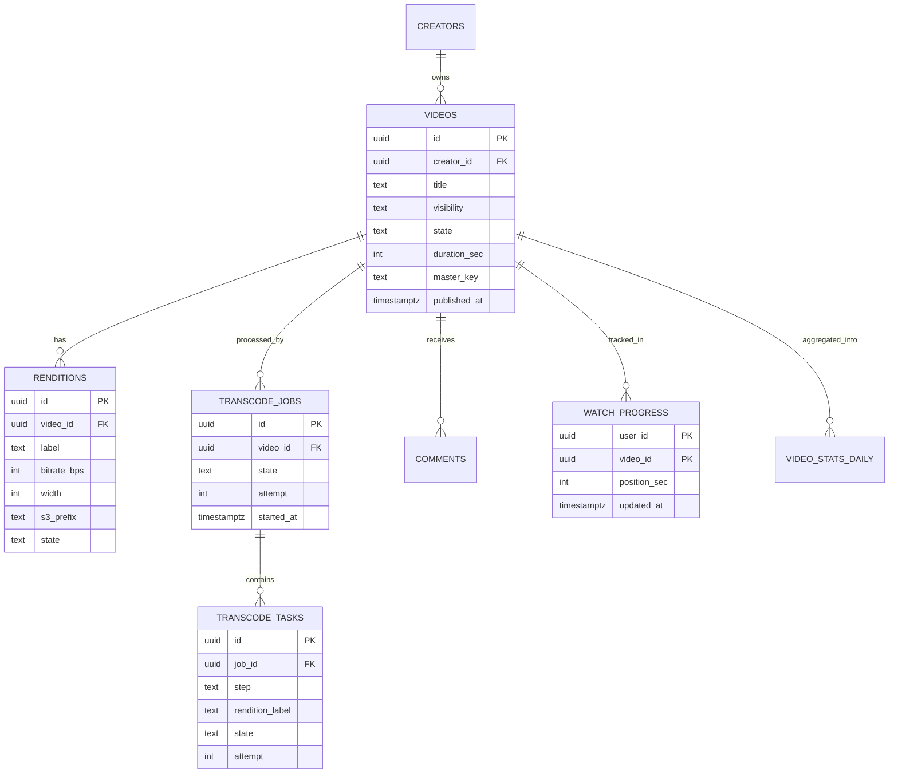
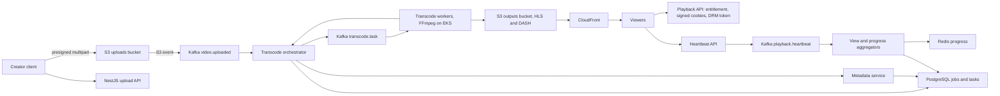
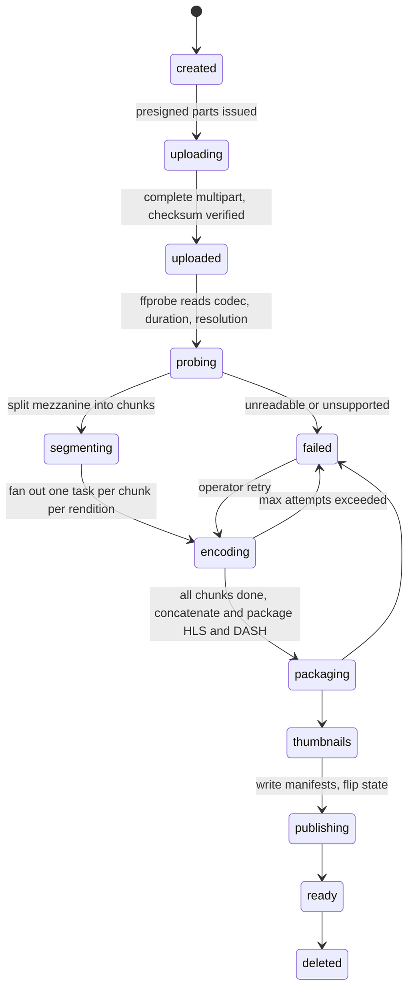
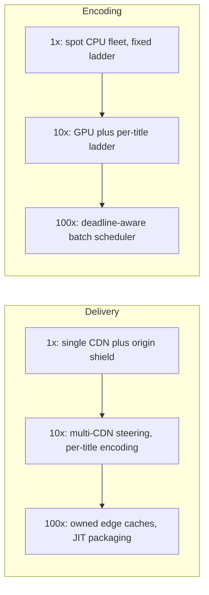

## 59.13 Video Streaming Platform

> **Try it first** · Level: Advanced · About 60 minutes
>
> **Build:** a video platform where creators upload videos that are transcoded and streamed to viewers with adaptive quality through a CDN.
>
> **Requirements:**
> - Resumable upload of videos up to 20 GB, with progress and status.
> - Transcode each upload into an adaptive bitrate ladder packaged as HLS and DASH; generate thumbnails.
> - Playback that starts within 2 seconds and adapts to bandwidth; resume where the viewer stopped.
> - Visibility (public, unlisted, private, subscription tier), view counting, comments, search and creator analytics.
>
> **Scale and constraints:** 5 million daily viewers watching 30 minutes each (2.5 million watch hours per day, about 2.8 PB of CDN egress per day); 312,000 concurrent streams at peak (about 780 Gbps); 4,000 hours uploaded per day. Startup p95 under 2.5 s; rebuffering under 0.4 percent of watch time; upload to playable p50 under 8 minutes for a 10-minute 1080p video; 99.99 percent playback availability; view counts within 1 percent; no custom CDN, and egress is the largest cost; DRM for the premium tier.
>
> **Your task:** sketch the API, the data model and the upload, transcode and playback paths; estimate storage, egress and transcode compute; name the two hardest problems and how you would solve them.
>
> Spend the time on paper before you read on. The model design follows.

### 59.13.1 Requirements

A video streaming platform takes a file from a creator's laptop and turns it into something that plays instantly, at the right quality, on a phone on a train, a laptop on hotel Wi-Fi and a television on fibre. The interesting engineering is not the player. It is everything between "upload finished" and "playable", and everything between "playable" and "the bill did not bankrupt us".

The users are creators, who upload and want to know when their video is live and how it is doing, and viewers, who want playback to start in under two seconds and never buffer. There is a third stakeholder nobody puts on the diagram: finance, because a streaming platform's cost curve is dominated by bytes leaving the CDN, and a design that ignores that fact is not a design.

Imagine a bakery that must serve bread to customers all over the country. You do not bake on demand at each shop; you bake once at a central bakery (transcoding), cut the loaf into slices of different thickness for different customers (the bitrate ladder), put a printed list of available slice sizes on the counter (the manifest), and ship pallets to local shops overnight so customers get bread from around the corner instead of from the central bakery (the CDN). When a shop runs out, it calls the bakery, which is the cache miss. If every shop calls at once because a new loaf just became famous, the bakery melts. That is the cache-miss storm, and preventing it is a large part of this design.

### 59.13.2 Functional requirements

1. A creator uploads a video file up to 20 GB, resumably, and sees progress and status.
2. The platform transcodes each upload into an adaptive bitrate ladder and packages it as HLS and DASH.
3. Playback starts within 2 seconds and adapts quality to the viewer's bandwidth without stalling.
4. Thumbnails are generated automatically (a grid of sprites for scrubbing plus a poster frame), and a creator can pick or upload a custom one.
5. Videos have visibility: public, unlisted, private, or restricted to a subscription tier.
6. Views are counted, with a definition of what counts as a view, and watch progress is remembered per user per video so playback resumes where it stopped.
7. Viewers can comment on a video and reply to comments.
8. The catalogue is searchable and a recommendation service can be plugged into the home and watch-next surfaces.
9. Creators see analytics: views, watch time, retention curve, quality of experience.
10. Live streaming is supported for a subset of creators, with the same player and CDN.

### 59.13.3 Non-functional requirements

| Property | Target | Why |
|---|---|---|
| Startup time (join to first frame) | p50 under 1.2 s, p95 under 2.5 s | Every extra second of startup loses viewers measurably |
| Rebuffer ratio | Under 0.4 percent of watch time | The only quality metric viewers actually feel |
| Upload to playable | p50 under 8 minutes for a 10-minute 1080p video, p95 under 30 minutes | Creators watch the status page |
| Playback availability | 99.99 percent | Streaming is the product |
| Catalogue API availability | 99.95 percent | Degrades to cached pages |
| Durability of masters | 11 nines (S3) | A lost master cannot be re-encoded |
| Consistency of metadata | Read-your-writes for the creator, eventual (under 30 s) for viewers | A creator editing a title must see the change |
| View count accuracy | Within 1 percent, converging within 10 minutes | It drives payouts, so it must be auditable |

### 59.13.4 Constraints

- AWS: S3, CloudFront, MSK, Aurora PostgreSQL, ElastiCache Redis, EKS. Transcoding either on EKS with FFmpeg or on AWS MediaConvert; the design supports both behind one interface.
- No custom CDN. Egress is billed per gigabyte and is the largest line item.
- Mobile clients on cellular networks; the manifest and the segment size must tolerate 300 ms round trips and abrupt bandwidth changes.
- Content licensing for a premium tier requires DRM (Widevine, FairPlay, PlayReady), which forces packaging decisions early.
- A team of twenty, so the pipeline must be operable, restartable and observable by people who did not write it.

### 59.13.5 Capacity estimation

| Quantity | Assumption | Calculation | Result |
|---|---|---|---|
| Daily active viewers | | given | 5 million |
| Watch minutes per viewer per day | | 30 | |
| Watch hours per day | 5M x 30 / 60 | | 2.5 million |
| Average delivered bitrate | Mix of mobile and TV | | 2.5 Mbps |
| Bytes per watch hour | 2.5 Mbps x 3600 s / 8 | | 1.125 GB |
| CDN egress per day | 2.5M x 1.125 GB | | 2.81 PB |
| CDN egress per month | 2.81 PB x 30 | | 84 PB |
| Average concurrent streams | 2.5M watch hours / 24 h | | 104,000 |
| Peak concurrent streams | 3x at prime time | | 312,000 |
| Peak egress bandwidth | 312,000 x 2.5 Mbps | | 780 Gbps |
| Segment requests per second, peak | 4-second segments: one request per stream per 4 s | 312,000 / 4 | 78,000 |
| Manifest and API requests per second, peak | Player refreshes plus catalogue | | about 12,000 |

Now the ingest and storage side, which is where the bitrate ladder arithmetic lives.

| Rendition | Resolution | Video bitrate | GB per content hour |
|---|---|---|---|
| 240p | 426x240 | 0.4 Mbps | 0.18 |
| 360p | 640x360 | 0.8 Mbps | 0.36 |
| 480p | 854x480 | 1.4 Mbps | 0.63 |
| 720p | 1280x720 | 2.8 Mbps | 1.26 |
| 1080p | 1920x1080 | 5.0 Mbps | 2.25 |
| 1440p | 2560x1440 | 9.0 Mbps | 4.05 |
| 2160p | 3840x2160 | 16.0 Mbps | 7.20 |
| Audio, two tracks | | 0.26 Mbps | 0.12 |
| **Full ladder total** | | **35.66 Mbps** | **16.05 GB per content hour** |

| Quantity | Assumption | Calculation | Result |
|---|---|---|---|
| Hours uploaded per day | | given | 4,000 |
| Mezzanine (original) size | Average upload 8 Mbps | 8 x 3600 / 8 | 3.6 GB per hour |
| Mezzanine added per day | 4,000 x 3.6 GB | | 14.4 TB |
| Ladder output per day, if every rung is encoded | 4,000 x 16.05 GB | | 64.2 TB |
| Ladder output with a capped ladder for low-resolution or unpopular uploads | Only 20 percent of uploads get 1440p and 2160p | 4,000 x 6.9 GB average | 27.6 TB |
| Total storage added per day | 14.4 + 27.6 | | 42 TB |
| Storage after one year | 42 TB x 365 | | 15.3 PB |
| Transcode CPU per content hour | Chunked parallel FFmpeg, whole ladder | | about 6 vCPU-hours |
| Transcode vCPU-hours per day | 4,000 x 6 | | 24,000 |
| Steady transcode fleet | 24,000 / 24 | | 1,000 vCPU, so about 60 c6i.4xlarge on spot |
| Peak transcode fleet | Uploads cluster in the evening, 2.5x | | 2,500 vCPU |

| Cost driver | Volume | Unit | Monthly |
|---|---|---|---|
| CDN egress | 84 PB | 0.003 USD per GB at contract rates | 252,000 USD |
| S3 storage, year one average | 8 PB average | 0.021 USD per GB blended with tiering | 168,000 USD |
| Transcoding compute | 720,000 vCPU-hours | 0.035 USD spot | 25,000 USD |

Two conclusions fall out of the arithmetic and drive the whole design. **Egress dominates**: it is more than half the bill and it scales with viewing, not with the catalogue, so every percent shaved off delivered bitrate is worth thousands of dollars a month. And **storing every rung for every video is waste**: 80 percent of watch time goes to 5 percent of videos, so the tail should be stored as a mezzanine plus a small ladder and re-packaged on demand.

### 59.13.6 API design

| Method | Path | Request | Response | Status codes | Idempotent | Auth |
|---|---|---|---|---|---|---|
| POST | `/v1/videos` | `{ title, description, visibility }` | `{ videoId, uploadId, partUrls[], expiresAt }` | 201, 400, 401 | No | Creator token |
| PUT | S3 presigned part URL | binary part | ETag | 200, 403 | Yes | Presigned |
| POST | `/v1/videos/{id}/upload/complete` | `{ uploadId, parts:[{n, etag}] }` | `{ status: 'processing' }` | 202, 400, 409 | Yes | Creator token |
| GET | `/v1/videos/{id}/status` | | `{ state, progressPct, renditions[], error? }` | 200, 404 | Yes | Creator token |
| GET | `/v1/videos/{id}` | | metadata plus poster and duration | 200, 403, 404 | Yes | Optional |
| POST | `/v1/videos/{id}/playback` | `{ deviceProfile }` | `{ manifestUrl, cookies?, drm? }` | 200, 402, 403, 404 | Yes | Optional or subscriber |
| PATCH | `/v1/videos/{id}` | `{ title?, description?, visibility?, thumbnailId? }` | video | 200, 403 | Yes | Owner |
| DELETE | `/v1/videos/{id}` | | | 204, 403 | Yes | Owner |
| POST | `/v1/videos/{id}/heartbeat` | `{ positionSec, sessionId, playedSec, quality, rebufferMs }` | | 204 | Yes, keyed by session and position | Optional |
| GET | `/v1/videos/{id}/progress` | | `{ positionSec, updatedAt }` | 200, 404 | Yes | User token |
| POST | `/v1/videos/{id}/comments` | `{ text, parentId? }` plus `Idempotency-Key` | comment | 201, 403 | Yes, via key | User token |
| GET | `/v1/videos/{id}/comments` | `?cursor=&sort=top` | `{ items[], nextCursor }` | 200 | Yes | Optional |
| GET | `/v1/search` | `?q=&cursor=` | results | 200 | Yes | Optional |
| GET | `/v1/recommendations` | `?context=watch_next&videoId=` | list | 200 | Yes | Optional |

The `POST /v1/videos/{id}/playback` endpoint is the security boundary of the whole system. It checks entitlement (is this video public, is this user a subscriber, is this region allowed), then mints either a signed CloudFront cookie scoped to the video's path prefix or a set of signed segment URLs, plus a DRM licence token when the video is protected. Manifests and segments themselves are static files on the CDN; the API never proxies video bytes, because proxying 780 Gbps through NestJS pods is not a plan.

The heartbeat endpoint is the highest-volume write in the system. At 312,000 concurrent streams with a heartbeat every 10 seconds it is 31,200 requests per second, which is more than the entire catalogue API. It returns 204 with no body, does no database work, and drops its payload straight onto Kafka.

### 59.13.7 Data model



```sql
CREATE TABLE videos (
  id           uuid PRIMARY KEY DEFAULT gen_random_uuid(),
  creator_id   uuid NOT NULL REFERENCES creators(id),
  title        text NOT NULL,
  description  text,
  visibility   text NOT NULL DEFAULT 'private'
                 CHECK (visibility IN ('private','unlisted','public','subscribers')),
  state        text NOT NULL DEFAULT 'created'
                 CHECK (state IN ('created','uploading','uploaded','transcoding','ready','failed','deleted')),
  duration_sec integer,
  master_key   text,                      -- s3://.../masters/{videoId}/source.mp4
  checksum     bytea,                     -- sha256 of the mezzanine, verified after upload
  published_at timestamptz,
  created_at   timestamptz NOT NULL DEFAULT now()
);
CREATE INDEX videos_creator_idx ON videos (creator_id, created_at DESC);          -- creator dashboard
CREATE INDEX videos_public_idx ON videos (published_at DESC)
  WHERE visibility = 'public' AND state = 'ready';                                -- public browse pages

CREATE TABLE renditions (
  id           uuid PRIMARY KEY DEFAULT gen_random_uuid(),
  video_id     uuid NOT NULL REFERENCES videos(id) ON DELETE CASCADE,
  label        text NOT NULL,            -- '1080p'
  bitrate_bps  integer NOT NULL,
  width        integer NOT NULL,
  height       integer NOT NULL,
  codec        text NOT NULL DEFAULT 'h264',
  s3_prefix    text NOT NULL,
  state        text NOT NULL DEFAULT 'pending',
  UNIQUE (video_id, label, codec)         -- makes re-running a rendition step idempotent
);

CREATE TABLE transcode_tasks (
  id              uuid PRIMARY KEY DEFAULT gen_random_uuid(),
  job_id          uuid NOT NULL REFERENCES transcode_jobs(id) ON DELETE CASCADE,
  step            text NOT NULL,          -- 'probe','segment','encode','package','thumbnail','publish'
  rendition_label text,
  state           text NOT NULL DEFAULT 'pending'
                    CHECK (state IN ('pending','running','done','failed','skipped')),
  attempt         smallint NOT NULL DEFAULT 0,
  lease_until     timestamptz,
  output_key      text,
  error           text,
  UNIQUE (job_id, step, rendition_label)  -- the idempotency key of the pipeline
);
CREATE INDEX transcode_tasks_claim_idx ON transcode_tasks (state, lease_until)
  WHERE state IN ('pending','running');   -- serves the worker claim query with SKIP LOCKED

CREATE TABLE watch_progress (
  user_id      uuid NOT NULL,
  video_id     uuid NOT NULL,
  position_sec integer NOT NULL,
  updated_at   timestamptz NOT NULL DEFAULT now(),
  PRIMARY KEY (user_id, video_id)          -- serves "resume where I left off" with one lookup
) PARTITION BY HASH (user_id);
```

The `UNIQUE (job_id, step, rendition_label)` constraint deserves emphasis: it is what makes the pipeline restartable. Every step of every job has exactly one row, so re-running a job after a crash re-uses the rows rather than creating duplicates, and a step that already reached `done` is skipped rather than repeated. That is idempotency implemented as a database constraint instead of as a hope.

### 59.13.8 High-level architecture



The pipeline is drawn separately because it is where the interesting states live.



### 59.13.9 Component design

| Component | Responsibility |
|---|---|
| `UploadController` | Create the video row, issue presigned multipart URLs, complete the upload, verify checksum |
| `OrchestratorService` | Own the job state machine, create tasks, dispatch, apply retries, decide the ladder |
| `TranscodeWorker` | Claim a task, run FFmpeg, write output to S3, report result |
| `PackagerService` | Concatenate encoded chunks, produce HLS and DASH manifests, optionally encrypt for DRM |
| `ThumbnailService` | Poster frame plus a sprite sheet every 5 seconds for scrub previews |
| `MetadataService` | Video CRUD, visibility, search indexing, read models for the watch page |
| `PlaybackService` | Entitlement check, signed cookie or URL minting, DRM licence token |
| `HeartbeatController` | Accept playback beacons and publish to Kafka; no synchronous storage |
| `ViewAggregator` | Turn heartbeats into view counts, watch time and quality metrics |
| `ProgressWriter` | Debounced writes of resume position into Redis and PostgreSQL |

```text
src/
  upload/
    upload.module.ts
    upload.controller.ts
    multipart.service.ts
  transcode/
    transcode.module.ts
    orchestrator.service.ts
    ladder.policy.ts             -- decides which rungs to encode
    worker/transcode.worker.ts
    worker/ffmpeg.runner.ts
    packager.service.ts
    thumbnail.service.ts
  catalog/
    videos.controller.ts
    videos.service.ts
    comments.service.ts
  playback/
    playback.controller.ts
    entitlement.service.ts
    signer.service.ts            -- CloudFront signed cookies and URLs
    drm.service.ts
  telemetry/
    heartbeat.controller.ts
    workers/view-aggregator.worker.ts
    workers/progress-writer.worker.ts
```

The orchestrator is the piece that decides the ladder, and the decision is a cost decision.

```ts
// transcode/ladder.policy.ts
export interface Rung { label: string; width: number; height: number; bitrateBps: number; }

const FULL: Rung[] = [
  { label: '240p',  width: 426,  height: 240,  bitrateBps: 400_000 },
  { label: '360p',  width: 640,  height: 360,  bitrateBps: 800_000 },
  { label: '480p',  width: 854,  height: 480,  bitrateBps: 1_400_000 },
  { label: '720p',  width: 1280, height: 720,  bitrateBps: 2_800_000 },
  { label: '1080p', width: 1920, height: 1080, bitrateBps: 5_000_000 },
  { label: '1440p', width: 2560, height: 1440, bitrateBps: 9_000_000 },
  { label: '2160p', width: 3840, height: 2160, bitrateBps: 16_000_000 },
];

export function chooseLadder(src: { width: number; height: number; bitrateBps: number }, tier: 'standard' | 'premium'): Rung[] {
  // Never upscale: encoding 720p source to 1080p costs money and looks identical.
  let rungs = FULL.filter((r) => r.height <= src.height);
  // Never encode a rung whose bitrate exceeds the source: it cannot add information.
  rungs = rungs.filter((r) => r.bitrateBps <= src.bitrateBps * 1.1);
  // Standard tier stops at 1080p on first pass; higher rungs are produced lazily if the video gets popular.
  if (tier === 'standard') rungs = rungs.filter((r) => r.height <= 1080);
  // Always keep a floor rung so a 2G viewer can still play something.
  if (!rungs.some((r) => r.label === '240p')) rungs.unshift(FULL[0]);
  return rungs;
}
```

Workers claim tasks with a lease, which is the same pattern as the job scheduler in 59.15: `FOR UPDATE SKIP LOCKED` plus a heartbeat, so a worker that dies does not strand the task.

```ts
// transcode/worker/transcode.worker.ts (claim and run)
async claimAndRun(): Promise<void> {
  const task = await this.dataSource.transaction(async (m) => {
    const rows = await m.query(
      `UPDATE transcode_tasks SET state='running', attempt=attempt+1,
              lease_until = now() + interval '15 minutes', worker_id = $1
       WHERE id = (
         SELECT id FROM transcode_tasks
         WHERE (state='pending') OR (state='running' AND lease_until < now())
         ORDER BY created_at
         FOR UPDATE SKIP LOCKED
         LIMIT 1)
       RETURNING *`, [this.workerId]);
    return rows[0] ?? null;
  });
  if (!task) return;

  const heartbeat = setInterval(
    () => this.repo.update(task.id, { leaseUntil: () => `now() + interval '15 minutes'` }), 60_000);
  try {
    // Deterministic output key: re-running the same task overwrites the same object, so a retry is safe.
    const key = `outputs/${task.videoId}/${task.renditionLabel}/chunk-${task.chunkIndex}.mp4`;
    await this.ffmpeg.encodeChunk(task, key);
    await this.repo.update(task.id, { state: 'done', outputKey: key, error: null });
    await this.kafka.emit('transcode.task.done', { jobId: task.jobId, taskId: task.id });
  } catch (err) {
    const fatal = err instanceof UnsupportedCodecError || task.attempt >= 4;
    await this.repo.update(task.id, { state: fatal ? 'failed' : 'pending', error: String(err) });
    if (fatal) await this.kafka.emit('transcode.task.failed', { jobId: task.jobId, taskId: task.id });
  } finally {
    clearInterval(heartbeat);
  }
}
```

Chunked encoding is what makes the p95 "upload to playable" target reachable. A 60-minute video encoded end to end at 4x real time takes 15 minutes per rendition. Split into 120 chunks of 30 seconds, encoded across 120 workers in parallel, the same rendition finishes in about 25 seconds plus concatenation. The catch is that chunk boundaries must align with keyframes, or the concatenated stream has visible glitches; the segmenter forces an IDR frame at every chunk boundary with `-force_key_frames`.

S3 layout is deliberate, because prefix design determines both throughput and lifecycle cost:

```text
s3://vp-masters/    masters/{videoId}/source.mp4              -> Glacier Deep Archive after 30 days
s3://vp-work/       work/{jobId}/chunks/{rendition}/*.mp4     -> lifecycle delete after 7 days
s3://vp-outputs/    v/{videoId}/{rendition}/seg-00001.m4s     -> Standard, then Standard-IA at 90 days
                    v/{videoId}/master.m3u8
                    v/{videoId}/manifest.mpd
                    v/{videoId}/thumbs/sprite-01.jpg
```

Three buckets rather than one, because the three have completely different lifecycle rules, access patterns and blast radii. The outputs bucket is the CDN origin and is read-only to everything except the packager. Masters are never public and are the only thing that cannot be regenerated.

### 59.13.10 Database design

PostgreSQL holds metadata, job state, comments and progress. It does not hold anything on the playback hot path except the entitlement check, which is cached.

The write pattern that needs care is `watch_progress`. A naive implementation writes a row per heartbeat: 31,200 writes per second, all `UPDATE`s on a hash-partitioned table. That is achievable but wasteful, and it produces enormous bloat because each update creates a dead tuple. Instead, progress lives in Redis (`prog:{userId}:{videoId}` with a 90-day TTL) and is flushed to PostgreSQL by a worker that debounces: it writes a user's position at most once every 60 seconds and once when the session ends. Volume drops from 31,200 writes per second to about 900.

View counting is aggregated, never incremented per event. The aggregator consumes `playback.heartbeat`, holds a 60-second tumbling window in memory keyed by `(videoId, day)`, and issues one `INSERT ... ON CONFLICT DO UPDATE SET views = video_stats_daily.views + EXCLUDED.views` per video per minute. A viral video generating 20,000 views per minute becomes one row update per minute.

Partitioning: `watch_progress` by hash of `user_id` into 32 partitions, `video_stats_daily` and `comments` by month. Comments partitioned by month is slightly unusual but pays off, because 95 percent of comment reads are on videos published in the last 30 days, so the hot partition stays in cache while the five-year archive sits on disk untouched.

Read replicas serve the creator dashboard and analytics; the writer serves entitlement and job state. Analytics queries that scan `video_stats_daily` across months run against a separate replica with a longer `statement_timeout`, so a slow dashboard query cannot consume a connection the pipeline needs.

### 59.13.11 Caching

| What | Where | TTL | Invalidation | Notes |
|---|---|---|---|---|
| Video segments and manifests | CloudFront edge | Segments 30 days (immutable), manifests 60 s for VOD | Version in the path on re-package | 95 percent of egress never touches origin |
| Shield layer | CloudFront origin shield in one region | Same | | Turns 400 edge locations into one origin requester |
| Watch-page metadata | Redis `video:{id}` | 5 min | `PATCH` publishes an invalidation | Serves the 12,000 requests per second catalogue path |
| Entitlement decision | Redis `ent:{userId}:{videoId}` | 60 s | Subscription change invalidates the user prefix | Keeps the playback endpoint under 20 ms |
| Watch progress | Redis `prog:{userId}:{videoId}` | 90 days | Written on flush | Source of truth for the resume feature during a session |
| Signed cookie policy | Client-side cookie | 4 hours | Re-mint on expiry | Long enough for a film, short enough to revoke |
| Recommendations | Redis `rec:{userId}:{context}` | 10 min | Model refresh | Falls back to a global popular list on miss |
| Comment first page | Redis `cmt:{videoId}:p0` | 30 s | New comment deletes it | The first page is 80 percent of comment reads |

Segments are immutable and cached for 30 days with `Cache-Control: public, max-age=2592000, immutable`. Manifests are the mutable part, so they carry a short TTL for VOD and 2 seconds for live. When a video is re-packaged (a new rendition added, DRM applied), the path changes to `v/{videoId}/{packageVersion}/...` rather than invalidating the CDN, because a CloudFront invalidation across 400 edges is slow, rate limited and expensive, while a new path is instant and free.

### 59.13.12 Messaging

| Topic | Key | Partitions | Events | Consumers |
|---|---|---|---|---|
| `video.uploaded` | `videoId` | 16 | S3 completion with key and size | Orchestrator |
| `transcode.task` | `jobId` | 64 | one message per chunk per rendition | Transcode workers |
| `transcode.task.done` / `.failed` | `jobId` | 64 | result | Orchestrator |
| `video.published` | `videoId` | 16 | video became `ready` | Search indexer, notification service, recommendation feature builder |
| `playback.heartbeat` | `videoId` | 128 | position, played seconds, quality, rebuffer ms | View aggregator, progress writer, QoE analytics |
| `playback.session.start` / `.end` | `sessionId` | 32 | join time, device, ABR path | QoE analytics |
| `transcode.dlq` | | 8 | poison jobs | On-call |

Keying `transcode.task` by `jobId` keeps all tasks for one video in one partition, which gives the orchestrator ordered completion events per job and makes the "are all chunks done?" check a simple counter rather than a distributed query. Keying `playback.heartbeat` by `videoId` puts all heartbeats for one video in one partition, which is exactly what the view aggregator needs to batch, but it creates a hot partition for a viral video. The mitigation is a composite key of `videoId:bucket` where `bucket` is a small random number for videos on a hot list, and the aggregator sums the buckets.

Retries: transcode tasks retry four times with exponential backoff, then go to the DLQ. Heartbeats are never retried; they are best-effort telemetry and a lost one costs at most 10 seconds of watch-time accuracy. That distinction is important. Treating telemetry with the same reliability machinery as money movement is one of the most common over-engineering mistakes in this kind of system.

### 59.13.13 Scaling

**At 1x (312,000 peak concurrent streams).** CloudFront with origin shield absorbs playback; the API tier is 40 pods; transcoding runs 60 spot instances scaled by Kafka lag; one Aurora writer with three readers; Redis Cluster with six shards. The bottleneck is not compute anywhere; it is CDN cost and origin egress on cache misses.

**At 10x (3 million peak concurrent, 7.8 Tbps).** Three changes. First, multi-CDN: traffic is split between two or three providers by a steering service that watches per-provider error and rebuffer rates, which improves resilience and gives commercial leverage worth more than any engineering optimisation on this bill. Second, the transcode fleet moves to a mix of GPU instances and per-title encoding, where each video gets a ladder derived from its own complexity (an animation needs far less bitrate than sports), typically saving 20 percent of delivered bytes. Third, the heartbeat path is moved off the main API to a dedicated ingest service behind a network load balancer with no framework overhead, because 312,000 requests per second of beacons should not share a thread pool with the catalogue.

**At 100x.** The origin becomes a tiered storage system: hot segments on NVMe caches in a handful of regions, warm on S3, cold on Glacier with just-in-time packaging that produces a rendition on first request and caches it. Transcoding moves to a dedicated cluster with a scheduler that treats encoding as a batch workload with deadlines and priorities. Peer-assisted delivery and ISP-embedded caches enter the picture, because at that scale the CDN contract stops being the cheapest option.



### 59.13.14 Security

- **Signed delivery.** Public videos are served with no signature to maximise cache efficiency. Private, unlisted and subscriber content is served behind CloudFront signed cookies scoped to `/v/{videoId}/*` with a 4-hour expiry. Cookies beat signed URLs here because a single playback session fetches hundreds of segment URLs and signing each one would either bloat the manifest or require a manifest rewrite per user, which destroys cacheability.
- **DRM.** For licensed content, segments are encrypted with Common Encryption (CENC) at package time and keys are served by a licence service that checks entitlement per playback session. Widevine for Android and Chrome, FairPlay for Apple, PlayReady for Windows and smart TVs. DRM is a business requirement, not a security guarantee: it raises the cost of copying, it does not prevent it. The engineering cost is real (key rotation, licence servers, device certification), so it is applied only to the tier that needs it.
- **Upload abuse.** Presigned multipart URLs are scoped to one key with a content-length range and a 6-hour expiry. Uploads are virus-scanned and probed before any worker touches them; `ffprobe` runs in a sandboxed container with no network and a memory limit, because media parsers are a classic source of remote code execution.
- **Hotlinking and sharing.** Signed cookies are bound to a viewer session and a coarse IP prefix; the licence service limits concurrent streams per account, which is the practical anti-sharing control.
- **Geo and age restrictions.** Enforced at the playback endpoint and reinforced by CloudFront geo-restriction on the distribution, because a client-side check is a suggestion.
- **Comment abuse.** Rate limited, filtered for spam, and moderated with a queue; comments on a video can be disabled by the creator.
- **Tenant isolation of buckets.** The outputs bucket has no public ACLs; CloudFront reaches it through an Origin Access Control. A misconfigured public bucket is the most common way a streaming platform leaks unpublished content.

### 59.13.15 Failure scenarios

| Failure | Detection | Impact | Mitigation | What the user sees |
|---|---|---|---|---|
| Transcode fails mid-pipeline (a worker OOMs on chunk 47 of 120) | Task lease expiry, `transcode_task_failed_total` | The video stalls in `encoding` | The task's lease expires and another worker re-claims it; output keys are deterministic so the retry overwrites, not duplicates; after four attempts the job goes to the DLQ and the creator sees a real error | Status page shows "processing", then either ready or a specific failure message |
| CDN cache-miss storm: a video goes viral and 400 edge locations all miss at once | Origin request rate spike, S3 5xx | S3 throttles, playback stalls for everyone on that video | Origin shield collapses 400 requesters into one; `Cache-Control: immutable` on segments; pre-warming pushes the first 60 seconds of a video to the shield when it enters the trending list | Brief buffering on the first plays, then normal |
| S3 throttling (503 SlowDown) during a transcode burst | S3 error rate, retry counter | Workers fail and retry, throughput collapses | Keys are spread across prefixes so requests distribute across S3 partitions; the SDK retries with adaptive backoff; upload concurrency per worker is capped | Slower processing, no failures |
| Corrupted upload: bytes do not match the client checksum | `complete` step compares sha256 | Transcoding a corrupt file wastes an hour and produces garbage | Checksum verified before the job is created; on mismatch the video returns to `uploading` and the client is told which parts to re-send | "Upload failed verification, retrying" |
| Single hot video: 40 percent of all traffic on one asset | Per-video egress metric, hot-partition alarm on Kafka | Hot Kafka partition for heartbeats, hot origin prefix | Heartbeat key becomes `videoId:bucket` with 16 buckets; segments are already immutable and edge-cached so origin load stays flat | Nothing |
| Orchestrator crash between creating tasks and dispatching | Job stuck in `segmenting` with no running tasks | Video never progresses | A reconciler runs every minute, finds jobs whose tasks are all `pending` with no dispatch record, and re-dispatches; dispatch is idempotent on `(job_id, step, rendition_label)` | Slightly longer processing |
| Manifest published before all segments are uploaded | Player 404s on segments, QoE alarm | Playback fails immediately after publish | Publish is the last step and verifies with a HEAD on the first and last segment of every rendition before flipping state to `ready` | Nothing |
| Redis loses watch progress | Cache miss rate on `prog:` | Viewers lose resume position for the current session | PostgreSQL holds the last flushed position, at most 60 seconds stale; the player resumes there | Resume point off by up to a minute |
| Aurora writer failover during a transcode burst | Connection errors | Task claims fail, workers idle | Workers retry claims with jitter for 60 s; tasks retain their state because nothing is held in worker memory | Processing pauses for under a minute |
| Kafka heartbeat topic unavailable | Producer error rate | View counts and progress stop updating | Heartbeats are dropped, not retried; view counts backfill from CDN access logs, which are the audit source anyway | Counts lag, playback unaffected |
| Licence server outage for DRM content | Licence error rate from players | Protected content will not start | Licence tokens are cached client-side for the session length; the service runs in three AZs with a static fallback for already-issued sessions | New plays of protected titles fail |
| Poison media: a crafted file crashes the probe container repeatedly | Repeated crashes on the same task | A worker slot cycles forever | Attempt counter caps at four, then the job fails with `unsupported_media`; probe runs sandboxed with a hard memory and CPU limit | "This file could not be processed" |

### 59.13.16 Observability

The metrics that describe the product are quality-of-experience metrics computed from heartbeats, not server metrics: `startup_time_seconds` (join to first frame) by device and CDN, `rebuffer_ratio` (rebuffer ms divided by played ms), `average_delivered_bitrate`, and `playback_failure_rate` by error code. These are dashboarded per CDN, per region and per device class, because a regression is almost always confined to one of those dimensions.

Pipeline metrics: `transcode_queue_depth`, `transcode_task_duration_seconds` by step and rendition, `upload_to_ready_seconds` at p50 and p95 (the creator-facing promise), `transcode_failure_rate` by error class, and DLQ depth. Infrastructure metrics: origin request rate and cache hit ratio per CDN, S3 4xx and 5xx, Kafka lag per consumer group, Redis memory.

The alert that catches the most real incidents is `rebuffer_ratio` above 1 percent for 5 minutes in any single region-plus-CDN combination, because it fires for CDN degradation, bad encodes and origin problems alike. The alert engineers most often forget is on `upload_to_ready_seconds` p95, which is invisible to viewers and enormously visible to creators.

Traces cover the playback authorisation path and the orchestrator's decisions. Logs from FFmpeg are captured per task and kept for 14 days, because the only way to debug "this one video looks wrong" is to read the encoder's own output.

### 59.13.17 Deployment

| Workload | Kind | Replicas | Notes |
|---|---|---|---|
| `catalog-api` | Deployment | 30, HPA on CPU | Metadata, comments, search proxy |
| `playback-api` | Deployment | 20 | Entitlement and signing; 3 AZs, tight latency SLO |
| `heartbeat-ingest` | Deployment | 24 | Minimal handler, NLB, no database access |
| `orchestrator` | Deployment | 3 with leader election | Only one leader dispatches; others are hot standbys |
| `transcode-worker` | Deployment on spot nodes | 0 to 400, KEDA on Kafka lag | Interruption-tolerant thanks to leases |
| `packager` | Deployment | 10 | Higher memory, on-demand nodes |
| `view-aggregator` | Deployment | 8 | Consumer group on `playback.heartbeat` |
| `progress-writer` | Deployment | 4 | Debounced writes |
| `reconciler` | CronJob every minute | 1 | Finds stuck jobs |

Transcode workers run on spot instances with a `terminationGracePeriodSeconds` of 120 and a `preStop` hook that releases the task lease, so a spot reclamation returns work to the queue in seconds instead of waiting 15 minutes for the lease to expire. Node pools are separate for workers and for API pods, so an encoding burst cannot starve playback.

Rollouts are canary at 5 percent with automatic rollback on `startup_time_seconds` p95 or `playback_failure_rate` regression. Encoder version changes are the riskiest deploys in the system, because a subtly broken encode is not visible in any server metric; they roll out behind a flag on 1 percent of uploads and are compared with VMAF quality scores against the previous encoder before going wide.

### 59.13.18 Cost considerations

| Item | Sizing | Monthly (USD, approximate) |
|---|---|---|
| CDN egress | 84 PB at contract rates | 252,000 |
| S3 storage | 8 PB average, blended tiers | 168,000 |
| S3 requests and lifecycle transitions | | 8,000 |
| Transcoding compute | 720,000 vCPU-hours, mostly spot | 25,000 |
| EKS for API, ingest and aggregation | about 90 pods | 7,000 |
| Aurora PostgreSQL | writer plus 3 readers, 4 TB | 7,500 |
| ElastiCache Redis | 6 shards | 3,500 |
| MSK Kafka | 9 brokers, high heartbeat volume | 5,000 |
| DRM licence service and certificates | | 6,000 |
| Observability | | 4,000 |
| Total | | about 486,000 |

Egress plus storage is 86 percent of the bill. That ratio dictates the engineering priorities in order: reduce delivered bytes (per-title encoding, AV1 for supported devices, capping default quality on mobile), reduce stored bytes (lazy high rungs, aggressive lifecycle to Glacier for masters, deleting work chunks), then negotiate. A 15 percent reduction in delivered bitrate through per-title encoding saves 38,000 USD per month, which is more than the entire compute budget. This is why an engineer who optimises the NestJS controller here is optimising the wrong thing.

### 59.13.19 Tradeoffs

- **Chunked parallel encoding rather than sequential.** Cuts p95 processing time by an order of magnitude, at the cost of keyframe alignment complexity, a concatenation step, and 120 tasks to track per rendition instead of one.
- **Lazy high rungs.** 1440p and 2160p are produced only when a video crosses a popularity threshold. Saves roughly 55 percent of the storage bill; the price is that the first viewers of a video that suddenly goes viral get 1080p for a few minutes.
- **Signed cookies rather than signed URLs.** Preserves CDN cacheability (one cached object serves everyone) at the cost of a cookie-scoped domain and slightly clumsier cross-domain player setups.
- **Heartbeat telemetry is best-effort.** No retries, no DLQ, drops accepted. Buys a simple, extremely cheap ingest path; the price is that view counts are reconciled from CDN logs rather than being authoritative in real time.
- **Progress in Redis with debounced PostgreSQL flush.** 35x fewer database writes, at the cost of losing up to 60 seconds of resume position when Redis fails.
- **Managed transcoding versus self-hosted FFmpeg.** The design keeps a common interface. Self-hosted on spot is roughly 4x cheaper and gives exact control over the encoder; managed removes an entire operational surface. At 4,000 hours a day, self-hosted wins; below a few hundred hours a day, it does not.
- **Immutable segment paths with versioned prefixes.** Avoids CDN invalidations entirely; the price is orphaned objects from old package versions, cleaned by a lifecycle rule.

### 59.13.20 Alternative architectures

**Fully managed pipeline: MediaConvert plus MediaPackage plus CloudFront.** AWS runs the encoding, packaging, DRM integration and just-in-time repackaging; your code shrinks to "upload to S3, submit a job, store the output URL". This wins decisively for a small team, for a catalogue under a few hundred hours a day, and for anyone who needs live and VOD with DRM quickly. It loses on unit cost at scale (per-minute encoding pricing is several times spot FFmpeg), on encoder control (you cannot tune per-title ladders or adopt a new codec before the service supports it), and on portability.

**Just-in-time packaging instead of pre-packaged output.** Store only the mezzanine plus one or two mezzanine-quality encodes, and generate the requested rendition and segments on the fly at a packaging layer in front of the CDN. Storage drops by 70 percent or more and adding a new codec becomes a configuration change rather than a re-encode of the entire catalogue. It wins for very large catalogues with a long tail where most videos are watched rarely. It loses on first-play latency for cold assets, on the operational difficulty of a stateful, CPU-heavy service in the request path, and on the fact that a popularity spike now costs compute rather than being free from cache.

**Peer-assisted delivery (WebRTC data channels between viewers).** Viewers of the same live stream or popular VOD exchange segments with each other, and the CDN serves only what the swarm cannot. This can cut egress by 30 to 70 percent for concurrent live events, which at our bill is worth six figures a month. It wins for live events with high concurrency on the same content. It loses on complexity (a tracker, NAT traversal, fallback logic), on privacy and consent concerns, on mobile battery and data plans, and on the fact that it does nothing for a long-tail VOD catalogue where no two viewers watch the same thing at the same time.
