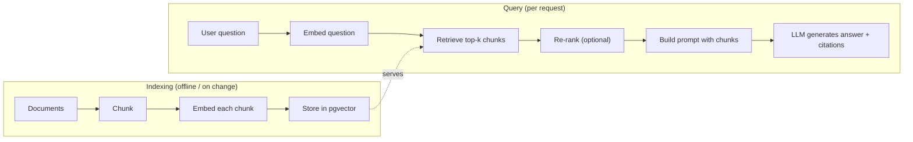

## 60.2 Retrieval-augmented generation

### 60.2.1 The RAG pipeline

#### Concept

**RAG** (Retrieval-Augmented Generation) is the pattern of retrieving relevant data and putting it into the prompt so the LLM answers from your facts instead of its training (which may be stale, generic, or wrong about your domain). The pipeline: chunk your documents, embed and index them, retrieve the most relevant chunks for a query, and generate an answer grounded in those chunks, with citations. RAG is how you build "ask a question about our data" features that are accurate and current.

#### Why does it exist?

An LLM alone cannot answer questions about your specific, current, private data — your product catalog, your support articles, this customer's orders — because it was never trained on them and cannot see them. Fine-tuning a model on your data is expensive, slow to update, and still hallucinates. RAG is simpler and better for most cases: keep your data in a store, retrieve the relevant pieces at query time, and let the model answer from them. When the data changes, you update the store, not the model. The model supplies language ability; your data supplies the facts.

#### Mental model

Imagine an open-book exam versus a closed-book one. A closed-book exam (the bare LLM) tests what the student memorized, and they will bluff when they do not know. An open-book exam (RAG) lets the student look up the relevant passage and answer from it, with a page reference. RAG hands the model the right pages for each question and asks it to answer from those pages and cite them. The retrieval step is finding the right pages; the generation step is writing the answer from them.

#### How it works — the pipeline



The two phases:

**Indexing (offline, or when data changes):**

1. **Chunk**: split documents into pieces small enough to be precise and to fit in the prompt (a product description, a paragraph of a support article, a section of a manual). Too large and retrieval is imprecise and the prompt bloats; too small and you lose context. Chunks often overlap slightly so a sentence spanning a boundary is not lost.
2. **Embed**: compute an embedding for each chunk.
3. **Index**: store the chunk text, its embedding, and metadata (document id, tenant, section) in pgvector.

**Query (per request):**

4. **Embed the question** with the same embedding model.
5. **Retrieve** the top-k most similar chunks (a vector search, scoped by tenant/metadata).
6. **Re-rank** (optional): a second, more precise step reorders the retrieved chunks by relevance, because the vector search is fast but approximate.
7. **Build the prompt**: insert the retrieved chunks into the prompt as context, with instructions to answer only from them and to cite sources.
8. **Generate**: the LLM produces the answer, grounded in the chunks, with citations.

#### How it works — code

```ts
// RAG query, continued from Part 59's LlmService and Part 60.1's pgvector.
async function answerWithRag(question: string, tenantId: string): Promise<{ answer: string; sources: string[] }> {
  // 5. Embed the question and retrieve top-k chunks for this tenant.
  const qEmbedding = await embedder.embed(question);
  const chunks = await db.query(
    `SELECT content, document_id, 1 - (embedding <=> $1) AS similarity
       FROM doc_chunks
      WHERE tenant_id = $2
      ORDER BY embedding <=> $1
      LIMIT 6`,
    [qEmbedding, tenantId],
  );

  // 7. Build a grounded prompt. Number the chunks so the model can cite them.
  const context = chunks
    .map((c, i) => `[${i + 1}] (doc ${c.document_id})\n${c.content}`)
    .join('\n\n');

  const system =
    'Answer the question using ONLY the numbered context below. ' +
    'Cite sources like [1], [2]. If the context does not contain the answer, ' +
    'say you do not have that information. Do not use outside knowledge.';

  // 8. Generate.
  const answer = await llm.complete({
    system,
    user: `Context:\n${context}\n\nQuestion: ${question}`,
    maxTokens: 500,
  });

  return { answer, sources: chunks.map((c) => c.document_id) };
}
```

The grounding instruction ("answer ONLY from the context, cite sources, say you do not know otherwise") is what keeps RAG honest. Citations let users (and you) verify the answer against the source, which is the main defense against hallucination (Part 59): a cited answer can be checked; an uncited one cannot.

#### Keeping the index in sync

The indexed chunks must stay consistent with the source data: when a product description or support article changes, its chunks must be re-embedded and updated, or RAG answers from stale data. The reliable pattern is the **outbox** or **CDC** (Part 19, Part 63): a change to the source emits an event that a worker consumes to re-chunk, re-embed and update the index. For pgvector this can even be in the same database and transaction as the source change; for a separate vector store it must be an asynchronous sync, which is one of the operational costs of that choice (60.1.3).

```text
Product updated (source of truth)
        |  emits event (outbox / CDC, Part 19, Part 63)
        v
Re-index worker: re-chunk -> re-embed -> upsert into pgvector
        |
        v
RAG retrieval now returns the current content
```

#### Hybrid search

Pure vector search misses exact matches (a product code, an exact name) that keyword/full-text search (Part 34) handles well, and keyword search misses paraphrases that vector search catches. **Hybrid search** runs both and combines the results (for example, blend the vector similarity rank and the full-text rank), getting the best of each. In PostgreSQL you can do both in one place: full-text search (Part 34) and pgvector in the same database, combining their scores. For many real search features, hybrid beats either alone.

#### Production scenario

A product-catalog search using RAG retrieves the six most relevant product chunks for a shopper's natural-language query, scoped to the tenant and in-stock products (a metadata filter in the same SQL), and the LLM produces a short grounded summary with the matching products cited. Hybrid search ensures that a query containing an exact SKU still returns that product. The index is kept in sync by an outbox-driven re-index worker, so a price or description change is reflected within seconds. Query embeddings are cached (Part 16) so repeated popular queries skip the embedding call. The result is a search that understands intent, stays current, and does not hallucinate products that do not exist.

#### Failure scenario

A support RAG system retrieved chunks and generated answers, but when an article was updated, the old chunks stayed in the index because there was no sync mechanism. Customers got confidently wrong answers citing the outdated article for weeks until someone noticed. The fix was an outbox-driven re-index worker (Part 19) that re-embeds and updates chunks whenever an article changes, plus a staleness check on the index. The lesson: RAG is only as good as the freshness of its index, and index sync is a first-class part of the system, not an afterthought.

#### Edge cases & failure modes

- **Stale index**: source data changed but chunks did not; answers from old data. Sync via outbox/CDC.
- **Poor chunking**: chunks too large (imprecise, bloated prompt) or too small (lost context); tune size and overlap.
- **Retrieval misses**: the relevant chunk is not in the top-k; raise k, improve chunking, add re-ranking or hybrid search.
- **Prompt overflow**: too many or too large chunks exceed the context window; bound total retrieved tokens.
- **No grounding instruction**: the model answers from training and hallucinates; always instruct "only from the context".
- **Cross-tenant retrieval**: missing tenant filter leaks another tenant's chunks (60.3).
- **Ungrounded citations**: the model cites a source that does not support its claim; spot-check, and prefer short, verifiable answers.

#### How a Senior Backend Engineer thinks about this

A senior treats RAG as a data pipeline, not a prompt trick: chunking, embedding, indexing, retrieval, re-ranking and generation are each a tunable stage, and index freshness (sync via outbox/CDC) is as important as the prompt. They ground every answer in retrieved context with explicit "answer only from this, cite sources, say you do not know otherwise" instructions, because grounding plus citations is the main defense against hallucination and the way answers become verifiable. They use hybrid search where exact matches matter, scope every retrieval to the tenant, bound the retrieved token count, and cache query embeddings. They measure retrieval quality (does the right chunk get retrieved?) and answer quality (is the answer correct and grounded?) separately with an evaluation set (60.4), because a RAG system can fail at retrieval or at generation and the fixes differ.

#### Common mistakes

- No index sync, so RAG answers from stale data.
- Bad chunking (too large or too small), hurting retrieval precision.
- No grounding instruction, so the model hallucinates instead of answering from context.
- No citations, so answers cannot be verified.
- Pure vector search where exact matches matter (needs hybrid).
- Missing tenant filter, leaking other tenants' data.
- Not measuring retrieval and generation quality separately.

#### Interview questions

1. **What is RAG and what problem does it solve?** Retrieval-Augmented Generation: retrieve relevant data and put it in the prompt so the LLM answers from your current, specific facts instead of its training, avoiding hallucination and staleness without fine-tuning.
2. **Walk through the RAG pipeline.** Indexing: chunk, embed, store with metadata. Query: embed the question, retrieve top-k (scoped by tenant), optionally re-rank, build a grounded prompt with citations, generate.
3. **How do you keep the RAG index in sync with source data?** Emit an event on source change (outbox/CDC) that a worker consumes to re-chunk, re-embed and upsert the index; staleness otherwise produces confidently wrong answers.
4. **What is hybrid search and why use it?** Combining vector (semantic) and keyword/full-text search; vectors catch paraphrases, keywords catch exact matches (codes, names), and together they outperform either alone.
5. **How do you defend a RAG answer against hallucination?** Ground it in retrieved context with instructions to answer only from that context and cite sources, and to say it does not know otherwise, so answers are verifiable.

#### Practical exercise

Build a RAG pipeline for support articles: chunk the articles with overlap, embed and store them in pgvector with tenant and document metadata, retrieve the top-k for a question scoped to the tenant, and generate a grounded, cited answer. Add an outbox-driven re-index worker so editing an article updates its chunks. Finally, add a hybrid step so a query containing an exact article title ranks that article highly. Acceptance criteria: answers cite real sources, editing an article changes subsequent answers within seconds, and no cross-tenant chunk is ever retrieved.
