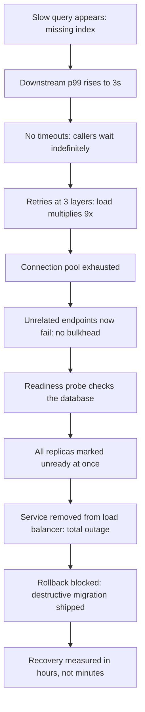

## 60.40 No rate limiting on auth endpoints

### What it looks like

```ts
@Post('login')                       // no throttling, no lockout, no CAPTCHA
async login(@Body() dto: LoginDto) { return this.auth.login(dto.email, dto.password); }
```

### Why it is dangerous

Credential stuffing is automated and cheap. With a leaked-password list, an attacker can try 200 requests per second against your login endpoint; at typical reuse rates of 1 to 2 percent, a list of a million credentials yields thousands of valid accounts within hours. The same applies to password reset (email enumeration and inbox flooding), OTP send (SMS costs that are literally billed to you, often exploited as toll fraud), and OTP verify (a 6-digit code is trivially brute-forced without a limit).

There is a secondary self-inflicted risk: bcrypt at cost factor 12 takes about 250 ms of CPU per attempt by design, so an unlimited login endpoint is also a CPU exhaustion vector. A few hundred concurrent attempts will saturate the service.

### How it happens

Rate limiting is treated as a cross-cutting infrastructure concern to be added later, and auth endpoints are built early, before that infrastructure exists.

### The fix

Tight, layered limits keyed by more than one dimension.

```ts
@Post('login')
@Throttle({ default: { ttl: 60_000, limit: 5 } })       // per IP
async login(@Body() dto: LoginDto, @Ip() ip: string) {
  await this.lockout.assertNotLocked(dto.email);         // per account, independent of IP
  try {
    return await this.auth.login(dto.email, dto.password);
  } catch (e) {
    await this.lockout.recordFailure(dto.email);         // exponential backoff per account
    throw new UnauthorizedException('invalid credentials');  // same message either way
  }
}
```

Limit per IP and per account, because a distributed attack rotates IPs while targeting one account, and a stuffing attack uses one IP against many accounts. Add CAPTCHA after a few failures, and alert on failure-rate spikes.

### How to detect it in review or in metrics

- List every unauthenticated endpoint and check each for a limit. Login, register, reset, OTP send, OTP verify, invite accept.
- Metric: failed logins per minute. A step change is an attack in progress.
- Distinct emails attempted per IP per hour, and distinct IPs per email per hour. Both are strong stuffing signals.
- SMS spend per hour, which is often the first place OTP abuse becomes visible.

## 60.41 Trusting client-side validation

### What it looks like

```ts
@Post('orders')
async create(@Body() body: any) {
  // "the frontend already validates this"
  return this.orders.create({ userId: body.userId, priceMinor: body.priceMinor });
}
```

### Why it is dangerous

The browser is not part of your system; it is an environment the attacker controls entirely. `curl` bypasses every frontend check in one command. Here, `priceMinor` comes from the client, so an attacker buys a laptop for one cent. `userId` comes from the client, so they place orders as somebody else. These are not theoretical: price tampering and horizontal privilege escalation through client-supplied identifiers are among the most commonly exploited web vulnerabilities.

The mass-assignment variant is just as bad: passing an unfiltered body into `repo.save()` lets a caller set `role: 'ADMIN'` or `isVerified: true` if those columns exist.

### How it happens

The frontend does validate, visibly and well, so the backend check feels redundant. Frontend and backend are often built by the same person in the same sprint, and duplicating rules feels like a DRY violation.

### The fix

Validate everything server-side, and derive identity and price from the server, never from the payload.

```ts
export class CreateOrderDto {
  @IsArray() @ArrayMinSize(1) @ArrayMaxSize(50)
  @ValidateNested({ each: true }) @Type(() => OrderItemDto)
  items!: OrderItemDto[];                 // note: no userId, no price
}

@Post('orders')
@UsePipes(new ValidationPipe({ whitelist: true, forbidNonWhitelisted: true, transform: true }))
async create(@Body() dto: CreateOrderDto, @Principal() p: Principal) {
  return this.orders.create({
    userId: p.userId,                      // from the verified token, never the body
    items: dto.items,                      // prices looked up server-side from the catalogue
  });
}
```

`whitelist: true` strips unknown properties and `forbidNonWhitelisted: true` rejects them outright, which kills mass assignment.

### How to detect it in review or in metrics

- Grep for `@Body() body: any`, and for any DTO containing a price, a role, a status or a user id.
- Check that `ValidationPipe` is applied globally with `whitelist` and `forbidNonWhitelisted`.
- Data check: compare stored order totals against catalogue prices. Any mismatch is either a bug or an exploit.
- In review, ask which fields come from the client and which from the token. Identity and money must come from the server.

## 60.42 Secrets in git

### What it looks like

```ts
// config/production.ts, committed in 2021
export default { stripeKey: 'sk_live_51H...', dbPassword: 'Pr0d!2021', jwtSecret: 'supersecret' };
```

### Why it is dangerous

Git history is permanent and distributed. The secret exists in every clone, every fork, every CI cache and every backup, and deleting the line in a later commit changes nothing. Public repositories are scanned continuously by bots: a leaked AWS key is typically exploited within minutes, usually to spin up compute for crypto mining, and the bill arrives before the alert does. A leaked `jwtSecret` is worse than a leaked database password, because anyone can mint a valid admin token and no log will show anything unusual.

Rewriting history with `filter-repo` does not fix it either, since you cannot un-distribute what people already cloned. The only real remedy is rotation.

### How it happens

It is the fastest way to make the application run, and the value starts as a development placeholder that is later replaced with a real one "temporarily". `.env` files get committed because a new team member could not get set up without them.

### The fix

```bash
# 1. Rotate first. The old secret must be assumed compromised forever.
# 2. Then remove it from the working tree and load from the environment.
echo ".env*" >> .gitignore
git rm --cached .env
# 3. Prevent recurrence
pip install pre-commit && pre-commit install     # with a gitleaks hook
```

Load secrets at runtime from AWS Secrets Manager, Vault or Kubernetes secrets mounted as files, and commit a `.env.example` with empty values so onboarding still works.

### How to detect it in review or in metrics

- `gitleaks detect --source . --log-opts="--all"` scans the entire history, not just HEAD.
- Enable push protection and secret scanning on the repository host.
- Grep for the obvious prefixes: `sk_live`, `AKIA`, `ghp_`, `-----BEGIN RSA`, `xoxb-`.
- Audit provider dashboards for keys that have never been rotated.

## 60.43 `latest` image tags

### What it looks like

```yaml
containers:
  - name: api
    image: registry.internal/order-service:latest
    imagePullPolicy: Always
```

### Why it is dangerous

`latest` is a moving pointer, so you do not know what is running. Two pods of the same deployment can run different code if they pulled at different times, which produces bugs that reproduce on one pod and not another. Rollback is impossible: `kubectl rollout undo` restores a manifest that still says `latest`, so it redeploys the same broken image. And a pod rescheduled at 03:00 silently picks up whatever was pushed last, meaning an unreviewed image can reach production without any deploy having happened.

### How it happens

It removes a step. Nobody has to update a manifest for every release, and it works fine when there is one environment and one person deploying.

### The fix

```yaml
image: registry.internal/order-service:2.14.3@sha256:9f2a...   # tag plus digest
imagePullPolicy: IfNotPresent
```

Tag with the git SHA or a semantic version produced by CI, and pin the digest so the tag cannot be moved underneath you. Enable registry tag immutability so a published tag can never be overwritten.

### How to detect it in review or in metrics

- `kubectl get pods -A -o jsonpath='{..image}' | tr ' ' '\n' | grep -c ':latest'`
- An admission policy (OPA Gatekeeper or Kyverno) that rejects `latest` outright.
- Compare the running image digest against the release record. Any drift is this problem.

## 60.44 Missing readiness probes

### What it looks like

```yaml
containers:
  - name: api
    image: registry.internal/order-service:2.14.3
    ports: [{ containerPort: 3000 }]
    # no readinessProbe, no preStop
```

### Why it is dangerous

Kubernetes adds the pod to the `Service` endpoints as soon as the container starts, before Nest has finished bootstrapping, before the connection pool is warm and before migrations have been checked. Every rolling deploy therefore produces a burst of 502s lasting as long as your startup time — typically 5 to 20 seconds per pod, multiplied across the rollout. The mirror problem happens at shutdown: without a `preStop` delay, the pod stops accepting connections before the load balancer notices, so in-flight requests are severed.

The result is a company that believes deploys inherently cause errors and therefore deploys rarely, which makes every release bigger and riskier.

### How it happens

Probes are optional and the deployment works without them. The 502s appear for a few seconds and are attributed to "normal deploy noise".

### The fix

```yaml
readinessProbe:
  httpGet: { path: /health/ready, port: 3000 }
  periodSeconds: 5
  failureThreshold: 2
startupProbe:
  httpGet: { path: /health/live, port: 3000 }
  failureThreshold: 30
  periodSeconds: 2            # allows 60s to boot without liveness killing it
lifecycle:
  preStop:
    exec: { command: ["sleep", "10"] }   # keep serving while endpoints propagate
terminationGracePeriodSeconds: 45
```

Pair it with `app.enableShutdownHooks()` in NestJS so in-flight requests drain cleanly.

### How to detect it in review or in metrics

- `kubectl get deploy -o json | jq '.items[].spec.template.spec.containers[] | select(.readinessProbe == null) | .name'`
- A 5xx spike correlated with every deploy. If your error graph has periodic spikes at release times, this is almost certainly why.
- Compare pod ready time against application "listening" log time.

## 60.45 Health checks that call every dependency

### What it looks like

```ts
@Get('health')
@HealthCheck()
check() {
  return this.health.check([
    () => this.db.pingCheck('postgres'),
    () => this.redis.isHealthy('redis'),
    () => this.kafka.isHealthy('kafka'),
    () => this.http.pingCheck('stripe', 'https://api.stripe.com/healthcheck'),
    () => this.http.pingCheck('search', 'https://es.internal:9200/_cluster/health'),
  ]);
}
```

Wired to the readiness probe.

### Why it is dangerous

This converts any dependency's partial degradation into your total outage. Elasticsearch goes yellow for 40 seconds during a shard rebalance; the check fails on every pod simultaneously; Kubernetes removes every pod from the `Service`; your API returns nothing at all — even though 95 percent of your endpoints never touch search. You have taken a degraded feature and turned it into a hard down, and you did it to yourself with a monitoring endpoint.

It also creates load and a dependency on a third party's availability for your own routing decisions. At 200 pods and a 5-second period, that is 40 requests per second to Stripe's endpoint purely for health checking, which will get you rate limited.

### How it happens

"Health" sounds like it should mean "everything is fine", and a thorough check feels more responsible than a shallow one. The distinction between "can I serve traffic" and "is everything downstream healthy" is subtle until the first self-inflicted outage teaches it.

### The fix

Separate the endpoints by consumer and semantics.

```ts
@Get('health/live')   @HealthCheck()
live() { return this.health.check([]); }             // process is alive, no I/O

@Get('health/ready')  @HealthCheck()
ready() {                                             // only what we cannot serve without
  return this.health.check([() => this.db.pingCheck('postgres', { timeout: 800 })]);
}

@Get('health/deep')   @HealthCheck()
deep() {                                              // for dashboards and humans only
  return this.health.check([
    () => this.db.pingCheck('postgres', { timeout: 1500 }),
    () => this.redis.isHealthy('redis'),
    () => this.search.isHealthy('search'),
  ]);
}
```

The test to apply to every readiness dependency: *if this is down, do I want all replicas removed from the load balancer simultaneously?* For caches, search and analytics the answer is always no.

### How to detect it in review or in metrics

- Read the readiness endpoint and count remote calls. More than one is a warning; anything optional is a bug.
- Any external hostname in a probe path.
- Incident review signal: an outage where the dependency was degraded but your own core paths were fine.
- Check that every health check has a timeout shorter than the probe period.

## 60.46 The anti-pattern smell test

Most anti-patterns are discovered through a symptom, not through reading code. This table runs backwards from the symptom to the cause, and gives the one check that confirms it in under five minutes.

| Smell | Likely anti-pattern | The quick check that confirms it |
|---|---|---|
| One file appears in every pull request | God service (60.1) | `git log --format= --name-only \| sort \| uniq -c \| sort -rn \| head` |
| Endpoint slow only for large accounts | N+1 queries (60.4) | Count queries per request in a trace; look for a wall of identical spans |
| Database CPU high, no slow queries | N+1 or missing index (60.4, 60.6) | `pg_stat_statements` ordered by `calls`, then by `total_exec_time` |
| Latency fine in staging, terrible in production | No indexes (60.6) | `EXPLAIN (ANALYZE, BUFFERS)` and look for `Rows Removed by Filter` |
| Writes got slower with no code change | Indexing everything (60.7) | `idx_scan = 0` rows in `pg_stat_user_indexes` |
| Response payloads are megabytes | `SELECT *` or no pagination (60.5, 60.30) | Response size histogram per endpoint |
| Memory climbs steadily, pod restarts every few days | Unbounded cache (60.20) or no timeouts (60.14) | Heap graph shape plus in-flight request gauge |
| Pod dies with no error in logs | Fire-and-forget promise (60.25) | `unhandledRejection` counter; exit code 1 |
| Services must be deployed in a fixed order | Distributed monolith (60.8) | Does any service depend on a shared package that changes weekly |
| Feature needs three repositories and three PRs | Microservices too early (60.9) | Services per engineer; RPS per service |
| A reporting job takes down checkout | Shared database (60.10) or no bulkhead | `pg_stat_activity` grouped by `application_name` during the incident |
| One slow dependency and everything is slow | Sync call chains (60.11) or no timeouts (60.14) | Trace depth; grep clients for missing timeouts |
| Downstream traffic higher than your inbound traffic | Retry storm (60.12) | Ratio of outbound requests to logical operations |
| Consumer lag grows, error rate constant | Infinite retries on a poison message (60.13) | Same correlation id repeating in logs; max message age |
| Customers charged twice | No idempotency (60.15) | `GROUP BY order_id HAVING count(*) > 1` |
| Orders stuck in an impossible state | Magic strings (60.27) or anemic model (60.3) | `SELECT DISTINCT status` versus the enum |
| Table bloat growing with normal traffic | Giant transactions (60.17) | `max(now() - xact_start)` in `pg_stat_activity` |
| Adding workers does not increase throughput | No `SKIP LOCKED` (60.34) | Sessions waiting on `Lock` for the same table |
| Six identical emails at 06:00 | Cron on every replica (60.35) | Job-run counter labelled by pod |
| 404 immediately after a successful create | Replication lag (60.37) | `pg_stat_replication` lag bytes at that timestamp |
| High test coverage, schema bugs still ship | Mocked database in integration tests (60.38) | Integration suite runtime under one second |
| Rollback made the incident worse | No rollback plan (60.39) | Did the release include a destructive migration |
| Login failures spike from many IPs | No auth rate limiting (60.40) | Distinct emails per IP per hour |
| A cheap order for an expensive product | Trusting the client (60.41) | Compare stored totals against catalogue prices |
| Two pods behave differently on the same version | `latest` tag (60.43) | Compare running image digests |
| 5xx spike on every deploy | Missing readiness probe (60.44) | Deployments with `readinessProbe == null` |
| Total outage when search degraded | Health check calls everything (60.45) | Count remote calls in the readiness endpoint |

### How anti-patterns cascade into an outage

No single anti-pattern usually causes a major incident. Outages are chains, and the chain below is the most common one in backend systems. Each link is individually defensible; together they take down a company.



Read it as a list of independent brakes you could have installed. A timeout at step C caps the damage. A retry budget at D stops the amplification. A bulkhead at F preserves the healthy endpoints. Removing the database from the readiness probe at G means the service degrades instead of disappearing. A reversible migration at J turns a two-hour incident into a two-minute one. You do not need all five; any one of them shortens the outage substantially, which is exactly why the fixes in this part are worth doing before you need them.

## Senior Checklist — Part 60

- [ ] I understand the concept
- [ ] I can explain it simply
- [ ] I can implement it
- [ ] I understand its failure modes
- [ ] I understand its scaling limitations
- [ ] I understand its security implications
- [ ] I understand its operational implications
- [ ] I can choose between alternatives
- [ ] I can explain the tradeoffs
- [ ] I can answer senior-level interview questions
- [ ] I can name the good intention behind every anti-pattern here, not just the fix
- [ ] I can spot an N+1 in a pull request without running the code
- [ ] I can prove a missing index with `EXPLAIN (ANALYZE, BUFFERS)` output
- [ ] I know how many indexes each of my hot tables carries, and which are unused
- [ ] Every outbound call in my service has a timeout, and I can point to each one
- [ ] Retries happen at exactly one layer of my stack and are covered by a budget
- [ ] Every queue, cache and buffer in my service has a documented maximum size
- [ ] My readiness probe does not check any optional dependency
- [ ] My last release could have been rolled back in under five minutes, and I have tested that
- [ ] No secret has ever been committed to a repository I own, and I can prove it with a history scan
- [ ] My integration tests run against a real PostgreSQL instance

## Part 60 — Key Takeaways

- Nobody writes an anti-pattern on purpose. Every one starts as a reasonable decision that outlived the conditions that justified it.
- The most expensive anti-patterns are invisible at development scale: N+1, missing indexes, no pagination, unbounded caches and no timeouts all work perfectly with seed data.
- A constructor with more than seven dependencies, an `await` inside a loop, and an empty `catch` block are the three highest-yield things to look for in review.
- Missing indexes cause more "the database is slow" incidents than anything else; indexing everything is the overcorrection that quietly halves your write throughput.
- Distribution multiplies costs before it multiplies benefits. A distributed monolith is strictly worse than the monolith it came from, and a shared database is the coupling that creates it.
- Retries, timeouts and idempotency are one decision, not three: retry only what is idempotent, always against a deadline, at exactly one layer.
- Never call an external API inside a database transaction, and never let a transaction span thousands of rows.
- Logs, git history and backups are forever. Assume anything written to them can never be unwritten.
- Floating point is not money, magic strings are not states, and `jsonb` is not a schema for anything you filter on.
- Health checks and probes cause self-inflicted outages more often than crashes do. Readiness must never depend on an optional service.
- Coverage from mocked databases measures nothing that breaks in production. Test against a real PostgreSQL instance.
- A release is not finished until you can undo it. Destructive migrations must never ship with the code that stops using the column.
- Outages are chains, not single failures. Any one brake in the chain converts a multi-hour incident into a minor blip.
