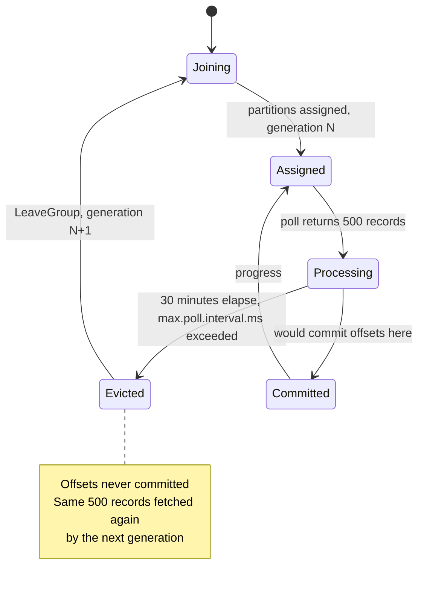
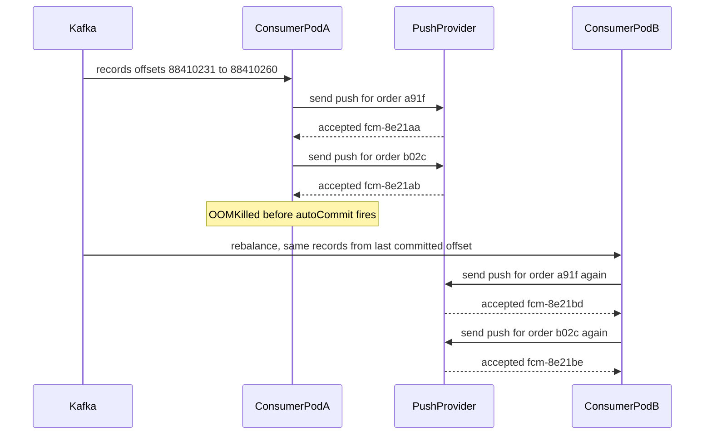

## 61.4 Kafka consumer lag keeps increasing

### Symptom

**16:40** — alert: `kafka_consumergroup_lag{group="notifications"} > 100000`. By 17:20 the lag is 1.4 million and climbing at roughly 900 messages per second. Order confirmation emails are arriving 35 minutes after checkout. Nothing is throwing errors; the consumer pods are `Running` with zero restarts; CPU on them is 12 percent.

Lag that grows with idle consumers is the interesting case. If consumers were saturated you would see CPU at 95 percent and the answer would be "add pods". Twelve percent CPU and growing lag means the consumers are **not consuming**, and that is a very different problem.

### First five minutes (mitigation)

The instinctive mitigation, and the one somebody suggests in the channel within ninety seconds, is "add partitions and more consumers".

```bash
# NOT run. Written in the incident doc as a rejected option, with the reason.
kafka-topics.sh --alter --topic order.events --partitions 48
```

Rejected for three reasons, and understanding them is most of this scenario. First, the consumer group currently has 12 members for 12 partitions and each member is using 12 percent of a CPU: **the existing consumers are not the constraint**, so more of them cannot help. Second, changing the partition count triggers a rebalance, and a rebalance is exactly what appears to be going wrong. Third, repartitioning changes the key-to-partition mapping, so events for the same `order_id` can land in a different partition than earlier events for that order, breaking per-key ordering permanently for in-flight work. **Adding partitions is a capacity decision made at design time (see Part 60), not an incident mitigation.** This is the scenario's red herring, and it is attractive enough that many teams run it and make the incident worse.

The actual mitigation at 16:52, after one look at the metrics below, is to shrink the amount of work each poll must do:

```yaml
# Helm values, rolled out at 16:52
env:
  - name: KAFKA_MAX_POLL_RECORDS
    value: "50"          # was 500
  - name: KAFKA_MAX_POLL_INTERVAL_MS
    value: "600000"      # was 300000, temporary breathing room
  - name: PROFILE_SERVICE_TIMEOUT_MS
    value: "800"         # was 10000
```

**16:58** — commit rate goes from 0 to 780/s. Lag peaks at 1.51 million and begins falling.

### Metrics

The panel that ends the investigation in one look:

| Metric | Value | Meaning |
|---|---|---|
| `kafka_consumergroup_lag` | 1,400,000 and rising | The symptom |
| `kafka_consumer_records_consumed_rate` | 5,900/s | Records **are** being fetched |
| `kafka_consumer_commit_rate` | **0.0/s** | Nothing is ever committed |
| `kafka_consumer_rebalance_rate_per_hour` | 244 | A rebalance every 15 seconds |
| `kafka_consumer_join_time_avg` | 3,100 ms | Every rebalance costs 3 s of stopped work |
| Consumer pod CPU | 12% | Idle |
| Downstream `POST /profiles/batch` p99 | 3,480 ms | Was 42 ms this morning |

**Records consumed but never committed** is the entire diagnosis. The consumers fetch messages, start processing, get kicked out of the group before they finish, and their offsets are never advanced. The next generation of the group re-fetches the same messages and repeats. The system is doing work at full speed and making zero progress, forever. This is a **rebalance loop**, sometimes called a livelock.

### Logs

```bash
kubectl logs -l app=notification-consumer -n prod --since=30m | grep -i "rebalanc\|poll\|leave" | head
```

```text
17:02:11 WARN  [Consumer clientId=consumer-notifications-3, groupId=notifications]
   Member consumer-notifications-3-9f2a1 sending LeaveGroup request to coordinator
   b-2.kafka.internal:9092 due to consumer poll timeout expired. This means the time
   between subsequent calls to poll() was longer than the configured max.poll.interval.ms,
   which typically implies that the poll loop is spending too much time processing messages.
   You can address this either by increasing max.poll.interval.ms or by reducing the
   maximum size of batches returned in poll() with max.poll.records.
17:02:14 INFO  [Consumer ... ] Request joining group due to: rebalance failed due to
   MemberIdRequiredException
17:02:17 INFO  [Consumer ... ] Successfully joined group with generation Generation{generationId=8814}
17:02:17 INFO  [Consumer ... ] Notifying assignor about the new Assignment(partitions=[order.events-4])
17:02:31 WARN  [Consumer clientId=consumer-notifications-7 ...] sending LeaveGroup request ...
```

Generation 8814. A healthy consumer group's generation increments a handful of times a day. Eight thousand generations means the group has been re-forming continuously, and the Kafka client library has told you the answer in plain English in the log message. It is worth pausing on that: **the client wrote the diagnosis and the two fixes into the log**, and the incident still took forty minutes because nobody read the warning-level logs until they were forced to.

### Traces

One message's processing trace, before the mitigation:

```text
notification.process (order.shipped)                3,612 ms
├── db.query notification_prefs.findByUser              4 ms
├── http POST /profiles/batch                       3,480 ms   <-- was 42 ms
├── template.render                                     9 ms
└── http POST fcm.googleapis.com/v1/.../send           110 ms
```

And the arithmetic that turns that into the incident:

| Quantity | Before | During incident |
|---|---|---|
| `max.poll.records` | 500 | 500 |
| Time per record | 165 ms | 3,612 ms |
| Time to process one poll batch | 500 * 0.165 = **82 s** | 500 * 3.612 = **1,806 s (30 min)** |
| `max.poll.interval.ms` | 300,000 (5 min) | 300,000 |
| Verdict | 82 s < 300 s: fine | **1,806 s > 300 s: evicted every time** |

The margin was always thin. The service ran at 82 seconds against a 300-second limit, a 3.7x buffer that nobody had ever computed. A 22x slowdown in one downstream call consumed it instantly.

### Application

```ts
// src/notifications/notification.consumer.ts  (the shape of the bug)
@Controller()
export class NotificationConsumer {
  @EventPattern('order.events')
  async handle(@Payload() message: OrderEvent): Promise<void> {
    const prefs = await this.prefs.findByUser(message.userId);
    // one HTTP call per message, no timeout, no circuit breaker
    const profile = await this.profiles.fetch(message.userId);
    const rendered = this.templates.render(message.type, profile, prefs);
    await this.push.send(profile.deviceTokens, rendered);
  }
}
```

Three design faults, each individually survivable, jointly fatal:

1. **A synchronous downstream call inside the poll loop.** Every millisecond the profile service adds is multiplied by `max.poll.records`.
2. **No timeout.** `this.profiles.fetch` used the client's default, which was 10 seconds. A call that should take 40 ms was allowed to take 250x that.
3. **No relationship between `max.poll.records` and the worst-case per-record time.** Nobody had ever written `max.poll.records * p99_processing_time < max.poll.interval.ms` on a whiteboard, so nobody knew how close to the edge the service ran.

### Database

Checked and cleared in three minutes: `pg_stat_activity` shows nothing long-running, `notification_prefs.findByUser` averages 4 ms in `pg_stat_statements`, and connection count is normal. Ruling the database out early matters because "the consumer is slow" instinctively points at the database, and it was innocent here.

### Infrastructure

Why did `POST /profiles/batch` slow from 42 ms to 3,480 ms? The profile service's own dashboard shows CPU at 62 percent, which looks fine, and `container_cpu_cfs_throttled_seconds_total` climbing steeply, which is not. A configuration change at 15:55 had reduced the profile service's CPU limit from 2 to 1 while leaving its request at 1. The pods were being CFS-throttled: usage looks moderate because throttled time is not counted as usage, while every request pays tens of milliseconds of forced sleep per 100 ms period.

This is the real chain: an unrelated resource-limit change in a **different service** manifested as unbounded lag in the notification pipeline three hours later.



### Root cause

A downstream service was CPU-throttled by a limit change, raising its p99 from 42 ms to 3.5 s. The notification consumer called it synchronously once per record with no timeout, so processing one `max.poll.records=500` batch went from 82 seconds to 30 minutes, exceeding `max.poll.interval.ms=300000`. Kafka evicted each member as unresponsive, triggering a rebalance before any offsets were committed. The group re-formed, re-fetched the same records, and repeated: full CPU-free throughput, zero progress, lag growing at the producer rate.

### Fix

**Immediate (16:52):** `max.poll.records` 500 -> 50 (worst case 180 s, under the 300 s limit), a temporary `max.poll.interval.ms` of 600,000, and an 800 ms timeout on the profile call. Lag drained from 1.51 M to zero in 47 minutes at a net 800 messages/s (`drain_time = backlog / (consumer_rate - producer_rate)` from Part 60 predicted 44 minutes; close enough).

**Durable, in order of importance:**

```ts
// 1. A hard timeout and a circuit breaker on every downstream call
const profile = await firstValueFrom(
  this.http.post<Profile[]>('/profiles/batch', { userIds }).pipe(
    timeout({ each: 800 }),
    retry({ count: 1, delay: 200 }),
    catchError(() => of({ data: [] as Profile[] })),   // degrade, do not block the poll loop
  ),
);
```

```ts
// 2. Batch the downstream call: one request per poll batch, not one per record
@EventPattern('order.events')
async handleBatch(@Payload() messages: OrderEvent[]): Promise<void> {
  const userIds = [...new Set(messages.map((m) => m.userId))];
  const profiles = await this.profiles.fetchMany(userIds);   // 1 call instead of 50
  const byId = new Map(profiles.map((p) => [p.userId, p]));
  await Promise.all(messages.map((m) => this.deliver(m, byId.get(m.userId))));
}
```

One batched call turns 50 x 3.5 s into 1 x 3.5 s, a 50x reduction in worst-case poll time, and it is the fix that would have made the incident impossible rather than merely survivable.

```ts
// 3. Heartbeat and commit incrementally within a long batch (KafkaJS eachBatch)
await consumer.run({
  eachBatch: async ({ batch, resolveOffset, heartbeat, isRunning, isStale }) => {
    for (const message of batch.messages) {
      if (!isRunning() || isStale()) break;
      await this.process(message);
      resolveOffset(message.offset);   // progress is committed even if we are evicted later
      await heartbeat();               // tell the coordinator we are alive
    }
  },
});
```

`resolveOffset` plus `heartbeat` is the structural answer: work already done is never redone, and a slow batch does not look like a dead member.

**4.** Write the budget down as a constant next to the config, so the relationship is a reviewable fact rather than tribal knowledge:

```ts
// max.poll.records * p99_processing_ms must stay under 50% of max.poll.interval.ms
// 50 records * 800 ms budget = 40 s, versus 300 s limit. Margin 7.5x.
```

**5.** Restore the profile service's CPU limit and set `requests == limits` so it gets a Guaranteed QoS class and predictable scheduling.

### Prevention

- **Alert on `commit_rate == 0 while records_consumed_rate > 0`.** This single alert detects every rebalance loop, and it fires within a minute rather than after an hour of accumulating lag. Lag alerts tell you something is wrong; this one tells you *what*.
- **Alert on rebalance rate above 6 per hour.** A healthy group barely rebalances.
- **Alert on `container_cpu_cfs_throttled_seconds_total` for every service**, not just CPU utilization. Throttling is invisible in the usage graph and it is a leading cause of mysterious downstream slowness.
- **A timeout on every network call, enforced by a shared HTTP client factory** so a service cannot make an untimed call by accident.
- **Autoscale consumers on lag (KEDA) with `maxReplicaCount <= partitions`,** and size partitions from the recovery requirement, as Part 60 sets out.
- **A load test with an artificially slowed downstream** in the pipeline: inject 3 s latency into the profile client and assert the consumer still commits. This exact test would have caught it.

### Junior versus senior

| | Junior | Senior |
|---|---|---|
| First action | Adds partitions and pods | Notices consumers are at 12 percent CPU, so capacity is not the constraint |
| Metric read | Watches lag | Watches lag *and* commit rate; zero commits with nonzero consumption is the whole answer |
| Logs | Filters to `ERROR` | Reads `WARN`, where the Kafka client had written the diagnosis and both fixes |
| Downstream | "The profile service is slow, tell that team" | Fixes their own resilience (timeout, batching, degrade) and then tells that team |
| Fix | Raises `max.poll.interval.ms` to 30 minutes | Reduces the work per poll, batches the call, commits incrementally, and writes down the budget inequality |

## 61.5 Users are receiving duplicate notifications

### Symptom

**09:31** — support escalates 12,400 tickets received in 20 minutes: "Your order has shipped" push notifications arriving 3 to 7 times. Twitter has screenshots. Some users received the same email eleven times. The window of affected notifications is narrow: everything sent between 09:12 and 09:18.

### First five minutes (mitigation)

Duplicate sends are a reputational problem that gets worse every second, so stop the sending first and understand it after.

```bash
kubectl scale deployment/notification-consumer --replicas=0 -n prod   # 09:34
```

Sending stops. Kafka retains the events, so nothing is lost; the queue simply grows (at 800/s, a 30-minute investigation builds a 1.4 M backlog that will take about 30 minutes to drain afterwards, which the on-call announces in the channel so nobody is surprised).

Then a blast-radius limiter is deployed before consumers are turned back on: a per-user cap of 5 notifications per hour, enforced in Redis. It does not fix the bug, but it converts "eleven identical emails" into "five", which is the difference between an apology and a churn event.

### Metrics

| Metric | Normal | 09:12–09:18 |
|---|---|---|
| `notifications_sent_total` | 800/s | 3,900/s |
| `order.shipped` events produced | 780/s | 790/s |
| Ratio sent / produced | 1.02 | **4.9** |
| Consumer pod restarts | 0 | **3** |
| `kafka_consumergroup_lag` | ~200 | spiked to 61,000 then drained |

Producers produced the normal number of events. Consumers sent five times as many notifications. **The duplication is on the consuming side**, which eliminates half the possible causes immediately.

### Logs

```bash
kubectl logs -l app=notification-consumer -n prod --previous --since-time=2026-04-02T09:10:00Z | head -40
```

```text
09:12:41 INFO  processing orderId=a91f topic=order.events partition=3 offset=88410231
09:12:41 INFO  push sent orderId=a91f userId=u-77 providerMessageId=fcm-8e21aa
09:12:41 INFO  processing orderId=b02c partition=3 offset=88410232
09:12:42 INFO  push sent orderId=b02c userId=u-91 providerMessageId=fcm-8e21ab
...
09:12:53 FATAL JavaScript heap out of memory
```

and from the replacement pod:

```text
09:13:09 INFO  [Consumer] Successfully joined group with generation 4471
09:13:09 INFO  [Consumer] Assignment(partitions=[order.events-3])
09:13:10 INFO  processing orderId=a91f topic=order.events partition=3 offset=88410231   <-- again
09:13:10 INFO  push sent orderId=a91f userId=u-77 providerMessageId=fcm-8e21bd           <-- new provider id
```

Offset 88410231 is processed twice, six hundred milliseconds of wall-clock apart in different pods, and each processing produced a **different** `providerMessageId`.

That last detail is the one that kills the red herring. The prevailing theory in the channel for the first fifteen minutes was that the push provider was retrying deliveries on its side. It is a comfortable theory because it makes the problem someone else's. The evidence against it is decisive and takes two minutes to gather: if the provider were retrying, there would be **one** `providerMessageId` delivered several times. Instead there are five distinct provider message ids for one `order_id`, each with its own accepted timestamp in the provider's dashboard. The provider did exactly what it was told, five times. *"We sent it five times"* went into the incident doc at 09:47, and the investigation turned inward.

### Traces

The trace of a single duplicated notification is unremarkable and that is the point: each of the five sends is a complete, correct, successful trace. There is no error anywhere. Duplicates are not a failure of any single operation; they are a failure of the *protocol between* operations.

### Application

```ts
// src/notifications/notification.consumer.ts  (the bug)
@EventPattern('order.events')
async handle(@Payload() event: OrderEvent): Promise<void> {
  if (event.type !== 'order.shipped') return;
  const user = await this.users.findOne(event.userId);
  await this.push.send(user.deviceTokens, this.templates.shipped(event));  // side effect
  await this.log.record(event.orderId, 'push', 'sent');
  // offsets are committed by the framework, after the handler returns
}
```

The consumer config:

```ts
// src/main.ts
{
  transport: Transport.KAFKA,
  options: {
    client: { brokers: [...] },
    consumer: { groupId: 'notifications', sessionTimeout: 30000 },
    run: { autoCommit: true, autoCommitInterval: 5000 },   // commits every 5 s
  },
}
```

Two facts combine. **Every message broker worth using is at-least-once**: it guarantees a message is delivered at least once, never exactly once, because "exactly once" across a broker and an external HTTP call is not something any broker can promise. And **`autoCommitInterval: 5000` means up to five seconds of successful sends may be uncommitted** at any moment. A pod that dies in that window has performed the side effect but not recorded that it did.

The pod died because of the memory leak described in section 61.6, which is why these two scenarios often arrive on the same day.



Three crashes, each re-delivering up to five seconds of already-sent messages, and one user who happened to be in three of those windows received the notification four times.

### Database

`notification_log` confirms it in one query, and this query is also the tool for measuring the blast radius:

```sql
SELECT order_id, channel, count(*) AS sends,
       min(sent_at) AS first_send, max(sent_at) AS last_send
FROM notification_log
WHERE sent_at BETWEEN '2026-04-02 09:10' AND '2026-04-02 09:20'
GROUP BY order_id, channel HAVING count(*) > 1
ORDER BY sends DESC LIMIT 10;
```

```text
 order_id | channel | sends |     first_send      |      last_send
----------+---------+-------+---------------------+---------------------
 a91f...  | push    |     5 | 2026-04-02 09:12:41 | 2026-04-02 09:17:52
 b02c...  | email   |     4 | 2026-04-02 09:12:42 | 2026-04-02 09:16:03
```

The table recorded every duplicate faithfully. It was a **log**, not a **guard**: nothing ever read it before sending.

### Infrastructure

Confirmed: three `OOMKilled` events on `notification-consumer` pods between 09:12 and 09:18, exit code 137, memory limit 1 Gi, `--max-old-space-size` unset. That is section 61.7's failure mode, and it is the trigger; the duplicates are the consequence of a non-idempotent consumer meeting an ordinary crash.

### Root cause

The consumer performed an external, irreversible side effect (a push and an email) and then relied on an offset commit that happened up to five seconds later. When the pod was OOMKilled between the side effect and the commit, Kafka's at-least-once delivery correctly redelivered those messages to the new pod, which performed the side effect again because nothing made the send idempotent.

**The crash is not the bug.** Pods die: OOM, node drain, spot reclamation, rolling deploy, a bad `kubectl delete`. A consumer that produces duplicates when a pod dies is broken by design, and it will produce duplicates eventually no matter how stable your pods are.

### Fix

Make the send idempotent with a deterministic key and a uniqueness constraint the database enforces.

```sql
ALTER TABLE notification_log
  ADD COLUMN idempotency_key text,
  ADD COLUMN state text NOT NULL DEFAULT 'sent';
UPDATE notification_log SET idempotency_key = encode(sha256((order_id || ':' || channel || ':' || event_version)::bytea),'hex')
  WHERE idempotency_key IS NULL;
ALTER TABLE notification_log ALTER COLUMN idempotency_key SET NOT NULL;
CREATE UNIQUE INDEX CONCURRENTLY uq_notification_idempotency
  ON notification_log (idempotency_key);
```

```ts
// src/notifications/notification.consumer.ts  (fixed)
@EventPattern('order.events')
async handle(@Payload() event: OrderEvent): Promise<void> {
  if (event.type !== 'order.shipped') return;

  const key = createHash('sha256')
    .update(`${event.orderId}:push:${event.version}`)   // deterministic: same event, same key, always
    .digest('hex');

  // Claim the send. ON CONFLICT DO NOTHING makes this an atomic test-and-set.
  const claimed = await this.dataSource.query(
    `INSERT INTO notification_log (idempotency_key, order_id, channel, state, claimed_at)
     VALUES ($1, $2, 'push', 'sending', now())
     ON CONFLICT (idempotency_key) DO NOTHING
     RETURNING id`,
    [key, event.orderId],
  );
  if (claimed.length === 0) {
    this.metrics.increment('notifications.duplicate_suppressed');
    return;                       // someone already sent, or is sending, this exact notification
  }

  const user = await this.users.findOne(event.userId);
  const providerMessageId = await this.push.send(user.deviceTokens, this.templates.shipped(event));

  await this.dataSource.query(
    `UPDATE notification_log SET state = 'sent', provider_message_id = $2, sent_at = now()
     WHERE idempotency_key = $1`, [key, providerMessageId],
  );
}
```

Be honest about what this does and does not guarantee. The claim is atomic, so two consumers can never both send. But if the pod dies **after** the `INSERT` and **before** the provider accepts the push, the row is stuck in `sending` and the notification is never delivered. That is the at-least-once/at-most-once trade made explicit, and you must choose per notification type:

| Notification | Choice | Mechanism |
|---|---|---|
| Marketing push | At most once. A missed one costs nothing | Leave stuck `sending` rows alone; a report counts them |
| Order shipped | At least once, deduplicated on the client where possible | A sweeper re-queues rows stuck in `sending` for over 10 minutes |
| One-time password | At least once, always | Sweeper at 60 seconds; a duplicate OTP is far better than a missing one |

```sql
-- The sweeper, run every minute
UPDATE notification_log SET state = 'retry', claimed_at = now()
WHERE state = 'sending' AND claimed_at < now() - interval '10 minutes'
RETURNING id, order_id, channel;
```

Add a Redis fast path in front of the insert (`SET key 1 NX EX 86400`) to keep the common case off the database, but keep PostgreSQL as the source of truth: Redis can lose a key, and a lost dedupe key means a duplicate.

### Prevention

- **A chaos test in CI that kills the consumer mid-batch** and asserts that replaying the same offsets produces exactly one send. Run it against real Kafka and PostgreSQL containers.
- **`notifications.duplicate_suppressed` as a metric.** After the fix it should be small but nonzero, and a spike in it is an early warning that pods are crashing.
- **Set `autoCommit: false` and commit explicitly after the side effect and its record**, which narrows the window from five seconds to one message.
- **The per-user rate cap stays permanently.** A blast-radius limiter is worth keeping even when the specific bug is fixed, because the next bug is unknown.
- **A design rule stated in the team's coding standard**: *every consumer of a message broker is at-least-once, so every side effect it performs needs an idempotency key derived from the event, not from the wall clock or a random id.*

### Junior versus senior

| | Junior | Senior |
|---|---|---|
| First theory | The provider is retrying | Checks provider message ids; five distinct ids means we sent five times |
| Framing | "How do we stop the pod crashing?" | "Pods will always crash. Why does a crash cause duplicates?" |
| Fix | Adds a `sentAt` check with a `SELECT` before the send | Uses a unique constraint with `ON CONFLICT DO NOTHING`, because a `SELECT`-then-`INSERT` is the same race one layer up |
| Guarantees | "We fixed the duplicates" | Names the remaining window explicitly and chooses at-least-once or at-most-once per notification type |
| Testing | Manual retest | A test that kills the consumer between the side effect and the commit |
