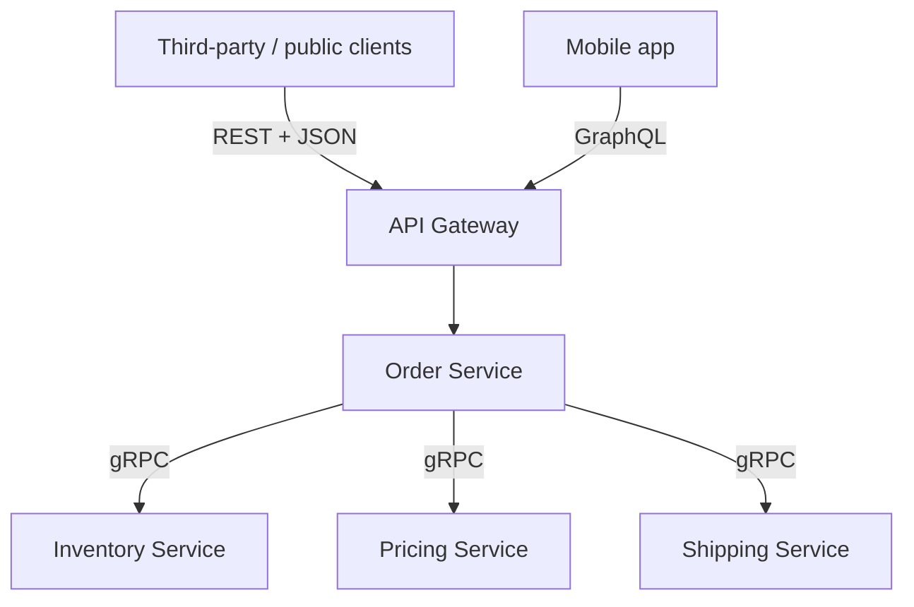

### 61.2.2 Schema evolution and gRPC operations

#### Concept

A protobuf schema is a contract between services that are deployed independently, so it must evolve without breaking either side. Protobuf's design — identifying fields by **number**, not name, and making fields optional — supports backward- and forward-compatible evolution if you follow the rules. The main operational concerns beyond the schema are load balancing (HTTP/2 is sticky), and reaching gRPC from the browser (gRPC-Web and gateways).

#### Why does it exist?

Services deploy on their own schedules, so at any moment an old client may talk to a new server or vice versa. If a schema change broke that, every change would require a lockstep deploy of all services — impossible at scale. Protobuf's field-number identity and optional fields make most changes compatible, so a new server with an extra field still works with an old client, and an old server ignores a new field it does not understand. The rules exist to preserve this, and breaking them causes exactly the cross-version failures Part 32 warns about.

#### How it works — the compatibility rules

```proto
message Order {
  string id = 1;
  string status = 2;
  int32 total_cents = 3;
  repeated OrderItem items = 4;
  string currency = 5;          // ADD: new fields get a new number; old code ignores it (safe)
  reserved 6;                    // RESERVE a retired number so it is never reused
  reserved "old_field_name";     // RESERVE a retired name too
}
```

The rules that keep protobuf compatible:

- **Never change a field's number.** The number is its identity on the wire; changing it makes old and new code disagree about what the field is. This is the cardinal rule.
- **Never reuse a retired field's number.** When you remove a field, `reserved` its number (and name) so a future field cannot accidentally reuse it and misinterpret old data.
- **Add new fields with new numbers.** Old code ignores them (forward compatible); new code reading old data sees them as default (backward compatible).
- **Do not change a field's type incompatibly.** Some type changes are compatible, many are not; treat a type change as potentially breaking.
- **Removing or renaming** a field is a breaking-ish change to callers that use it; deprecate and migrate (Part 32), and reserve the number.

This is the same backward/forward compatibility discipline as Part 32 (schema and API compatibility), expressed through protobuf's field numbers. Follow it and services evolve independently; break it and you get subtle data corruption across versions.

#### How it works — load balancing and gRPC-Web

**Load balancing**: because gRPC runs over long-lived HTTP/2 connections that multiplex many calls, a naive connection-level load balancer sends all of one client's calls to one server (sticky), causing uneven load. gRPC load balancing is therefore done at the request level (client-side load balancing or an L7 proxy/service mesh that understands HTTP/2), so individual calls spread across servers. This is a known gRPC operational consideration (Part 26 on load balancing).

**gRPC-Web and gateways**: browsers cannot make raw gRPC calls (they lack the needed HTTP/2 control). **gRPC-Web** is a variant that works in browsers via a proxy that translates between gRPC-Web and gRPC. Alternatively, a **gateway** exposes a REST/JSON or GraphQL facade in front of gRPC services for external clients. The common pattern: gRPC internally between services, a gateway (REST or GraphQL) for the public and the browser (61.3).

#### How a Senior Backend Engineer thinks about this

A senior treats the `.proto` as a shared contract under the same compatibility discipline as any API (Part 32): never change or reuse field numbers, add fields with new numbers, reserve retired numbers, and deprecate rather than remove. They know gRPC's HTTP/2 connections need request-level load balancing (client-side or an L7 proxy/mesh), not naive connection-level balancing, or load concentrates on a few servers. They expose gRPC to browsers only through gRPC-Web with a proxy or, more commonly, through a REST/GraphQL gateway, keeping raw gRPC internal. They apply deadlines and the right status codes so the whole mesh behaves well under failure (Part 38).

#### Common mistakes

- Changing or reusing a field number, corrupting data across versions.
- Removing a field without reserving its number, so a future field reuses it.
- Connection-level load balancing of gRPC, concentrating load on few servers.
- Trying to call raw gRPC from a browser without gRPC-Web or a gateway.

#### Interview questions

1. **What are the protobuf rules for compatible schema evolution?** Never change or reuse field numbers, add fields with new numbers, reserve retired numbers and names, avoid incompatible type changes, and deprecate rather than remove — so independently deployed services stay compatible.
2. **Why is gRPC load balancing different from REST?** gRPC uses long-lived multiplexed HTTP/2 connections, so connection-level balancing is sticky; you need request-level balancing (client-side or an L7 proxy/mesh) to spread calls.
3. **How do browsers use gRPC services?** Not directly — via gRPC-Web through a translating proxy, or via a REST/GraphQL gateway in front of the gRPC services.
4. **Why do protobuf field numbers matter more than names?** Numbers are the field identity on the wire; changing one makes old and new code disagree about the data, causing corruption.

#### Practical exercise

Evolve the `Order` protobuf by adding a `currency` field with a new number, then simulate removing an old field by reserving its number and name. Verify that an old client and a new server interoperate after the additive change. Then describe how you would load-balance this gRPC service and expose it to a browser. Acceptance criteria: the additive change is backward/forward compatible, the retired number is reserved, and you can explain request-level load balancing and the gRPC-Web/gateway options.

## 61.3 Choosing REST, GraphQL or gRPC

### 61.3.1 The decision and the combined architecture

#### Concept

REST, GraphQL and gRPC are three tools for three situations, not competitors where one wins. The senior skill is matching each to where it fits: REST for simple, public, cacheable APIs; GraphQL for flexible, nested data to rich clients (mobile, complex frontends); gRPC for fast, typed, high-volume internal service-to-service communication. A mature system often uses all three at once.

#### Why does it exist?

Each style optimizes for different things. REST optimizes for simplicity, universality and HTTP caching. GraphQL optimizes for client flexibility and few round trips. gRPC optimizes for internal performance and typed contracts. No single style is best at all three, so forcing one everywhere means paying its weaknesses where another's strengths were needed. Choosing per situation gives you each strength where it matters.

#### How it works — the decision matrix

| Factor | REST | GraphQL | gRPC |
|---|---|---|---|
| Best for | Public APIs, simple CRUD | Mobile/complex frontends needing tailored nested data | Internal service-to-service |
| Format | JSON (text, human-readable) | JSON | Binary protobuf (compact) |
| Transport | HTTP/1.1 or 2 | HTTP (usually POST) | HTTP/2 |
| Client flexibility | Fixed shapes | Client picks fields | Fixed (typed contract) |
| HTTP caching | Easy (by URL) | Harder (rebuild at entity/client) | Not applicable |
| Browser-native | Yes | Yes | No (needs gRPC-Web/gateway) |
| Typed contract | Via OpenAPI (optional) | Via schema | Strong (protobuf, generated) |
| Round trips for nested data | Many | One | Few (and streaming) |
| Main risk | Over/under-fetching | N+1, query cost, caching | Not for public/browser |
| Debuggability | High (readable) | Medium | Lower (binary) |

```text
Choose REST when:            Choose GraphQL when:          Choose gRPC when:
- public or third-party API  - mobile app / rich frontend  - internal service-to-service
- simple CRUD resources      - many client-specific shapes - high volume, perf-sensitive
- HTTP caching matters       - few round trips needed      - streaming between services
- maximum simplicity/        - a backend-for-frontend      - a strict typed contract
  compatibility/debuggability                              - deadline propagation in a mesh
```

#### The combined architecture (the worked example)



The order service exposes **REST publicly** for third-party integrations and simple cacheable reads (its simplicity and HTTP caching win there), **GraphQL for the mobile app** so a screen's nested data comes in one round trip with only the fields it needs, and talks **gRPC internally** to inventory, pricing and shipping services for fast, typed, high-volume calls with deadline propagation. Each style is used exactly where its strengths apply and its weaknesses do not matter. This is not over-engineering; it is matching the tool to the job, and it is a common real architecture.

#### How a Senior Backend Engineer thinks about this

A senior chooses the API style per boundary, not per company. For the public edge they default to REST for its simplicity, universality, cacheability and debuggability, reaching for GraphQL only when a rich client's data-fetching pain (over/under-fetching, many round trips) genuinely justifies the added server complexity and the N+1/caching/query-cost work it brings. For internal service-to-service traffic at volume they reach for gRPC's efficiency and typed contracts, while keeping it off the public edge. They are comfortable running all three in one system, because that is often the right answer, and they resist both the dogma that REST is always enough and the hype that GraphQL or gRPC should be everywhere. The question is always "what does this specific boundary need?"

#### Common mistakes

- Forcing one style everywhere out of dogma or hype.
- Using GraphQL for a simple public API, taking on its complexity for no benefit.
- Using gRPC at the public/browser edge, fighting its lack of browser support.
- Using REST for high-volume internal calls where gRPC's efficiency and typing would help.
- Not considering a combined architecture where each style serves its natural boundary.

#### Interview questions

1. **When do you choose REST, GraphQL and gRPC respectively?** REST for simple, public, cacheable APIs; GraphQL for rich clients needing tailored nested data in few round trips; gRPC for high-volume, performance-sensitive, typed internal service-to-service communication.
2. **Why not use GraphQL everywhere?** It adds server complexity (N+1, query-cost limits, rebuilt caching) and is overkill for simple public CRUD where REST's simplicity and HTTP caching win.
3. **Why keep gRPC internal?** Browsers cannot speak it directly, its binary format is not human-readable, and it offers no HTTP caching; REST/GraphQL serve external clients better.
4. **Describe a realistic architecture using all three.** REST for public/third-party, GraphQL for the mobile app via a gateway/BFF, gRPC internally between services — each at the boundary where its strengths fit.

#### Practical exercise

For the order system, write a one-page decision (an ADR, Part 49) specifying which API style serves the public/third-party edge, the mobile app, and the internal inventory/pricing/shipping calls, with justifications tied to each style's strengths and the concrete needs (caching, nested data, performance, typing, browser support). Acceptance criteria: each choice follows from stated requirements, and the decision explicitly rejects the styles not chosen for each boundary with reasons.

## Senior Checklist — Part 61

- [ ] I understand the concept
- [ ] I can explain it simply
- [ ] I can implement it
- [ ] I understand its failure modes
- [ ] I understand its scaling limitations
- [ ] I understand its security implications
- [ ] I understand its operational implications
- [ ] I can choose between alternatives
- [ ] I can explain the tradeoffs
- [ ] I can answer senior-level interview questions
- [ ] I can build a GraphQL API in NestJS and explain queries, mutations, resolvers
- [ ] I can identify and fix the N+1 problem with per-request DataLoader
- [ ] I can secure a GraphQL API with depth/complexity limits and persisted queries
- [ ] I can build a gRPC service in NestJS with protobuf, deadlines and status codes
- [ ] I can evolve a protobuf schema compatibly (field numbers, reserved)
- [ ] I can choose REST vs GraphQL vs gRPC for a given boundary and justify it
- [ ] I can design a combined architecture using all three where each fits

## Part 61 — Key Takeaways

- GraphQL lets clients request exactly the fields they need, including nested data, in one request, solving REST's over-fetching and multiple-round-trip problems for rich clients.
- GraphQL's per-field resolution invites the N+1 problem; fix it with a per-request DataLoader that batches lookups, and verify the query count stays small.
- A GraphQL endpoint's open query surface is an attack surface; bound it with depth and complexity limits, cost-based rate limiting, and persisted queries for first-party clients.
- GraphQL loses REST's easy HTTP caching; rebuild caching at the entity (Redis) and client layers, paginate with cursor connections, and evolve the schema additively with deprecation.
- gRPC uses binary protobuf over HTTP/2 with a typed shared contract — fast, efficient, streaming-capable — ideal for high-volume internal service-to-service calls.
- gRPC gives deadline propagation and its own status codes; set deadlines and map errors correctly so a service mesh behaves well under failure.
- Evolve protobuf compatibly: never change or reuse field numbers, add fields with new numbers, reserve retired numbers, and deprecate rather than remove (the Part 32 discipline).
- gRPC is internal plumbing; browsers need gRPC-Web with a proxy or a REST/GraphQL gateway, and gRPC needs request-level load balancing, not connection-level.
- REST, GraphQL and gRPC are three tools for three situations; a mature system often uses REST publicly, GraphQL for rich clients, and gRPC internally.
- Choose the API style per boundary based on its concrete needs (caching, nested data, performance, typing, browser support), resisting both REST dogma and GraphQL/gRPC hype.
