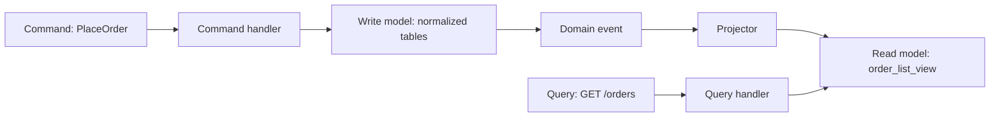
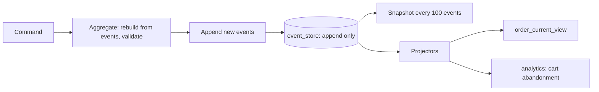
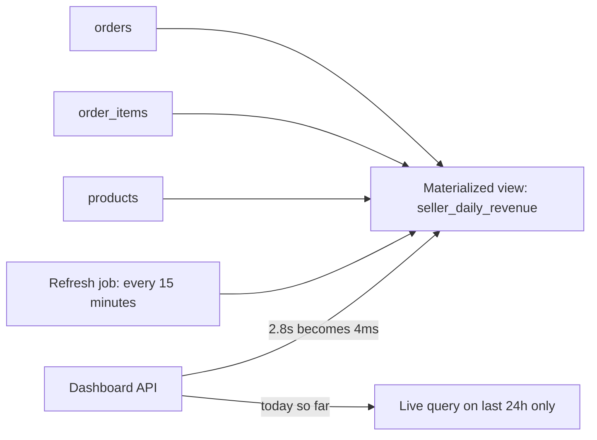
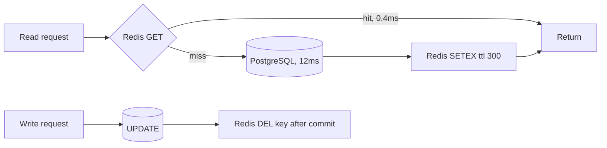

## 61.19 CQRS

### Problem

One model serves two very different jobs. Writes need validation, invariants and normalised tables: an order with items, addresses and discounts spread across six tables. Reads need a flat, denormalised shape: the order list screen wants order number, customer name, item count, total and status in one row, sorted and paginated, at 3,000 requests per second. Serving both from one model means either your writes carry denormalised baggage or your reads join six tables on every request.

### Solution

Command Query Responsibility Segregation: separate the write model from the read model. Commands change state through the domain model; queries read from a shape built for reading. That is the whole idea. The read side may be a different query in the same database, a materialized view, a separate table, a replica, or a separate datastore entirely — those are increasing levels of commitment, and most teams should stop at the first or second.

### Architecture



### Example

The lightweight version that pays for itself. Same database, separate read table maintained by a projector, so the list screen is a single indexed scan.

```sql
-- read model: one row per order, exactly what the list screen renders
CREATE TABLE order_list_view (
  order_id      UUID PRIMARY KEY,
  user_id       UUID        NOT NULL,
  order_number  TEXT        NOT NULL,
  customer_name TEXT        NOT NULL,
  item_count    INT         NOT NULL,
  total_minor   BIGINT      NOT NULL,
  status        TEXT        NOT NULL,
  placed_at     TIMESTAMPTZ NOT NULL
);
CREATE INDEX olv_user_recent ON order_list_view (user_id, placed_at DESC);
```

```ts
// Write side: NestJS CQRS command handler, normalized entities, invariants enforced.
@CommandHandler(PlaceOrderCommand)
export class PlaceOrderHandler implements ICommandHandler<PlaceOrderCommand> {
  constructor(private readonly ds: DataSource, private readonly bus: EventBus) {}

  async execute(cmd: PlaceOrderCommand): Promise<string> {
    const order = await this.ds.transaction(async (em) => {
      const o = Order.place(cmd);              // domain invariants live here
      await em.save(o);
      await em.insert(OutboxEvent, { aggregateId: o.id, eventType: 'order.placed', payload: o.toEvent() });
      return o;
    });
    this.bus.publish(new OrderPlacedEvent(order.id));
    return order.id;
  }
}

// Read side: no entities, no joins, no domain objects. Just the shape the UI needs.
@QueryHandler(ListOrdersQuery)
export class ListOrdersHandler implements IQueryHandler<ListOrdersQuery> {
  constructor(@InjectDataSource() private readonly ds: DataSource) {}

  execute(q: ListOrdersQuery) {
    return this.ds.query(
      `SELECT order_id, order_number, customer_name, item_count, total_minor, status, placed_at
         FROM order_list_view
        WHERE user_id = $1 AND ($2::timestamptz IS NULL OR placed_at < $2)
        ORDER BY placed_at DESC LIMIT $3`,
      [q.userId, q.cursor, q.limit],
    );
  }
}
```

### Advantages

- Reads become trivial and fast: 1 to 3 ms index scans instead of 40 ms six-table joins.
- Read and write sides scale independently. Add read replicas or cache the read model without touching writes.
- The write model can stay strictly normalised and rich, without denormalisation for the UI.
- Query handlers stop importing domain entities, which removes a large class of accidental coupling.

### Disadvantages

- The read model is eventually consistent unless you update it in the same transaction. A user who just placed an order may not see it in their list, which is a support ticket generator.
- Two models to keep in sync, plus a projector to operate, monitor and rebuild.
- More code for the same feature. A simple CRUD entity becomes a command, a handler, an event, a projector and a read table.
- Debugging gains a question: "is the data wrong, or is the projection behind?"

### When to use

- Read and write loads differ by an order of magnitude, or in shape.
- The read shape is genuinely different from the write shape (dashboards, feeds, search, reporting).
- Read traffic must scale independently, for example a public catalogue with an internal admin write path.

### When NOT to use

- **Most CRUD applications.** This deserves saying plainly: if your reads are "select the entity by id and show its fields", CQRS makes the system worse. You add eventual consistency, a projector, a rebuild procedure and double the code, in exchange for nothing. The default is one model, one table, an index, and `SELECT`.
- When users expect read-after-write consistency everywhere and you cannot route those reads to the write model.
- When the team is small. Two models means two things to change for every feature, forever.
- As a synonym for "we use the `@nestjs/cqrs` package". Command and query *classes* over the same tables are a code-organisation choice, not CQRS, and that is fine — just do not claim architectural benefits you did not buy.

### Edge cases and failure modes

- **Read-after-write**: the user places an order and the list is empty. Mitigate by reading from the write model for that one screen, or by writing the read row in the same transaction.
- **Projector lag**: a slow projector makes every read stale. Emit `projection_lag_seconds` and alert on it.
- **Projection bug**: a bad projector corrupts the read model. You need a documented, tested rebuild that runs in acceptable time. At 200 million rows, "rebuild" is a two-day operation you must plan for.
- **Duplicate events**: projectors must be idempotent, typically by upserting keyed on the aggregate id.
- **Out-of-order events**: apply a version number and ignore events older than the row's current version.

### Senior perspective

CQRS is two ideas wearing one name, and conflating them causes most of the damage. The first idea — "the shape you read is not the shape you write" — is nearly always right and costs almost nothing: a denormalised table or a materialized view, updated by a projector, with a rebuild script. The second idea — separate databases, separate services, asynchronous projection, eventual consistency everywhere — is a serious distributed-systems commitment and should be justified by a number: read RPS, write RPS, or a query that cannot be made fast any other way. When someone proposes CQRS, I ask which of the two they mean. If they cannot say, they mean the first one and should build only that.

## 61.20 Event sourcing

### Problem

Your `orders` table stores the current state. A customer disputes a charge and asks what the order looked like on the 3rd. You cannot answer: the row was updated in place and the previous values are gone. An `updated_at` column and a partial audit table give you fragments. Meanwhile the business keeps asking questions your schema was never designed for — "how many carts had an item removed before checkout?" — and each one needs a new column and a backfill.

### Solution

Store the sequence of events as the source of truth instead of the current state. `OrderPlaced`, `ItemAdded`, `PaymentAuthorized`, `ItemRemoved`, `OrderShipped`. Current state is derived by replaying events (usually with periodic snapshots for speed). The event log is append-only and immutable, which gives you a perfect audit trail and the ability to build new read models over history that nobody thought of at the time.

### Architecture



### Example

The store, the optimistic-concurrency guard that makes it correct, and the rehydration.

```sql
CREATE TABLE event_store (
  stream_id   UUID        NOT NULL,          -- one stream per aggregate
  version     INT         NOT NULL,          -- 1,2,3... per stream
  event_type  TEXT        NOT NULL,
  payload     JSONB       NOT NULL,
  metadata    JSONB       NOT NULL,          -- causationId, correlationId, actor
  created_at  TIMESTAMPTZ NOT NULL DEFAULT now(),
  PRIMARY KEY (stream_id, version)           -- this is the concurrency control
);
CREATE TABLE snapshot (
  stream_id UUID PRIMARY KEY, version INT NOT NULL, state JSONB NOT NULL
);
```

```ts
async append(streamId: string, expectedVersion: number, events: DomainEvent[]): Promise<void> {
  await this.ds.transaction(async (em) => {
    const rows = events.map((e, i) => ({
      streamId, version: expectedVersion + i + 1,
      eventType: e.type, payload: e.payload,
      metadata: { correlationId: this.ctx.correlationId, actor: this.ctx.userId },
    }));
    try {
      await em.insert(EventRow, rows);
    } catch (err) {
      // PK violation means someone else appended since we loaded: retry the command
      if ((err as any).code === '23505') throw new ConcurrencyError(streamId, expectedVersion);
      throw err;
    }
  });
}

async load(streamId: string): Promise<Order> {
  const snap = await this.snapshots.findOne({ where: { streamId } });
  const from = snap?.version ?? 0;
  const events = await this.events.find({ where: { streamId, version: MoreThan(from) }, order: { version: 'ASC' } });
  return events.reduce((agg, e) => agg.apply(e), Order.fromSnapshot(snap));
}
```

### Advantages

- Complete, immutable history. Every state change, who caused it, and when. Compliance and dispute resolution become trivial.
- Time travel: reconstruct any past state exactly.
- New read models over old data. Add a projection today that answers a question about last year.
- Optimistic concurrency falls out of the primary key, with no locks.
- Debugging is exceptional: you can replay a production stream locally and watch the bug happen.

### Disadvantages

- Every query becomes a projection. There is no ad-hoc `SELECT ... WHERE status = 'X'` over the truth.
- Schema evolution is genuinely hard. A five-year-old event must still be replayable, so you carry upcasters forever.
- Deleting data is architecturally awkward, which collides with GDPR erasure. The usual answer, crypto-shredding, is real work.
- Snapshotting, stream sizing, replay performance and projection rebuilds are all operational burdens you now own.
- The talent pool is small. Most engineers joining your team have never done this.

### When to use

- Domains where history *is* the business: ledgers, accounting, trading, insurance claims, medical records, audit-heavy compliance.
- Where regulators require proof of what happened, not just what is true now.
- Where temporal queries and behavioural analytics have clear, funded business value.

### When NOT to use

- **Almost every CRUD application.** This is the strongest warning in this part. If your domain is "users edit their profile, admins manage products, customers place orders and view them", event sourcing will make your system slower to build, harder to query, harder to hire for, and harder to change — with no benefit you cannot get from an audit table.
- When you need ad-hoc queries against current state. You will build a projection for every question, forever.
- When "we might need the history someday" is the justification. Add an audit table (`orders_history` written by a trigger, or a `pgaudit`-style log). It gives you 90 percent of the value for 2 percent of the cost.
- When erasure requirements are strict and the team has not designed crypto-shredding.
- When the team is under five engineers, or when nobody has operated an event-sourced system before.

### Edge cases and failure modes

- **Huge streams**: an aggregate with 200,000 events takes seconds to load. Snapshot, or the aggregate boundary is wrong.
- **Event schema drift**: a renamed field breaks replay of old events. Version events and write upcasters, and test replay of the oldest event in CI.
- **Projection rebuild time**: rebuilding from 500 million events can take days. Measure it *before* you need it in an incident.
- **Concurrency retries**: a hot aggregate (a popular product's stock) causes constant version conflicts. Split the aggregate or move to a different model, such as sharded counters.
- **GDPR erasure**: an immutable log conflicts with "delete my data". Encrypt personal fields per subject and destroy the key.
- **Poison event**: a projector that throws on one malformed event stalls the whole projection.

### Senior perspective

Event sourcing is a specialist tool that produces exceptional results in a narrow set of domains and quiet misery everywhere else. I have used it well in a payments ledger, where "what was the balance at 14:03 on the 12th" is a daily business question, and I have watched it applied to a product catalogue where it added six months to a roadmap and a permanent tax on every feature. My test is a single question: *does the business ask questions about the past that the current state cannot answer, and is someone paid to answer them?* If yes, event source that one bounded context and nothing else. If no, use a normal table plus an append-only history table written by a trigger, and spend the saved time on features. Note also that event sourcing and CQRS are separate decisions that got married by convention: you can do CQRS without event sourcing, and you almost always should.

## 61.21 Materialized view and read model

### Problem

The seller dashboard shows revenue for the last 30 days grouped by day and category. The query joins `orders`, `order_items`, `products` and `categories`, aggregates 4 million rows, and takes 2.8 seconds. Forty sellers load the dashboard every morning at 09:00. Your database CPU chart has a spike shaped exactly like the sales team's routine.

### Solution

Compute the result once and store it. PostgreSQL's `MATERIALIZED VIEW` does this natively with an explicit refresh; a hand-rolled summary table updated by a projector or a trigger gives you more control and incremental updates. Either way you trade freshness for latency, and you choose the trade explicitly.

### Architecture



### Example

A concurrent refresh (which needs a unique index, and does not block readers) and the hybrid query that keeps today live.

```sql
CREATE MATERIALIZED VIEW seller_daily_revenue AS
SELECT o.seller_id,
       date_trunc('day', o.placed_at) AS day,
       p.category_id,
       count(DISTINCT o.id)           AS orders,
       sum(oi.qty * oi.unit_price_minor) AS revenue_minor
FROM orders o
JOIN order_items oi ON oi.order_id = o.id
JOIN products p     ON p.id = oi.product_id
WHERE o.status IN ('PAID','SHIPPED','DELIVERED')
GROUP BY 1, 2, 3;

-- REFRESH CONCURRENTLY requires a unique index on the view
CREATE UNIQUE INDEX sdr_pk ON seller_daily_revenue (seller_id, day, category_id);
CREATE INDEX sdr_seller_day ON seller_daily_revenue (seller_id, day DESC);

REFRESH MATERIALIZED VIEW CONCURRENTLY seller_daily_revenue;  -- readers keep working
```

```sql
-- Hybrid: fast history from the view, live numbers for today only.
SELECT day, category_id, revenue_minor FROM seller_daily_revenue
 WHERE seller_id = $1 AND day >= current_date - 29 AND day < current_date
UNION ALL
SELECT current_date, p.category_id, sum(oi.qty * oi.unit_price_minor)
  FROM orders o JOIN order_items oi ON oi.order_id = o.id
  JOIN products p ON p.id = oi.product_id
 WHERE o.seller_id = $1 AND o.placed_at >= current_date AND o.status IN ('PAID','SHIPPED','DELIVERED')
 GROUP BY p.category_id;
```

### Advantages

- Enormous latency wins: 2,800 ms becomes 4 ms, and the database CPU spike disappears.
- No application code for the plain materialized view case. It is one DDL statement.
- Refresh cost is paid once, not once per viewer.
- `CONCURRENTLY` means no read downtime during refresh.

### Disadvantages

- Stale by design. You must decide and communicate the staleness window.
- `REFRESH` recomputes everything: on a large view it can take minutes and burn significant I/O.
- No incremental refresh in PostgreSQL, so very large views need a hand-rolled summary table instead.
- The view is invisible to developers who do not know it exists, so they write the slow query again.

### When to use

- Dashboards, reports, leaderboards, aggregates over large tables.
- Expensive queries whose inputs change far less often than they are read.
- Any query where 15-minute-old data is business-acceptable.

### When NOT to use

- Data that must be current to the second (account balance, stock availability at checkout).
- When the underlying query is slow because of a missing index. Fix the index first: a materialized view over a badly indexed query hides the real problem and doubles the storage.
- When the refresh takes longer than the acceptable staleness. A 20-minute refresh cannot deliver 15-minute freshness.

### Edge cases and failure modes

- **Refresh overlap**: the next refresh starts while the previous is running, doubling load. Take an advisory lock.
- **Non-concurrent refresh**: plain `REFRESH MATERIALIZED VIEW` takes an `ACCESS EXCLUSIVE` lock and blocks every reader. In production, always `CONCURRENTLY`.
- **Bloat**: concurrent refresh writes a full new copy and leaves dead tuples. Watch table size and autovacuum.
- **Silent staleness**: the refresh job dies and the dashboard shows Tuesday's numbers on Friday. Store and display `refreshed_at`, and alert on its age.
- **Replica lag** on top of staleness: a view read from a lagging replica is stale twice.

### Senior perspective

The materialized view is the cheapest big win in the entire catalogue and it is systematically underused because it feels unfashionable next to a streaming pipeline. Before anyone builds a projection service, I want to see why `REFRESH MATERIALIZED VIEW CONCURRENTLY` on a schedule is insufficient. Two disciplines make them safe in production: always expose the refresh timestamp to the UI so staleness is visible rather than surprising, and always alert on refresh age rather than trusting the cron. And the discipline that makes them *honest*: check the index first. Roughly half the "we need a materialized view" requests I have reviewed were a missing composite index.

## 61.22 Cache-aside

### Problem

The product page is read 8,000 times per second. Each read is a 12 ms PostgreSQL query joining product, price and inventory. That is 96 database seconds of work per wall-clock second, which no single primary will serve. The data changes a few times a day.

### Solution

The application checks the cache first. On a miss it reads the database, writes the result to the cache with a TTL, and returns it. On a write it invalidates or updates the entry. Also called lazy loading, this is the default caching pattern because the cache never needs to know about the database. Part 27 — Caching and Redis covers stampedes, TTL strategy, serialization and eviction in depth; this entry is the catalogue view with the invalidation detail that matters most.

### Architecture



### Example

Cache-aside with single-flight protection, so a cold key under 8,000 RPS does not send 8,000 identical queries to PostgreSQL.

```ts
@Injectable()
export class ProductReadService {
  private readonly inflight = new Map<string, Promise<Product>>();

  async getProduct(id: string): Promise<Product> {
    const key = `product:v3:${id}`;                 // version in the key: deploy = clean slate
    const hit = await this.redis.get(key);
    if (hit) return JSON.parse(hit) as Product;

    // Single flight: one loader per key per pod, everyone else awaits it.
    const existing = this.inflight.get(key);
    if (existing) return existing;

    const p = (async () => {
      try {
        const product = await this.repo.findFull(id);
        if (!product) throw new NotFoundException();
        // jittered TTL so a batch of keys does not expire in the same second
        const ttl = 300 + Math.floor(Math.random() * 60);
        await this.redis.set(key, JSON.stringify(product), 'EX', ttl);
        return product;
      } finally {
        this.inflight.delete(key);
      }
    })();
    this.inflight.set(key, p);
    return p;
  }

  async updatePrice(id: string, priceMinor: number): Promise<void> {
    await this.ds.transaction((em) => em.update(Product, id, { priceMinor }));
    await this.redis.del(`product:v3:${id}`);       // AFTER commit, never before
  }
}
```

### Advantages

- Database load collapses. At a 97 percent hit rate, 8,000 RPS becomes 240 RPS on PostgreSQL.
- Latency drops from 12 ms to under 1 ms for the common path.
- Simple and resilient: if Redis is empty or down, everything still works, just slower.
- Only requested data is cached, so memory tracks actual access patterns.

### Disadvantages

- Stale reads for up to the TTL. You must decide what staleness the business tolerates.
- Cache invalidation is genuinely hard, especially for derived and list data.
- Cold start after a Redis restart means full database load at once.
- Every cached shape is a second representation to keep compatible across deploys.

### When to use

- Read-heavy data with a read-to-write ratio above roughly 10 to 1.
- Expensive-to-compute results where slight staleness is acceptable.
- Protecting the database from predictable hot keys.

### When NOT to use

- Write-heavy data. Constant invalidation means you pay cache cost and get no hits.
- Data that must be strictly consistent: account balances, stock at the moment of checkout, permission checks after a revoke.
- When the query is 12 ms because of a missing index. Add the index; a cache over a bad query hides it until the cache is cold during an incident, which is the worst possible moment.

### Edge cases and failure modes

- **Stampede**: a hot key expires and thousands of requests hit the database at once. Single flight plus jittered TTL, as above.
- **Invalidate before commit**: deleting the key before the transaction commits lets a concurrent read repopulate the cache with the old value, which then lives for the whole TTL. Always invalidate after commit.
- **Redis down**: with no timeout on the Redis call, the cache becomes slower than the database. Set a 50 to 100 ms timeout and treat failures as misses.
- **Hot key**: one product on the front page saturates one Redis shard. Add a short-lived local cache in front.
- **Shape change**: a deploy changes the cached object's fields and old entries crash the new code. Version the key prefix.
- **Unbounded memory**: caching without TTL or eviction policy fills Redis and triggers evictions of the wrong keys. Set `maxmemory-policy allkeys-lru`.

### Senior perspective

Cache-aside is right roughly nine times out of ten, and the two decisions that matter are the TTL and the invalidation point. On TTL, I start from the business question — "how stale can this be before someone is harmed?" — and pick the largest number that answers it, because every second of TTL is database load removed. On invalidation, the rule is absolute: invalidate after commit, never before, and never inside the transaction. The other habit worth building is measuring hit rate per key prefix. An aggregate hit rate of 95 percent can hide a prefix at 20 percent that is costing you more in Redis round trips than it saves.
