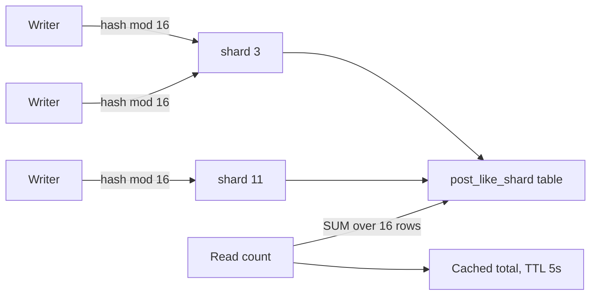
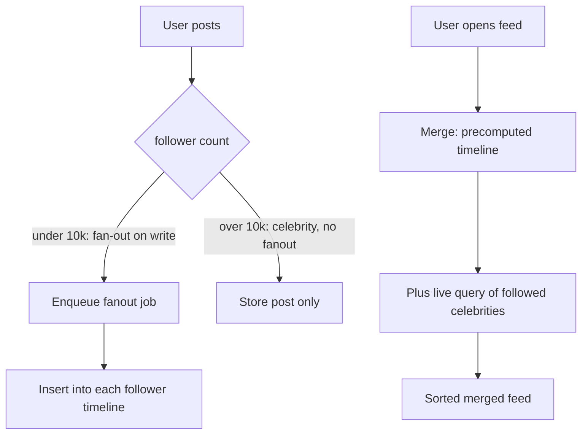
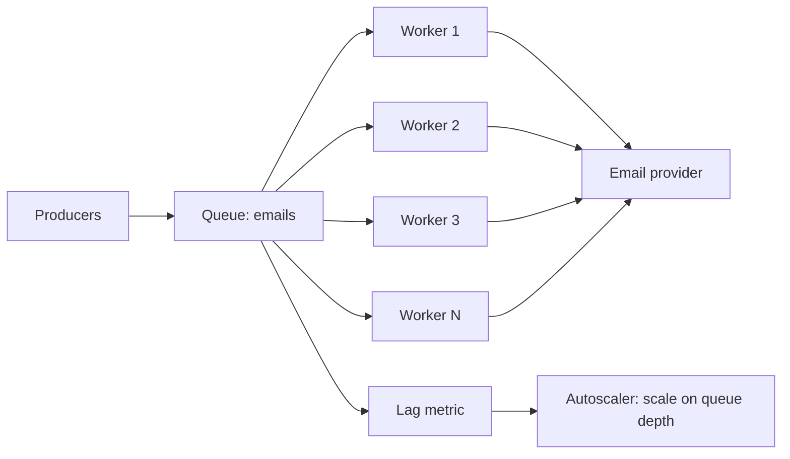
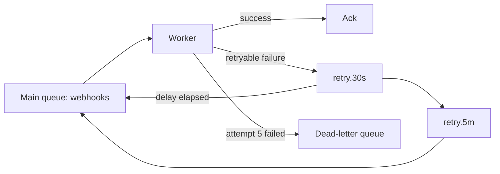

## 61.23 Sharded counters

### Problem

A viral post's like counter. `UPDATE posts SET likes = likes + 1 WHERE id = $1` at 5,000 requests per second means 5,000 transactions serialising on one row. Every writer takes a row lock; each must wait for the previous to commit. PostgreSQL will happily do maybe 1,000 to 3,000 updates per second on a single row under ideal conditions, and far fewer with replication and fsync. Beyond that, lock waits climb, connections pile up, and the whole pool is stuck behind one row. This is the classic hot row.

### Solution

Split the counter into N rows. Each writer picks a shard (randomly, or by hashing the actor id) and increments that. Reading sums the shards. Contention drops by a factor of N, at the cost of read complexity and exact-at-any-instant precision.

### Architecture



### Example

The table, the write and the read, with the rollup that keeps reads cheap.

```sql
CREATE TABLE post_like_shard (
  post_id  UUID   NOT NULL,
  shard_id SMALLINT NOT NULL,          -- 0..15
  count    BIGINT NOT NULL DEFAULT 0,
  PRIMARY KEY (post_id, shard_id)
);

-- write: contention is now 1/16th per row
INSERT INTO post_like_shard (post_id, shard_id, count)
VALUES ($1, (hashtext($2::text) & 15), 1)     -- $2 = user_id, deterministic shard
ON CONFLICT (post_id, shard_id) DO UPDATE SET count = post_like_shard.count + 1;

-- read: 16 rows, one index scan, about 0.2 ms
SELECT sum(count) FROM post_like_shard WHERE post_id = $1;
```

```ts
// Even cheaper: count in Redis, roll up to PostgreSQL periodically.
await this.redis.hincrby(`likes:${postId}`, String(shard), 1);       // 0.3 ms, no locks
// every 10s a rollup job drains the hash into post_like_shard for durability
```

### Advantages

- Removes the hot-row bottleneck. Sixteen shards turn 3,000 writes per second into a theoretical 48,000.
- Simple, boring SQL. No new infrastructure.
- Shard count is tunable per counter: 4 for moderately warm, 64 for viral.

### Disadvantages

- Reads cost N row lookups instead of one, so a list of 50 posts becomes 800 lookups without a rollup or cache.
- Exact instantaneous totals are harder; the sum is consistent but the shape encourages caching, which reintroduces staleness.
- Decrements can make an individual shard negative, which looks alarming even when the sum is right.
- More rows: 10 million posts times 16 shards is 160 million rows.

### When to use

- Genuinely hot single-row counters: likes, views, stock reservations on a flash-sale item, rate counters.
- Write rates above roughly 500 per second against one logical row.

### When NOT to use

- Ordinary counters. A product with 40 orders a day does not need sharding; you have added 16 rows and a sum for nothing.
- When approximate counts are acceptable and Redis alone will do. `INCR` on one Redis key handles 100,000 per second without any sharding.
- When the counter needs to enforce a limit (stock must not go below zero). A sum over shards cannot be checked atomically; use a single row with a `CHECK` constraint, or Redis with a Lua script.

### Edge cases and failure modes

- **Read amplification**: a feed of 50 posts summing 16 shards each. Maintain a rollup total updated every few seconds, and read that.
- **Shard count change**: going from 16 to 64 makes old counts live in the wrong shards. Totals stay correct because you sum all shards, but never re-shard by re-hashing.
- **Redis rollup loss**: if Redis is the write path and it restarts before the rollup, you lose counts. Acceptable for likes, unacceptable for anything billed.
- **Negative shards**: after decrements, a shard can go negative. Clamp only the sum, never the shard.
- **Autovacuum pressure**: hot-updated rows generate dead tuples. Set a lower `autovacuum_vacuum_scale_factor` on the table.

### Senior perspective

Sharded counters are a targeted fix for a specific, measurable symptom: lock waits on one row. I do not apply them pre-emptively, because they cost read complexity forever. The trigger is data — `pg_stat_activity` showing sessions blocked on a `Lock` wait event for the same tuple, or `pg_locks` pointing at one row. When that appears, the decision is between sharding in PostgreSQL and moving the counter to Redis with periodic rollup. My default for social-style counters is Redis plus rollup, because it is faster and cheaper. My default for anything that touches money or stock is PostgreSQL, because durability beats throughput and I would rather solve contention by changing the model than by risking a lost increment.

## 61.24 Fan-out on write versus on read

### Problem

A social feed. When a user opens the app, they must see recent posts from everyone they follow, newest first, in under 200 ms. Two obvious designs exist and they are opposites. Compute the feed when someone *posts* (push a copy into every follower's timeline), or compute it when someone *reads* (query the posts of everyone they follow and merge). Choosing wrong costs you either write amplification or read latency, and at scale both are severe.

### Solution

Fan-out on write precomputes timelines: one post by a user with 900 followers becomes 900 inserts, and reads are a single indexed scan. Fan-out on read computes at query time: writes are one insert, reads merge N sources. The real answer for most large systems is a **hybrid**: fan out on write for normal users, and fan out on read for the small number of accounts with enormous follower counts.

### Architecture



### Example

The hybrid, which is what you would actually build. Fan-out is a background job with a cap; celebrities are merged at read time.

```ts
// WRITE PATH: fan out to followers, in batches, off the request path.
@Processor('fanout')
export class FanoutProcessor {
  @Process({ concurrency: 8 })
  async handle(job: Job<{ postId: string; authorId: string }>) {
    const followerCount = await this.follows.countFollowers(job.data.authorId);
    if (followerCount > 10_000) return;             // celebrity: read-time merge instead

    let cursor: string | null = null;
    do {
      const page = await this.follows.pageFollowers(job.data.authorId, cursor, 1_000);
      await this.timeline.insertMany(page.ids.map((uid) => ({
        userId: uid, postId: job.data.postId, createdAt: job.data.createdAt,
      })));                                          // 1000 rows per round trip
      cursor = page.next;
    } while (cursor);
  }
}

// READ PATH: precomputed rows plus a live query for followed celebrities.
async feed(userId: string, before: Date, limit = 30): Promise<Post[]> {
  const [own, celebs] = await Promise.all([
    this.timeline.page(userId, before, limit),                    // 1 index scan, ~2ms
    this.posts.recentByAuthors(await this.follows.celebrityIds(userId), before, limit),
  ]);
  return merge(own, celebs).sort(byCreatedAtDesc).slice(0, limit);
}
```

### Advantages

- **Fan-out on write**: reads are one indexed scan, so feed latency is flat and predictable regardless of how many people you follow. Read traffic dominates in social products by 100 to 1, so optimising reads is usually right.
- **Fan-out on read**: writes are cheap and instant, storage is minimal, and there is no timeline to rebuild when follow graphs change.
- **Hybrid**: bounds the worst case of both.

### Disadvantages

- **Fan-out on write**: write amplification. An account with 40 million followers generates 40 million inserts per post. Storage multiplies: 500 million timeline rows for a modest network. Unfollowing means deleting rows or filtering at read time.
- **Fan-out on read**: latency grows with the number of followed accounts. A user following 3,000 accounts triggers a merge across 3,000 sources; p99 becomes unacceptable.
- **Hybrid**: two code paths, a threshold to tune, and merge logic that must be correct at page boundaries.

### When to use

- Fan-out on write: read-heavy feeds, modest follower counts, latency-critical reads.
- Fan-out on read: write-heavy or low-read systems, symmetric graphs (group chats, small teams), and any case where storage cost dominates.
- Hybrid: any real social product past a few million users.

### When NOT to use

- Do not fan out on write when the follower distribution has a long tail you cannot cap; you will build a job that runs for an hour on a single post.
- Do not fan out on read when the average user follows hundreds of accounts and expects a 200 ms feed.
- Do not build either for a product with 5,000 users. A single `SELECT ... WHERE author_id = ANY($1) ORDER BY created_at DESC LIMIT 30` with a good composite index serves that perfectly for years.

### Edge cases and failure modes

- **Follower spike**: an account gains a million followers in a day and the fan-out queue backs up for hours. Cap fan-out and fall back to read-time merge.
- **Timeline drift**: a deleted post must vanish from millions of timelines. Filter deleted posts at read time rather than chasing rows.
- **New follow**: a fresh follow shows no history unless you backfill; a backfill of recent posts on follow is the usual compromise.
- **Ordering across sources**: merging precomputed and live results at a cursor boundary can drop or duplicate items. Merge on a stable sort key, not on offset.
- **Storage growth**: timeline tables grow without bound. Trim to the most recent 1,000 entries per user; nobody scrolls further.

### Senior perspective

This is the clearest example in the catalogue of a decision driven purely by numbers, and the numbers are follower distribution and read-to-write ratio. Get those two from the data before arguing. In every social system I have worked on, the distribution was heavy-tailed enough that a pure strategy failed — median follower count in the tens, maximum in the millions — which is why the hybrid is not a clever optimisation but the only design that survives. The other thing I insist on early is timeline trimming, because unbounded per-user timelines are how a feed feature turns into a storage bill nobody budgeted for.

## 61.25 Competing consumers

### Problem

Order confirmation emails arrive on a queue at 400 per second during a flash sale. One worker processes 30 per second because each email involves a template render and an SMTP call. The queue grows by 370 messages per second. Customers get their confirmation an hour late, and the backlog does not clear until 03:00.

### Solution

Run many identical consumers against the same queue. The broker delivers each message to exactly one of them, so throughput scales roughly linearly with worker count until some other resource becomes the bottleneck. This is the fundamental scaling pattern for asynchronous work, and it is why queues exist.

### Architecture



### Example

A BullMQ worker with bounded concurrency, plus the Kubernetes autoscaler that scales on queue depth rather than CPU (workers waiting on SMTP use almost no CPU, so CPU-based scaling never triggers).

```ts
new Worker(
  'emails',
  async (job) => {
    await this.mailer.send(job.data);   // idempotent: provider dedupes on messageId
  },
  {
    connection,
    concurrency: 10,                     // per pod; 12 pods gives 120 in flight
    limiter: { max: 500, duration: 1000 }, // respect the provider's 500/s contract
    lockDuration: 30_000,                // longer than the slowest send
  },
);
```

```yaml
apiVersion: keda.sh/v1alpha1
kind: ScaledObject
metadata: { name: email-workers }
spec:
  scaleTargetRef: { name: email-worker }
  minReplicaCount: 2
  maxReplicaCount: 30
  triggers:
    - type: redis
      metadata:
        address: redis.prod:6379
        listName: "bull:emails:wait"
        listLength: "100"      # add a pod per 100 waiting jobs
```

### Advantages

- Throughput scales with worker count; adding capacity is a replica-count change.
- Natural load levelling: producers never wait for consumers.
- Fault tolerance is built in: a crashed worker's unacknowledged message is redelivered to another.
- Rolling deploys are invisible to producers.

### Disadvantages

- Message order across consumers is lost. Two updates to the same order can be processed out of sequence.
- At-least-once delivery means duplicates, so handlers must be idempotent (see the transactional inbox).
- The bottleneck moves. Twenty workers hammering one PostgreSQL connection pool or one third-party rate limit is worse than five.

### When to use

- Any independent, parallelisable unit of work: emails, thumbnails, webhooks, exports, indexing.
- Load spikes that should not be felt by the producer.

### When NOT to use

- When strict ordering per entity is required, unless you partition by key (Kafka partitions, or a per-entity lock).
- When the downstream cannot take the concurrency. Scaling workers 10x against a database that can serve 2x is how you take down the database with a background job.
- For work that must happen inside the user's request, such as validation that decides the HTTP response.

### Edge cases and failure modes

- **Visibility timeout too short**: a slow job's lock expires, the message is redelivered, and two workers process it simultaneously. Set `lockDuration` above p99 processing time and renew for long jobs.
- **Poison message**: one bad payload crashes every worker in turn, looping forever. That is what dead-letter queues are for.
- **Rebalancing storms** in Kafka: every deploy triggers a rebalance and pauses consumption. Use cooperative sticky assignment and a sane `session.timeout.ms`.
- **Downstream saturation**: workers scale up and exhaust the connection pool. Bulkhead the pool per worker type.
- **Unbounded scale-up**: KEDA scales to 200 pods and hits the provider's rate limit, which returns 429s that you then retry.

### Senior perspective

Competing consumers is the pattern people think they get for free by using a queue, and mostly they do. The two things that are not free are ordering and idempotency, and both must be decided before the first message flows. My default is to assume no ordering, make every handler idempotent, and use a partition key only where the business genuinely requires per-entity sequencing. The operational default I insist on is scaling on *queue depth or consumer lag*, never on CPU: I/O-bound workers sit at 5 percent CPU while a backlog grows for two hours, and CPU-based autoscaling will happily do nothing the entire time.

## 61.26 Retry queue

### Problem

A webhook delivery to a partner fails because their endpoint is down for maintenance. Retrying immediately fails again. Retrying in a tight loop inside the worker blocks that worker for the duration of the backoff, so a handful of failing messages consume your whole worker pool while thousands of healthy messages wait behind them.

### Solution

Move the failed message out of the main queue and into a delayed queue, to be redelivered after a backoff. The worker returns immediately and picks up the next message. Backoff grows per attempt, so the retry schedule might be 30 s, 2 min, 10 min, 1 h, 6 h. Some brokers support this natively (BullMQ delayed jobs, SQS with a delay queue, RabbitMQ with a dead-letter exchange and TTL); Kafka needs explicit retry topics.

### Architecture



### Example

BullMQ with per-job backoff, plus the Kafka pattern of tiered retry topics, which is the version people get wrong.

```ts
await this.webhookQueue.add('deliver', payload, {
  attempts: 6,
  backoff: { type: 'exponential', delay: 30_000 },  // 30s, 1m, 2m, 4m, 8m
  removeOnComplete: 1000,
  removeOnFail: false,                              // keep failures for inspection
});
```

```ts
// Kafka: separate topics per delay tier. Never sleep inside a consumer:
// a paused poll loop triggers a rebalance and stalls the whole partition.
const TIERS = [
  { topic: 'webhooks.retry.1m',  delayMs: 60_000 },
  { topic: 'webhooks.retry.10m', delayMs: 600_000 },
  { topic: 'webhooks.retry.1h',  delayMs: 3_600_000 },
];

async onFailure(msg: KafkaMessage, attempt: number): Promise<void> {
  const tier = TIERS[attempt - 1];
  if (!tier) return this.producer.send({ topic: 'webhooks.dlq', messages: [msg] });
  await this.producer.send({
    topic: tier.topic,
    messages: [{ ...msg, headers: { ...msg.headers, attempt: String(attempt + 1),
      'not-before': String(Date.now() + tier.delayMs) } }],
  });
}
// The retry-tier consumer checks not-before; if the time has not come, it pauses
// the partition until it has, which is safe because the tier topic is ordered by time.
```

### Advantages

- Failing work stops blocking healthy work.
- Backoff gives the downstream time to recover instead of hammering it.
- Retry state is durable: a worker crash does not lose the schedule.
- Attempt counts and delays are visible and tunable in production without a deploy.

### Disadvantages

- Ordering is lost for retried messages. A retried `order.updated` can land after a newer one.
- More topics or queues to create, monitor and reason about.
- Long backoffs mean the effect happens much later than the cause, which confuses debugging and users.

### When to use

- Deliveries to systems you do not control: webhooks, partner APIs, payment providers.
- Any failure class that is genuinely transient over minutes to hours.

### When NOT to use

- For failures that will never succeed: validation errors, 404s, malformed payloads. Send those straight to the DLQ; retrying them for six hours is pure waste.
- When the message has a business deadline shorter than the backoff, such as a one-time password.
- When retrying is unsafe because the handler is not idempotent.

### Edge cases and failure modes

- **Retry loop with no cap**: a message that always fails cycles forever, consuming capacity indefinitely. Always terminate at the DLQ.
- **Sleeping in a consumer**: `await sleep(600000)` inside a Kafka handler stops heartbeats and triggers a rebalance that stalls the consumer group.
- **Retry amplification**: every failure during a downstream outage lands in the retry queue, and when the downstream recovers they all fire at once and knock it over again. Add jitter to delays.
- **Message expiry**: a retry scheduled for 6 hours later against a broker with a 4-hour retention silently disappears.
- **Growing payloads**: appending diagnostic headers on each retry until the message exceeds the broker's size limit.

### Senior perspective

The rule I apply is: classify the failure before you schedule the retry. A `422` from a partner is permanent and belongs in the dead-letter queue immediately; a `503` or a connection reset is transient and belongs in the retry tier. Systems that skip this classification spend most of their retry capacity on messages that can never succeed, and then have no capacity left during a real outage. The second rule is that the retry schedule is a product decision: how long should we keep trying to deliver a partner's webhook before we give up and page someone? Get an answer from the business, and encode it as the tier list.
