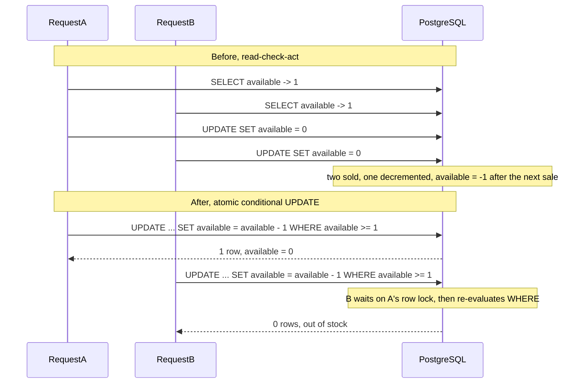

## 61.10 Two users purchase the last item at the same time

### Symptom

**20:07, during a flash sale.** A support ticket: two customers received order confirmations for the last unit of a limited-edition sneaker. Warehouse has one. Then the query that turns one ticket into an incident:

```sql
SELECT id, sku, available FROM products WHERE available < 0;
```

```text
                  id                  |      sku       | available
--------------------------------------+----------------+-----------
 3f19c2a1-...                         | SNK-LTD-42     |        -2
 a81be440-...                         | SNK-LTD-43     |        -1
 c02f1188-...                         | HOODIE-BLK-M   |        -1
```

Negative stock. A column that represents a count of physical objects holds a number that cannot exist. **When a database contains an impossible value, the cause is almost always a race or a missing constraint, and usually both.**

### First five minutes (mitigation)

Stop the oversell, then reconcile. Two actions:

```sql
-- 1. Take the affected SKUs off sale immediately. Cheaper than being wrong twice more.
UPDATE products SET is_purchasable = false WHERE available <= 0;
```

2. The three affected SKUs are handed to operations: contact the customers whose orders cannot be fulfilled, refund or offer an alternative, and hold the rest. Doing this within the first ten minutes is worth more than the root cause, because a customer who hears from you before they notice is a different customer from one who finds out when the parcel does not arrive.

### Metrics

| Metric | Value | Note |
|---|---|---|
| Checkout RPS on `SNK-LTD-42` | 41/s at 20:04 | Flash sale on one SKU |
| `reserve_stock` p99 | 38 ms | Fast. No lock contention visible |
| `InsufficientStockError` rate | 380/min | Working normally for the majority |
| Oversells | 4 across 3 SKUs | 0.02% of reservations |
| Database CPU | 48% | Healthy |

Nothing looks broken. The bug affects a handful of requests out of tens of thousands, only at high concurrency on a single row. This is the defining property of a race condition: **it is invisible in aggregate metrics and it scales with concurrency**, so it appears exactly when it hurts most.

### Logs

Two orders, interleaved by microsecond:

```text
20:04:11.402118 [orders-api-2xnpq] INFO reserveStock sku=SNK-LTD-42 qty=1 read available=1 corr=a1
20:04:11.402684 [orders-api-9wzlm] INFO reserveStock sku=SNK-LTD-42 qty=1 read available=1 corr=b7
20:04:11.409901 [orders-api-2xnpq] INFO reserveStock committed available=0 corr=a1
20:04:11.411330 [orders-api-9wzlm] INFO reserveStock committed available=0 corr=b7
```

Both read `available = 1`. Both wrote `available = 0`. Two units sold, one decrement recorded. This is a textbook **lost update**, and the log line `read available=1` twice is the entire proof.

### Traces

```text
POST /checkout (corr=a1)                    62 ms      POST /checkout (corr=b7)          64 ms
├── db.query products.findOne     4 ms                 ├── db.query products.findOne     4 ms
├── pricing.calculate             9 ms                 ├── pricing.calculate            11 ms
├── db.query products.save        6 ms                 ├── db.query products.save        7 ms
└── db.query orders.insert       21 ms                 └── db.query orders.insert       22 ms
```

Note what is absent: no `pessimistic_write` lock, no wait time, no serialization. The two transactions never contended for anything, because nothing asked them to.

### Application

```ts
// src/inventory/stock.service.ts  (the bug)
async reserveStock(sku: string, qty: number): Promise<void> {
  const product = await this.repo.findOne({ where: { sku } });        // READ
  if (!product || product.available < qty) {                          // CHECK
    throw new InsufficientStockError(sku);
  }
  product.available -= qty;                                           // ACT (in JavaScript)
  await this.repo.save(product);                                      // WRITE
}
```

Read, check, act, in three separate steps with the decision made in application memory. Under PostgreSQL's default `READ COMMITTED` isolation, two concurrent transactions both see `available = 1` (neither has committed a change the other can see), both pass the check, both compute `1 - 1 = 0`, and both write `0`. The second write silently overwrites the first. No error, no lock, no warning. TypeORM's `save()` issues `UPDATE products SET available = 0 WHERE id = $1`: the new value is a **constant computed in Node**, and the `UPDATE` has no idea what the row contained when it was read.

The **red herring** occupied 25 minutes. The product page reads stock from a read replica, and replica lag was 340 ms during the sale. The theory: "the checkout read stale stock from a replica". It is plausible, it explains oversells, and it is wrong. It was killed with evidence rather than argument:

```ts
// Both transactions were logged with their connection target
logger.log({ sku, available: product.available, host: this.dataSource.options.host }, 'reserveStock read');
// -> host: orders-primary.internal   for BOTH corr=a1 and corr=b7
```

Both reads went to the primary. `DataSource` for the write path has no replication config; only the catalog `DataSource` uses replicas. And the decisive argument: a stale read would have shown `available` as some **older, larger** number, while both logs show exactly 1, which is the correct current value. Replica lag would have produced a different wrong answer than the one observed. Theory discarded at 20:41.

#### Reproducing it

A race you cannot reproduce is a race you cannot prove fixed. Force the interleaving with two real transactions and a barrier:

```ts
// test/inventory/reserve-stock.race.spec.ts
describe('reserveStock concurrency', () => {
  it('never sells more than the available quantity', async () => {
    await dataSource.query(`UPDATE products SET available = 1 WHERE sku = 'SNK-LTD-42'`);

    // 20 parallel attempts on a single unit of stock
    const attempts = Array.from({ length: 20 }, () =>
      stockService.reserveStock('SNK-LTD-42', 1)
        .then(() => 'ok' as const)
        .catch((e) => (e instanceof InsufficientStockError ? 'rejected' as const : Promise.reject(e))),
    );
    const results = await Promise.all(attempts);

    expect(results.filter((r) => r === 'ok')).toHaveLength(1);        // exactly one winner
    const [row] = await dataSource.query(
      `SELECT available FROM products WHERE sku = 'SNK-LTD-42'`);
    expect(Number(row.available)).toBe(0);                            // never negative
  });
});
```

Against the buggy code this fails immediately and dramatically: `Expected length: 1, Received length: 14`, with `available = -13`. Twenty parallel requests through a real pool against a real PostgreSQL reproduce it every time. **`Promise.all` over a real connection pool is the cheapest concurrency test you will ever write**, and it belongs in the suite for every contended write in the system.

### Database

The fix is to make the check and the act a single atomic statement, so the database evaluates the condition against the row it is about to modify, under the row lock it takes to modify it:

```sql
UPDATE products
   SET available = available - $2,          -- relative, not absolute
       updated_at = now()
 WHERE sku = $1
   AND available >= $2                      -- the check, evaluated inside the write
RETURNING available;
```

Two properties make this correct. `available - $2` is computed by PostgreSQL from the row's current value, so nothing read earlier can be stale. And under `READ COMMITTED`, when two transactions target the same row, the second blocks on the first's row lock, then **re-evaluates its `WHERE` clause against the updated row** once the first commits. The second sees `available = 0`, `0 >= 1` is false, the row does not match, and the statement affects zero rows. Zero rows is your out-of-stock signal.



### Infrastructure

Ruled out quickly and deliberately. Pod count, node health, clock synchronization (`chronyc tracking` showed 0.9 ms offset), and load balancer behaviour were all normal, and none of them could produce a negative integer in a database column anyway. The only infrastructure fact that mattered is the one that made the bug *visible*: 20 pods serving 41 checkouts per second on one SKU means two requests land inside the same 10 ms window many times per minute. **Infrastructure did not cause this race; it supplied the concurrency that exposed it.** The same code had been correct-looking for three years at 2 requests per second on any given SKU.

### Root cause

`reserveStock` read the row, checked availability in application memory, decremented in JavaScript, and wrote an absolute value back. Under `READ COMMITTED` two concurrent transactions both observed `available = 1`, both passed the check, and both wrote `available = 0`, so the second write silently discarded the first. Nothing in the database prevented the resulting value from going negative, because there was no `CHECK` constraint. A lost update plus a missing invariant.

### Fix

```ts
// src/inventory/stock.service.ts  (fixed)
async reserveStock(sku: string, qty: number): Promise<number> {
  const result = await this.repo
    .createQueryBuilder()
    .update(Product)
    .set({ available: () => 'available - :qty', updatedAt: () => 'now()' })
    .where('sku = :sku AND available >= :qty', { sku, qty })
    .returning('available')
    .execute();

  if (result.affected === 0) {
    throw new InsufficientStockError(sku);   // no row matched: sold out, atomically determined
  }
  return Number(result.raw[0].available);
}
```

The Sequelize equivalent, since the same bug is written the same way in both ORMs:

```ts
const [affected] = await Product.update(
  { available: sequelize.literal(`available - ${Number(qty)}`) },   // qty is validated as an integer
  { where: { sku, available: { [Op.gte]: qty } }, transaction: t },
);
if (affected === 0) throw new InsufficientStockError(sku);
```

**The backstop constraint.** The application fix is correct today; the constraint is correct forever, including against the next developer, the next ORM upgrade, a manual `psql` session, and a data migration:

```sql
-- Repair the impossible rows first: a constraint cannot be validated over invalid data.
UPDATE products SET available = 0 WHERE available < 0;   -- after operations reconciles physically

-- Add as NOT VALID: takes only a brief lock, does not scan the table, enforces on all new writes.
ALTER TABLE products
  ADD CONSTRAINT chk_available_non_negative CHECK (available >= 0) NOT VALID;

-- Then validate existing rows with a weaker lock that does not block reads or writes.
ALTER TABLE products VALIDATE CONSTRAINT chk_available_non_negative;
```

The two-step `NOT VALID` then `VALIDATE` pattern is how you add a check constraint to a large hot table without an outage (see Part 27 — Database Migrations). With the constraint in place, a future read-check-act bug fails loudly with `23514 check_violation` and a rolled-back transaction instead of quietly selling stock that does not exist. **A wrong number in a database is worse than a failed request**, and a constraint is what enforces that preference.

Alternatives, and when each is right:

| Approach | How | Wins when | Costs |
|---|---|---|---|
| **Atomic conditional `UPDATE`** | `SET x = x - n WHERE x >= n` | The decision is one row and one arithmetic condition. **Default choice** | Cannot express complex multi-row logic |
| `SELECT ... FOR UPDATE` | Lock the row, then read-check-act | Several rows or complex logic must be decided together | Serializes all buyers of a hot SKU; throughput bounded by lock hold time |
| Optimistic locking (`@VersionColumn`) | `WHERE version = $n`, retry on 0 rows | Low contention, long think-time between read and write | Retry storms under high contention |
| `SERIALIZABLE` isolation | Let PostgreSQL detect the anomaly | Complex invariants across many tables | Serialization failures must be retried by the caller; throughput cost |
| Redis `DECRBY` reservation | Decrement a counter in Redis, settle in PostgreSQL later | Extreme contention: 30,000 checkouts/s on one SKU | Two sources of truth; needs reconciliation and expiry of unclaimed reservations |

For a flash sale, the honest answer is often the atomic `UPDATE` plus a Redis admission gate in front, so the database only ever sees as many checkout attempts as there is stock, plus a margin.

### Prevention

- **Keep the parallel test permanently.** It runs in 400 ms, it fails loudly on regression, and it documents the invariant better than a comment can.
- **A nightly invariant check** across the schema, alerting on any row that violates a business rule: `SELECT count(*) FROM products WHERE available < 0`, plus the equivalents for balances, quantities and totals. Invariant checks find the bugs that no error rate can.
- **A code-review rule: no read-modify-write on a contended row.** If a value is decremented, incremented or conditionally changed, it happens in one statement or under an explicit lock.
- **Constraints for every business invariant that can be expressed as one**: `CHECK (available >= 0)`, `CHECK (total_amount >= 0)`, unique indexes on natural keys, `EXCLUDE` constraints for overlapping bookings. The database is the last honest layer.
- **Load test the contended path specifically.** A general load test spreads requests over 5,000 SKUs and will never reproduce this. Point 200 virtual users at one SKU with stock 50 and assert exactly 50 succeed.

### Junior versus senior

| | Junior | Senior |
|---|---|---|
| Reaction to negative stock | Fixes the rows with an `UPDATE` | Fixes the rows, then asks what allowed an impossible value to exist |
| Explanation | "Race condition, hard to reproduce" | Writes a 15-line parallel test that reproduces it every run |
| Fix | Adds `SELECT ... FOR UPDATE` everywhere | Uses the atomic conditional `UPDATE`, keeps `FOR UPDATE` for genuinely multi-row decisions |
| Isolation | "We should use SERIALIZABLE" | Knows `READ COMMITTED` re-evaluates the `WHERE` clause after a blocking write, which is exactly the needed semantics here |
| Backstop | None | `CHECK (available >= 0)` added `NOT VALID` then validated, plus a nightly invariant alert |

## 61.11 Patterns across incidents

Ten incidents, and the same shapes keep recurring. This table is the compressed version: match the symptom class, check the three metrics, then work the usual suspects in order.

| Symptom class | First three metrics | Usual suspects |
|---|---|---|
| Latency up, errors flat | p50 vs p99 split; pool `waitingCount`; database CPU and `blks_read` | Plan flip after stale statistics; pool saturation; a slow downstream with a generous timeout; GC pauses; lock waits |
| Latency up, 5xx up | Error rate by route and status; downstream error rate; pod restarts | Failing dependency; timeouts firing; pods being killed mid-request; connection exhaustion |
| Everything fails at the same second | Shared-resource metrics: connections used, Redis memory, DNS failures | `max_connections` reached; Redis eviction or failover; DNS or certificate expiry; a config rollout |
| Database CPU high | `pg_stat_statements` top by total time; `blks_read` rate; buffer cache hit ratio | Missing index (especially on a foreign key); plan flip; a batch job; an N+1 loop; autovacuum as a *consequence* |
| Memory growing | `nodejs_heap_size_used_bytes` slope; `external_memory`; `active_handles` | Unbounded cache on a singleton; listeners added per request; retained request objects; native buffers if the heap is flat |
| Pods restarting | Restart count; exit code from `describe`; startup duration | OOMKilled (heap limit above container limit); liveness probe budget under startup time; liveness doing I/O |
| Queue or consumer lag growing | Lag; **commit rate**; rebalance rate | Processing exceeding `max.poll.interval.ms`; slow downstream; a poison message; consumers fewer than partitions; a dead consumer |
| Stale or wrong data | Cache hit ratio by prefix; invalidation counters; replication lag | Two cache key formats; missed invalidation; no TTL; reading a replica when the write must be visible |
| Duplicates | Sends vs events produced; consumer restarts; provider message ids | At-least-once redelivery with a non-idempotent side effect; retries without an idempotency key; auto-commit windows |
| Missing or stuck records | Business-invariant counts; outbox oldest age; webhook rejection counters | A race between an external callback and a commit; a swallowed error; a stalled relay; a 2xx returned for unhandled work |
| Impossible values in the database | Invariant query counts; contention on the hot row | Read-check-act race; missing `CHECK` constraint; a manual `UPDATE`; a migration that skipped validation |

Five meta-patterns run underneath all of it.

**Most incidents are caused by a change**, but the change is often not the obvious one and often not in your service. A CPU limit on the profile service caused a Kafka rebalance loop. A backfill migration caused an API latency spike. Correlate with change first, and cast a wide net.

**The symptom is rarely the cause.** Autovacuum burning CPU was the consequence of a missing index. Duplicate notifications were the consequence of an OOM. Pool exhaustion was the consequence of a plan flip. Always ask "what would have to be true upstream of this?"

**Saturation shows up as latency long before it shows up as errors.** A pool with a 30-second acquire timeout will make every request slow and none of them fail. Alert on saturation signals (pool waiting, event loop lag, replica lag, connection count, consumer lag, heap slope), not only on error rates.

**Every "impossible" state is a race or a missing constraint.** Negative stock, an order paid but pending, a notification sent five times: none of these are mysteries once you look for the window between two operations that are not atomic.

**The third incident of a kind is a design problem, not an ops problem.** An alert acknowledged three nights running is a signal that the team has normalized a defect. Escalate it into a design change rather than a better runbook.

## 61.12 Building a debugging-friendly system

Every incident above was solved faster or slower depending on what existed *before* it started. These are the investments, roughly in order of value per hour spent.

**Correlation ids everywhere.** One id, generated at the edge, propagated through every log line, every trace, every queue message and every downstream HTTP header. Without it, section 61.9's six-hundred-millisecond ordering inversion is invisible.

```ts
// src/common/correlation/correlation.middleware.ts
import { AsyncLocalStorage } from 'node:async_hooks';
export const als = new AsyncLocalStorage<{ correlationId: string }>();

@Injectable()
export class CorrelationMiddleware implements NestMiddleware {
  use(req: Request, res: Response, next: NextFunction): void {
    const correlationId = (req.headers['x-correlation-id'] as string) ?? randomUUID();
    res.setHeader('x-correlation-id', correlationId);
    als.run({ correlationId }, () => next());   // available anywhere downstream, no plumbing
  }
}
```

Propagate it onto every outbound call and every message header, and make the id part of the event payload written to the outbox so an asynchronous chain remains traceable hours later.

**Structured logs, with fields you can query.** `logger.log({ orderId, sku, available, host }, 'reserveStock read')` is queryable; `logger.log(\`reserving ${sku}\`)` is not. Log at `info` the facts a future investigator needs (ids, decisions, counts, which host, which key), never request bodies or personal data. Sample high-volume paths rather than turning them off, so a rare event is still represented.

**`application_name` on every database connection, per pod.** One line of config, and it converts "some service is holding 300 connections" into "these three pods of `orders-api` are". Section 61.8 was diagnosed in minutes because of it.

```ts
extra: { application_name: `${process.env.SERVICE_NAME}@${process.env.HOSTNAME}` }
```

**Slow query logging on by default.** `log_min_duration_statement = 200ms` and `auto_explain` with `auto_explain.log_min_duration = 500`, `log_analyze = on`, `log_buffers = on`. The cost is a small amount of logging; the benefit is that when a plan flips at 03:00 you have the plan, with real parameters, instead of a theory. Also `log_lock_waits = on` and `log_temp_files = 0`.

**Dashboards built before the incident.** Four per service, and they must exist while things are calm because nobody builds a good dashboard at 02:00: **RED** (rate, errors, duration by route), **saturation** (pod CPU and throttling, event loop lag, heap, pool waiting, connections used versus `max_connections`), **dependencies** (latency and error rate per downstream, per database, per cache, per topic), and **business invariants** (orders pending over 15 minutes, outbox oldest age, negative stock count, notifications sent versus events produced). The fourth is the one most teams do not have, and it is the one that catches money going missing.

**Runbooks linked from alerts.** Every alert carries a `runbook_url` annotation pointing at a page that says what the alert means, what to check first, what the safe mitigations are, and who owns it.

```yaml
- alert: PgConnectionsHigh
  expr: sum(pg_stat_activity_count{state!="idle"}) / on() pg_settings_max_connections > 0.7
  for: 5m
  labels: { severity: page }
  annotations:
    summary: "PostgreSQL connections above 70 percent of max_connections"
    runbook_url: "https://wiki.internal/runbooks/pg-connections-high"
```

**Feature kill switches.** Every non-essential feature behind a flag that can be turned off in seconds without a deploy: recommendations, the retry button, a new read path, a chatty analytics beacon. In section 61.9 the flag that disabled the retry button stopped double charges four minutes into the incident. A kill switch is a mitigation you can use before you understand anything, which is exactly when you need one.

**A rollback you have actually practised.** Not "we can roll back", but "we rolled back last Thursday in a game day and it took 3 minutes 40 seconds". Practise reveals the parts that do not roll back: a migration that dropped a column, a cache format the old version cannot read, a Kafka message schema the old consumer rejects, a feature flag whose default changed. Expand-contract migrations (Part 27) and backward-compatible schemas (Part 28) are what make rollback real rather than aspirational.

Two smaller items that repay themselves quickly: **timeouts and limits everywhere** (`statement_timeout`, `idle_in_transaction_session_timeout`, `lock_timeout`, HTTP connect/headers/body timeouts, `connectionTimeoutMillis`, body size limits), because every incident above got worse in proportion to how long something was allowed to take; and **an admin diagnostics endpoint** on an internal port, guarded, offering a CPU profile and a heap snapshot on demand, so the tooling in sections 61.6 and 61.12 is available at 02:00 instead of requiring a deploy.

## Senior Checklist — Part 61

- [ ] I understand the concept
- [ ] I can explain it simply
- [ ] I can implement it
- [ ] I understand its failure modes
- [ ] I understand its scaling limitations
- [ ] I understand its security implications
- [ ] I understand its operational implications
- [ ] I can choose between alternatives
- [ ] I can explain the tradeoffs
- [ ] I can answer senior-level interview questions
- [ ] I mitigate before I diagnose, and I announce every mitigation with a timestamp
- [ ] I keep a written timeline during an incident and communicate on a fixed schedule
- [ ] I form hypotheses from metrics and name the observation that would kill each one
- [ ] I read `p50` versus `p99` to tell "everything is slower" from "some requests are slower"
- [ ] I can read `EXPLAIN (ANALYZE, BUFFERS)` and recognise a plan flip from stale statistics
- [ ] I know that a foreign key never creates an index on the referencing column, and I can find every unindexed FK
- [ ] I treat autovacuum activity as a possible consequence and check its start time against the symptom's
- [ ] I diagnose cache staleness by comparing the read key with the invalidation key, and I never cache without a TTL
- [ ] I know that zero commit rate with nonzero consumption means a rebalance loop, not a capacity problem
- [ ] I make every consumer side effect idempotent with a key derived from the event
- [ ] I can take and compare two heap snapshots and read a retainer path to the leaking field
- [ ] I know exit code 137, use `kubectl logs --previous`, and set `--max-old-space-size` below the container limit
- [ ] I use a startupProbe for slow boots, keep liveness free of I/O, and put dependency checks in readiness
- [ ] I read the `pg_stat_activity` state breakdown, kill `idle in transaction` sessions, and set `idle_in_transaction_session_timeout`
- [ ] I never return 2xx to a webhook I did not durably store, and I keep a reconciliation query for both arms
- [ ] I replace read-check-act with an atomic conditional `UPDATE` and back it with a `CHECK` constraint
- [ ] I can reproduce a race with a parallel integration test before claiming it is fixed
- [ ] My services carry correlation ids, structured logs, `application_name`, slow query logging, dashboards, runbook links and kill switches

## Part 61 — Key Takeaways

- Mitigate first, diagnose second; a rollback that does not help is four minutes well spent because it kills the most attractive theory.
- Walk the ladder: symptom, metrics, logs, traces, application, database, infrastructure. Never start in the middle because of a hunch.
- p50 moving with p99 means a shared resource; p99 alone means a subset (locks, GC, one tenant, one key).
- A deploy near the start time is a suspect, not a verdict; coincidences are common in teams that deploy often.
- Every scenario had a red herring that cost real minutes; kill theories with evidence, and write down that you did.
- Plan flips come from stale statistics after bulk data changes; `ANALYZE` after every backfill and make autoanalyze aggressive on large tables.
- PostgreSQL never indexes a foreign key's referencing column; every parent delete then becomes a full scan of the child table.
- Cache correctness is a key-naming problem: one module owns key construction, invalidation is derived from it, and every entry has a TTL.
- Growing lag with idle consumers and a zero commit rate is a rebalance loop; reduce work per poll, batch the downstream call, commit incrementally.
- Brokers are at-least-once, so every side effect needs an idempotency key and a uniqueness constraint; pods will always crash mid-batch.
- Leaks are found by comparing two heap snapshots and reading the retainer path, not by upgrading dependencies and hoping.
- Set `--max-old-space-size` below the container limit; above it guarantees the kernel kills the process before V8 collects.
- Liveness probes must never do I/O, slow startups need a startupProbe, and exit code 137 with `--previous` logs tells you which death you had.
- Connections leak on error paths: use managed transactions, always `release()` in `finally`, size pools with Little's law, and let the database enforce `idle_in_transaction_session_timeout`.
- A 2xx to a webhook is a durability promise; store the event first, process it asynchronously, and reconcile on a schedule for both the "event without order" and "order without event" arms.
- Read-check-act on a contended row is a lost update; use one atomic conditional `UPDATE`, prove it with a parallel test, and add the `CHECK` constraint as the backstop.
- Alert on saturation and business invariants, not only on errors; the incidents that cost money are the ones no latency dashboard can see.
- Build the debugging-friendly system before you need it: correlation ids, structured logs, `application_name`, slow query logs, four dashboards, runbook links, kill switches, and a rollback you have actually practised.
