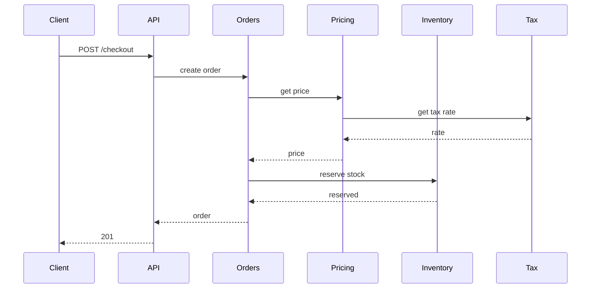

## 62.8 Distributed monolith

### What it looks like

Twelve services, one release train. Deploying `order-service` requires deploying `pricing-service` and `inventory-service` in the same window because they share a DTO package that just changed. The CI pipeline is one repository-wide job that runs 40 minutes and deploys all twelve.

```ts
// @company/shared-types v4.2.0 - imported by all 12 services
export interface Order {
  id: string;
  status: 'NEW' | 'PAID' | 'SHIPPED';   // adding 'REFUNDED' breaks every consumer's exhaustive switch
  items: OrderItem[];
  internalPricingSnapshot: PricingSnapshot;   // an internal type, now public
}
```

### Why it is dangerous

You pay every cost of distribution — network latency, partial failure, serialization, distributed debugging, twelve deploy pipelines, twelve on-call surfaces — and receive none of the benefits, because you cannot deploy, scale or fail independently. This is strictly worse than a monolith. A monolith with a bad module boundary is a refactor; a distributed monolith with a bad boundary is a coordinated multi-team release.

The concrete production consequence is deploy velocity collapse. A team I worked with went from 20 deploys per week as a monolith to 3 per week after the split, because each release needed a version-compatibility matrix and a rollback plan across four services. Incident recovery time doubled: a rollback now required rolling back four services in the correct order.

### How it happens

The intention is good and the mechanism is a shared library. Splitting a monolith into services duplicates types, so somebody extracts a `shared-types` package to avoid duplication (DRY, correctly applied at the wrong boundary). Then shared validation. Then shared database entities. Each extraction removes duplication and adds coupling, and coupling across a network is far more expensive than duplication within a process.

### The fix

Duplicate the types. Across a service boundary, duplication is the *correct* choice: each service defines the subset of the contract it actually consumes, and versions it independently.

```ts
// inside order-service: only the fields this service uses, owned by this service
export interface PricingResult {
  totalMinor: number;
  currency: string;
  // no 'internalPricingSnapshot' - if pricing changes its internals, we do not care
}
```

Share only stable, versioned wire contracts (OpenAPI specs, protobuf files, Avro schemas), never internal domain types. Enforce backward compatibility in CI with a schema-compatibility check. If a change requires a coordinated deploy, that is a design bug, not a scheduling problem — Part 25 — Backward Compatibility covers expand-contract for exactly this.

And be honest about the alternative: if the services genuinely cannot be decoupled, merge them back. A modular monolith with enforced internal boundaries is a legitimate, senior destination, not a defeat.

### How to detect it in review or in metrics

- A shared package that all services depend on and that changes more than monthly.
- Any release process with the words "deploy in this order".
- Deploy frequency per service. If services always deploy together, they are one service.
- A service that cannot start unless three others are running — check whether integration tests require the whole stack.
- In review: "can this change ship alone?" If not, note why.

## 62.9 Microservices too early

### What it looks like

A pre-product-market-fit startup with four engineers and eleven repositories: `user-service`, `auth-service`, `notification-service`, `product-service`, `cart-service`, `order-service`, `payment-service`, `search-service`, `api-gateway`, `shared-lib`, `infra`. Total traffic: 40 requests per minute.

### Why it is dangerous

Every feature now spans three repositories and needs three pull requests, three reviews and three deploys. A change that would take two hours in a monolith takes two days. With four engineers and eleven services, nobody owns anything properly, and every service has a different logging format because they were each set up in a hurry.

The operational tax is real money and real time: eleven CI pipelines, eleven sets of dashboards, eleven Kubernetes deployments and eleven idle service footprints. At 40 requests per minute you are paying roughly 400 dollars a month in infrastructure that a single 2 vCPU instance would serve, plus the far larger cost of engineering time spent on distributed-systems problems that your traffic does not justify.

Worst of all, the boundaries are wrong. You do not yet know your domain, and service boundaries are the most expensive thing in software to move. Fixing a bad module boundary is a refactor in an afternoon; fixing a bad service boundary is a data migration, an API deprecation and a quarter.

### How it happens

Two good intentions. First, engineers who have felt the pain of a badly-factored monolith want to avoid repeating it, and microservices are marketed as the cure. Second, "we will need to scale" — which is true eventually and irrelevant now. Conference talks describe architectures built by companies with 300 engineers and 100,000 requests per second, and the architecture is copied without the context. Resume-driven development is real too, and worth naming without shame.

### The fix

Start with a modular monolith: one deployable, one database, strict internal module boundaries with explicit public interfaces per module.

```ts
// src/modules/orders/index.ts - the ONLY file other modules may import from
export { OrdersModule } from './orders.module';
export { PlaceOrderService } from './application/place-order.service';
export type { OrderSummary } from './application/order-summary.dto';
// internals (entities, repositories, private services) are not exported
```

Enforce it mechanically, so it is not a matter of discipline:

```json
{
  "rules": {
    "no-restricted-imports": ["error", {
      "patterns": [{
        "group": ["**/modules/*/!(index)", "**/modules/*/**"],
        "message": "Import modules only through their public index.ts"
      }]
    }]
  }
}
```

Extract a service when you have a *specific* reason: a genuinely different scaling profile, a different runtime need, an independent team that is blocked, or a compliance boundary. One reason, one service, one extraction at a time. Part 12 — Software Architecture covers the modular monolith in depth and Part 63 gives the decision tree.

### How to detect it in review or in metrics

- Services per engineer above roughly one. Below three engineers per service, you have an ownership problem.
- Total requests per second divided by service count. Under 10 RPS per service, distribution is not buying you anything.
- Features that routinely touch more than two repositories.
- The phrase "we should extract this into a service" appearing in a design doc without a named scaling, team or compliance reason.

## 62.10 Shared database between services

### What it looks like

```ts
// order-service
const user = await this.dataSource.query('SELECT * FROM users WHERE id = $1', [userId]);

// user-service, same database, same table
await this.userRepo.update(userId, { tier: 'GOLD' });

// analytics-service, also writing
await this.dataSource.query('UPDATE users SET last_seen_at = now() WHERE id = $1', [userId]);
```

### Why it is dangerous

The database schema becomes an undocumented public API with three owners and no versioning. When the user service renames `tier` to `loyalty_tier`, the order service breaks at runtime, in production, with no compile-time warning and no contract test to catch it. You cannot deploy the rename at all without a coordinated release, which puts you back in the distributed monolith.

Worse consequences arrive under load. Locking is now cross-service: a long-running analytics `UPDATE` on `users` blocks the checkout path's `SELECT ... FOR UPDATE`, so a reporting job takes down ordering. Connection budgets are shared too — three services with 20-connection pools across 15 pods each is 900 connections against a `max_connections` of 300, and the third service to start simply cannot connect.

And the ownership question becomes unanswerable: when `users.tier` holds a wrong value, which of the three services wrote it?

### How it happens

It is the fastest path, and it starts during a migration. When you extract a service from a monolith, splitting the data is by far the hardest part, so the first version keeps the shared database "temporarily". Temporary lasts years. It is also genuinely convenient: joining across service data in one query is easy, and building an API to fetch it is work.

### The fix

One database per service, with data crossing boundaries through APIs or events.

```ts
// order-service no longer reads the users table
@Injectable()
export class OrderEnrichmentService {
  constructor(private readonly users: UserServiceClient) {}

  async enrich(order: Order): Promise<EnrichedOrder> {
    const user = await this.users.getSummary(order.userId);   // versioned API contract
    return { ...order, customerName: user.name, tier: user.tier };
  }
}
```

For read-heavy access where an API call per request is too slow, replicate the data you need into your own store via events, and own that copy:

```sql
-- order-service's own table, updated from user.tier_changed events
CREATE TABLE user_projection (
  user_id     UUID PRIMARY KEY,
  name        TEXT NOT NULL,
  tier        TEXT NOT NULL,
  updated_at  TIMESTAMPTZ NOT NULL
);
```

When you cannot split immediately, take the intermediate step: give each service its own database *user* with grants only on the tables it owns, plus read-only views for what it needs. That converts an invisible coupling into an explicit, auditable one, and it can be done in an afternoon.

### How to detect it in review or in metrics

- More than one service's credentials pointing at the same database host and schema. Audit connection strings.
- `pg_stat_activity` grouped by `application_name`: more than one application name on a table is the smell.
- Migrations in one repository altering tables owned by another.
- Lock waits in `pg_locks` where the blocking and blocked sessions come from different applications.

## 62.11 Synchronous call chains

### What it looks like



Five services deep, all synchronous, all blocking.

### Why it is dangerous

Availability multiplies downward. Five services at 99.9 percent each gives 99.5 percent for the chain, which is 3.6 hours of downtime per month instead of 43 minutes. Latency adds up: if each hop has a p99 of 120 ms, the chain's p99 is not 120 ms but closer to 400 ms, because the slowest hop dominates and tail latencies compound.

The failure mode is worse than the arithmetic. If `tax-service` slows to 3 seconds, every service in the chain holds an open request waiting for it, consuming connections and event-loop slots all the way up to the client. One leaf service can exhaust the resources of four upstream services simultaneously. This is precisely the cascade that Part 31 — Reliability Engineering exists to prevent.

### How it happens

It is the natural translation of a function call into a network call. The monolith had `pricingService.getPrice()` calling `taxService.getRate()`, and after extraction those became HTTP calls with identical structure. Nobody redesigned the flow; they changed the transport. Each individual call is also perfectly reasonable in isolation — the problem is only visible when you draw the whole chain, which nobody does.

### The fix

Three moves, in order of preference. First, flatten: have the API call services in parallel rather than in a chain.

```ts
// Depth 2 instead of 5, and the slowest call sets the latency, not the sum.
const [price, stock, tax] = await Promise.all([
  this.pricing.getPrice(items, { timeoutMs: 300 }),
  this.inventory.check(items, { timeoutMs: 300 }),
  this.tax.getRate(address, { timeoutMs: 300 }),
]);
```

Second, make non-critical steps asynchronous. Does the tax rate need to be fetched live, or can it be cached for an hour, or computed after the order is accepted? Most chain links are synchronous out of habit rather than requirement.

Third, where a step must be synchronous, give it a strict timeout budget that shrinks as you go deeper, and a fallback:

```text
Client timeout        5000 ms
  API gateway         4000 ms
    Order service     2500 ms
      Pricing          800 ms  (cached tax rate, no further hop)
      Inventory        800 ms
```

### How to detect it in review or in metrics

- Distributed traces: sort by span depth. Any trace deeper than three service hops deserves a design review.
- Compute the theoretical availability of each critical path and compare it to your SLO.
- Grep for sequential `await` calls to different service clients that could be `Promise.all`.
- Alert on "requests where more than one downstream service was called sequentially".

## 62.12 Retry storms

### What it looks like

```ts
// client library: retries 3 times
const response = await this.http.get(url, { retries: 3 });

// service layer: also retries 3 times
await retry(() => this.client.fetchUser(id), { attempts: 3 });

// worker: also retries
await queue.add(job, { attempts: 3 });
```

Three layers, three attempts each: one logical request becomes up to 27 calls to the downstream service.

### Why it is dangerous

Retries multiply load exactly when the system is least able to absorb it. Here is the incident shape, and it is always the same. At 02:14 the payment service's p99 rises from 80 ms to 900 ms because of a slow query. Callers start timing out at 1 second and retry. Load on the payment service triples instantly, from 400 RPS to 1,200 RPS. Its connection pool saturates, latency goes to 8 seconds, and now every request times out, so every request is retried the maximum number of times: 400 RPS of real traffic becomes 3,600 RPS of attempts. A service that was merely slow is now completely dead, and it stays dead after the slow query is fixed, because the retry backlog keeps it saturated. Recovery requires shedding traffic at the edge.

### How it happens

Each retry layer was added by a different person solving a different real problem, months apart, and none of them knew about the others. HTTP client libraries often retry by default, which means one of the three layers is invisible in your code entirely. The intention — "make transient failures invisible to users" — is correct at every single layer.

### The fix

Retry at exactly one layer, and add a retry budget so retries can never exceed a fraction of normal traffic.

```ts
// Retry budget: allow retries only while they are under 10 percent of successful calls.
@Injectable()
export class RetryBudget {
  private tokens = 0;
  onSuccess(): void { this.tokens = Math.min(this.tokens + 0.1, 100); }   // earn budget
  tryConsume(): boolean {
    if (this.tokens < 1) return false;                                    // budget exhausted
    this.tokens -= 1;
    return true;
  }
}

async callWithBudget<T>(fn: () => Promise<T>): Promise<T> {
  try {
    const r = await fn();
    this.budget.onSuccess();
    return r;
  } catch (e) {
    if (!isRetryable(e) || !this.budget.tryConsume()) throw e;   // fail fast when unhealthy
    return fn();
  }
}
```

Disable retries in the HTTP client library explicitly (`retries: 0`) so the one retry layer is visible. Add jitter so retries do not synchronise. Combine with a circuit breaker so that when the downstream is clearly unhealthy, you stop calling it altogether instead of retrying into it.

### How to detect it in review or in metrics

- The ratio of `outbound_requests_total` to `logical_operations_total`. Healthy is near 1.0; anything above 1.2 sustained is a warning; above 2.0 is a storm forming.
- Downstream request rate rising while your own inbound rate is flat. That gap is retries.
- Grep every HTTP client construction for default retry settings.
- In review: for each new retry, ask "what else retries in this path?" and require an answer.

## 62.13 Infinite retries

### What it looks like

```ts
async processMessage(msg: Message): Promise<void> {
  while (true) {                       // "it will succeed eventually"
    try {
      await this.handle(msg);
      return;
    } catch (err) {
      this.logger.warn('retrying', err);
      await sleep(1000);
    }
  }
}
```

Or the queue-configuration version: `attempts: Number.MAX_SAFE_INTEGER`, or a consumer that never acknowledges a failing message so the broker redelivers it forever.

### Why it is dangerous

A message that can never succeed — a malformed payload, a reference to a hard-deleted product, a schema field the consumer does not understand — blocks the pipeline forever. In an ordered Kafka partition, one poison message stops every message behind it: the partition's lag grows without bound while the consumer logs the same error 86,400 times a day. I have seen a single unparseable event stall an order-fulfilment partition for eleven hours overnight, holding up 40,000 orders, because the retry loop never gave up and no alert fired on "same error repeating".

Even without ordering, infinite retries burn a worker slot permanently. Ten poison messages against a pool of ten workers is a total outage of that pipeline, and the metrics look fine: CPU is low, no errors are being returned to anyone, the queue simply stops draining.

### How it happens

The intention is data safety: "we must never lose a message". That is a good instinct, and the infinite loop is the naive implementation of it. It is reinforced by the fact that during testing, every retry eventually succeeded, because every test failure was transient.

### The fix

Bound attempts and route exhausted messages to a dead-letter queue, which preserves the message without blocking the pipeline. That satisfies the original "never lose data" intention properly.

```ts
const MAX_ATTEMPTS = 5;

async processMessage(msg: Message, attempt = 1): Promise<void> {
  try {
    await this.handle(msg);
  } catch (err) {
    if (!isRetryable(err)) return this.deadLetter(msg, err, attempt);   // permanent: stop now
    if (attempt >= MAX_ATTEMPTS) return this.deadLetter(msg, err, attempt);
    const delay = Math.min(2 ** attempt * 1000, 60_000) * (0.5 + Math.random());
    await this.retryQueue.add(msg, { delay, attempt: attempt + 1 });
  }
}
```

Classify errors first: a 422 or a JSON parse failure is permanent and should dead-letter on attempt one, not attempt five.

### How to detect it in review or in metrics

- Any `while (true)` or recursive retry with no attempt counter.
- Queue configuration with no `attempts` limit or no dead-letter target.
- Metrics: consumer lag rising steadily while the error rate is constant and non-zero. That combination is a poison message.
- Log signal: the same error message with the same correlation id appearing more than a handful of times. Alert on it.
- Message age: `max(now - message.timestamp)` for in-flight messages. A message older than an hour is stuck.

## 62.14 No timeouts

### What it looks like

```ts
// axios with no timeout: waits until the OS gives up, which can be 2 hours
const { data } = await axios.get(`${PRICING_URL}/prices/${sku}`);

// pg pool with no statement_timeout: a query can run until the connection dies
const rows = await this.pool.query('SELECT ... FROM huge_table WHERE unindexed = $1', [v]);

// fetch with no AbortController
const res = await fetch(url);
```

### Why it is dangerous

Without a timeout, a slow dependency does not fail — it accumulates. Node's default socket timeout is effectively unbounded for an established connection, and the OS-level TCP keepalive can take over two hours to notice a dead peer. During that time each waiting request holds a socket, a promise chain, a request context and often a database connection.

Here is the arithmetic that ends services: 200 requests per second into a dependency that has stopped responding. After 30 seconds you have 6,000 in-flight requests, each holding roughly 30 KB of context, which is 180 MB of heap that will never be freed. After 60 seconds the pod is `OOMKilled`. Kubernetes restarts it, the new pod picks up traffic, and it dies too. Meanwhile the connection pool is exhausted, so requests that do not even touch the slow dependency start failing. One unresponsive third-party API takes down a service that only used it for an optional feature.

### How it happens

Nobody omits a timeout deliberately; libraries default to none, and the default is invisible. In development the dependency is always fast, so the missing timeout has no observable effect. Setting a timeout also requires choosing a number, which requires knowing the dependency's latency profile, which requires data nobody has yet — so it gets deferred.

### The fix

Set timeouts everywhere, at every layer, defaulting to aggressive.

```ts
// HTTP client: connect and total budget, configured once in the module
@Module({
  imports: [HttpModule.register({ timeout: 2_000, maxRedirects: 2 })],
})
export class PricingModule {}

// PostgreSQL: server-side limits so a runaway query cannot outlive its client
TypeOrmModule.forRoot({
  extra: {
    connectionTimeoutMillis: 2_000,   // waiting for a pool connection
    statement_timeout: 5_000,         // server kills the query
    idle_in_transaction_session_timeout: 10_000,  // kills forgotten open transactions
    query_timeout: 5_000,
  },
});

// Anything else: wrap it
const withTimeout = <T>(p: Promise<T>, ms: number, label: string) =>
  Promise.race([p, new Promise<never>((_, rej) =>
    setTimeout(() => rej(new TimeoutError(label, ms)), ms).unref())]);
```

Choose numbers from data: set the timeout at roughly p99 plus 50 percent, and make timeouts shorter the deeper you go so the budget shrinks along the chain.

### How to detect it in review or in metrics

- Grep for `axios.get(`, `fetch(`, `new Pool(` and check each for a timeout. A CI lint rule can enforce it.
- Latency histograms with no ceiling. If your p99.9 latency has no natural maximum, nothing is bounding it.
- In-flight request gauge (`http_client_requests_in_flight`). A number that only goes up is the signature.
- Heap growth correlated with downstream latency in your dashboards.
- Check `idle in transaction` sessions in `pg_stat_activity` — long-lived ones mean a missing session timeout.

## 62.15 No idempotency

### What it looks like

```ts
@Post('payments')
async charge(@Body() dto: ChargeDto) {
  const charge = await this.stripe.charges.create({    // no idempotency key
    amount: dto.amountMinor,
    currency: dto.currency,
    source: dto.token,
  });
  await this.paymentRepo.save({ chargeId: charge.id, orderId: dto.orderId });
  return charge;
}
```

### Why it is dangerous

Every layer above this endpoint retries: the mobile client on a dropped connection, the load balancer on a 502, the client's own "tap again because nothing happened". On mobile networks roughly 0.5 to 2 percent of requests lose their response, so at 10,000 payments a day you can expect 50 to 200 duplicate submissions. Without protection, that is 50 to 200 double charges per day: refunds, chargebacks, support tickets, and in regulated markets a compliance incident.

The same problem in a less obvious place is often worse. A webhook consumer that decrements stock without deduplication will oversell during any broker redelivery, and the discrepancy shows up as a physical inventory mismatch weeks later that nobody can trace to a cause.

### How it happens

The happy path works perfectly, and every test exercises the happy path. Duplicates are a property of the *network*, not of the code, so they are invisible in unit tests, invisible in staging, and only appear at production volume. It also feels like the client's problem: "the app should not send it twice" is true and useless, because the app cannot know whether the first request arrived.

### The fix

Make the operation idempotent at the boundary. Prefer a natural unique constraint where one exists, because it never expires and needs no cleanup.

```sql
-- one payment per order, enforced by the database
ALTER TABLE payments ADD CONSTRAINT payments_order_unique UNIQUE (order_id);
```

```ts
@Post('payments')
async charge(@Body() dto: ChargeDto, @Headers('idempotency-key') key: string) {
  if (!key) throw new BadRequestException('Idempotency-Key required');

  return this.ds.transaction(async (em) => {
    const claimed = await em.createQueryBuilder().insert().into(IdempotencyKey)
      .values({ key, userId: dto.userId, status: 'IN_PROGRESS' }).orIgnore().execute();
    if (claimed.raw.length === 0) {
      const prior = await em.findOneOrFail(IdempotencyKey, { where: { key } });
      if (prior.status === 'IN_PROGRESS') throw new ConflictException('in progress');
      return prior.responseBody;                    // replay, do not charge again
    }
    // Pass the key downstream too: the provider dedupes on its side as well.
    const charge = await this.stripe.charges.create(
      { amount: dto.amountMinor, currency: dto.currency, source: dto.token },
      { idempotencyKey: key },
    );
    await em.save(Payment, { chargeId: charge.id, orderId: dto.orderId });
    await em.update(IdempotencyKey, { key }, { status: 'COMPLETED', responseBody: charge });
    return charge;
  });
}
```

For consumers, use the transactional inbox from Part 30 — Distributed Transactions: insert the message id in the same transaction as the side effects.

### How to detect it in review or in metrics

- Any `POST` endpoint that creates money, stock or messages without a unique constraint or an idempotency key.
- Query for duplicates directly: `SELECT order_id, count(*) FROM payments GROUP BY 1 HAVING count(*) > 1`. Run it as a scheduled data-quality check, not just once.
- Payment provider dashboards showing duplicate charges within a short window for the same customer.
- Support ticket categories. "Charged twice" appearing at all means the mechanism is missing.
- In review, apply the mantra: *can it duplicate?* If the handler is not safe when called twice with identical input, it is not finished.
