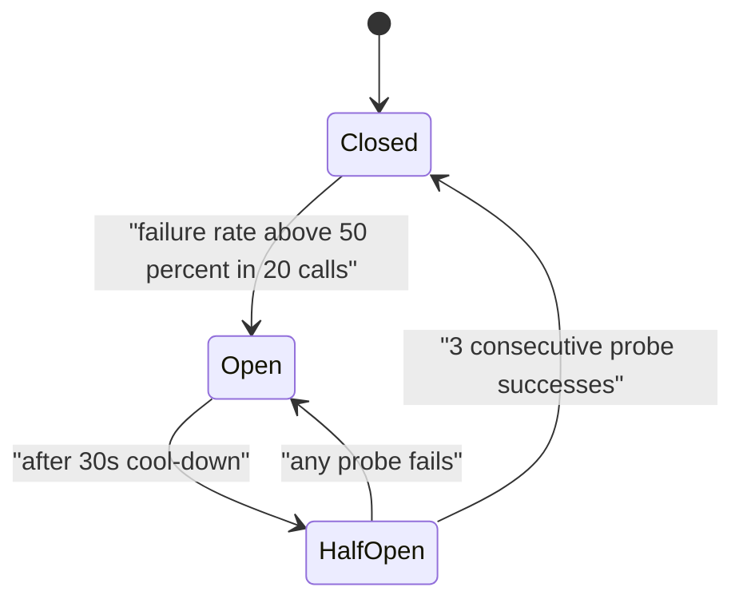
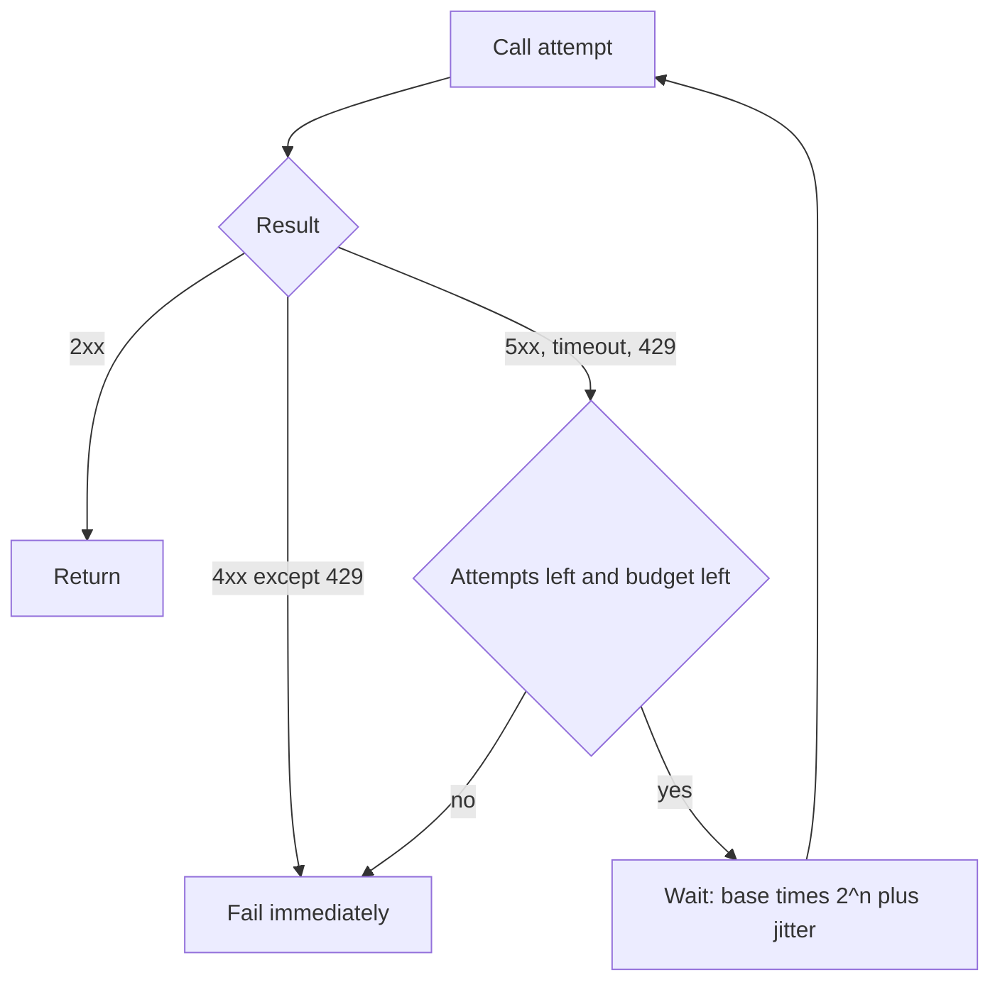
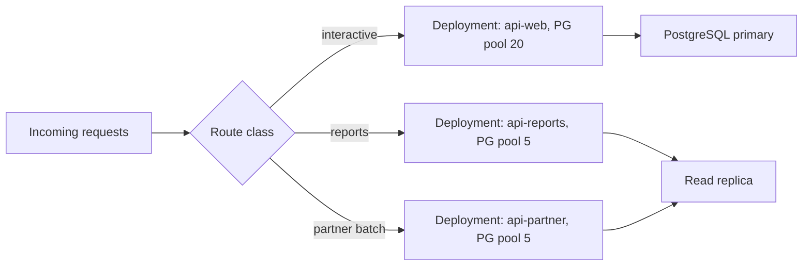
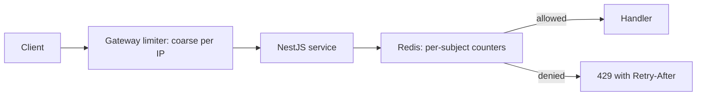
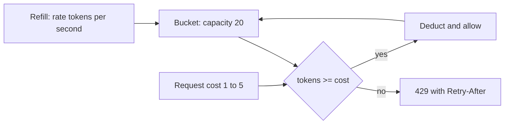
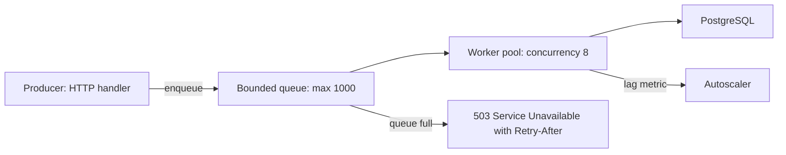

## 62.7 Circuit breaker

### Problem

A downstream service is failing or has become very slow. Your service keeps calling it. Each call occupies a connection, a promise, an event-loop slot and a request context for the full timeout — say 5 seconds. At 200 requests per second, after 5 seconds you have 1,000 in-flight requests waiting on a dependency that is not coming back. Your memory climbs, your own latency explodes, and callers upstream start timing out on *you*. One sick service has made three healthy ones sick.

### Solution

Wrap the call in a state machine that counts failures. After a threshold, the breaker **opens** and calls fail immediately without touching the network. After a cool-down it goes **half-open** and lets a small number of probe requests through. Success closes it; failure re-opens it. The point is not to fix the dependency; it is to fail fast and free your own resources. Part 31 — Reliability Engineering covers the thresholds, the tuning and the interaction with retries in depth; this entry is the catalogue view.

### Architecture



### Example

A breaker around the shipping-rate provider, with the fallback that actually matters: a cached or default answer, not an exception.

```ts
import CircuitBreaker from 'opossum';

@Injectable()
export class ShippingRateService {
  private readonly breaker: CircuitBreaker<[string, number], Quote>;

  constructor(private readonly http: HttpService, private readonly cache: Cache) {
    this.breaker = new CircuitBreaker(
      (zip: string, weightG: number) => this.callProvider(zip, weightG),
      {
        timeout: 2_000,            // a slow call counts as a failure
        errorThresholdPercentage: 50,
        volumeThreshold: 20,       // never trip on 2 requests
        resetTimeout: 30_000,      // cool-down before half-open
      },
    );
    // Fallback must be cheap and local. Never call another remote service here.
    this.breaker.fallback((zip: string) => this.cache.getFlatRate(zip) ?? FLAT_RATE_DEFAULT);
    this.breaker.on('open', () => this.metrics.inc('breaker_open', { dep: 'shipping' }));
    this.breaker.on('halfOpen', () => this.metrics.inc('breaker_half_open', { dep: 'shipping' }));
  }

  quote(zip: string, weightG: number): Promise<Quote> {
    return this.breaker.fire(zip, weightG);
  }
}
```

### Advantages

- Bounded resource usage during a dependency outage. Latency stays flat instead of climbing to the timeout.
- The failing dependency gets breathing room to recover instead of being hammered.
- Explicit, observable state: `breaker_open` on a dashboard is a much better signal than a latency graph.

### Disadvantages

- One more thing to tune wrongly. Too sensitive and it trips on normal noise; too lax and it never helps.
- Open breakers turn partial failures into total ones for that feature.
- Per-process state: with 40 pods you have 40 independent breakers, each needing its own volume of traffic to trip.

### When to use

- Any remote call that can be slow: third-party APIs, cross-service calls, cross-region calls.
- Where a degraded answer exists (cached price, default shipping rate, "try again later" state).

### When NOT to use

- Around your primary database. If PostgreSQL is down you have no service; a breaker only changes the error message while hiding the real signal.
- On calls that must be exactly-once and have no fallback — failing fast just moves the problem.
- Low-traffic endpoints, where the breaker never sees enough calls to decide anything meaningful.

### Edge cases and failure modes

- **Half-open stampede**: the cool-down expires and every pod probes at the same instant, re-killing a recovering dependency. Add jitter to `resetTimeout`.
- **Slow, not failing**: a dependency returning 200s in 9 seconds never trips an error-count breaker. Count timeouts as failures, which is why `timeout` above is set.
- **Breaker plus retry**: retries inside the breaker inflate load and confuse the failure count. Retry outside, or not at all.
- **Shared breaker for multiple endpoints**: one failing endpoint opens the breaker for the healthy ones. Key breakers per dependency *and* per operation class.

### Senior perspective

The question I ask before adding a breaker is: *what do we do when it is open?* If the answer is "return a 500", the breaker bought you resource protection and nothing else — which is still worth it, but say so explicitly. If the answer is "serve last known price", you have a real resilience improvement and the breaker is the mechanism. I also insist on emitting breaker state as a metric with the dependency name as a label. In an incident, "shipping breaker opened at 02:14" collapses twenty minutes of investigation into one glance.

## 62.8 Retry

### Problem

Networks drop packets. Pods get rescheduled. A database fails over for eight seconds. A provider returns 503 for one request in a thousand. Failing the user's checkout because of a transient blip is a bad trade when a second attempt would have worked.

### Solution

Retry, but only for failures that can plausibly succeed on a second attempt, with **exponential backoff plus jitter**, a **hard cap** on attempts, a **total time budget**, and only on operations that are idempotent or protected by an idempotency key. Part 31 — Reliability Engineering has the full treatment including budgets and retry storms; here is the shape and one concrete implementation.

### Architecture



### Example

A retry helper with a *deadline*, which is the part most implementations forget: three retries at 4 seconds each is a 12-second call your caller already gave up on.

```ts
type RetryOpts = { attempts: number; baseMs: number; deadlineMs: number };

export async function retry<T>(fn: (attempt: number) => Promise<T>, o: RetryOpts): Promise<T> {
  const deadline = Date.now() + o.deadlineMs;
  let lastErr: unknown;
  for (let attempt = 1; attempt <= o.attempts; attempt++) {
    try {
      return await fn(attempt);
    } catch (err) {
      lastErr = err;
      if (!isRetryable(err) || attempt === o.attempts) throw err;
      // full jitter: random between 0 and the exponential cap
      const cap = o.baseMs * 2 ** (attempt - 1);
      const wait = Math.floor(Math.random() * cap);
      if (Date.now() + wait >= deadline) throw err;   // no time left, stop pretending
      await sleep(wait);
    }
  }
  throw lastErr;
}

const isRetryable = (e: unknown) =>
  e instanceof TimeoutError ||
  (e instanceof HttpError && (e.status >= 500 || e.status === 429)) ||
  (e as NodeJS.ErrnoException)?.code === 'ECONNRESET';
```

### Advantages

- Turns most transient failures invisible: a database failover becomes a 300 ms latency bump instead of 4,000 errors.
- Cheap to add, and pairs naturally with idempotency keys.
- Jitter spreads load so recovering dependencies are not re-flooded.

### Disadvantages

- Multiplies load exactly when the system is least able to take it.
- Hides real problems from your error rate until they become severe.
- Increases tail latency: a p99 that includes two backoffs looks terrible.

### When to use

- Idempotent reads, and writes protected by an idempotency key or a unique constraint.
- Known-transient errors: connection resets, 503s, lock timeouts, leader elections.
- Between your own services, where you control both retry policy and capacity.

### When NOT to use

- Non-idempotent writes with no dedupe. Retrying `POST /charges` without a key charges the card twice.
- Deep in a call chain where every layer also retries. Three layers of 3 retries is 27 requests. Retry at exactly one layer, usually the outermost that owns the user's deadline.
- On 4xx errors. A 400 will be a 400 forever.
- When a queue would be better: if the work can be asynchronous, enqueue it and let the worker retry with a proper backoff schedule.

### Edge cases and failure modes

- **Retry storm**: a brownout causes every client to retry, tripling load and turning a slow dependency into a dead one. Cap with a token-bucket "retry budget" — for example, allow retries only up to 10 percent of successful call volume.
- **Retries on a full queue**: pointless work while the real problem is capacity.
- **Duplicate side effects**: emails sent twice, stock decremented twice.
- **Budget exhaustion**: the user's 3-second timeout expires while attempt two is still backing off.
- **Retrying a poisoned request**: a malformed payload that always fails burns your retry budget forever.

### Senior perspective

Retries are the single easiest way to convert a small incident into a large one, and they still belong in every serious system. The discipline is in three rules I apply without exception: retry only where the operation is idempotent, retry at exactly one layer of the stack, and always retry against a deadline rather than a count. The fourth rule is a monitoring one — graph *attempts* separately from *requests*. A service whose retry ratio quietly rose from 1.02 to 1.4 over a month is telling you something before it pages you.

## 62.9 Bulkhead

### Problem

Your API serves both a fast product-detail endpoint and a slow report endpoint. Both use the same 20-connection PostgreSQL pool and the same Node event loop. One morning the report query starts taking 30 seconds. Reports occupy all 20 connections. Now product detail — a 2 ms query — cannot get a connection either. A slow feature has taken down a fast one. The name comes from ships: a hull is divided into watertight compartments so one breach does not sink the vessel.

### Solution

Partition resources so that a failure in one workload cannot consume the resources of another. Partition connection pools, thread or worker pools, queues, and in extreme cases whole deployments.

### Architecture



### Example

Two TypeORM `DataSource`s in one NestJS app: a small, replica-backed pool with a hard statement timeout for reports, and the main pool untouched by them.

```ts
@Module({
  imports: [
    TypeOrmModule.forRoot({
      name: 'default',
      type: 'postgres',
      url: process.env.DATABASE_URL,
      extra: { max: 20, connectionTimeoutMillis: 2_000, statement_timeout: 5_000 },
    }),
    TypeOrmModule.forRoot({
      name: 'reporting',                       // separate bulkhead
      type: 'postgres',
      url: process.env.DATABASE_REPLICA_URL,   // different server too
      extra: { max: 5, connectionTimeoutMillis: 1_000, statement_timeout: 60_000 },
    }),
  ],
})
export class DatabaseModule {}

@Injectable()
export class ReportService {
  constructor(@InjectDataSource('reporting') private readonly ds: DataSource) {}
  // Worst case: 5 stuck report queries. Checkout still has all 20 primary connections.
}
```

The same idea at the queue level with BullMQ: separate queues and separate worker concurrency, so a flood of image resizes cannot starve payment webhooks.

```ts
new Worker('payments-webhook', handler, { concurrency: 10, connection });
new Worker('image-resize',    handler, { concurrency: 4,  connection });  // capped on purpose
```

### Advantages

- Failures stay local. A stuck workload degrades one feature instead of the product.
- Makes capacity explicit: you can state "reports may use at most 5 connections".
- Enables different tuning per workload — long statement timeouts for reports, short ones for checkout.

### Disadvantages

- Lower total utilisation. Reserved capacity sits idle when its workload is quiet.
- More configuration and more deployables to reason about.
- Sizing is guesswork until you have production data, and wrong sizes cause artificial queuing.

### When to use

- Mixed workloads on shared resources: interactive plus batch, internal plus partner traffic.
- Multi-tenant systems where one tenant can generate pathological load.
- Any time you can name a workload that is allowed to be slow.

### When NOT to use

- A single homogeneous workload. Partitioning 20 connections into four pools of five just lowers your ceiling.
- As a substitute for fixing the slow query. Bulkheads contain damage; they do not repair it.
- Under tight memory budgets, where each extra pool and process costs real RAM.

### Edge cases and failure modes

- **Undersized bulkhead**: the reserved pool is too small and the workload queues even when the system is idle overall.
- **Shared underlying resource**: two pools on the same PostgreSQL instance still compete for CPU, buffers and locks. Real isolation may need a replica.
- **Event loop is the real bulkhead**: in Node, a CPU-heavy handler blocks *everything* in the process regardless of pool separation. Isolation there means separate processes or worker threads.
- **Connection limit overrun**: 40 pods times 25 connections is 1,000 connections against a `max_connections` of 200. Bulkheads need a global budget, usually via PgBouncer.

### Senior perspective

Bulkheads are how you buy the right to have slow features. Once I can say "reports run on the replica, with five connections and a sixty-second statement timeout", the report team is free to write expensive queries and the checkout team stops caring. The most valuable bulkhead in a Node system is usually the crudest one: a separate deployment. Same image, different `--role` flag, different replica count, different HPA target. It costs a few hundred megabytes of memory and removes an entire class of incident.

## 62.10 Rate limiter

### Problem

Any endpoint open to the internet will eventually be hit far harder than you planned: a partner's buggy retry loop, a scraper, a credential-stuffing attack, or your own mobile app after a push notification. Without a limit, the first symptom is your database at 100 percent CPU and every customer affected by one caller.

### Solution

Count requests per subject (API key, user, IP) per window and reject once the count exceeds the allowance, with a `429` and a `Retry-After`. The counter must be shared across pods, which in practice means Redis. Part 27 — Caching and Redis and the rate limiter case study in Part 55 cover algorithms, tiering and headers in detail; this entry is the architectural placement.

### Architecture



### Example

Two layers, which is the part people miss. A cheap global limit at the edge, and a precise business limit in the app with `@nestjs/throttler` backed by Redis so all pods share one counter.

```ts
@Module({
  imports: [
    ThrottlerModule.forRootAsync({
      useFactory: () => ({
        throttlers: [
          { name: 'short', ttl: 1_000, limit: 20 },     // burst protection
          { name: 'long',  ttl: 60_000, limit: 300 },   // sustained rate
        ],
        storage: new ThrottlerStorageRedisService(process.env.REDIS_URL),
      }),
    }),
  ],
  providers: [{ provide: APP_GUARD, useClass: ThrottlerGuard }],
})
export class AppModule {}

@Controller('auth')
export class AuthController {
  // Auth endpoints get a much tighter limit than the global default.
  @Throttle({ short: { ttl: 60_000, limit: 5 } })
  @Post('login')
  login(@Body() dto: LoginDto) { /* ... */ }
}
```

### Advantages

- Protects capacity and cost from a single bad actor.
- Turns credential stuffing from feasible into impractical.
- Becomes a product feature: documented tiers for free and paid partners.

### Disadvantages

- Adds a Redis round trip (0.3 to 0.8 ms in-AZ) to every request.
- Shared IPs behind corporate NAT or carrier-grade NAT punish innocent users.
- Wrong limits are invisible until a customer complains about `429`s during their peak.

### When to use

- Every public endpoint. Especially login, password reset, OTP send and search.
- Multi-tenant APIs where fairness matters.
- Expensive endpoints: exports, reports, anything that fans out.

### When NOT to use

- Internal service-to-service calls where the right control is concurrency limiting and backpressure, not rejection.
- As your only defence against abuse. A limiter does not stop a distributed attack from 50,000 IPs; that needs WAF and bot management.

### Edge cases and failure modes

- **Redis down**: decide fail-open or fail-closed *per route*. Fail-open on product browsing, fail-closed on login.
- **Hot key**: one enormous tenant makes a single Redis key a bottleneck. Shard the key or use per-pod local limits with a global ceiling.
- **Clock skew** between pods when using fixed windows causes double allowance at boundaries. Sliding window or token bucket fixes it.
- **Retry-After ignored**: clients that retry immediately turn a limit into a hot loop. Emit the header and expect it to be ignored anyway.

### Senior perspective

Rate limiting is one of the very few controls that protects you from problems you did not predict. I put a generous global limit on day one — high enough that nobody notices, low enough that a runaway loop cannot melt the database — and tighten specific endpoints as they earn attention. Two design details matter more than the algorithm: the limiter must never be able to take the API down (so its failure mode is a per-route policy decision), and it must return honest headers so partners can self-regulate instead of filing tickets.

## 62.11 Token bucket

### Problem

Fixed-window counters are simple and wrong at the edges: a client with a limit of 100 per minute can send 100 at 11:59:59 and 100 at 12:00:00, delivering 200 requests in one second. Meanwhile a real client's traffic is bursty by nature — a page load fires eight requests at once and then nothing for a minute. A limiter that forbids bursts breaks legitimate usage; one that ignores them permits abuse.

### Solution

Model the allowance as a bucket of tokens with a **capacity** (burst size) and a **refill rate** (sustained rate). Each request removes tokens equal to its cost. If tokens are unavailable, reject or wait. Capacity and rate are two independent dials: "300 per minute, burst 20" is expressible, unlike a fixed window. Part 27 derives the algorithm; here is the placement and the atomic implementation.

### Architecture



### Example

The whole pattern in one Redis Lua script. Atomicity matters: read-then-write from Node lets two pods spend the same token.

```lua
-- KEYS[1] = bucket key, ARGV = capacity, refillPerSec, nowMs, cost, ttlSec
local b = redis.call('HMGET', KEYS[1], 'tokens', 'ts')
local capacity, rate = tonumber(ARGV[1]), tonumber(ARGV[2])
local now, cost      = tonumber(ARGV[3]), tonumber(ARGV[4])
local tokens = tonumber(b[1]) or capacity
local ts     = tonumber(b[2]) or now
-- lazy refill: no background job, we compute elapsed time on read
tokens = math.min(capacity, tokens + ((now - ts) / 1000.0) * rate)
local allowed = 0
if tokens >= cost then tokens = tokens - cost; allowed = 1 end
redis.call('HMSET', KEYS[1], 'tokens', tokens, 'ts', now)
redis.call('EXPIRE', KEYS[1], tonumber(ARGV[5]))   -- idle buckets disappear
-- returns: allowed, tokens left, ms until one token is available
return { allowed, math.floor(tokens), math.floor(math.max(0, (cost - tokens) / rate * 1000)) }
```

```ts
const [allowed, remaining, retryAfterMs] = await this.redis.evalsha(
  this.sha, 1, `rl:{${apiKey}}:search`, 20, 5, Date.now(), 5, 3600,
); // capacity 20, 5 per second, this request costs 5 units
```

### Advantages

- Bursts allowed on purpose, up to a number you chose.
- Lazy refill means no background timer and O(1) memory per subject (about 120 bytes).
- Per-request cost falls out naturally: a search costs 5, a read costs 1.
- One round trip and one atomic operation.

### Disadvantages

- Two parameters to explain to partners instead of one.
- Redis-dependent for correctness across pods.
- Floating-point token accounting needs care with very low rates.

### When to use

- Public APIs with documented burst and sustained limits.
- Outbound throttling toward a provider that publishes "200 requests per second".
- Any place where you want to smooth rather than block: a leaky-bucket variant queues instead of rejecting.

### When NOT to use

- When you need a strict "no more than N in any rolling 60 seconds" guarantee for compliance. Use a sliding-window log; the bucket permits a burst on top of the rate.
- Single-process tools, where an in-memory counter is fine and Redis is overkill.

### Edge cases and failure modes

- **Clock skew**: `nowMs` supplied by the client pod can jump backwards. Use Redis `TIME` inside the script if pods drift.
- **Key expiry mid-burst**: a bucket that expires refills to full capacity, granting a free burst. Set the TTL longer than the full refill time.
- **Cluster slots**: use a hash tag (`{apiKey}`) so all keys for a subject live on one shard and the script stays single-slot.
- **Cost larger than capacity**: a request costing 30 against a 20 bucket can never succeed. Validate at config time.

### Senior perspective

I default to token bucket for everything user-facing because it matches how real clients behave: bursty, then quiet. The two numbers also make good contract language — "5 requests per second sustained, bursts of 20" is something a partner engineer can implement against. Where I have been burned is Redis Cluster: without hash tags the script touches multiple slots and fails in production but not in your single-node dev Redis. Test limiters against the topology you actually run.

## 62.12 Backpressure with bounded queues

### Problem

Producers are faster than consumers. An upload endpoint accepts files faster than the resizer can process them; a Kafka consumer reads faster than it can write to PostgreSQL; a Node stream reads a 2 GB file faster than it can push to S3. Unbounded buffering absorbs the difference — until it does not. The classic Node failure is an in-memory array that grows until the pod is `OOMKilled`, losing every item in it.

### Solution

Make every buffer bounded, and make "full" mean something. When the buffer is full, the producer must slow down, block, or be rejected. This is backpressure: the signal that flows *backwards* from a slow consumer to a fast producer. Part 31 covers load shedding and admission control; here is the queue-shaped version.

### Architecture



### Example

A bounded in-process queue for a write-behind path, plus the Kafka consumer equivalent where backpressure means *pausing the partition* instead of buffering.

```ts
@Injectable()
export class EventIngestService {
  private readonly queue: Batch[] = [];
  private readonly MAX = 1_000;              // bounded, on purpose
  private draining = false;

  enqueue(batch: Batch): void {
    if (this.queue.length >= this.MAX) {
      this.metrics.inc('ingest_shed');
      throw new ServiceUnavailableException('ingest saturated'); // shed, do not buffer
    }
    this.queue.push(batch);
    void this.drain();
  }

  private async drain(): Promise<void> {
    if (this.draining) return;
    this.draining = true;
    try {
      while (this.queue.length) {
        const chunk = this.queue.splice(0, 100);
        await this.repo.insertMany(chunk);    // one round trip per 100 rows
      }
    } finally {
      this.draining = false;
    }
  }
}
```

```ts
// KafkaJS: real backpressure is pausing the partition, not growing an array.
await consumer.run({
  partitionsConsumedConcurrently: 3,
  eachBatch: async ({ batch, resolveOffset, heartbeat, pause }) => {
    if (this.db.pool.waitingCount > 20) {
      const resume = pause();                 // stop fetching from this partition
      setTimeout(resume, 5_000);
      return;
    }
    for (const m of batch.messages) {
      await this.handle(m);
      resolveOffset(m.offset);
      await heartbeat();                      // avoid rebalance during slow batches
    }
  },
});
```

### Advantages

- Memory usage becomes predictable and provable, not hopeful.
- Overload turns into explicit, observable rejection (`503`, shed counter) instead of a silent death.
- Queue depth becomes a first-class autoscaling and alerting signal.

### Disadvantages

- You must decide what to do when full, and every option is unpleasant: reject, block, or drop.
- Bounded queues surface capacity problems loudly and early, which feels worse than it is.
- Blocking producers can propagate stalls upstream if you did not intend that.

### When to use

- Every producer-consumer boundary: HTTP to worker, Kafka to database, stream to storage.
- Ingest endpoints where traffic spikes are expected.
- Anywhere memory is bounded (containers) and input is not.

### When NOT to use

- Never skip bounding. But do not add an in-process queue at all when a durable broker is the right answer: an in-memory queue loses everything on restart, and "we buffer in memory for durability" is not a plan.
- When the work must not be dropped and the producer cannot be slowed — then you need durable buffering with disk, not a bigger array.

### Edge cases and failure modes

- **The queue that isn't**: `Promise.all` over 50,000 items is an unbounded queue with extra steps. Use a concurrency limiter.
- **Consumer lag masking**: pausing partitions stops lag from growing in memory but grows it in the broker. Alert on consumer lag, not just RAM.
- **Rebalance during pause**: a paused consumer that stops heartbeating is kicked out of the group, causing a rebalance storm.
- **Shed the wrong traffic**: dropping checkout while accepting analytics. Prioritise by request class before you shed.
- **Silent drops**: dropping without a metric turns data loss into a mystery three weeks later.

### Senior perspective

Backpressure is the pattern that separates systems that degrade from systems that die. My review question for any queue, buffer, array or `Promise.all` in a service is simply: *what is the maximum size of this, and what happens when it is reached?* If the author cannot answer with a number, the code is an outage waiting for a traffic spike. The corollary is that rejecting work is a legitimate, healthy behaviour. A service returning `503` on 2 percent of ingest requests while serving the other 98 percent at normal latency is doing its job perfectly; a service that accepts everything and then falls over serves zero percent.
