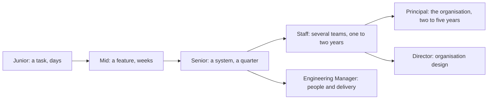

# Part 63 — Junior to Principal: What Is Expected at Each Level

Every company writes its own career ladder, and most of them are vague in the same way: "demonstrates increasing impact and scope". True, and useless on a Monday morning when you want to know what to do differently.

This part is the concrete version. It describes what each level actually looks like in a backend team building NestJS services on PostgreSQL, Redis and Kafka: what you do, what you are trusted to own, what you have stopped getting wrong, and what would get you to the next level. Titles vary between companies — some have no Staff level, some call Principal "Distinguished" — but the behaviours are remarkably consistent, because they are shaped by the same underlying thing: how much uncertainty you can absorb and how far your work travels beyond your own hands.

## 63.1 The levels in one page

Five dimensions separate the levels. Everything else is downstream of these.

| Dimension | Junior | Mid | Senior | Staff | Principal |
|---|---|---|---|---|---|
| **Scope** | A task | A feature or component | A system or service | Multiple systems, a team's area or a domain | An engineering-wide area, or the company's technical direction |
| **Ambiguity** | Told what to build and often how | Told what to build, decides how | Told the problem, defines what to build | Finds the problem worth solving | Decides which problems the organisation should have |
| **Impact** | Your own output | Your team's feature velocity | Your team's outcomes and reliability | Several teams' outcomes | The company's ability to build and operate systems |
| **Influence** | Learns from others | Helps peers | Sets the bar on a team; mentors | Aligns teams without authority; writes the strategy | Changes how the organisation thinks; hires and sets standards |
| **Time horizon** | Days to a sprint | Weeks | A quarter to two quarters | One to two years | Two to five years |

### 63.1.1 The title versus the behaviour

Two things are worth saying plainly.

**Titles are calibrated locally.** A "Senior Engineer" at a 30-person startup and at a 3,000-person platform company can be two levels apart in either direction. Do not use your title as evidence about yourself, in either direction. Use the behaviours.

**Behaviour comes before the title, always.** Nobody is promoted to Senior and *then* starts making senior decisions. The sequence is: you start operating at the next level, you do it consistently for two or three quarters on work that matters, other people notice without you telling them, and then the title catches up. If you are waiting for the title to start behaving differently, you will wait forever. This is the single most common career mistake I see, and it costs people years.

The corollary: if you have been operating at the next level visibly for a year and the title has not followed, that is information about the company, not about you. Ask directly what is missing, get a specific answer, and if the answer is not specific, consider that promotion may be faster elsewhere.

### 63.1.2 The individual contributor track versus management

Beyond senior, the ladder forks. Both branches are the same seniority; they differ in the material you work with.

The **IC track** (Staff, Principal) scales your technical judgment: you work through designs, standards, prototypes, reviews and writing. You still code, less than before, and mostly on the hard or risky parts. Your leverage comes from decisions that many people build on.

The **management track** works through people: hiring, growth, performance, prioritisation, and the health of a team. It is a different job, not a promotion from engineering. The most common mistake is taking it because it looks like the only way up; the second most common is believing you can do it "part time" while remaining the team's main coder.

Two honest signals. If your best days are the ones where you unblocked four people and shaped a plan, management may suit you. If your best days are the ones where you solved something nobody else could and left a design that will hold for three years, stay on the IC track. And note that the switch is reversible in both directions in most healthy companies, though returning to IC after three years of management costs six months of catching up.

## 63.2 Expectations by engineering area

This is the heart of the part. For each area you get a five-column table with three unlabeled rows, always in the same order:

1. **What they typically do** at that level.
2. **What they are trusted to own** without supervision.
3. **The failure they have stopped making** — often the most diagnostic row.

Then two or three paragraphs of context and one concrete example per level. Read the row for your current level, then read the one to the right; the gap between them is your development plan.

### 63.2.1 Programming and TypeScript

| Junior | Mid | Senior | Staff | Principal |
|---|---|---|---|---|
| Writes working code with review guidance; uses the types the codebase already has | Writes clean, tested code independently; uses generics, unions and narrowing correctly | Designs types that make invalid states unrepresentable; keeps `strict` on and knows why | Sets language standards across teams; owns shared libraries and lint policy | Decides language and runtime direction; judges when TypeScript is not the right tool for a workload |
| A function or class inside an existing module | A feature end to end within a service | A service's internal architecture and type contracts | The shared kernel: SDKs, error types, config libraries | The engineering-wide programming model |
| Stopped fighting the compiler with `any` | Stopped writing types that merely describe the shape after the fact | Stopped clever type gymnastics that nobody else can read | Stopped adding abstractions that only the author benefits from | Stopped believing a language choice will fix an organisational problem |

TypeScript maturity is not measured by knowledge of conditional types. It is measured by whether your types prevent bugs at compile time that would otherwise be caught in production. A senior models an order as a discriminated union where `status: 'paid'` carries `paidAt` and `paymentId` as required fields, so the "paid order with no payment id" bug cannot be written. That is worth more than any amount of mapped-type cleverness.

The other senior marker is knowing where types stop. Data crossing a boundary — HTTP body, queue message, database row, third-party response — is `unknown` until validated at runtime. An interface asserting that a Kafka payload has a `userId` is a comment with syntax highlighting, not a guarantee.

- **Junior**: implements `calculateShippingCost` against an existing interface, with tests, after two review rounds.
- **Mid**: builds the whole shipping module, including DTOs with `class-validator`, and handles the nullable-address edge case unprompted.
- **Senior**: replaces a `status: string` with a discriminated union across the order domain, deleting nine defensive `if` statements and one class of production bug.
- **Staff**: writes the shared `@company/errors` package with typed error codes that three teams' clients depend on, and versions it properly.
- **Principal**: decides that the new video-transcoding pipeline is written in Go rather than Node, with a written rationale about CPU-bound workloads, and sets what "supported language" means for the company.

### 63.2.2 Node.js runtime

| Junior | Mid | Senior | Staff | Principal |
|---|---|---|---|---|
| Uses `async/await`; knows promises resolve later | Understands the event loop, microtasks, and why blocking code hurts | Diagnoses event-loop lag, memory growth and GC pauses from production evidence | Sets runtime standards: versions, flags, container memory ratios | Decides where Node belongs in the architecture and where it does not |
| A handler that awaits correctly | A module that does not block the loop | The runtime behaviour of a service under load | The Node platform baseline across services | The runtime strategy and its cost model |
| Stopped using sync file APIs in a request path | Stopped `await`-ing in a loop where parallelism was safe | Stopped guessing at memory issues instead of taking a heap snapshot | Stopped letting each team pick a different Node version and flag set | Stopped using one runtime for every workload out of habit |

The mid-to-senior jump here is diagnostic ability. A mid-level engineer knows the event loop exists; a senior has looked at `event_loop_lag_p99` climbing to 400 ms during a report generation and traced it to a synchronous `JSON.stringify` on a 40 MB object, then moved the work to a worker thread and proved the fix on the graph.

Memory is the other divider. `--max-old-space-size` set equal to the container limit is the classic OOMKill: V8 delays a major collection because it believes it has room, and the kernel kills the process first. Seniors know the rule of thumb that resident memory runs 150-250 MB above the heap limit, and they set the container limit above that, not equal to it.

- **Junior**: fixes a bug by awaiting a promise that was previously fired and forgotten.
- **Mid**: replaces a sequential loop of 200 HTTP calls with a bounded-concurrency batch of 10, cutting a job from 90 s to 12 s.
- **Senior**: catches a slow memory leak from an unbounded `Map` cache using heap snapshots taken 30 minutes apart, and adds an LRU bound plus a heap-usage alert.
- **Staff**: standardises Node 22 across nine services with a shared base image, one upgrade playbook, and a compatibility matrix for native modules.
- **Principal**: writes the position paper on when a workload should leave Node for a JVM or Go service, with cost and latency numbers from real internal benchmarks.

### 63.2.3 NestJS and application architecture

| Junior | Mid | Senior | Staff | Principal |
|---|---|---|---|---|
| Adds controllers and services to existing modules | Builds modules with correct providers, guards, pipes and interceptors | Designs module boundaries, the request lifecycle and cross-cutting concerns | Defines the reference application architecture used by several teams | Sets the architectural direction and the criteria for splitting or merging services |
| An endpoint | A feature module | A service's structure and its public contracts | The shared application template and libraries | The system landscape |
| Stopped putting business logic in controllers | Stopped injecting a repository into a controller to save time | Stopped letting modules import each other's internals | Stopped shipping a template that assumes every service is a CRUD API | Stopped solving organisational coupling with technical splits |

The senior skill in NestJS is not knowing more decorators. It is deciding what belongs in a guard versus an interceptor versus the service, keeping the domain logic free of framework types, and enforcing module boundaries so the codebase can be split later without a data migration.

Watch for the tell: in a mature codebase, the domain services do not import `@nestjs/common` except for `@Injectable`. Framework concerns live at the edges. That single property is what makes a five-year-old codebase upgradable.

- **Junior**: adds `GET /products/:id` to the catalogue controller and wires it to the existing service.
- **Mid**: builds the whole promotions module with a `ValidationPipe`, a caching interceptor and unit tests for the service.
- **Senior**: introduces a module-boundary lint rule and a domain-event bus so that the orders module never queries inventory tables directly.
- **Staff**: publishes the service template: health checks, graceful shutdown, config schema, logging, tracing, error filter, all wired and tested, so a new service is production-ready on day one.
- **Principal**: decides the company runs a modular monolith plus three extracted services rather than fifteen microservices, and writes the criteria for future extractions.

### 63.2.4 API design

| Junior | Mid | Senior | Staff | Principal |
|---|---|---|---|---|
| Adds endpoints following existing patterns | Designs a resource with correct status codes, pagination and validation | Designs contracts that can evolve: versioning, deprecation, idempotency, error shapes | Sets API standards and governance across teams | Decides the company's API strategy: public surface, partner model, protocol choices |
| One endpoint | One resource | A service's public API and its compatibility guarantees | The API style guide and review process | The external contract with customers and partners |
| Stopped returning 200 with an error body | Stopped returning entities directly from controllers | Stopped making breaking changes without a deprecation path | Stopped letting three teams invent three error formats | Stopped adding public surface faster than the company can support it |

The defining senior insight is that an API is a promise you cannot take back. Once a mobile app in the field consumes your response, that shape is frozen for as long as old versions run, which for mobile is years. Everything follows from that: additive changes only, explicit versioning, deprecation with dates and metrics, and pagination that does not break when data shifts underneath the client.

Error design is the neglected half. A consistent envelope with a stable machine-readable `code`, a human `message`, and a `correlationId` is worth more to your integrators than any amount of endpoint elegance, because it is what they build their retry and alerting logic on.

- **Junior**: adds `POST /reviews` returning 201 with a `Location` header after being shown the pattern.
- **Mid**: designs `/orders` with filtering, sorting, pagination, and DTO validation that rejects unknown fields.
- **Senior**: migrates order history to keyset pagination with a versioned opaque cursor, keeps the old parameters for two releases, and tracks deprecated usage to decide when to remove them.
- **Staff**: writes the API style guide — error envelope, pagination, idempotency keys, naming, versioning — and gets four teams to adopt it by making it the default in the service template.
- **Principal**: decides the partner integration is webhooks plus a REST API rather than a GraphQL gateway, based on the integration capabilities of actual partners.

### 63.2.5 SQL and data modelling

| Junior | Mid | Senior | Staff | Principal |
|---|---|---|---|---|
| Writes joins and aggregates; uses the ORM for most access | Writes efficient multi-table queries; models tables with sensible keys and constraints | Models for invariants, growth and change; reaches for raw SQL when the ORM is wrong | Sets modelling standards and data ownership rules across services | Decides the company's data architecture: what is relational, what is not, who owns what |
| A query | A table and its access patterns | A domain's schema and its evolution path | The data ownership map and the review bar | The data platform strategy |
| Stopped using `SELECT *` in application code | Stopped modelling with nullable columns instead of proper relations | Stopped encoding invariants only in application code | Stopped letting services reach into each other's tables | Stopped duplicating the same entity in six systems with no owner |

Modelling is where the biggest long-term differences appear, because the schema outlives the code. A senior asks what must always be true and pushes it into the database: unique constraints, foreign keys, check constraints, exclusion constraints for overlapping ranges. Application-level validation is a convenience; the database is the only place where a rule cannot be bypassed by a script, a backfill or a second service.

The other senior habit is preserving facts. Store the events that produced the state, not only the state. Almost every "we cannot answer that question" moment in a company's data history is a moment where somebody stored only the current value.

- **Junior**: writes a three-table join with a `GROUP BY` for a report, guided in review.
- **Mid**: designs the `subscriptions` schema with proper foreign keys and a unique constraint on active subscriptions per customer.
- **Senior**: adds an append-only `subscription_events` table, a check constraint enforcing non-negative balances, and range partitioning on the events table before it grows.
- **Staff**: publishes the data ownership map — one writer per table, cross-service reads through APIs, views for analytics — and enforces it in design review.
- **Principal**: decides the customer master record lives in one system with the others subscribing to change events, ending three years of duplicated customer data.

### 63.2.6 PostgreSQL operations and performance

| Junior | Mid | Senior | Staff | Principal |
|---|---|---|---|---|
| Runs queries; knows an index makes things faster | Reads `EXPLAIN ANALYZE` and adds the right index | Diagnoses locks, bloat, vacuum, replication lag, connection exhaustion and plan changes under production pressure | Sets database standards, capacity model and review gates for all teams | Owns the database strategy: engines, topology, managed versus self-run, DR posture |
| A query's performance | A table's indexes and query patterns | A database's health and its operational limits | The fleet: sizing, upgrades, pooling, backups | The data platform and its risk profile |
| Stopped testing performance on a 500-row dev database | Stopped adding an index per slow query without auditing existing ones | Stopped guessing at causes instead of reading `pg_stat_activity` and `pg_stat_statements` | Stopped letting each team discover connection limits during an incident | Stopped treating the database as infrastructure somebody else worries about |

The senior level here is defined by comfort with the operational catalogue. When latency triples, they check for lock waits, idle-in-transaction sessions, a plan flip after an `ANALYZE`, autovacuum falling behind, or a replica lagging — in a deliberate order, using evidence rather than folklore.

Connection management is the most common blind spot. Pods times pool size times the rolling-deploy surge is the number that hits `max_connections`, and it is discovered during a deploy at peak traffic if nobody computed it in advance. A senior computes it in advance and puts PgBouncer in front when the arithmetic demands it.

- **Junior**: adds an index on `orders.customer_id` after a slow query is pointed out.
- **Mid**: reads a plan, spots a `Seq Scan` with a huge `Rows Removed by Filter`, and fixes it with a composite index in the right column order.
- **Senior**: resolves a production stall by finding 180 idle-in-transaction sessions caused by an HTTP call inside a transaction, then fixes the pattern and adds an alert on the metric.
- **Staff**: rolls out PgBouncer and a standard pool-sizing formula across nine services, and runs the major-version upgrade programme with a tested rollback.
- **Principal**: decides that analytics moves off the primary to a separate warehouse fed by change data capture, with a cost and staffing plan.

### 63.2.7 ORM usage

| Junior | Mid | Senior | Staff | Principal |
|---|---|---|---|---|
| Uses repository methods and relations as documented | Controls eager and lazy loading; avoids N+1; uses the query builder | Knows exactly what SQL the ORM emits and when to bypass it; owns transaction boundaries | Sets ORM conventions, migration tooling and the escape hatch policy | Decides whether an ORM is used at all, and what the persistence strategy is |
| A repository call | A feature's data access | A service's persistence layer and its transaction semantics | The shared data-access conventions | The persistence approach across the estate |
| Stopped triggering N+1 without noticing | Stopped loading whole entity graphs to read two fields | Stopped letting the ORM own transaction boundaries implicitly | Stopped tolerating three different migration tools in one estate | Stopped arguing about ORMs as an identity rather than a trade-off |

The senior position on ORMs is unsentimental: they are excellent for the 90 percent of access that is simple CRUD, and actively harmful for complex reads, bulk operations and anything where the exact plan matters. Use the ORM for entity persistence and unit-of-work semantics; drop to raw SQL for reporting queries, upserts at volume, window functions and recursive queries. The tell of maturity is a codebase where both coexist without apology.

Transaction boundaries are the senior's real concern. Who opens the transaction, how long it stays open, whether a network call happens inside it, and whether a retry is safe. Those questions decide whether your database survives a bad afternoon.

- **Junior**: uses `find` with `relations` and does not know a join was generated.
- **Mid**: spots 200 queries in a log for one request and fixes the N+1 with a single `leftJoinAndSelect`.
- **Senior**: moves an outbox insert and the order write into one explicit `dataSource.transaction`, removes an HTTP call from inside it, and documents the retry semantics.
- **Staff**: standardises on one migration tool with a review gate for lock-taking statements, across every service.
- **Principal**: sets the direction that read models for reporting are built as SQL views and materialised tables owned by the data team, not as ORM entities.

### 63.2.8 Caching

| Junior | Mid | Senior | Staff | Principal |
|---|---|---|---|---|
| Adds a cache with a TTL where told | Chooses keys and TTLs; understands invalidation basics | Designs for stampedes, staleness budgets, hot keys and cache-down behaviour | Sets caching standards, memory policy and the shared Redis topology | Decides the caching strategy and its cost/consistency posture company-wide |
| A cached value | A feature's caching behaviour | A service's cache design and failure modes | The Redis platform and its limits | The consistency model the business accepts |
| Stopped caching without a TTL | Stopped caching data that must be correct immediately | Stopped assuming the database can absorb a cold cache | Stopped letting every team share one Redis with no eviction policy | Stopped paying for caching complexity where correctness was the requirement |

The senior questions about a cache are always the same three: what is the staleness budget in seconds, what happens when Redis is unavailable, and can the database survive the cold-start load. A cache designed without answering the third one is an outage amplifier, because the failure of the cache and the overload of the database happen at the same moment.

The second-order skills are stampede protection (a lock or a single-flight so a thousand concurrent misses become one database query), negative caching so a missing key does not hammer the database, and jittered TTLs so a thousand keys do not expire in the same second.

- **Junior**: adds a 60-second cache to a product endpoint using `@nestjs/cache-manager`.
- **Mid**: designs the key scheme with a version prefix so a deploy can invalidate a whole namespace, and picks TTLs per data type.
- **Senior**: adds single-flight protection with a Redis lock, a stale-while-revalidate path, jittered TTLs, and a fallback that limits concurrent database calls when Redis is down.
- **Staff**: separates the shared Redis into cache and session instances with different `maxmemory-policy` settings, because eviction of sessions was logging people out.
- **Principal**: rules that financial balances are never served from cache, and defines which data classes may be cached and for how long.
