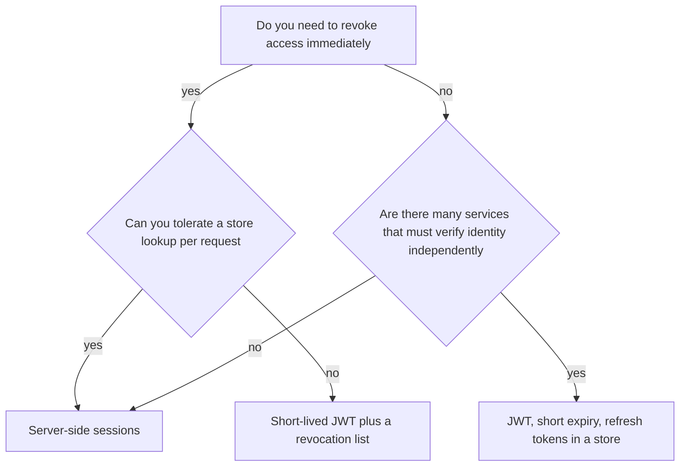
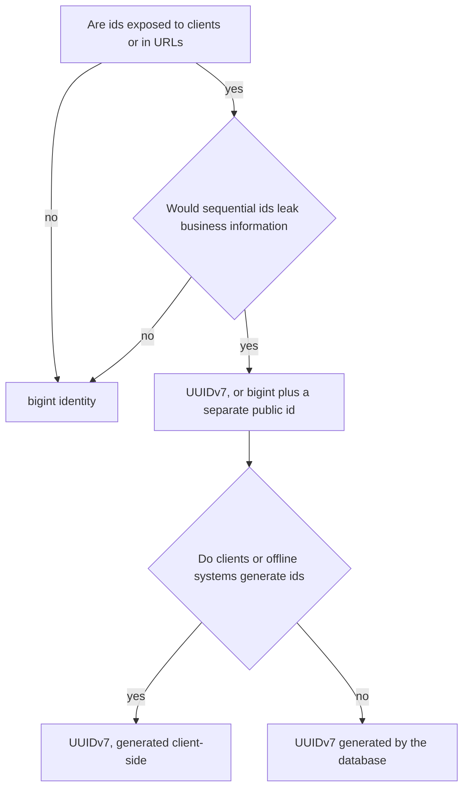
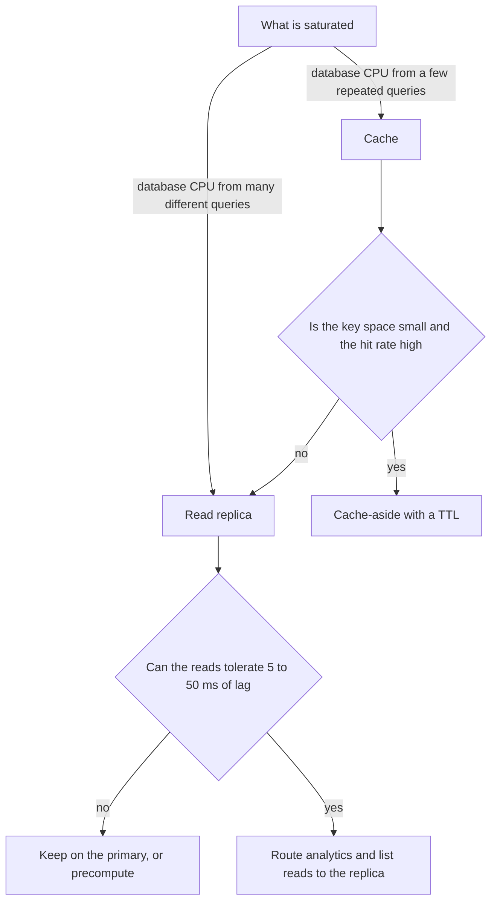
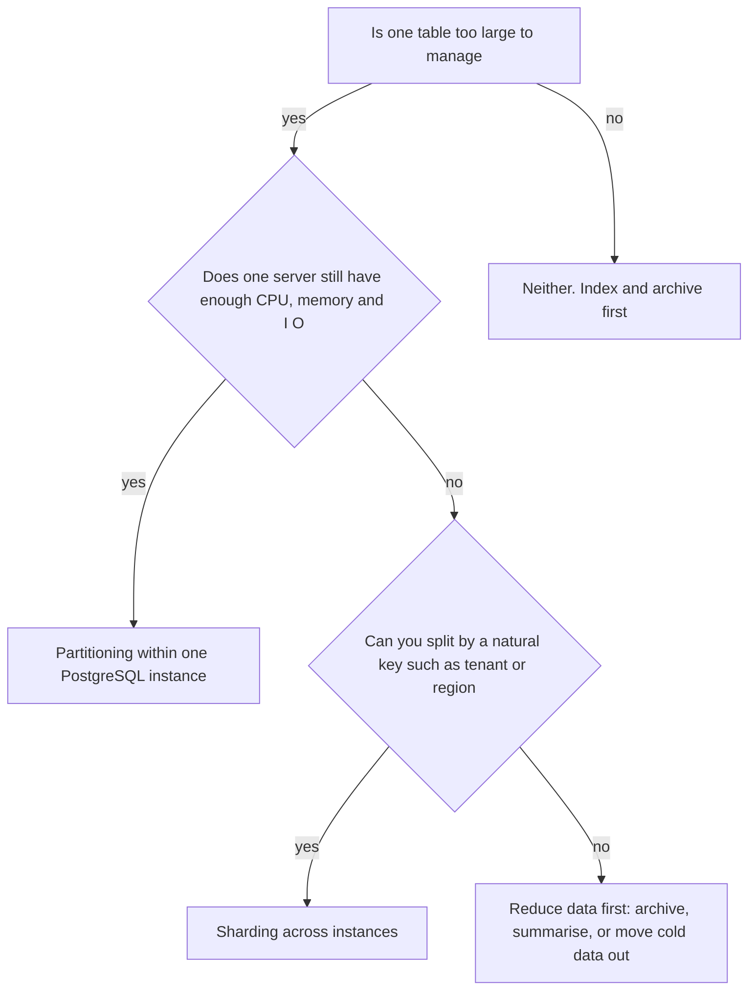

## 63.13 JWT versus sessions

### Decision tree



### If... then choose

```text
If you run one application and want the simplest correct thing
   -> Choose server-side sessions in Redis with an httpOnly cookie
If you must revoke a user's access within seconds, for example on a ban
   -> Choose sessions, or JWTs with a 5-minute expiry and a revocation check
If many independent services must verify identity without calling an auth service
   -> Choose JWT signed with an asymmetric key, verified locally against JWKS
If you are building a public API for third-party clients
   -> Choose OAuth 2 with short-lived JWT access tokens and opaque refresh tokens
If you have a mobile app that must stay logged in for weeks
   -> Choose short-lived access tokens plus a rotating refresh token stored server-side
If your reason for JWT is that it is stateless and therefore scalable
   -> Choose sessions; a Redis lookup is 0.3 ms and you are not at the scale where that matters
```

The practical answer for most systems is a hybrid: a short-lived JWT access token (5 to 15 minutes) that services verify locally, plus a long-lived refresh token that is stored server-side, single-use and rotated. You get local verification for the hot path and real revocation at the refresh boundary.

```ts
@Injectable()
export class TokenService {
  async issue(userId: string, sessionId: string) {
    const accessToken = await this.jwt.signAsync(
      { sub: userId, sid: sessionId, scope: 'user' },
      { expiresIn: '10m', algorithm: 'RS256' },          // services verify with the public key
    );
    const refreshToken = randomBytes(32).toString('base64url');
    await this.redis.set(`rt:${sha256(refreshToken)}`, JSON.stringify({ userId, sessionId }),
      'EX', 60 * 60 * 24 * 30);                           // opaque, revocable, rotated on use
    return { accessToken, refreshToken };
  }

  async revokeSession(sessionId: string) {
    await this.redis.set(`revoked:${sessionId}`, '1', 'EX', 900);  // covers the access-token window
  }
}
```

### Trade-offs

| Dimension | Server-side sessions | JWT |
|---|---|---|
| Consistency | Always current; a change to permissions takes effect on the next request | Stale until expiry; claims are a snapshot from issue time |
| Latency | One store lookup, 0.3 to 1 ms | Signature verification, roughly 0.1 ms with a cached key |
| Throughput | Bounded by the session store, which is very high with Redis | No store to bound it |
| Operational cost | A session store to run, size and back up | Key management, rotation and JWKS distribution |
| Team skill | Simple and familiar | Easy to implement insecurely: `alg: none`, missing audience checks, long expiry |
| Flexibility | Change session content freely at any time | Claims are fixed until the token is reissued |
| Money cost | Memory for sessions, typically small | Effectively zero |
| Ecosystem | Built into every framework | Universal across languages and platforms |
| Failure modes | Session store outage logs everyone out; sticky-session mistakes | Cannot revoke, token theft is high-impact, clock skew, key rotation breakage, oversized cookies |

### Signals you chose wrong

- Support asks you to ban a user and the honest answer is "in 24 hours, when their token expires".
- Your JWT has grown to 4 KB of permissions and now every request carries it, and some proxies reject the header size.
- You built a JWT denylist checked on every request, which is a session store with extra cryptography.
- You chose sessions and a Redis failover logged out every user during business hours, with no graceful degradation.
- Your access tokens live for 30 days "for convenience", which means a stolen token is valid for a month.

### How to change your mind later

Sessions to JWT: issue both for a transition period. The session cookie keeps working while clients start sending the bearer token, and services accept either. Once traffic on the cookie path is zero, remove it. Two to four weeks.

JWT to sessions: harder because clients hold tokens you cannot recall. Keep verifying existing JWTs until the longest expiry has passed, issue sessions for new logins, and shorten the JWT expiry immediately so the tail is short. Plan for one token lifetime plus a margin.

The design decision that makes both directions cheap is to hide the mechanism behind a guard and a `Principal` object, so application code never parses a token or reads a session directly.

### Senior perspective

The stateless argument for JWT is usually applied to a problem nobody has. A Redis session lookup costs less than a millisecond and gives you instant revocation, server-side session data, and the ability to see who is logged in — properties that matter to security teams and to customer support. Where JWT genuinely earns its place is a multi-service architecture in which each service must verify identity without a network call, or a public API where third parties hold tokens. My default is sessions for a single application, and short-lived asymmetric JWTs plus server-side refresh tokens for anything distributed. And whichever you choose, the expiry is the security control: a 10-minute access token makes most theft scenarios survivable, and a 30-day one does not.

## 63.14 UUID versus bigint keys

### Decision tree



### If... then choose

```text
If ids are internal only and never appear in a URL or an API response
   -> Choose bigint generated always as identity
If ids appear in URLs and sequential values would leak volume or allow enumeration
   -> Choose UUIDv7, which is time-ordered and index-friendly
If clients, mobile apps or offline systems must create ids before syncing
   -> Choose UUID, generated on the client
If you merge data from multiple databases or shards
   -> Choose UUID, because bigint sequences will collide
If you have a very large, write-heavy table and index size matters
   -> Choose bigint, and expose a separate public identifier
If you are considering random UUIDv4 as a primary key on a hot table
   -> Choose UUIDv7 instead; random insert order is the problem, not the width
```

The important modern detail: UUIDv4 is random, so inserts land in random positions of the B-tree, which causes page splits, poor cache locality and index bloat. UUIDv7 embeds a timestamp prefix, so inserts are approximately sequential and behave much more like a bigint. If you need UUIDs, use v7.

```sql
-- bigint: 8 bytes, sequential, minimal index bloat
CREATE TABLE events (
  id BIGINT GENERATED ALWAYS AS IDENTITY PRIMARY KEY,
  ...
);

-- UUIDv7 as a primary key, with a bigint surrogate for internal joins if needed
CREATE TABLE orders (
  id          UUID PRIMARY KEY,          -- generated in the application as v7
  public_ref  TEXT GENERATED ALWAYS AS ('ORD-' || substr(id::text, 1, 8)) STORED,
  ...
);
```

### Trade-offs

| Dimension | bigint identity | UUIDv7 | UUIDv4 |
|---|---|---|---|
| Consistency | Unique per table per database | Globally unique | Globally unique |
| Latency | Fastest lookups and joins | Close to bigint; slightly larger comparisons | Slower inserts due to random page access |
| Throughput | Highest; sequential appends | Near bigint | Notably worse on large write-heavy tables |
| Operational cost | Sequences need care when merging databases | None | Index bloat and more frequent vacuum |
| Team skill | Trivial | Requires choosing a v7 library | Trivial, and trivially misused |
| Flexibility | Cannot be generated offline or merged across shards | Generated anywhere, merged freely | Same |
| Money cost | 8 bytes; smallest indexes | 16 bytes; roughly 2x index size on the key | 16 bytes plus bloat, often 30 to 40 percent larger indexes in practice |
| Ecosystem | Universal | Well supported; `uuidv7` libraries are stable and PostgreSQL 18 has a built-in generator | Universal |
| Failure modes | Enumeration attacks, information leakage, collisions when merging | Timestamp leaks creation time, which is usually fine | Index fragmentation, slow bulk inserts, cache pressure |

Numbers worth knowing: on a 100 million row table, a bigint primary key index is roughly 2.1 GB, a UUID one roughly 3.7 GB, and every foreign key referencing it doubles in size too. That difference decides whether your working set fits in RAM.

### Signals you chose wrong

- You chose bigint and your public URLs are `/orders/48211`, so a competitor can measure your order volume by placing two orders a day apart.
- You have an IDOR vulnerability made trivially exploitable because ids are guessable.
- You chose UUIDv4 and insert throughput on your largest table has degraded steadily as it grew, with high `n_dead_tup` and frequent index bloat.
- You are merging two databases after an acquisition and your bigint sequences collide.
- Your total index size has become the reason your instance no longer caches the working set.

### How to change your mind later

This is one of the most expensive decisions to reverse, because every foreign key, every stored reference and every external integration carries the id.

The realistic path is additive: add the new column alongside the old one, populate it, add a unique index, then migrate foreign keys one table at a time using the expand-and-contract pattern from Part 24. Keep both columns for months. External systems that stored your ids may never migrate, so plan to accept both forms at your API boundary indefinitely.

A cheaper alternative that avoids the whole migration: keep `bigint` internally and add an external identifier column (a UUID or a short random string) used exclusively in URLs and APIs. You get non-enumerable public ids and small internal indexes. This is my usual recommendation when the concern is only exposure.

### Senior perspective

The decision is less about UUID versus bigint and more about whether internal and external identifiers should be the same thing. They usually should not. Internal keys want to be small, sequential and cheap to join; external identifiers want to be unguessable and stable. Using one value for both means you optimise for neither. Where I do use UUID as the primary key is in distributed or offline-capable systems, where the ability to generate an id anywhere is genuinely valuable — and there I insist on v7, because v4 primary keys on a large write-heavy table are a performance problem that arrives quietly and is painful to fix later.

## 63.15 Read replica versus cache

### Decision tree



### If... then choose

```text
If many different queries are collectively saturating the primary
   -> Choose a read replica; it scales the whole read workload, not one shape
If a handful of queries dominate and they repeat on the same keys
   -> Choose a cache; the hit rate will be high and the win is larger
If reporting and analytics compete with transactional traffic
   -> Choose a read replica, and put reports on it with a long statement timeout
If you need sub-millisecond reads
   -> Choose a cache; a replica is still a database round trip
If the data changes constantly and every read must be fresh
   -> Choose a replica, because lag is milliseconds while a cache TTL is seconds
If you need both, which is common
   -> Cache the hot shapes, put the long tail on a replica, keep writes and read-your-write on the primary
```

### Trade-offs

| Dimension | Read replica | Cache (Redis) |
|---|---|---|
| Consistency | Lags by replication delay, usually 5 to 50 ms, seconds under load | Stale for the TTL; invalidation bugs make it worse |
| Latency | Same as the primary, 1 to 5 ms | 0.2 to 1 ms |
| Throughput | Linear with replica count for reads | Enormous for cached shapes; nothing for the rest |
| Operational cost | Another instance to monitor, patch and fail over; lag alerting | Redis to run, plus invalidation logic in every write path |
| Team skill | Read-write routing discipline | Cache-invalidation discipline, which is harder |
| Flexibility | Serves any query, including ones you have not written yet | Serves only what you explicitly cache |
| Money cost | A full extra database instance, often the largest single line item | Memory is expensive per GB but you need far less of it |
| Ecosystem | Native to PostgreSQL and every managed service | Mature |
| Failure modes | Lag spikes during bulk writes, read-your-write bugs, stale authorization decisions, failover confusion | Stampede on expiry, cold start after restart, hot keys, evictions dropping needed data |

### Signals you chose wrong

- You added a replica and the primary's CPU did not drop, which means your load is writes, not reads. No number of replicas will help.
- You added a cache and the hit rate is 40 percent, which means the key space is too large or the TTL too short.
- Users see stale data on screens where they just made a change, because a global "reads go to the replica" rule was applied without exception.
- Replication lag spikes to 30 seconds during your nightly batch, and your morning traffic reads yesterday's data.
- Redis eviction rate is non-zero, which means you are silently losing entries you assumed were cached.

### How to change your mind later

Both are additive and removable. Removing a replica means changing routing and terminating the instance. Removing a cache means deleting the lookup. The critical discipline in both cases is that the code must remain correct without them: a cache miss reads the database, and a replica outage falls back to the primary.

Write routing as an explicit per-query choice rather than a global default. Then moving a query between primary, replica and cache is a one-line change with an obvious blast radius.

### Senior perspective

The diagnostic question is what kind of load you have. A replica scales *breadth* — many different queries — while a cache scales *depth* on a few hot shapes. Teams often add a replica when three queries account for 80 percent of the load, which is the case where a cache would have been far cheaper and far more effective. The reverse mistake is caching a long tail of rarely-repeated queries and achieving a 30 percent hit rate for a lot of invalidation complexity. Look at `pg_stat_statements` before deciding: if the top five queries dominate total execution time, cache; if the load is spread across fifty queries, replicate. And in both cases, route read-your-write traffic to the primary explicitly, because that single rule prevents most of the confusing bugs either option introduces.

## 63.16 Partitioning versus sharding

### Decision tree



### If... then choose

```text
If one table has hundreds of millions of rows and queries filter by time
   -> Choose range partitioning by time, and drop old partitions instead of deleting rows
If you must delete old data regularly and DELETE is causing bloat and vacuum pressure
   -> Choose partitioning, because DROP PARTITION is instant and generates no bloat
If maintenance operations such as VACUUM and REINDEX no longer fit in a window
   -> Choose partitioning
If a single server can no longer handle the write throughput or the working set
   -> Choose sharding, and only then
If you are a multi-tenant SaaS and tenants are naturally isolated
   -> Choose sharding by tenant, which is by far the easiest sharding to operate
If your problem is a slow query on a 20 million row table
   -> Choose neither. Add the right index
```

Partitioning splits one table into pieces inside one database; sharding splits your data across separate databases. Partitioning is a maintenance and query-pruning tool. Sharding is a capacity tool and a significant architectural commitment.

```sql
-- Range partitioning by month: pruning plus instant retention management
CREATE TABLE events (
  id BIGINT GENERATED ALWAYS AS IDENTITY,
  occurred_at TIMESTAMPTZ NOT NULL,
  payload JSONB NOT NULL
) PARTITION BY RANGE (occurred_at);

CREATE TABLE events_2026_09 PARTITION OF events
  FOR VALUES FROM ('2026-09-01') TO ('2026-10-01');

-- retention: instant, no bloat, no vacuum storm
DROP TABLE events_2026_03;
```

### Trade-offs

| Dimension | Partitioning | Sharding |
|---|---|---|
| Consistency | Full ACID; it is still one database | Cross-shard transactions are not available in practice |
| Latency | Faster with partition pruning; slower if a query cannot prune | Fast within a shard; cross-shard queries are scatter-gather and slow |
| Throughput | Bounded by one server | Scales linearly with shards |
| Operational cost | Moderate: partition creation automation, constraint management | High: routing, rebalancing, per-shard migrations, per-shard backups |
| Team skill | Learnable in a week | Requires real expertise; every operation becomes N operations |
| Flexibility | Any query still works | Queries must include the shard key or fan out |
| Money cost | Same server | N servers, plus operational headcount |
| Ecosystem | Native PostgreSQL, `pg_partman` for automation | Citus, Vitess, or application-level routing you maintain |
| Failure modes | Queries that cannot prune scan every partition; too many partitions slow planning; unique constraints must include the key | Hot shards, rebalancing downtime, cross-shard joins, a failed shard taking down a subset of customers |

### Signals you chose wrong

- You partitioned and query plans got slower, because queries do not filter on the partition key so every partition is scanned.
- You have 3,000 partitions and planning time now dominates execution time.
- You sharded and one shard holds 60 percent of the data because the shard key is skewed.
- Your application does scatter-gather queries across all shards for common screens, which means the shard key is wrong.
- You sharded when the real problem was a missing index or an unarchived history table.

### How to change your mind later

Partitioning an existing table is done online with expand and contract: create the partitioned table, copy data in batches, dual-write during the transition, then swap names in a short transaction. For a 500 GB table, plan several days of background copying and one brief cutover.

Sharding is the hardest reversal in this part. Going from one database to shards is a months-long project touching every query. Going back is equally hard. The mitigations are to route everything through a data-access layer that takes an explicit shard key, and to delay sharding as long as possible by exhausting the cheaper options first: better indexes, archiving cold data, read replicas, partitioning, and vertical scaling. A single modern PostgreSQL instance with 64 vCPUs and fast NVMe storage handles far more than most teams assume.

### Senior perspective

Partitioning is a routine tool and you should reach for it as soon as retention management becomes painful — `DROP TABLE` on last quarter's partition instead of a `DELETE` that generates 200 GB of bloat is reason enough. Sharding is a different category: it is a commitment that changes how every future feature is written, because every query must carry the shard key. I treat it as the last option, after archiving, partitioning, replicas and a bigger instance. When it is genuinely required, sharding by tenant is the version worth having, because the shard key is obvious, the data is naturally isolated, and you gain per-tenant blast-radius isolation as a bonus.
