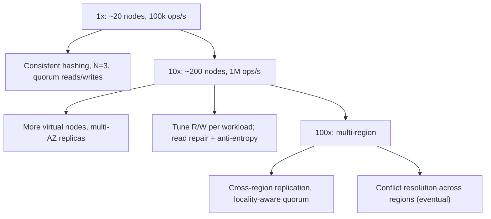

### 63.2.11 Caching

The store itself is the fast layer, so a separate cache is less common than in a database system; nodes keep hot data in memory. Clients may cache the ring topology to route directly to the right nodes (saving a coordinator hop).

Inside each node there are three caches worth naming: the OS page cache over SSTables (the biggest, and the reason nodes get large RAM), per-SSTable Bloom filters and partition-index summaries (about 2 GB per node in our estimate, always in memory), and an optional row cache for a small set of very hot keys. A **token-aware client** caches the ring and sends each request straight to a replica that owns the key, which removes one network hop (about 0.5 ms within an AZ) and spreads coordinator work evenly. A **hot key** that receives 50,000 reads per second still lands on only three nodes; the fix is a short-lived cache in the calling service (Part 26 — Caching and Redis, section 26.6), not more replicas.

### 63.2.12 Messaging

Gossip protocol for membership and failure detection (nodes periodically exchange state, so the cluster learns of joins, leaves and failures without a central coordinator). Hinted handoff and anti-entropy use background transfers between nodes. There is no external message broker; the coordination is peer-to-peer.

The gossip mechanics: every second, each node picks one to three random peers and exchanges a digest of what it knows (node, generation, heartbeat version, status, token ownership). Information spreads like rumors, reaching all of N nodes in about log2(N) rounds, so a membership change reaches a 200-node cluster in roughly 8 seconds. Gossip state is small (a few KB per node), so even at 1,000 nodes the traffic is negligible next to replication.

### 63.2.13 Scaling

Adding nodes moves only ~1/N of the data (consistent hashing), so scaling is near-linear and low-disruption. Virtual nodes keep load even. Multi-region adds cross-region replication and the hard problem of conflict resolution across regions, typically eventual consistency with the application reconciling conflicts.

| Stage | Load | Cluster | What changes and why |
|---|---|---|---|
| 1x | 100k ops/s, 30 TB stored | 18 nodes, 3 AZs, N = 3 | Quorum reads and writes; token-aware clients; repair weekly |
| 10x | 1M ops/s, 300 TB | about 180 nodes | Add nodes one at a time: each bootstrap streams about 1.7 TB, which at 200 MB/s takes about 2.5 hours, so growth is planned weeks ahead; repair becomes incremental and scheduled per range; per-tenant quotas because one bad client can now hurt hundreds of others |
| 100x | 10M ops/s, multi-region | several clusters of a few hundred nodes, or one cluster per region | `LOCAL_QUORUM` in each region with asynchronous cross-region replication; cross-region traffic at about 0.02 USD per GB becomes the largest bill; conflict resolution across regions is now a product decision |

The point at 10x is operational rather than algorithmic: a 180-node cluster has a disk failure every week or two, so node replacement must be a boring, automated runbook.

### 63.2.14 Security

Authentication and authorization at the client-to-coordinator boundary (which services may access which keyspaces), encryption in transit between nodes and from clients, and encryption at rest. Within the cluster, nodes trust each other, so the cluster network must be isolated. Multi-tenant keyspaces need isolation so one tenant cannot read another's keys.

### 63.2.15 Failure scenarios

| Failure | Detection | Impact | Mitigation | Effect |
|---|---|---|---|---|
| Single node down | Gossip failure detection | That node's replicas unavailable | N-1 replicas serve; hinted handoff holds its writes | None (quorum still met) |
| Network partition | Nodes unreachable across the split | Split brain risk | Tunable: favor availability (both sides write, reconcile later) or consistency (minority side refuses) | Per CAP choice |
| Concurrent conflicting writes | Diverging versions | Which value wins? | Vector clocks detect; resolve (LWW or app reconcile) | Possible lost update under LWW |
| Replica permanently lost | Health, capacity | Under-replicated keys | Re-replicate to a new node; anti-entropy | Restored durability |
| Clock skew (last-write-wins) | Monitoring | Wrong write "wins" by bad timestamp | Prefer vector clocks; sync clocks (NTP); be wary of LWW | Possible lost write |
| Hot key | Per-key load | One replica set overloaded | More virtual nodes; client cache; split hot key | Mitigated |
| Rebalancing storm (node flapping) | Topology churn | Excess data movement | Dampen membership changes; hysteresis | Stable |
| Node returns after being down longer than `gc_grace_seconds` | Downtime tracking per node | Deleted data comes back to life (63.2.21) | Never let such a node rejoin with its data: wipe and re-bootstrap; repair inside the grace window | Prevented |
| Slow replica (GC pause, noisy neighbor disk) | Per-replica p99 | Quorum waits on the slowest of R | Speculative retry to another replica at p99; dynamic snitch routes reads to fast replicas | Tail latency contained |
| Whole AZ lost | Gossip marks a third of nodes down | With one replica per AZ, every key still has 2 of 3 | `LOCAL_QUORUM` still succeeds; hints pile up, so cap hint windows and plan a repair | Reads and writes continue |
| Disk fills during compaction | Free-space alert | Writes rejected on that node | Keep 50 percent headroom for size-tiered compaction or use leveled compaction; alert at 60 percent | Node protected |
| Hinted handoff backlog grows for hours | Hint storage metric | Returning node overwhelmed by replay, or hints expire | Throttle replay; past the hint window, run repair instead | Converges |

### 63.2.16 Observability

Metrics: per-node ops/s and latency, quorum success/failure rate, replica lag and divergence, hinted-handoff queue size, anti-entropy repair volume, ring balance (per-node load), failure-detector state. Alerts: under-replicated keys, quorum failures, growing hinted-handoff backlog (a replica down too long), ring imbalance. Dashboards: cluster health, per-node load, consistency (divergence/repair rates).

### 63.2.17 Deployment

Nodes as a stateful cluster (StatefulSet on Kubernetes, or dedicated hosts) across multiple availability zones so an AZ loss does not lose quorum. Careful rolling upgrades (one node at a time, respecting quorum). Topology (replication factor, virtual nodes) as config. Adding/removing nodes is an operational procedure that triggers controlled rebalancing.

### 63.2.18 Cost considerations

Dominated by the storage and compute for N copies of the data across nodes (3x replication triples storage) and cross-AZ/cross-region network traffic for replication and quorum (cross-AZ data transfer is a real cost driver). Higher replication and stronger quorum cost more (more copies, more cross-node traffic). The cost is justified only when the availability and scale genuinely require a distributed store over a replicated single database.

### 63.2.19 Tradeoffs

- **Availability vs consistency (CAP)**: the core tradeoff, made tunable per operation via R/W quorums; during a partition you cannot have both, so you choose per operation.
- **Consistent hashing** (minimal data movement on topology change) over modulo hashing (rehashes everything): essential for elastic scaling.
- **Eventual consistency with conflict resolution** over strong consistency everywhere: buys availability and latency at the cost of possible stale reads and reconciliation complexity.
- **Masterless** (no single point of failure, any node coordinates) over a primary/replica design: higher availability at the cost of conflict-resolution complexity.
- **Last-write-wins vs vector clocks**: LWW is simple but can silently lose writes under clock skew; vector clocks are correct but more complex.

| Setting | Latency | Survives | Consistency | Use for |
|---|---|---|---|---|
| N=3, W=1, R=1 | Lowest | 2 replicas down for reads and writes | Eventual; can read stale, can lose acked write on crash | Caches, metrics, sessions you can recreate |
| N=3, W=2, R=2 (quorum) | Medium, waits for 2nd fastest | 1 replica down | Read-your-writes when no sloppy quorum is used | Default for user data |
| N=3, W=3, R=1 | Slow writes, fast reads | Writes fail with 1 down | Strong reads; writes unavailable during any failure | Read-heavy reference data |
| N=3, W=1, R=3 | Fast writes, slow reads | Reads fail with 1 down | Strong reads only if every replica answers | Rarely sensible |
| LWW conflict policy | No sibling handling | | Silent loss of one of two concurrent writes | Values that are overwritten wholesale |
| Vector clocks plus siblings | Client merge code | | No silent loss; app decides | Carts, counters, collaborative state |

### 63.2.20 Alternative architectures

**Use an existing distributed store** (DynamoDB, Cassandra, Part 25): the honest default — these systems embody exactly this design, battle-tested; building your own is justified only by a very specific need, because a correct distributed KV store is extremely hard to get right (conflict resolution and partition handling are subtle). This is the strong recommendation: understand the design (to use these well and to interview), but use a proven implementation unless you have a compelling reason not to.

**A replicated single database** (PostgreSQL with replicas, Part 22 — Database Scaling): if your scale fits one primary plus replicas and you need transactions and queries, this is simpler and gives you more (relational power, strong consistency) than a KV store. Many systems that reach for a distributed KV store would be better served by PostgreSQL plus caching — the Part 25 lesson applies.

**Strongly-consistent distributed store** (a consensus-based system using Raft/Paxos, like etcd or Spanner-style): when you need strong consistency across nodes rather than tunable eventual consistency, a consensus protocol provides it, at the cost of lower availability during partitions and higher latency. The right choice depends on whether the workload needs availability (Dynamo-style) or strong consistency (consensus-style) during a partition.

### 63.2.21 Incident story: revoked API keys came back from the dead

At 11:05 on a Monday a customer reported that an API key they had revoked twelve days earlier was working again. Then a second customer reported the same. The key-value store held API-key records; revocation was a `DELETE`.

The timeline, reconstructed: node `kv-11` lost its network card on day 1 and was marked down. The hardware ticket sat in a queue. On day 3, the customer revoked the key: the delete wrote tombstones to the two healthy replicas and a hint for `kv-11`, which expired after the 3-hour hint window. On day 11, ten days after the tombstones were written, compaction on the two healthy replicas purged them, because `gc_grace_seconds` was the default 864,000 seconds and no repair had included `kv-11`. On day 12, `kv-11` came back with its old disk intact and joined the ring. It still held the original key record. The next read repair and the weekly repair saw one replica with a value and two with nothing, and since "nothing" is not a version, the value won and was copied back to the other replicas. The deleted key was resurrected everywhere.

Mitigation that day: revoke the affected keys again (new tombstones), audit all deletes from days 3 to 11 by replaying the revocation log from the source-of-truth service, and run a full repair. The permanent fixes were operational, not algorithmic: a node that has been down for more than half of `gc_grace_seconds` is never allowed to rejoin with its data, it is wiped and re-bootstrapped; repair runs on a schedule that provably covers every range within the grace period; and a dashboard shows "time since last successful repair" per node, with a page at 7 days. Security-sensitive revocations were also moved to a store with a strongly consistent delete. The senior lesson: in an eventually consistent store, **a delete is a promise with an expiry date**, and the expiry is an operational setting someone must own.

### 63.2.22 Interview follow-ups

1. **Why does R + W > N give strong consistency, and when does it not?**
   Expected answer: any read set and write set must overlap in at least one replica, which has the latest write. It fails with sloppy quorums (writes acknowledged by nodes outside the preference list), with LWW under clock skew (the "latest" by timestamp is not the latest in real time), and across concurrent writes, where the overlap returns siblings rather than one answer. Follow-up: is quorum linearizable? (No, not without extra mechanisms such as read repair blocking before returning; Part 28, section 28.6.)
2. **What do virtual nodes buy you?**
   Expected answer: even load with few physical nodes, and when a node leaves, its load spreads across many nodes instead of landing on one neighbor. Follow-up: cost? (More ranges to repair and stream; Cassandra lowered its default from 256 to 16 tokens per node in 4.0 for that reason.)
3. **Walk me through what happens when a node is down for an hour, and for two weeks.**
   Expected answer: one hour: quorums still succeed, hints collect, replay on return. Two weeks: hints expired, tombstones may be purged, so wipe and re-bootstrap rather than rejoin.
4. **How would you implement a counter in this store?**
   Expected answer: not read-modify-write with LWW (lost increments). Use a CRDT counter: each replica keeps its own count and the value is the sum, so concurrent increments merge without loss. Follow-up: decrements? (PN-counter: two G-counters.)
5. **How do you choose between Dynamo-style and Raft-style for a new store?**
   Expected answer: the business invariant. If you must never accept two conflicting writes (balances, locks, uniqueness), choose consensus and accept unavailability on the minority side. If you must always accept writes (carts, sessions, telemetry), choose Dynamo-style and design the merge.

### 63.2.23 Practical exercise

Build an in-process simulation of the store in TypeScript with Jest, no real network.

1. Implement `HashRing` with virtual nodes and AZ-aware preference lists, and a `Node` class that stores `key -> { value, clock }[]`.
2. Implement a coordinator with `put(key, value, context, w)` and `get(key, r)` using vector clocks and siblings, with a simulated network that can drop, delay, or partition messages between chosen nodes.
3. Implement hinted handoff and a Merkle-tree comparison between two nodes.

Acceptance criteria:

- Adding a fifth node to a four-node ring moves between 15 and 25 percent of 100,000 keys (ideal is 20 percent).
- With N = 3, W = 2, R = 2 and one node partitioned away, every read returns the latest acknowledged write.
- Two concurrent writes on opposite sides of a partition produce two siblings on the next read after healing, and a write with the merged context produces exactly one value.
- A node that misses 1,000 writes is brought to full agreement by the Merkle comparison, and the test asserts that fewer than 5 percent of leaves were transferred.
- A test reproduces the resurrection bug (tombstone purged, stale node rejoins) and a second test shows the "wipe before rejoin" rule prevents it.
