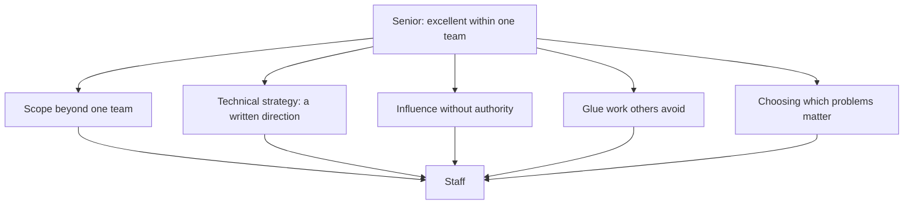

## 63.4 Moving from senior to staff

The senior-to-staff transition is different in kind, not in degree. Senior is the level at which you are complete: a company can hire only senior engineers and function. Staff exists because some problems are bigger than one team, and somebody has to work on those.

That means there is no promotion path made of doing senior work harder. Working more hours, shipping more features and reviewing more pull requests produces an exhausted senior engineer, not a staff engineer.

### 63.4.1 Scope beyond one team

Staff work starts where a problem cannot be solved inside one team's backlog. Examples from real organisations: three teams building three incompatible event schemas; a shared database that four services write to; a 40-minute CI pipeline that costs every team an hour a day; an authentication model that cannot express the permissions the product now needs; a migration off a datastore that six services depend on.

Each of these has a common shape. Every individual team is behaving rationally, the problem lives between them, and no single team can fix it without the others. Somebody has to hold the whole thing, and that somebody is not a manager, because the work is technical.

The practical move is to pick one such problem and start, without asking for a mandate. Write the document that describes the problem clearly, with evidence. That document alone often changes what teams do, and it is the most common way people become staff engineers before they are called one.

### 63.4.2 Technical strategy

Strategy is an overused word. In engineering it means something specific: **a written statement of where we are going technically, why, and what we will not do**, that survives contact with the next three quarters of planning.

A useful technical strategy has four parts: the current state described honestly including the parts that embarrass us, the forces that make change necessary (growth numbers, team growth, incident patterns, cost curves, product direction), the target state, and the sequence with the decision points along it.

The sequence is what distinguishes strategy from a wish. "We will move to event-driven communication between order and fulfilment" is a wish. "Quarter one: outbox in the order service and a single consumer, keeping the synchronous call as fallback. Quarter two: fulfilment consumes events and the synchronous call is removed. Quarter three: two more consumers. We stop and reassess if consumer lag exceeds our recovery target or if the schema registry rollout slips." That is a strategy: reversible, staged, with observable checkpoints.

### 63.4.3 Cross-team influence

You will not have authority over the teams whose behaviour needs to change. Influence at this level is a set of learnable mechanics.

**Start from their problems, not yours.** A team will not adopt your shared library because it is architecturally correct. They will adopt it because it deletes 400 lines they hate maintaining, or because it fixes an alert that pages them.

**Make the good path the easy path.** Standards enforced by documents decay. Standards embedded in the service template, the shared library, the lint rule and the CI check hold, because doing the right thing becomes less work than doing the wrong thing.

**Pre-socialise everything.** Before any proposal goes wide, talk to the two people most likely to object. Either they change your mind, which saves you a public failure, or you incorporate their concern and they become supporters. Proposals that first appear in a big meeting mostly die there.

**Give away credit.** Cross-team work depends entirely on people wanting to work with you again. Naming the engineer who did the hard part, in public, costs nothing and buys years of cooperation.

**Be willing to be the one who writes it down.** Half of alignment is somebody being bothered to summarise the meeting, list the decisions and send it out. It is astonishing how much influence that single habit produces.

### 63.4.4 Writing as a tool

At staff level, writing stops being documentation and becomes the primary way you work. A senior engineer's leverage is bounded by conversations, which are one-to-few and evaporate. A document is one-to-many and persists.

The four documents worth mastering: the **problem brief** (two pages, the situation with evidence, no solution — often the highest-value thing you will write), the **design doc**, the **RFC** for changes that need many teams to agree, and the **strategy memo** aimed at leadership, framed in delivery speed, risk and cost rather than in technology.

One discipline: write the shortest version that does the job. A two-page memo that everyone reads beats a twenty-page document that three people skim. If it must be long, put a summary and the ask at the top, and assume most readers stop after it.

### 63.4.5 Glue work

Glue work is the unglamorous connective activity that makes an organisation function: unblocking a stuck integration between two teams, running the design review forum, upgrading a shared dependency everyone depends on, chasing the action items from three incidents, onboarding, writing the summary nobody else wrote.

Two things are true at once, and you need both. Glue work is essential, genuinely staff-level, and organisations fall apart without it. And it is under-credited by default, especially for engineers who are already expected to be helpful, so it can consume you while leaving no evidence you did anything.

Manage that deliberately. Do glue work that is *strategic*, meaning it removes a recurring problem rather than one instance of it. Make it visible: a written outcome, a metric, a named improvement. And cap the volume: if you have no capacity left for a technical project with your name on it, you have become the team's operations layer, and your next promotion conversation will have nothing to point at.

### 63.4.6 Choosing which problems to work on

This is the actual staff skill, and it is a judgment about opportunity cost. At senior level, work mostly arrives. At staff level, you choose, and choosing badly wastes a quarter of a very expensive person.

The filter I use, in order:

1. **Would this still matter in a year?** Rules out most urgent-feeling things.
2. **Is it a class or an instance?** Prefer removing the class.
3. **Will it be done if I do not do it?** If a good team will handle it anyway, spend your time elsewhere.
4. **Am I distinctively able to do it?** Staff time is scarce; use it where your specific knowledge or credibility matters.
5. **Can I finish it?** An unfinished platform migration is worse than never starting: half-migrated systems have all the costs of both.
6. **Does it multiply, or only add?** A shared library, a standard or a document keeps producing value after you stop.

And the hardest discipline: say no to the interesting problem that fails these filters. Staff engineers who chase every interesting thing produce a trail of prototypes and no change.

## 63.5 Staff versus principal

The honest summary: **Staff changes how a group of teams builds. Principal changes what the company is capable of building.**

At staff, the scope is an organisational one: a department, a product area, a platform. You make several teams collectively better. At principal, the scope is the company: the technical direction, the standards, the hiring bar, the bets that pay off in two to five years, and the ability to say "we should not attempt that" to executives and be believed.

| Dimension | Staff | Principal |
|---|---|---|
| Typical scope | 3-8 teams, one platform or domain | The engineering organisation, or a company-critical domain |
| Horizon | 1-2 years | 2-5 years |
| Main output | Designs, standards, strategy for an area, senior engineers grown | Direction, technical bets, culture, the standard others enforce |
| Failure mode | Becomes a floating consultant with no shipped outcomes | Becomes an ivory-tower architect disconnected from delivery |
| Relationship to code | Codes on the risky or exemplary parts | Codes rarely, but reads widely and prototypes to prove a point |
| Who they influence | Team leads, senior engineers, their director | Executives, the whole engineering organisation, sometimes the industry |

### 63.5.1 Setting direction

Direction is the principal's product. It answers questions before they are asked: is this company going to be event-driven, do we build platforms or buy them, what is our position on multi-region, which languages do we support, what does "production-ready" mean here, what data do we consider a liability to store.

The test of good direction is that it makes decisions cheaper for everyone else. If four teams each spend a week deciding the same thing independently, direction was missing. If a team can point at a written principle and decide in an hour, direction is working.

Direction that only exists in a principal's head is worthless. It has to be written, repeated until people are bored of hearing it, and embedded in templates, reviews and hiring.

### 63.5.2 The archetypes

Staff-plus roles come in recognisable shapes. Most people lean towards one, and knowing yours helps you choose work that fits.

**The Tech Lead.** Leads a team or a group's technical execution. Owns the plan, sequences the work, keeps quality high, is close to delivery. The most common archetype and the easiest to be legible in. Risk: drifting into project management and losing technical depth.

**The Architect.** Owns the design of a large system or domain over time: interfaces, consistency boundaries, the migration sequence. Deep in one area. Risk: becoming the person who draws diagrams for systems they have never operated. The antidote is to keep shipping and keep taking pages.

**The Solver.** Parachutes into the hardest problems: the memory leak nobody can find, the corruption bug, the performance wall, the failing migration. Enormous value, highly visible. Risk: no compounding — you solve instances forever and change nothing structurally.

**The Right Hand.** Works closely with a director or VP on whatever matters most: due diligence on a proposal, a reorganisation's technical implications, a rescue of a failing programme. High leverage, high trust. Risk: your value depends on one relationship, and you can become invisible to everyone else.

None is better. But you should know which one you are being paid for, because the archetypes are evaluated differently and mismatched expectations are the main reason staff engineers feel lost.

## 63.6 A self-assessment rubric

Score yourself honestly. The rule: you may only tick a box if you can name a specific instance from the last twelve months. "I could do that" does not count.

**Junior**

- [ ] I complete assigned tasks without needing the approach re-explained.
- [ ] I write tests for my own code without being asked.
- [ ] I ask for help within an hour of being genuinely stuck, with what I have already tried.
- [ ] I can debug my own code with logs and a debugger before escalating.
- [ ] I follow the team's conventions without needing them repeated in review.

**Mid**

- [ ] I own a feature end to end: design, code, tests, deploy, verification.
- [ ] I can read `EXPLAIN ANALYZE` and add the correct index.
- [ ] I write integration tests against real dependencies, not only mocks.
- [ ] I handle failure paths — timeouts, retries, validation — without being reminded.
- [ ] I give code reviews that catch real problems.
- [ ] I understand why the feature exists, not just what it must do.

**Senior**

- [ ] I have owned a system in production, including its alerts, runbooks and on-call load.
- [ ] I define what to build when handed an ambiguous problem, and write it down.
- [ ] I can name what breaks first at 10x traffic for the systems I own, with numbers.
- [ ] Every design I produce answers: can it time out, duplicate, arrive late, arrive out of order, partially succeed.
- [ ] I have run a production migration on a large table with no downtime.
- [ ] I have commanded an incident: mitigation first, scheduled communication, blameless postmortem, actions completed.
- [ ] I explain trade-offs to non-engineers in time, risk and money, and I arrive with options.
- [ ] I have measurably grown at least one other engineer.
- [ ] I write ADRs and design docs that other people use to make decisions.
- [ ] I say no with alternatives attached, and I name which of scope, time or quality moves.

**Staff**

- [ ] I have led a technical initiative spanning at least three teams to completion.
- [ ] I have written a technical strategy that changed what teams planned to do.
- [ ] I have changed another team's behaviour without any authority over them.
- [ ] I have built something shared — library, template, standard — that teams adopted voluntarily.
- [ ] I have grown a senior engineer to the point of leading their own cross-team work.
- [ ] I choose my own problems, and I can articulate why I am not working on three other tempting ones.
- [ ] I do strategic glue work and it is visible in written outcomes.
- [ ] I am consulted before major technical decisions in my area, by default.

**Principal**

- [ ] I have set technical direction that the organisation follows and can cite.
- [ ] I have prevented a large, expensive mistake and can name it.
- [ ] I have made a multi-year technical bet and been accountable for the outcome.
- [ ] I influence executive decisions with technical framing they can act on.
- [ ] I shape hiring standards and promotion criteria.
- [ ] Several senior and staff engineers point to me as a reason they grew.
- [ ] I can say "we should not build this" to leadership and be believed.

A pattern worth noticing when you score yourself: most people find they have gaps *below* their current level, not only above it. Those gaps are usually the reason the next level feels stuck.

## 63.7 Common plateaus and how to break them

### 63.7.1 The strong coder who cannot influence

**Symptom.** Technically the best on the team. Consistently overruled or ignored. Frustrated that "nobody listens", and often right about the technical substance.

**Diagnosis.** Influence is not correctness. Being right is roughly a third of it; the rest is framing in the listener's terms, timing, pre-socialising, and having enough credibility deposits that people extend trust. Frequently the pattern is: strong opinions delivered late in a process, in engineering language, to people who care about delivery risk and cost.

**How to break it.** Write your position down *before* the decision meeting and share it. Frame in the audience's units — money, dates, risk — not in technology. Talk to the likely objector privately first. Bring two options rather than one verdict. And drop the arguments that do not matter: if you fight equally hard about formatting and about a data-loss risk, people learn to discount you.

### 63.7.2 The architect who does not ship

**Symptom.** Produces diagrams, strategies and opinions. Little of it lands. Teams nod politely and then do something else. Increasingly disconnected from what the code actually looks like.

**Diagnosis.** Credibility at senior-plus levels is renewed by delivery, not by past reputation. Designs from someone who has not operated a system in two years contain the wrong assumptions, and teams can tell.

**How to break it.** Ship something yourself this quarter, ideally the risky part of your own proposal. Join the on-call rotation. Prototype the design before proposing it, so you find the three things that do not work. And measure your proposals by adoption, not by production: an accepted design nobody implements is not a result.

### 63.7.3 The firefighter who never prevents fires

**Symptom.** Heroic. Always in the incident channel. Deeply appreciated. Nothing structurally improves, and the same class of incident recurs quarterly.

**Diagnosis.** Firefighting is more rewarding in the short term than prevention: it is visible, urgent, and thanked. Prevention is invisible, and its success looks like nothing happening. Some people also come to like it, because it is the part of the job where they feel most competent.

**How to break it.** Convert instances into classes. After each incident, ask what would make this category impossible, not just this occurrence. Insist on three owned action items with dates and check them at the next retro. Deliberately hand the next incident to someone else and coach them through it. And measure yourself on incidents *not* happening: pages per week, repeat causes eliminated, mean time to recovery. If your value disappears when the systems are healthy, you have optimised for the wrong outcome.

### 63.7.4 The specialist who stopped learning

**Symptom.** Deep expertise in one area, built five to ten years ago. Solves everything with that tool. Dismissive of new approaches, sometimes with good reasons that are no longer current. Scope has quietly narrowed.

**Diagnosis.** Depth is valuable and this person earned theirs. The failure is refusing to re-validate assumptions. PostgreSQL of five years ago could not do what today's can; the reasons you rejected a technology in 2019 may have been fixed twice since. Expertise decays silently, and its owner is the last to notice.

**How to break it.** Pick one adjacent area a year and go genuinely deep, to the point of shipping something in it. Re-test your own strong opinions with a small experiment rather than from memory. Read the release notes for the tools you claim to know; the gap between what you believe and what is true is usually shocking. And spend time with engineers who work differently from you — the discomfort is the signal that learning is available.

### 63.7.5 The general escape from any plateau

All four plateaus share a shape: a strength, over-applied, in an environment that has changed. The exit is always the same three steps. Get honest external feedback, from someone who will actually tell you the truth rather than be kind. Pick the one behaviour with the largest gap and work on it deliberately for a quarter, with a visible output. Then re-check, because you will be tempted to conclude you have fixed it after three good weeks.

Careers are long. A plateau of eighteen months is normal and not a verdict. What is fatal is not noticing you are on one.

## Senior Checklist — Part 63

- [ ] I understand the concept
- [ ] I can explain it simply
- [ ] I can implement it
- [ ] I understand its failure modes
- [ ] I understand its scaling limitations
- [ ] I understand its security implications
- [ ] I understand its operational implications
- [ ] I can choose between alternatives
- [ ] I can explain the tradeoffs
- [ ] I can answer senior-level interview questions
- [ ] I can place myself honestly on the scope, ambiguity, impact, influence and time-horizon dimensions
- [ ] I have scored myself against the rubric with specific evidence from the last twelve months, not aspirations
- [ ] I know the two or three engineering areas where I am furthest behind my target level
- [ ] I am currently operating one level above my title in at least one visible area
- [ ] I own an ambiguous, production-touching, measurable project rather than a queue of tasks
- [ ] I produce artefacts — ADRs, design docs, postmortems, runbooks — that outlive the conversation
- [ ] I can explain the difference between senior, staff and principal in behaviours, not titles
- [ ] I know which staff archetype fits me and which work I should therefore decline
- [ ] I can name the plateau I am most at risk of, and the behaviour I am practising against it
- [ ] I have asked my lead for the specific gap between me and the next level, and written down the answer

## Part 63 — Key Takeaways

- Levels are defined by five dimensions: scope, ambiguity, impact, influence and time horizon. Everything else follows from them.
- Behaviour comes before the title, always; nobody is promoted and then starts operating at the new level.
- The mid-to-senior gap is rarely coding ability. It is production ownership, deciding under ambiguity, writing things down, and finishing work completely.
- Senior means the organisation can hand you an important, unclear problem and stop worrying about it.
- Staff is not senior with more hours. It is a different job: problems that span teams, strategy in writing, influence without authority, and choosing what not to do.
- Principal changes what the company can build; the output is direction that makes everyone else's decisions cheaper.
- Look at the row to the right of your level in each area table; the difference is your development plan, and you will usually find gaps below your level too.
- Promotion decisions are made from artefacts and other people's accounts, so produce ADRs, postmortems, runbooks and measurable outcomes, and make them visible without bragging.
- Glue work is real staff work, but do the strategic kind, make it visible, and cap it so you still have a technical project with your name on it.
- The four plateaus — the uninfluential expert, the non-shipping architect, the firefighter, the stale specialist — are all one strength over-applied in a changed environment.
- Choose projects that are ambiguous, production-touching, bounded, cross-boundary and measurable; that combination is what a promotion case is made of.
- Careers are long; an eighteen-month plateau is normal, and the only fatal version is the one you do not notice.
