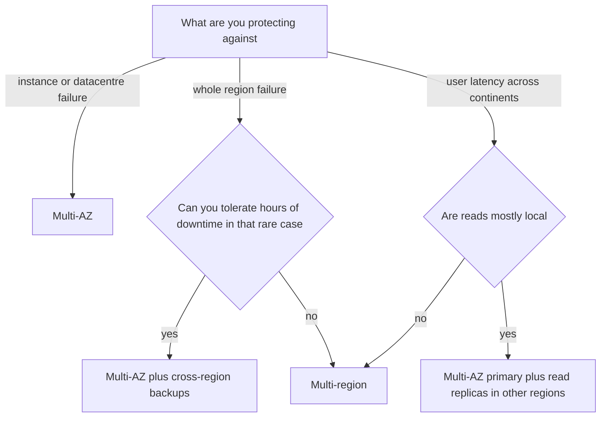

## 63.21 Multi-AZ versus multi-region

### Decision tree



### If... then choose

```text
If you need protection from a single machine, rack or availability zone failing
   -> Choose multi-AZ. This is the default for anything in production
If your SLA allows a few hours of downtime in a genuine regional outage
   -> Choose multi-AZ plus cross-region backups and a tested restore
If regulation requires data to stay in a jurisdiction
   -> Choose per-region deployments with data partitioned by region
If users on another continent suffer 200 ms of latency on reads
   -> Choose read replicas or a CDN in that region, not full multi-region writes
If the business genuinely cannot tolerate a regional outage, such as payments infrastructure
   -> Choose active-passive multi-region with a tested failover
If you think you need active-active multi-region writes
   -> Verify the requirement first; this is the most expensive architecture in this part
```

Be precise about the failure you are buying insurance against. Multi-AZ protects against the common case: a host failure, a rack failure, a zone-level network or power event. Those happen. Full regional outages are rare, typically a few hours long, and affect large parts of the internet simultaneously — which changes the business conversation, because your competitors are usually down too.

### Trade-offs

| Dimension | Multi-AZ | Multi-region active-passive | Multi-region active-active |
|---|---|---|---|
| Consistency | Synchronous replication; no data loss on failover | Asynchronous; expect seconds of data loss on failover | Conflict resolution required; strong consistency is expensive or impossible |
| Latency | Sub-millisecond between zones | Normal in the active region | Cross-region writes cost 80 to 150 ms |
| Throughput | Unaffected | Unaffected | Coordination overhead reduces it |
| Operational cost | Minimal; a checkbox on managed services | Real: failover runbook, drills, DNS strategy | Very high: conflict handling, data partitioning, split-brain design |
| Team skill | Standard | Requires disaster-recovery discipline | Requires senior distributed-systems expertise |
| Flexibility | Fine for almost everything | Adds regional deployment complexity | Constrains every data model decision |
| Money cost | Roughly 2x database cost, small application cost | Roughly 2x total infrastructure, mostly idle | 2 to 3x plus significant engineering time |
| Ecosystem | Native everywhere | Supported but manual | Few managed options; usually bespoke |
| Failure modes | Zone failure handled automatically; failover takes 30 to 120 seconds | Stale replica, DNS caching delays failover, untested runbook fails | Split brain, conflicting writes, partial regional failure is worse than total |

### Signals you chose wrong

- You have a multi-region setup and have never tested a failover, which means you have paid for it and do not have it.
- You built active-active and spend engineering time on write conflicts for a product where a five-minute outage would be tolerable.
- You are single-AZ in production and one zone event took you offline for three hours.
- Your recovery point objective is "we do not know", because backups are cross-region but the restore has never been timed.
- You went multi-region for latency when a CDN and regional read replicas would have delivered most of the benefit.

### How to change your mind later

Single-AZ to multi-AZ is usually a configuration change on managed services, with one failover-length interruption. Do it now if you have not.

Multi-AZ to multi-region active-passive is a project: cross-region replicas, an infrastructure-as-code deployment for the second region, a DNS or global-load-balancer failover strategy, and a written, rehearsed runbook. Two to four months, and the rehearsal is the part that makes it real.

Active-passive to active-active is a re-architecture, not a deployment change: you must decide, per entity, how conflicts are resolved or how data is partitioned so conflicts cannot occur. The realistic version for most products is regional data partitioning — European customers live in Europe, American customers live in America, and each region is authoritative for its own users. That gives you locality and regulatory compliance without global write coordination.

### Senior perspective

Start by asking what the business actually loses per hour of downtime, and compare it to the cost of the architecture. For most products, multi-AZ plus cross-region backups plus a restore that someone has actually performed and timed is the right answer, and the money saved is better spent on the reliability problems that cause real outages: bad deploys, missing indexes, retry storms and unbounded queues. Regional failure is not what takes most companies down; their own changes are. I have also never seen an untested failover work on the first attempt during a real incident, so if you do build multi-region, budget for quarterly drills. An untested disaster-recovery plan is a slide, not a capability.

## 63.22 A general decision-making template

Every decision in this part follows the same shape, and you can apply it to decisions this book does not cover. Write it down — the writing is what forces the thinking, and the artefact is what stops the same argument recurring in six months with new people.

The template has six parts:

1. **Context.** What is happening, what forced the decision now, and what constraints are non-negotiable. Include numbers: current traffic, current latency, team size, budget. A decision record with no numbers is an opinion.
2. **Options.** At least three, including "do nothing" or "keep the current approach". If you cannot state a genuine third option, you have not explored the space.
3. **Criteria and weights.** Pick four to seven criteria that matter *for this decision* and weight them so they sum to 100. Weighting is where the real disagreement lives, and surfacing it early is the whole point.
4. **Decision.** What you chose and, crucially, what you are giving up. Name the criterion you deliberately sacrificed.
5. **Consequences.** What becomes easier, what becomes harder, what new work this creates, and what would tell you the decision was wrong.
6. **Revisit date.** A specific date and a specific trigger. Not "when we scale" but "on 2027-03-01, or when write throughput exceeds 5,000 per second, whichever comes first".

Keep it to one page. Store it in the repository as `docs/adr/NNNN-title.md` so it is versioned with the code it describes. Never edit a decided record; supersede it with a new one that links back, so the history of reasoning survives.

### A worked ADR

```markdown
# ADR 0014: Job queue for order fulfilment

- Status: Accepted
- Date: 2026-09-09
- Deciders: Backend team, SRE, Head of Engineering
- Supersedes: none

## Context

Order fulfilment currently runs inline in the checkout request. Checkout p99 is
2.8 s, of which 1.9 s is the warehouse API call and the label-printing call. On
2026-08-14 the warehouse API was degraded for 40 minutes and checkout availability
fell to 91 percent, costing an estimated 38,000 EUR in abandoned orders.

Current scale: 240 orders per minute at peak, 12 fulfilment steps per order,
roughly 172,000 messages per day. Team: 9 backend engineers, 1 SRE, no dedicated
platform team. We already run PostgreSQL 16 (RDS) and Redis 7 (ElastiCache). We
do not run Kafka today.

Constraint: no order may be lost. Duplicate processing is acceptable because
fulfilment steps are idempotent via the warehouse reference id.

## Options considered

1. PostgreSQL job table with SELECT ... FOR UPDATE SKIP LOCKED
2. BullMQ on the existing Redis
3. Amazon SQS (standard queues) with SNS for fan-out
4. Kafka (MSK) with one topic per fulfilment stage
5. Do nothing: keep fulfilment inline and add timeouts plus a circuit breaker

## Criteria and weights

| Criterion | Weight | Why it matters here |
|---|---|---|
| Durability of queued work | 30 | Losing an order is the worst outcome we can have |
| Operational burden | 25 | One SRE; we cannot absorb a new stateful cluster |
| Delivery time | 20 | The incident is recent; leadership wants this within one quarter |
| Retry and delay features | 15 | Warehouse outages need backoff over hours, plus a DLQ |
| Cost at 3x current volume | 10 | Must stay under 500 EUR per month |

## Scoring

| Option | Durability (30) | Ops (25) | Delivery (20) | Features (15) | Cost (10) | Total |
|---|---|---|---|---|---|---|
| PostgreSQL SKIP LOCKED | 30 | 20 | 20 | 6 | 10 | 86 |
| BullMQ on Redis | 15 | 20 | 18 | 15 | 9 | 77 |
| SQS | 30 | 25 | 16 | 11 | 8 | 90 |
| Kafka on MSK | 30 | 5 | 8 | 9 | 3 | 55 |
| Do nothing | 0 | 25 | 20 | 0 | 10 | 55 |

## Decision

We will use **Amazon SQS** standard queues, one queue per fulfilment stage, with a
dead-letter queue after 5 attempts and an outbox table in PostgreSQL so that
enqueueing is transactional with the order write.

We explicitly give up **ordering** and **replay**. Fulfilment steps are commutative
and idempotent, so ordering is not required, and we have no consumer that needs to
re-read history. If either becomes a requirement, this decision is superseded.

We rejected Kafka because we cannot operate it with the staffing we have, and none
of the properties that make Kafka worth its cost - replay, many independent consumer
groups, very high throughput - apply to 172,000 messages per day.

We rejected BullMQ because Redis replication is asynchronous and a failover can lose
acknowledged jobs, which conflicts with the "no order may be lost" constraint.

## Consequences

Easier:
- Checkout returns as soon as the order is persisted; expected p99 drops to about 400 ms.
- A warehouse outage delays fulfilment instead of failing checkout.
- Fulfilment workers scale independently on queue depth.

Harder:
- Customers no longer see immediate fulfilment status; the UI needs a pending state.
- We now own a DLQ, its alerting and a replay tool.
- Every consumer must be idempotent; we will add an inbox table keyed by message id.
- Local development needs ElasticMQ or LocalStack to emulate SQS.

New work created:
- Outbox table and relay (2 weeks)
- Consumer framework with inbox dedupe and DLQ routing (2 weeks)
- Pending-state UI (1 week, frontend team)
- Runbook and DLQ alerting (3 days)

We were wrong if:
- Queue depth alerts fire more than twice a month in steady state.
- We need message ordering within 6 months.
- SQS cost exceeds 500 EUR per month before traffic triples.
- Checkout p99 does not fall below 600 ms after rollout.

## Revisit

2027-03-09, or earlier if sustained volume exceeds 2 million messages per day, or if
a second consumer group needs to read the same stream independently.
```

Notice what makes this record useful a year later. The numbers are specific enough to check. The rejected options say *why* they were rejected in terms of this context, not in general. The sacrifice is named explicitly. And the "we were wrong if" section is falsifiable, so the revisit is a real review rather than a re-argument from scratch.

## Senior Checklist — Part 63

- [ ] I understand the concept
- [ ] I can explain it simply
- [ ] I can implement it
- [ ] I understand its failure modes
- [ ] I understand its scaling limitations
- [ ] I understand its security implications
- [ ] I understand its operational implications
- [ ] I can choose between alternatives
- [ ] I can explain the tradeoffs
- [ ] I can answer senior-level interview questions
- [ ] I state the constraint I am optimising for before I argue about technology
- [ ] I can name the boring default for every decision, and what would justify deviating
- [ ] I write down falsifiable "signals you chose wrong" criteria before deciding
- [ ] I weight my criteria explicitly, and I know which criterion I sacrificed
- [ ] I can describe the realistic migration path away from every choice I have made
- [ ] I keep vendors, ORMs, brokers and caches behind an interface so decisions stay reversible
- [ ] I know the cost of each choice in money and in engineer time, not just in latency
- [ ] I set a revisit date with a numeric trigger, not "when we scale"
- [ ] I have written at least one ADR that a colleague could act on without me
- [ ] I can explain to a product manager why the simpler option is the responsible one

## Part 63 — Key Takeaways

- Most architecture arguments are unstated disagreements about which constraint matters. Name the constraint and the argument usually resolves itself.
- The default is the boring choice: PostgreSQL, a modular monolith, REST, containers, managed services. Deviating requires a written, specific reason.
- Spend analysis effort in proportion to irreversibility. Caches and flags are cheap to undo; service boundaries, primary keys and sharding are not.
- PostgreSQL with `jsonb` is very often the NoSQL you actually needed, and PostgreSQL full-text search is very often the search cluster you did not need.
- A modular monolith with enforced module boundaries is the correct middle path, and the best possible precondition for extracting services later.
- Kafka is a log, everything else in that comparison is a queue. If you cannot name the replay or the second consumer group, you want a queue.
- Choose synchronous only when the user's next action depends on the result. Moving optional work out of the request path is usually the biggest reliability win available.
- Fix the index before you add the cache. Caching an unindexed query removes the signal and keeps the debt, and the bill arrives when the cache is cold.
- Keyset pagination gives constant latency and correct results for the price of one composite index. Deep `OFFSET` is a cliff that arrives silently.
- Sessions give you revocation for 0.3 ms. JWT earns its place when many services must verify identity without a network call.
- Managed versus self-hosted is a question about year three, not month one. If you cannot demonstrate a restore, you are not operating that system.
- Buy the commodity, build the differentiator, and always integrate the vendor behind your own interface so the decision stays reversible.
- Multi-AZ is the default; multi-region is insurance whose premium is paid in complexity and whose value is zero if the failover is never tested.
- A decision without falsification criteria and a revisit date is a belief. Write the ADR, name what you sacrificed, and set the trigger that makes you look again.
