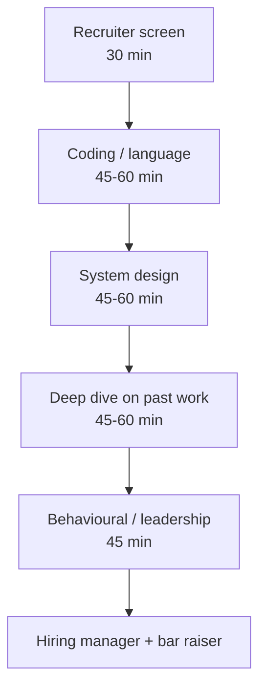
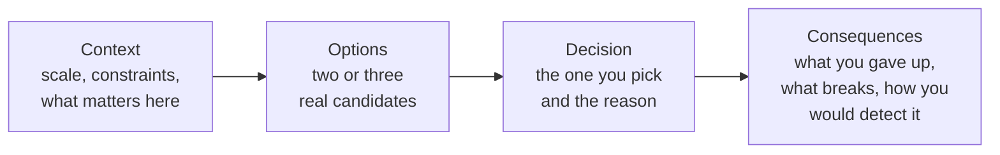

# Part 64 — Senior Backend Interview Preparation

## 64.0 How senior interviews work

You have built APIs for years. You have been paged at 3 a.m. You have fixed a query that was taking 40 seconds. And then you sit in a senior interview and get asked "what is the difference between `type` and `interface`" and you freeze, because the question feels beneath you and you have not said the words out loud in six years.

That is the trap. Senior interviews are not harder versions of junior interviews. They are a *different* assessment wearing the same clothes. This section tells you what is actually being measured, so that every one of the 260 questions in this Part becomes practice for the real thing rather than flashcard drilling.

### 64.0.1 The four formats

Almost every senior backend loop is built from four blocks, run in some combination over three to six hours.



**Coding and language.** Not LeetCode-hard at senior level in most backend teams. Expect a medium problem plus a *runtime* conversation: event loop ordering, async correctness, memory, a bug in concurrent code. The code is a pretext for watching how you reason.

**System design.** The dominant signal. You are given a vague prompt ("design a notification service") and 45 minutes. What is graded is scoping, capacity math, the data model, the failure story, and whether you can say what you would *not* build.

**Deep dive on past work.** The most under-prepared round. An interviewer picks one project from your CV and drills for 45 minutes: why that database, what broke, what the numbers were, what you would do differently. It is very hard to fake. Prepare three stories in depth: one performance story, one incident, one design decision you now regret.

**Behavioural.** Ownership, conflict, mentoring, saying no. At senior level this is not a formality; it is where "strong engineer, would not hire" decisions get made.

### 64.0.2 What is actually being assessed

Recall is table stakes. The four real signals are:

1. **Trade-off reasoning.** Can you name at least two viable options and say why you picked one *for this context*? A candidate who says "always use Kafka" has told the interviewer they have only used Kafka.
2. **Failure thinking.** Do you volunteer what breaks before you are asked? The senior mantra runs under every answer: *Can it timeout? Can it fail? Can it become slow? Can it duplicate? Can it return a wrong response? Can it partially succeed?*
3. **Ownership and operations.** Do you talk about monitoring, rollout, migration and on-call, or do you stop at "the code works"?
4. **Communication.** Can a product manager follow you? Can you compress a 40-minute incident into 90 seconds without losing the causal chain?

Notice that none of these require you to remember an API signature.

### 64.0.3 The answer structure: context, options, decision, consequences

Use one shape for almost every non-trivial answer. It costs nothing to learn and it makes you sound three years more experienced immediately.



Worked example. Question: "Would you cache the product page?"

- **Context:** "Read-heavy, maybe 4,000 requests per second at peak, product data changes a few times a day, and stale price is a business problem while stale description is not."
- **Options:** "Redis cache with a short TTL, CDN edge caching with purge on publish, or a materialised read model in Postgres."
- **Decision:** "Redis with a 60-second TTL for the description block, and I do *not* cache price. Price comes from the pricing service on every request because a wrong price is a refund and a support ticket."
- **Consequences:** "I have accepted up to 60 seconds of stale copy, I now need a cache-stampede guard on publish, and I need a `cache_hit_ratio` metric plus an alert if it drops below 0.8, because a silent cache miss storm looks exactly like a database problem."

Four sentences. That answer signals seniority more than any amount of Redis internals.

### 64.0.4 How to say "I don't know" well

You will be asked something you do not know. Every senior candidate is; that is often the point. The bad version is bluffing, and interviewers detect it instantly because bluffs have no numbers and no failure modes.

The good version has three parts: admit the boundary, state what you *do* know that is adjacent, then describe the concrete path to the answer.

> "I have not run Citus in production, so I would be guessing about its rebalancing behaviour. What I do know is the general shard-rebalancing problem: you need a routing layer that can point at both old and new shards during the move, and the risky window is the cutover. To answer properly I would read the Citus docs on `citus_rebalance_start`, then run a rebalance on a staging copy of the real dataset with production-shaped traffic replayed against it, and measure p99 during the move. If that showed a stall, that is a blocker."

That answer is often scored *higher* than a memorised correct one, because it demonstrates the thing the job actually needs: a method for reducing unknowns.

### 64.0.5 Red flags interviewers write down

| Red flag | What the interviewer writes | Fix |
|---|---|---|
| Absolutes with no trade-off ("never use ORMs", "always microservices") | "Dogmatic, single-context experience" | Name the context where the opposite is right |
| Blaming past teams ("the previous devs were idiots") | "Will be hard to work with" | Describe the constraint they were under, then what you changed |
| No numbers anywhere | "Has not owned anything at scale" | Attach one number to every claim: rows, RPS, ms, GB |
| No failure modes | "Happy path engineer" | Volunteer the failure before being asked |
| Cannot scope down | "Cannot ship" | Say "for v1 I would skip X and here is why that is safe" |
| Design with no data model | "Hand-waves the hard part" | Write the tables and the primary keys early |
| "It depends" with no follow-through | "Evasive" | Always finish: "it depends on X; assuming X is true, I would do Y" |

One more: silence. Thinking quietly for 90 seconds reads as being stuck. Narrate. "I am weighing two options here, give me a second" is free and buys you all the time you need.

The rest of this Part is 260 questions in the shape you will actually meet them, each with the expected answer, why it is asked, the follow-ups that are coming, and the line that separates a senior answer from a competent mid-level one.

## 64.1 TypeScript

### Q1. When do you use `type` and when do you use `interface`?

- **Expected answer** — Both describe object shapes and both are erased at runtime. `interface` supports declaration merging (two declarations of the same name combine) and is idiomatic for public object contracts that libraries may want to extend. `type` is a general alias, so it can express unions, tuples, mapped types, conditional types and primitives, which `interface` cannot. Practically: use `interface` for entity and DTO shapes and for anything a consumer might augment; use `type` the moment you need a union, an intersection of computed types, or a utility-type transformation. Performance differences are negligible in normal code, though very large intersections of `type` can slow the compiler more than equivalent interfaces. The one behavioural difference that bites is that an `interface` is not implicitly assignable to an index-signature type like `Record<string, unknown>`, while a `type` alias is, because interfaces are open to merging.

- **Why it matters** — Shows whether the candidate knows the type system's structural rules or just repeats a blog-post rule.

- **Follow-ups** — Why does `interface Foo { a: string }` fail to satisfy `Record<string, unknown>` when the equivalent `type` passes? Where would declaration merging actually help you? Which one would you export from a shared package and why?

- **Senior signal** — A senior gives the assignability difference and the library-augmentation use case, and says the choice barely matters inside one service but matters a lot at package boundaries. A mid-level answer stops at "interfaces can be extended, types cannot", which is not even true since types intersect.

### Q2. Explain generics and generic constraints with a real backend example.

- **Expected answer** — A generic is a type parameter: the function or class is written once and the caller supplies the concrete type. A constraint (`extends`) narrows what may be supplied so the body can safely use certain properties. In backend code the classic case is a repository or a paginated response wrapper.

  ```ts
  interface HasId { id: string; }

  async function findOrFail<T extends HasId>(
    repo: { findOne(where: { id: string }): Promise<T | null> },
    id: string,
  ): Promise<T> {
    const row = await repo.findOne({ id });
    if (!row) throw new NotFoundException(`entity ${id} not found`);
    return row; // callers get the concrete entity type back, not `any`
  }
  ```

  Without the constraint the compiler could not know `T` has an `id`. Generics preserve the caller's type through the function instead of widening to `object`. The trap is over-generifying: three type parameters with conditional types in a service class is usually a design smell, not cleverness.

- **Why it matters** — Reveals whether the candidate writes reusable typed infrastructure or copy-pastes types.

- **Follow-ups** — How do you infer the element type out of `Promise<Order[]>`? When does a generic default (`<T = unknown>`) help? What is the cost of a generic that is only ever instantiated once?

- **Senior signal** — Mentions that generics are a compile-time-only mechanism with zero runtime cost, and knows when *not* to use them.

### Q3. What is a discriminated union and why is it good for domain modelling?

- **Expected answer** — A discriminated (tagged) union is a union of object types that all share a literal-typed field, so the compiler can narrow the union by checking that field. It lets you make illegal states unrepresentable.

  ```ts
  type PaymentResult =
    | { status: 'captured'; transactionId: string; amountMinor: number }
    | { status: 'requires_action'; redirectUrl: string }
    | { status: 'failed'; declineCode: string; retriable: boolean };

  function handle(r: PaymentResult) {
    switch (r.status) {
      case 'captured': return log(r.transactionId);      // narrowed
      case 'requires_action': return redirect(r.redirectUrl);
      case 'failed': return r.retriable ? retry() : refundIntent();
    }
  }
  ```

  Compared with one flat interface full of optional fields, you cannot accidentally read `transactionId` on a failure. Adding a `never` exhaustiveness check in the `default` branch turns a new variant into a compile error instead of a production bug.

- **Why it matters** — Separates people who model domains from people who model database rows.

- **Follow-ups** — Show the exhaustiveness check with `never`. How do you serialise this over HTTP and validate it back? What if the discriminant comes from an external API and might be an unknown string?

- **Senior signal** — Brings up exhaustiveness enforcement and the boundary problem: unions are only safe if something validates untrusted input into the union at the edge.

### Q4. `unknown` versus `any` — when do you use each?

- **Expected answer** — `any` switches the type checker off for that value; every property access and call is allowed and errors surface at runtime. `unknown` is the safe top type: anything is assignable *to* it, but you can do nothing *with* it until you narrow it via a type guard, `typeof`, `instanceof` or a schema parse. Every value entering the process from outside — request bodies, JSON from Redis, Kafka payloads, third-party SDK responses — should be typed `unknown` and validated, not cast. `any` is legitimate only in narrow places: interop with an untyped library while you write the declaration file, or a deliberate escape hatch with a comment. The dangerous property of `any` is that it is contagious: one `any` in a chain silently untypes everything downstream, which is why `noImplicitAny` and lint rules against explicit `any` earn their keep.

- **Why it matters** — Predicts how much runtime type-confusion the candidate will let into a codebase.

- **Follow-ups** — Write a type guard for a webhook payload. Why is `as` a worse tool than a guard? What does `unknown` do in a `catch` clause under `useUnknownInCatchVariables`?

- **Senior signal** — Frames it as trust boundaries rather than style, and names the contagion property of `any`.

### Q5. TypeScript uses structural typing. What does that mean and where does it hurt?

- **Expected answer** — Two types are compatible if their shapes are compatible, regardless of names or declared inheritance. A function expecting `{ id: string }` accepts any object with a string `id`. This makes the language pleasant with plain JSON and duck-typed code. Where it hurts is when two domain concepts have the same shape but different meaning: `UserId` and `OrderId` are both `string`, so you can pass one where the other belongs and the compiler is happy. The fix is branded/nominal types, which fake nominality with a phantom field.

  ```ts
  type Branded<T, B> = T & { readonly __brand: B };
  type UserId = Branded<string, 'UserId'>;
  type OrderId = Branded<string, 'OrderId'>;
  const asUserId = (s: string) => s as UserId; // one controlled cast at the edge
  ```

  Excess property checks on object literals soften the problem for literals but not for variables.

- **Why it matters** — Structural typing causes real, subtle production bugs when identifiers are all strings.

- **Follow-ups** — Why does an object literal error on an extra property but a variable does not? How would you brand money amounts? What is the runtime cost of branding?

- **Senior signal** — Has actually shipped branded IDs or currency minor-units and can say where the single cast lives.

### Q6. Which utility types do you reach for, and what do they compile to?

- **Expected answer** — The everyday set: `Partial<T>` (all properties optional, ideal for PATCH DTOs and update payloads), `Required<T>`, `Readonly<T>`, `Pick<T, K>` and `Omit<T, K>` (deriving API responses from entities without redeclaring fields), `Record<K, V>` (lookup maps), `ReturnType<F>` and `Awaited<T>` (deriving a service's response type from the function itself), `NonNullable<T>`, and `Parameters<F>`. They are built from mapped and conditional types; nothing exists at runtime. The senior habit is deriving instead of duplicating: `type OrderResponse = Omit<Order, 'internalNotes' | 'costPrice'>` means adding a secret column to the entity does not silently leak it — but only if the response type is derived by `Omit`, whereas `Pick` is safer for leak-prevention because a new column is excluded by default. That is the actual trade-off: `Omit` is convenient, `Pick` is safe.

- **Why it matters** — Shows whether types are maintained by hand (and therefore drift) or derived.

- **Follow-ups** — Which is safer for API responses, `Pick` or `Omit`, and why? Write `DeepPartial<T>`. How does `Awaited` handle nested promises?

- **Senior signal** — The `Pick`-versus-`Omit` leak argument. That is a production scar, not a textbook fact.

### Q7. How do decorators and `reflect-metadata` work, and how does NestJS use them?

- **Expected answer** — A decorator is a function that runs once at class definition time and receives the target (constructor, prototype, property key, parameter index). It can wrap, replace or, most commonly in Nest, just record metadata. `reflect-metadata` is a polyfill that gives you a metadata store keyed by target plus key, and with `emitDecoratorMetadata: true` the TypeScript compiler additionally emits `design:paramtypes` — the runtime constructor parameter types. That emitted array is the whole trick behind Nest's constructor injection: `@Injectable()` marks the class, and at module bootstrap Nest reads `design:paramtypes` to learn that `OrderService` needs a `PaymentService`, then resolves it from the container. `@Get('/orders')` stores a path and method on the handler; the router scans that metadata at startup. `@UseGuards`, `@SetMetadata` and custom decorators read by `Reflector` follow the same pattern.

  ```ts
  export const Roles = (...roles: string[]) => SetMetadata('roles', roles);
  // guard side: this.reflector.getAllAndOverride<string[]>('roles', [ctx.getHandler(), ctx.getClass()])
  ```

  The consequence: interfaces cannot be injected by type, because interfaces vanish at runtime — hence injection tokens.

- **Why it matters** — Explains half of NestJS's "magic" and predicts whether the candidate can debug DI failures.

- **Follow-ups** — Why can you not inject an interface? What breaks if `emitDecoratorMetadata` is off? How do you inject an abstract dependency then?

- **Senior signal** — Connects `design:paramtypes` to the injection-token requirement instead of describing decorators abstractly.

### Q8. What does `strict` actually turn on, and is it worth it on a legacy codebase?

- **Expected answer** — `strict` is a bundle: `strictNullChecks`, `noImplicitAny`, `strictFunctionTypes`, `strictBindCallApply`, `strictPropertyInitialization`, `noImplicitThis`, `alwaysStrict`, and `useUnknownInCatchVariables`. The one that matters most by far is `strictNullChecks`, because it forces `null` and `undefined` to be handled explicitly and eliminates the most common runtime crash class in Node services. On legacy code you do not flip it globally on a Friday; you enable it per-directory using project references or incremental adoption, or turn on individual flags in order — `noImplicitAny` first, then `strictNullChecks` with `// @ts-expect-error` markers that you burn down. `strictPropertyInitialization` fights with ORM entities, which are populated by the driver rather than the constructor; the honest answer is to use the definite assignment assertion (`id!: string`) on entity fields rather than disabling the flag everywhere.

- **Why it matters** — Migration strategy is a seniority marker; anyone can say "strict is good".

- **Follow-ups** — How would you sequence the migration on a 200k-line codebase? What is `strictFunctionTypes` protecting you from? How do you keep new files strict while old ones are not?

- **Senior signal** — Talks about incremental adoption with a measurable burn-down, and admits the ORM friction instead of pretending it does not exist.

### Q9. Explain narrowing and control-flow analysis. What defeats it?

- **Expected answer** — The compiler tracks how a value's type changes along each code path: `typeof x === 'string'`, `x instanceof Error`, truthiness checks, `in` operators, equality against literals, and user-defined guards (`function isOrder(v: unknown): v is Order`) all narrow. Assertion functions (`asserts v is Order`) narrow for the rest of the scope. Narrowing is defeated by: reassignment inside a closure the compiler cannot follow, calling a function between the check and the use on a mutable property (`if (this.x) { await f(); this.x.y }` — after the `await`, `this.x` could have changed, and for properties the compiler *does* reset narrowing across function calls in some cases but notoriously does not for `await` on locals), destructuring a discriminated union before switching on the tag, and `any`. The practical rule: narrow into a `const` local, then use the local.

- **Why it matters** — Narrowing failures are where people reach for `!` and re-introduce null crashes.

- **Follow-ups** — Why does destructuring break discriminated-union narrowing before TS 4.6, and what changed? When is `!` acceptable? Show an assertion function for a config value.

- **Senior signal** — Gives the "copy to a const" rule and explains why, rather than sprinkling non-null assertions.

### Q10. What is declaration merging and when have you needed it?

- **Expected answer** — TypeScript merges multiple declarations with the same name in the same scope: interfaces merge their members, namespaces merge, and a namespace can merge with a class or function to add statics. The backend case you actually hit is augmenting third-party types — most often adding `user` to Express's `Request` so guards and controllers see the authenticated principal without casting.

  ```ts
  // types/express.d.ts
  declare global {
    namespace Express {
      interface Request { user?: { id: string; roles: string[] } }
    }
  }
  export {};
  ```

  It also appears when you add fields to `ProcessEnv` for typed config, or extend a library's options interface from a plugin. The risk is that it is global and invisible: a merged member appears everywhere, so a wrong or over-permissive augmentation (making `user` non-optional) makes the compiler lie about unauthenticated routes.

- **Why it matters** — Every real Node codebase needs at least one augmentation; doing it badly weakens type safety silently.

- **Follow-ups** — Why is the `export {}` line needed? Should `user` be optional and why? How do you scope an augmentation so it does not leak to consumers of your package?

- **Senior signal** — Insists `user` stays optional so that unauthenticated paths are still type-checked, and notes the global blast radius.

### Q11. Enums versus union literals — which do you use?

- **Expected answer** — A numeric `enum` emits a real runtime object with reverse mappings and its values are just numbers, so a wrong number type-checks; it also does not tree-shake well. A string `enum` emits an object too, is nominal-ish (a raw string is not assignable to it), and is useful when you need to iterate members or map to a database check constraint. A union of string literals (`type OrderStatus = 'created' | 'paid' | 'shipped'`) emits nothing, compares directly against JSON and database values, works with discriminated unions, and is my default. `const enum` inlines but breaks with `isolatedModules` and bundlers, so avoid it in libraries. Practical rule: union literals for domain states that cross the wire and the database; string enums only when you genuinely need the runtime object, and then derive the union from it with `` `${Status}` `` or `keyof typeof`.

- **Why it matters** — This choice shows up in every entity and DTO; wrong choices cause serialisation friction for years.

- **Follow-ups** — How do you get the list of allowed values at runtime for a `class-validator` `@IsIn`? How does this map to a Postgres enum type versus a check constraint? What breaks when you add a value?

- **Senior signal** — Connects the type choice to the database representation and to the migration cost of adding a value (Postgres `ALTER TYPE ... ADD VALUE` cannot run inside some transaction contexts, whereas a check constraint is a normal migration).

### Q12. How do you type async code and errors properly?

- **Expected answer** — An `async` function always returns `Promise<T>`; declare the `T` explicitly on public service methods so a refactor cannot silently widen it. TypeScript has no checked exceptions and the `catch` variable is `unknown` under strict mode, so error handling must narrow: `if (e instanceof HttpException)`, or a guard on a custom error class hierarchy. For expected failures, prefer a returned result union over throwing, because the compiler can then force the caller to handle it.

  ```ts
  type Result<T, E> = { ok: true; value: T } | { ok: false; error: E };
  async function charge(o: Order): Promise<Result<Receipt, 'insufficient_funds' | 'gateway_timeout'>> { /* ... */ }
  ```

  Throw for programmer errors and truly exceptional conditions; return a union for domain outcomes such as a declined card. Also type the *edges*: `Promise.all` gives a tuple, `Promise.allSettled` gives a discriminated union you must narrow, and unawaited promises are the top source of floating-promise bugs, so enable `@typescript-eslint/no-floating-promises`.

- **Why it matters** — Error typing is where TypeScript's guarantees stop, and how a candidate handles that gap is revealing.

- **Follow-ups** — What does `unknown` in `catch` change about your error middleware? When would you *not* use a result type? How do you make sure a `finally` releasing a DB connection cannot itself throw and mask the original error?

- **Senior signal** — Draws the line between exceptions (unexpected, cross-cutting, handled by a filter) and domain outcomes (expected, part of the contract), and mentions floating promises, which is a real production incident source in Node.
