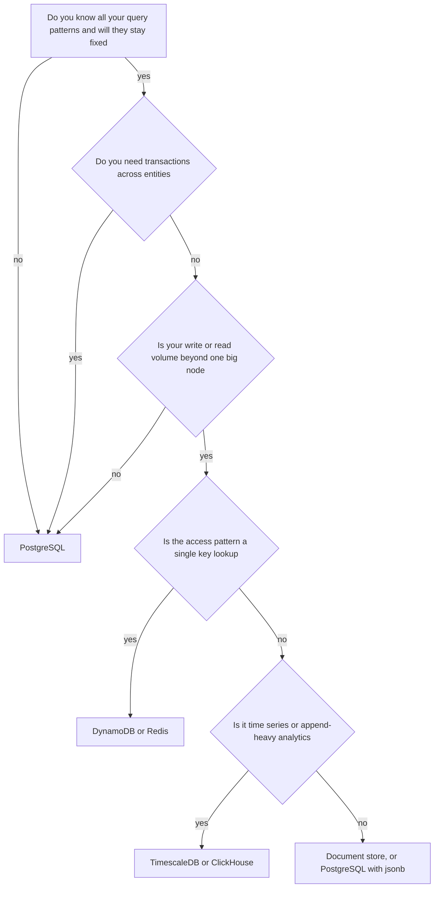
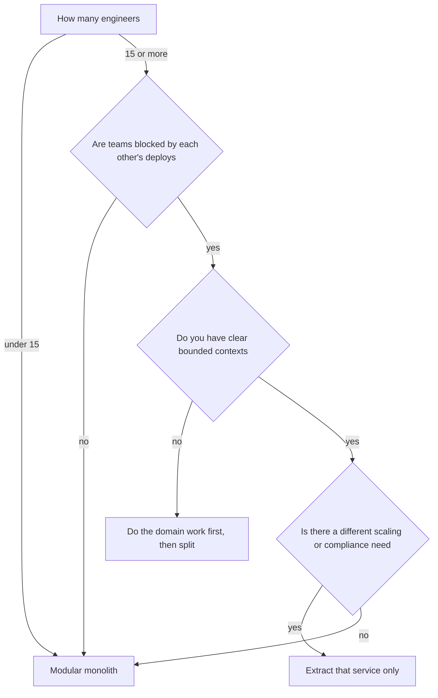
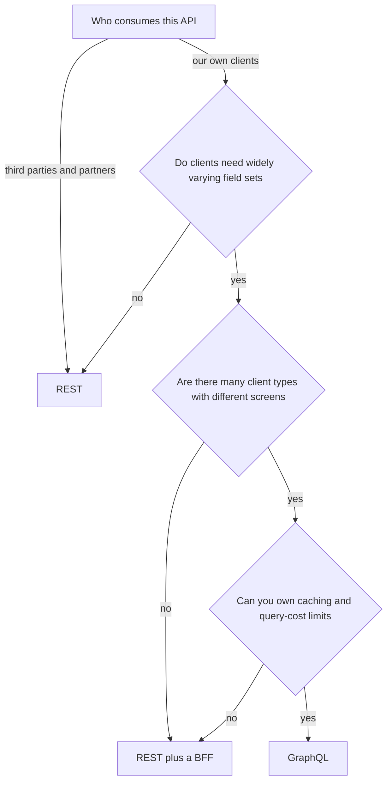
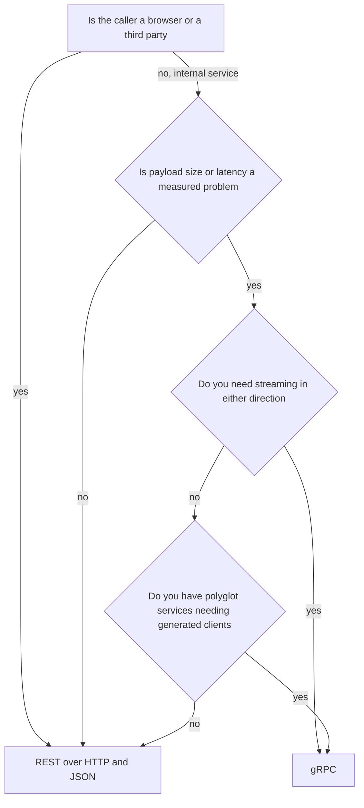

# Part 64 — Architecture Decision Framework

Most architecture arguments are not really disagreements about technology. They are disagreements about which constraint matters most, held by people who never said their constraint out loud. One person is optimising for hiring, another for latency, a third for the cloud bill. All three are right, and the argument cannot be resolved by discussing PostgreSQL.

This part is a set of decision procedures. For each of the twenty-one decisions below you get the same six things: a decision tree you can walk in ninety seconds, an explicit list of conditions mapped to choices, a trade-off table across nine dimensions, the signals that tell you the choice was wrong, the realistic migration path if it was, and a short note on how a senior engineer actually approaches it.

Three principles run underneath all of them.

**The default is the boring choice.** PostgreSQL, a modular monolith, REST, containers, managed services. Not because they are best in every case, but because they are best in most cases and the burden of proof belongs on the exception. When you deviate, write down the specific requirement that forced it.

**Reversibility is a first-class criterion.** Decisions differ enormously in how expensive they are to unmake. Choosing GraphQL is a few weeks to undo; choosing DynamoDB with a single-table design is a year. Spend your analysis budget in proportion to irreversibility, and where a decision is cheap to reverse, just decide and move.

**Every choice has a "signals you chose wrong" list, and you should write it before you decide.** A decision without falsification criteria is a belief. Writing down "if our p99 is still above 400 ms in three months, this was wrong" is what turns architecture from opinion into engineering.

## 64.1 SQL versus NoSQL

### Decision tree



### If... then choose

```text
If you need ACID transactions across multiple entities and rich ad-hoc queries
   -> Choose PostgreSQL
If you need single-digit-millisecond key lookups at extreme scale with one access pattern
   -> Choose DynamoDB or Redis
If your documents are variable in shape but you still need joins, constraints and SQL
   -> Choose PostgreSQL with jsonb columns
If you are storing 500,000 metric points per second with time-window queries
   -> Choose TimescaleDB, ClickHouse or a dedicated TSDB
If you need full-text relevance ranking across millions of documents with facets
   -> Choose Elasticsearch alongside PostgreSQL, never instead of it
If your data is a graph and your queries are variable-depth traversals
   -> Choose a graph database, but only after testing recursive CTEs in PostgreSQL
If you do not yet know the shape of your data or your queries
   -> Choose PostgreSQL, always
```

The most under-used answer on that list is the third. PostgreSQL with `jsonb` is very often the document database people actually needed: schemaless columns where you want them, real constraints and joins where you need them, GIN indexes for containment queries, and one system to operate.

```sql
CREATE TABLE products (
  id          UUID PRIMARY KEY,
  sku         TEXT NOT NULL UNIQUE,             -- structured where it matters
  price_minor BIGINT NOT NULL CHECK (price_minor >= 0),
  attributes  JSONB NOT NULL DEFAULT '{}'       -- schemaless where it helps
);
CREATE INDEX products_attr_gin ON products USING gin (attributes jsonb_path_ops);

-- containment query, index-backed, roughly 1 to 3 ms on millions of rows
SELECT id, sku FROM products WHERE attributes @> '{"colour":"red","size":"XL"}';
```

### Trade-offs

| Dimension | PostgreSQL | Document store (MongoDB) | Key-value (DynamoDB, Redis) |
|---|---|---|---|
| Consistency | Strong, ACID, serializable available | Tunable; multi-document transactions exist but are costly | Item-level atomic; cross-item needs application work |
| Latency | 1 to 5 ms typical indexed query | 1 to 5 ms typical | Under 1 ms for a key lookup |
| Throughput | Tens of thousands of TPS on one node; scales with replicas and partitions | High with sharding | Effectively unbounded with partitioning |
| Operational cost | Well understood; managed options everywhere | Sharding and balancing need real expertise | Very low if managed; you own capacity planning |
| Team skill | Nearly every backend engineer knows SQL | Moderate; misuse is common | Data modelling is genuinely hard and unforgiving |
| Flexibility | Excellent for new queries; `jsonb` covers variable shapes | Good for shape changes, weaker for new access patterns | Poor. New access patterns need new tables or GSIs |
| Money cost | Cheapest per GB; a single instance goes far | Higher per node | Pay per request; cheap at low volume, expensive at high read volume |
| Ecosystem | Enormous: ORMs, migrations, BI, extensions | Good | Good within its cloud, weak outside |
| Failure modes | Connection exhaustion, lock contention, bloat, replication lag | Unbalanced shards, hot chunks, unindexed scans | Hot partitions, throttling, unbounded item growth |

### Signals you chose wrong

- You picked NoSQL and are now doing joins in application code, fetching three collections to render one screen.
- You are writing eventual-consistency reconciliation jobs to fix data a transaction would have kept correct.
- Product asks a new question and the answer is "we cannot query that without a migration or a new index table".
- You picked PostgreSQL and one table is 4 TB with 200,000 writes per second on a single hot key, and partitioning has not helped.
- Your DynamoDB bill is dominated by read capacity, which usually means you are using it as a query engine.

### How to change your mind later

Moving from NoSQL to PostgreSQL is the common direction and is very doable: dual-write for a period, backfill historically with a batch job, verify with a comparison script that reads both and reports differences, then switch reads behind a feature flag and stop writing the old store. Budget one to three months for a medium dataset.

Moving from PostgreSQL to a key-value store is harder because you are giving up joins and transactions that application code has relied on for years. The realistic path is to move *one access pattern* at a time: identify the specific hot table, put the new store in front as a read cache first, then move writes once the read path is proven. Never migrate the whole database.

The cheapest insurance is a repository layer that keeps SQL in one place per aggregate. Not a generic abstraction over all databases, which is the overengineering trap from Part 63, just a boundary where the queries live.

### Senior perspective

I have never regretted starting on PostgreSQL, and I have several times watched teams spend a year escaping a NoSQL choice made in month two for scale that arrived in year four, if ever. The question that settles it is not "how much data will we have" but "will our query patterns change". If the answer is yes, and for any product still finding its market it is always yes, then the flexibility of SQL is worth more than the throughput of a key-value store. Choose the specialised store when you have a specific, measured access pattern that PostgreSQL demonstrably cannot serve. That is a real and legitimate situation; it is just much rarer than the architecture blogs suggest.

## 64.2 Monolith versus microservices

### Decision tree



### If... then choose

```text
If you have fewer than 15 engineers, or you are pre product-market fit
   -> Choose a modular monolith
If one component needs 20x the replicas of everything else at peak
   -> Extract that one component as a service
If a component has a different compliance boundary, such as card data
   -> Extract it, and keep the boundary narrow
If independent teams are genuinely blocked waiting on each other's release train
   -> Extract along the team boundary, one service at a time
If a component needs a different runtime, such as Python for machine learning
   -> Extract it
If your reason is "microservices are the modern architecture"
   -> Choose a modular monolith
If you already have a distributed monolith and cannot deploy services separately
   -> Merge them back, then re-split along the real boundaries
```

The default middle path deserves its own paragraph. A modular monolith is one deployable with hard internal boundaries: each module exposes a small public interface, imports across module internals are blocked by a lint rule, and each module owns its own tables that no other module queries directly. You get almost all of the design benefit of microservices — clear ownership, explicit contracts, testable boundaries — with none of the distributed-systems cost. It is also the ideal precondition for extraction: a module with a clean interface and its own tables becomes a service in a week.

```json
{
  "rules": {
    "no-restricted-imports": ["error", {
      "patterns": [{
        "group": ["**/modules/*/src/**", "**/modules/*/!(index)"],
        "message": "Cross-module imports must go through the module's public index.ts"
      }]
    }]
  }
}
```

### Trade-offs

| Dimension | Modular monolith | Microservices |
|---|---|---|
| Consistency | Single database, real transactions across modules | Distributed; sagas, outbox, eventual consistency |
| Latency | In-process calls, nanoseconds | Network hops, 1 to 10 ms each, compounding |
| Throughput | Scale the whole app together; usually fine | Scale each service independently; efficient at high scale |
| Operational cost | One pipeline, one dashboard, one on-call rotation | N of everything, plus tracing, discovery, mesh |
| Team skill | Standard backend skills | Requires distributed-systems and platform expertise |
| Flexibility | Refactor boundaries in an afternoon | Boundaries are expensive to move; contracts must be versioned |
| Money cost | One deployment, high utilisation | Idle capacity per service; typically 2 to 4x infrastructure |
| Ecosystem | Everything works out of the box | Needs a platform investment to be pleasant |
| Failure modes | One process; a memory leak affects everything | Partial failure, cascades, retry storms, version skew |

### Signals you chose wrong

- You chose microservices and every feature touches three repositories, or you have more services than engineers.
- Services must be deployed in a specific order, which means you built a distributed monolith (see Part 63).
- You chose a monolith and a single module's memory or CPU profile now forces you to over-provision everything.
- Deploy frequency is falling because the blast radius of one release has become frightening.
- Teams are queuing for a shared release train, and the queue is measured in days.

### How to change your mind later

Monolith to services is the easy direction if the modules were clean: extract one module, give it its own database schema, replace direct calls with an API or events, run both in parallel behind a router (Strangler Fig, Part 62), then delete the old code. Expect four to eight weeks for the first service, much less for later ones because the platform work is done.

Services back to a monolith is unfashionable and entirely reasonable. It is also mechanically simpler than people expect: merge the repositories, replace HTTP clients with direct calls, consolidate the databases with a schema per former service. The hard part is political, not technical. Several well-known engineering organisations have done this and reported large cost and latency improvements.

### Senior perspective

The question I ask is never "monolith or microservices" but "what specifically is blocked today". If nothing is blocked, the answer is a modular monolith and the conversation is over. If something is blocked, the answer is to extract exactly the thing that is blocked, and nothing else. Service boundaries are the most expensive artefact in software to move — far more expensive than a schema or an API — so you want to draw them with knowledge you can only get by operating the system for a year. The modular monolith is how you buy that year without accumulating the mess that makes people reach for microservices in the first place.

## 64.3 REST versus GraphQL

### Decision tree



### If... then choose

```text
If your API is public, versioned and consumed by partners you do not control
   -> Choose REST
If mobile clients need many different field subsets and screens change often
   -> Choose GraphQL
If you have one web client and a stable set of screens
   -> Choose REST
If clients complain about over-fetching but there are only two or three shapes
   -> Choose REST with sparse fieldsets or a BFF per client
If you need HTTP caching, CDN caching and simple observability by URL
   -> Choose REST
If you are aggregating many backend services for many frontends
   -> Choose GraphQL as a gateway layer, with strict cost limits
If your team has never operated GraphQL in production
   -> Choose REST, and revisit in a year
```

### Trade-offs

| Dimension | REST | GraphQL |
|---|---|---|
| Consistency | Resource-shaped, predictable payloads | Client-shaped; the same entity can arrive in many shapes |
| Latency | Multiple round trips for composed screens | One round trip; resolver fan-out can hide N+1 |
| Throughput | Easy to cache at CDN and reverse proxy | Hard to cache; usually POST, so CDN caching is mostly off |
| Operational cost | Low; every tool understands it | Needs query cost analysis, depth limits, persisted queries |
| Team skill | Universal | Requires understanding resolvers, DataLoader and schema design |
| Flexibility | Adding a field is easy; adding a shape needs an endpoint | Excellent; clients compose what they need |
| Money cost | Low | Higher compute per request; unbounded queries are a cost risk |
| Ecosystem | Enormous, including OpenAPI tooling | Good and mature, but narrower |
| Failure modes | Over-fetching, endpoint sprawl, chatty clients | N+1 in resolvers, malicious deep queries, 200 responses containing errors |

### Signals you chose wrong

- You chose REST and your mobile team maintains a list of 14 calls to render one screen.
- Your REST API has endpoints like `/orders?include=items,user,shipping&fields=...` — you are reimplementing GraphQL badly.
- You chose GraphQL and your p99 is dominated by resolver N+1 because nobody added DataLoader.
- Your CDN hit rate went to zero after the migration and origin traffic tripled.
- A single client query can read 200,000 rows because there is no depth or cost limit.

### How to change your mind later

REST to GraphQL is additive and low risk: put a GraphQL layer in front that resolves by calling the existing REST endpoints or services, migrate clients screen by screen, keep REST for partners forever. Nothing needs to be deleted.

GraphQL to REST is more work but bounded: generate REST endpoints for the queries clients actually run — persisted-query logs tell you exactly which those are, usually a few dozen — and migrate clients one at a time. Persisted queries are also the thing that makes the migration measurable, which is a good reason to enable them on day one regardless.

### Senior perspective

GraphQL solves a client-diversity problem. If you do not have that problem, it is a tax: you pay in caching, observability and query-cost defence, and you receive flexibility you were not going to use. The strongest predictor I have found is the number of distinct client applications with independent release cycles. One client, choose REST. Four clients on three platforms with a design system that changes quarterly, GraphQL earns its keep. And whichever you choose, the discipline that matters is the same: know the cost of every request the client can construct, and cap it.

## 64.4 REST versus gRPC

### Decision tree



### If... then choose

```text
If browsers call it directly, or partners integrate with it
   -> Choose REST over HTTP and JSON
If two internal services exchange millions of messages per day and bytes matter
   -> Choose gRPC
If you need bidirectional or server-side streaming between services
   -> Choose gRPC
If you have services in TypeScript, Go and Java that must share a contract
   -> Choose gRPC, and let protoc generate the clients
If your services are all Node and the traffic is under a few thousand RPS
   -> Choose REST; the gain is not worth the tooling
If you want a strict, machine-checked contract with backward-compatibility rules
   -> Choose gRPC, or REST with OpenAPI and a contract test in CI
```

### Trade-offs

| Dimension | REST and JSON | gRPC and protobuf |
|---|---|---|
| Consistency | Contract by convention or OpenAPI | Contract enforced by generated code |
| Latency | Higher: JSON parsing plus HTTP/1.1 overhead | Lower: binary encoding, HTTP/2 multiplexing; typically 20 to 40 percent faster in-region |
| Throughput | Good | Better; payloads often 30 to 60 percent smaller |
| Operational cost | Trivial to debug with curl and browser tools | Needs grpcurl, reflection, and proxies that speak HTTP/2 |
| Team skill | Universal | Requires learning protobuf, codegen and streaming semantics |
| Flexibility | Add a field freely | Add a field freely if you follow protobuf rules; renumbering breaks everything |
| Money cost | Higher bandwidth and CPU for serialization | Lower bandwidth; relevant at high volume or cross-AZ |
| Ecosystem | Everything | Strong for backend, weak in browsers without grpc-web and a proxy |
| Failure modes | Silent contract drift, over-fetching | Version skew between generated stubs, load balancing needs L7 awareness |

A practical note on load balancing: gRPC uses long-lived HTTP/2 connections, so a plain L4 load balancer pins a client to one server and traffic becomes badly skewed. You need client-side load balancing or an L7 proxy that understands HTTP/2. This surprises teams in production more than any protocol detail.

### Signals you chose wrong

- You chose gRPC and every debugging session starts by installing a tool to read a payload.
- Browser clients need grpc-web plus a translating proxy, which you now operate.
- One backend pod receives 80 percent of gRPC traffic because of connection pinning.
- You chose REST and serialization CPU is a visible fraction of your service's profile, or cross-AZ bandwidth is a line item you can see on the bill.
- Internal payloads exceed a megabyte and JSON parsing shows up in flame graphs.

### How to change your mind later

Run both. A NestJS service can expose an HTTP controller and a gRPC controller over the same application service with no duplication of logic.

```ts
@Controller()
export class PricingGrpcController {
  constructor(private readonly pricing: PricingService) {}   // same service as the REST controller

  @GrpcMethod('PricingService', 'GetPrice')
  getPrice(req: GetPriceRequest): Promise<PriceReply> {
    return this.pricing.getPrice(req.sku, req.quantity);
  }
}
```

Migrate callers one at a time, keep REST for anything external, and delete nothing until traffic is zero.

### Senior perspective

gRPC is a performance and contract tool for internal, high-volume, polyglot communication. Reach for it when you have measured a serialization or bandwidth problem, or when you genuinely need streaming, or when generated clients across three languages would remove a class of integration bugs. Do not reach for it because it is faster in a benchmark: at 500 RPS between two Node services, the difference is invisible next to your database time, and you have paid a real debuggability cost. My usual arrangement is REST at the edge, gRPC only on the two or three internal paths where the numbers justify it.
