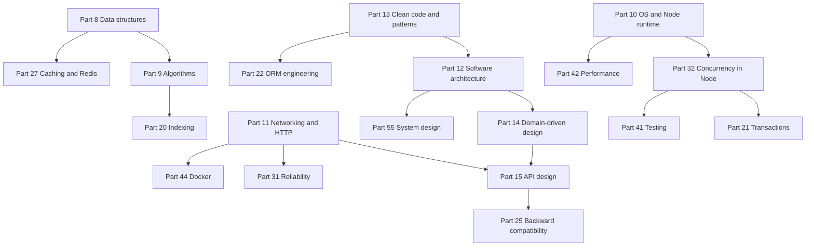
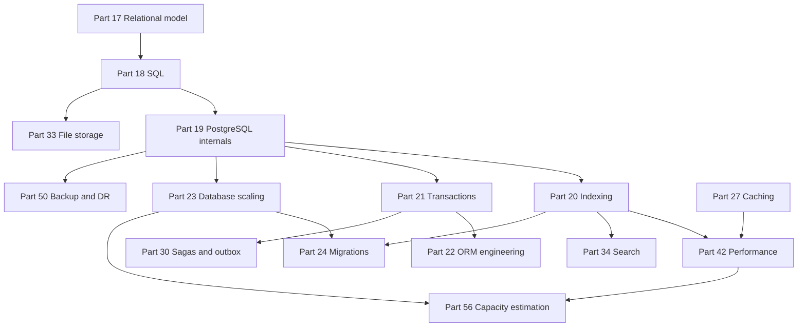
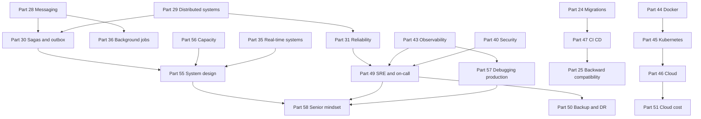
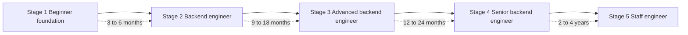

# Part 65 — The Knowledge Map and Learning Roadmap

Backend engineering is not a list of technologies. It is a dependency graph, and most people learn it in the wrong order: they start with a framework, then a database library, then a container, and only years later discover that everything they found confusing about all three was a consequence of something in operating systems, networking or the relational model that nobody had shown them.

This part is the map. It shows what depends on what, in what order to learn it, how long each stage realistically takes, and what to read alongside. It closes the book, so it also tries to say the honest things about a career that a list of parts cannot.

## 65.1 The knowledge map

The chain from theory to practice looks linear when written as a sentence — computer science, then programming, then operating systems, networking, backend development, databases, distributed systems, system design, cloud, DevOps, observability, SRE, architecture, leadership — but that is not how the dependencies actually run. Concurrency in the Node runtime is what makes database transaction anomalies intuitive. PostgreSQL internals are what make indexing make sense. Messaging is what makes sagas necessary. Observability is what makes both incident response and production debugging possible.

Here is the real shape, in three views.

### 65.1.1 Foundations into application engineering

Two dependencies in that diagram are worth calling out, because they are the ones people skip.

**Part 10 into Part 32 into Part 21.** The event loop is why a single Node process can serve 2,000 concurrent requests, and it is also why fifty of those requests can be inside the same read-modify-write sequence on the same row at the same time. If you do not understand the runtime's concurrency model, database isolation levels read like trivia. Once you do, they read like the solution to a problem you have personally caused.

**Part 11 into Part 31.** Timeouts, retries, circuit breakers and backpressure are not framework features. They are consequences of what TCP does and does not promise you. A retry that makes an outage worse makes perfect sense once you have seen a connection queue fill.

### 65.1.2 The data path

The spine here is Part 19. PostgreSQL internals — the page layout, MVCC, the visibility map, the write-ahead log, autovacuum, the planner — is the single highest-return investment in the book for a backend engineer. Indexing stops being a list of index types and becomes obvious. Transactions stop being isolation-level trivia and become "which row versions can this snapshot see". Bloat, replication lag, plan flips and lock waits stop being mysteries and become things you can predict from first principles.

Note also that Part 21 feeds Part 30. Sagas exist because a database transaction cannot span two services. You cannot understand why the outbox pattern exists until you understand exactly what a local transaction gives you for free.

### 65.1.3 Distributed systems into production engineering

The pattern to notice: everything in the top half of this graph converges on the bottom. Part 58 is not a separate soft-skills topic bolted onto the end of a technical book. It is what the technical parts turn into once you have enough of them: the questions in Part 58 are only answerable by someone who knows what a timeout does to a connection pool, what a partial saga leaves behind, and what a missing index costs at a billion rows.

### 65.1.4 Every part, its prerequisites, and what it unlocks

Levels: **foundation** (before you can reason about anything else), **backend** (the working backend engineer's core), **advanced** (depth that separates strong mid from senior), **senior**, **staff**.

| Part | Prerequisites | What it unlocks | Level |
|---|---|---|---|
| 1 — Data structures | None | Complexity intuition; why hash maps, heaps and tries appear inside databases, caches and rate limiters | foundation |
| 2 — Algorithms | 1 | Reasoning about cost; pagination, sorting, graph problems, dependency resolution, cache eviction | foundation |
| 3 — OS and Node runtime | None | Everything about how your process actually behaves: memory, file descriptors, the event loop, GC | foundation |
| 4 — Networking and HTTP | None | API design, timeouts, keep-alive, TLS, CORS, and every "why is it slow" investigation | foundation |
| 5 — Software architecture | 3, 4 | Choosing monolith, modular monolith, microservices or events with reasons rather than fashion | backend |
| 6 — Clean code and patterns | 5 | Code that survives five years; dependency injection, repositories, strategies, the patterns NestJS assumes | backend |
| 7 — Domain-driven design | 5, 6 | Boundaries, aggregates and the vocabulary that makes service splits sane | advanced |
| 8 — API design | 4, 7 | Contracts that can evolve: versioning, pagination, idempotency, error shapes | backend |
| 9 — Relational model | None | Normalisation, keys, constraints; why the database can enforce truth | foundation |
| 10 — SQL | 9 | Joins, aggregates, window functions, CTEs, upserts; the language of all data work | backend |
| 11 — PostgreSQL internals | 10 | MVCC, WAL, vacuum, the planner; the mental model behind indexing, transactions, bloat and lag | advanced |
| 12 — Indexing | 11, 2 | B-tree, GIN, BRIN, partial and covering indexes; the biggest performance lever you own | advanced |
| 13 — Transactions | 11, 21 | Isolation levels, locks, deadlocks, optimistic and pessimistic strategies | advanced |
| 14 — ORM engineering | 6, 13 | Knowing the SQL your ORM emits, owning transaction boundaries, escaping to raw SQL deliberately | backend |
| 15 — Database scaling | 11, 12 | Replicas, partitioning, sharding, connection pooling, read/write splitting | advanced |
| 16 — Caching and Redis | 1, 4 | Cache-aside, stampedes, TTL strategy, hot keys, and cache-down behaviour | backend |
| 17 — Messaging | 4, 18 | Queues, topics, partitions, consumer groups, delivery semantics, dead letters | advanced |
| 18 — Distributed systems | 4 | CAP in practice, consistency models, partial failure, consensus and its limits | advanced |
| 19 — Sagas, outbox, idempotency | 13, 17, 18 | Correct multi-service workflows without distributed transactions | senior |
| 20 — Reliability engineering | 4, 18 | Timeouts, retries, backoff, circuit breakers, bulkheads, backpressure, graceful degradation | senior |
| 21 — Concurrency in Node | 3 | Race conditions in a single-threaded runtime, locks, worker threads, safe parallelism | advanced |
| 22 — Security | 4, 8 | Authn, authz, tokens, OWASP, secrets, and designing for the leak that will happen | senior |
| 23 — Testing | 6, 14, 21 | A strategy that catches real bugs: integration on real dependencies, concurrency and contract tests | backend |
| 24 — Performance engineering | 3, 11, 12, 16 | Percentiles, profiling, N+1, pools, batching, streaming; optimising the real constraint | advanced |
| 25 — Observability | 4, 24 | Structured logs, metrics, traces, correlation ids; being able to see production at all | advanced |
| 26 — Docker | 3 | Images, layers, PID 1, limits; reproducible environments and real local dependencies | backend |
| 27 — Kubernetes | 26, 4 | Pods, deployments, services, probes, rollouts, resource limits, disruption budgets | advanced |
| 28 — Cloud architecture | 27, 18 | Managed versus self-run, failure domains, IAM, networking, the build-or-buy calculation | advanced |
| 29 — CI/CD | 23, 26 | Pipelines, environments, artefacts, canaries, rollback, deploys as a boring event | backend |
| 30 — Git | None | Clean history, rebase, bisect, recovery, review workflow, secret removal | foundation |
| 31 — Migrations and zero downtime | 12, 13, 15 | Expand-contract, lock-safe DDL, batched backfills, rollback-safe releases | senior |
| 32 — Backward compatibility | 8, 17, 29 | Rolling deploys, API and event versioning, clients you cannot upgrade | senior |
| 33 — File storage and uploads | 10, 22, 28 | Object storage, presigned URLs, multipart, CDN, lifecycle, secure downloads | backend |
| 34 — Search | 12, 10 | Full-text in PostgreSQL, inverted indexes, ranking, fuzzy matching, when to add a search engine | advanced |
| 35 — Real-time systems | 4, 16, 17 | WebSockets, SSE, fan-out, presence, reconnection, ordering, scaling connections | advanced |
| 36 — Background jobs and schedulers | 17, 21 | BullMQ, retries, distributed locks, cron correctness, idempotent workers | backend |
| 37 — SRE, incident response and on-call | 20, 25, 22 | SLOs, error budgets, alert design, runbooks, incident command, postmortems | senior |
| 38 — Backup, restore and disaster recovery | 11, 28, 37 | RPO and RTO, PITR, tested restores, forensic copies, DR that is not theoretical | senior |
| 39 — Cloud cost engineering | 28, 41 | Right-sizing, retention, lifecycle, commitments, cost as a design constraint | senior |
| 40 — System design case studies | 5, 15, 17, 18, 41 | End-to-end design under real constraints; the interview skill and the job skill | senior |
| 41 — Capacity estimation | 11, 24 | Back-of-the-envelope arithmetic that turns opinions into numbers | advanced |
| 42 — Debugging production systems | 3, 24, 25 | Heap snapshots, flame graphs, lock waits, OOMKills, evidence-led diagnosis | senior |
| 43 — The senior mindset | 19, 20, 31, 37, 40 | The question set, ADRs, review, incident command, communication | senior |
| 44 — Junior to principal | 43 | An honest self-assessment and a development plan with visible signals | senior |
| 45 — Interview preparation | 40, 43 | Self-testing across the whole book; senior and staff interview performance | senior |
| 46 — Practical projects | 8, 14, 23, 29 | Turning reading into demonstrable ability by building and operating real systems | backend |
| 47 — Real-world architecture patterns | 20, 27, 28, 37 | Edge, discovery, health, gateway and resilience patterns as they actually appear | staff |
| 48 — Anti-patterns | 43, 47 | Recognising expensive mistakes before they are made, in code and in organisations | staff |
| 49 — Production readiness and go-live | 29, 37, 38, 39 | The launch checklist: deployment choices, readiness gates, day-one operations | senior |

Three reading notes on this table.

**Prerequisites are about comprehension, not permission.** You can read Part 45 on Kubernetes without Part 10. You will retain about a third of it, and you will not understand why a memory limit interacts with the V8 heap, which is exactly the thing that will page you.

**The foundation rows are the ones that keep paying.** Parts 8–11, 17 and 48 describe things that have been true for decades and will still be true when NestJS is a historical curiosity. Everything above them is an implementation of them.

**"Staff" level in this table does not mean harder.** It means the content is about judgment across systems and organisations rather than about mechanisms. A strong mid-level engineer can read Part 63 and enjoy it; they will get ten times more from it after operating something for two years.

## 65.2 The learning roadmap

Five stages. Each one has a goal, a reading order, a thing to build, skills you must be able to demonstrate rather than recognise, a realistic time estimate for someone working full time as a developer and studying seriously outside that, and an exit test.

The time estimates assume you are also doing a job. They are honest rather than encouraging: someone telling you that you can be a senior backend engineer in six months is selling something. The good news is that the stages overlap with paid work, so most of the time is not extra.

### 65.2.1 Stage 1 — Beginner foundation

**Goal.** Understand what happens underneath before you learn any framework's opinion about it. You should be able to explain what a process is, what happens between typing a URL and receiving bytes, what a table with a primary key really is, and why one algorithm is slower than another.

**Read in this order.** Part 0 (How to Understand Any Technology) first: it is the method the rest of the book uses. If you are new to programming, read Volume 0 (Parts 1–7) next; it ends with your first backend and your first frontend. Then Part 48 (Git), because you need it from day one. Then Part 8, Part 9, Part 10, Part 11, Part 17, Part 18. Do not skip Part 10 because it looks like operating-systems theory; it is the part that explains every future confusing thing about Node.

**Build alongside.** Not a project yet — exercises. Implement an LRU cache from scratch. Write a small HTTP server with Node's `http` module, no framework, and handle a POST body yourself. Create a PostgreSQL schema for a blog with proper foreign keys and write ten queries against it by hand, including joins and aggregates. Use `psql`, not a GUI.

**You must be able to demonstrate.**

- Explain the difference between a process, a thread and the event loop, and why blocking code hurts a Node server.
- Walk through DNS, TCP, TLS and HTTP for a single request, naming the round trips.
- Write a query with a join, a `GROUP BY` and a `HAVING` without looking anything up.
- Explain why a hash map lookup is O(1) and a sorted array search is O(log n), and where each appears in a real backend.
- Use Git for branching, rebasing, and recovering a commit you thought you lost.

**Time.** Three to six months, part time.

**Ready for the next stage when.** You can explain to another person, without notes, what happens between a browser request and a database row being returned, including where the time goes.

### 65.2.2 Stage 2 — Backend engineer

**Goal.** Build and ship a complete, correct API on your own: modelled, validated, tested, containerised, deployed, and not embarrassing.

**Read in this order.** Part 12, Part 13, Part 15, Part 22, Part 27, Part 41, Part 44, Part 47, Part 36, Part 33. Read Part 40 (Security) at least to the end of authentication, authorisation and injection; you cannot ship a login system responsibly without it. Read Part 53 (AI-Assisted Engineering) before you lean on AI tools at work, and Part 82 when you prepare for frontend or full-stack interviews.

**Build alongside.** The first Part 61 project: the production-grade authentication system. Registration, login, password hashing, refresh-token rotation with reuse detection, email verification, rate limiting, and a full test suite. Then deploy it somewhere real with a domain and TLS, and keep it running.

**You must be able to demonstrate.**

- A NestJS service with modules, DTO validation, guards, interceptors and an exception filter, where the domain logic does not depend on the framework.
- Correct HTTP semantics: status codes, idempotency of `PUT`, pagination, error envelopes.
- Integration tests that run against real PostgreSQL and Redis in containers.
- A multi-stage Dockerfile producing a small non-root image, and a CI pipeline that runs tests and builds it.
- Password hashing, token lifetimes and authorisation checks you can defend in a review.

**Time.** Nine to eighteen months, overlapping with a working job.

**Ready for the next stage when.** You have shipped something to real users, and when it broke you fixed it yourself using logs and metrics rather than by guessing.

