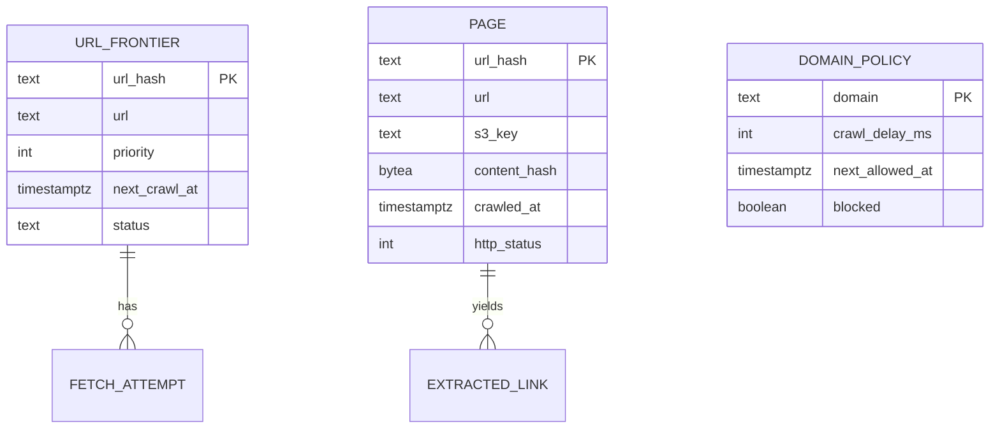
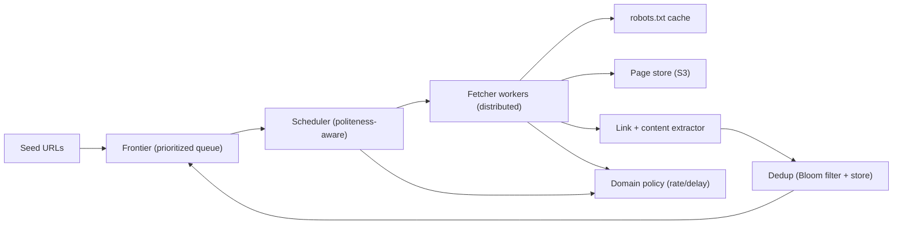
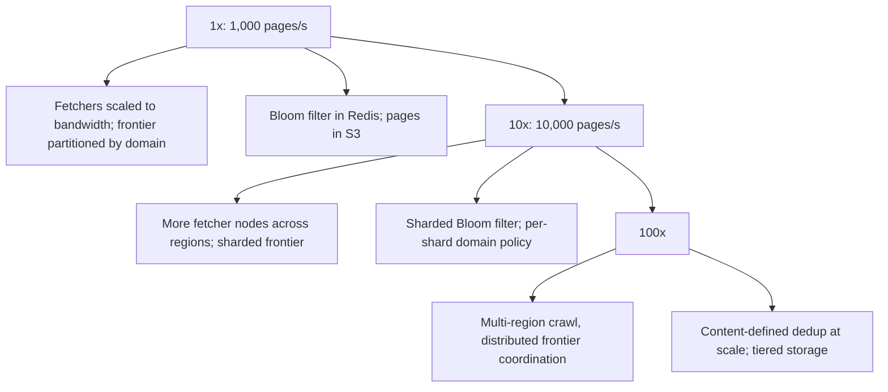

# Part 65 — More System Designs I

This Part continues the system-design case studies of Part 40, using the exact same method and twenty-section template. If you have not read Part 40, read its section 40.0 first: it defines the nine-move method (clarify, estimate, define APIs, model data, draw the high-level design, deep-dive the hot spots, address cross-cutting concerns, state tradeoffs, offer alternatives), the twenty-section template, and the default environment (NestJS on Kubernetes, PostgreSQL, Redis, Kafka or SQS, S3, CloudFront). Everything here assumes that method; we do not repeat it.

The four systems in this Part are classics that probe different skills: a **web crawler** (politeness, deduplication, a distributed frontier), a **distributed key-value store** (partitioning, consistent hashing, replication, quorum — the heart of distributed systems), a **unique ID generator** (Snowflake IDs, clock skew, UUIDv7, sequences at scale), and a **ticket and seat booking system** (holds, expiring reservations, hot-event contention, payment coupling). Part 66 continues with four more. Read each as a worked example of the method, then produce your own designs the same way.

## 65.1 Web Crawler

### 65.1.1 Requirements

A web crawler systematically downloads web pages, extracts their content and links, and follows those links to discover more pages, feeding a search index, a dataset, or a monitoring system. The users are internal: a search team that wants the web indexed, a data team that wants a corpus, an operations team that wants to detect changes. The crawler must be a good citizen of the web — polite to the sites it visits — and it must scale to billions of pages without re-downloading the same page endlessly or getting trapped.

Imagine a diligent librarian cataloguing an infinite library by starting at a few books, reading each, noting the references it cites, and visiting those next, keeping a card for every book already catalogued so none is read twice, and never pulling so many books from one shelf at once that the shelf collapses. The librarian is the crawler; the references are links; the cards are the seen-set (deduplication); not overwhelming a shelf is politeness.

### 65.1.2 Functional requirements

1. Start from a set of seed URLs and discover new URLs by following links.
2. Download each page's content and store it (or pass it to a processing pipeline).
3. Extract links from each page and enqueue the new ones for crawling.
4. Never crawl the same URL twice (deduplication), within a refresh window.
5. Respect politeness: obey `robots.txt`, limit the rate per domain, honor crawl-delay.
6. Prioritize URLs (freshness, importance) rather than pure FIFO.
7. Re-crawl pages periodically to detect changes (configurable per-page freshness).
8. Avoid traps: infinite URL spaces, redirect loops, enormous pages.

### 65.1.3 Non-functional requirements

| Property | Target | Why |
|---|---|---|
| Throughput | 1,000 pages/second sustained (target scale) | To cover a large web in reasonable time |
| Politeness | Never exceed a per-domain rate (e.g. 1 request/second/domain default) | Being blocked or harming a site is unacceptable |
| Deduplication | A URL is crawled at most once per refresh window | Re-crawling wastes the entire budget |
| Durability | A crawled page and the frontier survive crashes | Losing progress means re-crawling billions of pages |
| Scalability | Scale fetchers horizontally | One machine cannot crawl the web |
| Freshness | Important pages re-crawled within their window | A stale index is a poor one |

### 65.1.4 Constraints

- Must respect `robots.txt` and site rate limits absolutely; being a bad citizen gets the crawler's IPs banned and is reputationally and legally risky.
- Budget for storage of billions of pages (object storage, S3) and for the frontier and seen-set.
- The web is adversarial: spider traps, infinite calendars, malicious pages; the crawler must not be trapped or crashed by them.
- Distributed by necessity; must coordinate deduplication and politeness across many fetcher machines.

### 65.1.5 Capacity estimation

| Quantity | Assumption | Calculation | Result |
|---|---|---|---|
| Pages to crawl | Target corpus | given | 10 billion |
| Crawl rate | Sustained | given | 1,000 pages/second |
| Time for one full pass | 10B / 1,000 | 10,000,000 s | about 116 days |
| Average page size | HTML plus headers | given | about 100 KB |
| Storage for one pass | 10B x 100 KB | | 1 PB raw (compressed ~200-300 TB) |
| Seen-set size | 10B URLs x ~20 B (hash) | | about 200 GB (fits a Bloom filter + store) |
| Links per page | average outlinks | given | about 50 |
| Frontier growth | each page yields ~50 links, most seen | | frontier of billions of URLs |
| Bandwidth | 1,000 pages/s x 100 KB | | 100 MB/s = about 800 Mbps inbound |

The numbers say: deduplication must be memory-efficient at 10B URLs (a Bloom filter, Part 1, in front of an exact store), the frontier is itself a big-data problem (billions of URLs, must be durable and prioritized), storage is object storage (S3), and politeness must be coordinated across fetchers so one domain is never hammered by many machines at once.

### 65.1.6 API design

The crawler is mostly internal; its "API" is operational and the component interfaces.

| Operation | Interface | Notes |
|---|---|---|
| Add seeds | `POST /seeds { urls[] }` | Bootstrap the frontier |
| Enqueue URL | internal: `frontier.add(url, priority)` | From link extraction |
| Fetch next | internal: `frontier.next(domain-aware)` | Respects politeness |
| Mark seen | internal: `seen.add(urlHash)` | Bloom filter + store |
| Store page | internal: `store.put(url, content)` | To S3 + metadata |
| Get stats | `GET /stats` | Pages/s, frontier size, error rates |
| Pause/resume domain | `POST /domains/{d}/pause` | Operational control |

### 65.1.7 Data model

The **frontier** (URLs to crawl, prioritized, with next-crawl time), the **seen-set** (a Bloom filter in Redis for fast "probably seen" checks, backed by an exact store to resolve false positives), **pages** (content in S3, metadata in a store), and **domain policy** (per-domain crawl delay and next-allowed time for politeness). Content is addressed by `content_hash` so identical content fetched via different URLs is deduplicated at the content level too.

### 65.1.8 High-level architecture

Flow: the scheduler pulls from the frontier, choosing URLs whose domain is allowed to be crawled now (politeness), and hands them to fetcher workers. Fetchers check `robots.txt` (cached), download the page, store it in S3, and pass it to the extractor, which finds links, deduplicates them against the Bloom filter and store, and enqueues the new ones back into the frontier. Domain policy enforces per-domain rate limits across all fetchers.

### 65.1.9 Component design

| Component | Responsibility | Scaling |
|---|---|---|
| Frontier | Durable, prioritized store of URLs to crawl, with next-crawl times | Partitioned by domain hash |
| Scheduler | Pick URLs whose domain is politeness-eligible now; prioritize | Coordinates via domain policy in Redis |
| Fetcher workers | Download pages, obey robots.txt, handle timeouts/traps | Horizontal, stateless |
| Extractor | Parse content, extract links, compute content hash | Horizontal, per page |
| Dedup | Bloom filter (fast probable-seen) + exact store (resolve false positives) | Bloom in Redis, store partitioned |
| Domain policy | Per-domain crawl delay, next-allowed time, block list | Redis, shared across fetchers |

The **deduplication** design is the interesting part. A Bloom filter (Part 1) in Redis gives a fast, memory-efficient "probably seen" check for 10B URLs in a few GB; a positive is confirmed against an exact store (to resolve the Bloom filter's false positives, which would otherwise skip a genuinely new URL). URL normalization (lowercasing host, removing fragments and tracking params, sorting query params) happens before hashing, so the same page via different URL spellings is one entry.

### 65.1.10 Database / store design

The frontier and seen-set are partitioned by domain hash so each partition owns a set of domains, which also localizes politeness (one partition's scheduler controls one domain's rate). Pages go to S3 (object storage, cheap at petabyte scale), with metadata in a partitioned store. The frontier is prioritized: a priority queue per partition ordered by crawl priority and `next_crawl_at`, so important and due pages are crawled first. Content-level dedup uses `content_hash` so mirror sites and duplicate content do not consume the budget.

### 65.1.11 Caching

| Layer | What | TTL | Why |
|---|---|---|---|
| robots.txt cache | Per-domain crawl rules | 24 h | Avoid re-fetching robots.txt per URL |
| DNS cache | Hostname to IP | TTL-respecting | Avoid a DNS lookup per request |
| Bloom filter (Redis) | Seen URLs (probable) | long | Fast dedup without hitting the store |
| Domain policy (Redis) | Next-allowed time per domain | short | Politeness coordination across fetchers |

### 65.1.12 Messaging

The frontier itself is effectively a durable queue; new URLs from extraction are enqueued (Kafka or a partitioned queue, Part 17), keyed by domain so one domain's URLs land in one partition (politeness locality). Fetch results flow to the extractor via a queue. Re-crawl scheduling re-enqueues a page at its `next_crawl_at`. At-least-once delivery is fine because dedup makes re-processing idempotent.

### 65.1.13 Scaling

Fetchers scale horizontally (they are stateless); the frontier and seen-set scale by partitioning on domain hash; S3 scales for storage. The coordination challenge at scale is politeness: all fetchers for a domain must share its rate limit, which the domain-partitioned design and shared domain policy in Redis handle. Bandwidth, not CPU, is often the limit, so fetchers are placed for network throughput.

### 65.1.14 Security and safety

- **Politeness and robots.txt**: absolute — obey `robots.txt`, per-domain rate limits, and crawl-delay, or get banned and cause harm.
- **Traps**: cap URL depth and per-domain page counts, detect redirect loops, cap page size (reject enormous pages), and detect infinite URL spaces (calendars), so a trap does not consume the budget or crash a fetcher.
- **Malicious content**: fetchers parse untrusted HTML; parse defensively (timeouts, size limits) so a malicious page cannot hang or crash a worker.
- **SSRF / scope**: restrict the crawl to intended domains/schemes; never let a link drive the fetcher to internal addresses.
- **Legal/ethical**: respect terms, identify the crawler via User-Agent, provide an opt-out.

### 65.1.15 Failure scenarios

| Failure | Detection | Impact | Mitigation | Effect |
|---|---|---|---|---|
| Fetcher crash | Health check, lease expiry | In-flight URLs stalled | URLs leased with timeout; re-enqueued on lease expiry | None (re-crawled) |
| Spider trap (infinite URLs) | Per-domain page-count spike | Budget wasted on one domain | Depth/count caps, trap detection | Bounded |
| Bloom filter false positive | Rare, by design | A new URL skipped | Exact store confirms; tune filter size | Negligible |
| robots.txt change (now disallowed) | Periodic re-fetch | Crawling disallowed paths | Re-fetch robots.txt per TTL; stop on disallow | Compliant |
| One domain overwhelmed | Domain error rate, complaints | Harm, risk of ban | Per-domain rate limit enforced across fetchers | Prevented |
| Frontier store down | Errors | Crawling stalls | Durable, replicated frontier; resume on recovery | Pause, no loss |
| Enormous page | Size at fetch | Memory blowup | Stream and cap page size | Rejected cleanly |

### 65.1.16 Observability

Metrics: pages/second, frontier size, per-domain request rate (to prove politeness), error rates by type (timeout, 4xx, 5xx, trap), dedup hit rate, re-crawl freshness, bandwidth. Alerts: per-domain rate exceeding the limit (politeness violation), frontier growth stalling (coverage problem), error-rate spikes. Dashboards: coverage (pages crawled vs target), freshness (pages overdue for re-crawl), politeness (per-domain rates).

### 65.1.17 Deployment

Fetchers and extractors as horizontally-scaled stateless deployments (Part 27); the frontier and seen-set on partitioned durable stores; Redis for Bloom filter and domain policy; S3 for pages. Crawl scope and rate limits from config. Rollout with canaries so a bad parser change does not corrupt the corpus. Per-domain pause as an operational control.

### 65.1.18 Cost considerations

The dominant costs are storage (petabytes of pages in S3; compression and tiering to cheaper storage classes matter) and bandwidth (ingress for crawling). Compute (fetchers, extractors) is secondary and can use spot instances. The seen-set and frontier stores are modest by comparison. Cost is controlled by crawling selectively (prioritize, do not re-crawl needlessly — the dedup and freshness logic directly controls the bill) and by tiered storage for old pages.

### 65.1.19 Tradeoffs

- **Bloom filter dedup** (memory-efficient, tiny false-positive rate that rarely skips a URL) over an exact in-memory set (exact but needs ~200 GB RAM): we accept a negligible miss rate for huge memory savings.
- **Politeness over throughput**: we cap per-domain rate even when we could crawl faster, because being banned or harming sites is unacceptable; throughput comes from breadth (many domains) not depth (hammering one).
- **At-least-once processing with idempotent dedup** over exactly-once: simpler and the dedup makes reprocessing harmless.
- **Object storage (S3) for pages** over a database: cheap at petabyte scale, at the cost of not querying page content in the store (that is the index's job).

### 65.1.20 Alternative architectures

**Managed crawl + serverless**: Lambda-based fetchers triggered from an SQS frontier, pages to S3, dedup in DynamoDB. Scales elastically and needs no fetcher fleet to manage; loses some control over politeness coordination and can cost more at sustained high throughput.

**Single-machine crawler**: for crawling one site or a small set (thousands to millions of pages), a single well-behaved process with an in-memory frontier and a local seen-set is far simpler and entirely adequate. This is what most "crawler" needs actually are, and the distributed design above is justified only at web scale. Build the simple version first.
