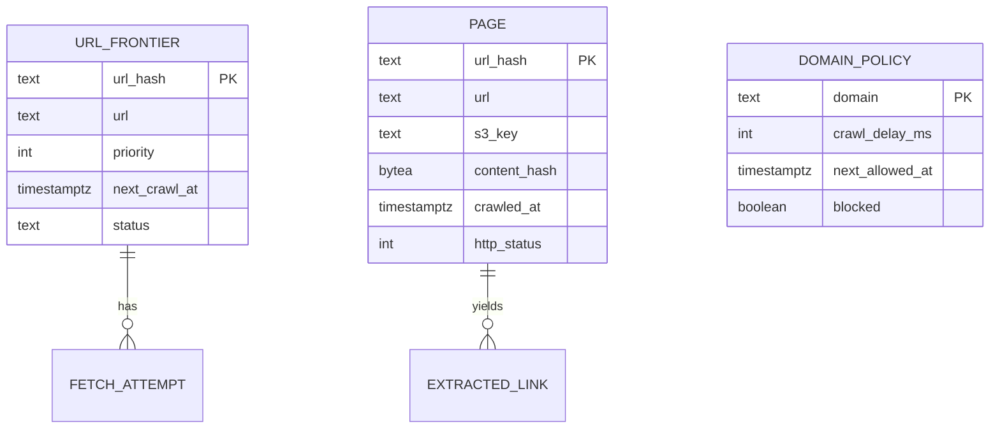
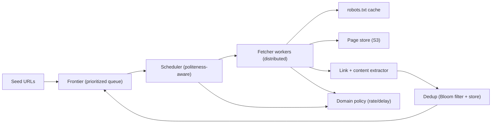
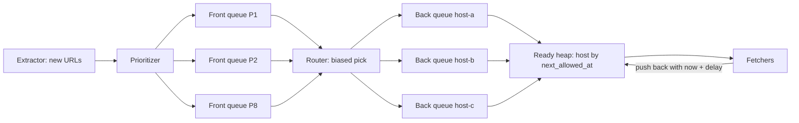

# Part 65 — More System Designs I

This Part continues the system-design case studies of Part 54, using the exact same method and twenty-section template. If you have not read Part 54, read its section 54.0 first: it defines the nine-move method (clarify, estimate, define APIs, model data, draw the high-level design, deep-dive the hot spots, address cross-cutting concerns, state tradeoffs, offer alternatives), the twenty-section template, and the default environment (NestJS on Kubernetes, PostgreSQL, Redis, Kafka or SQS, S3, CloudFront). Everything here assumes that method; we do not repeat it.

The four systems in this Part are classics that probe different skills: a **web crawler** (politeness, deduplication, a distributed frontier), a **distributed key-value store** (partitioning, consistent hashing, replication, quorum — the heart of distributed systems), a **unique ID generator** (Snowflake IDs, clock skew, UUIDv7, sequences at scale), and a **ticket and seat booking system** (holds, expiring reservations, hot-event contention, payment coupling). Part 66 continues with four more. Read each as a worked example of the method, then produce your own designs the same way.

## 65.1 Web Crawler

### 65.1.1 Requirements

A web crawler systematically downloads web pages, extracts their content and links, and follows those links to discover more pages, feeding a search index, a dataset, or a monitoring system. The users are internal: a search team that wants the web indexed, a data team that wants a corpus, an operations team that wants to detect changes. The crawler must be a good citizen of the web — polite to the sites it visits — and it must scale to billions of pages without re-downloading the same page endlessly or getting trapped.

Imagine a diligent librarian cataloguing an infinite library by starting at a few books, reading each, noting the references it cites, and visiting those next, keeping a card for every book already catalogued so none is read twice, and never pulling so many books from one shelf at once that the shelf collapses. The librarian is the crawler; the references are links; the cards are the seen-set (deduplication); not overwhelming a shelf is politeness.

### 65.1.2 Functional requirements

1. Start from a set of seed URLs and discover new URLs by following links.
2. Download each page's content and store it (or pass it to a processing pipeline).
3. Extract links from each page and enqueue the new ones for crawling.
4. Never crawl the same URL twice (deduplication), within a refresh window.
5. Respect politeness: obey `robots.txt`, limit the rate per domain, honor crawl-delay.
6. Prioritize URLs (freshness, importance) rather than pure FIFO.
7. Re-crawl pages periodically to detect changes (configurable per-page freshness).
8. Avoid traps: infinite URL spaces, redirect loops, enormous pages.

### 65.1.3 Non-functional requirements

| Property | Target | Why |
|---|---|---|
| Throughput | 1,000 pages/second sustained (target scale) | To cover a large web in reasonable time |
| Politeness | Never exceed a per-domain rate (e.g. 1 request/second/domain default) | Being blocked or harming a site is unacceptable |
| Deduplication | A URL is crawled at most once per refresh window | Re-crawling wastes the entire budget |
| Durability | A crawled page and the frontier survive crashes | Losing progress means re-crawling billions of pages |
| Scalability | Scale fetchers horizontally | One machine cannot crawl the web |
| Freshness | Important pages re-crawled within their window | A stale index is a poor one |

### 65.1.4 Constraints

- Must respect `robots.txt` and site rate limits absolutely; being a bad citizen gets the crawler's IPs banned and is reputationally and legally risky.
- Budget for storage of billions of pages (object storage, S3) and for the frontier and seen-set.
- The web is adversarial: spider traps, infinite calendars, malicious pages; the crawler must not be trapped or crashed by them.
- Distributed by necessity; must coordinate deduplication and politeness across many fetcher machines.

### 65.1.5 Capacity estimation

| Quantity | Assumption | Calculation | Result |
|---|---|---|---|
| Pages to crawl | Target corpus | given | 10 billion |
| Crawl rate | Sustained | given | 1,000 pages/second |
| Time for one full pass | 10B / 1,000 | 10,000,000 s | about 116 days |
| Average page size | HTML plus headers | given | about 100 KB |
| Storage for one pass | 10B x 100 KB | | 1 PB raw (compressed ~200-300 TB) |
| Seen-set size (exact store) | 10B URLs x 16 B hash plus about 4 B overhead | | about 200 GB on disk, sharded |
| Bloom filter in front of it | 10B URLs at 1 percent false positives: 9.6 bits per URL, 7 hash functions | 10B x 9.6 bits | about 12 GB of RAM (18 GB at 0.1 percent) |
| Links per page | average outlinks | given | about 50 |
| Frontier growth | each page yields ~50 links, most seen | | frontier of billions of URLs |
| Bandwidth | 1,000 pages/s x 100 KB | | 100 MB/s = about 800 Mbps inbound |

The second half of the estimate is about concurrency, DNS and politeness, which matter more than raw bytes:

| Quantity | Assumption | Calculation | Result |
|---|---|---|---|
| Average fetch time | DNS (cached) + TCP + TLS + time to first byte + 100 KB transfer | measured on a sample | about 1.2 s |
| In-flight requests | Little's law: throughput x latency (Part 55) | 1,000 x 1.2 s | about 1,200 open sockets |
| Fetcher pods | about 250 concurrent sockets per Node.js pod with headroom | 1,200 / 250 | 5 pods, run 8 for failure and skew |
| Parse CPU | about 8 ms CPU per 100 KB HTML page | 1,000 x 8 ms | 8 cores of extractor CPU |
| Hosts that must be ready at any instant | politeness of 1 request per host every 5 s on average (crawl-delay plus adaptive backoff) | 1,000 x 5 | at least 5,000 hosts in rotation, so the frontier needs 10,000+ host queues |
| DNS lookups | 90 percent host-cache hit rate | 1,000 x 0.1 | 100 per second; public resolvers rate-limit, so run a local caching resolver |
| Link observations | 50 outlinks per page | 1,000 x 50 | 50,000 dedup checks per second |
| Frontier size on disk | 10B URLs x about 100 B (URL plus priority plus timestamps) | | about 1 TB, never in RAM |
| S3 PUT requests if one object per page | 1,000 per second x 2.6M s per month | 2.6B PUTs at 0.005 USD per 1,000 | about 13,000 USD per month, which is why pages are batched into large archive files |

The numbers say: deduplication must be memory-efficient at 10B URLs (a Bloom filter, see Part 8 — Computer Science Fundamentals, section 8.16, in front of an exact store), the frontier is itself a big-data problem (a terabyte of URLs that must be durable and prioritized), storage is object storage in large batched objects, and politeness must be coordinated across fetchers so one domain is never hammered by many machines at once. The politeness row is the one juniors miss: you cannot reach 1,000 pages per second by crawling a few big sites fast, you reach it by crawling thousands of sites slowly at the same time.

### 65.1.6 API design

The crawler is mostly internal; its "API" is operational and the component interfaces.

| Operation | Interface | Notes |
|---|---|---|
| Add seeds | `POST /seeds { urls[] }` | Bootstrap the frontier |
| Enqueue URL | internal: `frontier.add(url, priority)` | From link extraction |
| Fetch next | internal: `frontier.next(domain-aware)` | Respects politeness |
| Mark seen | internal: `seen.add(urlHash)` | Bloom filter + store |
| Store page | internal: `store.put(url, content)` | To S3 + metadata |
| Get stats | `GET /stats` | Pages/s, frontier size, error rates |
| Pause/resume domain | `POST /domains/{d}/pause` | Operational control |
| Opt-out | `POST /optout { host, contact }` | Site owners can stop the crawl without writing robots.txt |
| Inspect URL | `GET /urls/{urlHash}` | Why was this URL crawled, skipped, or blocked? Support tool |

The internal interfaces matter more than the HTTP surface, because they are where the contracts between teams live. `frontier.add` must be idempotent (the same URL discovered from 3,000 pages is one entry), `frontier.next` must never return two URLs of the same host to two fetchers at once, and `store.put` must be safe to retry because a fetcher can crash between upload and acknowledgement.

### 65.1.7 Data model



The **frontier** (URLs to crawl, prioritized, with next-crawl time), the **seen-set** (a Bloom filter in Redis for fast "probably seen" checks, backed by an exact store to resolve false positives), **pages** (content in S3, metadata in a store), and **domain policy** (per-domain crawl delay and next-allowed time for politeness). Content is addressed by `content_hash` so identical content fetched via different URLs is deduplicated at the content level too.

The DDL below is written in PostgreSQL syntax because it is the clearest way to show types, constraints and indexes. At 10 billion rows the `pages` table does not live on one PostgreSQL primary; it lives in a sharded store (Citus, Cassandra, or a key-value store) partitioned by `url_hash`. The `hosts` table, at a few hundred million rows, fits comfortably in a partitioned PostgreSQL cluster.

```sql
CREATE TABLE hosts (
  host               text PRIMARY KEY,               -- lowercase, punycode for IDNs
  partition_no       smallint NOT NULL,              -- hash(host) % 64: the frontier shard that owns this host
  robots_body        text,                           -- raw robots.txt, capped at 500 KiB
  robots_status      text NOT NULL DEFAULT 'unknown'
                     CHECK (robots_status IN ('unknown','ok','allow_all','disallow_all')),
  robots_fetched_at  timestamptz,
  crawl_delay_ms     integer NOT NULL DEFAULT 1000 CHECK (crawl_delay_ms >= 250),
  pages_crawled      bigint NOT NULL DEFAULT 0,
  page_budget        bigint NOT NULL DEFAULT 100000, -- trap guard: stop at this many pages per epoch
  paused             boolean NOT NULL DEFAULT false
);

CREATE TABLE pages (
  url_hash       bytea PRIMARY KEY,                  -- first 16 bytes of sha256(normalized URL)
  url            text NOT NULL,
  host           text NOT NULL,
  warc_file      text,                               -- archive object in S3 that holds the body
  warc_offset    bigint,                             -- byte offset inside that archive
  content_hash   bytea,                              -- sha256 of the body: exact duplicate detection
  simhash        bigint,                             -- 64-bit fingerprint: near-duplicate detection
  http_status    smallint,
  etag           text,                               -- sent back as If-None-Match on re-crawl
  last_modified  timestamptz,                        -- sent back as If-Modified-Since
  crawled_at     timestamptz,
  next_crawl_at  timestamptz NOT NULL,
  change_rate    real NOT NULL DEFAULT 0.5           -- share of recent crawls that found new content
) PARTITION BY HASH (url_hash);

-- Serves the re-crawl scheduler: "which pages of this host are due?"
CREATE INDEX pages_host_due_idx ON pages (host, next_crawl_at);
-- Serves exact content dedup: "have we stored this body before?"
CREATE INDEX pages_content_hash_idx ON pages (content_hash);
```

Two columns deserve a note. `warc_file` plus `warc_offset` exist because a page is not its own S3 object: bodies are appended to WARC archives (the standard Web ARChive format) of about 1 GB, and the metadata row points at a byte range. That turns 2.6 billion PUTs a month into about 100,000. `etag` and `last_modified` exist so that a re-crawl can send a conditional GET and receive a `304 Not Modified` with no body, which on a typical corpus saves 30 to 50 percent of re-crawl bandwidth.

### 65.1.8 High-level architecture



Flow: the scheduler pulls from the frontier, choosing URLs whose domain is allowed to be crawled now (politeness), and hands them to fetcher workers. Fetchers check `robots.txt` (cached), download the page, store it in S3, and pass it to the extractor, which finds links, deduplicates them against the Bloom filter and store, and enqueues the new ones back into the frontier. Domain policy enforces per-domain rate limits across all fetchers.

### 65.1.9 Component design

| Component | Responsibility | Scaling |
|---|---|---|
| Frontier | Durable, prioritized store of URLs to crawl, with next-crawl times | Partitioned by domain hash |
| Scheduler | Pick URLs whose domain is politeness-eligible now; prioritize | Coordinates via domain policy in Redis |
| Fetcher workers | Download pages, obey robots.txt, handle timeouts/traps | Horizontal, stateless |
| Extractor | Parse content, extract links, compute content hash | Horizontal, per page |
| Dedup | Bloom filter (fast probable-seen) + exact store (resolve false positives) | Bloom in Redis, store partitioned |
| Domain policy | Per-domain crawl delay, next-allowed time, block list | Redis, shared across fetchers |

The **deduplication** design is the first interesting part. A Bloom filter (Part 8, section 8.16) in Redis gives a fast, memory-efficient "probably seen" check for 10B URLs in about 12 GB; a negative is definitive (the URL is new), and a positive is confirmed against an exact store (to resolve the Bloom filter's false positives, which would otherwise skip a genuinely new URL). URL normalization (lowercasing host, removing fragments and tracking params, sorting query params) happens before hashing, so the same page via different URL spellings is one entry.

#### Deep dive: the two-level frontier

A single priority queue cannot be the frontier, because the most important URLs tend to cluster on the same few hosts. Pop the top 1,000 URLs and 600 of them are on one news site; politeness then forces 599 fetchers to wait. The classic answer, from the Mercator crawler, is a frontier with two levels.

1. **Front queues by priority.** Each new URL gets a priority from 1 to F (say F = 8) based on page importance, host importance and freshness need. There is one FIFO queue per priority level.
2. **Back queues by host.** A router moves URLs from the front queues into back queues, where each back queue holds URLs of exactly one host. It picks front queues with a bias towards high priority, so important URLs reach back queues sooner.
3. **A ready-heap of hosts.** Each back queue has a `next_allowed_at` time. A min-heap (here, a Redis sorted set) orders hosts by that time. A fetcher asks for "the host whose next allowed time is earliest and already past", takes one URL from that host's queue, and pushes the host back into the heap with `now + delay`.
4. **Adaptive delay.** The delay is the larger of the robots.txt `Crawl-delay` and a multiple (commonly 10x) of how long the last download took. A slow server automatically gets visited less often, which is exactly the polite behavior.



Mercator's rule of thumb is about three back queues per fetcher thread, so there is always a ready host. With 1,200 concurrent fetches that is about 3,600 hosts actively queued per moment, which matches the "at least 5,000 hosts in rotation" from the estimate.

The ready-heap is the only shared, contended structure, so it lives in Redis as a sorted set per frontier partition, and the claim must be atomic: two fetchers must never get the same host at the same instant. A small Lua script does the pop and the provisional push in one step.

```ts
// frontier/host-scheduler.service.ts
import { Inject, Injectable } from '@nestjs/common';
import type { Redis } from 'ioredis';
import { REDIS_CLIENT } from '../redis/redis.module';

// Pop the earliest host whose time has come, and push it forward by a lease so no
// other fetcher can take it while this one is still downloading.
const CLAIM_LUA = `
local due = redis.call('ZRANGEBYSCORE', KEYS[1], '-inf', ARGV[1], 'LIMIT', 0, 1)
if #due == 0 then return false end
redis.call('ZADD', KEYS[1], tonumber(ARGV[1]) + tonumber(ARGV[2]), due[1])
return due[1]
`;

@Injectable()
export class HostSchedulerService {
  constructor(@Inject(REDIS_CLIENT) private readonly redis: Redis) {}

  async claimHost(partition: number, leaseMs = 60_000): Promise<string | null> {
    const host = await this.redis.eval(CLAIM_LUA, 1, `ready:${partition}`, Date.now(), leaseMs);
    return (host as string | null) ?? null;
  }

  /** Called after a fetch finishes, successfully or not. */
  async release(partition: number, host: string, crawlDelayMs: number, lastFetchMs: number, retryAfterMs = 0) {
    const delay = Math.max(crawlDelayMs, 10 * lastFetchMs, retryAfterMs);   // adaptive politeness
    await this.redis.zadd(`ready:${partition}`, Date.now() + delay, host);
  }
}
```

If a fetcher crashes mid-download, nothing has to clean up: the lease simply expires after 60 seconds and the host becomes due again. A `429 Too Many Requests` or `503` with `Retry-After` feeds `retryAfterMs`, so the site itself can slow us down.

#### Deep dive: URL normalization and near-duplicate content

Dedup is only as good as normalization. Without it, `HTTP://Shop.Example.com:80/a?utm_source=x&b=2&a=1#top` and `http://shop.example.com/a?a=1&b=2` are two URLs and the same page is crawled twice.

```ts
// dedup/normalize-url.ts
const TRACKING = new Set(['gclid', 'fbclid', 'mc_eid', 'ref', 'sessionid', 'phpsessid']);

export function normalizeUrl(raw: string, base?: string): string | null {
  let u: URL;
  try { u = new URL(raw, base); } catch { return null; }      // resolves relative links too
  if (u.protocol !== 'http:' && u.protocol !== 'https:') return null;   // no mailto:, javascript:, ftp:
  u.hash = '';                                                 // fragments never reach the server
  u.username = ''; u.password = '';                            // never crawl with embedded credentials
  for (const key of [...u.searchParams.keys()]) {
    if (key.startsWith('utm_') || TRACKING.has(key.toLowerCase())) u.searchParams.delete(key);
  }
  u.searchParams.sort();                                       // a=1&b=2 and b=2&a=1 are the same
  if (u.pathname.length > 2048 || u.search.length > 2048) return null;  // trap guard
  return u.toString();                                         // WHATWG URL already lowercases the host and drops default ports
}
```

URL dedup still misses the same content at different URLs: mirrors, print versions, session-id paths, and boilerplate-heavy pages that differ only in an ad slot. Two content fingerprints catch these. `content_hash` (SHA-256 of the body) catches exact copies. **SimHash** catches near-copies: it turns a page's word features into a 64-bit fingerprint where similar documents differ in only a few bits. Google's published crawler work used 64-bit SimHash with a Hamming distance of 3 or less as "near-duplicate" across 8 billion pages. Near-duplicates are still stored, but their outlinks get lower priority and they are excluded from the index, which stops a link farm of 100,000 near-identical pages from eating the crawl budget.

#### Deep dive: robots.txt and re-crawl scheduling

The Robots Exclusion Protocol is now a standard, RFC 9309 (2022), and its error rules are what a polite crawler must implement exactly:

| robots.txt fetch result | What RFC 9309 says | What we do |
|---|---|---|
| `200` | Parse and obey the rules for our user-agent (or `*`) | Cache 24 h; parse at least the first 500 KiB |
| `4xx` (including `404`) | Robots file is "unavailable": crawler may access any resource | Mark `allow_all`, still honor our default rate |
| `5xx` or network error | Robots file is "unreachable": assume complete disallow | Mark `disallow_all`, retry robots.txt with backoff; never crawl the site meanwhile |
| Redirects | Follow at least five hops | Follow up to five, then treat as unavailable |

The `5xx` row matters in practice: a site whose server is struggling returns `503` for robots.txt, and the polite reading is "stay away", not "no rules, crawl everything".

Re-crawl uses an adaptive interval per page. Each crawl compares the new `content_hash` with the old one. If it changed, the interval halves; if not, it doubles; it is clamped between 1 day and 90 days, and high-importance pages have a lower ceiling. `change_rate` is the exponentially weighted share of crawls that found a change. A news homepage settles at a few hours; a 2014 blog post settles at 90 days. With conditional GETs on top, a re-crawl of an unchanged page costs about 500 bytes instead of 100 KB.

#### The fetcher

The fetcher is where untrusted input enters, so it is written defensively: timeouts on everything, a size cap enforced while streaming, manual redirect handling so each hop is re-checked against robots.txt and the SSRF filter, and content-type filtering before the body is read.

```ts
// fetch/page-fetcher.service.ts
import { Injectable } from '@nestjs/common';
import { SsrfGuard } from './ssrf.guard';

const MAX_BYTES = 5 * 1024 * 1024;   // 5 MB: larger pages are skipped, not buffered
const UA = 'ExampleBot/2.1 (+https://example.com/bot)';

export type FetchResult =
  | { kind: 'ok'; status: number; body: Buffer; etag?: string; lastModified?: string; ms: number }
  | { kind: 'not-modified'; ms: number }
  | { kind: 'redirect'; location: string | null; ms: number }
  | { kind: 'skipped'; reason: string; ms: number };

@Injectable()
export class PageFetcherService {
  constructor(private readonly ssrf: SsrfGuard) {}

  async fetchPage(url: URL, etag?: string): Promise<FetchResult> {
    const started = Date.now();
    await this.ssrf.assertPublicHost(url.hostname);   // resolves DNS, rejects 10/8, 127/8, 169.254/16, etc.
    const res = await fetch(url, {
      redirect: 'manual',                              // each hop is re-checked by the caller
      signal: AbortSignal.timeout(15_000),             // whole request, including body
      headers: { 'user-agent': UA, accept: 'text/html', ...(etag ? { 'if-none-match': etag } : {}) },
    });
    const ms = Date.now() - started;
    if (res.status === 304) return { kind: 'not-modified', ms };
    if (res.status >= 300 && res.status < 400) return { kind: 'redirect', location: res.headers.get('location'), ms };
    if (!(res.headers.get('content-type') ?? '').startsWith('text/html')) {
      await res.body?.cancel();
      return { kind: 'skipped', reason: 'content-type', ms };
    }
    const reader = res.body!.getReader();
    const chunks: Uint8Array[] = [];
    let size = 0;
    for (;;) {
      const { done, value } = await reader.read();
      if (done) break;
      size += value.byteLength;
      if (size > MAX_BYTES) { await reader.cancel(); return { kind: 'skipped', reason: 'too-large', ms }; }
      chunks.push(value);
    }
    return { kind: 'ok', status: res.status, body: Buffer.concat(chunks), ms: Date.now() - started,
             etag: res.headers.get('etag') ?? undefined, lastModified: res.headers.get('last-modified') ?? undefined };
  }
}
```

One honest gap: resolving the hostname in `SsrfGuard` and then letting `fetch` resolve it again leaves a DNS-rebinding window, where the second lookup returns `127.0.0.1`. Production fetchers close it by pinning the connection to the IP that passed the check (for example an `undici` `Agent` with a custom `connect.lookup`), as covered in Part 40 — Security, section 40.23.
