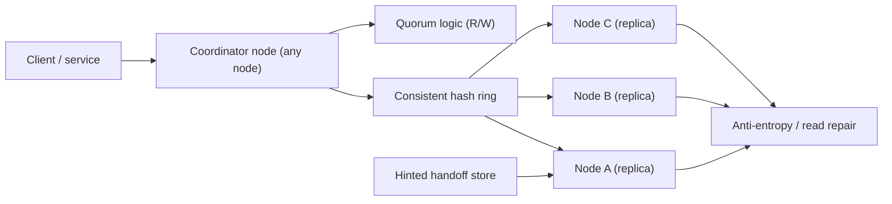
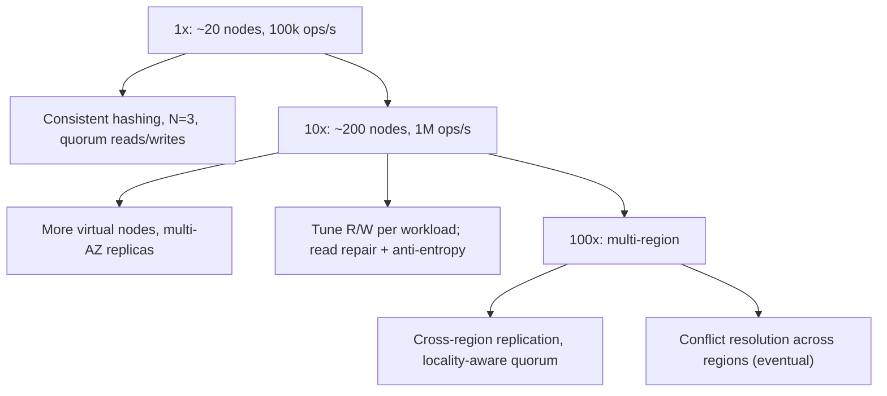

## 65.2 Distributed Key-Value Store

### 65.2.1 Requirements

A distributed key-value store holds `key -> value` pairs across many machines, surviving machine failures, serving reads and writes at scale with low latency, and staying available even when some nodes or network links fail. This is the canonical distributed-systems design (the shape of Dynamo, Cassandra, Riak). The users are other services that need a fast, highly-available store for data that does not need relational queries. The design probes the deepest distributed-systems ideas: partitioning, replication, consistency, and the CAP tradeoff (Part 42).

Imagine a chain of identical lockers spread across many buildings. Each item (value) goes in a locker chosen by a formula from its tag (key), and a copy is placed in two nearby buildings too (replication), so if one building closes you still get your item. When you store or fetch, you can insist that a majority of the buildings confirm (strong consistency, slower) or accept one building's word (fast, maybe slightly stale). The buildings are nodes; the formula is consistent hashing; the copies are replicas; the majority rule is quorum.

### 65.2.2 Functional requirements

1. `put(key, value)` stores a value; `get(key)` retrieves it; `delete(key)` removes it.
2. Data is distributed across many nodes (partitioning).
3. Data is replicated so the loss of a node does not lose data.
4. The system stays available for reads and writes during node failures and network partitions (tunable).
5. Tunable consistency: callers choose how many replicas must respond (quorum).
6. Nodes can be added and removed with minimal data movement (elastic).
7. Eventually, all replicas converge to the same value (anti-entropy, read repair).

### 65.2.3 Non-functional requirements

| Property | Target | Why |
|---|---|---|
| Read/write latency | p99 single-digit to low-tens of ms | A fast store for other services |
| Availability | Very high (survive node/AZ loss, stay writable) | The reason to build this over a single database |
| Durability | No data loss on single-node (or N-1 replica) failure | Replication guarantees this |
| Scalability | Linear with nodes added | Add capacity by adding nodes |
| Consistency | Tunable per operation (quorum) | Trade consistency for availability/latency per need |

### 65.2.4 Constraints

- Distributed by definition; must handle node failure, network partitions and clock skew.
- No single point of failure; masterless (every node equal) for availability.
- Rebalancing when nodes join/leave must move minimal data (consistent hashing).
- The CAP tradeoff (Part 42) is fundamental: during a partition, choose availability or consistency, tunable per operation.

### 65.2.5 Capacity estimation

| Quantity | Assumption | Calculation | Result |
|---|---|---|---|
| Keys | Target | given | 10 billion |
| Value size | average | given | 1 KB |
| Raw data | 10B x 1 KB | | 10 TB |
| Replication factor | 3 copies | 10 TB x 3 | 30 TB stored |
| Nodes | per-node capacity ~2 TB usable | 30 TB / 2 TB | about 15-20 nodes |
| Read/write rate | Target | given | 100,000 ops/second |
| Per-node ops | 100k / 15 | | about 7,000 ops/s/node |

The numbers say: partition 10B keys across ~15-20 nodes with 3x replication, each node handling a slice of keys and ~7,000 ops/s, and rebalancing must be cheap when the node count changes. These are the forces that make consistent hashing and quorum the right tools.

### 65.2.6 API design

| Operation | Signature | Consistency option |
|---|---|---|
| Put | `put(key, value, W)` | W = replicas that must ack the write |
| Get | `get(key, R)` | R = replicas that must respond to the read |
| Delete | `delete(key, W)` | A delete is a write of a tombstone |

The caller chooses `W` (write quorum) and `R` (read quorum). With `R + W > N` (replication factor), a read is guaranteed to see the latest write (strong consistency); with lower values, you get lower latency and higher availability but possible staleness. This per-operation tunability is the practical expression of the CAP tradeoff.

### 65.2.7 Data model

```text
Just keys and values. The system's structure is in the placement:

key -> hash(key) -> position on the hash ring -> the N nodes clockwise own it

Each key's value is stored on N nodes (the "preference list"), e.g. N=3:
  key "user:42" -> hashes to ring position P -> stored on nodes A, B, C (next 3 clockwise)

Each stored value carries a version (vector clock or timestamp) to resolve conflicts.
```

There are no tables or joins; the data model is deliberately minimal. The sophistication is in *where* each key lives (consistent hashing) and how conflicting versions are reconciled (versioning).

### 65.2.8 High-level architecture



Any node can act as the **coordinator** for a request: it hashes the key to find the N replica nodes (the preference list), sends the read/write to them, waits for R or W acknowledgements (quorum), and returns. Replicas converge via **read repair** (fix stale replicas noticed during a read) and **anti-entropy** (background comparison and repair). When a replica is temporarily down, a **hinted handoff** stores the write on another node to be delivered when the replica recovers.

### 65.2.9 Component design

| Component | Responsibility |
|---|---|
| Consistent hashing ring | Map keys to nodes; minimize movement when nodes change |
| Coordinator | Route a request to the N replicas, enforce R/W quorum |
| Replica store | Hold the data for its key ranges, with versions |
| Versioning (vector clocks / timestamps) | Detect and resolve conflicting concurrent writes |
| Read repair | Fix stale replicas detected during a read |
| Anti-entropy (Merkle trees) | Background sync of divergent replicas |
| Hinted handoff | Hold writes for a down replica, deliver on recovery |
| Gossip | Nodes share membership and health (no central coordinator) |

### 65.2.10 Deep dive: consistent hashing, replication, quorum

**Consistent hashing** (Part 42) places nodes and keys on a ring (hash space). A key is owned by the N nodes clockwise from its position. When a node is added or removed, only the keys between it and its neighbor move — about 1/N of the data — instead of rehashing everything (which naive modulo hashing would require). **Virtual nodes** (each physical node occupies many ring positions) spread load evenly and avoid hotspots.

**Replication**: each key is stored on N nodes (the preference list). This gives durability (lose a node, N-1 copies remain) and availability (read from any live replica).

**Quorum**: a write waits for `W` acknowledgements, a read for `R` responses. Choosing `R + W > N` guarantees a read sees the latest write (the read and write quorums overlap by at least one node). `W=N, R=1` favors read speed; `W=1, R=N` favors write speed; `W=R=quorum (⌈(N+1)/2⌉)` balances. Lower `R`/`W` trade consistency for availability and latency — the CAP tradeoff, per operation.

```text
N=3 replicas. Quorum = 2.
  Write with W=2: ack when 2 of 3 replicas confirm (survives 1 down, fast-ish)
  Read with R=2:  read 2 of 3, take the newest version (read repair fixes the third)
  R(2) + W(2) = 4 > N(3) -> a read always overlaps the latest write -> strong consistency
  Lower to R=1/W=1: faster, more available, but a read may miss the latest write (eventual)
```

**Conflict resolution**: concurrent writes to different replicas can diverge. Versioning (vector clocks, or last-write-wins by timestamp with its risks) detects conflicts; the system either resolves them (last-write-wins) or returns both versions for the application to reconcile. This is the price of high availability: during a partition, both sides may accept writes, and they must be reconciled later.

### 65.2.11 Caching

The store itself is the fast layer, so a separate cache is less common than in a database system; nodes keep hot data in memory. Clients may cache the ring topology to route directly to the right nodes (saving a coordinator hop).

### 65.2.12 Messaging

Gossip protocol for membership and failure detection (nodes periodically exchange state, so the cluster learns of joins, leaves and failures without a central coordinator). Hinted handoff and anti-entropy use background transfers between nodes. There is no external message broker; the coordination is peer-to-peer.

### 65.2.13 Scaling



Adding nodes moves only ~1/N of the data (consistent hashing), so scaling is near-linear and low-disruption. Virtual nodes keep load even. Multi-region adds cross-region replication and the hard problem of conflict resolution across regions, typically eventual consistency with the application reconciling conflicts.

### 65.2.14 Security

Authentication and authorization at the client-to-coordinator boundary (which services may access which keyspaces), encryption in transit between nodes and from clients, and encryption at rest. Within the cluster, nodes trust each other, so the cluster network must be isolated. Multi-tenant keyspaces need isolation so one tenant cannot read another's keys.

### 65.2.15 Failure scenarios

| Failure | Detection | Impact | Mitigation | Effect |
|---|---|---|---|---|
| Single node down | Gossip failure detection | That node's replicas unavailable | N-1 replicas serve; hinted handoff holds its writes | None (quorum still met) |
| Network partition | Nodes unreachable across the split | Split brain risk | Tunable: favor availability (both sides write, reconcile later) or consistency (minority side refuses) | Per CAP choice |
| Concurrent conflicting writes | Diverging versions | Which value wins? | Vector clocks detect; resolve (LWW or app reconcile) | Possible lost update under LWW |
| Replica permanently lost | Health, capacity | Under-replicated keys | Re-replicate to a new node; anti-entropy | Restored durability |
| Clock skew (last-write-wins) | Monitoring | Wrong write "wins" by bad timestamp | Prefer vector clocks; sync clocks (NTP); be wary of LWW | Possible lost write |
| Hot key | Per-key load | One replica set overloaded | More virtual nodes; client cache; split hot key | Mitigated |
| Rebalancing storm (node flapping) | Topology churn | Excess data movement | Dampen membership changes; hysteresis | Stable |

### 65.2.16 Observability

Metrics: per-node ops/s and latency, quorum success/failure rate, replica lag and divergence, hinted-handoff queue size, anti-entropy repair volume, ring balance (per-node load), failure-detector state. Alerts: under-replicated keys, quorum failures, growing hinted-handoff backlog (a replica down too long), ring imbalance. Dashboards: cluster health, per-node load, consistency (divergence/repair rates).

### 65.2.17 Deployment

Nodes as a stateful cluster (StatefulSet on Kubernetes, or dedicated hosts) across multiple availability zones so an AZ loss does not lose quorum. Careful rolling upgrades (one node at a time, respecting quorum). Topology (replication factor, virtual nodes) as config. Adding/removing nodes is an operational procedure that triggers controlled rebalancing.

### 65.2.18 Cost considerations

Dominated by the storage and compute for N copies of the data across nodes (3x replication triples storage) and cross-AZ/cross-region network traffic for replication and quorum (cross-AZ data transfer is a real cost driver). Higher replication and stronger quorum cost more (more copies, more cross-node traffic). The cost is justified only when the availability and scale genuinely require a distributed store over a replicated single database.

### 65.2.19 Tradeoffs

- **Availability vs consistency (CAP)**: the core tradeoff, made tunable per operation via R/W quorums; during a partition you cannot have both, so you choose per operation.
- **Consistent hashing** (minimal data movement on topology change) over modulo hashing (rehashes everything): essential for elastic scaling.
- **Eventual consistency with conflict resolution** over strong consistency everywhere: buys availability and latency at the cost of possible stale reads and reconciliation complexity.
- **Masterless** (no single point of failure, any node coordinates) over a primary/replica design: higher availability at the cost of conflict-resolution complexity.
- **Last-write-wins vs vector clocks**: LWW is simple but can silently lose writes under clock skew; vector clocks are correct but more complex.

### 65.2.20 Alternative architectures

**Use an existing distributed store** (DynamoDB, Cassandra, Part 62): the honest default — these systems embody exactly this design, battle-tested; building your own is justified only by a very specific need, because a correct distributed KV store is extremely hard to get right (conflict resolution and partition handling are subtle). This is the strong recommendation: understand the design (to use these well and to interview), but use a proven implementation unless you have a compelling reason not to.

**A replicated single database** (PostgreSQL with replicas, Part 14): if your scale fits one primary plus replicas and you need transactions and queries, this is simpler and gives you more (relational power, strong consistency) than a KV store. Many systems that reach for a distributed KV store would be better served by PostgreSQL plus caching — the Part 62 lesson applies.

**Strongly-consistent distributed store** (a consensus-based system using Raft/Paxos, like etcd or Spanner-style): when you need strong consistency across nodes rather than tunable eventual consistency, a consensus protocol provides it, at the cost of lower availability during partitions and higher latency. The right choice depends on whether the workload needs availability (Dynamo-style) or strong consistency (consensus-style) during a partition.
