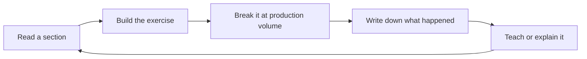

### 65.2.3 Stage 3 — Advanced backend engineer

**Goal.** Understand your database and runtime deeply enough to predict behaviour rather than discover it. Start being the person others ask about performance and correctness.

**Read in this order.** Part 54 (System Design from Zero) first, so every later Part has a place in the big picture; then Part 19, Part 20, Part 21, Part 32, Part 42, Part 43, Part 23, Part 28, Part 29, Part 45, Part 46, Part 34, Part 35, Part 56. This is the densest stretch of the book and the one that changes how you see everything.

**Build alongside.** Extend the Part 61 line of projects into an order and inventory system with money in it: transactions, concurrent stock reservation, background jobs, idempotent webhook handling from a payment provider, and a cache with a real invalidation strategy. Then generate ten million rows and make it fast. The volume is the point; a correct system at 5,000 rows teaches you almost nothing.

**You must be able to demonstrate.**

- Read `EXPLAIN (ANALYZE, BUFFERS)` and say why a plan is bad and what index would fix it.
- Cause a deadlock deliberately, read it in the PostgreSQL log, and fix it by ordering lock acquisition.
- Prove a race condition with 50 parallel requests, then fix it with an atomic statement and a check constraint.
- Find a memory leak with two heap snapshots and name the retaining path.
- Instrument a service with structured logs, metrics and traces, and debug a real slowdown using them.
- Estimate the storage, connections and partitions a system needs, with arithmetic on paper.

**Time.** Twelve to twenty-four months.

**Ready for the next stage when.** Someone brings you a production performance problem and you find the cause from evidence, in under an hour, without changing random things.

### 65.2.4 Stage 4 — Senior backend engineer

**Goal.** Own systems, not features. Design under ambiguity, operate what you build, and make the people around you better.

**Read in this order.** Part 14, Part 30, Part 31, Part 40 in full, Part 24, Part 25, Part 49, Part 50, Part 55, Part 57, Part 58, Part 59, Part 51, Part 64. Work through the system design ladder in 54.7 as you go: the Intermediate and Advanced designs in Parts 55, 66, 67 and 68, each tried on paper before you read the model design.

**Build alongside.** The later Part 61 projects, where the system becomes distributed: an outbox, a saga with compensation across two services, a real message broker, zero-downtime migrations on a large table, and an on-call setup for yourself with genuine alerts that wake you. Then deliberately break it: kill the broker, fill the disk, add 300 ms of latency to the database, and see whether your system degrades or collapses.

**You must be able to demonstrate.**

- Run a zero-downtime migration on a table with tens of millions of rows, including the rollback plan.
- Design a multi-service workflow with explicit idempotency, compensation and reconciliation.
- Write an ADR that a stranger can act on in two years.
- Command an incident: mitigate, communicate on a schedule, keep a log, run a blameless postmortem with completed actions.
- Explain a trade-off to a non-engineer in time, risk and money, with two options and a recommendation.
- Design a system end to end in 45 minutes with capacity numbers and failure behaviour.

**Time.** Two to four years from Stage 3, mostly gated by exposure rather than reading. You cannot learn incident command from a book; you can only prepare so that the incidents teach you efficiently.

**Ready for the next stage when.** Your team makes good decisions in your absence, and problems that span teams start finding their way to you.

### 65.2.5 Stage 5 — Staff engineer

**Goal.** Work above one team: strategy, standards, influence without authority, and problems nobody owns.

**Read in this order.** Volume 8 (Parts 83–90) for writing, strategy, governance, migrations, org design and influence, and Part 91 when you interview for staff or principal roles; Part 62, Part 63; then re-read Part 12, Part 14, Part 55 and Part 58 with a different question in mind — not "how does this work" but "how do I get five teams to do this consistently". Part 59 sections 59.4 and 59.5 are the map.

**Build alongside.** Not a personal project. A cross-team artefact: a shared library or service template that other teams adopt voluntarily, a written technical strategy that changes plans, a migration programme spanning several services, or a standard embedded in tooling.

**You must be able to demonstrate.**

- A written strategy with a staged sequence and observable checkpoints, that teams actually followed.
- Changing another team's behaviour with no authority, and being able to explain how.
- Growing a senior engineer to the point where they lead their own cross-team work.
- Choosing not to work on three tempting problems, and articulating why.

**Time.** Two to four years, and it is not guaranteed by effort; it also requires an organisation with problems of that size.

### 65.2.6 A six-month plan, week by week

This assumes roughly eight to ten focused hours a week outside work, and that you are somewhere around Stage 2 ending or Stage 3 beginning. Adjust the reading, keep the shape: read, build, prove.

| Week | Read | Build | Prove it |
|---|---|---|---|
| 1 | Part 19.1-19.7 (pages, tuples, MVCC) | Seed a 10 M row `orders` table with `generate_series` | Explain MVCC and dead tuples to a colleague |
| 2 | Part 19 rest (WAL, vacuum, planner) | Watch `pg_stat_user_tables` during a bulk update | Show bloat growing, then vacuum it away |
| 3 | Part 20.1-20.5 (B-tree, composite) | Add three indexes; measure before and after | Explain column order for equality, range, sort |
| 4 | Part 20 rest (partial, covering, GIN) | Replace `OFFSET` with keyset pagination | Plan showing 7 buffers instead of 10,000 rows |
| 5 | Part 21.1-21.3 (isolation, anomalies) | Reproduce a lost update, then fix it | Demonstrate the anomaly at each isolation level |
| 6 | Part 21 rest (locks, deadlocks) | Cause and read a deadlock in the log | Fix it by ordering lock acquisition |
| 7 | Part 32 (concurrency in Node) | Write a 50-parallel-request test for stock | Test fails before the fix, passes after |
| 8 | Part 22 (ORM engineering) | Log the SQL your ORM emits for one flow | Find and fix one N+1 |
| 9 | Part 42.1-42.4 (percentiles, N+1) | Load test one endpoint with k6 or autocannon | Report p50, p95, p99 and the constraint |
| 10 | Part 42 rest (pools, batching, streaming) | Size the pool with Little's law; stream a big export | Show memory flat during a 400 MB export |
| 11 | Part 43.1-43.3 (logs, correlation, metrics) | Structured logging with a correlation id end to end | Trace one request id across API and worker |
| 12 | Part 43 rest (tracing, OpenTelemetry) | Add tracing to two services | Find the slowest span in a real request |
| 13 | Part 27 (caching and Redis) | Cache-aside with jitter and single-flight | Show database load under a cold-cache burst |
| 14 | Part 28.1-28.3 (queues, topics, partitions) | Publish and consume with a partition key | Show ordering preserved per key |
| 15 | Part 28 rest, Part 36 (jobs) | Retries, backoff and a dead-letter queue | Poison message lands in the DLQ, not a crash loop |
| 16 | Part 29 (distributed systems) | Add 300 ms latency with `tc` or a proxy | Describe what broke and why |
| 17 | Part 30.9-30.12 (outbox, idempotency) | Transactional outbox with a relay | Kill the relay mid-publish; no message lost |
| 18 | Part 30 rest (sagas, inbox) | Saga with a compensating refund | Force a failure; show the compensation run |
| 19 | Part 31 (reliability) | Timeouts, bulkhead, circuit breaker | Slow dependency degrades one feature only |
| 20 | Part 24 (migrations) | Expand-contract a column on 10 M rows | Zero downtime, measured lock time under 3 s |
| 21 | Part 41 (testing) | Integration and concurrency tests in CI | Suite under 6 minutes, no flakes in 10 runs |
| 22 | Part 47 (CI/CD) | Pipeline with canary and rollback | Roll back a release in under 2 minutes |
| 23 | Part 49 (SRE) | SLOs and two symptom-based alerts | Alert fires on an injected fault, with a runbook |
| 24 | Part 56 (capacity) | Estimate for 10x, then load test it | Prediction within 3x of measurement |
| 25 | Part 58 (mindset) | Write two ADRs for real decisions | A colleague can act on them without you |
| 26 | Part 55 (system design) | Design one case study on paper in 45 minutes | Numbers, failure modes and a migration path |

### 65.2.7 A twelve-month plan

The six-month plan builds depth. The twelve-month plan turns depth into seniority, which needs breadth and visible ownership.

| Month | Theme | Reading | Output that proves it |
|---|---|---|---|
| 1 | PostgreSQL internals and indexing | 11, 12 | An index audit of a real system, with before and after numbers |
| 2 | Transactions and concurrency | 13, 21 | A concurrency bug found and fixed in production code, with a test |
| 3 | Performance and observability | 24, 25 | A dashboard and three symptom alerts others now rely on |
| 4 | Caching and scaling | 16, 15 | A cache design surviving a cold start, proven with a load test |
| 5 | Messaging and jobs | 17, 36 | A consumer with idempotency, DLQ and a lag alert in seconds |
| 6 | Distributed correctness | 18, 19 | An outbox and a saga with compensation, chaos-tested |
| 7 | Reliability and incident response | 20, 37 | Runbooks for your service and one incident you commanded |
| 8 | Security | 22 | A threat model for one feature plus cross-tenant access tests |
| 9 | Migrations and compatibility | 31, 32 | A zero-downtime migration on a large table, with rollback |
| 10 | Containers, Kubernetes, cloud | 26, 27, 28 | Right-sized resources from real usage; deploys with no dropped requests |
| 11 | Capacity, cost and DR | 41, 39, 38 | A capacity and cost model; a restore you actually tested |
| 12 | Design and judgment | 40, 42, 43, 44 | Two system designs, three ADRs, and an honest rubric self-score |

A note on both plans: the "prove it" column is the real content. Reading a part takes two hours and produces a warm feeling of understanding that evaporates in a fortnight. Producing the artefact takes six hours and produces knowledge you still have in three years.

## 65.3 How to study this handbook

Every part of this book is designed to be studied in the same loop. Reading is only the first quarter of it.

**Active recall beats re-reading.** After finishing a section, close the book and write down the mechanism in your own words: how MVCC decides visibility, what a circuit breaker does in each state, what happens on a Kafka rebalance. Then check. The gap between what you thought you knew and what you could reproduce is the entire learning signal, and re-reading hides it.

**Build while reading, not after.** Every part has a practical exercise. Do it in a scratch repository with real PostgreSQL and Redis in Docker. Concepts you have only read stay abstract; concepts you have caused, broken and fixed become intuition. The specific moment that teaches you MVCC is the moment your own table triples in size during your own backfill.

**Keep an incident diary.** Every production problem you touch, at work or in your own projects, gets five lines: what happened, how you found out, what the cause was, what you did, and what you would build differently. Re-read it every quarter. After two years this document is worth more than any course, because it is calibrated to the systems you actually work on, and the patterns in it are yours.

**Teach someone else.** A fifteen-minute talk to your team on the last thing you learned will expose every soft spot in your understanding within the first five minutes of preparing it. Writing an internal document has the same effect. If you cannot explain it simply, you have memorised it rather than understood it.

**Redo the exercises at production data volumes.** This is the single most under-used piece of advice in the book. Almost every exercise behaves differently at 10 million rows than at 10 thousand: plans flip to sequential scans, sorts spill to disk, vacuum matters, connection pools saturate, exports run out of memory. Use `generate_series` to make the data. It takes ten minutes and changes what you learn.

**Use Part 60 as self-tests, not as revision.** Answer the interview questions out loud, from memory, before reading the answers, and preferably to another person who will ask "why?" twice. The questions are designed so that a memorised answer collapses on the first follow-up. When it collapses, you have found precisely the thing to go and learn.

**Re-read the parts you are sure you already know.** Every eighteen months, re-read Parts 10, 11, 19 and 21. You will find things that were invisible the first time because you lacked the experience to notice them. This is not a failure of the first reading; it is how depth works.

## 65.4 Reading list

The handbook is a map. These are the territories, with an honest line each on why and when.

**Designing Data-Intensive Applications**, Martin Kleppmann. The best book in our field. Read it after Stage 3, when you have felt replication lag and a partial failure yourself, or half of it will feel like abstract taxonomy. Then read it again a year later.

**Database Internals**, Alex Petrov. What a storage engine actually does: B-trees, LSM trees, WAL, consensus. Read it when Part 19 has made you curious rather than satisfied. Dense, precise, and it makes index behaviour obvious.

**Site Reliability Engineering**, Google. Read the chapters on SLOs, error budgets, alerting and postmortems; skim the rest. Best read when you are on call, because until then the incentives it describes feel theoretical.

**Release It!**, Michael Nygard. Stability patterns and antipatterns: circuit breakers, bulkheads, cascading failures, integration points. The most immediately actionable book on the list, and the one whose stories you will recognise from your own outages.

**The Pragmatic Programmer**, Hunt and Thomas. About craft and judgment rather than technology. Best read early and re-read every few years; the parts that matter change as you do.

**Domain-Driven Design**, Eric Evans. The strategic patterns — bounded contexts, ubiquitous language, context maps — are the valuable half and are in the back. Read those first. Dense; take it slowly.

**Implementing Domain-Driven Design**, Vaughn Vernon. The practical companion, with code. Read it when you are about to design a real aggregate boundary, not before; out of context it reads as ceremony.

**Clean Architecture**, Robert C. Martin. Useful for the dependency-rule idea and for thinking about boundaries. Read it critically: the principles are sound, the prescriptions are stronger than the evidence for them, and layers cost something.

**Kafka: The Definitive Guide**, Narkhede, Shapira and Palino. Read it when you actually run Kafka. The chapters on producers, consumers, delivery semantics and operations are the ones that matter; the rest can wait until you need it.

### 65.4.1 Documentation worth reading end to end

Documentation usually beats books for accuracy and loses on narrative. These specific sections are worth reading straight through, not just searching.

**PostgreSQL documentation.** Chapter 13 (Concurrency Control) — read every word, twice. Chapter 11 (Indexes). Chapter 14 (Performance Tips), including "Using EXPLAIN". Chapter 25 (Routine Database Maintenance Tasks), especially the vacuum sections. Chapter 5.12 (Table Partitioning). Chapter 30 (Write-Ahead Logging) and Chapter 27 (High Availability, Load Balancing and Replication) when you start operating it. These are perhaps 150 pages and they will make you better at your job than any five blog posts.

**Node.js documentation.** The guides "The Node.js Event Loop, Timers, and process.nextTick", "Don't Block the Event Loop", and "Backpressuring in Streams". Then the API reference for `stream`, `worker_threads`, `perf_hooks` and `diagnostics_channel`. The event-loop guide in particular is short and explains more production behaviour than its length suggests.

**NestJS documentation.** Read Overview and Fundamentals end to end, once, properly: modules, providers, injection scopes, lifecycle events, custom providers. Then Techniques (configuration, database, caching, queues, task scheduling, health checks) as you need them, and Microservices only when you are actually building one. Most NestJS confusion is dependency-injection confusion, and it is all in Fundamentals.

**Redis documentation.** The data-types pages with their command references, then "Redis persistence", "Key eviction", "Redis pipelining" and "Distributed locks with Redis", which is refreshingly honest about the limits of the pattern it describes.

**Kubernetes documentation.** Concepts: Pods, Deployments, Services, Configuration, Resource management, and Pod lifecycle including probes and termination. Then "Best practices for pod disruption". Skip the tutorials that build clusters by hand unless you will operate the control plane.

**AWS Well-Architected Framework.** The Reliability and Operational Excellence pillars are worth reading end to end even if you are not on AWS; they are a good checklist in disguise. The Cost Optimization pillar is worth it once you own a bill. Read the Security pillar's identity and detection sections.

## 65.5 Closing words

You have reached the end of a long book. Here is what I would say to you if we were sitting down after a project together.

The thing that compounds over a career is not the tools. In my time I have watched teams move from Perl to Ruby to Node to Go, from bare metal to VMs to containers to serverless and part of the way back, from SOAP to REST to GraphQL to gRPC and back to REST. Every one of those transitions was described as fundamental by the people selling it. Almost none of it changed what actually makes a backend engineer good.

What compounds is the fundamentals in Parts 8–11, and the habits in Part 58. Understanding how a process uses memory, how a scheduler works, what a network round trip costs and what TCP does and does not promise you — that knowledge was true in 1998, it is true today, and it will explain whatever runtime you are using in 2035. Every framework is a set of opinions about those primitives. When you know the primitives, learning a framework takes a week. When you do not, you can use one for five years and still be surprised by it.

The second thing that compounds is the questions. Can it time out. Can it duplicate. Can it arrive late or out of order. Can it partially succeed. What is the blast radius. Who owns this data. How would we know it broke. How do we undo it. Those questions do not care which language you write in. They are the difference between systems that survive their worst day and systems that discover their design flaws in front of customers. They are, more than anything else, what people mean when they say someone is senior.

The third thing, and the one that quietly determines careers, is being the person who can be trusted with production. Not the fastest coder or the one with the most opinions. The person who, when something important and unclear needs to be done, gets handed it — because they will find out what is actually true, they will say what they do not know, they will not make it worse at 03:00, they will tell you what happened afterwards, and they will finish it. That reputation takes years to build and about one bad decision made dishonestly to lose. It is also, in my experience, the single largest determinant of what work you get offered and what your career looks like at forty.

And now permission, which I mean sincerely: **you do not need to know everything.** Nobody does. I have been doing this for a long time and there are large areas of this book where I would need a day and a good colleague before I would trust my own opinion. Every engineer you admire is quietly ignorant of things you would find surprising. The people who look like they know everything are usually just confident in a narrow area and careful about where they speak.

What matters is not the size of what you know; it is being honest about its edges. "I don't know, let me find out" is a senior sentence. So is "I was wrong about this, here is what I learned". The engineers who cannot say either of those are the dangerous ones, because their systems fail in ways nobody predicted and nobody was allowed to question.

So: pick the next thing on the map. Build it, break it, operate it, write down what happened. Fix a class of problem rather than an instance. Leave the codebase and the people around you better than you found them. Take the pager, because that is where the real feedback lives. And be patient with yourself, because this takes years, and the years are the point.

Good luck. Go and build something that stays up.

## Senior Checklist — Part 65

- [ ] I understand the concept
- [ ] I can explain it simply
- [ ] I can implement it
- [ ] I understand its failure modes
- [ ] I understand its scaling limitations
- [ ] I understand its security implications
- [ ] I understand its operational implications
- [ ] I can choose between alternatives
- [ ] I can explain the tradeoffs
- [ ] I can answer senior-level interview questions
- [ ] I know which stage of the roadmap I am actually in, judged by what I can demonstrate rather than what I have read
- [ ] I have identified the three parts whose prerequisites I skipped, and scheduled them
- [ ] I do the practical exercises at production data volumes, not at development volumes
- [ ] I keep an incident diary and re-read it quarterly
- [ ] I test myself with Part 60's questions out loud before reading any answer
- [ ] I have taught at least one topic from this book to another person
- [ ] I have a written plan with dates for the next six months, and an artefact to produce each month
- [ ] I re-read Parts 10, 11, 19 and 21 periodically, expecting to find new things
- [ ] I have read at least the PostgreSQL concurrency-control chapter and the Node event-loop guide end to end
- [ ] I can name what I do not know, out loud, without embarrassment

## Part 65 — Key Takeaways

- The fundamentals outlive every tool: processes, memory, the event loop, TCP, HTTP and the relational model explain whatever framework you use next.
- The senior question set is the transferable skill — can it time out, duplicate, arrive late, arrive out of order, partially succeed; what is the blast radius; who owns the truth; how do we undo it.
- The simplest design that meets a stated numeric requirement wins; every added component is a permanent tax on operations, onboarding and 03:00 debugging.
- The database is where mistakes become permanent, so spend disproportionate effort on the schema, the indexes, the transaction boundaries and the migration path.
- A timeout is not a failure, it is unknown; from that single fact follow idempotency keys, reconciliation, and the reason retries need thought.
- "Done" means running in production, alerted on a business signal, deployable, rollback-safe, debuggable by a stranger and owned by a named rotation.
- Measure before you optimise, and fix the class of problem rather than the instance; almost every slow system is one query, one lock, one missing index or one serialised loop.
- Write decisions down when you make them, with the alternatives and the trigger that would make you revisit; the reader is a stranger in two years and it is probably you.
- Mitigate before you diagnose, communicate on a fixed schedule, stay blameless, and make the postmortem actions someone's actual job.
- Learn by building, breaking and operating at real data volumes; reading produces recognition, and only production produces judgment.
- Your personal throughput caps your value, but the people you make better do not — which is why reviewing, writing, mentoring and deleting code are the job, not overhead.
- You do not need to know everything; being trusted with production comes from being honest about the edges of what you know and finishing what you start.
