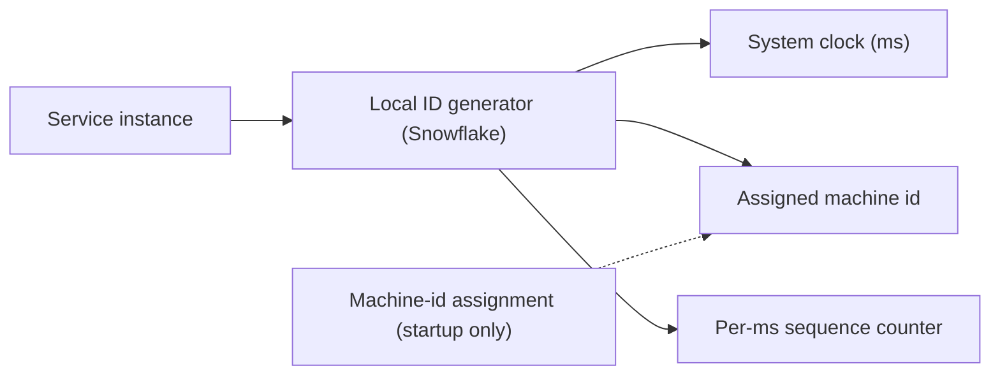
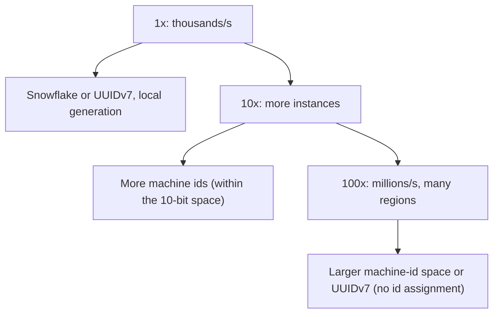

## 65.3 Unique ID Generator

### 65.3.1 Requirements

A unique ID generator produces unique identifiers for records across a distributed system — order ids, message ids, event ids — at high throughput, with no coordination bottleneck, and ideally roughly time-ordered (so ids sort by creation time). The users are every service that creates records. The design probes distributed-systems fundamentals in a compact form: how do many machines generate globally unique ids without a central coordinator becoming a bottleneck or single point of failure, and what tradeoffs (sortability, size, predictability, clock dependence) does each approach make.

Imagine many ticket counters across a country, each needing to issue unique ticket numbers without phoning a head office for every ticket. If each counter has a unique counter-number baked into every ticket it prints, plus the time and a local sequence, every ticket is globally unique with no phone call. The counters are machines; the baked-in counter-number is the machine id; the time plus sequence makes each counter's tickets unique and roughly time-ordered. That is the Snowflake idea.

### 65.3.2 Functional requirements

1. Generate globally unique ids with no duplicates, ever.
2. High throughput: thousands to millions of ids per second across the system.
3. No central coordination on the hot path (no bottleneck, no single point of failure).
4. Roughly time-ordered (sortable by creation time) — valuable for database locality and debugging.
5. Fit a reasonable size (ideally a 64-bit integer, or a compact string).
6. Optionally, not trivially guessable/enumerable (do not leak volume or allow enumeration).

### 65.3.3 Non-functional requirements

| Property | Target | Why |
|---|---|---|
| Uniqueness | Absolute (zero collisions) | A duplicate id corrupts data |
| Throughput | Millions/second system-wide | Every record creation needs one |
| Latency | Microseconds (local generation) | On the write hot path |
| Availability | No single point of failure | Cannot stop creating records |
| Sortability | Roughly time-ordered | DB index locality, debugging |
| Size | 64-bit int or compact string | Storage and index efficiency |

### 65.3.4 Constraints

- Must work across many machines without per-id coordination.
- Clock-based approaches depend on time; clock skew and backward jumps are a real hazard.
- 64-bit integer is the ideal size (efficient as a primary key); UUID (128-bit) is larger but needs no coordination at all.
- Sortable ids improve database index locality (Part 12) but can leak ordering/volume information.

### 65.3.5 Capacity estimation

| Quantity | Assumption | Calculation | Result |
|---|---|---|---|
| ID generation rate | System-wide peak | given | 1,000,000 ids/second |
| Bits needed for uniqueness/sec | log2(1M) | | ~20 bits of per-second capacity |
| Snowflake layout (64 bits) | timestamp + machine + sequence | 41 + 10 + 12 | see below |
| Timestamp range (41 bits, ms) | 2^41 ms | | ~69 years |
| Machines (10 bits) | 2^10 | | 1,024 machines |
| Sequence per ms per machine (12 bits) | 2^12 | | 4,096 ids/ms/machine = 4M/s/machine |

A 64-bit Snowflake id comfortably provides millions of ids per second across a thousand machines for decades. These numbers are what make the Snowflake layout work.

### 65.3.6 API design

| Operation | Signature | Notes |
|---|---|---|
| Generate | `nextId(): bigint` | Local, microseconds, no network on the hot path |
| (Snowflake) configure | machine id assigned at startup | From config/coordination service |

Generation is a local call, not a network request, which is the whole point — no round trip per id.

### 65.3.7 Data model

```text
Snowflake-style 64-bit ID layout:

 | 1 bit | 41 bits timestamp (ms since epoch) | 10 bits machine id | 12 bits sequence |
   sign    ~69 years of milliseconds             1,024 machines      4,096 per ms

Example: id = (timestamp_ms << 22) | (machine_id << 12) | sequence
  - timestamp first -> ids sort roughly by time
  - machine_id -> uniqueness across machines (no coordination per id)
  - sequence -> uniqueness within a machine within one millisecond
```

The layout encodes time (for sortability), machine (for cross-machine uniqueness without coordination), and a per-millisecond sequence (for within-machine, within-ms uniqueness). No two machines share a machine id, so no two ids collide.

### 65.3.8 High-level architecture



Each service instance generates ids locally from its clock, its assigned machine id, and an in-memory per-millisecond sequence. The only coordination is assigning a unique machine id at startup (from a coordination service like ZooKeeper/etcd, or from config/infrastructure), which happens once, not per id. The hot path is purely local arithmetic.

### 65.3.9 Component design and the approaches

| Approach | How | Pros | Cons |
|---|---|---|---|
| Snowflake-style | timestamp + machine id + sequence, 64-bit | Sortable, no per-id coordination, compact | Clock-dependent (skew/backward jumps), needs machine-id assignment |
| UUIDv4 | 128-bit random | Zero coordination, unguessable | Not sortable, 128-bit (index locality worse), larger |
| UUIDv7 | 128-bit, time-ordered prefix + random | Sortable (like Snowflake) and zero coordination | 128-bit (larger than Snowflake's 64) |
| Database sequence | DB auto-increment / sequence | Simple, sortable, no collisions | The database is a coordination point; hard across shards; enumerable |
| Ticket server / batched ranges | A service hands out ranges of ids | No per-id DB hit (batch), sortable | A service to run; a range is lost if a holder dies |

**UUIDv7** deserves emphasis: it is a modern standard that combines UUID's zero-coordination property with time-ordering (a timestamp prefix plus randomness), giving the sortability of Snowflake without needing machine-id assignment, at the cost of 128 bits versus Snowflake's 64. For many systems today, UUIDv7 is the simplest good default — sortable, unique with no coordination, and widely supported.

### 65.3.10 Deep dive: clock skew and database sequences at scale

**Clock skew and backward jumps** are Snowflake's main hazard. The timestamp component assumes a monotonic clock; if the machine's clock jumps backward (NTP correction, VM pause), the generator could produce an id with an earlier timestamp than a previous one, risking a duplicate within the same ms/sequence space. Defenses: detect a backward jump and either wait until the clock catches up, or refuse to generate until time advances, and use the per-ms sequence to absorb many ids within one millisecond. A generator must never silently produce a smaller timestamp than one it already used.

**Database sequences at scale**: a single database auto-increment is simple and sortable but makes the database a coordination point and a bottleneck, and does not work cleanly across shards (two shards' sequences collide). Scaling options: give each shard a different sequence offset/step (shard 1: 1, 3, 5...; shard 2: 2, 4, 6...), or use a ticket server that hands out ranges so each instance gets a block of ids and only talks to the server once per block (amortizing the coordination). But sequences are enumerable (an id reveals roughly how many were created and lets an attacker guess neighbors), which is why public-facing ids often avoid raw sequences.

### 65.3.11 Caching

Not applicable in the usual sense; the per-ms sequence counter is in-memory per instance. A ticket-server approach caches a pre-fetched range of ids locally so most generations need no network.

### 65.3.12 Messaging

Not applicable on the hot path (generation is local). Machine-id assignment at startup uses a coordination service (ZooKeeper/etcd) or infrastructure-provided unique values (pod ordinal, instance metadata).

### 65.3.13 Scaling



Because generation is local and coordination-free (except startup), it scales trivially by adding instances — each with its own machine id (Snowflake) or no coordination at all (UUIDv7/v4). The only scaling limit for Snowflake is the machine-id bit space (1,024 with 10 bits); more machines need more bits or UUIDv7.

### 65.3.14 Security

If ids must not be guessable or enumerable (exposing ids publicly), avoid raw sequences (enumerable) and consider UUIDv4 (random, unguessable) or encrypting/obfuscating a Snowflake id for external use while keeping the sortable form internally. A sortable id leaks creation order and volume, which may be sensitive (a competitor can estimate your order volume from id gaps), so public ids are often random or obfuscated even when internal ids are sortable.

### 65.3.15 Failure scenarios

| Failure | Detection | Impact | Mitigation | Effect |
|---|---|---|---|---|
| Clock jumps backward (Snowflake) | Timestamp < last used | Risk of duplicate id | Wait for clock to catch up, or refuse to generate until time advances | Brief pause, no duplicate |
| Two machines share a machine id | Collision monitoring | Duplicate ids | Strict unique machine-id assignment (coordination service) | Prevented |
| Sequence exhausted in one ms | Sequence overflow | Cannot issue more this ms | Wait until next ms (4,096/ms is usually ample) | Microsecond wait |
| Ticket server down (range approach) | Generation errors | Instances run out of their range | Pre-fetch next range early; fall back to another approach | Degraded, not stopped |
| DB sequence bottleneck (sequence approach) | Latency on create | Slow record creation | Batch ranges, per-shard offsets, or switch approach | Mitigated |
| ID space exhaustion (41-bit timestamp) | ~69 years out | Eventually | Plan epoch/layout; far-future problem | None near-term |

### 65.3.16 Observability

Metrics: id generation rate, per-ms sequence usage (near-exhaustion warning), clock-skew/backward-jump events (critical alert for Snowflake), machine-id assignment conflicts, ticket-range consumption rate. Alerts: any backward-clock event, any machine-id collision, sequence saturation. These are small but critical signals — a clock problem or id collision is a data-integrity emergency.

### 65.3.17 Deployment

Snowflake needs a reliable machine-id assignment at startup (from a coordination service or infrastructure-unique value like a pod ordinal), and reliable time sync (NTP) with backward-jump handling. UUIDv7/v4 need neither, which is why they are operationally simpler. Ensure the id approach is consistent across all services that must not collide.

### 65.3.18 Cost considerations

Negligible compute (local arithmetic). The real cost consideration is indirect: id size and sortability affect database index size and locality (Part 12) — a 64-bit sortable Snowflake id gives better index locality (sequential inserts) than a 128-bit random UUIDv4 (random inserts scatter across the index, hurting cache locality and causing page splits). This is why UUIDv7 (sortable) is preferred over UUIDv4 for primary keys: it keeps the index-locality benefit while needing no coordination.

### 65.3.19 Tradeoffs

- **Snowflake (64-bit, sortable, coordination-free hot path) vs UUIDv7 (128-bit, sortable, no coordination at all)**: Snowflake is more compact but needs machine-id assignment and is clock-sensitive; UUIDv7 is larger but operationally simpler. Both are sortable.
- **Sortable ids (index locality, debuggability) vs random ids (unguessable, no ordering leak)**: sortable helps the database and operators but leaks creation order/volume; choose by whether ids are public.
- **UUIDv7 over UUIDv4 for primary keys**: sortability gives far better index locality (sequential inserts) than random UUIDv4, at the same size.
- **Database sequence (simple) vs distributed generator (scalable)**: sequences are simplest but bottleneck and do not shard; use them until scale or sharding forces a distributed approach.

### 65.3.20 Alternative architectures

**Just use UUIDv7** (or the database's native sortable UUID support): for the vast majority of systems, UUIDv7 is the right default — unique with zero coordination, time-ordered for index locality, widely supported, no clock-skew handling or machine-id assignment to operate. Build the fancy Snowflake generator only when the 64-bit size genuinely matters (huge tables where the extra 8 bytes per row across billions of rows is significant). This is the pragmatic recommendation: understand Snowflake (for interviews and the rare case), default to UUIDv7.

**Database auto-increment**: for a single-database system at moderate scale, the database's own sequence is the simplest correct choice — no generator to build. Reach for distributed generation only when you shard or outgrow the single database's coordination.

**Ticket server with batched ranges**: a central service hands out id ranges to instances, which generate locally from their range. A middle ground that avoids per-id coordination while keeping ids compact and sortable, at the cost of running the service and losing a range if a holder dies.
