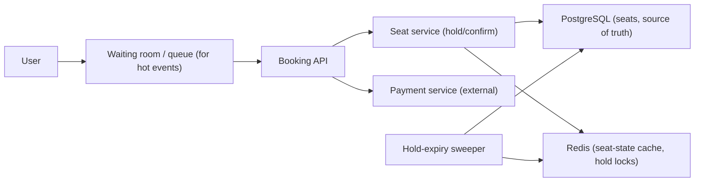
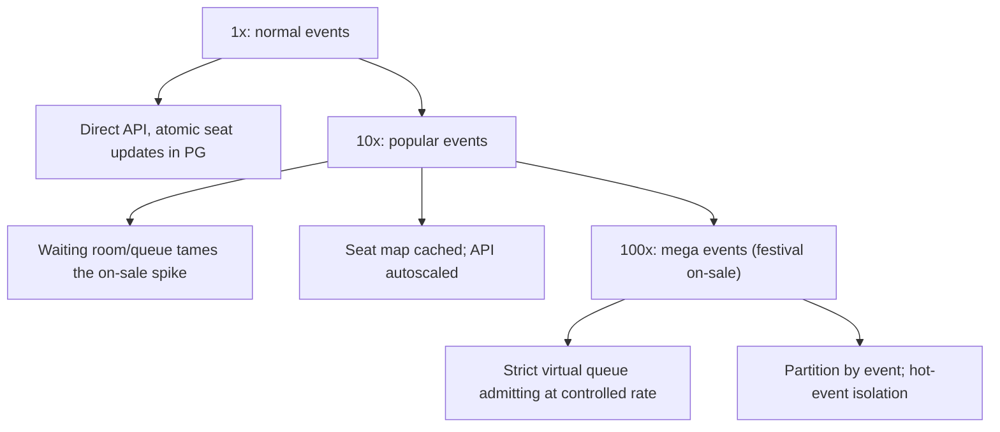

## 65.4 Ticket and Seat Booking System

### 65.4.1 Requirements

A ticket and seat booking system lets users browse available seats for an event, hold one or more seats while they pay, and confirm the booking — without ever selling the same seat twice, even under intense contention when thousands of people rush for a popular event the moment tickets go on sale. The users are ticket buyers, and the business is event organizers. This design is the sharpest test of concurrency control under contention: the hard part is not scale in general but the hot moment when a popular event sells out and everyone wants the same few good seats at once.

Imagine a theatre box office on the morning tickets for a sold-out show go on sale. A crowd rushes the counter, all wanting seat A1. The clerk must give A1 to exactly one person, briefly reserve it while they find their wallet, release it if they do not pay in time, and never, ever hand the same seat to two people. The counter is the booking service; the brief reservation is the seat hold; the time limit is the hold expiry; "never two people" is the concurrency control that this whole design exists to guarantee.

### 65.4.2 Functional requirements

1. Browse events and see which seats are available, held, or booked.
2. Hold one or more seats for a short, fixed time while the user pays.
3. Confirm the booking by paying within the hold window; the seats become booked.
4. Release held seats automatically when the hold expires (the user did not pay).
5. Never sell the same seat twice (the absolute invariant).
6. Handle intense contention on popular events (thousands competing for the same seats).
7. Handle payment coupling: the seat is only truly sold when payment succeeds.

### 65.4.3 Non-functional requirements

| Property | Target | Why |
|---|---|---|
| Correctness | A seat is sold at most once, always | Double-selling is a serious business failure |
| Hold latency | p99 low (hundreds of ms) | Users expect an instant "seat held" |
| Contention handling | Thousands competing for one event without collapse | The on-sale moment is the whole challenge |
| Availability | High during on-sale spikes | The spike is exactly when the business needs it up |
| Hold expiry accuracy | Holds release promptly (seconds after expiry) | Expired holds must free seats for others |
| Consistency | Strong for seat state (no double-sell) | This is a correctness, not a performance, property |

### 65.4.4 Constraints

- The no-double-sell invariant is non-negotiable and requires strong consistency on seat state — this is a case where you cannot trade consistency for availability on the seat itself (contrast the KV store, 65.2).
- Extreme contention is concentrated: a popular event's best seats are a hot row/key that thousands hit simultaneously (the hot-row problem, Part 13).
- Payment is external, slow and can fail; the seat must be held during payment and released or confirmed based on the outcome.
- Spikes are massive and brief (the on-sale instant), so the system must absorb a thundering herd without over-provisioning for the quiet rest of the time.

### 65.4.5 Capacity estimation

| Quantity | Assumption | Calculation | Result |
|---|---|---|---|
| Popular event seats | A large venue | given | 50,000 seats |
| Users rushing at on-sale | Demand far exceeds supply | given | 500,000 users in the first minutes |
| Peak requests | Browsing + hold attempts | | 100,000+ requests/second at on-sale |
| Hold window | Time to pay | given | 10 minutes |
| Contention on best seats | Everyone wants the front rows | | thousands hitting the same ~100 seats |
| Payment time | External provider | given | seconds to a minute |

The numbers say: the system must handle a 100,000 rps spike concentrated on a tiny set of hot seats, with strong consistency so none is double-sold, holds that expire reliably, and a queue to tame the thundering herd. The contention, not the total scale, is the design driver.

### 65.4.6 API design

| Method | Path | Request | Response | Status | Idempotent | Notes |
|---|---|---|---|---|---|---|
| GET | `/events/{id}/seats` | | seat map with states | 200 | Yes | Available/held/booked |
| POST | `/events/{id}/holds` | `{ seatIds[] }` + Idempotency-Key | `{ holdId, expiresAt }` | 201, 409 (taken), 429 | Yes (idempotency key) | Creates a hold |
| POST | `/holds/{holdId}/confirm` | `{ paymentToken }` + Idempotency-Key | booking | 200, 409, 410 (expired) | Yes | Pay and confirm |
| DELETE | `/holds/{holdId}` | | | 204 | Yes | Release early |
| GET | `/holds/{holdId}` | | hold status | 200, 404, 410 | Yes | Check before confirm |

Idempotency keys (Part 18) are essential: users on flaky mobile connections retry the hold and confirm requests, and a retry must not create a second hold or a double charge.

### 65.4.7 Data model

```mermaid
erDiagram
    EVENT ||--o{ SEAT : has
    SEAT ||--o| HOLD : currently_held_by
    SEAT ||--o| BOOKING : sold_as
    HOLD ||--o| BOOKING : becomes
    EVENT { uuid id PK, text name, timestamptz starts_at }
    SEAT {
        uuid id PK
        uuid event_id FK
        text label
        text status
        uuid hold_id
        timestamptz hold_expires_at
    }
    HOLD {
        uuid id PK
        uuid user_id
        timestamptz expires_at
        text status
    }
    BOOKING {
        uuid id PK
        uuid hold_id FK
        uuid user_id
        text payment_id
        timestamptz confirmed_at
    }
```

```sql
CREATE TABLE seats (
  id               uuid PRIMARY KEY,
  event_id         uuid NOT NULL,
  label            text NOT NULL,
  status           text NOT NULL DEFAULT 'available'
                   CHECK (status IN ('available','held','booked')),
  hold_id          uuid,
  hold_expires_at  timestamptz,
  version          integer NOT NULL DEFAULT 0,          -- optimistic locking
  UNIQUE (event_id, label)
);
-- Serves the expiry sweeper; partial index stays small
CREATE INDEX seats_hold_expiry_idx ON seats (hold_expires_at) WHERE status = 'held';
```

The `seats` table is the source of truth, and a seat's `status` plus `version` is where the no-double-sell guarantee lives.

### 65.4.8 High-level architecture



For a hot event, users first pass through a **waiting room / virtual queue** that admits them to the booking API at a controlled rate, taming the thundering herd. The seat service performs holds and confirms against PostgreSQL (the source of truth for seat state) with strong concurrency control, caching the seat map in Redis for browsing. Payment is external; the hold spans the payment. A sweeper releases expired holds.

### 65.4.9 Component design

| Component | Responsibility |
|---|---|
| Waiting room / queue | Admit users to the on-sale at a controlled rate (thundering-herd control) |
| Seat service | Hold and confirm seats with strong concurrency control (no double-sell) |
| Seat state store | PostgreSQL: the authoritative seat status with locking/versioning |
| Seat map cache | Redis: the seat map for browsing (eventually consistent is fine for browsing) |
| Payment integration | Charge during the hold; confirm or release based on outcome |
| Hold-expiry sweeper | Release holds past their expiry, freeing seats |

### 65.4.10 Deep dive: the no-double-sell concurrency control

This is the heart of the design. Holding a seat must be atomic and exclusive: among thousands trying to hold seat A1, exactly one succeeds. The robust approach is a conditional update in PostgreSQL that only succeeds if the seat is currently available (Part 13 on locking and the hot-row problem):

```sql
-- Atomic hold: only succeeds if the seat is still available.
-- If two requests race, only one updates a row (0 rows updated = lost the race -> 409).
UPDATE seats
   SET status = 'held', hold_id = $1, hold_expires_at = now() + interval '10 minutes',
       version = version + 1
 WHERE id = $2 AND status = 'available';
-- rows affected = 1 -> you got the seat; = 0 -> someone else did -> return 409
```

The `WHERE status = 'available'` makes the update conditional and atomic: PostgreSQL serializes the row update, so exactly one of the racing transactions finds the seat available and claims it; the rest update zero rows and are told the seat is taken. This is optimistic concurrency on the seat row and is the core guarantee. For multiple seats in one hold, do them in one transaction (all-or-nothing) with consistent lock ordering to avoid deadlocks (Part 13).

**Confirming** turns a valid (unexpired) hold into a booking, coupled with payment:

```sql
-- Confirm only if the hold is still valid (not expired, still held by this hold).
UPDATE seats SET status = 'booked'
 WHERE hold_id = $1 AND status = 'held' AND hold_expires_at > now();
-- then record the booking with the payment id, in the same transaction
```

**Payment coupling** is the subtle part: the seat is held, then payment is attempted (external, slow, fallible), then the seat is confirmed or released. The flow must handle payment success after hold expiry (rare race: hold expired and seat was resold — the payment must be refunded and the user told) and payment failure (release the hold). Idempotency keys ensure a retried confirm does not double-charge. The invariant throughout: a seat moves available -> held -> booked only via atomic conditional updates, so it is never booked twice.

### 65.4.11 Caching

The seat map for **browsing** is cached in Redis (eventually consistent is fine — a user seeing a seat as available that was just held will simply fail the atomic hold and get a 409, which is correct). The **hold/confirm** operations go to PostgreSQL, not the cache, because they need strong consistency. This split — cache the browse, verify at the write — is the Part 16 pattern: the hot read path is cached, the correctness-critical write path hits the source of truth.

### 65.4.12 Messaging

A hold expiry can be scheduled (a delayed message or a sweeper). Booking confirmations and cancellations emit events (outbox, Part 19) for downstream (email, inventory, analytics). The waiting room admits users by releasing queue tokens at a controlled rate.

### 65.4.13 Scaling



The challenge is the concentrated spike, not steady throughput. The waiting room/queue is the key scaling tool: rather than let 500,000 users hit the booking API at once, admit them at a rate the system can handle, so the atomic seat updates never face more concurrency than PostgreSQL can serialize comfortably. Partitioning by event isolates a hot event so it does not affect others. The seat updates themselves are fast; the queue prevents them from being swamped.

### 65.4.14 Security

Prevent scalping and bots: rate-limit per user, require authentication, CAPTCHA or bot detection at the waiting room, limit seats per user per event. Prevent hold abuse (holding seats to deny others without buying) via per-user hold limits and the expiry. Ensure authorization (a user can only confirm their own hold). Protect against payment fraud (Part 23). The waiting room itself must be fair and resistant to queue-jumping.

### 65.4.15 Failure scenarios

| Failure | Detection | Impact | Mitigation | Effect |
|---|---|---|---|---|
| Two users race for one seat | Normal contention | Only one can win | Atomic conditional update; loser gets 409 | Correct: one seat, one buyer |
| Hold expires before payment | Sweeper | Seat released, user pays late | Confirm checks expiry; if seat resold, refund and apologize | Rare, handled |
| Payment succeeds after hold expired | Payment callback vs seat state | User paid but seat gone | Refund automatically, notify user | Rare race, contained |
| Payment fails | Provider response | Hold wasted | Release hold immediately, free the seat | Seat freed promptly |
| Thundering herd at on-sale | Traffic spike | API/DB overload | Waiting room admits at controlled rate | Smoothed |
| Sweeper down | Expiry lag alert | Expired holds not released | Redundant sweeper; confirm also checks expiry | Degraded, self-healing |
| Duplicate hold/confirm (retry) | Idempotency key | Double hold/charge risk | Idempotency keys dedupe | None |
| DB hot row on the best seats | Lock contention on A1 | Serialization queue on one row | Queue admits slowly; contention is on a fast update | Bounded |

### 65.4.16 Observability

Metrics: hold success/failure (409) rate, confirm success rate, hold-to-confirm conversion, hold expiry rate, payment success/failure, waiting-room queue depth and admit rate, seat-update latency and contention, double-sell count (must always be zero — alert immediately on any). Alerts: any double-sell (critical), sweeper lag (holds not releasing), payment-after-expiry races, queue overload. Dashboards: on-sale health (admit rate, holds/s, conversions), inventory (available/held/booked per event).

### 65.4.17 Deployment

Autoscaled stateless booking API; PostgreSQL (the source of truth) with enough capacity for the serialized seat updates; Redis for the seat-map cache and queue; a redundant sweeper (CronJob plus confirm-time expiry check as backup). The waiting room is deployed ahead of popular on-sales and tuned for the expected demand. Load-test the on-sale path specifically, because the spike is the whole risk.

### 65.4.18 Cost considerations

The system is quiet most of the time and spikes hard at on-sale, so autoscaling and the waiting room (which smooths the spike) control cost — you do not provision permanently for the peak. PostgreSQL must handle the serialized seat updates during the spike (the hot-row throughput), which is modest per update but concentrated. The waiting room lets you serve a huge demand spike with far less infrastructure than handling it all at once would require, which is its cost benefit as well as its correctness benefit.

### 65.4.19 Tradeoffs

- **Strong consistency on seat state** (no double-sell) over availability: here, unlike the KV store (65.2), correctness wins absolutely — a seat's state must be strongly consistent, so we accept that seat updates serialize on the hot row.
- **Waiting room/queue** (controlled admission) over letting everyone in: smooths the thundering herd and protects correctness, at the cost of users waiting in a queue (which, done well, is a better experience than errors).
- **Optimistic conditional update** (atomic, no explicit lock held across the hold) over pessimistic row locks held for the whole payment: we do not hold a database lock during the slow external payment (that would be disastrous for throughput); instead the seat is marked held and the lock is released, with expiry handling the abandonment.
- **Cache the browse, verify at the write**: eventually-consistent seat map for browsing (fast, scalable) with strongly-consistent holds (correct), accepting that a browsed-available seat may fail the hold (a correct 409).

### 65.4.20 Alternative architectures

**Redis-based holds with atomic operations**: hold seats via atomic Redis operations (a `SET NX` lock per seat with a TTL that is the hold expiry), with PostgreSQL as the durable record on confirm. Redis's atomic ops and native TTL make holds and expiry fast and simple, handling huge contention in memory; the tradeoff is Redis is not the durable source of truth, so you reconcile to PostgreSQL on confirm and handle Redis failures carefully. This is a common real approach for extreme-contention on-sales.

**Pessimistic locking (`SELECT ... FOR UPDATE`)**: lock the seat row during the hold. Simple and correct for low contention, but holding locks under the on-sale thundering herd causes severe lock contention and does not scale to the spike; the optimistic conditional update is preferred for high contention. Pessimistic locking is fine for normal events and simpler to reason about.

**Partitioned/sharded by event with per-event capacity**: for a platform with many simultaneous on-sales, partition by event so each hot event is isolated on its own capacity and cannot starve others. Combined with the waiting room, this is how large ticketing platforms handle many big on-sales at once.
