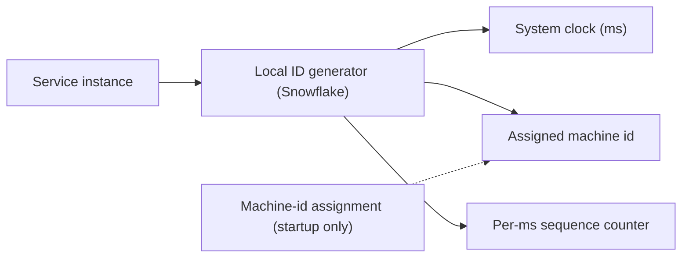

## 65.3 Unique ID Generator

### 65.3.1 Requirements

A unique ID generator produces unique identifiers for records across a distributed system — order ids, message ids, event ids — at high throughput, with no coordination bottleneck, and ideally roughly time-ordered (so ids sort by creation time). The users are every service that creates records. The design probes distributed-systems fundamentals in a compact form: how do many machines generate globally unique ids without a central coordinator becoming a bottleneck or single point of failure, and what tradeoffs (sortability, size, predictability, clock dependence) does each approach make.

Imagine many ticket counters across a country, each needing to issue unique ticket numbers without phoning a head office for every ticket. If each counter has a unique counter-number baked into every ticket it prints, plus the time and a local sequence, every ticket is globally unique with no phone call. The counters are machines; the baked-in counter-number is the machine id; the time plus sequence makes each counter's tickets unique and roughly time-ordered. That is the Snowflake idea.

### 65.3.2 Functional requirements

1. Generate globally unique ids with no duplicates, ever.
2. High throughput: thousands to millions of ids per second across the system.
3. No central coordination on the hot path (no bottleneck, no single point of failure).
4. Roughly time-ordered (sortable by creation time) — valuable for database locality and debugging.
5. Fit a reasonable size (ideally a 64-bit integer, or a compact string).
6. Optionally, not trivially guessable/enumerable (do not leak volume or allow enumeration).

### 65.3.3 Non-functional requirements

| Property | Target | Why |
|---|---|---|
| Uniqueness | Absolute (zero collisions) | A duplicate id corrupts data |
| Throughput | Millions/second system-wide | Every record creation needs one |
| Latency | Microseconds (local generation) | On the write hot path |
| Availability | No single point of failure | Cannot stop creating records |
| Sortability | Roughly time-ordered | DB index locality, debugging |
| Size | 64-bit int or compact string | Storage and index efficiency |

### 65.3.4 Constraints

- Must work across many machines without per-id coordination.
- Clock-based approaches depend on time; clock skew and backward jumps are a real hazard.
- 64-bit integer is the ideal size (efficient as a primary key); UUID (128-bit) is larger but needs no coordination at all.
- Sortable ids improve database index locality (Part 20) but can leak ordering/volume information.

### 65.3.5 Capacity estimation

| Quantity | Assumption | Calculation | Result |
|---|---|---|---|
| ID generation rate | System-wide peak | given | 1,000,000 ids/second |
| Bits needed for uniqueness/sec | log2(1M) | | ~20 bits of per-second capacity |
| Snowflake layout (64 bits) | timestamp + machine + sequence | 41 + 10 + 12 | see below |
| Timestamp range (41 bits, ms) | 2^41 ms | | ~69 years |
| Machines (10 bits) | 2^10 | | 1,024 machines |
| Sequence per ms per machine (12 bits) | 2^12 | | 4,096 ids/ms/machine = 4M/s/machine |

A 64-bit Snowflake id comfortably provides millions of ids per second across a thousand machines for decades. These numbers are what make the Snowflake layout work.

Three more calculations decide real designs, and each one has caught a team out:

| Question | Calculation | Answer | Consequence |
|---|---|---|---|
| When does the 41-bit timestamp run out? | 2^41 ms is about 69.7 years from the custom epoch | An epoch of 2025-01-01 lasts until about 2094 | Pick a recent custom epoch, never 1970, or you waste 55 years of range |
| When does a Snowflake id stop fitting in a JavaScript `number`? | `Number.MAX_SAFE_INTEGER` is 2^53 - 1; the id passes 2^53 once the timestamp part passes 2^(53-22) = 2^31 ms | About 24.9 days after the epoch | Every real Snowflake id is unsafe as a JS number; serialize as a string in JSON |
| What does 128 bits instead of 64 cost? | 10B rows x 8 extra bytes x about 4 copies (primary key, two foreign keys, one secondary index) | About 320 GB extra, mostly index | Matters for very large tables and RAM-resident indexes; irrelevant for a 5M-row table |
| How many ids does one Node.js pod need? | A busy order service: 2,000 creates per second, 5 ids each (order, items, payment, events) | 10,000 per second, about 10 per ms | Far below the 4,096 per ms per worker limit; sequence exhaustion is a non-issue for most services |

Well-known layouts make different bets with the same 63 usable bits:

| Layout | Time bits and unit | Machine bits | Sequence bits | Per machine | Lifetime |
|---|---|---|---|---|---|
| Twitter Snowflake | 41, milliseconds | 10 (5 datacenter + 5 worker) | 12 | 4,096 per ms | about 69 years |
| Discord | 41, milliseconds, epoch 2015 | 10 (5 worker + 5 process) | 12 | 4,096 per ms | about 69 years |
| Sonyflake | 39, units of 10 ms | 16 | 8 | 256 per 10 ms (25,600 per second) | about 174 years |
| Instagram (in PostgreSQL) | 41, milliseconds | 13 (logical shard) | 10 | 1,024 per ms per logical shard | about 69 years |

Sonyflake trades per-machine throughput for 65,536 machine ids and a longer lifetime, which suits a fleet of many small instances. Instagram moves the generator into the database, which is the next deep dive.

### 65.3.6 API design

| Operation | Signature | Notes |
|---|---|---|
| Generate | `nextId(): bigint` | Local, microseconds, no network on the hot path |
| (Snowflake) configure | machine id assigned at startup | From config/coordination service |

Generation is a local call, not a network request, which is the whole point — no round trip per id.

The external contract matters as much as the generator. Snowflake ids cross service boundaries in JSON, and JSON numbers are parsed as IEEE 754 doubles by JavaScript clients. `JSON.parse('{"id":1834567890123456789}')` silently returns `1834567890123456800`. So the rule for every API that carries a 64-bit id is: **the id is a string in JSON.** In NestJS that is a `string` property on the DTO, `bigint` in the database, and an explicit conversion at the boundary. The `pg` driver already returns PostgreSQL `bigint` (`int8`) columns as strings for exactly this reason, and TypeORM maps `bigint` columns to `string`.

```ts
// orders/dto/order.response.ts
export class OrderResponse {
  id!: string;            // "1834567890123456789": a string, never a number, in JSON
  customerId!: string;
  totalMinor!: number;    // money in minor units fits safely in a double
  createdAt!: string;
}

// orders/entities/order.entity.ts
@Entity('orders')
export class Order {
  @PrimaryColumn({ type: 'bigint' })
  id!: string;            // TypeORM returns bigint as string; keep it that way end to end
}
```

### 65.3.7 Data model

```text
Snowflake-style 64-bit ID layout:

 | 1 bit | 41 bits timestamp (ms since epoch) | 10 bits machine id | 12 bits sequence |
   sign    ~69 years of milliseconds             1,024 machines      4,096 per ms

Example: id = (timestamp_ms << 22) | (machine_id << 12) | sequence
  - timestamp first -> ids sort roughly by time
  - machine_id -> uniqueness across machines (no coordination per id)
  - sequence -> uniqueness within a machine within one millisecond
```

The layout encodes time (for sortability), machine (for cross-machine uniqueness without coordination), and a per-millisecond sequence (for within-machine, within-ms uniqueness). No two machines share a machine id, so no two ids collide.

That last sentence is the whole correctness argument, so the machine id needs a real data model. The two common sources are infrastructure identity and a lease table.

```sql
-- Machine-id leases: one row per worker id that is currently owned
CREATE TABLE worker_leases (
  worker_id   smallint PRIMARY KEY CHECK (worker_id BETWEEN 0 AND 1023),
  holder      text NOT NULL,                    -- pod name plus start time, unique per process life
  expires_at  timestamptz NOT NULL
);

-- Claim a random free (or long-expired) worker id. Two pods racing for the same id:
-- one INSERT wins, the other hits the conflict, the WHERE fails, 0 rows return, it retries.
WITH candidate AS (
  SELECT g AS worker_id
    FROM generate_series(0, 1023) AS g
    LEFT JOIN worker_leases l ON l.worker_id = g
   WHERE l.worker_id IS NULL OR l.expires_at < now() - interval '10 seconds'
   ORDER BY random()
   LIMIT 1
)
INSERT INTO worker_leases (worker_id, holder, expires_at)
SELECT worker_id, $1, now() + interval '60 seconds' FROM candidate
ON CONFLICT (worker_id) DO UPDATE
   SET holder = EXCLUDED.holder, expires_at = EXCLUDED.expires_at
 WHERE worker_leases.expires_at < now() - interval '10 seconds'
RETURNING worker_id;

-- Heartbeat every 20 s. Zero rows updated means the lease was lost: stop issuing ids now.
UPDATE worker_leases SET expires_at = now() + interval '60 seconds'
 WHERE worker_id = $1 AND holder = $2;
```

The 10-second grace after expiry is clock-skew insurance between the database and the old holder. The rule that makes leases safe is on the holder's side: a process that has not completed a heartbeat for 40 seconds stops generating, even if it cannot reach the database to find out. It must give up its identity before anyone else can be given it, which is the fencing idea from Part 29, section 29.11.

### 65.3.8 High-level architecture



Each service instance generates ids locally from its clock, its assigned machine id, and an in-memory per-millisecond sequence. The only coordination is assigning a unique machine id at startup (from a coordination service like ZooKeeper/etcd, or from config/infrastructure), which happens once, not per id. The hot path is purely local arithmetic.

### 65.3.9 Component design and the approaches

| Approach | How | Pros | Cons |
|---|---|---|---|
| Snowflake-style | timestamp + machine id + sequence, 64-bit | Sortable, no per-id coordination, compact | Clock-dependent (skew/backward jumps), needs machine-id assignment |
| UUIDv4 | 128-bit random | Zero coordination, unguessable | Not sortable, 128-bit (index locality worse), larger |
| UUIDv7 | 128-bit, time-ordered prefix + random | Sortable (like Snowflake) and zero coordination | 128-bit (larger than Snowflake's 64) |
| Database sequence | DB auto-increment / sequence | Simple, sortable, no collisions | The database is a coordination point; hard across shards; enumerable |
| Ticket server / batched ranges | A service hands out ranges of ids | No per-id DB hit (batch), sortable | A service to run; a range is lost if a holder dies |

**UUIDv7** deserves emphasis: it is a modern standard that combines UUID's zero-coordination property with time-ordering (a timestamp prefix plus randomness), giving the sortability of Snowflake without needing machine-id assignment, at the cost of 128 bits versus Snowflake's 64. For many systems today, UUIDv7 is the simplest good default — sortable, unique with no coordination, and widely supported.

### 65.3.10 Deep dive: clock skew and database sequences at scale

**Clock skew and backward jumps** are Snowflake's main hazard. The timestamp component assumes a monotonic clock; if the machine's clock jumps backward (NTP correction, VM pause), the generator could produce an id with an earlier timestamp than a previous one, risking a duplicate within the same ms/sequence space. Defenses: detect a backward jump and either wait until the clock catches up, or refuse to generate until time advances, and use the per-ms sequence to absorb many ids within one millisecond. A generator must never silently produce a smaller timestamp than one it already used.

**Database sequences at scale**: a single database auto-increment is simple and sortable but makes the database a coordination point and a bottleneck, and does not work cleanly across shards (two shards' sequences collide). Scaling options: give each shard a different sequence offset/step (shard 1: 1, 3, 5...; shard 2: 2, 4, 6...), or use a ticket server that hands out ranges so each instance gets a block of ids and only talks to the server once per block (amortizing the coordination). But sequences are enumerable (an id reveals roughly how many were created and lets an attacker guess neighbors), which is why public-facing ids often avoid raw sequences.

#### Deep dive: a Snowflake generator in TypeScript

```ts
// ids/snowflake.generator.ts
const EPOCH = 1735689600000n;                // 2025-01-01T00:00:00Z: a recent custom epoch
const WORKER_BITS = 10n;
const SEQ_BITS = 12n;
const MAX_SEQ = (1n << SEQ_BITS) - 1n;       // 4095
const MAX_BACKWARD_MS = 5n;                  // tolerate tiny NTP slews by waiting; refuse bigger jumps

export class ClockMovedBackwardsError extends Error {
  constructor(readonly behindMs: bigint) { super(`clock moved backwards by ${behindMs} ms`); }
}

export class SnowflakeGenerator {
  private lastMs = -1n;
  private seq = 0n;

  constructor(private readonly workerId: bigint) {
    if (workerId < 0n || workerId > (1n << WORKER_BITS) - 1n) throw new RangeError('workerId out of range');
  }

  next(): bigint {
    let now = BigInt(Date.now());
    if (now < this.lastMs) {
      const behind = this.lastMs - now;
      if (behind > MAX_BACKWARD_MS) throw new ClockMovedBackwardsError(behind);  // page someone; do not guess
      now = this.waitUntil(this.lastMs);                                          // small slew: wait it out
    }
    if (now === this.lastMs) {
      this.seq = (this.seq + 1n) & MAX_SEQ;
      if (this.seq === 0n) now = this.waitUntil(this.lastMs + 1n);   // 4,096 already used in this ms
    } else {
      this.seq = 0n;
    }
    this.lastMs = now;
    return ((now - EPOCH) << (WORKER_BITS + SEQ_BITS)) | (this.workerId << SEQ_BITS) | this.seq;
  }

  private waitUntil(targetMs: bigint): bigint {
    let now = BigInt(Date.now());
    while (now < targetMs) now = BigInt(Date.now());   // busy-wait; bounded by MAX_BACKWARD_MS or 1 ms
    return now;
  }
}
```

Three Node.js specifics. Node runs your JavaScript on one thread, so a single generator instance per process needs no lock; but a process started in cluster mode, or two containers in one pod, are separate generators and each needs its own worker id. The busy-wait blocks the event loop for at most a few milliseconds, which is acceptable only because it is bounded; never wait out a large backward jump. And a restart is a hidden clock hazard: the new process has `lastMs = -1`, so if the wall clock is now behind the last id issued before the crash, it will happily reissue that range. Production generators either persist the last timestamp (in the lease row) and refuse to start below it, or simply wait out the lease grace period, which is longer than any plausible skew.
