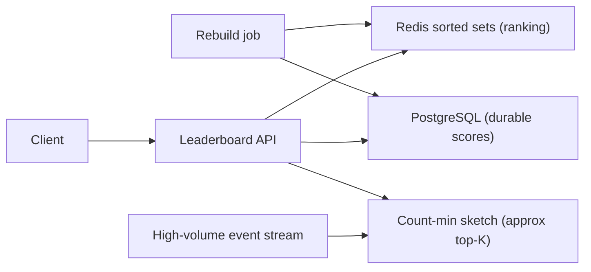
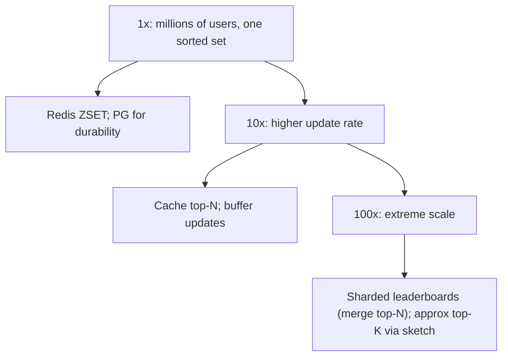

# Part 66 — More System Designs II

This Part continues the system-design case studies, using the same method and twenty-section template as Part 40 and Part 65. If you have not read section 40.0, read it first for the nine-move method and the template. The four systems here each probe a distinct skill: a **leaderboard and top-K** system (Redis sorted sets, approximate top-K, sharded leaderboards), **collaborative document editing** (operational transform versus CRDTs, presence, offline sync), **proximity search** for nearby drivers and restaurants (geohash, quadtrees, PostGIS, high-rate location updates), and **ad-click and metrics aggregation** (high-volume ingestion, exactly-once counting, windowed aggregation, reconciliation). Together with Parts 40 and 65, these complete a broad library of worked designs.

## 66.1 Leaderboard and Top-K

### 66.1.1 Requirements

A leaderboard ranks users by a score — game scores, points, sales, engagement — and answers "what is the top N?", "what rank is this user?", and "who is near this user's rank?", updating in real time as scores change. The users are players (seeing their rank), the product (showing leaderboards), and sometimes analytics (top-K items by some metric). The design probes ranking at scale: how to maintain and query rankings efficiently when scores change constantly and the user base is huge, and when exact ranking becomes too expensive, how to approximate the top-K.

Imagine a scoreboard at a stadium that must instantly reflect every point scored and, on demand, show the top ten, your position, and the players just above and below you — for millions of competitors. Recomputing the whole ranking on every point would be impossible; the scoreboard keeps players in sorted order as scores change so any ranking question is answered by looking at a position in the sorted list. That sorted-order structure is what a Redis sorted set provides.

### 66.1.2 Functional requirements

1. Update a user's score (set or increment) in real time.
2. Get the top N users by score.
3. Get a specific user's rank and score.
4. Get the users ranked near a given user (the window around their rank).
5. Support time-scoped leaderboards (all-time, this week, today).
6. Scale to millions of users and frequent score updates.
7. (Top-K variant) Find the top-K items from a high-volume stream (most-viewed products) approximately when exact is too costly.

### 66.1.3 Non-functional requirements

| Property | Target | Why |
|---|---|---|
| Update latency | p99 low (single-digit ms) | Scores change constantly, in real time |
| Rank query latency | p99 low (single-digit ms) | Users check their rank frequently |
| Scale | Millions of users, thousands of updates/second | Popular games/apps |
| Freshness | Rank reflects a score change within ~1s | "Real-time" leaderboard |
| Accuracy | Exact where feasible; approximate top-K acceptable for streams | Exact ranking is costly at extreme scale |

### 66.1.4 Constraints

- Ranking must be fast for both updates and queries; recomputing a full sort per query is infeasible at millions of users.
- Score updates are frequent and must not lose updates.
- Exact top-K over a high-volume stream (billions of events) is expensive in memory; approximation (count-min sketch) trades a little accuracy for huge savings.
- Time-scoped leaderboards (weekly) need expiry/reset without disrupting the all-time board.

### 66.1.5 Capacity estimation

| Quantity | Assumption | Calculation | Result |
|---|---|---|---|
| Users on a leaderboard | Popular game | given | 10 million |
| Score updates | Peak | given | 10,000/second |
| Rank queries | Peak | given | 50,000/second |
| Redis sorted set memory | ~70-100 B per member | 10M x ~80 B | about 800 MB per leaderboard |
| Top-K stream (approximate) | high-volume product views | given | 1,000,000 events/second |
| Count-min sketch memory | fixed, independent of item count | | a few MB (vs tracking every item) |

The numbers say: a Redis sorted set holds 10M-user leaderboards in under a GB with O(log n) updates and rank queries, handling the update/query rates easily; but exact top-K over a 1M-event/second stream of many distinct items needs approximation (count-min sketch) to stay in a few MB rather than tracking counts for every item.

### 66.1.6 API design

| Method | Path | Request | Response | Notes |
|---|---|---|---|---|
| POST | `/leaderboards/{id}/scores` | `{ userId, score }` or `{ userId, delta }` | updated rank | Set or increment |
| GET | `/leaderboards/{id}/top?n=10` | | top N users | Top-N |
| GET | `/leaderboards/{id}/users/{userId}` | | `{ rank, score }` | User's rank |
| GET | `/leaderboards/{id}/users/{userId}/neighbors?window=5` | | users around the user's rank | Window around user |

### 66.1.7 Data model

```text
Redis sorted set (ZSET) per leaderboard:
  key: "leaderboard:game42:weekly"
  members: userIds, scores: their score
  ZADD leaderboard:game42:weekly 1500 user:7     -- set/update a score (O(log n))
  ZINCRBY leaderboard:game42:weekly 50 user:7     -- increment a score
  ZREVRANGE leaderboard:game42:weekly 0 9 WITHSCORES  -- top 10 (O(log n + k))
  ZREVRANK leaderboard:game42:weekly user:7       -- a user's rank (O(log n))
  ZREVRANGE ... around the user's rank            -- neighbors

Durable source of truth in PostgreSQL (scores table) for recovery:
  scores(leaderboard_id, user_id, score, updated_at)  -- rebuild the ZSET from this
```

The Redis sorted set is the fast ranking structure; PostgreSQL holds the durable scores so the sorted set can be rebuilt if Redis is lost (Redis is a cache/index here, not the sole source of truth for anything that matters, per Part 16).

### 66.1.8 High-level architecture



Score updates go to both Redis (for instant ranking) and PostgreSQL (for durability), and rank queries hit Redis. For approximate top-K over a high-volume stream, a count-min sketch counts items in fixed memory. A rebuild job can reconstruct the Redis sorted sets from PostgreSQL after a Redis loss.

### 66.1.9 Component design

| Component | Responsibility |
|---|---|
| Leaderboard API | Handle score updates and rank queries |
| Redis sorted sets | Maintain sorted ranking; answer top-N, rank, neighbors fast |
| PostgreSQL scores | Durable source of truth for scores; enables rebuild |
| Count-min sketch | Approximate counts for top-K over high-volume streams in fixed memory |
| Rebuild job | Reconstruct Redis sorted sets from PostgreSQL on recovery |
| Time-scope manager | Create/reset/expire weekly/daily leaderboards |

### 66.1.10 Deep dive: sorted sets, approximate top-K, sharding

**Redis sorted sets** are the core: they keep members ordered by score in a skip-list, so `ZADD`/`ZINCRBY` (update), `ZREVRANK` (rank), and `ZREVRANGE` (top-N and neighbors) are all O(log n) or O(log n + k). This gives exact, real-time ranking for millions of users in one data structure — the reason Redis is the standard leaderboard tool. Scores update instantly and any ranking question is a fast position lookup, not a re-sort.

**Approximate top-K (count-min sketch)**: for the top-K-items-in-a-stream variant (most-viewed products over a billion-event stream), tracking an exact count per item needs memory proportional to the number of distinct items. A **count-min sketch** (Part 1) is a fixed-size probabilistic structure that estimates item counts using a few hash functions and counters, so it tracks approximate counts for any number of items in a few MB, over-estimating slightly but never under-estimating. Combined with a small heap of the current top-K, it answers "approximate top-K" in bounded memory. You accept small inaccuracy for enormous memory savings — the right trade when exact top-K is infeasible.

**Sharded leaderboards**: a single sorted set can become a bottleneck at extreme update rates or sizes. Sharding splits the leaderboard across multiple Redis instances (by user hash), with each shard maintaining a partial ranking; a global top-N merges the top-N from each shard (since the global top-N must be within each shard's top-N). Sharding adds the merge complexity but removes the single-instance limit. Most leaderboards never need this; a single sorted set handles millions of users.

### 66.1.11 Caching

The Redis sorted set is itself the fast layer. The top-N result (which changes as scores update but is read very frequently) can be cached with a short TTL (a second) so a flood of top-N reads does not recompute, trading a second of staleness for far fewer Redis calls.

### 66.1.12 Messaging

Score-generating events (a game result) can flow through a queue to the leaderboard updater for buffering and ordering. The high-volume stream for approximate top-K is consumed to update the count-min sketch.

### 66.1.13 Scaling



A single Redis sorted set scales to millions of users and thousands of updates per second. Beyond that, cache the hot top-N, buffer updates, and if truly necessary shard the leaderboard across instances with a top-N merge. For stream top-K at extreme volume, the count-min sketch keeps memory bounded regardless of item count.

### 66.1.14 Security

Prevent score tampering: score updates must be authorized and validated server-side (never trust a client-submitted score without verification), and rate-limited to prevent flooding. For competitive leaderboards, anti-cheat validation of scores matters. Ensure a user can only see leaderboards they are entitled to.

### 66.1.15 Failure scenarios

| Failure | Detection | Impact | Mitigation | Effect |
|---|---|---|---|---|
| Redis lost | Connection errors | Ranking unavailable | Rebuild sorted sets from PostgreSQL scores | Brief outage, no data loss |
| Lost score update | Reconciliation | Rank slightly off | Durable write to PG; reconcile Redis against PG | Corrected |
| Hot leaderboard (one huge game) | Redis instance load | Update/query latency | Cache top-N; shard if needed | Mitigated |
| Count-min over-estimate | By design | Top-K slightly off | Acceptable approximation; exact for small sets | Negligible |
| Score tampering | Validation | Fake rankings | Server-side validation, anti-cheat, rate limits | Prevented |
| Weekly reset race | Reset job | Updates during reset lost/misplaced | Atomic reset (new key swap) | Clean |

### 66.1.16 Observability

Metrics: update and query rates and latency, sorted-set sizes, top-N cache hit rate, count-min sketch accuracy (compared periodically against exact for a sample), rebuild duration, Redis memory. Alerts: Redis memory nearing limits, update/query latency spikes, Redis/PG score divergence (reconciliation). Dashboards: leaderboard activity, rank-query performance.

### 66.1.17 Deployment

Redis (clustered if sharding) for the sorted sets; PostgreSQL for durable scores; the API autoscaled and stateless. Time-scoped leaderboards managed by a scheduler that atomically creates/resets keys. A rebuild job ready to reconstruct Redis from PostgreSQL after a failure.

### 66.1.18 Cost considerations

Redis memory is the main cost (sorted sets hold all members in memory — under a GB per 10M-user leaderboard, modest). PostgreSQL for durable scores is small. The count-min sketch's fixed small memory is the whole point for stream top-K — it avoids the huge memory of exact counting. Sharding adds instances only at extreme scale. Overall inexpensive for the capability.

### 66.1.19 Tradeoffs

- **Redis sorted set (in-memory, fast, exact) with PostgreSQL durability** over PostgreSQL-only ranking (a query with `ORDER BY score` plus `ROW_NUMBER` is far slower at scale and loads the database): we keep the fast ranking in Redis and durability in PostgreSQL, accepting the dual write and rebuild path.
- **Approximate top-K (count-min sketch, bounded memory) vs exact counting (memory per distinct item)**: we accept slight over-estimation for enormous memory savings when the item count is huge.
- **Single sorted set (simple) vs sharded (scalable)**: stay single until scale forces sharding, because the top-N merge adds complexity; most leaderboards never need it.
- **Short-TTL cached top-N (fewer Redis calls) vs always-fresh**: a second of staleness on the top-N for far less load.

### 66.1.20 Alternative architectures

**PostgreSQL-only** with an indexed score column and window functions (`ROW_NUMBER() OVER (ORDER BY score DESC)`): simple and durable with no Redis, and fine for small leaderboards or infrequent queries; it does not scale to millions of users with thousands of real-time updates and frequent rank queries, where the sorting load overwhelms the database. Use it for small or low-traffic leaderboards.

**Managed real-time database** (a service with built-in sorted/ranked structures): offloads operating Redis; viable when you prefer managed infrastructure, at the cost of less control and potential expense.

**Precomputed periodic rankings**: if real-time is not required (a daily leaderboard that updates once a day), compute the ranking in a batch job and serve the static result — far simpler, no sorted set needed. Match the design to the freshness requirement; not every leaderboard is real-time.
