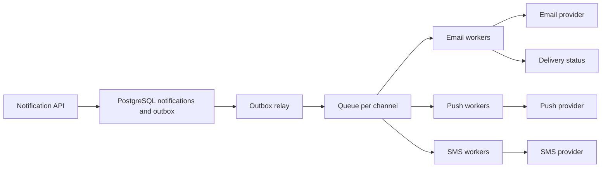

### 66.2.2 A live solve, narrated

#### Practical example

Here is the method of 66.2.1 applied to one problem, with what the candidate says at each step. The problem is phrased in a backend domain on purpose; interviewers increasingly dress classic patterns in product language.

> "You are given the warehouse code of each order in the order it was placed. Find the longest run of consecutive orders that touches at most K distinct warehouses. We want to batch pick-ups."

```text
1. Clarify    "Consecutive means a contiguous slice of the array, not a subset? Can K be 0?
               How large is n?"  -> contiguous; K >= 0; n up to 10^6.
2. Examples   [BLR, BLR, DEL, BOM, BOM, BOM, DEL], K = 2
               BLR BLR DEL       -> 3 (two warehouses)
               DEL BOM BOM BOM DEL -> 5 (two warehouses)   answer 5
3. Approach   "Contiguous plus 'at most K' is the sliding-window cue. I grow the window on the
               right, and when it holds more than K distinct codes I shrink from the left.
               A map from code to count tells me the distinct count in O(1).
               Each index enters and leaves once: O(n) time, O(K) space.
               Brute force over all slices would be O(n^2), 10^12 at n = 10^6, too slow."
4. Confirm    "Does that sound reasonable before I code it?"
```

```ts
// Longest run of consecutive orders that touch at most k distinct warehouses.
// Sliding window: O(n) time, O(k) space.
export function longestRunWithinKWarehouses(warehouses: string[], k: number): number {
  if (k <= 0) return 0;
  const counts = new Map<string, number>();       // warehouse -> occurrences inside the window
  let left = 0;
  let best = 0;
  for (let right = 0; right < warehouses.length; right++) {
    const w = warehouses[right];
    counts.set(w, (counts.get(w) ?? 0) + 1);      // expand: take the next order
    while (counts.size > k) {                     // shrink until the window is valid again
      const out = warehouses[left++];
      const c = counts.get(out)! - 1;
      if (c === 0) counts.delete(out); else counts.set(out, c);
    }
    best = Math.max(best, right - left + 1);
  }
  return best;
}
```

Step 6, testing, is where candidates separate. Trace the example aloud first: at `right = 3` (BOM) the map holds three codes, so the window drops BLR, BLR and becomes `DEL BOM`; it then grows to `DEL BOM BOM BOM DEL`, length 5. Then the edge cases, written as a table so the interviewer can see you thought about them:

```ts
import { longestRunWithinKWarehouses } from './window';

describe('longestRunWithinKWarehouses', () => {
  it.each([
    [['BLR', 'BLR', 'DEL', 'BOM', 'BOM', 'BOM', 'DEL'], 2, 5],   // DEL BOM BOM BOM DEL
    [['BLR', 'DEL', 'BLR', 'DEL'], 2, 4],                        // whole array
    [[], 3, 0],                                                  // empty input
    [['BLR', 'DEL'], 0, 0],                                      // k = 0
    [['BLR', 'DEL', 'BOM'], 1, 1],                               // every order differs
  ])('%j with k=%i -> %i', (input, k, expected) => {
    expect(longestRunWithinKWarehouses(input, k)).toBe(expected);
  });

  it('handles 1,000,000 orders in linear time', () => {
    const big = Array.from({ length: 1_000_000 }, (_, i) => (i % 3 === 0 ? 'BLR' : 'DEL'));
    expect(longestRunWithinKWarehouses(big, 2)).toBe(1_000_000);
  });
});
```

An honest note from preparing this example: the first draft of the test table expected 4 for the first case, because the author eyeballed `BOM BOM BOM DEL` and missed the `DEL` before it. The code was right and the expectation was wrong, and only running the trace caught it. That is exactly why step 6 exists — and in an interview, catching your own wrong expectation is as strong a signal as catching a bug in the code.

Step 7 closes the loop: "O(n) time, because each index is added once and removed at most once; O(K) space for the map. I do not think we can beat O(n), since every order must be read."

### 66.2.3 Two more patterns in TypeScript: monotonic stack and union-find

#### Practical example

Two patterns appear in interviews far more often than they appear in day-to-day backend code, so they are the ones candidates fumble. Both fit in a few lines once you have seen them.

**Monotonic stack** — "for each day, how many days until a higher price?" Keep a stack of indices still waiting for a higher price; their prices are decreasing from bottom to top. Each new price pops every waiting index it beats. Every index is pushed and popped once, so the whole pass is O(n) instead of the O(n²) double loop.

```ts
export function daysUntilHigherPrice(prices: number[]): number[] {
  const answer = new Array<number>(prices.length).fill(0);
  const stack: number[] = [];                       // indices still waiting for a higher price
  for (let i = 0; i < prices.length; i++) {
    while (stack.length > 0 && prices[i] > prices[stack[stack.length - 1]]) {
      const j = stack.pop()!;
      answer[j] = i - j;                            // day i is the first higher price after day j
    }
    stack.push(i);
  }
  return answer;
}
```

**Union-find** — "customer accounts that share any email or phone belong to the same person; how many people are there?" The relation is transitive (A shares a phone with B, B shares an email with C, so A and C are the same person), which is the cue for disjoint sets. With path halving and union by rank, each operation is effectively constant time.

```ts
export class UnionFind {
  private parent: number[];
  private rank: number[];
  constructor(n: number) {
    this.parent = Array.from({ length: n }, (_, i) => i);
    this.rank = new Array<number>(n).fill(0);
  }
  find(x: number): number {
    while (this.parent[x] !== x) {
      this.parent[x] = this.parent[this.parent[x]];  // path halving
      x = this.parent[x];
    }
    return x;
  }
  union(a: number, b: number): void {
    let ra = this.find(a), rb = this.find(b);
    if (ra === rb) return;
    if (this.rank[ra] < this.rank[rb]) [ra, rb] = [rb, ra];
    this.parent[rb] = ra;                            // attach the shorter tree under the taller
    if (this.rank[ra] === this.rank[rb]) this.rank[ra]++;
  }
}

export function countPeople(accounts: Array<{ emails: string[]; phones: string[] }>): number {
  const uf = new UnionFind(accounts.length);
  const firstOwner = new Map<string, number>();     // contact -> first account that used it
  accounts.forEach((acc, i) => {
    for (const contact of [...acc.emails, ...acc.phones]) {
      const owner = firstOwner.get(contact);
      if (owner === undefined) firstOwner.set(contact, i); else uf.union(owner, i);
    }
  });
  return new Set(accounts.map((_, i) => uf.find(i))).size;
}
```

```ts
import { daysUntilHigherPrice } from './stack';
import { countPeople } from './unionfind';

it('finds the next higher price for each day', () => {
  expect(daysUntilHigherPrice([100, 98, 101, 97, 99, 105])).toEqual([2, 1, 3, 1, 1, 0]);
});

it('merges accounts that share any contact, transitively', () => {
  expect(countPeople([
    { emails: ['a@x.com'], phones: ['111'] },
    { emails: ['b@x.com'], phones: ['111'] },   // shares a phone with account 0
    { emails: ['b@x.com'], phones: ['222'] },   // shares an email with account 1
    { emails: ['z@x.com'], phones: ['999'] },   // nobody else
  ])).toBe(2);
});
```

The union-find problem is also a real backend task: identity resolution for fraud detection and customer deduplication runs exactly this algorithm, usually as a batch job over millions of accounts. Mentioning that connection in the interview costs ten seconds and shows you see algorithms as tools, not puzzles.

#### Edge cases & failure modes — your testing checklist

Run this list against every solution before you say "done":

- Empty input, one element, two elements.
- All elements equal; all elements distinct.
- Already sorted and reverse sorted (catches off-by-one in two pointers and binary search).
- Duplicates at the boundaries of a window.
- Negative numbers and zero (breaks "running sum only grows" assumptions).
- The largest allowed input, at least as a complexity argument.
- For graphs: disconnected components, self-loops, cycles.

#### Interview questions

1. **Why is the monotonic stack O(n) when it has a nested loop?** Each index is pushed once and popped at most once, so the total work across all iterations of the inner loop is at most n (amortized analysis, Part 8 — 8.2 Time complexity).
2. **What do path compression and union by rank buy?** Together they make each operation nearly constant time (inverse Ackermann); without them a chain of unions can make `find` O(n).
3. **How would you solve the warehouse problem as a stream that never ends?** Keep the same window state; report the best length so far. Memory stays O(K) regardless of stream length.

#### Practical exercise

Solve one problem per pattern in the 66.2.1 catalogue using the full method, recording yourself. Acceptance criteria: for each, the recording contains the pattern named with its cue, the complexity stated before code, a trace of one example, and at least three edge cases from the checklist above.

## 66.3 The system design round

### 66.3.1 A 45-minute procedure

#### Concept

The system design round asks you to design a system (a URL shortener, a notification system, a ride-booking backend) in about 45 minutes, judged on your method, your tradeoff reasoning, and the depth you show when probed. It is best run as a timed procedure with budgets for each phase, so you cover requirements, estimation, high-level design, a deep dive, and the cross-cutting concerns without running out of time. This is the interview application of the method taught in Parts 52, 53 and 63, 64.

#### Why does it exist?

Designing a system well under time pressure, communicating as you go, and defending your choices is exactly what senior engineers do in design reviews, so the round tests it directly. It exists to assess judgment — can you clarify a vague problem, reason with numbers, make and justify tradeoffs, go deep where it matters, and know the failure modes — rather than recall. Treating it as a timed procedure exists because the most common failure is poor time management: spending too long on the diagram and never reaching the tradeoffs and depth the interviewer is actually scoring.

#### Mental model

Imagine an architect walking a client through a house design in a single meeting. They do not start by drawing bricks. They ask who lives there and what the budget is, sketch the rooms, walk one person through a morning routine to prove the layout works, then zoom into the one tricky part (the staircase that has to fit a narrow plot), and finish with what the design gives up. The client remembers the walk-through and the staircase, not the brick pattern.

#### How it works — the time-boxed procedure

```text
45-minute system design procedure (narrate constantly):
  0-5 min   Clarify requirements: functional, non-functional (latency, availability,
            consistency), constraints, scope. Write them down. Confirm scope.
  5-10 min  Capacity estimation: users, RPS avg/peak, read:write, storage, bandwidth.
            Do the arithmetic out loud; let the numbers drive the design.
  10-15 min API design + data model: endpoint table, entities, key indexes.
  15-25 min High-level design: components and data flow; narrate one request end to end.
  25-35 min Deep dive: go deep on the hot path the interviewer chooses (the exact mechanism).
  35-42 min Cross-cutting: failure modes (a table), scaling ladder (1x/10x/100x), security, cost.
  42-45 min Tradeoffs and alternatives: what you gave up, what else you considered, when it wins.
```

This is the Part 52 method (its section 52.0) compressed into a 45-minute budget. The key time-management rules: do not start with the diagram (clarify and estimate first — 10 minutes before any boxes); do not spend 30 minutes on the high-level diagram and skip the deep dive and tradeoffs (where seniority shows); and leave time for tradeoffs and alternatives at the end (a design with no stated weaknesses looks unconsidered). The interviewer will choose where to go deep (the deep-dive phase); follow their lead on which hot path to explore.

#### How it works — what to draw, and when

Draw three things, in this order, and nothing else unless asked. At minute 15, the boxes and arrows for one request path. At minute 25, the zoom into the hot path. At minute 35, a failure-mode table, which is a table rather than a picture. For a notification service (Part 52 — Notification System), the minute-15 drawing is about this big:



Ten boxes is plenty. If you have drawn twenty boxes by minute 20, you are describing infrastructure instead of designing, and the deep dive is about to be squeezed out.

#### Practical example — a condensed 45 minutes

"Design a notification service for a food-delivery app." The phases, with the sentences that earn points:

| Time | What the candidate does | The sentence that scores |
|---|---|---|
| 0–5 | Scope: push, SMS, email; order updates and marketing; per-user preferences | "Order updates are transactional and must arrive; marketing can be dropped under load. Two priority classes." |
| 5–10 | 20M users, 5M orders/day, 6 notifications per order = 30M/day, about 350/s average, 3,000/s at dinner peak; marketing bursts to 50,000/s | "Marketing bursts are 15x the transactional peak, so they must never share a queue with order updates." |
| 10–15 | `POST /notifications` with an idempotency key; tables for notifications, preferences, outbox | "The idempotency key is the order event id, so a retried event never sends two SMS." |
| 15–25 | The diagram above; walks one "rider assigned" event from Kafka to a phone | "The API writes the notification and the outbox row in one transaction, then returns." |
| 25–35 | Deep dive the interviewer picks: provider rate limits and retries | "SMS provider allows 1,000/s. A token bucket per provider, retries with jitter, and a dead-letter queue after 5 attempts." |
| 35–42 | Failure table: provider down, duplicate events, queue backlog, user unsubscribed mid-flight | "If the SMS provider is down for 10 minutes, transactional messages fail over to push; marketing waits." |
| 42–45 | Tradeoffs | "I chose per-channel queues over one queue: more moving parts, but a slow SMS provider cannot delay push. At a tenth of the volume I would use one PostgreSQL jobs table with SKIP LOCKED." |

Notice that every row has a number or a named tradeoff. That is what a debrief writes down.

#### How it works — depth selection and handling pushback

- **Depth selection**: you cannot go deep on everything in 45 minutes, so keep most of the design at the box level and go deep on the two or three paths that carry the risk (the redirect path, the fan-out, the seat-hold logic — Part 52), or wherever the interviewer points. Signal that you know where the depth is ("the interesting part here is the hot path; let me go deep there").
- **Handling pushback**: the interviewer will challenge your choices ("why not use X?", "what happens at 100x?", "what if the cache is down?"). This is not an attack; it is the test. Respond by reasoning, not defending: acknowledge the tradeoff, state why you chose as you did, and name the condition under which the alternative wins. Being able to say "you're right, that would be better if Y" is a strength, not a weakness — rigidly defending a choice against a valid point scores poorly.

| Pushback | Weak response | Strong response |
|---|---|---|
| "Why not just use Kafka for everything?" | "Kafka is the industry standard." | "At 3,000/s PostgreSQL plus a queue handles it with less to operate. If we needed replay for analytics or 10x volume, Kafka's retention would earn its cost." |
| "What if Redis goes down?" | "It won't, it's replicated." | "Rate-limit state is lost; I fail open for order updates and closed for marketing, and alert. Replication narrows the window but failover can still lose recent writes." |
| "This won't scale to 100x." | Adds more boxes. | "At 100x the outbox relay is the bottleneck; I would partition the outbox by user id and run one relay per partition. Everything else scales horizontally already." |
| "Isn't this over-engineered?" | Defends every box. | "Possibly. The per-channel queues are the part I would cut first; here is the simpler version and what we lose." |

#### Failure scenario

A candidate with strong distributed-systems knowledge was asked to design a URL shortener. They spent 22 minutes on the high-level diagram: load balancers, a service mesh, three caching layers, a Kafka pipeline for click analytics, cross-region replication. At minute 30 the interviewer asked how short codes were generated without collisions, and the candidate had not decided. Three minutes on base62 and a sequence versus random codes was all the time left; failure modes and tradeoffs never happened. The debrief read "broad knowledge, no depth on the core problem, could not prioritize" — a no-hire for senior. The design question had one interesting part, and the candidate never reached it.

#### How a Senior Backend Engineer thinks about this

A senior runs the system design round as the time-boxed procedure, narrating constantly, because the most common failure is time mismanagement — never reaching the tradeoffs and depth that demonstrate seniority. They clarify and estimate before drawing, let the numbers drive the architecture, keep most of the design at the box level and go deep only on the risky hot paths (or where the interviewer points), and always leave time for failure modes, the scaling ladder, and honest tradeoffs with alternatives. They treat the interviewer's pushback as collaboration, reasoning about tradeoffs rather than defending rigidly, and they are comfortable saying when an alternative would be better under different constraints. They apply the exact method from Parts 52 and 63, 64, which is why those Parts are worked examples of this round.

#### Common mistakes

- Starting with the diagram instead of clarifying requirements and estimating.
- Spending too long on the high-level design and never reaching the deep dive and tradeoffs.
- Not doing the capacity estimation, so the design is ungrounded in numbers.
- Defending a choice rigidly against valid pushback instead of reasoning about the tradeoff.
- Going deep on everything (no time) or nowhere (no depth signal).
- No failure modes, scaling ladder or tradeoffs — the parts where seniority shows.
- Estimating without using the result. If the numbers say 350 writes per second, a single PostgreSQL primary is fine; say so instead of sharding by reflex (Part 53 — Turning estimates into decisions).

#### Interview questions (for your preparation)

1. **How do you budget 45 minutes for a system design round?** ~5 clarify, ~5 estimate, ~5 API/data model, ~10 high-level, ~10 deep dive, ~7 cross-cutting (failures/scaling/security/cost), ~3 tradeoffs/alternatives — narrating throughout.
2. **How do you handle an interviewer challenging your design?** Treat it as the test, not an attack: acknowledge the tradeoff, justify your choice, and name when the alternative would win; reason rather than defend rigidly.
3. **How do you decide where to go deep?** Keep most of the design at the box level; go deep on the two or three risky hot paths or wherever the interviewer points, and signal that you know where the depth is.
4. **Why estimate capacity before designing?** The numbers drive the architecture (whether you need a cache, a queue, sharding); designing without them is guessing.
5. **The interviewer is silent and gives no direction. What do you do?** Keep driving: state your assumptions, check in at phase boundaries ("I have the high-level design; shall I go deep on delivery guarantees or on the preference model?"). A silent interviewer is often deliberately testing whether you can lead.

#### Practical exercise

Run a full 45-minute system design on a prompt from Parts 52/65/66 (or a new one) against a timer, hitting each phase in its budget and narrating. Deliberately have a friend or yourself push back on two choices mid-way and practice reasoning about the tradeoff rather than defending. Acceptance criteria: you reach tradeoffs and alternatives within 45 minutes, you did estimation before drawing, and you handled pushback by reasoning about the tradeoff.
