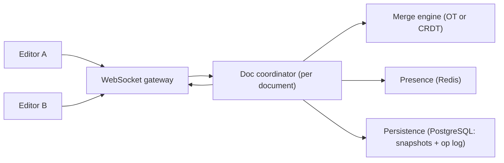
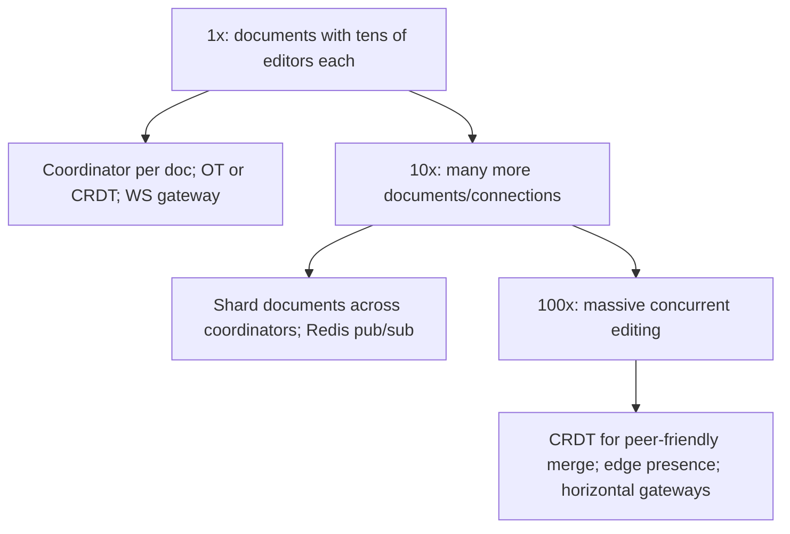

## 66.2 Collaborative Document Editing

### 66.2.1 Requirements

A collaborative document editing system lets multiple users edit the same document at the same time and see each other's changes in real time, with everyone's edits merging into a consistent result, showing who is present and where their cursor is (presence), and working even when a user goes briefly offline and reconnects. Think of a shared document editor. The users are people co-editing documents. This design probes the hardest problem in real-time collaboration: how to merge concurrent edits from multiple users into one consistent document without losing anyone's work or requiring locks.

Imagine several people editing the same physical page at once, each with a pen, all writing simultaneously in different (and sometimes the same) spots. Chaos — unless there is a magic rule by which, no matter the order their strokes land, everyone's page ends up identical and nobody's words are lost. That magic rule is the core of collaborative editing: a way to combine concurrent, conflicting edits so all copies converge to the same correct document. Operational transform and CRDTs are two such rules.

### 66.2.2 Functional requirements

1. Multiple users edit the same document simultaneously.
2. Each user sees others' edits in near real time.
3. Concurrent edits merge into one consistent document (no lost edits, all copies converge).
4. Presence: show who is in the document and their cursor/selection positions.
5. Offline support: a user can edit offline and have changes merge on reconnect.
6. Persist the document and its history (versions, undo).

### 66.2.3 Non-functional requirements

| Property | Target | Why |
|---|---|---|
| Edit propagation latency | Sub-second (feels real-time) | Collaboration must feel live |
| Convergence | All clients always converge to the same document | The core correctness property |
| Concurrency | Many simultaneous editors per document | Real collaboration |
| Offline tolerance | Edits merge correctly after reconnect | Networks drop |
| Durability | No committed edit is ever lost | Users trust their work is saved |

### 66.2.4 Constraints

- Concurrent edits to the same region must merge deterministically to the same result on every client (convergence) — this is the central hard constraint.
- Real-time means a persistent connection (WebSocket) per editor, with the scaling that implies (Part 40's chat system).
- Offline edits can be arbitrarily stale on reconnect and must still merge correctly.
- No locking: users edit freely and simultaneously, so the merge, not a lock, resolves conflicts.

### 66.2.5 Capacity estimation

| Quantity | Assumption | Calculation | Result |
|---|---|---|---|
| Concurrent editors per doc | Typical collaboration | given | up to ~50 (usually far fewer) |
| Documents being edited | Active | given | 100,000 concurrently |
| Edit operations | per active editor | ~a few/second typing | thousands of ops/second total |
| WebSocket connections | editors online | | hundreds of thousands |
| Document size | typical | given | KBs to a few MB |

The numbers say: the per-document concurrency is modest (tens of editors), so the hard problem is correctness of merging, not throughput; the scaling challenge is many persistent connections across many documents (like chat, Part 40), and routing all editors of one document to a coordination point.

### 66.2.6 API design

Mostly a real-time protocol over WebSocket, plus REST for document CRUD.

| Operation | Channel | Notes |
|---|---|---|
| Open document | REST `GET /docs/{id}` + WS subscribe | Load current state, join the session |
| Send edit | WS: `op` message | A client's edit operation |
| Receive edits | WS: broadcast `op` | Others' transformed/merged operations |
| Presence | WS: `presence` message | Cursor/selection, join/leave |
| Save/version | internal/periodic | Persist state and history |

### 66.2.7 Data model

```text
Document: current content + a history of operations (for merge, undo, recovery).
  documents(id, content_snapshot, version, updated_at)
  operations(doc_id, seq, user_id, op, based_on_version, created_at)  -- the edit log

The merge model (one of):
  Operational Transform (OT): operations + a transform function that adjusts an
    incoming op against concurrent ops so positions stay correct.
  CRDT: each character/element has a unique, ordered identity so concurrent inserts/
    deletes merge deterministically regardless of order, without a central transform.

Presence (ephemeral, in Redis): who is in the doc, cursor positions (not persisted).
```

### 66.2.8 High-level architecture



All editors of one document connect through a WebSocket gateway and are routed to that document's **coordinator**, which applies the merge model (OT or CRDT) to incoming operations, broadcasts the merged result to all editors so they converge, maintains presence in Redis, and persists snapshots and the operation log. Routing all editors of a document to one coordinator is key: concurrent edits are merged in one place (OT), or merged anywhere consistently (CRDT).

### 66.2.9 Component design

| Component | Responsibility |
|---|---|
| WebSocket gateway | Hold editor connections, route by document |
| Document coordinator | Own one document's session; apply and broadcast merged ops |
| Merge engine (OT or CRDT) | Combine concurrent edits so all copies converge |
| Presence | Track and broadcast who is editing and cursor positions (ephemeral) |
| Persistence | Snapshot document state and store the op log for history/recovery |
| Offline sync | Merge a reconnecting client's buffered edits against the current state |

### 66.2.10 Deep dive: operational transform vs CRDTs, presence, offline

**The core problem**: two users concurrently edit the same region — A inserts "X" at position 5, B deletes position 3. B's delete shifts positions, so A's "at position 5" now means a different place. Naively applying both gives different results on different clients — divergence. The two solutions:

**Operational Transform (OT)**: operations are transformed against concurrent operations before applying. When A's insert and B's delete happen concurrently, a transform function adjusts A's position to account for B's delete (and vice versa), so both clients, applying the transformed operations, reach the same document. OT requires a central coordinator to order and transform operations (or careful peer protocols), and the transform functions are famously tricky to get exactly right for all cases, but it is efficient (operations are small) and is used by major collaborative editors.

**CRDTs (Conflict-free Replicated Data Types)**: each element (character) gets a unique, globally-ordered identity, so an insert says "insert X between identity-7 and identity-9" rather than "at position 5". Because positions are stable identities, not shifting indices, concurrent operations merge deterministically in any order with no central transform — any two clients that have seen the same set of operations converge, regardless of order received. CRDTs are conceptually cleaner and support peer-to-peer and offline well, at the cost of metadata overhead (each element carries identity data), though modern CRDTs have reduced this substantially.

```text
OT:   op positions are TRANSFORMED against concurrent ops -> needs ordering/coordination,
      small ops, tricky transform functions.
CRDT: elements have stable IDENTITIES -> merge in any order, no transform, no central
      coordinator needed, more per-element metadata.
Both guarantee convergence: all clients end with the same document.
```

**Presence** is separate and simpler: each client periodically sends its cursor/selection and online status; the coordinator broadcasts this to others. Presence is ephemeral (kept in Redis, not persisted) — it is fine to lose it on disconnect.

**Offline sync**: a client editing offline buffers its operations; on reconnect, it sends them and receives the operations it missed, and the merge model (OT transform or CRDT merge) reconciles them with the current state. CRDTs handle this especially naturally because operations merge regardless of order or delay. The convergence guarantee is what makes offline editing safe: no matter how stale the client, its edits merge without loss.

### 66.2.11 Caching

The current document state is kept in memory in the coordinator for the active session (fast application and broadcast of ops), with periodic snapshots to PostgreSQL. Presence is in Redis.

### 66.2.12 Messaging

Operations flow over WebSocket in real time. For scaling across coordinator instances, a pub/sub (Redis or a broker) propagates operations to all instances holding editors of the same document, or editors are routed so one document maps to one coordinator (simpler). Snapshots and the op log persist asynchronously.

### 66.2.13 Scaling



Scaling is the many-persistent-connections problem (like chat, Part 40): horizontal WebSocket gateways and routing documents to coordinators. Since per-document concurrency is modest, the work is spreading many documents across instances, not merging huge numbers of editors on one document. CRDTs ease scaling by removing the need for a single central transform point.

### 66.2.14 Security

Authorize who can view/edit each document; validate that operations come from an authorized editor. Prevent one user from corrupting the document via malformed operations (validate ops). Protect the op log and snapshots. Presence should not leak more than intended (who is viewing). For sensitive documents, encryption and access control (Part 23, Part 58).

### 66.2.15 Failure scenarios

| Failure | Detection | Impact | Mitigation | Effect |
|---|---|---|---|---|
| Client disconnects mid-edit | Connection drop | Its buffered edits pending | Offline buffer; merge on reconnect | No loss |
| Coordinator crash | Health check | Active session lost | Rebuild from last snapshot + op log; reconnect clients | Brief interruption |
| Concurrent conflicting edits | Normal | Divergence risk | OT transform / CRDT merge guarantees convergence | Consistent result |
| Op lost in transit | Sequence gap | Divergence | Op sequencing + resend; CRDT idempotent merge | Recovered |
| Stale offline client reconnects | Reconnect | Many missed ops | Merge buffered ops against current state | Merged correctly |
| Op log corruption | Validation | History/recovery impaired | Validate ops; snapshot regularly | Bounded |

### 66.2.16 Observability

Metrics: edit propagation latency, concurrent editors per document, convergence errors (divergence detected — should be zero, alert on any), WebSocket connection counts, reconnect/offline-merge rates, snapshot/op-log lag. Alerts: any divergence (critical correctness failure), propagation latency spikes, coordinator overload. Dashboards: active documents/editors, real-time latency, merge health.

### 66.2.17 Deployment

WebSocket gateways and coordinators as horizontally-scaled services; Redis for presence and pub/sub; PostgreSQL for snapshots and op logs. Careful rollout so a merge-engine change does not cause divergence (the highest-risk change — test convergence thoroughly). Sticky routing so a document's editors reach the same coordinator (or pub/sub across coordinators).

### 66.2.18 Cost considerations

Dominated by holding many persistent WebSocket connections (memory per connection) and the coordinators' in-memory document state, plus Redis for presence/pub-sub. CRDT metadata adds storage/bandwidth overhead per operation (a tradeoff versus OT's smaller ops). Overall driven by concurrent-connection scale, like chat, rather than by heavy computation.

### 66.2.19 Tradeoffs

- **OT (small ops, needs central coordination, tricky transforms) vs CRDT (no central transform, offline/peer-friendly, more metadata)**: OT is efficient and proven but complex to implement correctly; CRDTs are cleaner for offline and peer-to-peer at the cost of per-element overhead. The choice depends on whether you need peer-to-peer/offline-first (favor CRDT) or have a reliable central server and want minimal per-op overhead (OT is viable).
- **Central coordinator per document (simple merge) vs fully peer-to-peer (CRDT, no central point)**: central is simpler to operate; peer-to-peer (enabled by CRDTs) removes the central dependency at the cost of more client-side complexity.
- **Persist op log + snapshots (full history, recovery, undo) vs snapshots only (less storage)**: the op log enables history and robust recovery at storage cost.

### 66.2.20 Alternative architectures

**Last-write-wins / lock-based editing**: far simpler — lock the document (or a section) to one editor at a time, or just take the last save. This is adequate when true simultaneous editing of the same region is rare (most documents are edited by one person at a time), and avoids the entire OT/CRDT complexity. Build this first unless genuine real-time co-editing of the same regions is a core requirement; most "collaborative" needs are satisfied by section locking or presence-plus-last-write.

**Use an existing collaborative-editing library/framework** (a mature OT or CRDT library): implementing OT or CRDTs correctly from scratch is extremely hard (the transform/merge edge cases are a research-grade problem), so using a proven library is strongly preferred over building the merge engine yourself. Understand the models (to choose and use them well); do not reimplement them.

**Managed real-time collaboration service**: offloads the entire merge and connection problem to a provider; viable when you want collaboration without owning the hardest part, at the cost of dependency and expense.
