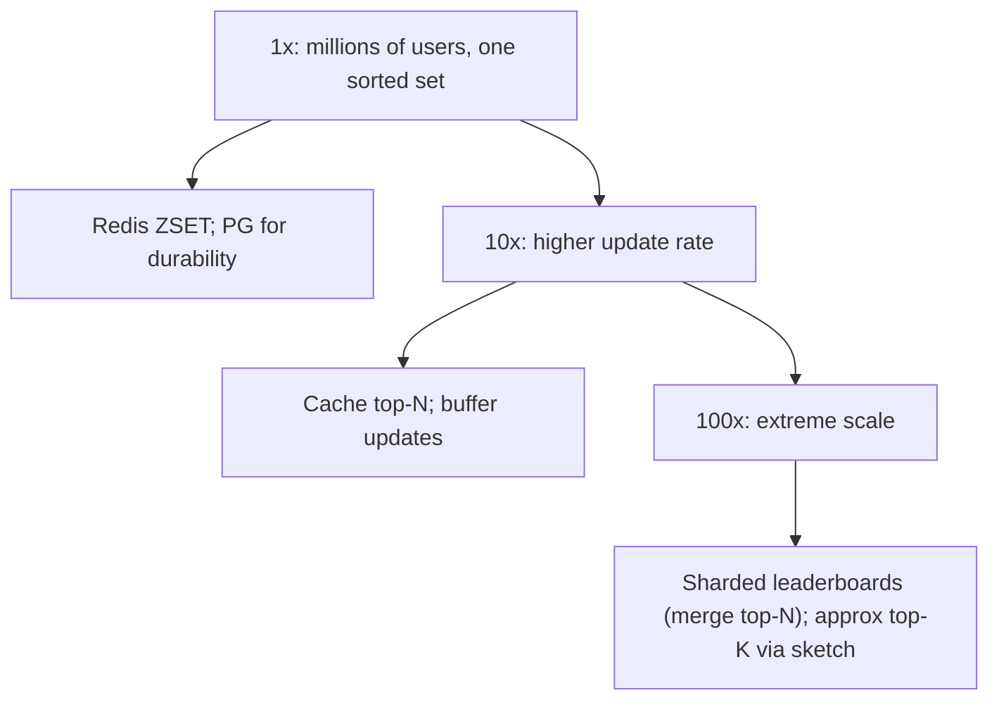

### 66.1.11 Caching

The Redis sorted set is itself the fast layer. The top-N result (which changes as scores update but is read very frequently) can be cached with a short TTL (a second) so a flood of top-N reads does not recompute, trading a second of staleness for far fewer Redis calls.

The numbers make the choice concrete. A home screen that shows the global top 100 to every player who opens the app is read perhaps 30,000 times per second. Cached in each API pod's memory for one second, with single-flight so only one request per pod refreshes it, those 30,000 reads become one `ZRANGE ... REV` per pod per second: 40 pods, 40 calls. Each payload is about 4 KB, so the cache costs nothing.

What is **not** cached is the per-player rank. It is different for every player, it changes with every score, and `ZREVRANK` already answers in about 0.2 ms. Caching it would only add a way to show a player a rank that disagrees with the one their friend sees. Display names and avatars for the top 100 are cached for a minute, since they are joined from the users service and change rarely.

### 66.1.12 Messaging

Score-generating events (a game result) can flow through a queue to the leaderboard updater for buffering and ordering. The high-volume stream for approximate top-K is consumed to update the count-min sketch.

At the full 10,000 score events per second the queue stops being optional, because one database transaction per event is wasteful. The game servers publish to a Kafka topic, and the leaderboard updater consumes it in batches:

| Topic | Key | Partitions | Consumer | Why |
|---|---|---|---|---|
| `game.score_recorded` | `userId` | 32 | Leaderboard updater, batches of 500 per PostgreSQL transaction, then a Redis pipeline | All events of one player land on one partition, in order, so their totals never race |
| `catalog.product_viewed` | `productId` | 64 | Trending counter, one count-min sketch per partition per minute, merged every minute | Bounded memory per consumer, no cross-partition coordination |
| `leaderboard.season_closed` | `gameId` | 1 | Rewards service, notification service | Prize payouts read the frozen final board, never the live one |

Keying by user id is what makes the batch upsert safe: one consumer owns one player's events, so the `board_scores` row for that player is never updated by two batches at once, and lock waits disappear. Kafka delivers at least once, and a replayed batch is harmless because `score_events` deduplicates on `event_id` (66.1.10).

### 66.1.13 Scaling

A single Redis sorted set scales to millions of users and thousands of updates per second. Beyond that, cache the hot top-N, buffer updates, and if truly necessary shard the leaderboard across instances with a top-N merge. For stream top-K at extreme volume, the count-min sketch keeps memory bounded regardless of item count.

| Stage | Load | Architecture | What changes |
|---|---|---|---|
| 1x | 1M players, 1,000 score events/s, 5,000 rank reads/s | One Redis primary with a replica, synchronous PostgreSQL then Redis write | Nothing exotic; even PostgreSQL alone would almost cope |
| 10x | 10M players, 10,000 events/s, 50,000 reads/s | Kafka in front of the updater, batch upserts, top-100 cached in pods, two Redis shards with one game per shard | Write fan-out is now the cost driver; games are spread across shards by hash tag |
| 100x | 100M players on one global board, 100,000 events/s | Board sharded by user hash across 8 Redis shards, rank by summed `ZCOUNT`, neighbours only for the top million | Rank becomes a scatter-gather; the product accepts approximate neighbours |

Notice that the 10x stage scales by spreading **boards** across shards, which needs no code change at all, because each board is still one sorted set. Only the 100x stage splits a single board, and that is the step that costs real complexity.

### 66.1.14 Security

Prevent score tampering: score updates must be authorized and validated server-side (never trust a client-submitted score without verification), and rate-limited to prevent flooding. For competitive leaderboards, anti-cheat validation of scores matters. Ensure a user can only see leaderboards they are entitled to.

In practice that means four concrete controls:

1. **Server-authoritative scores.** The game client never calls the score endpoint. The game server, which simulated the match, does, authenticated with a service credential (mTLS or a signed JWT, Part 40). A player who decompiles the app finds no endpoint that accepts a score.
2. **Plausibility bounds.** Each game mode has a maximum points-per-minute. A score event above it is stored, flagged and kept off the board until reviewed. A player who jumps from rank 2,000,000 to rank 1 in one event is reviewed automatically.
3. **Remove from the board, keep the record.** A confirmed cheater is removed with `ZREM` on every board and marked in PostgreSQL, so the rebuild job does not put them back. The `score_events` history stays for appeals.
4. **Privacy.** Leaderboards publish display names, not user ids or emails, and respect a "hide me from public boards" setting by filtering at read time, so the rank of everyone else is still correct.

### 66.1.15 Failure scenarios

| Failure | Detection | Impact | Mitigation | Effect |
|---|---|---|---|---|
| Redis lost | Connection errors | Ranking unavailable | Rebuild sorted sets from PostgreSQL scores | Brief outage, no data loss |
| Lost score update | Reconciliation | Rank slightly off | Durable write to PG; reconcile Redis against PG | Corrected |
| Hot leaderboard (one huge game) | Redis instance load | Update/query latency | Cache top-N; shard if needed | Mitigated |
| Count-min over-estimate | By design | Top-K slightly off | Acceptable approximation; exact for small sets | Negligible |
| Score tampering | Validation | Fake rankings | Server-side validation, anti-cheat, rate limits | Prevented |
| Weekly reset race | Reset job | Updates during reset lost/misplaced | Atomic reset (new key swap) | Clean |
| Redis evicts a board under memory pressure | `evicted_keys` rises, `ZCARD` far below the PostgreSQL row count | Players vanish from the board, ranks wrong | `maxmemory-policy noeviction` on the leaderboard Redis, never shared with a cache (66.1.21) | Writes fail loudly instead of data vanishing silently |
| Deleting a 10M-member board blocks Redis | Latency spike during cleanup, slow log entry for `DEL` | Seconds of timeouts for every board on the shard | Use `UNLINK` (frees memory in a background thread) or let `EXPIREAT` handle it with `lazyfree-lazy-expire yes` | No blocking |
| Retried score event | Duplicate `event_id` | Double points | `score_events` primary key, absolute `ZADD GT` | None |
| Out-of-order writes for one player | Lower score arrives after higher | Rank moves backwards | `ZADD GT` ignores lower values; Kafka keyed by user id | None |
| Composite score overflow | Score above 2^32 | Precision lost, wrong order | Validate bounds at ingest; widen the score bits and shrink tie bits if a game needs it | Rejected at the door |
| Kafka consumer lag | Lag metric above 30 s | Ranks stale | Scale consumers to partition count; the board is behind, not wrong | Delayed |

### 66.1.16 Observability

Metrics: update and query rates and latency, sorted-set sizes, top-N cache hit rate, count-min sketch accuracy (compared periodically against exact for a sample), rebuild duration, Redis memory. Alerts: Redis memory nearing limits, update/query latency spikes, Redis/PG score divergence (reconciliation). Dashboards: leaderboard activity, rank-query performance.

The most valuable signal is an **invariant check**, not a latency graph. Every five minutes the reconciler samples 1,000 random players per board, compares Redis's decoded score with `board_scores`, and also compares `ZCARD` with `SELECT count(*) FROM board_scores WHERE board_id = $1`. It exports `leaderboard_divergence_ratio` and `leaderboard_member_gap`; any gap above 0.1 percent pages. Add `evicted_keys` from `INFO stats`, which must stay at zero forever on this Redis, and `score_event_age_seconds` at apply time, which shows Kafka lag in terms a product manager understands.

### 66.1.17 Deployment

Redis (clustered if sharding) for the sorted sets; PostgreSQL for durable scores; the API autoscaled and stateless. Time-scoped leaderboards need no reset job: each period's key is created by its first write and removed by `EXPIREAT`, so the scheduler only precomputes rolling boards and closes seasons. A rebuild job ready to reconstruct Redis from PostgreSQL after a failure.

The rebuild job deserves a runbook, because it is the recovery path. It streams `board_scores` ordered by primary key in pages of 1,000 (keyset pagination, never `OFFSET`), writes into a **temporary** key with `ZADD`, and finishes with `RENAME lb:{game42}:week:2026-W45:rebuild lb:{game42}:week:2026-W45`, which swaps atomically. Live writes that arrived during the rebuild are replayed from Kafka from the offset recorded when the rebuild started. Run it monthly in staging against a production-sized copy, so you know it takes 50 seconds per board and not 50 minutes.

### 66.1.18 Cost considerations

Redis memory is the main cost (sorted sets hold all members in memory — about 1 GB per 10M-user leaderboard, modest). PostgreSQL for durable scores is small. The count-min sketch's fixed small memory is the whole point for stream top-K — it avoids the huge memory of exact counting. Sharding adds instances only at extreme scale. Overall inexpensive for the capability.

For a sense of scale: the 3.2 GB per game from 66.1.5, for ten games, fits on a pair of 52 GB memory-optimized cache nodes, which cost a few hundred dollars a month each on a managed service. The `score_events` log at 100 GB per day is the larger bill if you keep it; 30 days of daily partitions (3 TB) is the sensible ceiling, with older history archived to object storage as Parquet for anti-cheat investigations.

### 66.1.19 Tradeoffs

- **Redis sorted set (in-memory, fast, exact) with PostgreSQL durability** over PostgreSQL-only ranking (a query with `ORDER BY score` plus `ROW_NUMBER` is far slower at scale and loads the database): we keep the fast ranking in Redis and durability in PostgreSQL, accepting the dual write and rebuild path.
- **Approximate top-K (count-min sketch, bounded memory) vs exact counting (memory per distinct item)**: we accept slight over-estimation for enormous memory savings when the item count is huge.
- **Single sorted set (simple) vs sharded (scalable)**: stay single until scale forces sharding, because the top-N merge adds complexity; most leaderboards never need it.
- **Short-TTL cached top-N (fewer Redis calls) vs always-fresh**: a second of staleness on the top-N for far less load.

| Decision | Options | Chosen | Why | Cost |
|---|---|---|---|---|
| Write order | Redis first, PostgreSQL first, dual write in parallel | PostgreSQL first, then Redis | Failure leaves Redis behind, never ahead; reconciler repairs | A failed Redis write shows a stale rank for up to a minute |
| Increment semantics | `ZINCRBY`, absolute `ZADD`, absolute `ZADD GT` | Absolute `ZADD GT` | Idempotent and order-proof | Penalties need a separate path |
| Ties | Member order, composite score, secondary lookup | Composite score | One structure, one query | Score range capped at about 4.29 billion |
| Period boards | Reset in place, key per period | Key per period with `EXPIREAT` | No reset race, last week stays readable | More keys, all tiny compared with the boards |
| Trending | Exact counts, count-min plus heap, RedisBloom `TOPK` | `TOPK` per minute, merged | Bounded memory, maintained code | Approximate tail, exact recount needed for anything billed |

### 66.1.20 Alternative architectures

**PostgreSQL-only** with an indexed score column and window functions (`ROW_NUMBER() OVER (ORDER BY score DESC)`): simple and durable with no Redis, and fine for small leaderboards or infrequent queries; it does not scale to millions of users with thousands of real-time updates and frequent rank queries, where the sorting load overwhelms the database. Use it for small or low-traffic leaderboards.

**Managed real-time database** (a service with built-in sorted/ranked structures): offloads operating Redis; viable when you prefer managed infrastructure, at the cost of less control and potential expense.

**Precomputed periodic rankings**: if real-time is not required (a daily leaderboard that updates once a day), compute the ranking in a batch job and serve the static result — far simpler, no sorted set needed. Match the design to the freshness requirement; not every leaderboard is real-time.

### 66.1.21 Incident story: the leaderboard that lost two million players

A puzzle game ran its leaderboards on the same Redis cluster as its API response cache. To keep the cache healthy, someone had set `maxmemory-policy allkeys-lru` years earlier, which tells Redis to evict the least recently used keys, of any kind, when memory is full.

On the last Sunday of the month a marketing push tripled traffic. The response cache grew, Redis reached `maxmemory` at 19:40, and it started evicting. Most evictions were cold cache entries, exactly as intended. But the all-time board of an older game mode, read only a few times a minute, was among the least recently used keys. At 19:52 Redis evicted it: 2.1 million members gone in one step.

Nothing errored. The next score event for that mode called `ZADD`, which created a brand-new, almost empty sorted set. Within an hour the "all-time" board had 3,400 players on it, and players who had been ranked 40,000th found themselves in the top 100. Support tickets started at 20:30 with screenshots. The on-call engineer saw green dashboards: latency normal, error rate zero, Redis healthy.

The reconciler existed but only compared scores for sampled players, and it skipped players missing from Redis because it read Redis first. The fix took 50 seconds of rebuild once someone understood the problem at 21:15. The postmortem changed three things. Leaderboards moved to their own Redis with `noeviction`, so a full Redis now rejects writes with an error that pages someone, instead of silently deleting data. The reconciler gained the `ZCARD` versus row-count check from 66.1.16 and samples from PostgreSQL rather than from Redis. And the team adopted a rule: **never put data you cannot lose in a Redis whose eviction policy allows it to be lost.**

### 66.1.22 Interview follow-ups

1. **Why is `ZREVRANK` fast when `count(*) WHERE score > x` in PostgreSQL is slow?**
   Expected answer: the skip list stores span counts on its pointers, so rank is the sum of spans along an O(log n) path; a B-tree stores no subtree counts, so counting entries above a value walks them all. Why it matters: it shows you know why the tool fits, not just that it does. Follow-up: when would you still use PostgreSQL alone? (Small boards, low query rates, or ranks computed in batch.)
2. **Two players have the same score. Who ranks higher, and how do you implement it?**
   Expected answer: define the rule (first to reach it), encode it into a composite score within 2^53, and explain the bit budget.
3. **A game server retries a score event after a timeout. What prevents double points?**
   Expected answer: an event id deduplicated in PostgreSQL, then an absolute `ZADD GT` rather than `ZINCRBY`.
4. **Redis is gone. What do players see, and how long until it is back?**
   Expected answer: rank endpoints return a degraded response (cached top 100, "rank unavailable"); rebuild from `board_scores` at about 200,000 members per second into temporary keys, `RENAME`, then replay the Kafka tail.
5. **Find the 100 most-viewed products in the last hour over a million views per second.**
   Expected answer: count-min sketch plus heap, or RedisBloom `TOPK`, per minute and merged; state the error bound in terms of total events and why it only suits heavy hitters.
6. **Your board has 300 million members. What breaks first?**
   Expected answer: the single shard's write rate and memory; shard by user hash, scatter-gather top-N and rank, and negotiate approximate neighbours.

### 66.1.23 Practical exercise

Build the leaderboard service as a NestJS module with PostgreSQL and Redis.

1. Create `score_events` and `board_scores` from 66.1.7, with daily partitions for `score_events`.
2. Implement `POST /leaderboards/:id/scores` with the PostgreSQL-first write, composite scores and `ZADD GT`, plus the top-N, rank and neighbours endpoints.
3. Implement the rebuild job with keyset pagination, a temporary key and `RENAME`, and the reconciler with the `ZCARD` check.
4. Load 1,000,000 synthetic players and run a load test of 2,000 score events per second, 10 percent of them deliberate duplicates and 5 percent delivered out of order.

Acceptance criteria:

- After the run, every player's decoded Redis score equals `board_scores.score`, and `ZCARD` equals the row count for every board.
- Duplicate events change nothing: the sum of `delta` over distinct `event_id` values equals the sum of all scores on the all-time board.
- Two players with equal scores are ranked by who reached the score first, verified by a test.
- `FLUSHALL` followed by the rebuild restores all boards in under two minutes, with no score lost from events that arrived during the rebuild.
- A rank query for a mid-table player completes in under 2 ms at p99 under load.
