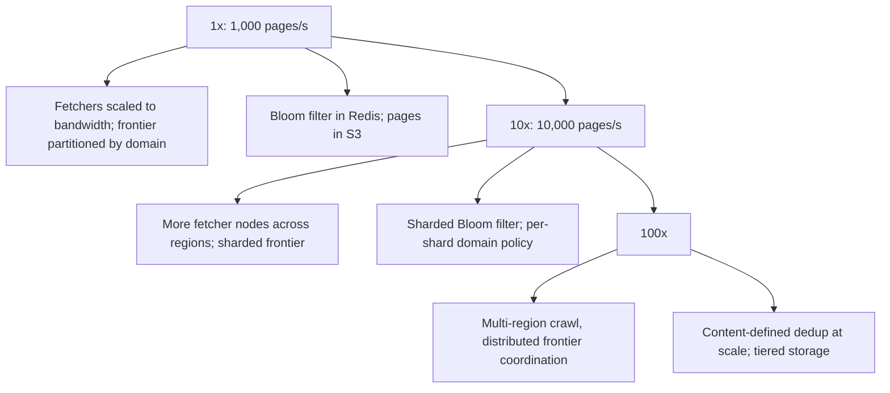

### 66.1.10 Database / store design

The frontier and seen-set are partitioned by domain hash so each partition owns a set of domains, which also localizes politeness (one partition's scheduler controls one domain's rate). Pages go to S3 (object storage, cheap at petabyte scale), with metadata in a partitioned store. The frontier is prioritized: a priority queue per partition ordered by crawl priority and `next_crawl_at`, so important and due pages are crawled first. Content-level dedup uses `content_hash` so mirror sites and duplicate content do not consume the budget.

Concretely, there are 64 frontier partitions, each owning the hosts where `hash(host) % 64` equals its number. A partition is a small stateful service with three stores: an on-disk queue per host (RocksDB or a log-structured file per partition, about 16 GB each at 1 TB total), the Redis ready-heap for its hosts, and its slice of the Bloom filter. The seen-set is sharded by `url_hash`, not by host, because link extraction on any fetcher must check any URL; each Redis shard holds a Bloom filter sized for its share:

```bash
# One Bloom filter per seen-set shard: 10B URLs / 64 shards = about 156M each, 1% false positives
BF.RESERVE seen:17 0.01 160000000 NONSCALING
# Check-and-add 500 extracted URL hashes in one round trip; returns 1 for "definitely new", 0 for "maybe seen"
BF.MADD seen:17 3f9a1c... 77be02... e10d4f...
# Capacity and fill, for the saturation alert
BF.INFO seen:17
```

`BF.*` commands come from RedisBloom, which is built into Redis 8 and Redis Stack; Valkey ships a compatible Bloom module. If your managed Redis has neither, a Bloom filter over plain `SETBIT`/`GETBIT` with k computed offsets works, at the cost of k round trips unless you pipeline them. `NONSCALING` is deliberate: a scaling filter adds sub-filters as it fills, which hides the moment the filter outgrows its design. We would rather alarm on fill and rotate the filter per crawl epoch.

Retention: page bodies older than two crawl epochs move to S3 Glacier Instant Retrieval; metadata keeps only the latest crawl per URL plus a small change history.

### 66.1.11 Caching

| Layer | What | TTL | Why |
|---|---|---|---|
| robots.txt cache | Per-domain crawl rules | 24 h | Avoid re-fetching robots.txt per URL |
| DNS cache | Hostname to IP | TTL-respecting | Avoid a DNS lookup per request |
| Bloom filter (Redis) | Seen URLs (probable) | long | Fast dedup without hitting the store |
| Domain policy (Redis) | Next-allowed time per domain | short | Politeness coordination across fetchers |
| Host metadata (in-process LRU) | robots rules, crawl delay, budget for the 100,000 hottest hosts | 5 min | Avoid a Redis or PostgreSQL round trip per URL |

The DNS cache deserves real engineering. At 100 lookups per second against a public resolver you will be rate-limited within minutes, and a slow DNS answer adds directly to the 1.2 s fetch time. Run a caching resolver (Unbound or CoreDNS) as a DaemonSet next to the fetchers, respect record TTLs, and cache negative answers (`NXDOMAIN`) for an hour so dead links do not hammer the resolver.

### 66.1.12 Messaging

The frontier itself is effectively a durable queue; new URLs from extraction are enqueued (Kafka or a partitioned queue, Part 28), keyed by domain so one domain's URLs land in one partition (politeness locality). Fetch results flow to the extractor via a queue. Re-crawl scheduling re-enqueues a page at its `next_crawl_at`. At-least-once delivery is fine because dedup makes re-processing idempotent.

| Topic | Key | Partitions | Producer | Consumer |
|---|---|---|---|---|
| `crawl.discovered` | host | 64 (one per frontier partition) | Extractors, after the Bloom check | Frontier partition N reads partition N |
| `crawl.fetched` | url_hash | 48 | Fetchers (metadata plus WARC pointer, never the body) | Extractors, indexers |
| `crawl.events` | host | 16 | Frontier, fetchers | Politeness auditor, dashboards |

Bodies never travel through Kafka: a 100 KB message at 1,000 per second is 100 MB/s of broker traffic for no benefit. Fetchers write the body to the current WARC file, and the message carries the pointer.

### 66.1.13 Scaling



Fetchers scale horizontally (they are stateless); the frontier and seen-set scale by partitioning on domain hash; S3 scales for storage. The coordination challenge at scale is politeness: all fetchers for a domain must share its rate limit, which the domain-partitioned design and shared domain policy in Redis handle. Bandwidth, not CPU, is often the limit, so fetchers are placed for network throughput.

| Stage | Pages/s | Inbound bandwidth | What changes |
|---|---|---|---|
| 1x | 1,000 | 0.8 Gbps | 8 fetcher pods, 64 frontier partitions, 12 GB of Bloom filter on a 3-shard Redis cluster, one local DNS resolver per node |
| 10x | 10,000 | 8 Gbps | 40 to 60 fetcher pods across 3 AZs with public egress (no NAT gateway, see cost), 256 partitions, 120 GB of Bloom filter on 12 Redis shards, a dedicated DNS resolver tier, near-duplicate detection mandatory because waste now costs real money |
| 100x | 100,000 | 80 Gbps | Crawl from several regions so each region crawls the hosts closest to it, a frontier per region with a global host-to-region assignment, egress IP pools registered with large sites, tiered storage with most bodies in archive classes |

At 100x the hard problem is not fetching but deciding: with billions of candidate URLs and a finite budget, the prioritizer (page importance from link graph signals, freshness need, host quality) decides the quality of the corpus.

### 66.1.14 Security and safety

- **Politeness and robots.txt**: absolute — obey `robots.txt`, per-domain rate limits, and crawl-delay, or get banned and cause harm.
- **Traps**: cap URL depth and per-domain page counts, detect redirect loops, cap page size (reject enormous pages), and detect infinite URL spaces (calendars), so a trap does not consume the budget or crash a fetcher.
- **Malicious content**: fetchers parse untrusted HTML; parse defensively (timeouts, size limits) so a malicious page cannot hang or crash a worker.
- **SSRF / scope**: restrict the crawl to intended domains/schemes; never let a link drive the fetcher to internal addresses.
- **Legal/ethical**: respect terms, identify the crawler via User-Agent, provide an opt-out.

### 66.1.15 Failure scenarios

| Failure | Detection | Impact | Mitigation | Effect |
|---|---|---|---|---|
| Fetcher crash | Health check, lease expiry | In-flight URLs stalled | URLs leased with timeout; re-enqueued on lease expiry | None (re-crawled) |
| Spider trap (infinite URLs) | Per-domain page-count spike | Budget wasted on one domain | Depth/count caps, trap detection | Bounded |
| Bloom filter false positive | Rare, by design | A new URL skipped | Exact store confirms; tune filter size | Negligible |
| robots.txt change (now disallowed) | Periodic re-fetch | Crawling disallowed paths | Re-fetch robots.txt per TTL; stop on disallow | Compliant |
| One domain overwhelmed | Domain error rate, complaints | Harm, risk of ban | Per-domain rate limit enforced across fetchers | Prevented |
| Frontier store down | Errors | Crawling stalls | Durable, replicated frontier; resume on recovery | Pause, no loss |
| Enormous page | Size at fetch | Memory blowup | Stream and cap page size | Rejected cleanly |
| Bloom filter saturated (more URLs than its design capacity) | `BF.INFO` items vs capacity, exact-store confirmation rate rising | False-positive rate climbs, exact store overloaded | Alert at 80 percent fill; rotate per epoch; size for 2x expected | Coverage preserved |
| robots.txt returns 5xx | Robots fetch outcome metric | Risk of crawling a struggling site | Treat as full disallow per RFC 9309; retry robots with backoff | Site left alone |
| Site starts returning 429/503 or 403 to all requests | Per-host error ratio | We are too aggressive or blocked | Honor `Retry-After`, multiply delay, pause host after 50 consecutive errors | Polite recovery |
| DNS resolver overloaded | Lookup latency, SERVFAIL rate | Fetch latency doubles, throughput halves | Local caching resolver per node, negative caching | Throughput restored |
| One host with 50M queued URLs | Back-queue length per host | Frontier storage bloat, priority starvation | Per-host page budget, drop low-priority URLs past the budget | Bounded |
| WARC writer crash mid-file | Unclosed file, fetched messages without a readable offset | Bodies lost for in-flight pages | Close files every 1 GB or 5 minutes; re-enqueue URLs whose WARC record is unreadable | Re-crawled |

### 66.1.16 Observability

Metrics: pages/second, frontier size, per-domain request rate (to prove politeness), error rates by type (timeout, 4xx, 5xx, trap), dedup hit rate, re-crawl freshness, bandwidth. Alerts: per-domain rate exceeding the limit (politeness violation), frontier growth stalling (coverage problem), error-rate spikes. Dashboards: coverage (pages crawled vs target), freshness (pages overdue for re-crawl), politeness (per-domain rates).

### 66.1.17 Deployment

Fetchers and extractors as horizontally-scaled stateless deployments (Part 45); the frontier and seen-set on partitioned durable stores; Redis for Bloom filter and domain policy; S3 for pages. Crawl scope and rate limits from config. Rollout with canaries so a bad parser change does not corrupt the corpus. Per-domain pause as an operational control.

### 66.1.18 Cost considerations

The dominant costs are storage (petabytes of pages in S3; compression and tiering to cheaper storage classes matter) and bandwidth (ingress for crawling). Compute (fetchers, extractors) is secondary and can use spot instances. The seen-set and frontier stores are modest by comparison. Cost is controlled by crawling selectively (prioritize, do not re-crawl needlessly — the dedup and freshness logic directly controls the bill) and by tiered storage for old pages.

| Item | Sizing at 1x | Monthly (USD, approximate) |
|---|---|---|
| S3 storage | about 250 TB compressed for one pass, Standard then Glacier Instant Retrieval | 3,000 to 5,000 |
| S3 PUTs | batched WARC files of 1 GB: about 100,000 PUTs | under 1 |
| S3 PUTs if you did one object per page | 2.6B PUTs | about 13,000 (the mistake to avoid) |
| Data transfer in | 260 TB per month from the internet | 0 (inbound is free on AWS) |
| NAT gateway processing, if fetchers sit in private subnets | 260 TB at 0.045 per GB | about 11,700 (the second mistake to avoid) |
| Fetchers and extractors | 16 to 24 vCPU of spot capacity | 400 |
| Redis (Bloom, ready-heaps) | 3 shards x r6g.xlarge with replicas | 1,200 |
| Frontier and metadata stores | sharded, about 4 TB of SSD | 2,000 |

The two "mistake" rows are the senior insight. Inbound traffic is free, but routing it through a NAT gateway is not, so fetchers run in public subnets with tight security groups and no inbound rules. And per-request storage pricing punishes tiny objects, so bodies are batched.

### 66.1.19 Tradeoffs

- **Bloom filter dedup** (memory-efficient, tiny false-positive rate that rarely skips a URL) over an exact in-memory set (exact but needs ~200 GB RAM): we accept a negligible miss rate for huge memory savings.
- **Politeness over throughput**: we cap per-domain rate even when we could crawl faster, because being banned or harming sites is unacceptable; throughput comes from breadth (many domains) not depth (hammering one).
- **At-least-once processing with idempotent dedup** over exactly-once: simpler and the dedup makes reprocessing harmless.
- **Object storage (S3) for pages** over a database: cheap at petabyte scale, at the cost of not querying page content in the store (that is the index's job).

| Decision | Chosen | Given up | Would revisit when |
|---|---|---|---|
| Frontier shape | Two-level (priority front queues, per-host back queues) | Simplicity of one queue | Never at web scale; a single site crawl needs only one queue |
| Partition key | Host hash | Even partition sizes (big hosts make big partitions) | One host exceeds a partition's disk; then split that host by path prefix |
| Seen-set | Bloom filter plus exact store | A little latency on positives | RAM is cheap enough for an exact in-memory set (rarely, at 200 GB) |
| Body storage | WARC archives of 1 GB | Random access to one page needs a range read | Never; range GETs are cheap |
| Re-crawl | Adaptive interval plus conditional GET | Perfect freshness | A customer pays for a guaranteed freshness SLA on specific hosts |

### 66.1.20 Alternative architectures

**Managed crawl + serverless**: Lambda-based fetchers triggered from an SQS frontier, pages to S3, dedup in DynamoDB. Scales elastically and needs no fetcher fleet to manage; loses some control over politeness coordination and can cost more at sustained high throughput.

**Single-machine crawler**: for crawling one site or a small set (thousands to millions of pages), a single well-behaved process with an in-memory frontier and a local seen-set is far simpler and entirely adequate. This is what most "crawler" needs actually are, and the distributed design above is justified only at web scale. Build the simple version first.

### 66.1.21 Incident story: the Bloom filter that quietly ate the crawl

At 09:40 on a Tuesday, a search-quality engineer asked in the crawl channel why the number of new pages entering the index had fallen by more than half over three weeks. Throughput looked perfect: 1,000 pages per second, every dashboard green.

The investigation took a day. New-URL discovery, the rate of URLs that passed dedup and entered the frontier, had fallen from about 600 per second to 250. The fetchers were busy, but increasingly with re-crawls, because the frontier was starving for new URLs.

The cause was two decisions months apart. First, the Bloom filters had been sized for 2 billion URLs at 1 percent false positives, about 2.4 GB, at a time when the corpus target was 2 billion. The target grew to 10 billion and nobody resized them. With 7 billion URLs in a filter built for 2 billion, the false-positive rate is (1 - e^(-kn/m))^k, which with k = 7 and n/m about 0.36 comes to roughly 57 percent. Second, during an earlier incident the exact store had been overloaded by confirmation lookups, and an engineer added a flag, `TRUST_BLOOM_POSITIVES=true`, to skip the confirmation "temporarily". The flag was never removed. So every false positive was treated as "already seen", and more than half of genuinely new URLs were silently discarded.

The fix: resize to 10 billion at 1 percent (12 GB across 64 shards) by building new filters from the exact store over a weekend, remove the flag, and turn the silent failure into a loud one. Three alerts now exist: filter fill above 80 percent of capacity (`BF.INFO`), confirmation-lookup rate above 2x baseline, and a canary: 1,000 freshly generated, never-seen test URLs are pushed through dedup every hour, and if any is reported as seen, someone is paged. The lesson is a senior one: **throughput metrics cannot see coverage failures.** A crawler that fetches the wrong pages fast looks healthy on every dashboard that measures speed.

### 66.1.22 Interview follow-ups

1. **How do you guarantee two fetchers never hit the same host at the same time?**
   Expected answer: host-level claiming from a shared ready-heap with an atomic pop-and-lease (a Lua script on a Redis sorted set, or a `FOR UPDATE SKIP LOCKED` claim in PostgreSQL), plus partitioning by host so one scheduler owns each host. Why it matters: this is politeness, the one requirement you cannot violate. Follow-up: what happens if the fetcher dies holding the lease? (It expires; the host becomes due again.)
2. **Your Bloom filter says "seen" for a URL. Is it seen?**
   Expected answer: maybe. Bloom negatives are certain, positives are probabilistic, so a positive must be confirmed against an exact store if missing new URLs is costly. Follow-up: how do you size it? (m = -n ln p / (ln 2)^2; 9.6 bits per item at 1 percent.)
3. **How do you avoid spider traps?**
   Expected answer: per-host page budgets, maximum URL length and path depth, detection of repeating path segments (`/a/b/a/b/a/b`), redirect-hop limits, near-duplicate detection to deprioritize auto-generated pages. Follow-up: an infinite calendar on a high-value site? (Budget per path prefix, not just per host.)
4. **How do you decide when to re-crawl a page?**
   Expected answer: adaptive interval from observed change rate, clamped, biased by importance, using conditional GETs to make unchanged re-crawls cheap.
5. **Why not put the page bodies in Kafka?**
   Expected answer: 100 MB/s of broker traffic and retention for data that only one consumer reads once; store bodies in batched objects and send pointers.
6. **How would you crawl JavaScript-rendered sites?**
   Expected answer: a separate, much smaller rendering tier with headless Chrome, about 50 to 100 times more expensive per page, used only for hosts where the raw HTML has little text but many script bundles. Follow-up: politeness now includes the subresources the browser fetches.

### 66.1.23 Practical exercise

Build a polite single-site crawler as a NestJS standalone application, then make it distributed.

1. Seed with one site you own or a local test site served by `npx http-server`. Implement `normalizeUrl`, a robots.txt parser that follows the RFC 9309 error table, and a fetcher with a 15 s timeout and 5 MB cap.
2. Keep the frontier in PostgreSQL (`crawl_queue(url_hash PK, url, host, priority, next_attempt_at, status)`) and claim work with `FOR UPDATE SKIP LOCKED`.
3. Add the Redis ready-heap so that two running instances never fetch the same host within its crawl delay.
4. Add a Bloom filter in front of the exact `pages` table.

Acceptance criteria:

- With two instances running against a test server that logs request times, no two requests to the same host are closer than the configured delay (prove it from the server log).
- A test server with an infinite calendar (`/cal/2026/11/05` linking to the next day forever) is cut off at the per-host page budget.
- A robots.txt that returns `503` stops all crawling of that host; one that returns `404` allows it.
- Killing an instance mid-crawl loses no URLs: every claimed URL is retried after its lease expires.
- The hourly "never-seen canary" test reports 0 false "seen" results with the exact-store confirmation enabled.
