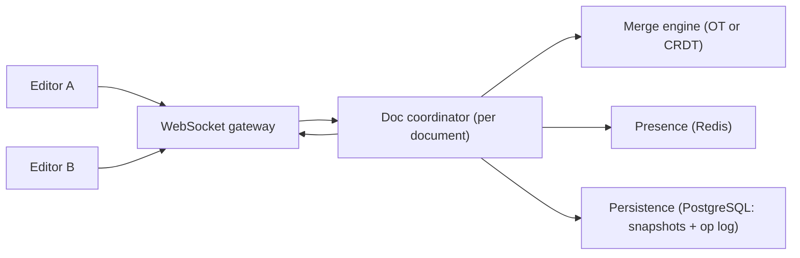

## 66.2 Collaborative Document Editing

### 66.2.1 Requirements

A collaborative document editing system lets multiple users edit the same document at the same time and see each other's changes in real time, with everyone's edits merging into a consistent result, showing who is present and where their cursor is (presence), and working even when a user goes briefly offline and reconnects. Think of a shared document editor. The users are people co-editing documents. This design probes the hardest problem in real-time collaboration: how to merge concurrent edits from multiple users into one consistent document without losing anyone's work or requiring locks.

Imagine several people editing the same physical page at once, each with a pen, all writing simultaneously in different (and sometimes the same) spots. Chaos — unless there is a magic rule by which, no matter the order their strokes land, everyone's page ends up identical and nobody's words are lost. That magic rule is the core of collaborative editing: a way to combine concurrent, conflicting edits so all copies converge to the same correct document. Operational transform and CRDTs are two such rules.

### 66.2.2 Functional requirements

1. Multiple users edit the same document simultaneously.
2. Each user sees others' edits in near real time.
3. Concurrent edits merge into one consistent document (no lost edits, all copies converge).
4. Presence: show who is in the document and their cursor/selection positions.
5. Offline support: a user can edit offline and have changes merge on reconnect.
6. Persist the document and its history (versions, undo).

### 66.2.3 Non-functional requirements

| Property | Target | Why |
|---|---|---|
| Edit propagation latency | Sub-second (feels real-time) | Collaboration must feel live |
| Convergence | All clients always converge to the same document | The core correctness property |
| Concurrency | Many simultaneous editors per document | Real collaboration |
| Offline tolerance | Edits merge correctly after reconnect | Networks drop |
| Durability | No committed edit is ever lost | Users trust their work is saved |

### 66.2.4 Constraints

- Concurrent edits to the same region must merge deterministically to the same result on every client (convergence) — this is the central hard constraint.
- Real-time means a persistent connection (WebSocket) per editor, with the scaling that implies (Part 54's chat system).
- Offline edits can be arbitrarily stale on reconnect and must still merge correctly.
- No locking: users edit freely and simultaneously, so the merge, not a lock, resolves conflicts.

### 66.2.5 Capacity estimation

| Quantity | Assumption | Calculation | Result |
|---|---|---|---|
| Concurrent editors per doc | Typical collaboration | given | up to ~50 (usually far fewer) |
| Documents being edited | Active | given | 100,000 concurrently |
| Edit operations | clients batch keystrokes into one update every ~200 ms while typing; most open editors are idle | 100,000 docs x ~0.5 updates/s | about 50,000 updates/second total |
| WebSocket connections | editors online | | hundreds of thousands |
| Document size | typical | given | KBs to a few MB |

The numbers say: the per-document concurrency is modest (tens of editors), so the hard problem is correctness of merging, not throughput; the scaling challenge is many persistent connections across many documents (like chat, Part 54), and routing all editors of one document to a coordination point.

The second table sizes the parts that the headline hides:

| Quantity | Assumption | Calculation | Result |
|---|---|---|---|
| Update size on the wire | a few typed characters plus CRDT ids, binary-encoded | | 20-60 bytes, about 100 with framing |
| Inbound bandwidth | 50,000 updates/s x 100 B | | 5 MB/s, trivial |
| Fan-out bandwidth | each update sent to ~2 other editors on average | 50,000 x 2 x 100 B | 10 MB/s outbound |
| Memory per open document | in-memory CRDT is roughly 3-10x the text size | 200 KB doc x 5 | about 1 MB; 100,000 docs is about 100 GB across coordinators |
| Memory per WebSocket | socket buffers plus session state | ~30-50 KB | 300,000 sockets is about 12 GB across gateways |
| Update log growth | 50,000/s x ~150 B per row with index | x 86,400 | about 650 GB/day before compaction, so compact hourly |
| Coordinators | ~3,000 open documents and ~10,000 sockets per 4 GB pod | 100,000 / 3,000 | about 35 pods |

The update log is the number to respect. Without compaction (folding old updates into a snapshot), it grows faster than every other table in the company. With compaction every few hundred updates, the steady state is one snapshot plus a short tail per document.

### 66.2.6 API design

Mostly a real-time protocol over WebSocket, plus REST for document CRUD.

| Operation | Channel | Notes |
|---|---|---|
| Open document | REST `GET /docs/{id}` + WS subscribe | Load current state, join the session |
| Send edit | WS: `op` message | A client's edit operation |
| Receive edits | WS: broadcast `op` | Others' transformed/merged operations |
| Presence | WS: `presence` message | Cursor/selection, join/leave |
| Save/version | internal/periodic | Persist state and history |

### 66.2.7 Data model

```text
Document: current content + a history of operations (for merge, undo, recovery).
  documents(id, content_snapshot, version, updated_at)
  operations(doc_id, seq, user_id, op, based_on_version, created_at)  -- the edit log

The merge model (one of):
  Operational Transform (OT): operations + a transform function that adjusts an
    incoming op against concurrent ops so positions stay correct.
  CRDT: each character/element has a unique, ordered identity so concurrent inserts/
    deletes merge deterministically regardless of order, without a central transform.

Presence (ephemeral, in Redis): who is in the doc, cursor positions (not persisted).
```

For the CRDT variant, which is what most teams build today, the concrete schema stores opaque binary updates rather than parsed operations:

```sql
CREATE TABLE documents (
  id          uuid PRIMARY KEY,
  owner_id    uuid NOT NULL,
  title       text NOT NULL,
  created_at  timestamptz NOT NULL DEFAULT now()
);

CREATE TABLE doc_snapshots (
  doc_id      uuid   NOT NULL REFERENCES documents(id),
  up_to_seq   bigint NOT NULL,             -- every update with seq <= this is folded in
  state       bytea  NOT NULL,             -- the encoded full document state
  created_at  timestamptz NOT NULL DEFAULT now(),
  PRIMARY KEY (doc_id, up_to_seq)
);

CREATE TABLE doc_updates (
  doc_id      uuid   NOT NULL REFERENCES documents(id),
  seq         bigint GENERATED ALWAYS AS IDENTITY,
  user_id     uuid   NOT NULL,             -- who made it, for history and audit
  payload     bytea  NOT NULL,             -- one encoded CRDT update, usually 20-200 bytes
  created_at  timestamptz NOT NULL DEFAULT now(),
  PRIMARY KEY (doc_id, seq)
);
```

Loading a document is "latest snapshot, then every update with a higher `seq`", applied in order. Because each document has exactly one writer (its coordinator), `seq` order and commit order agree within a document, which the compaction step depends on.

### 66.2.8 High-level architecture



All editors of one document connect through a WebSocket gateway and are routed to that document's **coordinator**, which applies the merge model (OT or CRDT) to incoming operations, broadcasts the merged result to all editors so they converge, maintains presence in Redis, and persists snapshots and the operation log. Routing all editors of a document to one coordinator is key: concurrent edits are merged in one place (OT), or merged anywhere consistently (CRDT).

### 66.2.9 Component design

| Component | Responsibility |
|---|---|
| WebSocket gateway | Hold editor connections, route by document |
| Document coordinator | Own one document's session; apply and broadcast merged ops |
| Merge engine (OT or CRDT) | Combine concurrent edits so all copies converge |
| Presence | Track and broadcast who is editing and cursor positions (ephemeral) |
| Persistence | Snapshot document state and store the op log for history/recovery |
| Offline sync | Merge a reconnecting client's buffered edits against the current state |

### 66.2.10 Deep dive: operational transform vs CRDTs, presence, offline

**The core problem**: two users concurrently edit the same region — A inserts "X" at position 5, B deletes position 3. B's delete shifts positions, so A's "at position 5" now means a different place. Naively applying both gives different results on different clients — divergence. The two solutions:

**Operational Transform (OT)**: operations are transformed against concurrent operations before applying. When A's insert and B's delete happen concurrently, a transform function adjusts A's position to account for B's delete (and vice versa), so both clients, applying the transformed operations, reach the same document. OT requires a central coordinator to order and transform operations (or careful peer protocols), and the transform functions are famously tricky to get exactly right for all cases, but it is efficient (operations are small) and is used by major collaborative editors.

**CRDTs (Conflict-free Replicated Data Types)**: each element (character) gets a unique, globally-ordered identity, so an insert says "insert X between identity-7 and identity-9" rather than "at position 5". Because positions are stable identities, not shifting indices, concurrent operations merge deterministically in any order with no central transform — any two clients that have seen the same set of operations converge, regardless of order received. CRDTs are conceptually cleaner and support peer-to-peer and offline well, at the cost of metadata overhead (each element carries identity data), though modern CRDTs have reduced this substantially.

```text
OT:   op positions are TRANSFORMED against concurrent ops -> needs ordering/coordination,
      small ops, tricky transform functions.
CRDT: elements have stable IDENTITIES -> merge in any order, no transform, no central
      coordinator needed, more per-element metadata.
Both guarantee convergence: all clients end with the same document.
```

**Presence** is separate and simpler: each client periodically sends its cursor/selection and online status; the coordinator broadcasts this to others. Presence is ephemeral (kept in Redis, not persisted) — it is fine to lose it on disconnect.

**Offline sync**: a client editing offline buffers its operations; on reconnect, it sends them and receives the operations it missed, and the merge model (OT transform or CRDT merge) reconciles them with the current state. CRDTs handle this especially naturally because operations merge regardless of order or delay. The convergence guarantee is what makes offline editing safe: no matter how stale the client, its edits merge without loss.


#### Deep dive: operational transform on a real example

The document is `Helo`. Alice inserts `l` at position 3 to fix the typo. At the same moment Bob deletes `H` at position 0. Both operations were made against the same version.

```text
Alice's op A: insert "l" at 3        Bob's op B: delete 1 char at 0
Alice applies A locally: "Hello"     Bob applies B locally: "elo"

The server receives B first, then A.
  Applying A unchanged to "elo": insert "l" at 3 -> "elol"        WRONG, diverged
  Transform A against B: position 3 is after the deleted range, so shift left by 1 -> insert at 2
  Applying A' to "elo": "ello"                                    correct
Alice receives B transformed against A: the delete at 0 is before her insert, unchanged -> "ello"
Both copies converge on "ello".
```

The transform for an insert against another operation fits in a few lines. The comments mark the rules, and the tie-break by site id is what stops two inserts at the same position from landing in different orders on different machines:

```ts
// collab/ot/transform.ts
export type Insert = { type: 'ins'; pos: number; text: string; site: number };
export type Delete = { type: 'del'; pos: number; len: number; site: number };
export type Op = Insert | Delete;

/** Rewrite insert `a` so it means the same thing after `b` has been applied. */
export function transformInsert(a: Insert, b: Op): Insert {
  if (b.type === 'ins') {
    const bGoesFirst = b.pos < a.pos || (b.pos === a.pos && b.site < a.site);   // same rule on every machine
    return bGoesFirst ? { ...a, pos: a.pos + b.text.length } : a;
  }
  if (a.pos <= b.pos) return a;                                    // the deletion is after the insert point
  if (a.pos >= b.pos + b.len) return { ...a, pos: a.pos - b.len }; // the deletion is entirely before it
  return { ...a, pos: b.pos };                                     // the insert point itself was deleted
}
```

Now try the other three cases. A delete against an insert that lands in the middle of the deleted range must split into two deletes. Two overlapping deletes must shrink each other without deleting a character twice. Undo needs the inverse of a transformed operation. Rich text adds formatting ranges, and tables add structure. Each case is a few lines, but the combinations must satisfy formal properties (applying A then B' must equal B then A' for every pair), and historically several published OT algorithms were later shown to violate them. That is why OT systems use a central server that puts every operation into one total order and transforms only against operations the client had not seen, which reduces the cases that must be correct.

#### Deep dive: CRDTs and a Yjs-backed coordinator

A sequence CRDT gives every character a permanent id: the pair (client id, counter). An insert does not say "at position 3"; it says "after the character with id (alice, 41)". Positions shift as text changes; ids never do. A delete marks the character as deleted (a **tombstone**) rather than removing it, so a concurrent insert that refers to it still has an anchor. When two clients insert after the same character at the same time, a deterministic rule (comparing client ids) orders them identically everywhere. The result: updates can be applied in any order, more than once, after any delay, and every replica that has seen the same set of updates holds the same document. Duplicates are harmless because applying an already-seen update is a no-op.

Yjs and Automerge are the two widely used open-source CRDT libraries. Yjs's sync protocol is built on **state vectors**: a compact map of "for each client id, the highest counter I have seen". Sync is two messages. The client sends its state vector; the server replies with `Y.encodeStateAsUpdate(doc, clientStateVector)`, which is exactly the updates the client is missing, plus its own state vector so the client can send back what the server is missing. That is also the whole offline-sync algorithm: a laptop that was offline for a week sends one state vector and receives one diff.

```ts
// collab/collab.gateway.ts
import { UseGuards } from '@nestjs/common';
import { ConnectedSocket, MessageBody, OnGatewayDisconnect, SubscribeMessage,
         WebSocketGateway, WsException } from '@nestjs/websockets';
import type { Socket } from 'socket.io';
import * as Y from 'yjs';
import { DocRegistry } from './doc-registry.service';
import { DocAccessWsGuard } from './doc-access-ws.guard';

const MAX_UPDATE_BYTES = 512 * 1024;

@WebSocketGateway({ namespace: '/collab' })
@UseGuards(DocAccessWsGuard)   // verifies the JWT and the user's role (viewer or editor) on docId
export class CollabGateway implements OnGatewayDisconnect {
  constructor(private readonly docs: DocRegistry) {}

  @SubscribeMessage('sync')
  async sync(@ConnectedSocket() socket: Socket, @MessageBody() msg: { docId: string; stateVector: Buffer }) {
    const doc = await this.docs.open(msg.docId, socket.id);   // snapshot plus tail on first open
    await socket.join(msg.docId);
    return {                                                  // returned value is the socket.io ack
      missing: Y.encodeStateAsUpdate(doc, new Uint8Array(msg.stateVector)),   // what the client lacks
      stateVector: Y.encodeStateVector(doc),                  // so the client can send what we lack
    };
  }

  @SubscribeMessage('update')
  async update(@ConnectedSocket() socket: Socket, @MessageBody() msg: { docId: string; update: Buffer }) {
    if (msg.update.byteLength > MAX_UPDATE_BYTES) throw new WsException('update too large');
    if (!this.docs.canEdit(socket, msg.docId)) throw new WsException('read-only');
    const doc = await this.docs.open(msg.docId, socket.id);
    Y.applyUpdate(doc, new Uint8Array(msg.update), socket.id);  // idempotent, order-independent merge
    await this.docs.append(msg.docId, socket.data.userId, msg.update);   // durable before the ack
    socket.to(msg.docId).emit('update', { docId: msg.docId, update: msg.update });
    return { ok: true };
  }

  handleDisconnect(socket: Socket) {
    this.docs.release(socket.id);   // unload the doc from memory when its last editor leaves
  }
}
```

`docs.append` does not do one `INSERT` per keystroke. It buffers updates per document for 50 ms and writes them in one multi-row `INSERT`, which turns 50,000 updates per second into a few thousand small transactions. The acknowledgement waits for that flush, so a client knows its edit is durable within about 60 ms. For production, Hocuspocus is an open-source Yjs server that already implements this gateway, persistence hooks and a Redis extension for multiple instances; read it before writing your own.

#### Deep dive: one document, one coordinator, and compaction

Every editor of a document should reach the same coordinator, so updates are merged in one place and broadcast once. Two routing options work:

1. **Ownership lease.** The first coordinator to open a document takes `SET doc-owner:{docId} <podId> NX PX 30000` in Redis and renews it every 10 seconds. Gateways look up the owner and forward. If the pod dies, the lease expires, and the next open takes over from PostgreSQL.
2. **Shared channel.** Any coordinator may hold the document; each publishes updates to a Redis channel per document and applies what others publish. Simpler routing, more memory, because a document may be loaded in several pods.

Here the choice of merge model shows up in operations. With a CRDT, two coordinators that briefly both believe they own a document (a lease that expired during a long garbage-collection pause) is survivable: both persist their updates, the updates commute, and the next load merges them. With OT, two servers ordering operations independently produce two histories that cannot be reconciled, so OT needs a fencing token on every write (Part 65, section 65.3, used the same idea for worker ids).

**Compaction** keeps the update log bounded. After 500 updates or 60 seconds of quiet, the coordinator writes a snapshot of its in-memory state with `up_to_seq` set to the highest `seq` it has applied, then deletes `doc_updates WHERE doc_id = $1 AND seq <= $2`. The `seq <= $2` is not decoration. An update that arrives while the snapshot is being written has a higher `seq`, is not in the snapshot, and must survive the delete. 66.2.21 is the story of a team that wrote the delete without it.

One more growth source is tombstones. A document that has been typed and deleted for two years can hold far more deleted characters than live ones. Yjs garbage-collects the content of deleted items by default (`doc.gc = true`), keeping only small markers, but turning `gc` off to support "view any past version" makes documents grow without limit. If you need version history, take periodic snapshots instead.
